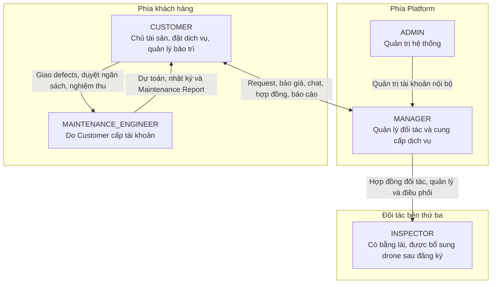
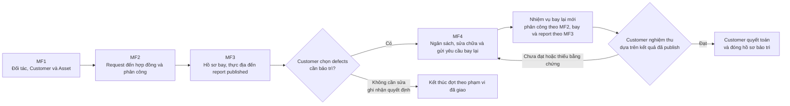
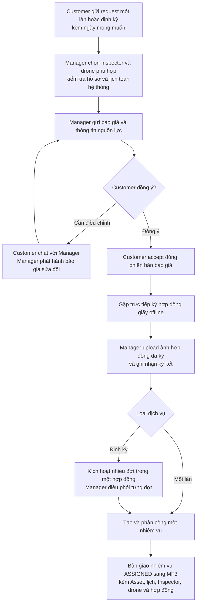
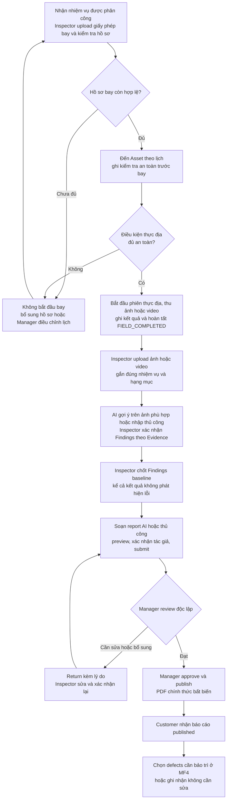
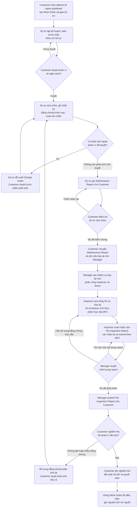

# Báo cáo đề xuất thay đổi mô hình và Main Flows MF1–MF4

**Dự án:** SmartDroneInspection

**Phiên bản:** Đề xuất v1.3 — chuyển hồ sơ bay, kiểm tra an toàn và thực địa từ MF2 sang MF3; giữ đăng ký Inspector chưa cần drone.

**Trạng thái:** Chờ duyệt toàn bộ phương án; chưa triển khai.

**Phạm vi bàn giao:** Một file Markdown độc lập, có so sánh cũ–mới, 5 role, sơ đồ và chi tiết MF1–MF4. **Không sửa code, database, migration, SRS hay sơ đồ hiện hành.**

> **Kết luận:** Chuyển từ nền tảng để doanh nghiệp tự tổ chức kiểm tra và thuê drone sang **nền tảng cung cấp dịch vụ kiểm tra công trình, do Platform điều phối mạng lưới Inspector đối tác**. Customer sở hữu tài sản và quản lý đội bảo trì; Manager quản lý Inspector, báo giá, hợp đồng dịch vụ, điều phối và phát hành báo cáo.
>
> Tài liệu này mô tả **nghiệp vụ đích được đề xuất**, không xác nhận tính năng đã tồn tại hoặc đã được kiểm thử. Tên trạng thái và đối tượng dữ liệu bên dưới là mô tả thiết kế, chưa phải quyết định sửa enum, API hoặc schema.

## Mục lục

1. [Căn cứ và các quyết định đã chốt](#1-căn-cứ-và-các-quyết-định-đã-chốt)
2. [Mô hình 5 role và phạm vi trách nhiệm](#2-mô-hình-5-role-và-phạm-vi-trách-nhiệm)
3. [So sánh mô hình cũ và mới](#3-so-sánh-mô-hình-cũ-và-mới)
4. [MF1 — Đối tác Inspector, Customer và Asset](#4-mf1--đối-tác-inspector-customer-và-asset)
5. [MF2 — Request, báo giá, chat, hợp đồng và phân công](#5-mf2--request-báo-giá-chat-hợp-đồng-và-phân-công)
6. [MF3 — Hồ sơ bay, thực địa, Evidence, Findings và báo cáo](#6-mf3--hồ-sơ-bay-thực-địa-evidence-findings-và-báo-cáo)
7. [MF4 — Bảo trì, bay lại, nghiệm thu và quyết toán](#7-mf4--bảo-trì-bay-lại-nghiệm-thu-và-quyết-toán)
8. [Trạng thái và quy tắc xuyên suốt](#8-trạng-thái-và-quy-tắc-xuyên-suốt)
9. [Tác động đến tính năng, dữ liệu và tài liệu](#9-tác-động-đến-tính-năng-dữ-liệu-và-tài-liệu)
10. [Các điểm chưa chốt](#10-các-điểm-chưa-chốt)
11. [Tiêu chí nghiệm thu cho giai đoạn triển khai](#11-tiêu-chí-nghiệm-thu-cho-giai-đoạn-triển-khai)
12. [Nguồn đối chiếu và giới hạn bàn giao](#12-nguồn-đối-chiếu-và-giới-hạn-bàn-giao)

---

## 1. Căn cứ và các quyết định đã chốt

### 1.1. Yêu cầu trực tiếp của người dùng

- Có đúng **5 role đăng nhập**: `ADMIN`, `MANAGER`, `INSPECTOR`, `CUSTOMER`, `MAINTENANCE_ENGINEER`.
- `ADMIN`, `MANAGER` thuộc Platform. `CUSTOMER` thuộc phía khách hàng.
- `INSPECTOR` là bên thứ ba đăng ký làm đối tác; **không bắt buộc có drone khi đăng ký, có thể bổ sung sau**. Sau khi ký hợp đồng giấy offline thì thuộc quyền quản lý và trách nhiệm vận hành của Platform, cụ thể là Manager.
- Landing page công khai quy trình và yêu cầu làm đối tác: **có bằng/giấy phép điều khiển drone**; việc sở hữu/khai báo drone **không phải điều kiện đăng ký hoặc ký hợp đồng đối tác**. Drone bổ sung sau phải được kiểm tra giấy tờ sở hữu, đăng ký và kiểm định trước khi dùng để phân công bay.
- Customer đăng ký và khai báo Asset; công trình nằm trong vùng cấm bay bị chặn, bao gồm yêu cầu **từ chối tạo tài khoản** ở bước đăng ký ban đầu.
- Cả request một lần và định kỳ đều phải qua Manager: chọn Inspector có drone phù hợp → báo giá kèm thông tin Inspector/drone → chat điều chỉnh → Customer accept → ký hợp đồng giấy offline → Manager upload ảnh hợp đồng đã ký.
- Inspector đến địa chỉ Asset, thực hiện kiểm tra, upload ảnh/video, khai báo Findings và lập report theo lõi flow cũ.
- Report do Manager duyệt/publish cho Customer. Sau bảo trì phải có vòng Customer → Manager → Inspector bay lại → Manager publish lại cho Customer.

### 1.2. Các quyết định đã được xác nhận bổ sung

| Mã | Quyết định đã chốt | Áp dụng vào thiết kế |
| --- | --- | --- |
| D1 | **Customer cấp tài khoản Maintenance Engineer.** | Kỹ sư thuộc phía khách hàng, không thuộc đội nhân sự do Manager của Platform quản lý. |
| D2 | **Một hợp đồng định kỳ bao phủ nhiều đợt kiểm tra.** | Báo giá cho cả kỳ/phạm vi đã thỏa thuận; không bắt ký hợp đồng giấy mới cho mỗi đợt trong phạm vi đó. |
| D3 | **Giữ dự toán, duyệt chi phí và quyết toán bảo trì; Customer là người duyệt.** | Không loại bỏ kế hoạch sửa chữa, ngân sách, Change Order, nhật ký, nghiệm thu độc lập hay đối soát chi phí của MF4 cũ. |
| D4 | **Inspector không cần có drone khi đăng ký; có thể bổ sung sau.** | Tách điều kiện đăng ký đối tác khỏi điều kiện được phân công bay. Giữ yêu cầu bằng lái; chỉ dùng drone đã bổ sung và có hồ sơ hợp lệ cho nhiệm vụ. |
| D5 | **Thực địa chuyển sang MF3.** | MF2 kết thúc ở hợp đồng và phân công/lịch kiểm tra; MF3 tiếp nhận nhiệm vụ, xử lý hồ sơ bay, kiểm tra an toàn, thực địa rồi Evidence/Findings/report đến publish. |

Các quy tắc chi tiết chưa được xác nhận riêng được ghi là **đề xuất** hoặc đưa vào mục 10, không coi là quyết định đã duyệt.

### 1.3. Phân biệt các loại giấy tờ

| Loại hồ sơ | Mục đích | Không thay thế cho |
| --- | --- | --- |
| Bằng/chứng chỉ/giấy phép điều khiển drone của Inspector | Chứng minh điều kiện của người điều khiển; cách gọi tương tự bằng lái trong yêu cầu. | Giấy tờ của thiết bị hoặc giấy phép bay cho một đợt cụ thể. |
| Giấy tờ sở hữu, đăng ký và kiểm định của drone | Chứng minh điều kiện của đúng thiết bị được đưa vào mạng lưới đối tác. | Bằng lái của Inspector hoặc giấy phép bay của nhiệm vụ. |
| Giấy phép bay áp dụng cho từng nhiệm vụ | Hồ sơ cho địa điểm, thời gian và phạm vi bay tương ứng, khi pháp luật yêu cầu. | Hợp đồng đối tác hoặc hợp đồng dịch vụ. |
| Hợp đồng đối tác Inspector–Platform | Xác lập quan hệ hợp tác, quản lý và trách nhiệm giữa đối tác với Platform. | Hợp đồng cung cấp dịch vụ cho Customer. |
| Hợp đồng dịch vụ Customer–Platform | Chốt phạm vi, giá, lịch và điều kiện cung cấp dịch vụ một lần/định kỳ. | Giấy phép bay hoặc sự cho phép của cơ quan có thẩm quyền. |

**Giữ cổng hồ sơ bay của flow cũ.** Customer accept, ký hợp đồng, upload ảnh hợp đồng hoặc bản đồ hiển thị không có vùng cấm **đều không tự cấp quyền bay**. Tên, giá trị pháp lý và yêu cầu cụ thể của từng giấy tờ cần được xác minh trước khi chốt SRS mới; tài liệu này không đưa ra kết luận pháp lý.

---

## 2. Mô hình 5 role và phạm vi trách nhiệm

### 2.1. Phân vùng chủ thể

| Role | Trách nhiệm chính | Giới hạn quyền quan trọng |
| --- | --- | --- |
| **ADMIN** | Quản trị kỹ thuật, tài khoản nội bộ Platform, danh mục loại tài sản, cấu hình và audit theo phạm vi được cấp. | Không mặc nhiên có quyền ký thay Customer, duyệt ngân sách bảo trì hay publish báo cáo nghiệp vụ. Phân công quản trị dữ liệu bản đồ cần chốt riêng. |
| **MANAGER** | Tiếp nhận và quản lý đối tác Inspector; kiểm tra hồ sơ; xử lý request; chọn cặp Inspector–drone; báo giá/chat; ghi nhận hợp đồng dịch vụ; điều phối lần đầu và bay lại; duyệt/publish Inspection Report. | Chỉ xử lý khách hàng/đơn hàng/đối tác thuộc phạm vi được giao. Không thay Customer duyệt chi phí sửa chữa hoặc quyết toán bảo trì. |
| **INSPECTOR** | Đối tác có bằng lái, không bắt buộc có drone khi đăng ký; bổ sung drone và hồ sơ thiết bị sau. Khi đủ điều kiện phân công thì thực hiện nhiệm vụ được Manager giao; cung cấp hồ sơ bay; thu thập Evidence; xác nhận Findings; lập Inspection Report lần đầu và bay lại. | Không tự publish report, tự giao nhiệm vụ cho mình hoặc xem toàn bộ dữ liệu của mọi Customer. Không trở thành nhân viên của Customer chỉ vì được giao kiểm tra Asset của họ. |
| **CUSTOMER** | Quản lý Asset; gửi request; trao đổi và accept báo giá; ký hợp đồng dịch vụ; đọc report published; cấp tài khoản/giao việc cho kỹ sư; duyệt dự toán và Change Order; gửi báo cáo sửa chữa sang Manager; nghiệm thu và quyết toán. | Chỉ dữ liệu của mình/phạm vi khách hàng được cấp. Không điều phối trực tiếp Inspector đối tác, sửa Findings chuyên môn của Inspector hoặc tự publish Inspection Report. |
| **MAINTENANCE_ENGINEER** | Lập phương án/dự toán, sửa chữa, ghi nhật ký và bằng chứng, đề xuất Change Order, soạn Maintenance Report gửi Customer. | Chỉ công việc được giao trong phạm vi Customer của mình. Không tự duyệt dự toán/Change Order hoặc nghiệm thu cuối cùng công việc do mình thực hiện. |

**Team Lead, Report Author, Team Member, người duyệt** là trách nhiệm theo từng hồ sơ, **không phải role đăng nhập thứ sáu**. `SYSTEM`, YOLO và LLM là thành phần tự động, không phải người dùng.

### 2.2. Ý nghĩa “Platform chịu trách nhiệm cho Inspector”

- Manager là đầu mối chịu trách nhiệm vận hành: điều kiện đối tác, phân công đúng người/thiết bị, xử lý phát sinh, kiểm soát chất lượng và phát hành kết quả cho Customer.
- Trách nhiệm cần truy vết tới Manager phụ trách và Inspector thực hiện trong từng hồ sơ.
- Việc Platform quản lý đối tác **không biến một tài khoản Manager thành chứng nhận chuyên môn** và không miễn trách nhiệm an toàn/pháp lý của người thực hiện. Điều kiện người được duyệt báo cáo chuyên môn cần chốt ở mục 10.

---

## 3. So sánh mô hình cũ và mới

### 3.1. Những thay đổi cốt lõi

| Nội dung | Baseline tài liệu cũ | Đề xuất mới |
| --- | --- | --- |
| Mô hình chính | Doanh nghiệp dùng workspace/subscription, tự quản đội ngũ, drone sở hữu/thuê và lịch kiểm tra. | Customer mua dịch vụ kiểm tra; Platform điều phối Inspector đối tác cùng drone của họ. |
| Inspector | Nhân sự nằm trong phạm vi tổ chức khách hàng. | Đối tác Platform được đăng ký khi chưa có drone và bổ sung sau; có thể phục vụ nhiều Customer qua các nhiệm vụ được giao riêng khi đủ điều kiện. |
| Drone | Fleet của tổ chức hoặc drone thuê từ Platform. | Drone thuộc Inspector, có thể khai báo sau khi đăng ký đối tác; Manager chỉ chọn thiết bị phù hợp và có hồ sơ hợp lệ cho nhiệm vụ. |
| Người lập kế hoạch bay | Organization Manager chọn Inspector và drone trực tiếp. | Customer nêu nhu cầu/ngày mong muốn; Manager chốt phương án và lịch thông qua báo giá/hợp đồng. |
| Vùng cấm bay | Bản đồ/cảnh báo trong lập kế hoạch. | Bổ sung cổng chặn đăng ký ban đầu và khai báo Asset; vẫn kiểm tra lại trước từng đợt. |
| Giao dịch dịch vụ | Subscription và drone leasing là luồng thương mại chính. | Request → báo giá → chat → accept → hợp đồng giấy offline và ảnh bằng chứng. |
| Duyệt Inspection Report | Organization Manager phía khách hàng. | Manager phía Platform, độc lập với Inspector tác giả; Customer nhận bản published. |
| Bảo trì | Có kế hoạch, dự toán, Change Order, thi công, báo cáo, nghiệm thu và quyết toán. | **Giữ các chức năng này**, Customer thay người duyệt phía tổ chức; thêm vòng bay lại bắt buộc trong luồng nghiệm thu được mô tả. |
| Bay lại sau sửa chữa | Là một lựa chọn trong luồng acceptance cũ. | Customer chuyển Maintenance Report → Manager điều phối → Inspector lập report mới → Manager publish → Customer nghiệm thu/quyết toán. |

Subscription, PayPal cho subscription và drone leasing **không còn là điều kiện của main flows dịch vụ mới được đề xuất**. Chưa quyết định xóa module, bảng hay dữ liệu lịch sử; thanh toán dịch vụ mới cũng chưa được chốt.

### 3.2. Cách chia lại 4 Main Flows

| Main Flow | Tên mới đề xuất | Đầu ra/bàn giao |
| --- | --- | --- |
| **MF1** | **Tiếp nhận đối tác Inspector, đăng ký Customer và khai báo Asset** | Đối tác đã đăng ký, có thể chưa có drone; drone được bổ sung và kiểm tra riêng trước phân công; Customer và Asset qua cổng vùng cấm bay. |
| **MF2** | **Yêu cầu kiểm tra, báo giá, thương lượng, hợp đồng và phân công** | Đơn dịch vụ có hợp đồng đã ghi nhận; nhiệm vụ có lịch và Inspector/drone được phân công để bàn giao MF3, chưa thực hiện bay. |
| **MF3** | **Hồ sơ bay, thực địa, Evidence, Findings, lập báo cáo và Manager publish cho Customer** | Nhiệm vụ qua cổng hồ sơ/an toàn, hoàn tất thực địa và Inspection Report published, truy vết được Evidence/Findings nguồn. |
| **MF4** | **Lập kế hoạch bảo trì, duyệt chi phí, sửa chữa, bay lại, nghiệm thu và quyết toán** | Kết quả bay lại đã published; Customer nghiệm thu, quyết toán và đóng hồ sơ đủ điều kiện. |

**Giữ 4 MF, không tạo MF5 cho bay lại.** MF4 là luồng điều phối vòng kiểm chứng; phân công/lịch của nhiệm vụ bay lại tái sử dụng cơ chế MF2, còn hồ sơ bay, thực địa, Evidence, Findings và Inspection Report **đều tái sử dụng MF3**.

---

## 4. MF1 — Đối tác Inspector, Customer và Asset

**Mục tiêu:** Chuẩn bị hai phía cung–cầu trước khi đặt dịch vụ. Hai nhánh dưới đây **độc lập**, không yêu cầu Customer phải đăng ký sau đúng một Inspector cụ thể.

### 4.1. Nhánh A — Đối tác Inspector

| Bước | Chủ thể | Nội dung | Kết quả |
| --- | --- | --- | --- |
| MF1-A1 | Ứng viên Inspector | Đọc landing page: quy trình, yêu cầu bằng lái, địa chỉ trụ sở, cách liên hệ và trách nhiệm đối tác; nêu rõ **không cần có drone khi đăng ký, có thể bổ sung sau**. | Biết cách tham gia; đọc landing page không tự tạo đối tác đã được duyệt. |
| MF1-A2 | Ứng viên và Manager | Đến trụ sở; đối chiếu bằng lái và hồ sơ cá nhân. Không yêu cầu có drone hoặc hồ sơ drone để tiếp nhận đăng ký. | Đủ điều kiện cá nhân hoặc được trả lại kèm lý do cần bổ sung; không từ chối chỉ vì chưa có drone. |
| MF1-A3 | Inspector và Platform, Manager làm đầu mối | Ký hợp đồng đối tác **bản giấy offline** khi hồ sơ cá nhân/bằng lái đạt yêu cầu, kể cả chưa có drone. | Quan hệ đối tác được xác lập theo hợp đồng. |
| MF1-A4 | Manager | Ghi nhận hợp đồng, hồ sơ Inspector và Manager phụ trách; hoàn tất đăng ký đối tác, cho phép chưa có drone. **Đề xuất:** Manager cấp tài khoản sau khi ký và lưu scan/ảnh hợp đồng đối tác để truy vết. | Inspector có tài khoản đối tác; **chưa có drone hợp lệ thì chưa đủ điều kiện phân công bay**. |
| MF1-A5 | Inspector và Manager | Inspector bổ sung drone sở hữu cùng giấy tờ đăng ký/kiểm định sau khi đăng ký; Manager kiểm tra hồ sơ thiết bị trước khi đưa vào danh sách có thể phân công. | Drone phù hợp và có hồ sơ hợp lệ mới được chọn cùng Inspector cho nhiệm vụ; không phải đăng ký lại tài khoản. |
| MF1-A6 | Inspector và Manager | Duy trì hồ sơ; cập nhật khi giấy tờ hết hạn, bị thu hồi hoặc drone không còn đủ điều kiện. | Không được phân công/bắt đầu bay dựa trên hồ sơ đã hết hiệu lực. |

Một Inspector có thể có **0 drone khi đăng ký**, sau đó bổ sung một hoặc nhiều drone sở hữu; Manager chọn **đúng drone đã được kiểm tra của Inspector đó**. Các giấy tờ sở hữu, đăng ký và kiểm định phải được phân biệt, không gộp thành một trạng thái “có giấy phép” thiếu căn cứ.

### 4.2. Nhánh B — Customer và Asset, chặn vùng cấm bay

**Quy tắc theo yêu cầu:** Vùng cấm bay phải chặn ngay từ onboarding, không chỉ cảnh báo rồi cho tiếp tục đặt kiểm tra.

**Cách thể hiện đề xuất để thực hiện yêu cầu “từ chối tạo tài khoản”:** Đăng ký ban đầu gồm thông tin tài khoản **và Asset đầu tiên**. Chỉ hoàn tất tạo tài khoản Customer/Asset khi kiểm tra địa điểm đạt yêu cầu. Nếu Asset đầu tiên nằm trong vùng cấm bay, từ chối hoàn tất đăng ký; không để lại tài khoản hoạt động nhưng Asset bị từ chối. Thiết kế gộp này cần được duyệt trước khi sửa giao diện đăng ký.

| Bước | Chủ thể | Nội dung |
| --- | --- | --- |
| MF1-B1 | Customer | Khai báo thông tin tài khoản/chủ tài sản và Asset đầu tiên: tên, loại công trình, địa chỉ, vị trí/phạm vi địa lý, tài liệu và hạng mục cần kiểm tra. |
| MF1-B2 | System | Đối chiếu vị trí/phạm vi Asset với dữ liệu vùng cấm bay theo cách biểu diễn được chốt. Nguồn dữ liệu và mức độ tin cậy phải được ghi nhận. |
| MF1-B3 | System | Nếu nằm trong vùng cấm bay: từ chối đăng ký, nêu lý do. Nếu không thuộc vùng cấm và các điều kiện khác hợp lệ: hoàn tất onboarding. |
| MF1-B4 | Customer | Quản lý Asset; khi thêm Asset hoặc đổi vị trí sau này vẫn qua cổng kiểm tra. **Đề xuất:** từ chối riêng Asset/thay đổi vi phạm, không xóa hoặc khóa tài khoản đang có chỉ vì lần thêm Asset đó. |
| MF1-B5 | Customer | Cấp tài khoản Maintenance Engineer của phía mình khi cần giao bảo trì; **không phải điều kiện để gửi request kiểm tra đầu tiên**. |

Vùng hạn chế bay khác với vùng cấm bay; kết quả không rõ, dữ liệu lỗi hoặc thiếu vị trí không được tự hiểu là “được phép bay”. Cách giữ hồ sơ chờ xác minh cho các trường hợp này nằm ở mục 10. Không có nhánh Manager tự override vùng cấm trong đề xuất.

### 4.3. Sơ đồ MF1

```mermaid
flowchart TD
  subgraph PartnerOnboarding["Nhánh A: Inspector đối tác"]
    A1["Đọc quy trình và điều kiện trên landing page"] --> A2["Đến trụ sở, Manager đối chiếu hồ sơ"]
    A2 --> A3{"Hồ sơ cá nhân và bằng lái<br/>đủ điều kiện?"}
    A3 -->|"Không"| A4["Bổ sung hồ sơ cá nhân hoặc bằng lái"]
    A3 -->|"Có"| A5["Ký hợp đồng đối tác giấy offline<br/>không bắt buộc có drone"]
    A5 --> A6["Manager hoàn tất đăng ký đối tác<br/>có thể chưa có drone"]
    A6 -.->|"Có thể thực hiện sau đăng ký"| A7["Inspector bổ sung drone và hồ sơ sở hữu<br/>đăng ký, kiểm định"]
    A7 --> A8["Manager kiểm tra drone và giấy tờ<br/>hợp lệ mới được xem xét phân công bay"]
  end
  subgraph CustomerOnboarding["Nhánh B: Customer và Asset đầu tiên - phương án gộp đề xuất"]
    B1["Khai báo tài khoản và Asset đầu tiên"] --> B2{"Đối chiếu vùng bay"}
    B2 -->|"Vùng cấm bay"| B3["Từ chối hoàn tất tạo tài khoản và Asset"]
    B2 -->|"Hợp lệ theo cổng đăng ký"| B4["Hoàn tất Customer và Asset"]
    B2 -->|"Hạn chế hoặc chưa xác định"| B5["Chờ xác minh theo chính sách cần chốt"]
    B4 --> B6["Sẵn sàng gửi request MF2"]
  end
```

**Đầu ra MF1:** Customer/Asset hợp lệ cho việc gửi yêu cầu và danh sách đối tác được Manager quản lý, **bao gồm Inspector chưa có drone**. Drone có thể được bổ sung sau; chỉ drone đã kiểm tra và còn hợp lệ mới được dùng khi phân công. Đăng ký đối tác chưa đồng nghĩa đủ điều kiện nhận nhiệm vụ bay và chưa phải giấy phép bay.

---

## 5. MF2 — Request, báo giá, chat, hợp đồng và phân công

**Actors:** Customer, Manager; Inspector nhận thông tin phân công; System kiểm tra trạng thái, điều kiện nguồn lực/lịch và gửi thông báo.

**Đầu vào:** Asset thuộc Customer đã qua MF1; có đối tác/drone phù hợp để Manager xem xét.

**Ranh giới:** MF2 chỉ xử lý yêu cầu, thương lượng, hợp đồng và phân công/lịch. Hồ sơ bay từng nhiệm vụ, kiểm tra an toàn và toàn bộ thực địa thuộc MF3.

### 5.1. Các bước nghiệp vụ

| Bước | Chủ thể | Xử lý và kết quả |
| --- | --- | --- |
| MF2-01 | Customer | Chọn Asset, mô tả phạm vi và gửi request **một lần hoặc định kỳ**, kèm ngày/khung thời gian mong muốn. Định kỳ có tần suất, mốc bắt đầu và số đợt/thời hạn mong muốn. |
| MF2-02 | Manager | Nhận request và làm rõ nhu cầu. Ngày Customer đưa ra là **ngày mong muốn**, chưa là lịch được cam kết. Nếu chưa đủ thông tin hoặc chưa có nguồn lực phù hợp, trao đổi lại; không tự xác nhận dịch vụ. |
| MF2-03 | Manager | Chỉ chọn Inspector đã có drone sở hữu được bổ sung và kiểm tra, phù hợp loại công trình, cảm biến, phạm vi, điều kiện hồ sơ và thời gian. Inspector chưa có drone hợp lệ vẫn giữ tài khoản đối tác nhưng chưa được chọn để phân công bay. Kiểm tra xung đột trên **toàn bộ nhiệm vụ của Inspector/drone, kể cả ở Customer khác**. |
| MF2-04 | Manager | Gửi báo giá gồm phạm vi, giá/đơn vị tiền, lịch đề xuất, deliverables, thông tin Inspector và drone. Định kỳ phải thể hiện giá cả kỳ/cách tính, số đợt và khoảng thời gian được bao phủ. |
| MF2-05 | Customer và Manager | Chat trong ngữ cảnh request/báo giá để hỏi và điều chỉnh. Manager phát hành phiên bản báo giá mới khi thay đổi điều khoản; tin nhắn không tự ghi đè báo giá hoặc tự chốt đơn. |
| MF2-06 | Customer | Bấm **Accept Order** cho đúng phiên bản báo giá đã thống nhất. Lưu người chấp thuận, thời điểm và bản điều khoản/Inspector/drone được chấp thuận. Chưa được bắt đầu bay. |
| MF2-07 | Customer và Manager | Gặp trực tiếp ký hợp đồng dịch vụ **bản giấy offline** theo phương án đã chốt. Manager chụp/scan hợp đồng đã ký, upload bằng chứng và ghi nhận hoàn tất ký kết trên hệ thống. |
| MF2-08 | Manager và System | Sau khi hợp đồng được ghi nhận đầy đủ, tạo nhiệm vụ một lần hoặc kích hoạt lịch nhiều đợt. Manager chịu trách nhiệm phân công và chốt nguồn lực cho từng đợt trong phạm vi hợp đồng; bàn giao nhiệm vụ ở trạng thái `ASSIGNED` sang MF3 để xử lý hồ sơ bay và thực địa. |

Thông tin Inspector/drone Customer nhận trong báo giá là hồ sơ phục vụ lựa chọn dịch vụ. **Đề xuất giới hạn hiển thị:** thông tin chuyên môn/thiết bị và tình trạng hồ sơ đã kiểm tra, không mặc định công khai toàn bộ bản scan giấy tờ cá nhân của đối tác.

### 5.2. Một hợp đồng định kỳ — nhiều nhiệm vụ độc lập

- Theo **D2**, các đợt trong cùng phạm vi đã ký không phải lặp lại toàn bộ báo giá–accept–ký giấy.
- Lịch định kỳ chỉ tạo/nhắc các đợt theo hợp đồng; **không tự bỏ qua phân công, kiểm tra xung đột, hiệu lực hồ sơ hoặc cổng giấy phép bay của từng đợt**.
- Mỗi đợt có nhiệm vụ, phiên thực địa, Evidence, Findings và report riêng; hoàn tất một đợt không hoàn tất cả hợp đồng.
- Inspector/drone đã nêu trong báo giá là phương án đã cam kết. Nếu cần thay thế hoặc đổi lịch/phạm vi sau khi Customer accept, phải lưu thay đổi và lấy xác nhận theo điều kiện hợp đồng; không âm thầm sửa bản đã chốt.
- Cơ chế sinh lịch có thể tái sử dụng flow cũ; không mặc định chỉ được phân công một cặp cố định mà bỏ kiểm tra khả dụng ở các đợt sau.

### 5.3. Sơ đồ MF2

### 5.4. Ngoại lệ không được bỏ qua

- **Hợp đồng chưa ký hoặc chưa có bằng chứng:** đơn ở trạng thái chờ hợp đồng; không mở phiên thực địa. Upload lỗi không được coi là ký kết đã được ghi nhận thành công.
- **Báo giá thay đổi hoặc nguồn lực hết khả dụng khi accept/ký:** kiểm tra lại; không dùng bản cũ để vượt xung đột hoặc tự thay Inspector/drone.
**Đầu ra MF2:** Đơn dịch vụ có hợp đồng đã ghi nhận và nhiệm vụ ở trạng thái `ASSIGNED`, kèm Asset, lịch kiểm tra, Inspector/drone, phạm vi và hợp đồng nguồn. **Chưa bắt đầu hoặc hoàn tất thực địa trong MF2; MF3 tiếp nhận nhiệm vụ để kiểm tra hồ sơ/an toàn và thực hiện bay.**

---

## 6. MF3 — Hồ sơ bay, thực địa, Evidence, Findings và báo cáo

**Đầu vào:** Nhiệm vụ `ASSIGNED` từ MF2, có hợp đồng đã ghi nhận, Asset, lịch và Inspector/drone được phân công. Với bay lại sau bảo trì, MF4 bàn giao nhiệm vụ liên kết đúng hồ sơ nguồn.

**Phạm vi mới theo D5:** Hồ sơ bay → kiểm tra an toàn → phiên thực địa và thu ảnh/video → Evidence → AI hỗ trợ hoặc khai báo thủ công → xác nhận Findings → nháp báo cáo → tác giả xác nhận → người độc lập duyệt → publish PDF bất biến. Phần Evidence/Findings/report giữ lõi flow cũ.

**Đổi trách nhiệm:** Inspector gửi **Manager phía Platform**, không gửi Organization Manager phía khách hàng để publish. Customer nhận báo cáo sau khi Manager phát hành.

### 6.1. Các bước nghiệp vụ

| Bước | Chủ thể | Xử lý và kết quả |
| --- | --- | --- |
| MF3-01 | Inspector được giao và System | Tiếp nhận nhiệm vụ; cung cấp/upload giấy phép bay áp dụng cho nhiệm vụ theo cổng hồ sơ cũ. Kiểm tra lại hiệu lực bằng lái, điều kiện drone, phân công và vùng bay; đủ điều kiện mới chuyển sang `READY_FOR_FLIGHT`. Hợp đồng không thay thế hồ sơ bay. |
| MF3-02 | Inspector | Đến địa chỉ Asset theo lịch đã chốt; ghi kiểm tra an toàn trước bay. Chỉ khi hồ sơ và điều kiện an toàn còn hợp lệ mới bắt đầu phiên thực địa `IN_PROGRESS`. |
| MF3-03 | Inspector | Bay khảo sát các hạng mục, chụp ảnh/quay video làm bằng chứng; ghi kết quả và hoàn tất phiên `FIELD_COMPLETED`. Nếu chưa an toàn thì hoãn/dừng kèm lý do theo mục 6.3. |
| MF3-04 | Inspector | Upload ảnh/video của đúng nhiệm vụ/phiên khảo sát; gắn vị trí hạng mục, thời gian và metadata có được. Thiếu GPS phải thể hiện là thiếu, không tự bịa tọa độ. |
| MF3-05 | Inspector và AI hỗ trợ | Khai báo Findings gắn với từng bằng chứng liên quan. YOLO gợi ý trên ảnh phù hợp; Inspector xác nhận/chỉnh sửa/loại đề xuất hoặc nhập thủ công. Mỗi bằng chứng có thể có 0 hoặc nhiều Findings; không ép mỗi ảnh/video phải có một defect. |
| MF3-06 | Inspector | Rà soát độ phủ hạng mục và các gợi ý còn chờ; chốt Findings baseline. Nếu không phát hiện lỗi vẫn phải xác nhận kết quả, độ phủ và giới hạn khảo sát. |
| MF3-07 | Inspector | Tạo nháp report bằng AI hoặc thủ công từ dữ liệu đã xác nhận; chỉnh nội dung, xem PDF preview, xác nhận tác giả và submit cho Manager. |
| MF3-08 | Manager độc lập với tác giả | Rà soát; trả lại đúng Inspector kèm lý do nếu cần sửa/bổ sung. Nếu nguồn Findings thay đổi, phải làm mới baseline/báo cáo và xác nhận lại trước khi duyệt. |
| MF3-09 | Manager và System | Manager approve rồi publish; System tạo bản PDF chính thức bất biến, lưu dấu vết phiên bản và gửi thông báo cho Customer. |
| MF3-10 | Customer | Đọc/tải bản published; chọn defects cần chuyển bảo trì ở MF4. Nếu không cần sửa, ghi nhận quyết định xử lý; việc publish đơn thuần chưa có nghĩa mọi defect đã được sửa. |

**Ảnh và video:** Yêu cầu mới bao gồm cả hai. Backend đang có allowlist nhận `video/mp4`, nhưng điều đó **không chứng minh** đã có đầy đủ trình xem video, chọn khung hình hoặc AI phân tích cả video. Đề xuất Findings của video phải chỉ tới mốc thời gian/đoạn liên quan; nếu dùng YOLO thì dùng ảnh/khung hình có truy vết về video nguồn. Cách chọn khung hình và giới hạn tệp cần chốt, không tự thêm pipeline phân tích video liên tục.

### 6.2. Sơ đồ MF3

### 6.3. Ngoại lệ thực địa và bay bổ sung

- **Thiếu/hết hạn hồ sơ bay:** nhiệm vụ chưa đủ điều kiện bắt đầu; bổ sung hoặc điều chỉnh phân công/lịch, kiểm tra lại trước khi mở phiên.
- **Thời tiết, sự cố thiết bị, thay đổi vùng bay:** Inspector ghi hoãn/dừng khẩn cấp và lý do; Manager điều phối lại. Khi đổi ngày/thiết bị phải đánh giá lại hồ sơ bay tương ứng.
- **Bay bổ sung để đủ dữ liệu của cùng đợt:** giữ khả năng mở thêm Field Session của flow cũ trong MF3, nhưng phải còn trong phạm vi và hiệu lực hồ sơ. Khác với **bay lại sau bảo trì**, vốn là nhiệm vụ mới liên kết từ MF4.

**Đầu ra MF3:** Nhiệm vụ đã hoàn tất thực địa, có phiên khảo sát, hồ sơ bay và Report published cùng tập Findings/Evidence nguồn. Không cho Customer xem bản nháp chưa được phát hành như một báo cáo chính thức. Sửa report sau publish phải bằng phiên bản mới, không ghi đè bản cũ.

---

## 7. MF4 — Bảo trì, bay lại, nghiệm thu và quyết toán

**Mục tiêu:** Khép kín vòng kiểm tra → sửa → kiểm tra lại, **đồng thời giữ đầy đủ kiểm soát ngân sách/chi phí của flow cũ theo D3**.

**Phân biệt ba loại báo cáo:**

1. **Inspection Report lần đầu:** Inspector lập → Manager publish → Customer đọc.
2. **Maintenance Report:** Maintenance Engineer lập → Customer tiếp nhận; bản được Customer chuyển sang Manager là căn cứ yêu cầu bay lại, chưa đồng nghĩa công việc đã được nghiệm thu cuối cùng.
3. **Re-inspection Report:** Inspector lập cho **nhiệm vụ bay lại mới** → Manager publish → Customer dùng cùng hồ sơ sửa chữa để quyết định nghiệm thu.

### 7.1. Các bước nghiệp vụ

| Bước | Chủ thể | Xử lý và kết quả |
| --- | --- | --- |
| MF4-01 | Customer | Đọc Inspection Report published, chọn confirmed defects cần sửa; tạo Work Order liên kết đúng phiên bản report, Asset và defects nguồn. Không giao sửa dựa trên AI candidate chưa xác nhận hoặc report chưa published. |
| MF4-02 | Customer | Phân công kỹ sư/đội kỹ sư đã được mình cấp tài khoản, thời hạn và yêu cầu. Giữ phân công Team Lead, Report Author, Team Member khi có đội; chỉ là trách nhiệm trong Work Order. Người nghiệm thu Customer phải độc lập với đội thực hiện. |
| MF4-03 | Maintenance Engineer/Team Lead | Lập phương án, task, tiêu chí kiểm tra và dự toán có căn cứ cho nhân công, vật tư, thiết bị/dịch vụ theo cấu trúc đang áp dụng. Có thể dùng RAG tư vấn tiêu chuẩn; kỹ sư vẫn chịu trách nhiệm nội dung. |
| MF4-04 | Customer | Duyệt, trả lại hoặc từ chối dự toán/phạm vi. Chỉ phần việc được phê duyệt mới được phát hành/bắt đầu; giữ phiên bản ngân sách gốc. |
| MF4-05 | Maintenance Engineer và Team Lead | Sửa chữa; ghi task, nhật ký, số đo/kiểm tra và ảnh trước–sau. Team Lead xác nhận nhật ký theo flow cũ. Phát sinh phạm vi/chi phí/lịch phải qua Change Order do **Customer** duyệt trước khi làm phần phát sinh. |
| MF4-06 | Maintenance Engineer giữ trách nhiệm Report Author | Hoàn tất các task, kiểm tra bằng chứng và nhật ký; soạn, xác nhận rồi gửi **Maintenance Report về Customer**. Không gửi thẳng Manager để bỏ qua Customer. |
| MF4-07 | Customer | Kiểm tra báo cáo sửa chữa; trả lại kỹ sư nếu thiếu/sai. Khi đủ căn cứ, chủ động **chuyển phiên bản Maintenance Report và các defects cần kiểm chứng sang Manager**, kèm yêu cầu bay lại. Chuyển tiếp không phải nghiệm thu cuối cùng. |
| MF4-08 | Manager | Tiếp nhận, kiểm tra phạm vi bay lại theo hợp đồng; thống nhất lịch và phân công Inspector có drone phù hợp. Tạo **nhiệm vụ bay lại mới**, liên kết Work Order, Maintenance Report, inspection/report ban đầu và các defects cần kiểm chứng. |
| MF4-09 | Inspector | Thực hiện toàn bộ cổng hồ sơ, kiểm tra an toàn và thực địa của MF3 cho nhiệm vụ mới; upload Evidence mới, đối chiếu từng defect và lập **Re-inspection Report** cũng theo MF3, gửi Manager. Không sửa đè Findings/report lịch sử để làm chúng trông như chưa từng có lỗi. |
| MF4-10 | Manager | Duyệt/trả lại report bay lại như MF3; nếu đạt chất lượng báo cáo thì publish cho Customer. **Báo cáo đánh giá sửa chữa chưa đạt vẫn có thể được publish nếu phản ánh đúng kết quả**; không đồng nhất duyệt chất lượng report với công nhận đã sửa đạt. |
| MF4-11 | Customer | Đọc Re-inspection Report published, đối chiếu Maintenance Report, tiêu chí nghiệm thu và kết quả thử nghiệm. Nếu chưa đạt/thiếu bằng chứng thì yêu cầu bổ sung hoặc sửa lại. Nếu đạt đủ phạm vi thì ghi quyết định nghiệm thu độc lập. |
| MF4-12 | Customer | Đối soát chi phí thực tế với dự toán và các Change Order đã duyệt, xử lý chênh lệch; sau nghiệm thu và quyết toán mới đóng Work Order. Không tự đóng toàn bộ Asset/hợp đồng định kỳ khi một Work Order hoàn thành. |

### 7.2. Sơ đồ MF4

### 7.3. Quy tắc khép vòng

- Bay lại **không chỉ là upload ảnh sửa chữa của kỹ sư**: phải có phân công của Manager, Inspector thực hiện, report gửi Manager và Manager publish.
- Kết quả từng defect trong báo cáo bay lại phân biệt: **đã khắc phục trong phạm vi kiểm tra**, **chưa đạt**, **chưa đủ bằng chứng/không đánh giá được**. Không mặc định trạng thái cuối cùng là đạt.
- Hình ảnh drone chỉ xác minh được phần quan sát/đo được trong phạm vi khảo sát. Không tự thay thế thử nghiệm kỹ thuật cần thiết hoặc bảo đảm an toàn toàn bộ kết cấu.
- Nghiệm thu là quyết định của Customer độc lập với người sửa; Manager publish report không tự duyệt ngân sách hoặc tự nghiệm thu thay Customer.
- Nếu còn defects khác chưa xử lý, phải giữ trạng thái/quyết định theo dõi của chúng. Đóng một Work Order không tự đánh dấu mọi finding của report gốc là đã giải quyết.
- Phí bay lại có nằm trong giá hợp đồng hay cần báo giá bổ sung chưa được chốt. **Không mặc định miễn phí hoặc bỏ qua phê duyệt thương mại** cho nhiệm vụ phát sinh.

**Đầu ra MF4:** Maintenance Report, Re-inspection Report published, quyết định nghiệm thu, chi phí đã đối soát và Work Order đóng đúng phạm vi; hoặc vòng bổ sung/sửa lại được lưu rõ.

---

## 8. Trạng thái và quy tắc xuyên suốt

### 8.1. Tách các vòng đời, không dùng một trạng thái thay cho tất cả

Các tên dưới đây để trao đổi thiết kế, **không xác nhận đã có trong code**.

| Đối tượng | Vòng đời nghiệp vụ đề xuất |
| --- | --- |
| Request/đơn dịch vụ | `REQUESTED` → `QUOTED` → `ORDER_ACCEPTED` → `CONTRACT_SIGNED`. Các phiên bản báo giá và bằng chứng hợp đồng được liên kết, không ghi đè lịch sử. Chính sách hủy/hết hạn cần chốt. |
| Lịch định kỳ | Chờ hợp đồng → lịch có hiệu lực trong phạm vi hợp đồng → từng đợt chờ/đã phân công. Cơ chế tạm dừng/kết thúc giữ lịch sử, không hủy ngầm các công việc đang mở. |
| Nhiệm vụ inspection | MF2 bàn giao `ASSIGNED`; MF3 xử lý cổng hồ sơ → `READY_FOR_FLIGHT` → `IN_PROGRESS` → `FIELD_COMPLETED` → `REPORT_DRAFT` → `REPORT_PUBLISHED`; hoãn/dừng/bổ sung phiên trong MF3 có lý do và kiểm tra lại điều kiện. |
| Inspection Report | `DRAFT` → `AUTHOR_VERIFIED` → `SUBMITTED` → `APPROVED` → `PUBLISHED`; nhánh `RETURNED` về tác giả; sửa bản published bằng revision mới. Áp dụng cả report lần đầu và bay lại. |
| Work Order | Giữ tiến trình dự toán → duyệt → phát hành → sửa → hoàn tất thi công → nộp report; sau đó chờ chuyển/bay lại và report published → Customer nghiệm thu → quyết toán → đóng. Chưa đạt thì rework; không rút gọn thành “kỹ sư gửi report là hoàn thành”. |

**Bốn mốc không được đồng nhất:** Customer accept báo giá ≠ hợp đồng đã ký ≠ hồ sơ đủ để bay ≠ nghiệm thu/đóng hồ sơ.

### 8.2. Quyền truy cập và audit

1. Customer và kỹ sư chỉ tiếp cận tài sản/công việc trong phạm vi của mình; quyền kỹ sư còn phụ thuộc phân công.
2. Inspector là đối tác Platform nhưng chỉ được đọc/ghi dữ liệu cần cho nhiệm vụ được giao. Không “bỏ lọc organization” trên toàn hệ thống để hỗ trợ đối tác liên khách hàng.
3. Manager phải có phạm vi phụ trách rõ ràng; quyền cấp Platform không đồng nghĩa được truy cập/sửa mọi hồ sơ khách hàng.
4. Draft report và giấy tờ riêng của đối tác không tự lộ cho Customer; Customer có quyền đọc deliverables đã publish và dữ liệu cần thiết của dịch vụ đã đặt.
5. Khi chuyển Maintenance Report sang Manager, chia sẻ đúng phiên bản và dữ liệu cần kiểm chứng; **không mặc định chia sẻ toàn bộ dự toán, chi phí nội bộ hoặc mọi hồ sơ kỹ sư**.
6. Ghi nhận người, thời điểm và phiên bản cho: xét đối tác, thay hồ sơ drone, báo giá/accept, upload hợp đồng, phân công, hồ sơ bay, Findings, review/publish, dự toán/Change Order, chuyển report, nghiệm thu và quyết toán.
7. Không tự approve/publish bằng timer, AI, im lặng trong chat hoặc upload thành công. Mọi quyết định nghiệp vụ quan trọng phải có chủ thể được phép xác nhận.
8. Bản published, quyết định đã duyệt và nguồn bằng chứng phải giữ lịch sử. Thu hồi quyền tương lai không làm biến mất tác giả/đơn vị chịu trách nhiệm trong hồ sơ cũ.

---

## 9. Tác động đến tính năng, dữ liệu và tài liệu

### 9.1. Đề xuất giữ mã FE-01–FE-12 để thuận tiện đối chiếu

Đây là **bản phân nhóm chức năng đề xuất**, chưa thay tên feature trong SRS và chưa phân công lại thành viên.

| Mã | Nội dung mới/giữ lại | MF liên quan |
| --- | --- | --- |
| FE-01 | Đăng nhập, bảo vệ phiên, đăng ký Customer và phân quyền 5 role mới. | Toàn bộ |
| FE-02 | Tiếp nhận đối tác, hợp đồng đối tác, hồ sơ bằng lái; Customer cấp tài khoản kỹ sư. | MF1 |
| FE-03 | Asset, tài liệu/hạng mục và cổng vùng cấm; Inspector bổ sung drone sở hữu sau đăng ký, Manager kiểm tra hồ sơ thiết bị trước phân công. | MF1, MF2 |
| FE-04 | Một hợp đồng nhiều đợt, phát sinh/nhắc lịch và thông báo theo chủ thể. | MF2, MF4 |
| FE-05 | Request một lần/định kỳ; chọn nguồn lực, báo giá phiên bản, order chat, accept và hợp đồng dịch vụ; điều phối nhiệm vụ. | MF2 |
| FE-06 | Giấy phép bay từng nhiệm vụ, readiness, phiên thực địa, hoãn/dừng và bay bổ sung. | MF3, bay lại MF4 |
| FE-07 | Dashboard/lịch theo 5 role và phạm vi công việc mới. | Toàn bộ |
| FE-08 | Evidence ảnh/video, Findings có truy vết, AI hỗ trợ và baseline xác nhận. | MF3, bay lại MF4 |
| FE-09 | Inspector soạn report; Manager duyệt/publish; Customer đọc published; lịch sử revision. | MF3, bay lại MF4 |
| FE-10 | Customer chọn defects, giao đội bảo trì; kế hoạch/task và RAG tư vấn. | MF4 |
| FE-11 | **Giữ** dự toán, Customer duyệt ngân sách/Change Order, sửa chữa và xác nhận nhật ký. | MF4 |
| FE-12 | Maintenance Report → Customer → Manager; điều phối bay lại qua FE-05/06/08/09; Customer nghiệm thu, quyết toán và đóng. | MF4 |

FE-05 tăng đáng kể phạm vi vì có báo giá/chat/hợp đồng; cần đánh giá khối lượng và phân công lại sau khi duyệt nghiệp vụ. Không coi đây là đổi tên role đơn thuần.

### 9.2. Tác động dữ liệu — mức khái niệm, không phải migration

| Nhóm dữ liệu | Thay đổi cần thiết khi triển khai |
| --- | --- |
| Identity và phạm vi sở hữu | Ánh xạ có kiểm soát `PLATFORM_MANAGER` → `MANAGER`, `ORG_MANAGER` → `CUSTOMER`; Inspector chuyển sang quan hệ đối tác Platform, kỹ sư giữ phạm vi Customer. Không đổi đồng loạt dữ liệu cũ chỉ bằng thay chuỗi role. |
| Đối tác, bằng lái và drone | Cho phép Inspector có **0..N drone**, không bắt buộc tạo drone khi đăng ký đối tác; bổ sung thiết bị và hồ sơ sau. Ghi quan hệ sở hữu, Manager phụ trách, hồ sơ giấy tờ, hợp đồng và hiệu lực; kiểm tra riêng điều kiện phân công bay. Không gộp hạn đăng ký drone với hạn kiểm định nếu đó là hai loại giấy tờ khác nhau. |
| Asset và vùng bay | Có dữ liệu vị trí/phạm vi đủ để kiểm tra, kết quả kiểm tra và căn cứ dữ liệu. Chưa chốt dùng điểm tọa độ hay polygon/phạm vi công trình; xem mục 10. |
| Request, báo giá, accept và hợp đồng | Cần truy vết phiên bản báo giá đã được Customer chấp thuận, Inspector/drone được đề xuất, chứng cứ hợp đồng dịch vụ, người ghi nhận và phạm vi nhiều đợt. Chưa chốt tách bảng nào. |
| Chat theo request | Lưu ngữ cảnh request, người tham gia, người gửi và thời điểm; không coi chat là nguồn tự động thay đổi giá hoặc hợp đồng. Chưa chọn WebSocket, polling hay API mới. |
| Inspection và recurring | Liên kết Customer/Asset, đơn/hợp đồng, lịch/đợt, Inspector/drone và Manager phụ trách; chống trùng lịch liên khách hàng. |
| Evidence và Findings | Tái sử dụng lưu trữ/metadata hiện có khi phù hợp; bổ sung truy vết Finding tới video/mốc thời gian nếu thiếu. Không khẳng định phải viết lại upload vì backend đã nhận MP4. |
| Maintenance và bay lại | **Giữ dữ liệu dự toán, cost lines, Change Order, team/task, work logs, report và acceptance.** Liên kết nhiệm vụ bay lại mới với report gốc, Work Order, phiên bản Maintenance Report và kết quả đối chiếu defect. |
| Subscription, payment và drone leasing cũ | Không còn trong main flow dịch vụ đề xuất; chỉ lập phương án chuyển tiếp/lưu lịch sử sau khi được duyệt. **Không xóa bảng, dữ liệu hoặc sửa migration đã áp dụng trong công việc này.** |

### 9.3. Documentation impact — những tài liệu cần cập nhật sau khi duyệt

| Nguồn | Nội dung sẽ cần đồng bộ |
| --- | --- |
| Report 1 | Mô hình dịch vụ/đối tác, product scope và 5 role. |
| Report 2 | WBS, RACI, phạm vi chức năng và phân công khối lượng mới. |
| Report 3 | Product overview, actors/use cases, screen flow/quyền, FE-01–12, business rules, phân vùng dữ liệu, hợp đồng và vòng nghiệm thu mới; cập nhật record of changes cùng lần. |
| Business-flow reference | Cập nhật/khôi phục nguồn MF1–MF4 chính thức sau khi xác định đúng đường dẫn; không xem file đề xuất này là đã thay thế nguồn chuẩn. |
| Report 4 và sơ đồ | Context, use case, activity, sequence, lifecycle, ownership/ERD; không tái dùng nguyên ràng buộc “Inspector chỉ thuộc một tổ chức khách hàng”. |
| Hướng dẫn backend/frontend/mobile | RBAC, client contract, đăng ký, báo giá/chat, đối tác, quyền xem nháp/published, chia sẻ report và liên kết bay lại. |
| Report 5 | Tạo/điều chỉnh cases ánh xạ FE/WF mới; kết quả mới để Pending/Not Run cho tới khi thực thi; giữ bằng chứng lịch sử của baseline cũ, không đổi chúng thành test đã pass cho flow mới. |

**Hiện tại chỉ tạo báo cáo độc lập này.** Theo yêu cầu chưa sửa dự án, chưa cập nhật các nguồn chuẩn trên; do đó baseline Enterprise cũ và đề xuất mới đang được giữ tách biệt có chủ ý.

---

## 10. Các điểm chưa chốt

Các mục sau không ngăn việc duyệt hướng main flows, nhưng phải quyết định trước khi chốt SRS/API/schema hoặc bắt đầu phần code liên quan.

| Mã | Câu hỏi còn mở | Khuyến nghị trong bản đề xuất, chưa phải quyết định đã chốt |
| --- | --- | --- |
| O1 | Đăng ký Customer và Asset đầu tiên gộp một quy trình hay tài khoản chờ xác minh? Khi thêm Asset về sau thì xử lý tài khoản hiện hữu thế nào? | Gộp đăng ký + Asset đầu tiên như MF1 để thực hiện đúng yêu cầu từ chối tạo tài khoản khi thuộc vùng cấm; Asset bổ sung vi phạm thì chỉ từ chối thao tác đó. |
| O2 | Nguồn dữ liệu vùng bay do ai duy trì, kiểm tra theo điểm hay toàn phạm vi Asset; xử lý Restricted/Unknown/ngoài vùng dữ liệu ra sao? | Nguồn và thời điểm dữ liệu phải rõ; công trình có diện tích cần kiểm tra phạm vi phù hợp. Trường hợp không xác định giữ chờ xác minh, không kết luận là được bay. |
| O3 | Thanh toán dịch vụ lúc nào, có đặt cọc/hoàn tiền không; phí bay lại đã bao gồm trong hợp đồng chưa? | Ghi điều kiện trong báo giá/hợp đồng; chưa tự đưa PayPal của subscription sang dịch vụ mới và chưa thêm cổng “đã thanh toán” ngoài yêu cầu. |
| O4 | Hạn báo giá/giữ lịch, Customer rút request, hủy hợp đồng, đổi Inspector/drone/lịch sau accept xử lý thế nào? | Có phiên bản/thỏa thuận thay đổi và xác nhận của Customer; kiểm tra lại khả dụng, không sửa ngầm bản đã accept. |
| O5 | Một Manager phụ trách toàn bộ Customer hay từng đơn; khi vắng mặt, ai được tiếp quản và xem chat/hợp đồng? | Lưu đầu mối trên đơn và đối tác; chuyển giao phải có phân quyền/audit, không mở toàn bộ dữ liệu cho mọi Manager. |
| O6 | Ai xác minh hồ sơ bay, ai có chuyên môn phù hợp để duyệt báo cáo; ký kết/xác minh giấy tờ đối tác được ghi nhận chi tiết đến đâu? | Giữ cổng upload từng nhiệm vụ và kiểm tra hiệu lực; Manager chịu trách nhiệm vận hành nhưng cần điều kiện năng lực của người review, không coi nút duyệt là chứng nhận pháp lý. |
| O7 | Video: định dạng, dung lượng/thời lượng, cách ghi timestamp và lấy frame cho Findings/AI? | Tái sử dụng MP4 khi phù hợp; cho truy vết Findings theo mốc thời gian/ảnh nguồn, chỉ chạy AI trên ảnh/frame được hỗ trợ. Không tự bổ sung dịch vụ xử lý video nền. |
| O8 | Chuyển đổi hệ thống cũ: xử lý Inspector hiện thuộc tổ chức, drone thuê, subscription đang hoạt động và hồ sơ đang mở ra sao? | Lập danh sách/ánh xạ và duyệt migration riêng; giữ dữ liệu/audit, không xóa module hoặc gán lại quyền hàng loạt ngay. |

---

## 11. Tiêu chí nghiệm thu cho giai đoạn triển khai

Đây là **danh sách đề xuất kiểm chứng**, không phải kết quả chạy test. Tất cả đang ở trạng thái **chưa triển khai/chưa thực thi cho mô hình mới**.

| Mã | Tình huống phải kiểm chứng | Kết quả kỳ vọng |
| --- | --- | --- |
| AC-01 | Kiểm tra role, route và API. | Chỉ 5 role mới; Team Lead/Report Author/System không trở thành role đăng nhập mới. |
| AC-02 | Ứng viên đọc landing page; đăng ký khi chưa có drone hoặc thiếu bằng lái. | Nêu rõ được bổ sung drone sau; chưa có drone không chặn đăng ký/ký hợp đồng đối tác khi hồ sơ cá nhân và bằng lái đạt yêu cầu. Thiếu bằng lái vẫn phải bổ sung. |
| AC-03 | Manager hoàn tất đăng ký Inspector chưa có drone; sau đó Inspector bổ sung drone và giấy tờ. | Có tài khoản đối tác trước khi thêm drone; bổ sung thiết bị không phải tạo lại tài khoản. Drone chỉ được chọn cho nhiệm vụ sau khi Manager kiểm tra hồ sơ hợp lệ; có audit. |
| AC-04 | Asset đầu tiên thuộc vùng cấm bay; Asset bổ sung/đổi vị trí vi phạm. | Chặn theo chính sách onboarding được duyệt; không tạo trạng thái hoạt động trái cổng vùng cấm. |
| AC-05 | Vùng hạn chế/không rõ hoặc tra cứu lỗi. | Không tự coi là vùng được bay; xử lý đúng chính sách đã chốt và hiển thị nguyên nhân. |
| AC-06 | Customer cấp kỹ sư và giao việc; người khác truy cập chéo Customer. | Chỉ cấp/giao trong phạm vi Customer; truy cập chéo bị từ chối phía backend. |
| AC-07 | Gửi request một lần/định kỳ, chốt hợp đồng và phân công ở MF2; bàn giao MF3. | Cả hai tới Manager; MF2 kết thúc ở nhiệm vụ `ASSIGNED`, không bắt đầu bay. MF3 mới kiểm tra hồ sơ/an toàn và thực hiện thực địa. |
| AC-08 | Manager chọn Inspector chưa bổ sung drone hợp lệ, drone không thuộc Inspector, hồ sơ hết hạn hoặc lịch trùng ở Customer khác. | Không cho phân công/bắt đầu với cặp nguồn lực không hợp lệ; việc chưa đủ điều kiện phân công không làm mất tài khoản đối tác đã đăng ký. |
| AC-09 | Chat điều chỉnh và accept khi đã có báo giá phiên bản mới. | Không accept nhầm phiên bản cũ; tin nhắn không tự sửa giá/điều khoản. |
| AC-10 | Customer đã accept nhưng chưa ký/upload bằng chứng hợp đồng. | Chưa được mở phiên thực địa; upload lỗi không đánh dấu hợp đồng hoàn tất. |
| AC-11 | Một hợp đồng định kỳ có nhiều đợt. | Không bắt ký lại trong phạm vi đã chốt; mỗi đợt vẫn có phân công, hồ sơ bay và report riêng. |
| AC-12 | Đã có hợp đồng nhưng thiếu giấy phép nhiệm vụ, bằng lái hết hạn hoặc drone không đủ điều kiện. | Không chuyển sang được bắt đầu bay chỉ nhờ hợp đồng. |
| AC-13 | Hoãn/dừng bay, đổi ngày và mở phiên bổ sung. | Có lý do/lịch sử, kiểm tra lại điều kiện áp dụng; không điều khiển phần cứng drone. |
| AC-14 | Evidence ảnh/video, không có GPS, Findings bằng AI/thủ công hoặc không phát hiện lỗi. | Truy vết nguồn rõ; AI candidate chưa xác nhận không thành defect chính thức; không bịa metadata/defect. |
| AC-15 | Inspector submit report; Manager return/approve/publish. | Đúng chuỗi tác giả–người duyệt; Customer chỉ nhận bản chính thức sau publish, bản published không bị sửa đè. |
| AC-16 | Giao bảo trì từ draft report hoặc từ candidate chưa xác nhận. | Bị từ chối; chỉ giao từ defects hợp lệ của report published. |
| AC-17 | Kỹ sư gửi dự toán/Change Order; thử tự duyệt hoặc làm phần phát sinh chưa duyệt. | Customer duyệt; chặn vượt ngân sách/phạm vi được cấp, giữ phiên bản gốc. |
| AC-18 | Hoàn tất sửa khi task/nhật ký/bằng chứng còn thiếu. | Chưa được coi là hoàn tất đủ điều kiện; giữ xác nhận Lead và yêu cầu chứng cứ/thử nghiệm theo flow cũ. |
| AC-19 | Maintenance Report được gửi và chuyển tiếp. | Đúng chuỗi Engineer → Customer → Manager; dùng phiên bản cụ thể, không tự lộ toàn bộ chi phí nội bộ. |
| AC-20 | Manager tiếp nhận yêu cầu bay lại. | Có nhiệm vụ mới liên kết đúng Work Order/report/defects; Inspector được giao mới có quyền thao tác. |
| AC-21 | Bay lại ghi kết quả chưa đạt/không đánh giá được; Manager duyệt report đúng thực tế. | Có thể publish kết quả chưa đạt nhưng không tự đánh dấu đã sửa xong; Customer yêu cầu bổ sung/sửa lại. |
| AC-22 | Customer thử đóng Work Order ngay khi report bay lại published. | Chỉ đóng sau nghiệm thu độc lập và đối soát chi phí; không đóng nhầm defects khác hoặc toàn hợp đồng định kỳ. |
| AC-23 | Đối tác thực hiện cho nhiều Customer, quyền bị thu hồi/chuyển giao. | Chỉ truy cập nhiệm vụ được giao còn quyền; lịch sử report, bằng chứng và người chịu trách nhiệm không mất. |

---

## 12. Nguồn đối chiếu và giới hạn bàn giao

### 12.1. Nguồn đã đối chiếu

Các liên kết tương đối bên dưới tính từ thư mục workspace chứa file báo cáo này.

- [Report 1 — mô hình/feature baseline cũ](reports/report-1-project-introduction/report1-project-introduction.md).
- [Report 3 — Product Overview](reports/report-3-software-requirement-specification/01-overall-description.md).
- [Report 3 — Actors và Use Cases](reports/report-3-software-requirement-specification/02-user-requirements.md).
- [Report 3 — Functional Requirements](reports/report-3-software-requirement-specification/03-functional-requirements.md), đặc biệt FE-05/06, FE-08/09, FE-10/11/12.
- [Report 3 — Business Rules](reports/report-3-software-requirement-specification/05-requirement-appendix.md).
- [Report 4 — Detailed Design](reports/report-4-software-design-document/03-detailed-design.md), các activity WF-01–04 và bản Mermaid tương ứng đã đọc.
- Flow MF2 được mô tả trong file workspace-level `mf2-step-by-step-db-flow.md`, nằm ngoài repository tài liệu.
- Role enum trong backend: `SmartDroneInspection-backend/src/main/java/com/smartdroneinspection/users/domain/enums/UserRole.java` vẫn là `ADMIN`, `PLATFORM_MANAGER`, `ORG_MANAGER`, `INSPECTOR`, `MAINTENANCE_ENGINEER` tại thời điểm đối chiếu; **chưa đổi code**.
- EvidenceService trong backend: `SmartDroneInspection-backend/src/main/java/com/smartdroneinspection/inspections/service/EvidenceService.java` allowlist có `video/mp4`, giới hạn hiện tại trong service là 10 MiB/tệp. Đây chỉ là bằng chứng đường upload, không phải xác nhận toàn bộ flow video đã hoàn thiện.

Một số tài liệu có nhắc `project-reference/business-flows.md` và `development/ai-agent-rules.md`, nhưng hai đường dẫn đó không có trong working tree được kiểm tra. Vì vậy dùng trực tiếp Report 3/4 và các activity hiện có làm **baseline so sánh**, không giả định đã đọc nguồn bị thiếu và không khôi phục chúng ngoài yêu cầu.

### 12.2. Nguồn quyết định và giới hạn

- **Nguồn quyết định cho phương án mới:** yêu cầu hiện tại của người dùng và D1–D5 đã xác nhận. Khi khác baseline Enterprise trong Report 3, báo cáo này chủ động thể hiện là **đề xuất thay đổi**, không âm thầm coi baseline cũ đã bị thay thế.
- **Documentation impact:** chỉ file đề xuất này được tạo/cập nhật. Các tài liệu chuẩn, generated reports và sơ đồ cũ chưa đổi; phải đồng bộ sau khi người dùng duyệt.
- **Chưa làm:** sửa role/API/database, di chuyển dữ liệu, triển khai chat/quotation/video/re-inspection, chạy test chức năng mới hoặc công nhận các AC ở mục 11 đã pass.
- **Không nằm trong phạm vi:** điều khiển drone, tự cấp phép bay, AI tự quyết định defect/duyệt report, ký số thay hợp đồng giấy, tự thêm cổng thanh toán hoặc xóa dữ liệu cũ.

**Tóm tắt hướng MF mới:**

> **MF1:** Đối tác và Customer/Asset đủ điều kiện.
>
> **MF2:** Customer request → Manager báo giá và nguồn lực → chat → accept → hợp đồng giấy/bằng chứng → phân công và chốt lịch → bàn giao nhiệm vụ.
>
> **MF3:** Hồ sơ bay → kiểm tra an toàn → Inspector thực địa, thu ảnh/video → upload Evidence → Findings → report → Manager review/publish → Customer nhận.
>
> **MF4:** Customer giao defects → kỹ sư dự toán → Customer duyệt → sửa và báo cáo → Customer chuyển Manager → Inspector bay lại → Manager publish → Customer nghiệm thu, quyết toán và đóng đúng phạm vi.
