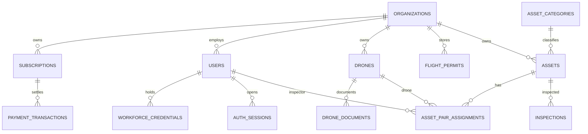
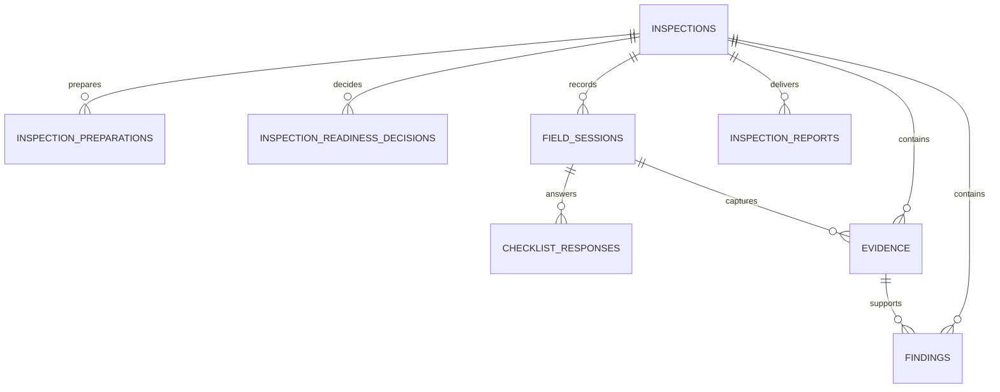
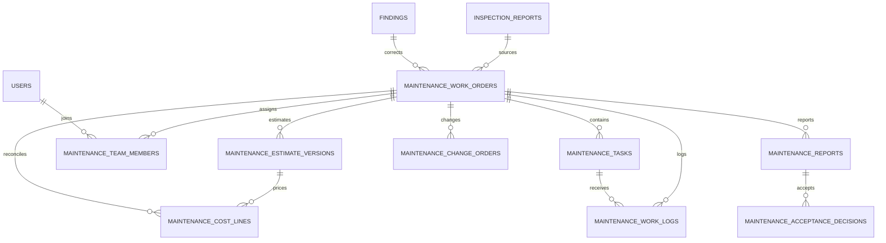

# SmartDroneInspection Database Design

> **Scope:** This document is the database-design companion to the Report 3 SRS revision dated **7 October 2026**, with the MF3 pre-report simplification incorporated on **22 October 2026**. It specifies the Enterprise SaaS target with four human roles and four connected Main Flows; the 35-table count below is a target logical inventory, not a completed database inventory.
>
> **Implementation status — 21 October 2026 (historical snapshot):** Backend V24 aligns identity vocabulary and performs a fail-closed role/zone migration; V25 is an additive bridge that creates the target tables. `V26__enterprise_saas_runtime_cutover.sql` completes the runtime cutover: it drops every non-target marketplace, old-client and MF5 table, tightens composite tenant foreign keys, and enforces the target status vocabularies. `V27__mf3_report_workflow.sql` then drops the removed `peer_reviews` table and replaces the retired report-status vocabulary with the MF3 one. `V30__mf3_corrective_action_and_decision_revision.sql` adds the MF3-12 corrective-action outcome columns on `findings` and the MF3-13 handoff columns on `inspections`. `V31__mf3_corrective_outcome_follows_publication.sql` then clears outcomes that predate the publication they would be attributed to. The `inspections` module has focused MF2 preparation/readiness/session and MF3 evidence/findings/report workflow slices; MF1 and MF4 workflow implementation remains incomplete. `V37__merge_findings_into_one_table.sql` consolidates detector suggestions and Inspector findings; rejected AI suggestions are excluded and are not retained as finding-level audit records, while explicitly removed Inspector findings retain deletion attribution. The dated test results and code/schema descriptions below record the prior implementation; this 22 October documentation change does not assert that the target MF3 schema or behavior has been implemented. No Report 5 case was promoted. See current source and migrations for executable detail.
>
> **Change boundary:** This design supersedes the former Provider/Client marketplace and MF1–MF5 target schema proposal. The current companion status/report references were also reconciled on 7 October 2026; Report 3 remains the source of business requirements. Backend migrations and code are owned by the backend repository and must not be inferred from this design alone.

## 1. Target model and boundaries

SmartDroneInspection is a multi-tenant SaaS workspace rented by infrastructure-owning organizations. The platform manages:

```text
Enterprise subscription
        -> organization workforce, Drone and compliance records (MF1)
        -> asset + default Inspector/Drone pair + inspection setup (MF1)
        -> mission preparation, Compliance Gate and field session (MF2)
        -> evidence, Inspector-invoked AI candidates, LLM draft and approved inspection report (MF3)
        -> repair team, work order, cost control, LLM completion report and acceptance (MF4)
```

The system does **not** store or control:

- RC flight commands, camera controls or Drone SDK state;
- a Provider marketplace, quotations between Client and Provider, commissions or platform-held repair funds;
- an accounting ledger, payroll system, procurement system or statutory tax-invoice engine;
- a government permit registry or an automatic legal conclusion;
- an autonomous AI approval or a report accepted only because an LLM generated it.

### 1.1 Human roles

| Role | Data responsibilities |
| --- | --- |
| `ADMIN` | Platform tenant/subscription administration, technical/security settings and authorized support/audit. No default customer technical or repair acceptance authority. |
| `ORG_ADMIN` | Organization users, credentials, Drone fleet, permits, assets, asset-pair assignment, inspection setup, readiness/report review, repair team/budget assignment and independent acceptance. |
| `INSPECTOR` | Assigned inspection preparation, field-session records, evidence upload, findings confirmation and inspection report authorship/submission. |
| `MAINTENANCE_ENGINEER` | Assigned repair tasks, team lead/report-author responsibilities when designated, work logs, actuals, evidence and maintenance-report author verification. |

`SYSTEM`, AI Vision and LLM are automated components, not rows in `users` and not approvers.

### 1.2 Flow ownership and storage home

| Flow | Primary records | Handover |
| --- | --- | --- |
| MF1 — Resources, assets, pair assignment and inspection setup | `organizations`, `subscriptions`, `payment_transactions`, workforce credentials, Drones, permits, `assets`, `asset_pair_assignments`, `inspections` | Inspection ID, scope/dates, Inspector + Drone snapshot and compliance references → MF2 |
| MF2 — Preparation, Compliance Gate and field-session records | `inspection_preparations`, `inspection_readiness_decisions`, `field_sessions`, `checklist_responses` | Ended field session, checklist, shot-list and readiness snapshot → MF3 |
| MF3 — Evidence, AI Vision, LLM report and review | `evidence`, findings, report versions and source links | Published inspection report version + individually forwarded findings → MF4 |
| MF4 — Team repair, cost control, LLM completion report and acceptance | Work orders/tasks/team assignments, estimate/change/actual cost lines, work logs, repair evidence, completion reports and acceptance | Accepted repair disposition, reconciled cost and updated asset history |

## 2. Design principles

1. **Organization scope is explicit.** Every operational aggregate has `organization_id` directly or through a foreign-key chain that cannot cross organizations.
2. **Assignment scope is explicit.** Inspection access requires the assigned Inspector or an authorized `ORG_ADMIN`; repair access requires work-order/team/task assignment.
3. **The asset pair is historical data.** An asset has a current/default Inspector + specific Drone pair, but each inspection snapshots the pair. Changing the default never rewrites past inspections.
4. **Published records are append-only.** Inspection reports, maintenance reports, decisions, cost baselines and change decisions are versioned. Corrections create a linked version.
5. **Evidence bytes stay in MinIO.** PostgreSQL stores object identity, capture metadata, ownership and workflow links; it does not store large image/video bytes. Inspection evidence does not carry a SHA-256 field; published report PDFs retain their own checksum.
6. **AI provenance is retained with accepted findings.** AI suggestions cannot be used as official defects until the Inspector confirms or modifies them. Rejecting an AI suggestion removes it from retained finding records; deletion audit fields apply to explicitly removed Inspector working-set findings.
7. **LLM output is separate from approved reports.** A draft stores model provenance and source references. It cannot become published/accepted without the named human gates.
8. **Estimate, approved budget, actual and variance are different values.** A cost line is never silently changed from estimate to actual.
9. **Completion is not acceptance.** A team can report physical work complete; an independent qualified reviewer must accept it before closure.
10. **Forward-only implementation.** Applied migrations are immutable. This document does not authorize editing, dropping or renumbering migrations.

## 3. Right-sized logical schema

The target design contains **35 application tables** plus optional framework infrastructure such as Spring Modulith `event_publication`. Table count is a design inventory, not an implementation claim.

| Area | Tables | Count |
| --- | --- | ---: |
| Tenant, subscription and access | `organizations`, `subscriptions`, `payment_transactions`, `users`, `auth_sessions` | 5 |
| Workforce and compliance | `workforce_credentials`, `drones`, `drone_documents`, `flight_permits` | 4 |
| Asset and MF1 setup | `asset_categories`, `checklist_templates`, `checklist_items`, `assets`, `asset_documents`, `asset_pair_assignments`, `inspections` | 7 |
| MF2 preparation and field | `inspection_preparations`, `inspection_readiness_decisions`, `field_sessions`, `checklist_responses` | 4 |
| MF3 evidence, findings and reports | `evidence`, `findings`, `inspection_reports` | 3 |
| MF4 repair and cost | `maintenance_work_orders`, `maintenance_tasks`, `maintenance_team_members`, `maintenance_estimate_versions`, `maintenance_cost_lines`, `maintenance_change_orders`, `maintenance_work_logs`, `maintenance_reports`, `maintenance_acceptance_decisions`, `repair_knowledge_chunks` | 10 |
| Cross-cutting | `audit_events`, `notifications` | 2 |

The inventory is intentionally explicit so a later migration review can reconcile every Report 3 step with a storage home. No Provider organization, RFQ, commission, marketplace dispute or MF5 table belongs in this target design.

## 4. PostgreSQL conventions

| Java/domain value | PostgreSQL representation | Rule |
| --- | --- | --- |
| `UUID` | `uuid` | `gen_random_uuid()` default for new entity identifiers. |
| `Instant` | `timestamptz` | Store an absolute instant; display in organization/user timezone. |
| Enum/status | `varchar` + check constraint | Status changes require a forward migration; no silent spelling changes. |
| Money/rate | `numeric(18,2)` | Never binary floating point. Every cost aggregate has an explicit currency and tax basis. |
| Quantity/rate | `numeric(18,6)` | Preserve enough precision for labor hours, material quantities and unit rates. |
| Version | `bigint` or positive `integer` | Optimistic locking/version ordering; published versions are immutable. |
| Flexible snapshot | `jsonb` | Only for immutable source snapshots, model metadata, structured references or organization-specific fields; not a substitute for core foreign keys. |
| File bytes | MinIO object | PostgreSQL stores `object_key`, applicable checksum, media metadata and ownership links only; inspection evidence has no checksum column, while published report PDFs retain checksums. |

### 4.1 Common columns

Mutable aggregates use:

```sql
id uuid primary key default gen_random_uuid(),
created_at timestamptz not null,
updated_at timestamptz not null,
row_version bigint not null default 0
```

Append-only decisions and versions retain the actor/time fields required for their independent decisions and must not be updated after finalization. Evidence retirement and Inspector finding removal use a soft-delete boolean flag (`is_deleted`, defaulting to `false`); they preserve the record and stored bytes without separate actor or reason columns. Historical business records are retired/cancelled/superseded rather than hard-deleted. Foreign keys default to `ON DELETE RESTRICT`; authentication children may use `CASCADE` only where no operational history is lost.

## 5. Relationship overview







## 6. Data dictionary

When a definition below says **mutable aggregate columns**, it means `created_at TIMESTAMPTZ`, `updated_at TIMESTAMPTZ`, and `row_version BIGINT NOT NULL DEFAULT 0`. Append-only child/version tables include `created_at TIMESTAMPTZ`.

### 6.1 Tenant, subscription and access

#### `organizations`

| Column | Type | Constraint/purpose |
| --- | --- | --- |
| `id` | `uuid` | PK. |
| `legal_name` | `varchar(250)` | Required legal organization name. |
| `display_name` | `varchar(200)` | Required workspace name. |
| `registration_code` | `varchar(64)` | Unique platform organization code. |
| `timezone` | `varchar(64)` | Organization display timezone. |
| `status` | `varchar(24)` | `PENDING`, `ACTIVE`, `SUSPENDED`, `CLOSED`. |
| `created_by_user_id` | `uuid` | Initial ORG_ADMIN after atomic creation. |
| common columns | — | Timestamps and optimistic version. |

The organization is the tenant boundary. It is not a Provider organization and does not participate in marketplace quotation or commission settlement.

#### `subscriptions`

| Column | Type | Constraint/purpose |
| --- | --- | --- |
| `id` | `uuid` | PK. |
| `organization_id` | `uuid` | FK `organizations`; RESTRICT. |
| `plan_code` | `varchar(32)` | Only `ENTERPRISE`. |
| `billing_period_months` | `integer` | Standard price schedule supports 1, 6, and 12 months; negotiated custom term bound is 1–120 months (V38). |
| `status` | `varchar(24)` | `PENDING`, `ACTIVE`, `PAST_DUE`, `SUSPENDED`, `EXPIRED`, `CANCELLED`. |
| `starts_at`, `ends_at` | `timestamptz` | Entitlement window. |
| `external_reference` | `varchar(128)` | Administrative invoice/payment reference; not a payment token. |
| `agreed_amount_usd` | `numeric(12,2)` | Optional platform-approved final amount; a customer proposal is stored only in `terms_snapshot` until the Platform Admin agrees it. |
| `terms_snapshot` | `jsonb` | Immutable terms/version/actor snapshot, including any unapproved customer price proposal and negotiation notes. |
| `confirmed_by_user_id`, `confirmed_at` | `uuid`, `timestamptz` | Activation decision attribution. |

At most one subscription may be `ACTIVE` for an organization. A future migration must pre-check populated data before adding that partial unique index.

#### `payment_transactions`

| Column | Type | Constraint/purpose |
| --- | --- | --- |
| `id` | `uuid` | PK. |
| `subscription_id` | `uuid` | FK `subscriptions`; RESTRICT. |
| `paypal_order_id` | `varchar(64)` | PayPal Orders v2 transaction identifier. |
| `paypal_capture_id` | `varchar(64)` nullable | Provider-issued capture ID, unique when present; `NULL` while a server-created order is pending. It is never supplied as trusted evidence by the browser. |
| `amount` | `numeric(12,2)` | Settled subscription amount. |
| `currency` | `varchar(3)` | Currency ISO-4217 code (default `USD`). |
| `status` | `varchar(24)` | `COMPLETED`, `PENDING`, `DECLINED`, `REFUNDED`. |
| `payer_email` | `varchar(255)` | PayPal payer account email. |
| `captured_at` | `timestamptz` nullable | Provider capture time; `NULL` while status is `PENDING`. |
| common columns | — | Timestamps and optimistic version. |

When PayPal is explicitly enabled for a deployment, `payment_transactions` records the provider order and its later verified capture; disabled/unconfigured online checkout creates no transaction and cannot activate a subscription. Webhook notifications must be signature-verified before a capture is applied. PayPal credentials and webhook secrets are deployment secrets, never database columns. Technical maintenance and repair costs remain internal cost accounting registers.

#### `users`, `user_roles`, `auth_sessions`, `refresh_tokens`

- `users`: `id`, `organization_id` nullable only for platform `ADMIN`, normalized email, full name, status (`ACTIVE`, `SUSPENDED`, `DISABLED`), `auth_version`, password hash and timestamps.
- `user_roles`: `user_id`, `role`; unique `(user_id, role)`. Allowed roles are exactly `ADMIN`, `ORG_ADMIN`, `INSPECTOR`, `MAINTENANCE_ENGINEER`.
- `auth_sessions`: user, client type (`WEB`/`MOBILE`), expiry, revoked time/reason.
- `refresh_tokens`: session, token hash, issued/expiry/revoked timestamps. Raw tokens are never stored.

Every non-`ADMIN` user belongs to exactly one organization. Cross-table role/organization policies are also enforced in application services because PostgreSQL local checks cannot validate all authorization rules.

### 6.2 Workforce and compliance

#### `workforce_credentials`

Stores relevant qualifications, training, fitness/insurance documents where applicable and their validity:

- `organization_id`, `user_id`, `credential_type`, issuer/reference;
- `issued_at`, `expires_at`, `status` (`DRAFT`, `PENDING_REVIEW`, `ACTIVE`, `EXPIRING_SOON`, `EXPIRED`, `REJECTED`, `SUSPENDED`);
- `evidence_id`, verifier, verification time and reason.

This records internal document management; it does not claim government registry verification or create a professional licence.

#### `drones` and `drone_documents`

`drones` stores organization-owned devices: `organization_id`, serial, model/manufacturer, payload metadata, serviceability (`ACTIVE`, `MAINTENANCE`, `SUSPENDED`, `RETIRED`), maintenance dates and notes. Unique `(organization_id, serial_number)` prevents duplicate devices in a tenant.

`drone_documents` stores registration/identification, technical, maintenance and insurance documents with issuer/reference, validity window, status, MinIO object key/checksum and ORG_ADMIN review attribution. A suspended/retired Drone or expired mandatory document cannot pass MF2 readiness.

#### `flight_permits`

Stores organization permit/permission records without issuing them: `organization_id`, optional asset/area, permit type, issuing authority/reference, geographic scope/route JSON, `valid_from`, `valid_until`, conditions, status (`APPLICATION`, `ACTIVE`, `EXPIRED`, `REJECTED`, `REVOKED`, `NOT_APPLICABLE`), source evidence and review attribution.

A readiness decision references the permit and snapshots its version/status. A public map lookup is not an `ACTIVE` permit.

### 6.3 Asset and MF1 setup

#### `asset_categories`, `checklist_templates`, `checklist_items`

- `asset_categories` (**8 columns**: `id`, `code`, `name`, `description`, `active`, `created_at`, `updated_at`, `row_version`): platform categories classified by normalized `code`. Unused `organization_id` is dropped.
- `checklist_templates` (**14 columns**: `id`, `template_key`, `version_number`, `asset_category_id`, `name`, `description`, `name_vi`, `description_vi`, `status`, `created_by_user_id`, `published_at`, `created_at`, `updated_at`, `row_version`): versioned template linked to an asset category, bilingual metadata, publication status and author. Unused `context`, `active_from`, and `active_until` are dropped.
- `checklist_items` (**14 columns**: `id`, `template_id`, `item_code`, `section_name`, `prompt`, `response_type`, `required`, `display_order`, `guidance`, `section_name_vi`, `prompt_vi`, `guidance_vi`, `validation_config`, `created_at`): typed item, bilingual prompt/guidance, order, required flag, validation JSON and template FK. Unused `evidence_requirement` is dropped.

A response references the exact template/item version used; later edits do not rewrite historical responses.

#### `assets`

Stores **14 columns** (`id`, `organization_id`, `category_id`, `asset_code`, `name`, `description`, `location`, `latitude`, `longitude`, `technical_profile`, `status`, `created_at`, `updated_at`, `row_version`): `organization_id`, unique organization-local `asset_code`, `category_id`, name/description, location JSON, GPS coordinates, technical profile JSON and status (`ACTIVE`, `INACTIVE`, `RETIRED`). Redundant `asset_type` is dropped because classification is normalized via `category_id`.

#### `asset_documents`

Stores **11 columns** (`id`, `asset_id`, `uploaded_by_user_id`, `document_type`, `file_name`, `content_type`, `size_bytes`, `checksum_sha256`, `object_key`, `document_date`, `created_at`): asset drawings, manuals and historical files with object key/checksum/size/media type, uploader, document date and creation timestamp. Published documents are immutable; unused `document_version`, `status`, and `updated_at` are dropped.

#### `asset_pair_assignments`

The MF1 pair record stores **16 columns**: `organization_id`, `asset_id`, `inspector_user_id`, `drone_id`, `valid_from`, `valid_until`, status (`DRAFT`, `ACTIVE`, `SUPERSEDED`, `SUSPENDED`), reason, assigned by/time, Inspector `assignment_response` (`ACCEPTED`, `REJECTED`), `responded_at` and mutable aggregate columns.

The target invariant permits one current active default pair per asset and requires Inspector, Drone and asset to share the organization. A pair is a default operational assignment, not a permanent Drone reservation.

#### `inspections`

`inspections` (**18 columns**: `id`, `organization_id`, `asset_id`, `asset_pair_assignment_id`, `inspector_id`, `drone_id`, `objective`, `scope`, `component_scope`, `acceptance_criteria`, `planned_start_at`, `planned_end_at`, `status`, `findings_confirmed_at`, `findings_snapshot_hash`, `created_at`, `updated_at`, `row_version`) is the MF1 inspection aggregate: organization, asset, objective, scope/component scope, acceptance criteria, planned dates, assignment snapshot (`asset_pair_assignment_id`, `inspector_id`, `drone_id`), findings confirmation snapshot and status:

```text
DRAFT -> ASSIGNED -> PREPARING -> READY_FOR_FLIGHT
      -> IN_PROGRESS -> FIELD_COMPLETED -> REPORT_DRAFT
      -> REPORT_PUBLISHED -> REPAIR_PENDING -> COMPLETED
```

`objective`, `scope`, `component_scope`, and `acceptance_criteria` are retained on the inspection as
MF1-owned scope. They remain the source for inspection display, MF2 readiness review and readiness
`source_hash` inputs; the report does not replace or migrate these scope fields. Legacy `schedule_id` and `due_cycle_key` columns from the retired `inspection_schedules` table are dropped.

Past snapshots never change when the asset default pair changes.

### 6.4 MF2 preparation and field records

#### `inspection_preparations`

Versioned preparation records: inspection, Inspector, preparation version, component shot-list JSON, evidence types, access constraints, safety observations, permit/document references, submitted time and status (`DRAFT`, `SUBMITTED`, `RETURNED`, `READY`, `SUPERSEDED`). Inspection planned start/end remain on the inspection and are updated when the Inspector proposes the window for an additional-session preparation; each readiness decision snapshots the version and planned window it reviewed.

#### `inspection_readiness_decisions`

Append-only decisions: inspection, preparation version, decision (`APPROVED`, `RETURNED`, `INVALIDATED`), ORG_ADMIN reviewer, time/reason, permit/credential/Drone-document snapshot IDs and source hash. `APPROVED` is usable for `READY_FOR_FLIGHT` only when all applicable requirements pass.

#### `field_sessions`

Records app-only sessions: inspection, organization, Inspector, assigned Drone snapshot, readiness version, status (`PLANNED`, `IN_PROGRESS`, `FIELD_COMPLETED`, `POSTPONED`, `ABORTED`), start/end, postponement/abort reason, normal-completion `outcome_notes`, checklist version and limitations. `V36__record_completed_field_session_outcome.sql` adds the outcome-notes field and `SUPERSEDED` preparation status. Normal completion records `FIELD_COMPLETED`; weather/site-safety postponement stays distinct. It does not require flight-control telemetry and does not imply the app piloted the aircraft.

#### `checklist_responses`

Stores context, template/item version, responder, typed answer JSON, notes, evidence reference and timestamp. Revisions are preserved; current-answer uniqueness is enforced by the context/item/version key.

### 6.5 MF3 evidence, findings and reports

#### `evidence`

Metadata for digital captures collected during an inspection:

- **13 columns**: `id`, `inspection_id`, `field_session_id`, `file_name`, `content_type`, `size_bytes`, `object_key`, `capture_time`, `latitude`, `longitude`, `location_description`, `is_deleted`, `created_at`.
- Direct parent is `inspections(id)` (mandatory FK) with optional `field_sessions(id)` (FK); `organization_id` is dropped as redundant (resolved via `inspections.organization_id`).
- All 3 maintenance parent foreign keys (`maintenance_work_log_id`, `maintenance_work_order_id`, `maintenance_task_id`) are dropped; `evidence` belongs exclusively to inspections.
- `upload_status` and `evidence_kind` are dropped. Binary ingestion is atomic.
- Soft-delete uses the boolean flag `is_deleted` (default `false`), replacing `retired_at`. Retiring evidence sets `is_deleted = true`, preserving the row and stored MinIO bytes without separate retirement actor or reason columns.
- Media bytes are stored in MinIO under `object_key`. Inspection evidence has no SHA-256 column or checksum-based deduplication key. A repeated sanitized filename within one inspection is treated as a duplicate; files with different contents but the same sanitized name therefore require renaming before both can be retained. AI analysis is Inspector-invoked and does not persist an analysis-completion timestamp/count on evidence.
- `field_sessions.pre_flight_checklist_note` (V35) stores the Inspector-entered pre-flight note that the start request already required. It is not item-level checklist evidence or proof of flight. Report context may list persisted item-level answers only when a `checklist_responses` row is associated with the inspection and the item belongs to the session's recorded checklist template; no source response means no claim that checklist answers were supplied.
- MF2 owns requests for additional field sessions and the independent readiness review; MF3 has no evidence-quality decision record or accepted-evidence gate. Inspector coverage and omissions are authored in the report sections.

#### `findings`

One table for every finding, whoever produced it:

- **15 columns**: `id`, `inspection_id`, `evidence_id`, `finding_code`, `defect_label`, `severity`, `bounding_box`, `technical_notes`, `recommended_action`, `status`, `model_name`, `confidence`, `forwarded_to_maintenance_at`, `is_deleted`, `created_at`.
- **Identity & Scope**: `id` (PK), `inspection_id` (FK to `inspections`), `evidence_id` (FK to `evidence`), `finding_code` (unique per inspection).
- **Status**: `PENDING` or `CONFIRMED`. A detector proposal and a manual observation both start `PENDING`; only the assigned Inspector's explicit confirmation makes a finding official. The confirmed state is represented directly by `status = CONFIRMED`, subsuming the former `inspector_confirmed_at` timestamp.
- **Content**: `defect_label`, `severity` (`LOW`, `MEDIUM`, `HIGH`, `CRITICAL`), `bounding_box` (`jsonb`), `technical_notes`, and optional `recommended_action`. The former `description` text is merged into `technical_notes`; finding location is represented by linked evidence metadata rather than duplicated finding fields.
- **Provenance** (nullable, present only when a detector produced the finding): `model_name` and `confidence` (`numeric(6,5)`). Unneeded metadata fields `model_version` and `model_provider` are dropped.
- **Forward to Maintenance**: nullable `forwarded_to_maintenance_at` records forwarding per finding to MF4 remediation. MF3 does not collect corrective-action rationale, priority or due date; those belong to MF4 triage. `inspections.status` carries the overall outcome (`REPAIR_PENDING` or `COMPLETED`).
- **Removal & Lifecycle**: `is_deleted` boolean flag (default `false`) replaces the former `deleted_at` timestamp. Rejected AI proposals are deleted rather than retained as finding audit rows. Explicitly removed Inspector working-set findings set `is_deleted = true`. `updated_at` is dropped to keep finding records append-only/audit-clean with `created_at`.

The merge keeps every finding that was already official, with its code, so a published report and its PDF still point at the same rows. A detector suggestion the Inspector never resolved becomes a `PENDING` row of its own; a suggestion that already produced a finding is that finding, so it is not copied twice. Rejected AI suggestions are excluded from the migration and do not remain as finding-level audit records. Explicitly removed Inspector working-set findings retain their soft-delete flag (`is_deleted = true`) and can be restored; exact actor and reason are not retained.

#### `inspection_reports`

Each row represents an inspection report deliverable/version for an inspection:

- **13 columns**: `id`, `inspection_id`, `version_no`, `status`, `content_snapshot`, `submitted_at`, `reviewer_user_id`, `reviewed_at`, `return_reason`, `rendered_object_key`, `rendered_checksum_sha256`, `published_at`, `created_at`.
- **Identity & Scope**: `id` (PK), `inspection_id` (FK to `inspections`), `version_no` (1-based, sequential integer). Author identity is resolved via `inspections.inspector_id` (dropping redundant `author_user_id`). Linear version sequencing eliminates the need for `source_version_id`.
- **Status**: `DRAFT`, `AUTHOR_VERIFIED`, `SUBMITTED`, `RETURNED`, `APPROVED`, `PUBLISHED`, `SUPERSEDED`.
- **Authoring Content**: `content_snapshot` (`jsonb`, default `{}`), holds the structured authored section values (Executive Summary, Scope & Methodology, Weather & Site Observations, Component Findings Discussion, Recommendations, Coverage Assessment, Omission Disclosure). Automated drafting writes proposed section values into a draft version; it never updates `findings`.
- **Submission & Withdrawal**: `submitted_at` records the timestamp for submission to administrative review. Author withdrawal drops `withdrawn_at` and `withdrawal_reason`; withdrawing simply reverts the report version from `SUBMITTED` back to `DRAFT`.
- **Administrative Review**: `reviewer_user_id` (FK to `users`), `reviewed_at`, and `return_reason` (populated when returned for revision). The runtime validates role, tenant, active status, and separation of duties.
- **Publication Deliverable**: `rendered_object_key` and `rendered_checksum_sha256` are populated upon publication; they identify the immutable published PDF deliverable in MinIO and its cryptographic SHA-256 hash. `published_at` records the publication timestamp. `created_at` records row creation.
- An approved report cannot be edited in place; correction creates a linked version with incremented `version_no`. LLM regeneration never silently overwrites author edits.

Read-only report-version context resolves tenant-scoped organization, asset/category/location and assigned Drone labels, plus stored preparation/readiness, field-session/pre-flight, evidence and findings-confirmation records. These are source facts, not independent permit, qualification or aircraft-operation validation. PDF rendering omits claims about absent checklist responses or session logs and renders recorded context only when supported by source rows; already published PDF objects remain immutable.

`rendered_object_key` and `rendered_checksum_sha256` are populated when the version is published, not before: they identify the published PDF that is the version's deliverable, and the checksum is taken from the stored bytes. A draft or returned version legitimately leaves the PDF object key and checksum null. The published PDF remains immutable. MF3-13 sets `findings.forwarded_to_maintenance_at` for each selected finding; the inspection's `status` becomes `REPAIR_PENDING` if any finding is forwarded, otherwise `COMPLETED` when a newly published inspection is dispositioned, including when the Inspector confirmed an empty findings set. Once completed, the inspection's maintenance disposition cannot be changed. The append-only `audit_events` record stores the reviewer, report version, selected IDs and before/after status; duplicate handoff actor/time and no-repair columns are not stored on `inspections`. The handoff is not an MF4 work order; MF4 work-order creation and execution remain unimplemented. Confirmed findings and evidence sections are rendered from current inspection records, alongside the version's authored sections and published PDF artifact.

### 6.6 MF4 repair team, costs and acceptance

#### `maintenance_work_orders`

- **18 columns**: `id`, `organization_id`, `asset_id`, `source_report_version_id`, `source_finding_id`, `status`, `priority`, `due_at`, `corrective_scope`, `acceptance_criteria`, `owner_user_id`, `budget_approver_user_id`, `team_lead_user_id`, `report_author_user_id`, `accepting_reviewer_user_id`, `created_at`, `updated_at`, `row_version`.
- Stores organization, asset, published source report version, confirmed source finding, status, priority/due date, corrective scope, acceptance criteria, non-null owner and budget approver, designated team lead, designated report author, independent accepting reviewer and common columns.

Statuses:

```text
DRAFT -> AWAITING_APPROVAL -> APPROVED -> READY -> IN_PROGRESS
      -> WORK_COMPLETED -> SUBMITTED_FOR_ACCEPTANCE
      -> ACCEPTED -> COST_RECONCILED -> CLOSED

IN_PROGRESS -> REWORK_REQUIRED -> IN_PROGRESS
SUBMITTED_FOR_ACCEPTANCE -> REINSPECTION_REQUIRED -> linked inspection
```

The source report must be published and the finding must be confirmed and forwarded from MF3 (`forwarded_to_maintenance_at IS NOT NULL`). Migration `V2__maintenance_concurrency_guards.sql` adds a partial unique index over `source_finding_id` for the live statuses above, preventing duplicate active work orders at the database layer while allowing a later order after the prior order reaches a non-live status. The existing service precheck remains; the index is the concurrent-insert backstop. This DB-only change does not add application-level translation for a raw unique-constraint violation, so concurrent duplicate creation may still surface as an unhandled server error until the service/error handler is implemented.

#### `maintenance_tasks`

- **13 columns**: `id`, `work_order_id`, `task_number`, `name`, `method`, `assigned_engineer_user_id`, `planned_start_at`, `planned_end_at`, `acceptance_criteria`, `status`, `created_at`, `updated_at`, `row_version`.
- Divides approved scope: work order, sequential `task_number` (unique per `work_order_id`, also serving as display order), name, method, Engineer assignee, planned dates, acceptance criteria, status (`PLANNED`, `READY`, `IN_PROGRESS`, `WORK_COMPLETED`, `REWORK_REQUIRED`, `ACCEPTED`, `CANCELLED`), and mutable aggregate columns. Unused `completion_notes` and redundant `display_order` are dropped.

#### `maintenance_team_members`

- **10 columns**: `id`, `work_order_id`, `engineer_user_id`, `member_role`, `effective_from`, `effective_until`, `assigned_by_user_id`, `reason`, `active`, `created_at`.
- Assignment history: work order, Engineer, member role (`LEAD`, `REPORT_AUTHOR`, `MEMBER`), effective dates, assigned by/reason and active flag. Partial unique indexes and domain rules enforce at most one active lead and one active report author and prevent self-acceptance.

#### `maintenance_estimate_versions` and `maintenance_cost_lines`

- `maintenance_estimate_versions` (**11 columns**: `id`, `work_order_id`, `version_no`, `status`, `prepared_by_user_id`, `approved_by_user_id`, `approved_at`, `currency`, `baseline_total`, `assumptions`, `created_at`) stores version, status (`DRAFT`, `SUBMITTED`, `APPROVED`, `REJECTED`, `SUPERSEDED`), preparer, approver/time, currency, baseline total and assumptions. Unused `tax_basis` and redundant `snapshot` are dropped.
- `maintenance_cost_lines` (**14 columns**: `id`, `work_order_id`, `estimate_version_id`, `task_id`, `line_kind`, `state`, `description`, `quantity`, `unit`, `unit_rate`, `amount`, `currency`, `entered_by_user_id`, `created_at`) stores estimate/actual ownership (`state` in `ESTIMATE`, `ACTUAL`), optional estimate version and task FKs, cost kind (`LABOR`, `MATERIAL`, `EQUIPMENT`, `EXTERNAL_SERVICE`, `OTHER`, `CONTINGENCY`), description, quantity, unit, unit rate, derived amount, currency, entered by user and creation timestamp. Unmapped `change_order_id`, unused `tax_treatment` and `evidence_reference`, and duplicate `entered_at` are dropped.

Authoritative values:

```text
approved_budget B = initial_approved_baseline + sum(approved_change_deltas)
actual_total A   = sum(reconciled actual cost lines)
variance V       = A - B
variance_percent = 100 * V / B, when B > 0; otherwise N/A
```

SYSTEM calculates totals with decimal arithmetic. Missing price is unknown, not zero. Contingency is not an incurred expense.

#### `maintenance_change_orders`

- **13 columns**: `id`, `work_order_id`, `change_number`, `reason`, `proposed_delta`, `status`, `requested_by_user_id`, `decided_by_user_id`, `decided_at`, `decision_reason`, `created_at`, `updated_at`, `row_version`.
- Versioned scope/cost changes: work order, change number, reason, proposed delta, status (`DRAFT`, `AWAITING_APPROVAL`, `APPROVED`, `REJECTED`, `RETURNED`, `SUPERSEDED`), requester and decision attribution. Unused `affected_tasks`, `supporting_evidence`, `proposed_start_at`, and `proposed_end_at` are dropped. Additional work is unauthorized until approval; the initial baseline remains immutable.

#### `maintenance_work_logs`

- **13 columns**: `id`, `work_order_id`, `task_id`, `engineer_user_id`, `started_at`, `ended_at`, `hours`, `as_left_condition`, `test_readings`, `status`, `created_at`, `updated_at`, `row_version`.
- Task-level execution records: work order/task, Engineer, start/end, hours, as-left condition, tests/readings narrative, status (`IN_PROGRESS`, `PAUSED_FOR_CHANGE`, `SUBMITTED`, `VERIFIED`) and mutable aggregate columns. Unused `actual_cost_references` is dropped. `WORK_COMPLETED` is a team declaration, not acceptance.

#### `maintenance_reports`

- **9 columns**: `id`, `work_order_id`, `version_no`, `status`, `author_verified_at`, `content_snapshot`, `rendered_object_key`, `rendered_checksum_sha256`, `created_at`.
- Completion report versions store work order, sequential `version_no`, status (`DRAFT`, `AUTHOR_VERIFIED`, `SUBMITTED`, `RETURNED`, `APPROVED`, `SUPERSEDED`), author-verification time, `content_snapshot`, and rendered PDF `rendered_object_key` and `rendered_checksum_sha256`. Redundant `author_user_id` (resolved via `maintenance_work_orders.report_author_user_id`), unused LLM metadata (`llm_provider`, `llm_model`, `prompt_version`, `generated_at`) and unused snapshot hash columns (`approved_scope_hash`, `change_snapshot_hash`, `work_log_snapshot_hash`, `actual_cost_snapshot_hash`) are dropped.

#### `maintenance_acceptance_decisions`

- **9 columns**: `id`, `work_order_id`, `report_version_id`, `reviewer_user_id`, `decision`, `technical_comments`, `acceptance_checklist`, `test_result`, `decided_at`.
- Append-only decision: work order/report version, independent ORG_ADMIN reviewer, decision (`ACCEPTED`, `REWORK_REQUIRED`, `REINSPECTION_REQUIRED`), technical comments, acceptance checklist, test result, and `decided_at`. Unused `signature_reference`, duplicate `created_at`, and unsupported `REJECTED` decision state are dropped. The executing team cannot create final acceptance.

#### `repair_knowledge_chunks`

Storage and vector indexing for civil/structural engineering repair specifications and standard codes (TCVN, ISO, EN, AASHTO, ACI, manufacturer method statements) supporting RAG-assisted maintenance scope and criteria generation.

Columns:
- `id` (UUID, primary key)
- `standard_code` (VARCHAR(64), e.g. `TCVN 9343:2012`, `ISO 12944-5`)
- `title` (VARCHAR(255), human-readable repair guideline title)
- `category` (VARCHAR(64), indexed: `CONCRETE_CRACK`, `SPALLING`, `STEEL_CORROSION`, `WATER_LEAKAGE`, `STRUCTURAL_DEFORMATION`)
- `defect_patterns` (VARCHAR(255), keyword match patterns for fallback/hybrid retrieval)
- `content` (TEXT, detailed methodology, surface preparation, material specs, and quantifiable acceptance thresholds)
- `reference_url` (VARCHAR(500), authoritative legal/standard documentation source link)
- `embedding` (vector(1536), pgvector representation indexed via HNSW `vector_cosine_ops` for semantic similarity retrieval `<=>`)
- `created_at` (TIMESTAMPTZ)

### 6.7 Cross-cutting tables

#### `audit_events`

Append-only security/workflow history: organization, actor, action, aggregate type/id, before/after status, version, reason, timestamp, trace ID and safe metadata. For successful `ORGANIZATION_REGISTRATION`, `safe_metadata` includes bounded `ip_address`/`user_agent`, `terms_accepted: true`, `terms_version`, `privacy_notice_accepted: true`, `privacy_notice_version`, and server-generated UTC `accepted_at`, written in the same transaction as organization and first-user creation. This is application interaction evidence, not a certified digital signature or guarantee of legal enforceability. Never store passwords, raw tokens, private keys or protected file contents.

#### `notifications`

Scoped delivery record: recipient, organization, event type, aggregate reference, created/read/sent times and delivery status. A notification never grants access.

## 7. Authorization and integrity invariants

| Rule | Database/domain enforcement |
| --- | --- |
| One tenant owns every business record | Direct `organization_id` plus application scope queries; cross-table organization equality is checked in domain services. |
| Asset code unique within tenant | Unique `(organization_id, asset_code)`. |
| One current default pair per asset | Partial unique index over active `asset_pair_assignments`; pre-check populated data before migration. |
| Asset pair members belong to the same tenant | Domain service plus explicit organization FKs/validation. |
| Periodic inspection is idempotent | Unique `(schedule_id, due_cycle_key)` for generated inspections. |
| Inspection evidence duplicate policy | A repeated sanitized filename within one inspection is rejected; this policy does not provide content-based identity or deduplication. |
| AI suggestion is not an official defect | Only `findings` confirmed by the assigned Inspector may enter approved report/work order links; pending rows are advisory, and rejected AI suggestions are removed rather than retained as findings. |
| Report publication requires human gates | State transition requires Inspector author verification and independent ORG_ADMIN approval; MF3-13 records forwarding on each finding and uses `inspections.status` for the aggregate outcome. Reviewer professional qualification is a target condition, not a runtime credential check. |
| Work order source is valid | FK to published report version and confirmed repair-required finding. |
| One lead/report author per work order | Partial unique active assignment indexes plus application validation. |
| Repair team cannot self-accept | Domain authorization checks accepting reviewer against active team membership. |
| Additional work waits for approval | Change-order state and work-order transition service. |
| Closure requires complete evidence and decisions | Transactional closure query plus workflow test. |
| Cross-tenant access is denied | Organization-scoped repository queries, never in-memory filtering. |

PostgreSQL `CHECK` constraints should cover local-column invariants only. Cross-table rules such as “reviewer is ORG_ADMIN and not a team member” belong in application policy and integration tests; PostgreSQL checks cannot safely use subqueries.

## 8. Index strategy

Create indexes for demonstrated authorization, workflow, scheduler and cleanup queries:

- users: `(organization_id, status)` and unique normalized email;
- credentials: `(organization_id, user_id, status, expires_at)`;
- Drones: `(organization_id, status)` and unique serial per organization;
- permits: `(organization_id, status, valid_from, valid_until)`;
- assets: `(organization_id, status)` and unique organization-local code;
- pair assignments: `(asset_id, status, valid_from)`;
- inspections: `(organization_id, asset_id, status, planned_start_at)`;
- field sessions: `(inspection_id, status, started_at)`;
- evidence: `(inspection_id, created_at DESC)`;
- findings: `(inspection_id, status)`;
- inspection reports: `(inspection_id, status, version_no DESC)`;
- work orders: `(organization_id, status, due_at)` and `(source_finding_id, status)`;
- costs: `(work_order_id, line_kind, state)`;
- audit: `(organization_id, aggregate_type, aggregate_id, created_at)`.

Do not add indexes for every enum or boolean. Verify expensive queries with PostgreSQL query plans before adding composite indexes.

## 9. Retention, privacy and deletion

- Retain published reports, acceptance decisions, cost baselines, change history and audit events for the organization policy period; no universal period is hard-coded here.
- Credential and permit files are visible only to authorized ORG_ADMIN, the subject where appropriate, assigned reviewers and the minimum workflow scope.
- Raw evidence is never public. MinIO access is issued only after backend organization/assignment/release checks.
- Subscription expiry may restrict new work while preserving historical data according to published terms; it must not silently delete open inspections, reports or work orders.
- Deletion requests must respect legal retention, report immutability and linked-work-order history. Prefer anonymization/retirement over deleting referenced records.

## 10. Migration and implementation policy

The 22 October MF3 target updates the logical design only. It does not authorize or implement a schema change; the current Flyway-managed backend still has the historical quality-decision and corrective-outcome schema. Any later implementation must follow the repository's reviewed migration policy and preserve applied migration history.

Applied migration files remain forward-only history. The backend reset has begun the target cutover; these steps remain necessary for completion:

1. Reconcile this logical target inventory against the current live schema and Java entities; do not assume all 35 target tables exist or that all legacy tables have been retired.
2. Track V24 (role/zone alignment), V25 (additive target schema) and V26 (runtime cutover) as three separate forward migrations; V26 is the destructive step and is authorized as an explicit start-fresh reset.
4. Pre-check populated data before unique indexes, checks and status constraints; backfill parent records before adding non-null foreign keys.
5. Implement entity/repository ownership, authorization policies, and workflow behavior in separately scoped slices. Schema rows alone do not implement a workflow; MF2 and MF3 have partial runtime slices, while complete MF1 and MF4 behavior remains to be built.
6. Test empty and populated databases, including duplicate/expired credentials, cross-tenant access, stale readiness, self-acceptance and cost variance.
7. Run schema validation and repository verification before claiming implementation; preserve actual execution results in Report 5 without extrapolating beyond tested behavior.

## 11. Implementation status

- This file is a **target database design aligned with Report 3**, not a full implementation report.
- V24 aligns identity/role vocabulary, V25 adds the target schema, and V26 completes the runtime cutover to the then-current 41-table target inventory. Verified by `./mvnw clean verify` on 8 October 2026 (88 tests, exit 0), including empty-database migration, populated V1–V23 fail-closed migration tests and an exact-table-inventory assertion. V39 adds Vietnamese checklist columns, and V40 implements the MF3 target changes through a forward Flyway migration. B40 provides a single-step baseline migration for fresh databases. Both were executed on disposable PostgreSQL databases; local drifted V38 and deployed schemas were not changed or verified.
- Historical backend status through 21 October: source code and migrations implemented MF2 assignment response, preparation/compliance, readiness approval/return, field-session start/postpone/abort and normal completion, plus the earlier MF3 evidence-quality decision and corrective-outcome flow. V40 is now present in the worktree as a forward migration removing those quality/legacy fields and applying the simplified MF3 entity contract; B40 provides a single complete schema migration for new databases. Both paths were executed against fresh disposable PostgreSQL schemas, including populated and fail-closed guard fixtures, not against the drifted local database or a deployed database. Source tests/compile and client checks have passed, while Docker-backed Spring integration remains blocked. MF2-08 source-change invalidation is partial. `V37` merges detector suggestions and Inspector findings into `findings`; rejected AI suggestions are excluded and are not retained as finding-level audit records. MF1 and MF4 work-order creation remain incomplete workflow areas.
- Asset/catalog/scheduling and auth runtime remain in the reset branch, but they are partial capabilities and must be checked against current source and the corresponding backend guides.
- Do not read the 35-table target count as the current physical schema. A table's existence does not establish API, use-case, workflow, or test completion.

## 12. Source reference

- Backend plan: [`2026-10-07_enterprise-saas-backend-and-full-db.md`](../../backend/.hermes/plans/2026-10-07_enterprise-saas-backend-and-full-db.md)
- V24 identity alignment: `backend/src/main/resources/db/migration/V24__enterprise_saas_role_and_schema_alignment.sql`
- V25 additive target-schema bridge: `backend/src/main/resources/db/migration/V25__enterprise_saas_target_schema.sql`
- V26 runtime cutover: `backend/src/main/resources/db/migration/V26__enterprise_saas_runtime_cutover.sql`
- V27 MF3 report workflow: `SmartDroneInspection-backend/src/main/resources/db/migration/V27__mf3_report_workflow.sql` — drops the removed `peer_reviews` table and replaces the retired report-status vocabulary
- V28 assignment response: `SmartDroneInspection-backend/src/main/resources/db/migration/V28__assignment_response.sql` — records the Inspector's accept/reject response separately from pairing lifecycle
- V29 findings confirmation gate: `SmartDroneInspection-backend/src/main/resources/db/migration/V29__mf3_findings_confirmation_gate.sql`
- V30 MF3 corrective outcome and handoff: `SmartDroneInspection-backend/src/main/resources/db/migration/V30__mf3_corrective_action_and_decision_revision.sql` — adds `verified_findings.corrective_action_*` (the table was renamed to `findings` by V37) and `inspections.corrective_handoff_*`/`no_repair_rationale`, and backfills existing reviewer dispositions
- V31 corrective outcome follows publication: `SmartDroneInspection-backend/src/main/resources/db/migration/V31__mf3_corrective_outcome_follows_publication.sql` — clears backfilled outcomes that predate the publication they would be attributed to, leaving inspections that already completed the MF3-13 handoff untouched
- V32 findings correction and author withdrawal: `SmartDroneInspection-backend/src/main/resources/db/migration/V32__mf3_findings_correction_and_author_withdrawal.sql` — adds `verified_findings.deleted_*` (now `findings.deleted_*`), `evidence.retired_*`, and `inspection_report_versions.withdrawn_*` / `return_reason_type`
- V37 findings merge: `SmartDroneInspection-backend/src/main/resources/db/migration/V37__merge_findings_into_one_table.sql` — renames `verified_findings` to `findings`, folds the detector's suggestions into it, and replaces the duplicated review vocabularies with one status (`PENDING`, `CONFIRMED`) plus a removal tombstone
- V35 pre-flight note persistence: `backend/src/main/resources/db/migration/V35__persist_field_session_preflight_note.sql` — stores the required Inspector-entered session note; it is not item-level checklist evidence
- V39 Vietnamese checklist content: `backend/src/main/resources/db/migration/V39__add_vietnamese_checklist_content.sql` — adds nullable Vietnamese columns to the checklist template and item tables so system-managed checklist text can be localized, keeping the English columns as the explicit fallback
- V40 MF3 entity field audit: `backend/src/main/resources/db/migration/V40__mf3_entity_field_audit.sql` — streamlines finding/evidence models, transitions to per-finding handoff (`forwarded_to_maintenance_at`), and drops obsolete `evidence_quality_decisions`
- V41 custom subscription period and negotiated pricing: `backend/src/main/resources/db/migration/V41__custom_subscription_period_and_negotiated_pricing.sql` — allows custom billing periods and records agreed pricing
- V42 PayPal payment transactions: `backend/src/main/resources/db/migration/V42__paypal_payment_transactions.sql` — stores PayPal Orders v2 transactions and capture status
- B42 Complete baseline schema: `backend/src/main/resources/db/migration/B42__complete_schema.sql` — canonical 42-table schema snapshot for single-step instantiation on fresh databases

- [Report 3 Software Requirement Specification](../reports/report-3-software-requirement-specification/)
- [Authentication and Access Control](../backend/authentication-and-authorization.md)
- [Backend Architecture](../backend/architecture.md)
- [AI Agent Rules](../development/ai-agent-rules.md)
