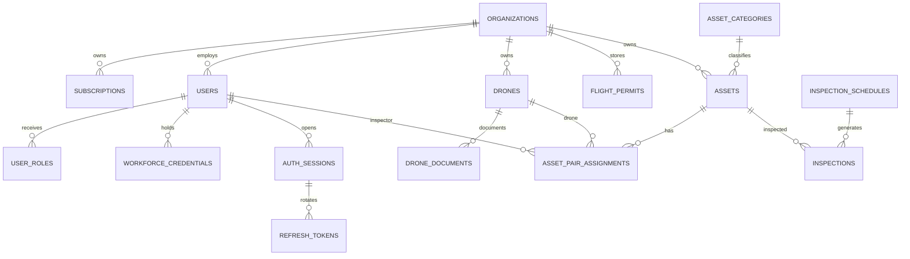
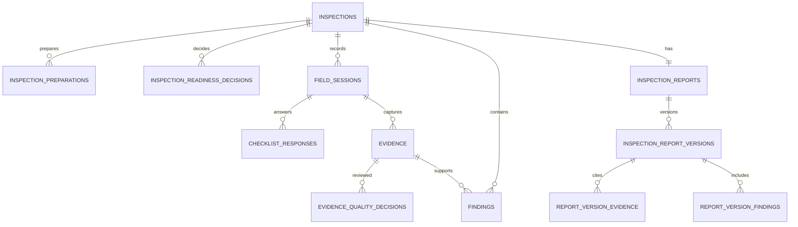
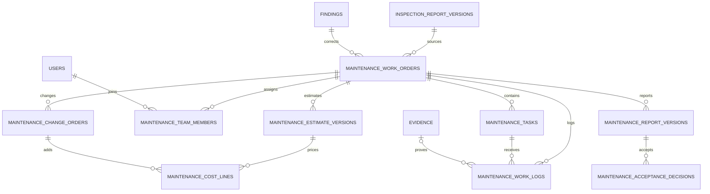

# SmartDroneInspection Database Design

> **Scope:** This document is the database-design companion to the Report 3 SRS revision dated **7 October 2026**. It specifies the Enterprise SaaS target with four human roles and four connected Main Flows; the 41-table count below is a target logical inventory, not a completed database inventory.
>
> **Implementation status — 21 October 2026:** Backend V24 aligns identity vocabulary and performs a fail-closed role/zone migration; V25 is an additive bridge that creates the target tables. `V26__enterprise_saas_runtime_cutover.sql` completes the runtime cutover: it drops every non-target marketplace, old-client and MF5 table, tightens composite tenant foreign keys, and enforces the target status vocabularies. `V27__mf3_report_workflow.sql` then drops the removed `peer_reviews` table and replaces the retired report-status vocabulary with the MF3 one. `V30__mf3_corrective_action_and_decision_revision.sql` adds the MF3-12 corrective-action outcome columns on `findings` and the MF3-13 handoff columns on `inspections`. `V31__mf3_corrective_outcome_follows_publication.sql` then clears the outcomes that predate the publication they would be attributed to, and the publication path repeats that correction at runtime. The `inspections` module has focused MF2 preparation/readiness/session and MF3 evidence/findings/report workflow slices; MF1 and MF4 workflow implementation remains incomplete. `V37__merge_findings_into_one_table.sql` consolidates detector suggestions and Inspector findings; rejected AI suggestions are excluded and are not retained as finding-level audit records, while explicitly removed Inspector findings retain deletion attribution. In this task `./mvnw verify` passed 684 tests before the final rejection-path correction; `./mvnw -DskipTests package` then passed after the correction without running tests. No Report 5 case was promoted; a table or column's presence is not proof that its full workflow is implemented. See current source and migrations for executable detail.
>
> **Change boundary:** This design supersedes the former Provider/Client marketplace and MF1–MF5 target schema proposal. The current companion status/report references were also reconciled on 7 October 2026; Report 3 remains the source of business requirements. Backend migrations and code are owned by the backend repository and must not be inferred from this design alone.

## 1. Target model and boundaries

SmartDroneInspection is a multi-tenant SaaS workspace rented by infrastructure-owning organizations. The platform manages:

```text
Enterprise subscription
        -> organization workforce, Drone and compliance records (MF1)
        -> asset + default Inspector/Drone pair + inspection setup (MF1)
        -> mission preparation, Compliance Gate and field session (MF2)
        -> evidence, AI candidates, LLM draft and approved inspection report (MF3)
        -> repair team, work order, cost control, LLM completion report and acceptance (MF4)
```

The system does **not** store or control:

- RC flight commands, camera controls or Drone SDK state;
- a Provider marketplace, quotations between Client and Provider, commissions or platform-held repair funds;
- an accounting ledger, payroll system, procurement system or statutory tax-invoice engine;
- a government permit registry or an automatic legal conclusion;
- an autonomous AI approval or a report accepted only because an LLM generated it.

### 1.1 Human roles

| Role | Data responsibilities |
| --- | --- |
| `ADMIN` | Platform tenant/subscription administration, technical/security settings and authorized support/audit. No default customer technical or repair acceptance authority. |
| `ORG_ADMIN` | Organization users, credentials, Drone fleet, permits, assets, asset-pair assignment, inspection setup, readiness/report review, repair team/budget assignment and independent acceptance. |
| `INSPECTOR` | Assigned inspection preparation, field-session records, evidence upload and substantive evidence-quality decision; inspection report author verification. |
| `MAINTENANCE_ENGINEER` | Assigned repair tasks, team lead/report-author responsibilities when designated, work logs, actuals, evidence and maintenance-report author verification. |

`SYSTEM`, AI Vision and LLM are automated components, not rows in `users` and not approvers.

### 1.2 Flow ownership and storage home

| Flow | Primary records | Handover |
| --- | --- | --- |
| MF1 — Resources, assets, pair assignment and inspection setup | `organizations`, `subscriptions`, workforce credentials, Drones, permits, `assets`, `asset_pair_assignments`, `inspections` | Inspection ID, scope/dates, Inspector + Drone snapshot and compliance references → MF2 |
| MF2 — Preparation, Compliance Gate and field-session records | `inspection_preparations`, `inspection_readiness_decisions`, `field_sessions`, `checklist_responses` | Ended field session, checklist, shot-list and readiness snapshot → MF3 |
| MF3 — Evidence, AI Vision, LLM report and review | `evidence`, evidence-quality decisions, candidates, findings, report versions and source links | Published inspection report version + confirmed repair-required findings → MF4 |
| MF4 — Team repair, cost control, LLM completion report and acceptance | Work orders/tasks/team assignments, estimate/change/actual cost lines, work logs, repair evidence, completion reports and acceptance | Accepted repair disposition, reconciled cost and updated asset history |

## 2. Design principles

1. **Organization scope is explicit.** Every operational aggregate has `organization_id` directly or through a foreign-key chain that cannot cross organizations.
2. **Assignment scope is explicit.** Inspection access requires the assigned Inspector or an authorized `ORG_ADMIN`; repair access requires work-order/team/task assignment.
3. **The asset pair is historical data.** An asset has a current/default Inspector + specific Drone pair, but each inspection snapshots the pair. Changing the default never rewrites past inspections.
4. **Published records are append-only.** Inspection reports, maintenance reports, decisions, cost baselines and change decisions are versioned. Corrections create a linked version.
5. **Evidence bytes stay in MinIO.** PostgreSQL stores object identity, checksum, metadata, ownership and workflow links; it does not store large image/video bytes.
6. **AI provenance is retained with accepted findings.** AI suggestions cannot be used as official defects until the Inspector confirms or modifies them. Rejecting an AI suggestion removes it from retained finding records; deletion audit fields apply to explicitly removed Inspector working-set findings.
7. **LLM output is separate from approved reports.** A draft stores model provenance and source references. It cannot become published/accepted without the named human gates.
8. **Estimate, approved budget, actual and variance are different values.** A cost line is never silently changed from estimate to actual.
9. **Completion is not acceptance.** A team can report physical work complete; an independent qualified reviewer must accept it before closure.
10. **Forward-only implementation.** Applied migrations are immutable. This document does not authorize editing, dropping or renumbering migrations.

## 3. Right-sized logical schema

The target design contains **41 application tables** plus optional framework infrastructure such as Spring Modulith `event_publication`. Table count is a design inventory, not an implementation claim.

| Area | Tables | Count |
| --- | --- | ---: |
| Tenant, subscription and access | `organizations`, `subscriptions`, `users`, `user_roles`, `auth_sessions`, `refresh_tokens` | 6 |
| Workforce and compliance | `workforce_credentials`, `drones`, `drone_documents`, `flight_permits` | 4 |
| Asset and MF1 setup | `asset_categories`, `checklist_templates`, `checklist_items`, `assets`, `asset_documents`, `asset_pair_assignments`, `inspection_schedules`, `inspections` | 8 |
| MF2 preparation and field | `inspection_preparations`, `inspection_readiness_decisions`, `field_sessions`, `checklist_responses` | 4 |
| MF3 evidence, findings and reports | `evidence`, `evidence_quality_decisions`, `findings`, `inspection_reports`, `inspection_report_versions`, `report_version_evidence`, `report_version_findings` | 7 |
| MF4 repair and cost | `maintenance_work_orders`, `maintenance_tasks`, `maintenance_team_members`, `maintenance_estimate_versions`, `maintenance_cost_lines`, `maintenance_change_orders`, `maintenance_work_logs`, `maintenance_report_versions`, `maintenance_acceptance_decisions` | 9 |
| Cross-cutting | `audit_events`, `notifications` | 2 |

The inventory is intentionally explicit so a later migration review can reconcile every Report 3 step with a storage home. No Provider organization, RFQ, commission, marketplace dispute or MF5 table belongs in this target design.

## 4. PostgreSQL conventions

| Java/domain value | PostgreSQL representation | Rule |
| --- | --- | --- |
| `UUID` | `uuid` | `gen_random_uuid()` default for new entity identifiers. |
| `Instant` | `timestamptz` | Store an absolute instant; display in organization/user timezone. |
| Enum/status | `varchar` + check constraint | Status changes require a forward migration; no silent spelling changes. |
| Money/rate | `numeric(18,2)` | Never binary floating point. Every cost aggregate has an explicit currency and tax basis. |
| Quantity/rate | `numeric(18,6)` | Preserve enough precision for labor hours, material quantities and unit rates. |
| Version | `bigint` or positive `integer` | Optimistic locking/version ordering; published versions are immutable. |
| Flexible snapshot | `jsonb` | Only for immutable source snapshots, model metadata, structured references or organization-specific fields; not a substitute for core foreign keys. |
| File bytes | MinIO object | PostgreSQL stores `object_key`, checksum, media metadata and ownership links only. |

### 4.1 Common columns

Mutable aggregates use:

```sql
id uuid primary key default gen_random_uuid(),
created_at timestamptz not null,
updated_at timestamptz not null,
row_version bigint not null default 0
```

Append-only decisions, evidence metadata and versions use `created_at` plus their actor/time fields and must not be updated after finalization. Historical business records are retired/cancelled/superseded rather than hard-deleted. Foreign keys default to `ON DELETE RESTRICT`; authentication children may use `CASCADE` only where no operational history is lost.

## 5. Relationship overview







## 6. Data dictionary

When a definition below says **mutable aggregate columns**, it means `created_at TIMESTAMPTZ`, `updated_at TIMESTAMPTZ`, and `row_version BIGINT NOT NULL DEFAULT 0`. Append-only child/version tables include `created_at TIMESTAMPTZ`.

### 6.1 Tenant, subscription and access

#### `organizations`

| Column | Type | Constraint/purpose |
| --- | --- | --- |
| `id` | `uuid` | PK. |
| `legal_name` | `varchar(250)` | Required legal organization name. |
| `display_name` | `varchar(200)` | Required workspace name. |
| `registration_code` | `varchar(64)` | Unique platform organization code. |
| `timezone` | `varchar(64)` | Organization display timezone. |
| `status` | `varchar(24)` | `PENDING`, `ACTIVE`, `SUSPENDED`, `CLOSED`. |
| `created_by_user_id` | `uuid` | Initial ORG_ADMIN after atomic creation. |
| common columns | — | Timestamps and optimistic version. |

The organization is the tenant boundary. It is not a Provider organization and does not participate in marketplace quotation or commission settlement.

#### `subscriptions`

| Column | Type | Constraint/purpose |
| --- | --- | --- |
| `id` | `uuid` | PK. |
| `organization_id` | `uuid` | FK `organizations`; RESTRICT. |
| `plan_code` | `varchar(32)` | Only `ENTERPRISE`. |
| `billing_period_months` | `smallint` | Check `IN (1, 6, 12)`. |
| `status` | `varchar(24)` | `PENDING`, `ACTIVE`, `PAST_DUE`, `SUSPENDED`, `EXPIRED`, `CANCELLED`. |
| `starts_at`, `ends_at` | `timestamptz` | Entitlement window. |
| `external_reference` | `varchar(128)` | Administrative invoice/payment reference; not a payment token. |
| `terms_snapshot` | `jsonb` | Immutable accepted subscription terms. |
| `confirmed_by_user_id`, `confirmed_at` | `uuid`, `timestamptz` | Activation decision attribution. |

At most one subscription may be `ACTIVE` for an organization. A future migration must pre-check populated data before adding that partial unique index.

#### `users`, `user_roles`, `auth_sessions`, `refresh_tokens`

- `users`: `id`, `organization_id` nullable only for platform `ADMIN`, normalized email, full name, status (`ACTIVE`, `SUSPENDED`, `DISABLED`), `auth_version`, password hash and timestamps.
- `user_roles`: `user_id`, `role`; unique `(user_id, role)`. Allowed roles are exactly `ADMIN`, `ORG_ADMIN`, `INSPECTOR`, `MAINTENANCE_ENGINEER`.
- `auth_sessions`: user, client type (`WEB`/`MOBILE`), expiry, revoked time/reason.
- `refresh_tokens`: session, token hash, issued/expiry/revoked timestamps. Raw tokens are never stored.

Every non-`ADMIN` user belongs to exactly one organization. Cross-table role/organization policies are also enforced in application services because PostgreSQL local checks cannot validate all authorization rules.

### 6.2 Workforce and compliance

#### `workforce_credentials`

Stores relevant qualifications, training, fitness/insurance documents where applicable and their validity:

- `organization_id`, `user_id`, `credential_type`, issuer/reference;
- `issued_at`, `expires_at`, `status` (`DRAFT`, `PENDING_REVIEW`, `ACTIVE`, `EXPIRING_SOON`, `EXPIRED`, `REJECTED`, `SUSPENDED`);
- `evidence_id`, verifier, verification time and reason.

This records internal document management; it does not claim government registry verification or create a professional licence.

#### `drones` and `drone_documents`

`drones` stores organization-owned devices: `organization_id`, serial, model/manufacturer, payload metadata, serviceability (`ACTIVE`, `MAINTENANCE`, `SUSPENDED`, `RETIRED`), maintenance dates and notes. Unique `(organization_id, serial_number)` prevents duplicate devices in a tenant.

`drone_documents` stores registration/identification, technical, maintenance and insurance documents with issuer/reference, validity window, status, MinIO object key/checksum and ORG_ADMIN review attribution. A suspended/retired Drone or expired mandatory document cannot pass MF2 readiness.

#### `flight_permits`

Stores organization permit/permission records without issuing them: `organization_id`, optional asset/area, permit type, issuing authority/reference, geographic scope/route JSON, `valid_from`, `valid_until`, conditions, status (`APPLICATION`, `ACTIVE`, `EXPIRED`, `REJECTED`, `REVOKED`, `NOT_APPLICABLE`), source evidence and review attribution.

A readiness decision references the permit and snapshots its version/status. A public map lookup is not an `ACTIVE` permit.

### 6.3 Asset and MF1 setup

#### `asset_categories`, `checklist_templates`, `checklist_items`

- `asset_categories`: platform categories plus optional organization-specific categories.
- `checklist_templates`: versioned template, context (`MF2_FIELD`, `MF3_EVIDENCE`, `MF4_ACCEPTANCE`), active period and author.
- `checklist_items`: typed item, order, required flag, evidence requirement and template FK.

A response references the exact template/item version used; later edits do not rewrite historical responses.

#### `assets`

Stores `organization_id`, unique organization-local code, category, name/type, location JSON, technical profile JSON, source documents and status (`ACTIVE`, `INACTIVE`, `RETIRED`).

#### `asset_documents`

Stores asset drawings, manuals and historical files: asset, type/version, object key/checksum/size/media type, uploader, status and timestamps. Published documents are not overwritten.

#### `asset_pair_assignments`

The MF1 pair record stores `organization_id`, `asset_id`, `inspector_user_id`, `drone_id`, `valid_from`, `valid_until`, status (`DRAFT`, `ACTIVE`, `SUPERSEDED`, `SUSPENDED`), reason, assigned by/time and version.

The target invariant permits one current active default pair per asset and requires Inspector, Drone and asset to share the organization. A pair is a default operational assignment, not a permanent Drone reservation.

#### `inspection_schedules` and `inspections`

`inspection_schedules` stores optional cadence, next due time, scope defaults and active status.

`inspections` is the MF1 inspection aggregate: organization, asset, schedule/cycle key, objective, scope/component scope, acceptance criteria, planned dates, assignment snapshot (`asset_pair_assignment_id`, `inspector_id`, `drone_id`) and status:

```text
DRAFT -> ASSIGNED -> PREPARING -> READY_FOR_FLIGHT
      -> IN_PROGRESS -> FIELD_COMPLETED -> REPORT_DRAFT
      -> REPORT_PUBLISHED -> REPAIR_PENDING -> COMPLETED
```

A due-cycle uniqueness key prevents duplicate generated inspections. Past snapshots never change when the asset default pair changes.

### 6.4 MF2 preparation and field records

#### `inspection_preparations`

Versioned preparation records: inspection, Inspector, preparation version, component shot-list JSON, evidence types, access constraints, safety observations, permit/document references, submitted time and status (`DRAFT`, `SUBMITTED`, `RETURNED`, `READY`, `SUPERSEDED`). Inspection planned start/end remain on the inspection and are updated when the Inspector proposes the window for an additional-session preparation; each readiness decision snapshots the version and planned window it reviewed.

#### `inspection_readiness_decisions`

Append-only decisions: inspection, preparation version, decision (`APPROVED`, `RETURNED`, `INVALIDATED`), ORG_ADMIN reviewer, time/reason, permit/credential/Drone-document snapshot IDs and source hash. `APPROVED` is usable for `READY_FOR_FLIGHT` only when all applicable requirements pass.

#### `field_sessions`

Records app-only sessions: inspection, organization, Inspector, assigned Drone snapshot, readiness version, status (`PLANNED`, `IN_PROGRESS`, `FIELD_COMPLETED`, `POSTPONED`, `ABORTED`), start/end, postponement/abort reason, normal-completion `outcome_notes`, checklist version and limitations. `V36__record_completed_field_session_outcome.sql` adds the outcome-notes field and `SUPERSEDED` preparation status. Normal completion records `FIELD_COMPLETED`; weather/site-safety postponement stays distinct. It does not require flight-control telemetry and does not imply the app piloted the aircraft.

#### `checklist_responses`

Stores context, template/item version, responder, typed answer JSON, notes, evidence reference and timestamp. Revisions are preserved; current-answer uniqueness is enforced by the context/item/version key.

### 6.5 MF3 evidence, findings and reports

#### `evidence`

Shared evidence metadata for inspection and repair:

- organization, optional inspection/session/work-order/task/work-log parents;
- kind (`INSPECTION_SOURCE`, `INSPECTION_ANNOTATION`, `BEFORE_REPAIR`, `DURING_REPAIR`, `AFTER_REPAIR`, `TEST_RESULT`, `DOCUMENT`);
- MinIO object key, SHA-256, size, media type, source (`WEB`, `MOBILE`, `SD_CARD`, `IMPORTED`), available capture/GPS/device metadata;
- uploader, created time and immutable-original flag;
- shared asset-area `location_description` plus nullable `analysis_completed_at` and `analysis_detection_count` for successful image analysis, including zero detections. Failed inference leaves analysis completion unset.

`field_sessions.pre_flight_checklist_note` (V35) stores the Inspector-entered pre-flight note that the start request already required. It is not item-level checklist evidence or proof of flight. Report context may list persisted item-level answers only when a `checklist_responses` row is associated with the inspection and the item belongs to the session's recorded checklist template; no source response means no claim that checklist answers were supplied.

At least one workflow parent is required. Duplicate checksum within the same inspection/work-log scope is rejected. Original files are not overwritten.

#### `evidence_quality_decisions`

Inspector-controlled decision per evidence set/version: `PENDING`, `ACCEPTED`, `REUPLOAD_REQUIRED`, `ADDITIONAL_SESSION_REQUIRED`, `LIMITED`. Stores shot-list comparison, limitation reason, Inspector and time. Technical intake cannot create `ACCEPTED` by itself.

#### `findings`

One table for every finding, whoever produced it. `V37__merge_findings_into_one_table.sql` merges
the former `ai_finding_candidates` and `verified_findings` tables into this one, because the
workflow never asked which of the two a row was: it asked whether the Inspector had confirmed it.

- **Identity**: `id`, `inspection_id`, `evidence_id`, `created_by_user_id`, `finding_code` (unique per inspection, assigned to every row including a detector suggestion).
- **Status**: `PENDING` or `CONFIRMED`. A detector suggestion and a manual observation both start `PENDING`; only the Inspector's confirmation makes a finding official.
- **Content**: `defect_label`, `severity`, `location_description`, `technical_notes`, `recommended_action`, `component`, `description`, `observed_condition`, `priority`, measurement JSON with method/unit, `bounding_box`.
- **Provenance** (nullable, present only when a detector produced the finding): `model_name`, `model_version`, `model_provider`, `confidence`.
- **Confirmation**: `inspector_confirmed_at` and `confirmed_by_user_id`.
- **Removal**: `deleted_at`, `deleted_by_user_id`, `deletion_reason`. Removal is a tombstone rather than a status, so a finding that was confirmed and later removed still records that it was confirmed, and a removed finding can be restored.
- **Corrective outcome** (MF3-12): `corrective_action_required`, `corrective_action_priority`, optional `corrective_action_due_at`, `corrective_action_reviewed_by_user_id`, `corrective_action_reviewed_at` and `corrective_action_rationale`. These fields are distinct from the Inspector proposal; a work-required outcome requires a priority, while a no-action outcome carries no priority/due date. A corrective-action outcome belongs to the published version that precedes it: `V31__mf3_corrective_outcome_follows_publication.sql` clears a recorded outcome that predates its report's publication (for an inspection that has not completed the MF3-13 handoff), and publication clears an outcome recorded before the new version, so a disposition from an earlier cycle is never presented as the outcome of a later one.

The merge keeps every finding that was already official, with its code, confirmation time and
corrective outcome intact, so a published report and its PDF still point at the same rows. A
detector suggestion the Inspector never resolved becomes a `PENDING` row of its own; a suggestion
that already produced a finding is that finding, so it is not copied twice. Rejected AI suggestions
are excluded from the migration and removed when the old candidate table is dropped; they do not
remain as finding-level audit records. Explicitly removed Inspector working-set findings retain the
delete attribution fields.

#### `inspection_reports`, `inspection_report_versions`, `report_version_evidence`, `report_version_findings`

`inspection_reports` is one aggregate per inspection. `inspection_report_versions` is append-only and stores:

- sequential version and status `DRAFT`, `AUTHOR_VERIFIED`, `SUBMITTED`, `RETURNED`, `APPROVED`, `PUBLISHED`, `SUPERSEDED`;
- Inspector author and verification timestamp;
- ORG_ADMIN reviewer and decision/time/reason (the runtime validates role, tenant, active status and separation of duties; it does not validate reviewer credentials, so runtime review must not be described as professionally qualified);
- LLM provider/model/template/prompt version and generation time;
- structured summary/limitations/recommendations JSON plus rendered object key/checksum;
- source evidence/finding snapshot hash and published time.

Read-only report-version context resolves tenant-scoped organization, asset/category/location and assigned Drone labels, plus stored preparation/readiness, evidence-quality, field-session/pre-flight and findings-confirmation records. These are source facts, not independent permit, qualification or aircraft-operation validation. PDF rendering omits claims about absent checklist responses or session logs and renders recorded context only when supported by source rows; already published PDF objects remain immutable.

The report body's structured JSON holds the authored section values described in Report 3 §3.7.2,
so no additional table is required for them. Automated drafting writes proposed section values into
a new DRAFT version; it never updates `findings`, and the author can replace or clear each
proposal before verification. `rendered_object_key` and `rendered_checksum_sha256` are
populated when the version is published, not before: they identify the published PDF that is the
version's deliverable, and the checksum is taken from the stored bytes. A draft or returned version
legitimately leaves them null. MF3-12 corrective-action outcomes are stored against `findings`
after publication and never mutate this immutable PDF. Inspection columns `corrective_handoff_by_user_id`,
`corrective_handoff_at` and `no_repair_rationale` (added by `V30`) record the final MF3-13 handoff:
work-required findings move the inspection to `REPAIR_PENDING`, an all-no-action finding set completes
it, and an explicitly confirmed empty findings set closes through the reasoned no-repair route. The
handoff record is not an MF4 work order: MF4 work-order creation is not implemented, and the
work-required priority/due-date values stored here are the reviewer's corrective-action metadata
rather than a work-order triage record.
The two junction tables preserve exactly which evidence and findings supported a version, and the
Confirmed findings, Evidence register, Approval block and Appendices sections of the document are
rendered from those records and the version's own authorship columns rather than copied into the body.
An approved report cannot be edited in place; correction creates a linked version. LLM regeneration
never silently overwrites author edits.

### 6.6 MF4 repair team, costs and acceptance

#### `maintenance_work_orders`

Stores organization, published source report version, confirmed source finding, status, priority/due date, corrective scope, acceptance criteria, owner/budget approver, exactly one team lead, exactly one report author, one independent accepting reviewer and common columns.

Statuses:

```text
DRAFT -> AWAITING_APPROVAL -> APPROVED -> READY -> IN_PROGRESS
      -> WORK_COMPLETED -> SUBMITTED_FOR_ACCEPTANCE
      -> ACCEPTED -> COST_RECONCILED -> CLOSED

IN_PROGRESS -> REWORK_REQUIRED -> IN_PROGRESS
SUBMITTED_FOR_ACCEPTANCE -> REINSPECTION_REQUIRED -> linked inspection
```

The source report must be published and the finding must be reviewer-confirmed with an MF3-12 outcome recording that corrective work is required. Active duplicate corrective scope requires an explicit follow-up reason. This table and its workflow are a target design: MF4 work-order creation and execution are not implemented, and the MF3-13 handoff does not create a work order. A handoff-eligible finding is one whose confirmed/modified decision and `corrective_action_required` outcome are both recorded.

#### `maintenance_tasks`

Divides approved scope: work order, task number/name, method, Engineer assignee, planned dates, acceptance criteria, status (`PLANNED`, `READY`, `IN_PROGRESS`, `WORK_COMPLETED`, `REWORK_REQUIRED`, `ACCEPTED`, `CANCELLED`), completion notes and order. Unique `(work_order_id, task_number)`.

#### `maintenance_team_members`

Assignment history: work order, Engineer, member role (`LEAD`, `REPORT_AUTHOR`, `MEMBER`), effective dates, assigned by/reason and active flag. Application rules enforce exactly one active lead and report author and prevent self-acceptance.

#### `maintenance_estimate_versions` and `maintenance_cost_lines`

`maintenance_estimate_versions` stores version, status (`DRAFT`, `SUBMITTED`, `APPROVED`, `REJECTED`, `SUPERSEDED`), preparer, approver/time, currency, tax basis, baseline total, assumptions and immutable snapshot.

`maintenance_cost_lines` stores estimate/change/actual ownership, optional task, cost kind (`LABOR`, `MATERIAL`, `EQUIPMENT`, `EXTERNAL_SERVICE`, `OTHER`, `CONTINGENCY`), description, quantity, unit, unit rate, amount, currency, tax treatment, evidence/reference and entered by/time.

Authoritative values:

```text
approved_budget B = initial_approved_baseline + sum(approved_change_deltas)
actual_total A   = sum(reconciled actual cost lines)
variance V       = A - B
variance_percent = 100 * V / B, when B > 0; otherwise N/A
```

SYSTEM calculates totals with decimal arithmetic. Missing price is unknown, not zero. Contingency is not an incurred expense.

#### `maintenance_change_orders`

Versioned scope/cost/time changes: work order, change number/version, reason, affected tasks, proposed delta, supporting evidence, proposed dates, status (`DRAFT`, `AWAITING_APPROVAL`, `APPROVED`, `REJECTED`, `RETURNED`, `SUPERSEDED`), requester and decision attribution. Additional work is unauthorized until approval; the initial baseline remains immutable.

#### `maintenance_work_logs`

Task-level execution records: work order/task, Engineer, start/end, narrative, hours, actual-cost references, as-left condition, tests/readings JSON, submitted time and status. `WORK_COMPLETED` is a team declaration, not acceptance. Evidence links through `maintenance_work_log_id`.

#### `maintenance_report_versions`

Append-only completion report versions store work order/version/status, designated Engineer author, author-verification time, LLM provider/model/template/prompt/generation metadata, approved scope/change/work-log/actual snapshot hashes, structured execution/as-left/residual/cost-variance data and rendered object key/checksum.

#### `maintenance_acceptance_decisions`

Append-only decision: work order/report version, ORG_ADMIN reviewer, decision (`ACCEPTED`, `REWORK_REQUIRED`, `REINSPECTION_REQUIRED`, `REJECTED`), technical comments, acceptance checklist/test result, time and signature reference where a real signature service is used. The executing team cannot create final acceptance.

### 6.7 Cross-cutting tables

#### `audit_events`

Append-only security/workflow history: organization, actor, action, aggregate type/id, before/after status, version, reason, timestamp, trace ID and safe metadata. Never store passwords, raw tokens, private keys or protected file contents.

#### `notifications`

Scoped delivery record: recipient, organization, event type, aggregate reference, created/read/sent times and delivery status. A notification never grants access.

## 7. Authorization and integrity invariants

| Rule | Database/domain enforcement |
| --- | --- |
| One tenant owns every business record | Direct `organization_id` plus application scope queries; cross-table organization equality is checked in domain services. |
| Asset code unique within tenant | Unique `(organization_id, asset_code)`. |
| One current default pair per asset | Partial unique index over active `asset_pair_assignments`; pre-check populated data before migration. |
| Asset pair members belong to the same tenant | Domain service plus explicit organization FKs/validation. |
| Periodic inspection is idempotent | Unique `(schedule_id, due_cycle_key)` for generated inspections. |
| Evidence is not duplicated in a workflow context | Scoped unique checksum indexes. |
| AI suggestion is not an official defect | Only `findings` confirmed by the assigned Inspector may enter approved report/work order links; pending rows are advisory, and rejected AI suggestions are removed rather than retained as findings. |
| Report publication requires human gates | State transition requires Inspector author verification and independent ORG_ADMIN approval; the runtime outcome field records a corrective-action decision per official finding, and the handoff columns record MF3-13. Reviewer professional qualification is a target condition, not a runtime credential check. |
| Work order source is valid | FK to published report version and confirmed repair-required finding. |
| One lead/report author per work order | Partial unique active assignment indexes plus application validation. |
| Repair team cannot self-accept | Domain authorization checks accepting reviewer against active team membership. |
| Additional work waits for approval | Change-order state and work-order transition service. |
| Closure requires complete evidence and decisions | Transactional closure query plus workflow test. |
| Cross-tenant access is denied | Organization-scoped repository queries, never in-memory filtering. |

PostgreSQL `CHECK` constraints should cover local-column invariants only. Cross-table rules such as “reviewer is ORG_ADMIN and not a team member” belong in application policy and integration tests; PostgreSQL checks cannot safely use subqueries.

## 8. Index strategy

Create indexes for demonstrated authorization, workflow, scheduler and cleanup queries:

- users: `(organization_id, status)` and unique normalized email;
- credentials: `(organization_id, user_id, status, expires_at)`;
- Drones: `(organization_id, status)` and unique serial per organization;
- permits: `(organization_id, status, valid_from, valid_until)`;
- assets: `(organization_id, status)` and unique organization-local code;
- pair assignments: `(asset_id, status, valid_from)`;
- inspections: `(organization_id, asset_id, status, planned_start_at)`;
- field sessions: `(inspection_id, status, started_at)`;
- evidence: `(organization_id, inspection_id, checksum_sha256)` and `(maintenance_work_order_id, maintenance_work_log_id)`;
- candidates/findings: `(inspection_id, status)`;
- report versions: `(inspection_report_id, version_no)`;
- work orders: `(organization_id, status, due_at)` and `(source_finding_id, status)`;
- costs: `(work_order_id, line_kind, state)`;
- audit: `(organization_id, aggregate_type, aggregate_id, created_at)`.

Do not add indexes for every enum or boolean. Verify expensive queries with PostgreSQL query plans before adding composite indexes.

## 9. Retention, privacy and deletion

- Retain published reports, acceptance decisions, cost baselines, change history and audit events for the organization policy period; no universal period is hard-coded here.
- Credential and permit files are visible only to authorized ORG_ADMIN, the subject where appropriate, assigned reviewers and the minimum workflow scope.
- Raw evidence is never public. MinIO access is issued only after backend organization/assignment/release checks.
- Subscription expiry may restrict new work while preserving historical data according to published terms; it must not silently delete open inspections, reports or work orders.
- Deletion requests must respect legal retention, report immutability and linked-work-order history. Prefer anonymization/retirement over deleting referenced records.

## 10. Migration and implementation policy

Applied migration files remain forward-only history. The backend reset has begun the target cutover; these steps remain necessary for completion:

1. Reconcile this logical target inventory against the current live schema and Java entities; do not assume all 41 target tables exist or that all legacy tables have been retired.
2. Track V24 (role/zone alignment), V25 (additive target schema) and V26 (runtime cutover) as three separate forward migrations; V26 is the destructive step and is authorized as an explicit start-fresh reset.
4. Pre-check populated data before unique indexes, checks and status constraints; backfill parent records before adding non-null foreign keys.
5. Implement entity/repository ownership, authorization policies, and workflow behavior in separately scoped slices. Schema rows alone do not implement a workflow; MF2 and MF3 have partial runtime slices, while complete MF1 and MF4 behavior remains to be built.
6. Test empty and populated databases, including duplicate/expired credentials, cross-tenant access, stale readiness, self-acceptance and cost variance.
7. Run schema validation and repository verification before claiming implementation; preserve actual execution results in Report 5 without extrapolating beyond tested behavior.

## 11. Implementation status

- This file is a **target database design aligned with Report 3**, not a full implementation report.
- V24 aligns identity/role vocabulary, V25 adds the target schema, and V26 completes the runtime cutover to the 41-table target inventory. Verified by `./mvnw clean verify` on 8 October 2026 (88 tests, exit 0), including empty-database migration, populated V1-V23 fail-closed migration tests, and an exact-table-inventory assertion.
- Current backend runtime has removed provider request/marketplace code. The `inspections` module implements MF2 assignment response, preparation/compliance, readiness approval/return, field-session start/postpone/abort and normal completion, plus the MF3 evidence, quality decision, findings, and versioned report workflow. `V30` adds the MF3-12 corrective-outcome and MF3-13 handoff storage; runtime review also does not validate reviewer credentials. MF2-08 source-change invalidation is partial; MF2-12 normal completion records `FIELD_COMPLETED` and Inspector outcome notes. `V37` merges detector suggestions and Inspector findings into `findings`; rejected AI suggestions are excluded and are not retained as finding-level audit records, while explicitly removed Inspector findings retain deletion attribution. In this task `./mvnw verify` passed 684 tests before the final rejection-path correction; `./mvnw -DskipTests package` then passed after the correction without running tests. MF1 and MF4 work-order creation remain incomplete workflow areas.
- Asset/catalog/scheduling and auth runtime remain in the reset branch, but they are partial capabilities and must be checked against current source and the corresponding backend guides.
- Do not read the 41-table target count as the current physical schema. A table's existence does not establish API, use-case, workflow, or test completion.

## 12. Source reference

- Backend plan: [`2026-10-07_enterprise-saas-backend-and-full-db.md`](../../backend/.hermes/plans/2026-10-07_enterprise-saas-backend-and-full-db.md)
- V24 identity alignment: `backend/src/main/resources/db/migration/V24__enterprise_saas_role_and_schema_alignment.sql`
- V25 additive target-schema bridge: `backend/src/main/resources/db/migration/V25__enterprise_saas_target_schema.sql`
- V26 runtime cutover: `backend/src/main/resources/db/migration/V26__enterprise_saas_runtime_cutover.sql`
- V27 MF3 report workflow: `SmartDroneInspection-backend/src/main/resources/db/migration/V27__mf3_report_workflow.sql` — drops the removed `peer_reviews` table and replaces the retired report-status vocabulary
- V28 assignment response: `SmartDroneInspection-backend/src/main/resources/db/migration/V28__assignment_response.sql` — records the Inspector's accept/reject response separately from pairing lifecycle
- V29 findings confirmation gate: `SmartDroneInspection-backend/src/main/resources/db/migration/V29__mf3_findings_confirmation_gate.sql`
- V30 MF3 corrective outcome and handoff: `SmartDroneInspection-backend/src/main/resources/db/migration/V30__mf3_corrective_action_and_decision_revision.sql` — adds `verified_findings.corrective_action_*` (the table was renamed to `findings` by V37) and `inspections.corrective_handoff_*`/`no_repair_rationale`, and backfills existing reviewer dispositions
- V31 corrective outcome follows publication: `SmartDroneInspection-backend/src/main/resources/db/migration/V31__mf3_corrective_outcome_follows_publication.sql` — clears backfilled outcomes that predate the publication they would be attributed to, leaving inspections that already completed the MF3-13 handoff untouched
- V32 findings correction and author withdrawal: `SmartDroneInspection-backend/src/main/resources/db/migration/V32__mf3_findings_correction_and_author_withdrawal.sql` — adds `verified_findings.deleted_*` (now `findings.deleted_*`), `evidence.retired_*`, and `inspection_report_versions.withdrawn_*` / `return_reason_type`
- V37 findings merge: `SmartDroneInspection-backend/src/main/resources/db/migration/V37__merge_findings_into_one_table.sql` — renames `verified_findings` to `findings`, folds the detector's suggestions into it, and replaces the duplicated review vocabularies with one status (`PENDING`, `CONFIRMED`) plus a removal tombstone
- V35 pre-flight note persistence: `SmartDroneInspection-backend/src/main/resources/db/migration/V35__persist_field_session_preflight_note.sql` — stores the required Inspector-entered session note; it is not item-level checklist evidence

- [Report 3 Software Requirement Specification](../reports/report-3-software-requirement-specification/)
- [Authentication and Access Control](../backend/authentication-and-authorization.md)
- [Backend Architecture](../backend/architecture.md)
- [AI Agent Rules](../development/ai-agent-rules.md)
