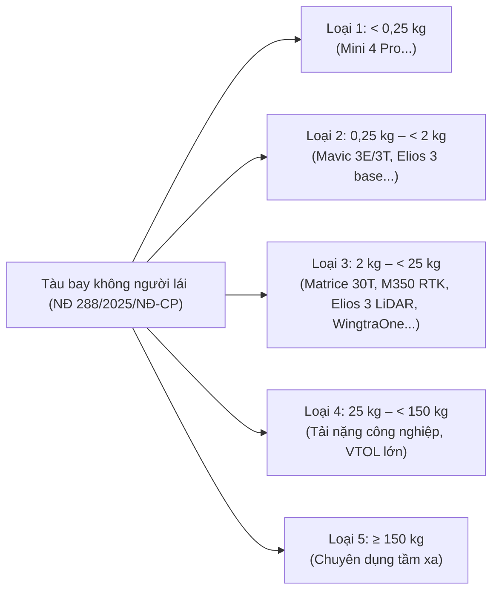
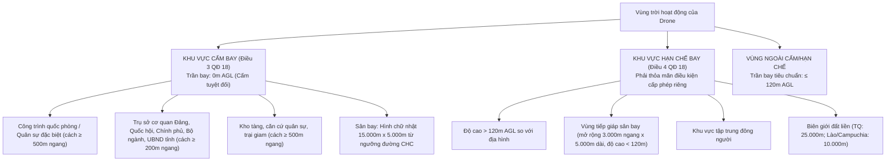
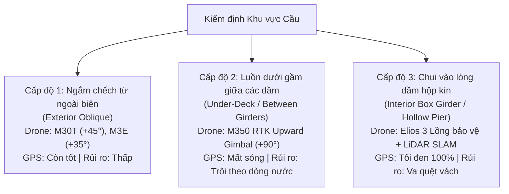
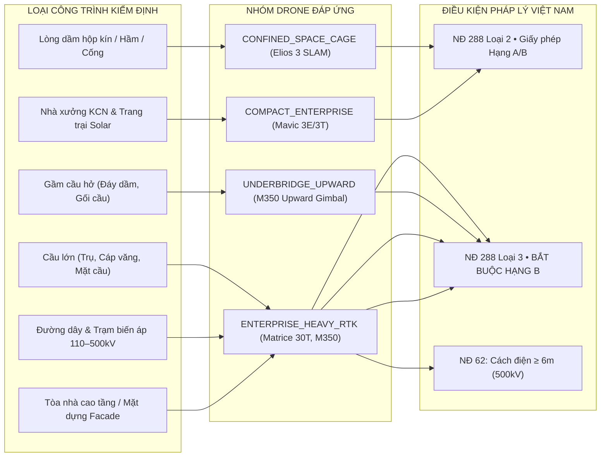

# Phân Loại Phương Tiện Bay (Drone), Công Trình Phù Hợp, Độ Cao, Sức Gió & Quy Chuẩn Pháp Lý Việt Nam

> **Ưu tiên áp dụng:** Tài liệu này đặt **hệ thống văn bản quy phạm pháp luật Việt Nam làm chuẩn mực cao nhất** (Luật Phòng không nhân dân 2024 số 49/2024/QH15, Nghị định 288/2025/NĐ-CP, Nghị quyết 24/2026/NQ-CP, Thông tư 78/2026/TT-BCA, Quyết định 18/2020/QĐ-TTg, Nghị định 62/2025/NĐ-CP về an toàn lưới điện). Sau đó kết hợp với các tiêu chuẩn quốc tế (EASA C0–C6) và nghiên cứu kỹ thuật thực nghiệm chuyên ngành (FHWA-HRT-21-060, NAP 27881, Nature Scientific Reports 2025, AIP Advances) nhằm đối chiếu và chuẩn hóa cho hệ sinh thái **SmartDroneInspection**.

---

## Mục lục

1. [Khung Pháp Lý Việt Nam về Quản Lý và Vận Hành Drone (Bắt buộc)](#1-khung-pháp-lý-việt-nam-về-quản-lý-và-vận-hành-drone-bắt-buộc)
   - 1.1. [Phân loại 5 nhóm phương tiện bay theo MTOW (Điều 4 NĐ 288/2025/NĐ-CP)](#11-phân-loại-5-nhóm-phương-tiện-bay-theo-mtow-điều-4-nđ-2882025nđ-cp)
   - 1.2. [Quy định về Giấy phép điều khiển bay: Hạng A vs. Hạng B (Điều 19, 27, 28 NĐ 288 & NQ 24/2026)](#12-quy-định-về-giấy-phép-điều-khiển-bay-hạng-a-vs-hạng-b)
   - 1.3. [Quy định Đăng ký phương tiện bay và thiết bị quản lý hoạt động bay (Thông tư 78/2026/TT-BCA)](#13-quy-định-đăng-ký-phương-tiện-bay-và-thiết-bị-quản-lý-hoạt-động-bay)
   - 1.4. [Quy định Cấp phép bay (Flight Permit) và trường hợp miễn phép (Điều 21, 22 NĐ 288)](#14-quy-định-cấp-phép-bay-flight-permit-và-trường-hợp-miễn-phép)
   - 1.5. [Khu vực cấm bay & Khu vực hạn chế bay (Quyết định 18/2020/QĐ-TTg)](#15-khu-vực-cấm-bay--khu-vực-hạn-chế-bay-quyết-định-182020qđ-ttg)
   - 1.6. [Khoảng cách an toàn đối với Công trình lưới điện cao áp (Nghị định 62/2025/NĐ-CP)](#16-khoảng-cách-an-toan-đối-với-công-trình-lưới-điện-cao-áp-nghị-định-622025nđ-cp)
2. [5 Nhóm Drone Công Nghiệp Phù Hợp Kiểm Định Hạ Tầng & Thông Số Thực Tế](#2-5-nhóm-drone-công-nghiệp-phù-hợp-kiểm-định-hạ-tầng--thông-số-thực-tế)
3. [Giải Phẫu Bài Toán Đặc Thù: Kiểm Định Gầm Cầu (3 Cấp độ tiếp cận)](#3-giải-phẫu-bài-toán-đặc-thù-kiểm-định-gầm-cầu-3-cấp-độ-tiếp-cận)
4. [Các Yếu Tố Vật Lý & Môi Trường Quyết Định Lựa Chọn Drone](#4-các-yếu-tố-vật-lý--môi-trường-quyết-định-lựa-chọn-drone)
   - 4.1. [Sức gió (Wind Speed) & Kháng gió: Tách bạch giới hạn máy và giới hạn ảnh](#41-sức-gió-wind-speed--kháng-gió-tách-bạch-giới-hạn-máy-và-giới-hạn-ảnh)
   - 4.2. [Độ cao vận hành (AGL) & Quy tắc gió tầng cao](#42-độ-cao-vận-hành-agl--quy-tắc-gió-tầng-cao)
   - 4.3. [Nhiễu điện từ trường (EMI/EMF) & Giải pháp Dual-RTK](#43-nhiễu-điện-từ-trường-emiemf--giải-pháp-dual-rtk)
   - 4.4. [Độ rọi ánh sáng, ngược sáng & Cửa sổ bay chụp nhiệt](#44-độ-rọi-ánh-sáng-ngược-sáng--cửa-sổ-bay-chụp-nhiệt)
5. [Ma Trận Đối Khớp Toàn Diện: Loại Công Trình ↔ Drone ↔ Pháp Lý VN](#5-ma-trận-đối-khớp-toàn-diện-loại-công-trình--drone--pháp-lý-vn)
6. [Đánh Giá Hiện Trạng Codebase SmartDroneInspection](#6-đánh-giá-hiện-trạng-codebase-smartdroneinspection)
7. [Định Hướng Triển Khai Vào Hệ Thống (3 Điểm Chạm)](#7-định-hướng-triển-khai-vào-hệ-thống-3-điểm-chạm)
8. [Văn Bản Pháp Lý & Tài Liệu Dẫn Chiếu](#8-văn-bản-pháp-lý--tài-liệu-dẫn-chiếu)

---

## 1. Khung Pháp Lý Việt Nam về Quản Lý và Vận Hành Drone (Bắt buộc)

Hoạt động khai thác tàu bay không người lái (UAV/drone) phục vụ kiểm định công trình xây dựng, cầu đường và lưới điện tại Việt Nam chịu sự điều chỉnh trực tiếp của:
- **Luật Phòng không nhân dân số 49/2024/QH15** (được sửa đổi bởi Luật số 98/2025/QH15).
- **Nghị định số 288/2025/NĐ-CP** ngày 05/11/2025 của Chính phủ quy định về quản lý tàu bay không người lái và phương tiện bay khác.
- **Nghị quyết số 24/2026/NQ-CP** ngày 29/04/2026 của Chính phủ về cắt giảm, đơn giản hóa thủ tục hành chính.
- **Thông tư số 78/2026/TT-BCA** ngày 05/06/2026 của Bộ Công an quy định chi tiết về đăng ký, quản lý phương tiện bay.
- **Quyết định số 18/2020/QĐ-TTg** ngày 10/06/2020 của Thủ tướng Chính phủ về thiết lập khu vực cấm bay, khu vực hạn chế bay.
- **Nghị định số 62/2025/NĐ-CP** ngày 04/03/2025 của Chính phủ quy định chi tiết thi hành Luật Điện lực về bảo vệ công trình điện lực và an toàn trong lĩnh vực điện lực.

---

### 1.1. Phân loại 5 nhóm phương tiện bay theo MTOW (Điều 4 NĐ 288/2025/NĐ-CP)

Khoản 1 Điều 4 Nghị định 288/2025/NĐ-CP quy định phân loại tàu bay không người lái theo **Trọng lượng cất cánh tối đa (Maximum Take-Off Weight — MTOW)**:

| Phân loại | Ngưỡng MTOW | Dòng máy đại diện trong kiểm định | Nhận định pháp lý & Vận hành |
| :--- | :--- | :--- | :--- |
| **Loại 1** | **$< 0,25\text{ kg}$** ($< 250\text{g}$) | DJI Mini 4 Pro ($249\text{g}$) | Người dưới 18 tuổi được phép điều khiển nếu phục vụ vui chơi giải trí. Tuy nhiên, nếu dùng để **kiểm định thương mại/khảo sát thì vẫn bắt buộc phải có Giấy phép bay**. |
| **Loại 2** | **$0,25\text{ kg} \le \text{MTOW} < 2\text{ kg}$** | DJI Mavic 3 Enterprise (`M3E`: $915\text{g}$, `M3T`: $920\text{g}$, MTOW $1,05\text{kg}$); Flyability Elios 3 bản chuẩn không LiDAR ($1,9\text{kg}$) | Bắt buộc người lái từ đủ 18 tuổi, có **Giấy phép điều khiển Hạng A** (nếu bay trực quan VLOS) hoặc **Hạng B** (nếu bay lập trình tự động / BVLOS). |
| **Loại 3** | **$2\text{ kg} \le \text{MTOW} < 25\text{ kg}$** | **Trục xương sống của kiểm định hạ tầng:** - DJI Matrice 30T ($3,77\text{kg}$, MTOW $4,07\text{kg}$) - DJI Matrice 350 RTK ($6,47\text{kg}$, MTOW $9,20\text{kg}$) - Flyability Elios 3 gắn LiDAR ($2,35\text{kg}$, MTOW $2,50\text{kg}$) - WingtraOne GEN II VTOL ($3,7\text{kg}$, MTOW $4,5\text{kg}$) | **Bắt buộc Giấy phép điều khiển Hạng B** ở mọi chuyến bay (kể cả bay quan sát trực quan hay bay tự động theo waypoint). |
| **Loại 4** | **$25\text{ kg} \le \text{MTOW} < 150\text{ kg}$** | UAV tải nặng mang thiết bị LiDAR địa hình công suất lớn, camera chụp phim điện ảnh | Bắt buộc Giấy phép Hạng B, kiểm định an toàn nghiêm ngặt. |
| **Loại 5** | **$\ge 150\text{ kg}$** | UAV vận tải, tuần thám tầm xa | Quy chế tương đương hàng không dân dụng/quân sự. |

---

### 1.2. Quy định về Giấy phép điều khiển bay: Hạng A vs. Hạng B

Căn cứ Điều 19, Điều 27 Nghị định 288/2025/NĐ-CP và Nghị quyết 24/2026/NQ-CP:

1. **Điều kiện người điều khiển (Điều 19)**:
   - Từ đủ 18 tuổi trở lên.
   - Sức khỏe bảo đảm: trong máu, hơi thở không có cồn, ma túy, chất kích thích.
   - Phải có Giấy phép điều khiển phương tiện bay do cơ quan có thẩm quyền cấp hoặc bằng/chứng chỉ quốc tế được Bộ Quốc phòng công nhận.
2. **Hai hạng Giấy phép điều khiển phương tiện bay (Điều 27)**:
   - **Giấy phép Hạng A (Điều khiển bay bằng trực quan — VLOS)**: Cấp cho người điều khiển phương tiện bay **Loại 2 ($0,25\text{kg} \le \text{MTOW} < 2\text{kg}$)**, bay trong tầm nhìn mắt thường.
   - **Giấy phép Hạng B (Điều khiển bay bằng thiết bị — BVLOS / Lập trình tự động)**:
     - Bắt buộc đối với phương tiện bay **Loại 3, Loại 4, Loại 5 (MTOW $\ge 2\text{kg}$)**.
     - Hoặc đối với phương tiện bay bất kỳ khi **bay ngoài tầm nhìn trực quan (BVLOS)** hoặc **bay theo chương trình cài đặt sẵn qua bộ điều khiển trung tâm (Waypoint / Mission Planner / MAVLink)**.
3. **Thời hạn hiệu lực & Thẩm quyền cấp (Điều 27, Điều 28, NQ 24/2026/NQ-CP)**:
   - Thời hạn hiệu lực: **10 năm**.
   - Cơ sở đào tạo giáo dục nghề nghiệp tổ chức huấn luyện (Lý thuyết hàng không + Thực hành bay).
   - Cơ quan có thẩm quyền thuộc **Bộ Quốc phòng** sát hạch, cấp phép (thời gian giải quyết là **08 ngày làm việc** theo NQ 24/2026/NQ-CP).

> **Ý nghĩa đối với SmartDroneInspection:** Mọi phi công đối tác (`INSPECTOR`) điều khiển các dòng drone như DJI Matrice 30T, Matrice 350 RTK, hoặc thực hiện bay lập trình tự động theo tuyến trên nền tảng **bắt buộc phải có Giấy phép Hạng B**.

---

### 1.3. Quy định Đăng ký phương tiện bay và thiết bị quản lý hoạt động bay

Căn cứ Điều 29 Luật Phòng không nhân dân 2024, Điều 18 Nghị định 288/2025/NĐ-CP và **Thông tư 78/2026/TT-BCA** (có hiệu lực từ 20/07/2026):

1. **Bắt buộc đăng ký trước khi đưa vào khai thác**: Mọi drone dân sự tại Việt Nam phải có Giấy chứng nhận đăng ký do cơ quan Công an cấp.
2. **Hồ sơ đăng ký phương tiện (Điều 18 NĐ 288 & Điều 9 TT 78/2026/TT-BCA)**:
   - Giấy tờ chứng minh sở hữu hợp pháp: Tờ khai hải quan nhập khẩu; Hóa đơn VAT; Văn bản chuyển nhượng hợp pháp.
   - Tài liệu chứng minh đáp ứng tiêu chuẩn/quy chuẩn kỹ thuật: Giấy chứng nhận xuất xưởng (CoC), kiểm định kỹ thuật.
3. **Mã định danh và Gắn thiết bị quản lý hoạt động bay (Điều 5, Điều 6 TT 78/2026/TT-BCA)**:
   - Mỗi drone sau khi đăng ký được cấp một **số đăng ký riêng biệt (mã định danh chủ sở hữu)**.
   - Drone phải được **gắn tem điện tử hoặc thiết bị điện tử tích hợp số đăng ký** do cơ quan đăng ký thuộc Bộ Công an gắn trực tiếp để phục vụ kiểm soát, nhận diện trên không.
4. **Phân cấp cơ quan đăng ký (Điều 8 TT 78/2026/TT-BCA)**:
   - **Cục An ninh mạng và phòng, chống tội phạm sử dụng công nghệ cao (A05 - Bộ Công an)**: Đăng ký drone của cơ quan ngoại giao, tổ chức nước ngoài, đăng ký tạm thời.
   - **Công an cấp tỉnh/thành phố**: Đăng ký drone của tổ chức, cá nhân Việt Nam có trụ sở/cư trú tại địa phương (có thể phân cấp cho Công an cấp xã đối với drone $<2\text{kg}$).

---

### 1.4. Quy định Cấp phép bay (Flight Permit) và trường hợp miễn phép

Căn cứ Điều 30 Luật Phòng không nhân dân 2024 và Điều 21, 22 Nghị định 288/2025/NĐ-CP:

1. **Nguyên tắc**: Mọi hoạt động bay kiểm định công trình (thuộc mục đích thương mại, khảo sát từ trên cao) **đều phải có phép bay do Cục Tác chiến - Bộ Tổng Tham mưu (Bộ Quốc phòng) cấp**. Cùng một hoạt động chỉ cấp 01 phép bay.
2. **Phân biệt trường hợp được miễn cấp phép bay (Khoản 3 Điều 30 Luật số 49 & Điểm b Khoản 1 Điều 21 NĐ 288)**:
   - Chỉ duy nhất phương tiện bay phục vụ **vui chơi giải trí có MTOW $< 0,25\text{kg}$** hoạt động ngoài vùng cấm, ngoài vùng hạn chế bay, trong tầm nhìn trực quan; hoặc bay cứu nạn khẩn cấp mới được miễn phép.
   - **Cảnh báo quan trọng:** Hoạt động kiểm định công trình bằng drone (dù dùng máy nhỏ như Mavic 3E/3T hay Mini) là hoạt động thương mại/chuyên môn, **KHÔNG thuộc diện miễn phép bay**.
3. **Thời hạn nộp hồ sơ xin phép bay (Khoản 2 Điều 22 NĐ 288)**:
   - **Tối thiểu 07 ngày** trước ngày bay đối với chuyến bay thông thường.
   - **Tối thiểu 12 ngày** trước ngày bay nếu chuyến bay có ảnh hưởng, hạn chế khai thác đường hàng không hoặc sân bay cần phát Thông báo hàng không (NOTAM).
   - Thời gian cấp phép của cơ quan thẩm quyền: **05 ngày làm việc** kể từ khi nhận đủ hồ sơ hợp lệ.
4. **Thời hạn hiệu lực của Phép bay (Khoản 4 Điều 21 NĐ 288)**:
   - Cho 01 hoạt động thông thường: **Tối đa không quá 30 ngày**.
   - Phục vụ hoạt động công vụ hoặc nông nghiệp: Tối đa không quá 180 ngày.
   - Tại khu vực bay truyền thống: Tối đa không quá 360 ngày.

---

### 1.5. Khu vực cấm bay & Khu vực hạn chế bay (Quyết định 18/2020/QĐ-TTg)

Quyết định 18/2020/QĐ-TTg quy định ranh giới không gian cụ thể trong vùng trời Việt Nam:

> **Lưu ý phân biệt giữa Quy định chung và Điều kiện cấp phép cụ thể:**
> - Trần bay pháp lý chung trong vùng hạn chế theo QĐ 18 là **$120\text{m AGL}$**.
> - Các con số như trần bay **$50\text{m AGL}$** (vùng kiểm soát tiếp cận CTR Tân Sơn Nhất) hay **$100\text{m AGL}$** (hành lang lưới điện Cát Lái) được thể hiện trong dữ liệu `AirspaceAdvisoryService` của hệ thống là **điều kiện giới hạn cụ thể do đơn vị quản lý bay (Sư đoàn Không quân 370 / Bộ Tư lệnh) áp đặt trong văn bản cấp phép hiệp đồng**, không phải trần bay áp dụng đại trà cho mọi vùng trời cả nước.

---

### 1.6. Khoảng cách an toàn đối với Công trình lưới điện cao áp (Nghị định 62/2025/NĐ-CP)

Khi kiểm định đường dây truyền tải điện, trạm biến áp hoặc công trình hạ tầng nằm liền kề lưới điện, hệ thống phải tuân thủ nghiêm ngặt **Nghị định 62/2025/NĐ-CP** (thay thế NĐ 14/2014 và NĐ 51/2020):

1. **Hạn chế bay gần công trình lưới điện cao áp (Khoản 6 Điều 3)**:
   - Phương tiện bay **không được phép bay vào phạm vi $500\text{m}$** tính từ mép ngoài công trình lưới điện cao áp, siêu cao áp trên không ($110\text{kV}, 220\text{kV}, 500\text{kV}$), hoặc **$100\text{m}$** đối với lưới điện trung áp.
   - **Ngoại lệ:** Chỉ phương tiện bay làm nhiệm vụ quản lý, kiểm tra, bảo dưỡng, sửa chữa đường dây điện được phép theo quy định mới được bay vào phạm vi này.
2. **Khoảng cách an toàn phóng điện tối thiểu (Khoản 8 Điều 4)**:
   Khi thực hiện công việc gần hoặc trong hành lang bảo vệ đường dây dẫn điện trên không, thiết bị/phương tiện bay tuyệt đối không được vi phạm khoảng cách an toàn phóng điện theo cấp điện áp:

| Cấp điện áp lưới điện | Khoảng cách an toàn phóng điện tối thiểu của thiết bị/phương tiện bay (Khoản 8 Điều 4 NĐ 62/2025) | Khuyến nghị Stand-off kỹ thuật khi dùng Drone có Zoom quang học 20x–30x |
| :--- | :---: | :---: |
| **Đến 35 kV** (Trung áp) | **$2,0\text{ m}$** | $4\text{m} – 6\text{m}$ |
| **110 kV** (Cao áp) | **$3,0\text{ m}$** | $6\text{m} – 10\text{m}$ |
| **220 kV** (Cao áp) | **$4,0\text{ m}$** | $8\text{m} – 12\text{m}$ |
| **500 kV** (Siêu cao áp) | **$6,0\text{ m}$** | **$12\text{m} – 20\text{m}$** *(kết hợp Dual-RTK chống nhiễu)* |

---

## 2. 5 Nhóm Drone Công Nghiệp Phù Hợp Kiểm Định Hạ Tầng & Thông Số Thực Tế

Bảng dưới đây tổng hợp thông số chính thức từ Datasheet và Hướng dẫn sử dụng của nhà sản xuất (DJI Enterprise, Flyability, Wingtra), đã được quy đổi chính xác theo Luật Việt Nam:

| Nhóm Drone Kỹ Thuật | Thiết bị đại diện | MTOW & Phân loại VN (NĐ 288) | Hạng bằng lái bắt buộc (VN) | Kháng gió máy tối đa | Kháng nước / Bụi | Cấu hình Gimbal & Cảm biến đặc thù | Công trình phù hợp nhất |
| :--- | :--- | :--- | :--- | :--- | :--- | :--- | :--- |
| **1. `COMPACT_ENTERPRISE`** *(Đa cánh quạt nhỏ gọn)* | DJI Mavic 3 Enterprise (`M3E` / `M3T`) | $1,05\text{ kg}$ $\rightarrow$ **Loại 2** | **Hạng A** (VLOS) hoặc **Hạng B** (Tự động) | **$12\text{ m/s}$** | **Không có IP** *(chỉ bay khô ráo)* | - Gimbal ngửa tối đa **$+35^\circ$** - `M3E`: 20MP Mechanical Shutter + Zoom - `M3T`: Thermal $640\times 512$ + Tele Zoom - Module RTK rời | - Mái nhà xưởng KCN - Trang trại điện mặt trời (Solar Farm) - Mặt cầu nhỏ, lan can, ngắm chếch dầm ngoài trời |
| **2. `ENTERPRISE_HEAVY_RTK`** *(Công nghiệp tải nặng, kháng nhiễu)* | DJI Matrice 30T ($4,07\text{kg}$), Matrice 350 RTK ($9,2\text{kg}$) | $4,07\text{kg} – 9,2\text{kg}$ $\rightarrow$ **Loại 3** | **Bắt buộc Hạng B** | **$12\text{ m/s}$** (M350) **$15\text{ m/s}$** (M30T) | **IP55** *(chịu mưa nhẹ, bụi, gió biển)* | - **Dual-RTK tích hợp** (chống nhiễu từ trường cao thế & thép) - Zoom quang học **$20\text{x}–34\text{x}$** + Camera nhiệt bức xạ - Laser đo cự ly $1200\text{m}$ | - Đường dây & Trạm biến áp 110kV–500kV - Trụ tháp cầu dây văng, cáp treo - Mặt dựng tòa nhà cao tầng (Facade) - Cảng biển, nhà máy nhiệt điện |
| **3. `UNDERBRIDGE_UPWARD`** *(Chuyên dụng gầm cầu ngoài trời)* | DJI Matrice 350 RTK (gắn **Single Upward Gimbal**), Skydio X10 | $2,1\text{kg} – 9,2\text{kg}$ $\rightarrow$ **Loại 3** | **Bắt buộc Hạng B** | **$12\text{ m/s}$** | **IP54 / IP55** | - **Upward Gimbal $+90^\circ$** (camera ngửa thẳng đứng trên lưng) - **Vision 6 hướng / LiDAR SLAM** chống mất GPS - Đèn chiếu sáng Spotlight bù ngược sáng | - Đáy bản mặt cầu (Soffit) - Đáy dầm bê tông/thép giữa sông - Gối cầu, khe co giãn dưới gầm cầu |
| **4. `CONFINED_SPACE_CAGE`** *(Drone lồng bảo vệ không gian hẹp)* | Flyability Elios 3 (+ LiDAR payload) | $1,9\text{kg}$ (chuẩn) / $2,5\text{kg}$ (LiDAR) $\rightarrow$ **Loại 2 hoặc 3** | **Bắt buộc Hạng B** *(nếu $\ge 2\text{kg}$ hoặc bay thiết bị)* | **$5\text{–}7\text{ m/s}$** *(chỉ bay trong nhà kín)* | **IP44 / IP68 (LiDAR)** | - **Khung lồng Carbon chống va đập** - Định vị **3D LiDAR SLAM** không cần GPS - Đèn LED trợ sáng $16.000\text{ lumens}$ | - Lòng dầm hộp bê tông (Box Girder) - Mố cầu rỗng, trụ rỗng - Hầm đường bộ, cống ngầm, bồn chứa |
| **5. `LONG_RANGE_CORRIDOR`** *(Cánh bằng cất hạ cánh thẳng đứng / Tuyến dài)* | WingtraOne GEN II VTOL, JOUAV CW-15 | $4,5\text{kg} – 15\text{kg}$ $\rightarrow$ **Loại 3** | **Bắt buộc Hạng B** (BVLOS) | **$12\text{ m/s}$** | **IP54** | - Bay hành trình cánh bằng $60\text{–}90\text{ phút}$ - Camera 42MP/61MP Full-frame hoặc LiDAR quét tuyến | - Tuyến đường cao tốc hàng chục km - Tuyến hành lang truyền tải điện liên tỉnh - Đê điều, đường ống dẫn dầu khí |

---

## 3. Giải Phẫu Bài Toán Đặc Thù: Kiểm Định Gầm Cầu (3 Cấp độ tiếp cận)

Trong kiểm định cầu đường bộ/đường sắt theo hướng dẫn FHWA (Mỹ) và thực tế thi công tại Việt Nam, khu vực **gầm cầu (under-bridge)** được phân cấp thành **3 kịch bản bay hoàn toàn khác biệt**:

1. **Cấp độ 1 — Chụp ngắm chếch từ bên ngoài mép cầu (Exterior Oblique)**:
   - Drone bay dọc bên ngoài hành lang lan can cầu, thấp hơn đáy dầm khoảng $1\text{m–}2\text{m}$ và cách dầm biên $3\text{m–}5\text{m}$.
   - Tín hiệu GPS vẫn ổn định. Góc ngửa gimbal yêu cầu từ **$+30^\circ$ đến $+45^\circ$**.
   - Thiết bị phù hợp: **DJI Matrice 30T** (ngửa được $+45^\circ$) hoặc **DJI Mavic 3E/3T** (ngửa được $+35^\circ$).
2. **Cấp độ 2 — Bay luồn trực tiếp dưới gầm cầu, giữa các hàng dầm (Under-Deck / Between Girders)**:
   - Drone phải bay chui vào khoảng không gian bên dưới bản mặt cầu bê tông cốt thép để soi thẳng lên đáy bản mặt cầu, dầm ngang, gối cầu trung tâm.
   - **Tín hiệu GPS bị chặn 100% (GNSS-Denied)**. Cầu vượt sông có luồng gió xoáy nén (hiệu ứng Venturi).
   - **Bẫy dòng nước chảy (Running Water Drift):** Cảm biến quang học đáy (Optical Flow) của drone thông thường sẽ khóa vào gợn sóng đang trôi bên dưới, khiến máy bay tự trôi theo dòng nước và đâm vào trụ cầu.
   - Thiết bị bắt buộc: **DJI Matrice 350 RTK gắn Single Upward Gimbal ($+90^\circ$)** kết hợp cảm biến thị giác 6 hướng hoặc LiDAR bám vào các dầm tĩnh xung quanh; hoặc **Skydio X10**.
3. **Cấp độ 3 — Chui vào lòng dầm hộp kín, mố rỗng (Interior Box Girder & Confined Spaces)**:
   - Không gian chật hẹp ($1,2\text{m–}2,5\text{m}$), tối hoàn toàn, nhiều bụi, dây cáp dự ứng lực bên trong dầm hộp.
   - Thiết bị bắt buộc: **Flyability Elios 3** có khung lồng carbon bảo vệ va chạm, cảm biến **3D LiDAR SLAM** để định vị không cần vệ tinh và hệ thống đèn LED cường độ cao $16.000\text{ lumens}$.

---

## 4. Các Yếu Tố Vật Lý & Môi Trường Quyết Định Lựa Chọn Drone

### 4.1. Sức gió (Wind Speed) & Kháng gió: Tách bạch giới hạn máy và giới hạn ảnh

Một sai lầm phổ biến là đồng nhất **sức kháng gió của drone** với **điều kiện gió cho phép kiểm định**:

| Loại giới hạn gió | Ngưỡng gió chuẩn | Căn cứ kỹ thuật & Hệ quả thực tế |
| :--- | :---: | :--- |
| **Sức kháng gió của máy bay (Airframe Limit)** | **$12\text{–}15\text{ m/s}$** *(M350, M30T)* **$5\text{–}7\text{ m/s}$** *(Elios 3)* | Giới hạn vật lý để drone giữ được thăng bằng, không bị gió bạt rơi. Không bảo đảm ảnh không bị rung nhòe. |
| **Giới hạn gió chụp ảnh vết nứt sắc nét (Inspection Quality Limit)** | **$\le 6,7\text{ m/s}$** ($15\text{ mph} \approx 24\text{ km/h}$) | Theo nghiên cứu thực nghiệm **FHWA-HRT-21-060**, khi gió vượt quá $6,7\text{ m/s}$, drone liên tục phải nghiêng góc để kháng gió, gây **nhòe chuyển động (Motion Blur)**, làm mất khả năng đo vết nứt bê tông $\ge 0,2\text{mm}$. |
| **Giới hạn gió bay tự động gần trạm điện cao thế** | **$\le 8,0\text{ m/s}$** | Theo *Nature Scientific Reports (2025)*, phải cộng thêm độ dạt do gió giật $0,5\text{m}$ vào khoảng cách an toàn. |
| **Giới hạn gió khi bay kiểm định nhiệt (Thermal)** | **$\le 5,0\text{ m/s}$** | Gió mạnh gây hiện tượng đối lưu làm mát cưỡng bức, làm giảm chênh lệch nhiệt độ ($\Delta T$) của khuyết tật trên tấm pin mặt trời và mối nối điện. |

---

### 4.2. Độ cao vận hành (AGL) & Quy tắc gió tầng cao

1. **Trần bay pháp lý:** Giới hạn tối đa không quá **$120\text{m AGL}$** (theo Điều 4 QĐ 18/2020/QĐ-TTg). Trường hợp công trình cao hơn $120\text{m}$ (như trụ tháp cầu dây văng lớn, nhà chọc trời) bắt buộc phải được chấp thuận trong văn bản cấp phép bay của Cục Tác chiến.
2. **Quy tắc tăng gió theo độ cao (Wind Gradient):**
   Tốc độ gió ở độ cao $H$ tăng dần so với mặt đất theo quy luật lũy thừa:
   $$v(H) = v_{10} \cdot \left(\frac{H}{10}\right)^\alpha \quad (\text{với } \alpha \approx 0,14\text{–}0,28 \text{ tùy địa hình})$$
   Ở độ cao $100\text{m–}150\text{m}$, tốc độ gió thực tế thường **lớn hơn từ $30\%\text{–}50\%$** so với tốc độ gió đo ở mặt đất. Do đó, nếu mặt đất đo được gió $8\text{ m/s}$, trên đỉnh tháp $120\text{m}$ gió có thể đạt $11\text{–}12\text{ m/s}$ (tiệm cận ngưỡng nguy hiểm của thiết bị).

---

### 4.3. Nhiễu điện từ trường (EMI/EMF) & Giải pháp Dual-RTK

Tại các công trình đường dây truyền tải và trạm biến áp $110\text{kV} – 500\text{kV}$:
- Cường độ từ trường ở cự ly $\le 3\text{m}$ quanh dây dẫn $500\text{kV}$ đạt $\ge 220\text{–}290\text{ }\mu\text{T}$, gây bão hòa la bàn từ (Compass), làm lệch góc yaw và ngắt kết nối điều khiển (*AIP Advances 2022*).
- **Yêu cầu kỹ thuật bắt buộc:**
  1. Phải sử dụng Drone có **Dual-RTK (2 ăng-ten GNSS)** để tính toán hướng mũi máy bay theo pha vệ tinh, không dùng la bàn từ.
  2. Trang bị ống kính **Zoom quang học $20\text{x}–30\text{x}$** để drone giữ khoảng cách an toàn $12\text{m–}20\text{m}$ (vừa tuân thủ Khoản 8 Điều 4 Nghị định 62/2025/NĐ-CP $\ge 6\text{m}$, vừa tránh xa vùng điện từ nguy hiểm).

---

### 4.4. Độ rọi ánh sáng, ngược sáng & Cửa sổ bay chụp nhiệt

- **Gầm cầu và không gian kín:** Độ rọi rất thấp ($< 50\text{ lux}$), chênh sáng gắt với nền trời bên ngoài. Cần máy bay có dải động cao (HDR), camera FPV nhìn đêm và **đèn Spotlight trợ sáng** (hoặc đèn LED $16.000\text{ lumens}$ của Elios 3).
- **Cửa sổ bay chụp ảnh nhiệt (Thermal Window):** Phải tiến hành vào sáng sớm (trước $9\text{h}00$) hoặc chiều mát (sau $15\text{h}30$) để tránh hiện tượng bức xạ nhiệt mặt trời làm nóng bề mặt (Solar loading) gây cảnh báo giả.

---

## 5. Ma Trận Đối Khớp Toàn Diện: Loại Công Trình ↔ Drone ↔ Pháp Lý VN

| Loại Công Trình & Hạng Mục | Độ cao điển hình | Môi trường đặc thù | Giới hạn gió kiểm định | Cấu hình Drone Bắt buộc | Nhóm Drone Đáp ứng | Hạng Bằng lái Bắt buộc (VN) |
| :--- | :---: | :--- | :---: | :--- | :--- | :---: |
| **Cầu lớn — Phần trên** *(Trụ tháp, Cáp văng, Mặt cầu, Lan can)* | $30\text{m} – 150\text{m}$ | Gió sông/biển mạnh, kết cấu thép lớn | $\le 6,7\text{ m/s}$ *(ảnh)* $\le 12\text{ m/s}$ *(máy)* | `RTK`, `OPTICAL_ZOOM_20X`, `IP55` | **`ENTERPRISE_HEAVY_RTK`** *(Matrice 30T / M350 RTK)* | **Hạng B** (Loại 3) |
| **Cầu — Gầm cầu hở** *(Đáy bản mặt cầu, Đáy dầm chính, Gối cầu)* | $2\text{m} – 35\text{m}$ | Mất sóng GPS, trôi theo dòng nước, gió Venturi | $\le 6,7\text{ m/s}$ | `UPWARD_GIMBAL_90`, `GNSS_DENIED_VISION`, `SPOTLIGHT` | **`UNDERBRIDGE_UPWARD`** *(M350 RTK gắn Upward Gimbal)* | **Hạng B** (Loại 3) |
| **Cầu — Lòng dầm hộp kín / Hầm** *(Interior Box Girder, Hầm, Cống rãnh)* | $0,5\text{m} – 25\text{m}$ | Không gian kín hẹp, tối đen 100%, không GPS, bụi bặm | $\le 5,0\text{ m/s}$ *(kín gió)* | `COLLISION_CAGE`, `LIDAR_SLAM`, `LED_LIGHTING` | **`CONFINED_SPACE_CAGE`** *(Flyability Elios 3)* | **Hạng B** *(nếu $\ge 2\text{kg}$ hoặc bay thiết bị)* |
| **Lưới điện & Trạm cao thế** *(110kV, 220kV, 500kV: Bát sứ, mối nối)* | $25\text{m} – 110\text{m}$ | Điện từ trường mạnh, nguy cơ phóng điện | $\le 8,0\text{ m/s}$ | `DUAL_RTK` *(kháng EMI)*, `OPTICAL_ZOOM_20X`, `THERMAL`, `IP55` | **`ENTERPRISE_HEAVY_RTK`** *(Matrice 350 RTK + H20T / M30T)* | **Hạng B** (Loại 3) *(Tuân thủ NĐ 62: cự ly $\ge 6\text{m}$)* |
| **Tòa nhà cao tầng / Mặt dựng Facade** *(Kính, tường bao, khe lún, mái đỉnh)* | $40\text{m} – 200\text{m+}$ | Gió giật tầng cao, hạn chế không gian đô thị | $\le 6,7\text{ m/s}$ | `RTK`, `OPTICAL_ZOOM`, `THERMAL` *(soi thấm nước)* | **`ENTERPRISE_HEAVY_RTK`** *(Matrice 30T / M350 RTK)* | **Hạng B** (Loại 3) |
| **Nhà xưởng KCN & Trang trại Solar** *(Mái tôn, Pin năng lượng mặt trời)* | $10\text{m} – 50\text{m}$ | Địa hình thoáng, phản xạ nhiệt mặt trời | $\le 5,0\text{ m/s}$ *(soi nhiệt)* | `THERMAL_RADIOMETRIC`, `RGB_HIGH_RES` | **`COMPACT_ENTERPRISE`** *(Mavic 3T)* hoặc **`ENTERPRISE_HEAVY_RTK`** | **Hạng A** *(nếu M3T bay VLOS)* hoặc **Hạng B** |

---

## 6. Đánh Giá Hiện Trạng Codebase SmartDroneInspection

| Khía cạnh | Thực trạng trong Codebase hiện tại | Đánh giá & Khoảng cách (Gaps) |
| :--- | :--- | :--- |
| **1. Đăng ký Drone (`MF1`)** | - Form `InspectorDroneRegistrationPage.tsx` có các ô `mtowKg`, `maxFlightTimeMinutes`, `cameraSensor`, `safetyFeatures`. - Dữ liệu đang nối chuỗi vào cột `model` (`VARCHAR(1000)`). | **Chưa tự động phân loại theo Nghị định 288/2025/NĐ-CP**: Người dùng nhập `mtowKg` nhưng hệ thống chưa tự suy ra **Loại 1 $\rightarrow$ Loại 5** và chưa tự suy ra **Hạng bằng lái bắt buộc (Hạng A hay Hạng B)**. |
| **2. Bằng lái phi công (`MF1`)** | - Bảng `inspector_profiles` có cột `pilot_license_class`, `pilot_license_number`. - File `InspectorProfileDialog.tsx:465` placeholder đang viết: `"VD: Hạng 2 (Trọng lượng 2-25kg), BVLOS..."`. | **Chưa chuẩn thuật ngữ luật Việt Nam**: Cần chuẩn hóa thành **Giấy phép Hạng A (VLOS, $<2\text{kg}$)** và **Giấy phép Hạng B (Thiết bị/BVLOS, $\ge 2\text{kg}$)** theo đúng Điều 27 NĐ 288/2025/NĐ-CP. |
| **3. Cấu hình Drone gầm cầu** | - Bảng `drones` có `payload_metadata` (`jsonb`). - Form chỉ cho chọn Standard / Thermal, chưa có các trường cho gầm cầu. | **Thiếu trường năng lực chụp gầm cầu**: Chưa có tùy chọn `Upward Gimbal (+90°)`, `Định vị khi mất GPS (Vision/LiDAR SLAM)`, `Chuẩn chống nước IP55`, `Sức kháng gió tối đa (m/s)`. |
| **4. Khai báo Công trình (`Asset`)** | - Bảng `assets` có cột `technical_profile` (`jsonb`) và `inspection_items` (`jsonb`). - `AssetsPage.tsx` đã có checklist 8 hạng mục cầu. | **Chưa khai báo Độ cao công trình & Môi trường**: Chưa lưu độ cao công trình ($H_{\text{asset}}$), chưa đối chiếu với trần bay vùng trời `maxAltitudeMetersAgl`, và chưa tự động suy ra cấu hình drone khuyến nghị khi khách hàng chọn hạng mục gầm cầu. |
| **5. Điều phối kiểm định (`MF2`)** | - `Mf2InspectionAssignmentAdapter.java` kiểm tra: Inspector có bằng lái còn hạn, Drone có `serviceability == ACTIVE`, hạn đăng ký còn hiệu lực, không trùng lịch. | **Chưa kiểm tra tính tương thích kỹ thuật giữa Drone và Công trình**: Chưa kiểm tra xem công trình có hạng mục gầm cầu thì chiếc drone được gán có `Upward Gimbal` hay không, và Inspector có Bằng Hạng B tương ứng với trọng lượng drone hay không. |

---

## 7. Định Hướng Triển Khai Vào Hệ Thống (3 Điểm Chạm)

Giải pháp tận dụng **100% cấu trúc cơ sở dữ liệu hiện tại**, không thêm bảng mới:
- Dùng cột `payload_metadata` (`jsonb`) của bảng `drones`.
- Dùng cột `technical_profile` (`jsonb`) của bảng `assets`.
- Dùng cột `pilot_license_class` của bảng `inspector_profiles`.

### Điểm chạm 1: Chuẩn hóa Form Đăng ký Drone & Hồ sơ Bằng lái (`MF1`)
1. **Tự động gắn nhãn pháp lý theo NĐ 288/2025/NĐ-CP**:
   - Khi Inspector nhập `mtowKg` (ví dụ: `4.07`), hệ thống tự động hiển thị:
     > **Phân loại pháp lý:** Phương tiện bay **Loại 3 (2 – <25 kg)** theo NĐ 288/2025/NĐ-CP • Yêu cầu người điều khiển có **Giấy phép Hạng B**.
2. **Chọn nhóm cấu hình kỹ thuật & tính năng**:
   - Tích chọn: `Upward Gimbal (+90° chụp gầm cầu)`, `Định vị mất GPS (Vision/SLAM)`, `Dual-RTK chống nhiễu`, `Camera nhiệt (Thermal)`, `Zoom quang học ≥20x`.
   - Lưu cấu trúc JSON vào `payload_metadata`.
3. **Chuẩn hóa `InspectorProfileDialog.tsx`**:
   - Thay ô nhập tự do bằng menu chọn Hạng giấy phép chuẩn: `Hạng A (VLOS, <2kg)` hoặc `Hạng B (Thiết bị/BVLOS, ≥2kg)`.

### Điểm chạm 2: Khai báo Độ Cao Công Trình & Gợi Ý Cấu Hình (`AssetsPage`)
1. **Bổ sung vào `CreateAssetDialogForm`**:
   - Trường nhập: **Chiều cao công trình (m)** (lưu vào `technical_profile -> structureHeightMeters`).
   - Môi trường đặc thù: *Tiêu chuẩn*, *Dưới gầm cầu vượt sông (mất GPS)*, *Lòng dầm hộp/hầm*, *Đường dây điện cao thế*.
2. **Tự động đối chiếu vùng trời**:
   - So sánh chiều cao công trình với `maxAltitudeMetersAgl` của vùng trời tại tọa độ đó. Nếu công trình cao $60\text{m}$ trong vùng hạn chế $50\text{m AGL}$, hiển thị cảnh báo cần xin phép vượt trần.
3. **Tự động gợi ý Drone khi tích chọn hạng mục kiểm tra**:
   - Nếu khách hàng tích chọn *"Dầm chính & Dầm biên (dưới gầm)"* hoặc *"Gối cầu"*, hệ thống tự động gắn cờ:
     > **Khuyến nghị cấu hình:** Cần Drone nhóm `UNDERBRIDGE_UPWARD` (có Upward Gimbal $+90^\circ$ và cảm biến giữ vị trí khi mất GPS).

### Điểm chạm 3: Hiển thị Thẻ Tương Thích Kỹ Thuật Khi Điều Phối (`MF2`)
- Trong màn hình duyệt báo giá / điều phối (`CreateInspectionDialog` / `ScheduleProposalsPage`):
  - Hiển thị badge kiểm tra tương thích 3 lớp:
    1. **Pháp lý:** Bằng lái Inspector (Hạng A/B) có đủ điều kiện lái Drone (Loại 2/3) không?
    2. **Độ cao:** Drone có trần bay đáp ứng chiều cao công trình và trần vùng trời không?
    3. **Tính năng:** Drone có đáp ứng yêu cầu gầm cầu/nhiễu điện từ của công trình không?

---

## 8. Văn Bản Pháp Lý & Tài Liệu Dẫn Chiếu

1. **Luật Phòng không nhân dân số 49/2024/QH15** ngày 27/11/2024 (Quốc hội nước CHXHCN Việt Nam), sửa đổi bởi Luật số 98/2025/QH15 — quy định đăng ký, cấp phép bay và điều kiện khai thác phương tiện bay (Điều 29, 30, 31, 32).
2. **Nghị định số 288/2025/NĐ-CP** ngày 05/11/2025 của Chính phủ quy định về quản lý tàu bay không người lái và phương tiện bay khác (Công báo Chính phủ số 1589 + 1590).
3. **Nghị quyết số 24/2026/NQ-CP** ngày 29/04/2026 của Chính phủ về cắt giảm, đơn giản hóa thủ tục hành chính liên quan cấp giấy phép điều khiển phương tiện bay (Công báo số 276).
4. **Thông tư số 78/2026/TT-BCA** ngày 05/06/2026 của Bộ Công an hướng dẫn thi hành Luật Phòng không nhân dân về đăng ký phương tiện bay dân sự (hiệu lực từ 20/07/2026).
5. **Quyết định số 18/2020/QĐ-TTg** ngày 10/06/2020 của Thủ tướng Chính phủ thiết lập khu vực cấm bay, khu vực hạn chế bay đối với tàu bay không người lái và phương tiện bay siêu nhẹ.
6. **Nghị định số 62/2025/NĐ-CP** ngày 04/03/2025 của Chính phủ quy định chi tiết thi hành Luật Điện lực về bảo vệ công trình điện lực và an toàn trong lĩnh vực điện lực (Khoản 6 Điều 3; Khoản 8 Điều 4; thay thế NĐ 14/2014 và NĐ 51/2020).
7. **Federal Highway Administration — FHWA (U.S. DOT)**: *Controlled-Environment Testing of UAS Digital Camera Sensor Specifications and Operational Parameters for Bridge Safety Inspections* (Báo cáo nghiên cứu mã số FHWA-HRT-21-060) và *Effective Practices for Routine Bridge Inspections Using UAS* (FHWA-HRT-21-083).
8. **National Academies of Sciences, Engineering, and Medicine (NAP 27881)**: *Uncrewed Aerial Systems Applications for Bridge Inspections: Element-Level Bridge Data Collection*.
9. **Nature Scientific Reports (2025)**: *Substation UAV Inspection Path Planning and Safe Distance Determination under Electromagnetic Interference and Wind Gusts* (doi:10.1038/s41598-025-27525-5).
10. **AIP Advances (2022)**: *Simulation analysis and experimental research on the safety distance of UAV inspection on transmission lines* (doi:10.1063/5.0080313).
11. **European Union Aviation Safety Agency (EASA)**: *Commission Delegated Regulation (EU) 2019/945 and Implementing Regulation (EU) 2019/947 on UAS Class Identification Labels C0–C6*.
12. **Tài liệu kỹ thuật chính hãng:**
    - *DJI Matrice 350 RTK Datasheet & User Manual* (DJI Enterprise).
    - *DJI Matrice 30 / 30T Series Datasheet & User Manual v2.0* (DJI Enterprise).
    - *DJI Mavic 3 Enterprise Series Datasheet & User Manual* (DJI Enterprise).
    - *Flyability Elios 3 Technical Specifications v1* (Flyability).
