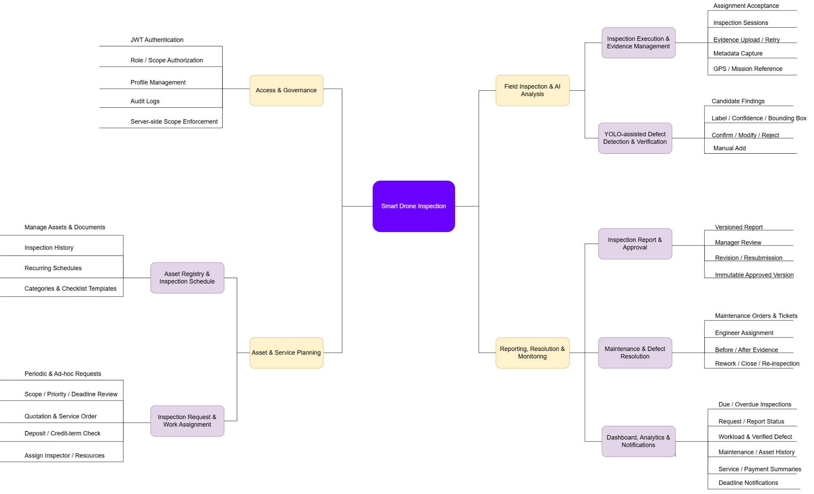

# I. Record of Changes

| Date | A* / M, D | In charge | Change Description |
| --- | --- | --- | --- |
| 11 Sep 2026 | A | Team | Version 1.0: Initial Project Introduction. |
| 03 Nov 2026 | M | Team | Version 2.0: Aligned product background, competitor review, and scope with the 5-role / 8-feature target. |
| 17 Nov 2026 | M | Team | Version 3.0: Rewritten against the implemented product. Scope narrowed to four login roles and the then-current six-feature set across three main flows; corrective maintenance recorded as an exclusion rather than a deliverable; existing-systems review extended to three comparators. |
| 18 Nov 2026 | M | Team | Version 3.1: Restructured to the four-main-flow, eight-feature model (`MF1`–`MF4`, `FE-01`–`FE-08`, two features per flow). `MF3` now ends at evidence and findings; `MF4` covers report review and payment settlement, including the re-inspection loop. Corrective maintenance execution remains a recorded exclusion. |
| 19 Nov 2026 | M | Team | Version 3.2: Documented the human-in-the-loop `DroneKnowledgeAI` retrieval boundary (`LI-9`) and synchronized FE-06/FE-07/FE-08, mobile scope, and the main flows with delivered re-inspection verdict validity, payment notice/receipt PDF, and Inspector–Customer chat. |

*A - Added M - Modified D - Deleted

# II. Project Introduction

## 1. Overview

### 1.1 Project Information

- Project name: SmartDroneInspection: AI-powered Infrastructure Inspection Management Platform
- Project code: GFA26SE139
- Group name: FA26SE112
- Software type: Web portals and mobile application for platform-managed building inspection services

The project is delivered by the team based in Ho Chi Minh City, Vietnam, under the supervision of the listed lecturers.

### 1.2 Project Team

| Full Name | Role | Email | Mobile |
| --- | --- | --- | --- |
| Phạm Minh Trí | Lecturer | tripm14@fpt.edu.vn |  |
| Đặng Ngọc Minh Đức | Lecturer | ducdnm2@fpt.edu.vn |  |
| Trần Hoàng Trung Hiếu | Leader | hieuthtse184212@fpt.edu.vn | 0963832382 |
| Phùng Trung Quốc | Member | quocptse170027@fpt.edu.vn | 0896986551 |
| Trương Thái Như | Member | nhuttse180082@fpt.edu.vn | 0328416716 |
| Trần Tùng Bách | Member | bachttse180220@fpt.edu.vn | 0378351050 |

## 2. Product Background

Organizations that own critical civil, industrial, and energy infrastructure — bridges, commercial buildings, transmission towers, solar farms, and industrial facilities — must inspect their assets periodically to detect structural defects, assess asset health, satisfy aviation and workplace-safety regulations, and confirm that previous repairs have held. These inspections are increasingly performed with camera-equipped drones, because aerial capture reaches surfaces that are slow, expensive, or unsafe to inspect from scaffolding or rope access.

In practice, however, the commercial side and the technical side of inspection are handled separately. A customer asks several partner drone operators for quotes through messaging apps; contracts are signed on paper; flight scheduling is coordinated by phone; photographs and video are returned on memory cards or shared folders; defect findings are written up in spreadsheets; and the resulting report is circulated as an email attachment. No single record connects a defect photographed on a given day to the contract that commissioned the flight, the partner who flew it, the permit that authorised it, the report that published it, and the invoice that was settled.

That fragmentation has concrete consequences for Vietnamese infrastructure owners. Flight permissions and no-fly-zone requirements are difficult to evidence after the fact. Partner pilots cannot be verified as currently qualified, and the same pilot can be double-booked across two customer organizations. Defects cannot be traced back to the geotagged photograph or video frame that demonstrates them. Reports are revised without version history, so a customer cannot prove which version was approved. Fees, commissions, and partner payouts are reconciled by hand.

SmartDroneInspection addresses this by treating inspection as a governed service rather than a one-off file transfer. The platform brings customer asset onboarding, partner qualification, service requests, priced quotations, signed agreements, partner dispatch, flight-permit readiness, field execution, photographic and video evidence, defect findings, report publication, and payment settlement into a single connected record, while leaving the actual flying to qualified partner pilots.

## 3. Existing Systems

Several commercial platforms already manage drone-captured data. Three were reviewed as benchmarks for data handling, visual review, and reporting.

### 3.1 DroneDeploy

**Description:** DroneDeploy is a cloud platform for drone flight planning, image processing, visual inspection, analysis, and reporting.

**Link:** https://www.dronedeploy.com/

**Actors:** Organization Owner/Admin, Coordinator, Pilot, Analyst, Member, External User, and Viewer.

**Features:** Automated flight planning, drone media upload, orthomosaic and 3D model processing, measurement tools, visual issue tagging, inspection-report generation, and workspace permission management.

**Pros:** Mature visual inspection interface, strong two- and three-dimensional spatial visualisation, flexible collaboration inside a workspace, and broad support for many drone models.

**Cons:** Oriented toward aerial mapping and visual issue tagging inside a single organization's workspace. It does not model a multi-party commercial service: there is no customer request and quotation negotiation, no partner-pilot qualification and dispatch across customer organizations, no Vietnam-specific flight-permit readiness gate, no independent review before publication, and no Vietnamese payment settlement.

### 3.2 Flyability Inspector

**Description:** Flyability Inspector is companion software for organising, reviewing, and reporting indoor and confined-space inspection data captured by Elios drones.

**Link:** https://www.flyability.com/inspector

**Actors:** Inspection teams, structural engineers, and asset owners.

**Features:** Asset-based organisation of inspection data, visual review with points of interest, spatial localisation, comparison of inspection history over time, and structured report generation.

**Pros:** Strong visual context for reviewing localised structural defects, and effective side-by-side comparison of the same asset across successive inspections.

**Cons:** Closely coupled to proprietary Elios hardware and its capture format. It does not accept arbitrary uploaded photographs and video from any aircraft, and it offers no commercial workflow — no service request, quotation, signed agreement, partner dispatch, payment settlement, or multi-tenant customer separation.

### 3.3 Skycatch

**Description:** Skycatch is an enterprise drone-data platform aimed at construction and industrial sites, offering automated capture, cloud processing, and progress analytics.

**Link:** https://www.skycatch.com/

**Actors:** Site managers, surveyors, project engineers, and enterprise administrators.

**Features:** Automated mission capture with supported aircraft, photogrammetric processing, volumetric and progress analysis, site dashboards, and integration with construction-management systems.

**Pros:** Strong automation across capture and processing, and good project-level analytics for measuring progress against a site model.

**Cons:** Optimised for construction progress tracking rather than periodic structural condition inspection. Its outputs are site models and measurements, not per-defect findings tied to evidence and to an independently published report, and it does not model a marketplace of partner pilots supplying inspection services to multiple customer organizations.

## 4. Business Opportunity

Infrastructure-owning enterprises across Vietnam and Southeast Asia increasingly buy drone inspection as an external service rather than maintaining an in-house aviation capability. That creates a real market for an operator that coordinates qualified partner pilots — but only if the operator can demonstrate control over the things customers and auditors care about: who flew, with which aircraft and documents, under which permit, over which asset, producing which evidence, supporting which findings, published in which report version, and settled for which amount.

No existing product covers that chain end to end for the Vietnamese market. Mapping tools capture data but do not govern commercial service. Document-management and CMMS products record contracts and work orders but have no notion of aerial capture, flight permission, or defect evidence. This gap is the opportunity: a platform that a Vietnamese inspection operator can run as its operating system, where the compliance and commercial records are the product rather than an afterthought.

The resulting product is also commercially attractive to the operator. Recurring service requests turn one-off inspections into predictable revenue; versioned quotations and signed agreements shorten the sales cycle; partner dispatch with qualification and schedule checks raises aircraft utilisation; and an auditable evidence-to-report chain is a defensible differentiator when tendering to enterprise customers.

## 5. Software Product Vision

For infrastructure-owning organizations that need auditable, regulation-aware structural inspections, SmartDroneInspection is a multi-portal web and mobile platform that connects commercial inspection contracts and vetted partner drone pilots to field execution, human-confirmed AI defect findings, independently published inspection reports, and settled payment — so that every finding can be traced back to the evidence that supports it and the contract that commissioned it.

Unlike generic cloud-storage or mapping tools, the platform separates responsibilities across four login roles — Platform Administrator (`ADMIN`), Platform Manager (`MANAGER`), Customer organization user (`CUSTOMER`), and Partner Drone Inspector (`INSPECTOR`) — and keeps automated services such as the vision model, the language model, and the payment gateways firmly in a supporting role. Automated detection proposes; a human Inspector confirms; a Manager who did not author the report decides publication; the Customer accepts and pays.

## 6. Project Scope & Limitations

The product is organised as four connected main flows, each carrying two product features.

**`MF1` — Onboarding.** A prospective customer registers an organization and its first asset. The asset location is screened against airspace restrictions: a location inside a prohibited zone cannot be registered, and a location requiring review is held for a platform decision. Partner Inspectors are admitted through a platform-governed process that records qualification and pilot-licence information, and each Inspector separately registers the drones they own, with the documents the platform requires. The platform administrator maintains the asset categories, licence classes, required drone documents, and finance settings that the rest of the product depends on.

**`MF2` — Service requests, pricing, agreements, and dispatch.** Customers raise one-time or recurring service requests. The Manager responds with a versioned quotation in Vietnamese dong, including the proposed Inspector and aircraft, and the two sides negotiate through an order chat attached to the request. After the customer accepts, the Manager records the signed paper agreement. For recurring requests, the platform generates the individual inspection occurrences covered by that agreement. The Manager then assigns a qualified Inspector and an eligible aircraft to each occurrence, with checks for pilot-licence validity, licence-class fit, and schedule conflicts across other customer organizations. An inspection chat attached to the occurrence lets the assigned Inspector and the Customer exchange messages and attachments during delivery, while an Admin-configurable assignment-acceptance timeout (default 24 hours) bounds the dispatch response.

**`MF3` — Flight readiness, field work, and evidence.** Before work begins the Inspector supplies the mission flight permit, which a Manager verifies. The Inspector then records the on-site session — start, completion, or abort with a reason — and uploads photographic and video evidence. The vision model proposes defects on that evidence, and the Inspector confirms, edits, or rejects each proposal to establish the findings baseline. During this review the Inspector may consult advisory similar-case and engineering-standard matches from `DroneKnowledgeAI`, which never replace the Inspector's own decision.

**`MF4` — Report review and payment settlement.** The platform compiles the inspection report, including an AI-drafted executive summary. A Manager who did not author the report reviews it independently and publishes a locked version, and the Customer accepts the published report and settles the service fee. Settlement is recorded against the occurrence, carries a configurable payment-due deadline with a single overdue reminder and a downloadable notice/receipt PDF, and the platform tracks partner payouts and refunds separately. A customer may also open a re-inspection against a published report; each originally confirmed defect is then re-assessed as resolved, unresolved, or inconclusive, a `RESOLVED` verdict requires fresh evidence captured in that re-inspection's completed field session, and every verdict carries a validity expiry shown on both web and mobile. Report export to PDF is an auxiliary download.

### 6.1 Major Features

Eight product features define the delivered scope, two per main flow. Each feature is owned by one team member and traced through Reports 2–5.

- **`MF1` FE-01: Registration, Sign-in and Account Access** *(Owner: Trần Hoàng Trung Hiếu)* — Customer organization onboarding with airspace screening of the first asset, secure sign-in with one-time codes and Google authentication, session and refresh handling, and account access limited to the four roles.
- **`MF1` FE-02: Partner Inspector and Drone Registration** *(Owner: Trần Hoàng Trung Hiếu)* — Platform-governed admission and review of partner Inspectors with pilot-licence records, and Inspector registration of owned drones with the required documents and review.
- **`MF2` FE-03: Buildings, Airspace Screening and Notifications** *(Owner: Phùng Trung Quốc)* — Customer maintenance of buildings, inspection checkpoints, and reference documents under the airspace gate; review of held restrictive-airspace registrations; recurring service-request planning; generation of the inspection occurrences covered by an agreement; and lifecycle notifications to the responsible users.
- **`MF2` FE-04: Service Requests, VND Quotations, Agreements and Dispatch** *(Owner: Phùng Trung Quốc)* — One-time and recurring requests, order-chat negotiation, versioned quotations in Vietnamese dong, acceptance, recorded signed agreements, and partner assignment with qualification and availability checks.
- **`MF3` FE-05: Flight Permit and On-site Field Sessions** *(Owner: Trần Tùng Bách)* — Mission flight-permit submission and verification, recording of the on-site field session including start, completion, and reasoned abort, and Manager reschedule, reassign, or cancel of the affected dispatch.
- **`MF3` FE-06: Evidence Intake and Human-Reviewed Defect Detection** *(Owner: Trần Tùng Bách)* — Photograph and video evidence intake with normalization and streaming playback, vision-assisted defect proposals, and human confirmation of the findings baseline. A `DroneKnowledgeAI` chip strip ("Similar Cases & Guide") surfaces matched historical findings and seeded engineering standards, with one-click application as an advisory note into edit mode.
- **`MF4` FE-07: Inspection Report Preparation, Review and Publication** *(Owner: Trần Tùng Bách)* — Report compilation from the confirmed findings with an AI-drafted executive summary that also lists the matched cases and engineering standards consulted, independent review by a Manager who did not author it, publication of a locked version, and PDF rendering on demand.
- **`MF4` FE-08: Customer Report Acceptance and Payment Settlement** *(Owner: Trương Thái Như)* — Customer acceptance of the published report, settlement through PayOS VietQR or VNPay with a configurable payment-due deadline, overdue reminder, and notice/receipt PDF, partner payout and refund tracking, and the re-inspection loop in which `RESOLVED` requires fresh evidence and each verdict carries a validity expiry.

Figure 1. Core operational flow from partner and customer onboarding, through service contracts, field capture, vision-assisted defect confirmation, and report publication, to payment settlement.

### 6.2 Limitations & Exclusions

- **LI-1 (No Flight Control):** The platform does not pilot aircraft and does not act as a ground control station. It does not perform autonomous flight, manual remote-control piloting, or live autopilot command. Flights are conducted by qualified partner Inspectors using their own aircraft and equipment.
- **LI-2 (Human Accountability for Automated Output):** Vision-detected defect proposals, the AI report summary, and any automated assessment support professional judgement only. They never replace Inspector confirmation of findings or Manager approval of publication.
- **LI-3 (No Legal Clearance):** A successful airspace screening, an approved flight permit record, or a recorded status is a platform record. It does not grant legal permission to fly and does not certify regulatory compliance.
- **LI-4 (Controlled Onboarding):** Customer self-registration is gated by airspace screening of the first asset. Inspector and drone registration are platform-governed and reviewed; they are not open self-service.
- **LI-5 (Organization and Assignment Boundaries):** Customer records are separated by organization, and an Inspector can reach only the inspections assigned to them. Visibility in a screen is never by itself permission to act.
- **LI-6 (Corrective Maintenance Excluded):** Repair planning, work orders, budgets, change orders, repair execution, maintenance completion reporting, maintenance acceptance, and cost reconciliation are **not** part of the delivered application scope. What the platform does provide is a re-inspection loop: a customer or manager may open a re-inspection against a published report and re-assess each originally confirmed defect as resolved, unresolved, or inconclusive. That loop reuses the request, dispatch, field, and reporting flows rather than adding a maintenance flow. Customers arrange repairs outside the platform. Where maintenance-related records still exist in the data store, they are retained for data preservation only and are not exposed as a workflow.
- **LI-7 (No Photogrammetry Reconstruction):** General-purpose three-dimensional point-cloud reconstruction and digital-twin mesh generation are outside the capstone scope. The platform stores two-dimensional photographs and video and their derived defect annotations.
- **LI-8 (Mobile Scope):** The mobile application serves the Customer role only. Inspectors and platform staff use the web portals. The Customer app mirrors the delivered platform parity: a collapsible knowledge-references strip, re-inspection verdict-expiry banners, payment-due status with the report payment-document PDF, and Inspector–Customer inspection chat.
- **LI-9 (Human-in-the-Loop Retrieval Boundary):** `DroneKnowledgeAI` does maintain a retrieval index — seeded engineering standards (`TCVN 9343:2012`, `TCVN 9361:2012`, `EN 1504-9`, `ISO 12944-5`, `ASTM C1583`) in `inspection_knowledge_chunks` and anonymized historical finding cases in `historical_finding_cases` — backed by a `pgvector` HNSW cosine index with a deterministic `HYBRID_MATCH` fallback when embeddings are unconfigured. Similar past findings and matched standards are surfaced as advisory context inside FE-06 and FE-07 on the web and on the Customer mobile inspection detail, and are referenced in the AI executive summary. Every recommendation remains strictly advisory: the human Inspector confirms, edits, or rejects each proposed finding, and private customer records stay tenant-isolated, so recommendations never expose another organization's data and never replace professional judgement.
