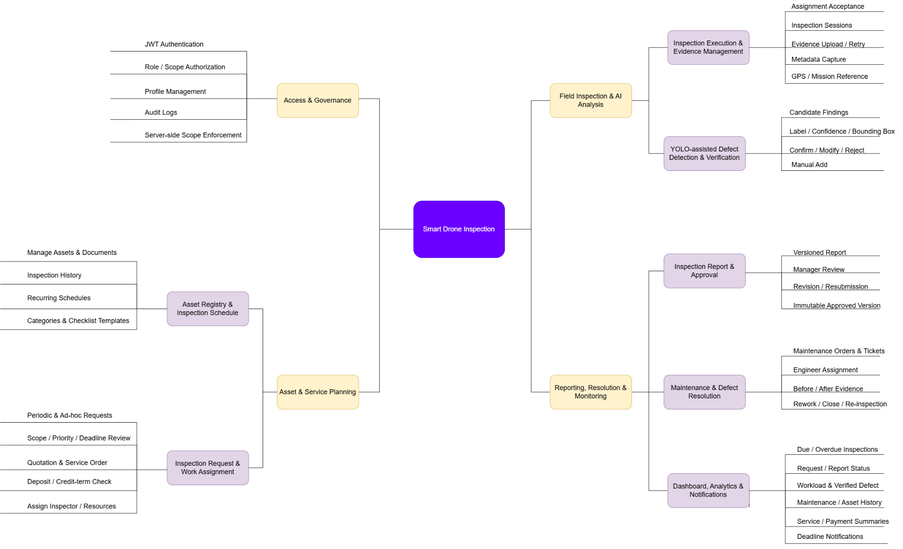

– Ho Chi Minh City, October 2026 –

# I. Record of Changes

| Date | A* M, D | In charge | Change Description |
| --- | --- | --- | --- |
| 11 Sep 2026 | A | Team | Version 1.0: Complete project-specific introduction, background, existing systems, and team information. |
| 03 Nov 2026 | M | Team | Version 2.0: Synchronized with the 5-Role Platform Inspection Service model (ADMIN, MANAGER, CUSTOMER, INSPECTOR, MAINTENANCE_ENGINEER), narrowed scope to 8 product features (FE-01 to FE-08, 2 features per member), and integrated Inspector & Drone 3-Doc Onboarding, Service Requests/VND Quotes/Signed Contracts, SmartDroneHub telemetry & flight trace/MP4 video sync, YOLO11 photo/video defect detection, Auto-Compiled Reports with AI Executive Summaries, PayOS/VNPay settlement, and 3-Way Re-inspection Defect Verification. |

*A - Added M - Modified D - Deleted

# II. Project Introduction

## 1. Overview

### 1.1 Project Information

- Project name: SmartDroneInspection: AI-powered Infrastructure Inspection Management Platform
- Project code: GFA26SE139
- Group name: FA26SE112
- Software type: Platform-Managed Infrastructure Inspection & Corrective Maintenance Service Platform (Responsive Web Portals, Flutter Field Mobile Application, and AI-assisted inspection and maintenance services)

### 1.2 Project Team

| Full Name | Role | Email | Mobile |
| --- | --- | --- | --- |
| Phạm Minh Trí | Lecturer | tripm14@fpt.edu.vn |  |
| Đặng Ngọc Minh Đức | Lecturer | ducdnm2@fpt.edu.vn |  |
| Trần Hoàng Trung Hiếu | Leader | hieuthtse184212@fpt.edu.vn | 0963832382 |
| Phùng Trung Quốc | Member | quocptse170027@fpt.edu.vn | 0896986551 |
| Trương Thái Như | Member | nhuttse180082@fpt.edu.vn | 0328416716 |
| Trần Tùng Bách | Member | bachttse180220@fpt.edu.vn | 0378351050 |

## 2. Product Background

Organizations that own or manage critical civil and energy infrastructure assets — such as highway bridges, commercial buildings, transmission towers, solar farms, wind turbines, and industrial facilities — must perform periodic structural inspections to identify defects, assess asset health, comply with aviation and safety regulations, and verify maintenance repairs. In practice, commercial service requests, quotations, offline service contracts, partner drone pilot scheduling, flight permits, field inspection logs, aerial imagery and video, defect findings, inspection reports, and maintenance work orders are frequently handled across disconnected spreadsheets, messaging apps, and manual folders. This fragmentation makes it difficult to enforce Vietnam aviation compliance, prevent cross-customer scheduling conflicts, trace every defect back to geotagged photographic or video evidence, or audit repair budgets and post-repair re-inspections from initial estimation to final cost closure.

SmartDroneInspection unifies customer asset onboarding, Inspector and Drone registration, service requests, VND quotations, signed service contracts, and partner dispatch. It supports field inspection preparation and execution, evidence review, human-confirmed AI-assisted findings, published inspection reports and PayOS (VietQR) payment, then connects confirmed defects to corrective maintenance planning, repair verification, and cost closure.

## 3. Existing Systems

The following commercial systems provide reference benchmarks for drone inspection data management, visual review, and reporting.

### 3.1 DroneDeploy

Description: DroneDeploy is a cloud-based drone data platform for flight planning, image processing, visual inspection, analysis, and reporting.

Actors: Organization Owner/Admin, Coordinator, Member, External User, Pilot, Analyst, and Viewer.

Main features: Automated flight planning, drone media upload and orthomosaic/3D processing, measurements, visual issue tagging, inspection reports, and workspace permission management.

Pros: Mature visual inspection interface, strong 2D/3D spatial visualization, and flexible workspace collaboration.

Cons: Focuses primarily on aerial mapping and visual issue tagging rather than platform-managed inspection service contracts, Vietnam airspace and flight-permit readiness, independent report publication with VietQR payment settlement, or corrective maintenance work orders with cost planning and re-inspection verification.

Reference: DroneDeploy, https://www.dronedeploy.com/

### 3.2 Flyability Inspector

Description: Flyability Inspector is companion desktop and cloud software designed for organizing, reviewing, and reporting indoor/confined-space inspection data captured by Elios drones.

Actors: Inspection Teams, Structural Engineers, and Asset Owners.

Main features: Asset-based organization, visual review with points of interest (POI), spatial localization, historical comparison, and structured inspection report generation.

Pros: Strong visual context for reviewing localized structural defects and comparing inspection history over time.

Cons: Coupled to proprietary Elios hardware data rather than hardware-agnostic uploaded aerial photos and MP4 videos, and does not provide commercial service request/quote/contract workflows, partner pilot dispatch, or end-to-end maintenance work order cost reconciliation.

Reference: Flyability, "Inspector", https://www.flyability.com/inspector

## 4. Business Opportunity

Infrastructure-owning enterprises in Vietnam and Southeast Asia increasingly rely on specialized unmanned aerial vehicle (UAV) inspection services for bridge, building, power-grid, and renewable-energy assessments rather than maintaining expensive internal aviation departments. However, coordinating external partner drone pilots, verifying 3-document aircraft airworthiness, checking prohibited military/aviation no-fly zones, negotiating one-off and recurring service contracts, verifying AI-detected defects, settling inspection fees, and closing the loop on structural repairs require an integrated governance platform.

SmartDroneInspection addresses this gap by combining a **Platform-Coordinated Inspector & Commercial Service Contract model** with an **end-to-end Inspection-to-Maintenance Engineering workflow**. Customers register infrastructure assets through an airspace screening process, submit one-time or recurring service requests, negotiate VND quotations, sign offline paper contracts, track inspection progress, accept published reports, and pay through **PayOS (VietQR)**. Confirmed defects can then be addressed through corrective maintenance planning, budget approval, repair execution, and re-inspection.

## 5. Software Product Vision

For infrastructure-owning customer organizations that require auditable, standards-compliant structural inspections and maintenance remediation, **SmartDroneInspection** is a multi-portal Web and Flutter Mobile platform that connects commercial inspection service contracts and vetted partner drone pilots to field survey execution, human-verified AI defect findings, independently published inspection reports, PayOS VietQR settlement, and budget-controlled engineering work orders.

Unlike generic cloud storage or standalone mapping tools, SmartDroneInspection separates responsibilities among five roles: `ADMIN`, `MANAGER`, `CUSTOMER`, `INSPECTOR`, and `MAINTENANCE_ENGINEER`. AI-assisted inspection and maintenance recommendations support evidence review, reporting, and repair planning, while human users remain accountable for confirming findings, publishing reports, and accepting completed maintenance.

## 6. Project Scope & Limitations

The product supports four connected business flows (`MF1` to `MF4` / `WF-01` to `WF-04`):
- **Stage 1 (`MF1` / `WF-01` — Customer and Partner Onboarding, Assets & Workforce)**: Customers register their organization and initial asset, subject to airspace screening. `ADMIN` and `MANAGER` provision Inspector accounts; Inspectors maintain their profiles and pilot-license information. Drone registration is a separate Inspector-owned process with required registration, ownership, and inspection documents. Customers can also provision Maintenance Engineer accounts and manage their asset catalog.
- **Stage 2 (`MF2` / `WF-02` — Service Requests, Quotes, Contracts, Dispatch & Airspace)**: Customers submit one-time or recurring service requests and negotiate with `MANAGER` through order chat. Quotes are versioned and recorded in VND. After quote acceptance, `MANAGER` records the signed paper service contract; recurring requests can produce planned service occurrences. `MANAGER` assigns Inspectors and their drones to occurrences, with cross-customer availability checks. The airspace map supports operational review.
- **Stage 3 (`MF3` / `WF-03` — Flight Readiness, Field Work, Evidence, Reports & Payment)**: Inspectors submit flight permits and record on-site inspection work. Role-appropriate dashboards, a schedule calendar, and customer progress views help users follow the work. Inspectors upload photo and video evidence; AI assists with defect review, while people confirm findings. The platform compiles inspection reports, `MANAGER` independently reviews and approves/publishes them, and Customers accept reports and settle inspection fees through PayOS (VietQR) (report export to PDF is an auxiliary deliverable download).
- **Stage 4 (`MF4` / `WF-04` — Corrective Maintenance & Re-inspection)**: Customers create maintenance work orders for confirmed defects, plan repairs and budgets, approve changes, and track field execution. AI-assisted recommendations support scope, cost, and acceptance review. The platform supports completion reporting, re-inspection evidence and defect verification, independent Customer acceptance, and final cost reconciliation.

**Five-Role Governance Model**

Access is organized around the five canonical login roles and their business responsibilities:
- **`ADMIN`** manages platform accounts and shared reference information, supports customer airspace onboarding decisions, and oversees platform finance and audit activities.
- **`MANAGER`** coordinates Inspector and Drone registries, service-request negotiations and VND quotes, signed contracts, partner dispatch and recovery after field aborts, independent inspection-report publication, and partner payouts.
- **`INSPECTOR`** maintains a partner profile and license information, separately registers owned drones, uploads flight permits and inspection evidence, records field work, confirms findings, submits reports, and performs re-inspection verification when assigned.
- **`CUSTOMER`** manages the organization's assets and workforce, requests inspection services, accepts quotes and reports, pays inspection fees, and governs maintenance budgets, changes, re-inspection, acceptance, and cost closure.
- **`MAINTENANCE_ENGINEER`** plans and performs corrective repairs, records work evidence, and prepares completion information for Customer review.

### 6.1 Major Features

Eight core product features (`FE-01` to `FE-08`, 2 functions per feature = 16 functions total, 2 features per team member) form the unified scope baseline across Reports 1–5:

- **FE-01: Authentication, Google OAuth2 & 5-Role Access Control** *(Owner: Trần Hoàng Trung Hiếu)* — Customer account and organization onboarding with initial asset airspace screening, secure sign-in, Google authentication, and access appropriate to each of the five roles.
- **FE-02: Partner Onboarding, Workforce, Asset & Inspector Drone Registry** *(Owner: Trần Hoàng Trung Hiếu)* — `ADMIN`/`MANAGER` provisioning of Inspector accounts and management of Inspector profiles and pilot-license information; separate Inspector-owned Drone registration with three required documents; Customer Maintenance Engineer provisioning; and customer asset catalog management.
- **FE-03: Recurring Service Requests, Contract Occurrences & Notifications** *(Owner: Phùng Trung Quốc)* — Recurring service-request planning and generated contract occurrences, with in-app notifications to keep participants informed.
- **FE-04: Service Requests, Quotations, Contracts, Dispatch & Airspace Map** *(Owner: Phùng Trung Quốc)* — One-time and recurring service requests, order-chat negotiation, versioned VND quotes, quote acceptance, signed paper contracts, Inspector/Drone occurrence dispatch, and an operational airspace map.
- **FE-05: Flight Permit Gate, Field Execution, Dashboard & Calendar** *(Owner: Trần Tùng Bách)* — Flight-permit readiness, on-site field-work recording with `SmartDroneHub` live telemetry and persisted flight trace/report metrics, role-appropriate operational dashboards, schedule calendar, and customer inspection-progress views.
- **FE-06: Evidence Intake, YOLO11 Detection, Auto-Compiled Report & PayOS** *(Owner: Trần Tùng Bách)* — Photo and high-resolution MP4 video evidence intake (including `SmartDroneHub` mission recording sync and interactive video frame cropping); AI-assisted YOLO11 photo/video defect analysis and human-confirmed findings; compiled inspection reports with AI summaries and flight trace review; independent `MANAGER` review and publication; customer report acceptance; and PayOS (VietQR) payment.
- **FE-07: Maintenance Work Orders, RAG Scope/Norms Advisor & Repair Execution** *(Owner: Trương Thái Như)* — Corrective maintenance work orders, AI-assisted repair-scope and cost guidance, team planning, Customer budget and change approval, field repair execution, and work-log review.
- **FE-08: Completion Report, 3-Way Re-inspection Verification & Cost Closure** *(Owner: Trương Thái Như)* — Maintenance completion reporting, AI-assisted acceptance checks, three-way evidence-based re-inspection, independent Customer acceptance, and final cost reconciliation and closure.

Figure 1. Core operational workflow diagram from partner and customer airspace onboarding through service contracts, field capture, AI defect verification, auto-compiled reporting, PayOS settlement, and RAG-assisted maintenance remediation.

### 6.2 Limitations & Exclusions

- **LI-1 (No Real-Time Drone Flight Control)**: The platform does not provide autonomous drone flight control, radio-control (RC) piloting, or live autopilot telemetry. Drone flight operations are performed by Inspectors using their aircraft and flight equipment.
- **LI-2 (Human Accountability for AI)**: AI-generated findings, report summaries, and maintenance recommendations support professional review; they do not replace human confirmation or approval.
- **LI-3 (Controlled Onboarding)**: Customer self-registration includes airspace screening of the initial asset. `ADMIN` and `MANAGER` provision Inspector accounts; profile and license management are separate from Inspector-owned Drone registration.
- **LI-4 (Organization and Assignment Boundaries)**: Customer information is separated by organization, and Inspectors can access only missions assigned to them.
- **LI-5 (Published Reports and Payment)**: Official inspection reports are reviewed, approved, and published on the platform after independent review; report export to PDF is an auxiliary deliverable download. Customers accept reports and settle applicable inspection fees through PayOS (VietQR).
- **LI-6 (No 3D Photogrammetry Reconstruction)**: General-purpose 3D point-cloud photogrammetry and digital-twin mesh reconstruction are outside the capstone scope.
- **LI-7 (In-App Notifications)**: Operational notifications are delivered through the platform's in-app notification inbox.
