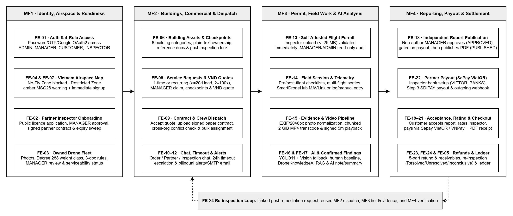

# I. Record of Changes

| Date | A* / M, D | In charge | Change Description |
| --- | --- | --- | --- |
| 11 Sep 2026 | A | Team | Version 1.0: Initial Project Introduction. |
| 03 Nov 2026 | M | Team | Version 2.0: Aligned product background, competitor review, and scope with the 5-role / 8-feature target. |
| 17 Nov 2026 | M | Team | Version 3.0: Rewritten against the implemented product. Scope narrowed to four login roles and the then-current six-feature set across three main flows; corrective maintenance recorded as an exclusion rather than a deliverable; existing-systems review extended to three comparators. |
| 18 Nov 2026 | M | Team | Version 3.1: Restructured to the four-main-flow, eight-feature model (`MF1`–`MF4`, `FE-01`–`FE-08`, two features per flow). `MF3` now ends at evidence and findings; `MF4` covers report review and payment settlement, including the re-inspection loop. Corrective maintenance execution remains a recorded exclusion. |
| 19 Nov 2026 | M | Team | Version 3.2: Documented the human-in-the-loop `DroneKnowledgeAI` retrieval boundary (`LI-9`) and synchronized FE-06/FE-07/FE-08, mobile scope, and the main flows with delivered re-inspection verdict validity, payment notice/receipt PDF, and Inspector–Customer chat. |
| 21 Nov 2026 | M | Team | Version 3.3: Decomposed the delivered product scope from eight grouped features into twenty-four atomic features (`FE-01`–`FE-24`) aligned across the four main flows (`MF1`–`MF4`), updated `LI-9` references to `FE-16`/`FE-17`/`FE-18`, and synced plain-text building ownership details, concise recurring request titles, and streamlined service-request workflows. |
| 25 Nov 2026 | M | Team | Version 3.4: Synchronized `MF1`–`MF4` and `FE-01`–`FE-24` with the current `main` baseline (`V70`–`V80`, `#175`): immediate restricted-airspace onboarding with `MSG28` warning (`FE-07`), Manager-only `MF1B`/`MF3` review and publication with Administrator read-only oversight, Inspector self-attested flight permits (`FE-13`), `Sepay` VietQR + `VNPay` checkout (`FE-20`), Step-3 `SePay` VietQR partner payout gate (`FE-22`), multi-flight sessions (`FE-14`), Inspector ratings (`FE-19`), per-request checkpoints (`FE-08`), Partner Chat (`FE-10`), bilingual notifications/emails (`FE-12`), and replaced Figure 1 with the exported Draw.io `End-to-End Operational Flow` diagram. |

*A - Added M - Modified D - Deleted

# II. Project Introduction

## 1. Overview

### 1.1 Project Information

- Project name: SmartDroneInspection: AI-powered Infrastructure Inspection Management Platform
- Project code: GFA26SE139
- Group name: FA26SE112
- Software type: Web portals and mobile application for platform-managed building inspection services

The project is delivered by the team based in Ho Chi Minh City, Vietnam, under the supervision of the listed lecturers.

### 1.2 Project Team

| Full Name | Role | Email | Mobile |
| --- | --- | --- | --- |
| Phạm Minh Trí | Lecturer | tripm14@fpt.edu.vn |  |
| Đặng Ngọc Minh Đức | Lecturer | ducdnm2@fpt.edu.vn |  |
| Trần Hoàng Trung Hiếu | Leader | hieuthtse184212@fpt.edu.vn | 0963832382 |
| Phùng Trung Quốc | Member | quocptse170027@fpt.edu.vn | 0896986551 |
| Trương Thái Như | Member | nhuttse180082@fpt.edu.vn | 0328416716 |
| Trần Tùng Bách | Member | bachttse180220@fpt.edu.vn | 0378351050 |

## 2. Product Background

Organizations that own critical civil, industrial, and energy infrastructure — bridges, commercial buildings, transmission towers, solar farms, and industrial facilities — must inspect their assets periodically to detect structural defects, assess asset health, satisfy aviation and workplace-safety regulations, and confirm that previous repairs have held. These inspections are increasingly performed with camera-equipped drones, because aerial capture reaches surfaces that are slow, expensive, or unsafe to inspect from scaffolding or rope access.

In practice, however, the commercial side and the technical side of inspection are handled separately. A customer asks several partner drone operators for quotes through messaging apps; contracts are signed on paper; flight scheduling is coordinated by phone; photographs and video are returned on memory cards or shared folders; defect findings are written up in spreadsheets; and the resulting report is circulated as an email attachment. No single record connects a defect photographed on a given day to the contract that commissioned the flight, the partner who flew it, the permit that authorised it, the report that published it, and the invoice that was settled.

That fragmentation has concrete consequences for Vietnamese infrastructure owners. Flight permissions and no-fly-zone requirements are difficult to evidence after the fact. Partner pilots cannot be verified as currently qualified, and the same pilot can be double-booked across two customer organizations. Defects cannot be traced back to the geotagged photograph or video frame that demonstrates them. Reports are revised without version history, so a customer cannot prove which version was approved. Fees, commissions, and partner payouts are reconciled by hand.

SmartDroneInspection addresses this by treating inspection as a governed service rather than a one-off file transfer. The platform brings customer asset onboarding, partner qualification, service requests, priced quotations, signed agreements, partner dispatch, flight-permit readiness, field execution, photographic and video evidence, defect findings, report publication, and payment settlement into a single connected record, while leaving the actual flying to qualified partner pilots.

## 3. Existing Systems

Several commercial platforms already manage drone-captured data. Three were reviewed as benchmarks for data handling, visual review, and reporting.

### 3.1 DroneDeploy

**Description:** DroneDeploy is a cloud platform for drone flight planning, image processing, visual inspection, analysis, and reporting.

**Link:** https://www.dronedeploy.com/

**Actors:** Organization Owner/Admin, Coordinator, Pilot, Analyst, Member, External User, and Viewer.

**Features:** Automated flight planning, drone media upload, orthomosaic and 3D model processing, measurement tools, visual issue tagging, inspection-report generation, and workspace permission management.

**Pros:** Mature visual inspection interface, strong two- and three-dimensional spatial visualisation, flexible collaboration inside a workspace, and broad support for many drone models.

**Cons:** Oriented toward aerial mapping and visual issue tagging inside a single organization's workspace. It does not model a multi-party commercial service: there is no customer request and quotation negotiation, no partner-pilot qualification and dispatch across customer organizations, no Vietnam-specific flight-permit readiness gate, no independent review before publication, and no Vietnamese payment settlement.

### 3.2 Flyability Inspector

**Description:** Flyability Inspector is companion software for organising, reviewing, and reporting indoor and confined-space inspection data captured by Elios drones.

**Link:** https://www.flyability.com/inspector

**Actors:** Inspection teams, structural engineers, and asset owners.

**Features:** Asset-based organisation of inspection data, visual review with points of interest, spatial localisation, comparison of inspection history over time, and structured report generation.

**Pros:** Strong visual context for reviewing localised structural defects, and effective side-by-side comparison of the same asset across successive inspections.

**Cons:** Closely coupled to proprietary Elios hardware and its capture format. It does not accept arbitrary uploaded photographs and video from any aircraft, and it offers no commercial workflow — no service request, quotation, signed agreement, partner dispatch, payment settlement, or multi-tenant customer separation.

### 3.3 Skycatch

**Description:** Skycatch is an enterprise drone-data platform aimed at construction and industrial sites, offering automated capture, cloud processing, and progress analytics.

**Link:** https://www.skycatch.com/

**Actors:** Site managers, surveyors, project engineers, and enterprise administrators.

**Features:** Automated mission capture with supported aircraft, photogrammetric processing, volumetric and progress analysis, site dashboards, and integration with construction-management systems.

**Pros:** Strong automation across capture and processing, and good project-level analytics for measuring progress against a site model.

**Cons:** Optimised for construction progress tracking rather than periodic structural condition inspection. Its outputs are site models and measurements, not per-defect findings tied to evidence and to an independently published report, and it does not model a marketplace of partner pilots supplying inspection services to multiple customer organizations.

## 4. Business Opportunity

Infrastructure-owning enterprises across Vietnam and Southeast Asia increasingly buy drone inspection as an external service rather than maintaining an in-house aviation capability. That creates a real market for an operator that coordinates qualified partner pilots — but only if the operator can demonstrate control over the things customers and auditors care about: who flew, with which aircraft and documents, under which permit, over which asset, producing which evidence, supporting which findings, published in which report version, and settled for which amount.

No existing product covers that chain end to end for the Vietnamese market. Mapping tools capture data but do not govern commercial service. Document-management and CMMS products record contracts and work orders but have no notion of aerial capture, flight permission, or defect evidence. This gap is the opportunity: a platform that a Vietnamese inspection operator can run as its operating system, where the compliance and commercial records are the product rather than an afterthought.

The resulting product is also commercially attractive to the operator. Recurring service requests turn one-off inspections into predictable revenue; versioned quotations and signed agreements shorten the sales cycle; partner dispatch with qualification and schedule checks raises aircraft utilisation; and an auditable evidence-to-report chain is a defensible differentiator when tendering to enterprise customers.

## 5. Software Product Vision

For infrastructure-owning organizations that need auditable, regulation-aware structural inspections, SmartDroneInspection is a multi-portal web and mobile platform that connects commercial inspection contracts and vetted partner drone pilots to field execution, human-confirmed AI defect findings, independently published inspection reports, and settled payment — so that every finding can be traced back to the evidence that supports it and the contract that commissioned it.

Unlike generic cloud-storage or mapping tools, the platform separates responsibilities across four login roles — Platform Administrator (`ADMIN`), Platform Manager (`MANAGER`), Customer organization user (`CUSTOMER`), and Partner Drone Inspector (`INSPECTOR`) — and keeps automated services such as the vision model, the language model, and the payment gateways firmly in a supporting role. Automated detection proposes; a human Inspector confirms; a Manager who did not author the report decides publication; the Customer accepts and pays.

## 6. Project Scope & Limitations

The product is organised as four connected main flows (`MF1`–`MF4`), decomposed into twenty-four atomic product features (`FE-01`–`FE-24`) so each engineering capability, owner, test sheet, and acceptance criterion is tracked without grouping unrelated workflows.

**`MF1` — Identity, onboarding, airspace screening & partner readiness (`FE-01`–`FE-04`, `FE-07`, plus `FE-05` financial ledger).** A prospective customer registers an organization and its first building while location coordinates are screened on an interactive Vietnam map against airspace zones (`FE-04`): prohibited locations are blocked and restricted locations attach an amber flight-permit warning (`MSG28`) while activating immediately (`FE-07`). Partner Inspectors are admitted through a platform-governed application and qualification process reviewed by Managers with Administrator read-only oversight (`FE-02`), and approved Inspectors register owned drones with required documents (`FE-03`), while Platform Administrators maintain roles, accounts, and platform rules (`FE-01`), and every operational role tracks its own scoped financial history (`FE-05`).

**`MF2` — Buildings, commercial requests, agreements, chat & dispatch (`FE-06`, `FE-08`–`FE-12`).** Customers maintain buildings, inspection checkpoints, plain-text ownership details, and verified reference documents (`FE-06`). Customers submit one-time or recurring service requests and receive VND quotations alongside Manager-configured per-request checkpoints (`FE-08`), confirm acceptance, record offline signed paper contracts, and receive cross-organization occurrence dispatch (`FE-09`). Dedicated three-channel messaging separates commercial Manager–Customer negotiations, private Manager–Inspector partner coordination, and private Inspector–Customer field coordination (`FE-10`), while configurable acceptance deadlines escalate unaccepted assignments (`FE-11`) and reliable bilingual in-app notifications and critical SMTP emails alert responsible actors (`FE-12`).

**`MF3` — Flight readiness, field work, evidence & AI analysis (`FE-13`–`FE-17`).** Before field work starts, the assigned Inspector submits a validated, self-attested mission flight permit that becomes effective immediately with Manager/Administrator read-only audit visibility (`FE-13`), executes multi-flight on-site field sessions with detailed safety checklists and read-only telemetry from SmartDroneHub or imported flight logs (`FE-14`), and uploads photographs and large videos that are prepared smoothly in the background (`FE-15`). Automated vision analysis proposes candidate building defects for Inspector confirmation (`FE-16`), supported by a tenant-isolated historical-case and engineering-standard advisor, editable AI note drafting, and executive summary references (`FE-17`).

**`MF4` — Report publication, acceptance, settlement & re-inspection (`FE-18`–`FE-24`, plus `FE-05` ledger view).** Compiled inspection reports undergo independent Manager review (`APPROVED`) followed by Step-3 `SePay` VietQR partner payout reconciliation (`PAID`) before official publication (`PUBLISHED`, `FE-18`, `FE-22`), Customer acceptance, pre-acceptance clarification, and configurable Inspector rating (`FE-19`), online checkout via Sepay VietQR or VNPay (`FE-20`), payment deadline tracking and downloadable notice/receipt PDFs (`FE-21`), evidence-backed refunds and receivable recovery (`FE-23`), and a three-way post-remediation re-inspection verification loop (`FE-24`).

### 6.1 Major Features

Twenty-four atomic product features define the delivered scope across the four main operational flows (`MF1`–`MF4`) and are traced individually through Reports 2–5 and Report 7.

- **`MF1` FE-01: Account Authentication, OTP & 4-Role Access Control** — Secure password sign-in with failed-attempt lockout and rate limiting, email one-time-code verification, Google sign-in, session refresh controls, self-service profile updates, and strict four-role access boundaries across Administrators, Managers, Customers, and Inspectors.
- **`MF1` FE-02: Partner Inspector Application & Qualification Management** — Public self-service Inspector application with pilot-licence scan (drone ownership is optional at application time), Manager approval/rejection and account creation (with Administrator read-only oversight), Manager-recorded signed partner contracts, licence class/expiry tracking, and flight logs.
- **`MF1` FE-03: Inspector-Owned Drone Registration & Fleet Management** — Administrator-configurable document and capability requirements, Inspector drone registration with photographs, flight capabilities, and required ownership/registration/inspection files, Vietnamese weight-category qualification rules, Manager approval (with Administrator read-only oversight), renewal, maintenance holds, and retirement.
- **`MF1` FE-04: Interactive Location Map & No-Fly Zone Airspace Screening** — Interactive Vietnam map coordinate picker across web and customer mobile, checking coordinates against configured clear, restricted, and prohibited airspace zones before allowing customer signup, building registration, or mission planning, with clear advisory warnings.
- **`MF4` FE-05: Financial History & Revenue/Payment Ledger** — Role-scoped financial ledgers across Customer, Inspector, and Manager web portals showing verified payments, platform commission (`15%`), VAT/personal tax deductions, and net partner payout history without cross-organization leakage.
- **`MF2` FE-06: Building Asset Registry, Checkpoints & Reference Documents** — Support for six building categories, automatic category-based inspection checkpoints (locked once any inspection exists), dedicated plain-text ownership details, duplicate-free reference documents in secure cloud storage, and permanent retirement for out-of-service buildings.
- **`MF1` FE-07: Restricted Airspace Advisory Warning & Immediate Onboarding** — Amber `MSG28` flight-permit advisory banners (zone name, governing authority, ceiling altitude, and `cambay.mod.gov.vn` reference) on restricted-airspace coordinates across customer registration, building management, and service requests with immediate account/building activation and no pre-registration review hold.
- **`MF2` FE-08: Service Requests (One-Time & Recurring) & VND Quotations** — Compact customer request creation (`>= 20` calendar days lead time, `1–120` month recurrence intervals, `2–100` occurrences, and concise recurring titles), single-Manager request claiming with direct detail navigation, Administrator reassignment oversight, Manager-configured per-request checkpoints, and VND quotation negotiation.
- **`MF2` FE-09: Offline Signed Contract & Occurrence Dispatch Scheduling** — Frozen agreed terms snapshot upon quotation acceptance, automatic creation of recurring inspection occurrences, offline signed paper contract upload, cross-organization Inspector and drone schedule-conflict validation, bulk assignment to remaining occurrences, and Manager recovery options after aborted field sessions.
- **`MF2` FE-10: Dual-Channel Messaging (Order Chat & Inspection Chat)** — Isolated Customer–Manager commercial order chat, private Manager–Inspector partner coordination chat, and private Inspector–Customer mission chat supporting up to five verified file attachments, excluding Administrators from private negotiation/field chats, and mirroring Customer access on the mobile app.
- **`MF2` FE-11: Assignment Acceptance Timeout & Escalation Handling** — Administrator-configurable partner acceptance deadline (`1–720` hours, default `24` hours) monitored automatically so unaccepted assignments are cancelled in time, crew schedules are freed, occurrences return for re-dispatch, and the owning Manager is alerted.
- **`MF2` FE-12: System Notifications & Alert Center** — Reliable, duplicate-free bilingual (`"Tiếng Việt | English"`) in-app notification center across all lifecycle pillars, bulk mark-as-read, 3-channel chat badge routing, best-effort SMTP email alerts for critical events, and permission-safe navigation links.
- **`MF3` FE-13: Flight Permit Upload & Inspector Self-Attestation Gate** — Assigned-Inspector self-attested permit upload (up to `25 MB` verified documents with permit number, authority, validity dates, and drone serial), becoming effective immediately once validation passes without Manager or Administrator approval, read-only audit visibility for Managers and Administrators, and automatic reset to re-upload required if the drone or schedule changes.
- **`MF3` FE-14: On-Site Field Session & SmartDroneHub MAVLink Telemetry** — Detailed pre/post-flight safety checklists, accountable session `Start` / `Complete` / reasoned `Abort` tracking with multi-flight sortie support, read-only live flight telemetry and GPS traces from SmartDroneHub, imported flight log support, manual flight declarations without fabricated metrics, role dashboards, and Inspector schedule calendar.
- **`MF3` FE-15: Field Evidence Intake & Chunked Video Processing Pipeline** — Inspection photo upload with preserved capture metadata and thumbnails, resumable chunked large MP4 video uploads up to `2 GiB`, background video optimization and poster generation, video frame capture, duplicate filename auto-numbering, and secure time-limited media playback.
- **`MF3` FE-16: AI Defect Detection (`YOLO11` + Vision Fallback) & Findings Confirmation** — Automated detection of five building defect types with secondary vision fallback (respecting user opt-out settings), configurable auto-confirm threshold (`70%` default), editable defect regions, quick status filters (`All active`, `Unconfirmed`, `Confirmed`), and explicit Inspector baseline confirmation.
- **`MF3` FE-17: AI Case/Standard Retrieval (`pgvector` RAG), Note Drafting & Report Summary** — Tenant-isolated historical-case and engineering-standard advisor (`DroneKnowledgeAI`) with resilient keyword fallback, finding-level `Draft note with AI` and batch `Draft all notes`, single-shot AI Executive Summary grounded with matched standards/cases, and a collapsible reference strip on Customer Mobile.
- **`MF4` FE-18: Inspection Report Compilation, Independent Review & Official Publication** — Consistent report compilation strictly from confirmed findings, independent review strictly by a non-author Manager (`ADMIN` retains read-only oversight), mandatory written reasons when returning drafts, version-preserved official publication gated on Step-3 partner payout settlement, and on-demand A4 PDF downloads.
- **`MF4` FE-19: Customer Report Acceptance & Clarification Workflow** — Customer deliverable review across web and mobile, explicit acceptance of the published report version before billing settlement, Customer-only pre-acceptance clarification requests, and configurable post-completion Inspector rating by Customer and Manager.
- **`MF4` FE-20: Online Service Fee Payment (`Sepay` VietQR & `VNPay`)** — Integrated `Sepay` VietQR and `VNPay` checkout with verified payment gateway callbacks, bidirectional gateway switching and unresolved-order protection, authorized manual confirmation fallback for offline environments, and Customer Mobile deep-link/QR parity.
- **`MF4` FE-21: Payment Deadlines, Invoices & Payment Document Management** — Per-occurrence financial rate snapshots (VND fee, commission, VAT, personal income tax), configurable payment-due countdown (`15` days default), single overdue reminder without revoking report access, and downloadable PDF payment notices and receipts across web and mobile.
- **`MF4` FE-22: Partner Inspector Payout Reconciliation** — Dedicated Step-3 Manager payout workflow (`1. Field Audit -> 2. Report Decision -> 3. Inspector Payout -> 4. Customer Settlement`) gating report publication (`APPROVED -> PAID -> PUBLISHED`), standardized Inspector `VIETQR_BANKS` bank details, automatic `SePay` VietQR (`SDIPAY`) payout generation and outgoing webhook settlement, role-masked financial views for Customers, and payout holds during active refund reviews.
- **`MF4` FE-23: Evidence-Backed Refunds & Receivable Recovery** — Two-step refund lifecycle (initiating and holding unpaid payouts, then completing after external transfer with balanced multi-part financial allocations), untransferred refund cancellation, legacy refund reconciliation, and separate Inspector receivable recovery tracking when refunds occur after partner payout.
- **`MF4` FE-24: Post-Remediation Re-inspection & Defect Verification** — Follow-up re-inspection creation linked to a published report, three-way defect verification (`Resolved`, `Unresolved`, `Inconclusive`), fresh evidence requirement from the new completed field session, automatic `Resolved` verdict validity expiry checks, and early expiry warning banners across web and mobile.

Figure 1. End-to-end operational flow across the four main flows (`MF1`–`MF4`) and twenty-four atomic features (`FE-01`–`FE-24`), from onboarding and airspace screening through commercial dispatch, field capture, AI-assisted confirmation, partner payout, report publication, and payment settlement.

### 6.2 Limitations & Exclusions

- **LI-1 (No Flight Control):** The platform does not pilot aircraft and does not act as a ground control station. It does not perform autonomous flight, manual remote-control piloting, or live autopilot command. Flights are conducted by qualified partner Inspectors using their own aircraft and equipment.
- **LI-2 (Human Accountability for Automated Output):** Vision-detected defect proposals, the AI report summary, and any automated assessment support professional judgement only. They never replace Inspector confirmation of findings or Manager approval of publication.
- **LI-3 (No Legal Clearance):** A successful airspace screening, an approved flight permit record, or a recorded status is a platform record. It does not grant legal permission to fly and does not certify regulatory compliance.
- **LI-4 (Controlled Onboarding):** Customer self-registration is gated by airspace screening of the first asset. Inspector and drone registration are platform-governed and reviewed; they are not open self-service.
- **LI-5 (Organization and Assignment Boundaries):** Customer records are separated by organization, and an Inspector can reach only the inspections assigned to them. Visibility in a screen is never by itself permission to act.
- **LI-6 (Corrective Maintenance Excluded):** Repair planning, work orders, budgets, change orders, repair execution, maintenance completion reporting, maintenance acceptance, and cost reconciliation are **not** part of the delivered application scope. What the platform does provide is a re-inspection loop: a customer or manager may open a re-inspection against a published report and re-assess each originally confirmed defect as resolved, unresolved, or inconclusive. That loop reuses the request, dispatch, field, and reporting flows rather than adding a maintenance flow. Customers arrange repairs outside the platform. Where maintenance-related records still exist in the data store, they are retained for data preservation only and are not exposed as a workflow.
- **LI-7 (No Photogrammetry Reconstruction):** General-purpose three-dimensional point-cloud reconstruction and digital-twin mesh generation are outside the capstone scope. The platform stores two-dimensional photographs and video and their derived defect annotations.
- **LI-8 (Mobile Scope):** The mobile application serves the Customer role only. Inspectors and platform staff use the web portals. The Customer app mirrors the delivered web features: a collapsible knowledge-references strip, re-inspection verdict-expiry warnings, payment-due status with downloadable payment notice and receipt PDFs, in-app `Sepay` VietQR and `VNPay` deep-link checkout, post-completion Inspector rating, and Inspector–Customer inspection chat.
- **LI-9 (Human-in-the-Loop Retrieval Boundary):** `DroneKnowledgeAI` maintains a retrieval library containing seeded Vietnamese and international engineering standards (`TCVN 9343:2012`, `TCVN 9361:2012`, `EN 1504-9`, `ISO 12944-5`, `ASTM C1583`) and anonymized historical finding cases, using semantic similarity search with an automatic keyword-matching fallback when AI embeddings are unavailable. Similar past findings and matched standards appear as advisory guidance inside defect review (`FE-16`, `FE-17`) and inside the inspection report summary (`FE-18`) on web and customer mobile. Every recommendation remains strictly advisory: the human Inspector confirms, edits, or rejects each finding, and customer records stay strictly separated by organization so no customer ever sees another organization's private data.
