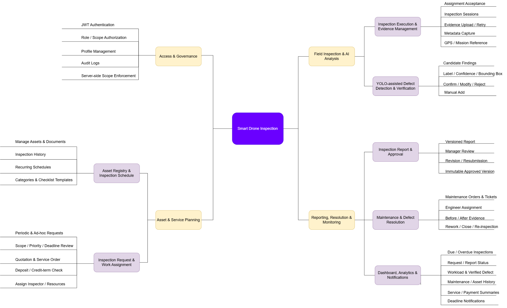

– Ho Chi Minh City, October 2026 –

# I. Record of Changes

| Date | A* M, D | In charge | Change Description |
| --- | --- | --- | --- |
| 11 Sep 2026 | A | Team | Version 1.0: Complete project-specific introduction, background, existing systems, and team information. |
| 21 Sep 2026 | M | Team | Version 1.2: Aligned customer organization self-registration and scope exclusions. |
| 21 Oct 2026 | M | Team | Version 1.3: Integrated PayPal Orders v2 online checkout for Enterprise SaaS subscription billing. |
| 27 Oct 2026 | M | Team | Version 2.0: Synchronized with Review 2 baseline — 5-role governance model (ADMIN, Platform Manager, Organization Manager, Inspector, Maintenance Engineer), B2B Drone Leasing, Airspace & No-Fly Zone Map, RAG Maintenance Scope Advisor, and 12 product features (FE-01 to FE-12). |

*A - Added M - Modified D - Deleted

# II. Project Introduction

## 1. Overview

### 1.1 Project Information

- Project name: SmartDroneInspection: AI-powered Infrastructure Inspection Management Platform
- Project code: GFA26SE139
- Group name: FA26SE112
- Software type: Multi-Tenant Enterprise SaaS & B2B Drone Leasing Platform (Responsive React 19 Web Portal, Flutter Field Mobile Application, Spring Boot 4.1 Modular Monolith REST API, and Self-Hosted FastAPI YOLO11 / RAG AI Services)

### 1.2 Project Team

| Full Name | Role | Email | Mobile |
| --- | --- | --- | --- |
| Phạm Minh Trí | Lecturer | tripm14@fpt.edu.vn |  |
| Đặng Ngọc Minh Đức | Lecturer | ducdnm2@fpt.edu.vn |  |
| Trần Hoàng Trung Hiếu | Leader | hieuthtse184212@fpt.edu.vn | 0963832382 |
| Phùng Trung Quốc | Member | quocptse170027@fpt.edu.vn | 0896986551 |
| Trương Thái Như | Member | nhuttse180082@fpt.edu.vn | 0328416716 |
| Trần Tùng Bách | Member | bachttse180220@fpt.edu.vn | 0378351050 |

## 2. Product Background

Organizations that own or manage critical civil and energy infrastructure assets — such as highway bridges, commercial buildings, transmission towers, solar farms, wind turbines, and industrial facilities — must perform periodic structural inspections to identify defects, assess asset health, comply with aviation and safety regulations, and verify maintenance repairs. In practice, subscription contracts, drone equipment leasing, flight permits, field inspection logs, aerial imagery, defect findings, inspection reports, and maintenance work orders are frequently handled across disconnected spreadsheets, messaging apps, and manual folders. This fragmentation makes it difficult to enforce aviation compliance, trace every defect back to geotagged photographic evidence, or audit repair budgets from initial estimation to final cost closure.

SmartDroneInspection is engineered to unify this lifecycle into a multi-tenant Enterprise Software-as-a-Service (SaaS) and B2B Drone Leasing platform. It connects commercial tenant onboarding and equipment leasing directly to mission dispatch, airspace advisory, field survey execution, human-verified AI defect detection, official PDF reporting, and standards-grounded engineering maintenance remediation.

## 3. Existing Systems

The following commercial systems provide reference benchmarks for drone inspection data management, visual review, and reporting.

### 3.1 DroneDeploy

Description: DroneDeploy is a cloud-based drone data platform for flight planning, image processing, visual inspection, analysis, and reporting.

Actors: Organization Owner/Admin, Coordinator, Member, External User, Pilot, Analyst, and Viewer.

Main features: Automated flight planning, drone media upload and orthomosaic/3D processing, measurements, visual issue tagging, inspection reports, and workspace permission management.

Pros: Mature visual inspection interface, strong 2D/3D spatial visualization, and flexible workspace collaboration.

Cons: Focuses primarily on aerial mapping and visual issue tagging rather than integrated B2B drone fleet leasing, Vietnam Decree No. 288/2025/NĐ-CP flight-permit readiness gates, independent two-tier report approval, or civil-engineering maintenance work orders with itemized budget and change-order governance.

Reference: DroneDeploy, https://www.dronedeploy.com/

### 3.2 Flyability Inspector

Description: Flyability Inspector is companion desktop and cloud software designed for organizing, reviewing, and reporting indoor/confined-space inspection data captured by Elios drones.

Actors: Inspection Teams, Structural Engineers, and Asset Owners.

Main features: Asset-based organization, visual review with points of interest (POI), spatial localization, historical comparison, and structured inspection report generation.

Pros: Strong visual context for reviewing localized structural defects and comparing inspection history over time.

Cons: Coupled to proprietary Elios hardware data rather than hardware-agnostic uploaded aerial imagery, and does not provide multi-tenant SaaS subscription billing, B2B drone leasing, or end-to-end maintenance work order cost reconciliation.

Reference: Flyability, "Inspector", https://www.flyability.com/inspector

## 4. Business Opportunity

Infrastructure-owning enterprises in Vietnam and Southeast Asia increasingly adopt unmanned aerial vehicles (UAVs) for bridge, building, power-grid, and renewable-energy inspections, yet many organizations either lease specialized inspection drones on a project/term basis or operate mixed fleets without a unified governance platform. When drone leasing, recurring inspection schedules, aviation no-fly zone checks, field evidence, AI defect analysis, certified PDF reports, and maintenance work orders live in separate systems, enterprises face compliance risks and poor cost visibility.

SmartDroneInspection addresses this gap by combining an **Enterprise SaaS Subscription & B2B Drone Leasing model** with an **end-to-end Inspection-to-Maintenance Engineering workflow**. Customers can subscribe to the platform, lease serial-numbered drones directly into their fleet, schedule one-off or recurring inspections with automated conflict checking, verify Vietnam restricted-airspace advisories, run human-in-the-loop YOLO11 defect detection, publish immutable A4 PDF reports as immutable PDF documents, and execute corrective maintenance guided by a `pgvector` RAG civil engineering standard advisor (`TCVN 9343:2012`, `EN 1504-9`, `ISO 12944-5`).

## 5. Software Product Vision

For infrastructure-owning organizations that require auditable, standards-compliant structural inspections and maintenance remediation, **SmartDroneInspection** is a multi-tenant B2B Web and Flutter Mobile platform that connects enterprise subscriptions and leased/owned drone fleets to field survey execution, human-verified AI defect findings, independently approved PDF reports, and budget-controlled engineering work orders.

Unlike generic cloud storage or standalone mapping tools, SmartDroneInspection enforces strict role separation of duties, immutable published PDF report integrity, and human accountability at every AI decision boundary — ensuring that AI computer vision (`YOLO11`) and generative language models (`LLM` report drafting & `RAG` repair scope advisory) accelerate engineering productivity without replacing professional engineering judgment.

## 6. Project Scope & Limitations

The software product is architected as a multi-tenant Enterprise SaaS & B2B Drone Leasing platform organized around four end-to-end business workflows (`WF-01` to `WF-04`):
- **Stage 1 (`WF-01` — Enterprise Onboarding, B2B Drone Leasing & Recurring Schedule Setup)**: Organization self-registration, Enterprise subscription activation (1–120 months via Corporate Wire or PayPal Orders v2), workforce provisioning (`Inspector`, `Maintenance Engineer`), remote pilot license self-declaration, infrastructure asset registry with standardized checkpoints (`inspection_items`), B2B platform drone leasing (`platform_drones` -> `drone_leases` -> `drones`), and timezone-anchored recurring inspection schedules (`Week`, `Month`, `Year`).
- **Stage 2 (`WF-02` — Mission Dispatch, Airspace Advisory, Flight Permit Gate & Field Execution)**: One-off and recurring mission dispatch with direct Inspector + Drone conflict detection, interactive Vietnam Airspace & No-Fly Zone Map evaluation (`No-Fly Zone`, `Restricted Zone`, `Clear Zone` under Decree No. 288/2025/NĐ-CP), self-service aviation flight permit upload gate (`Assigned -> Ready for Flight`), and Web/Flutter Mobile on-site field flight session logging (`In Progress -> Field Completed`).
- **Stage 3 (`WF-03` — Evidence Intake, Advisory YOLO11 Defect Verification, Report Publication & Handoff)**: Multipart aerial image intake into MinIO with EXIF GPS/timestamp extraction, Inspector-invoked self-hosted `YOLO11 (MBDD2025)` defect detection, human finding confirmation and findings baseline confirmation (`Report Draft`), context-grounded LLM/manual report drafting (`Author Verified -> Submitted`), independent `Organization Manager` approval and immutable A4 PDF publication (`Published`), and per-finding corrective handoff (`Repair Pending` / `Completed`).
- **Stage 4 (`WF-04` — Maintenance Work Order, RAG Estimation, Field Repair, Acceptance & Closure)**: Forwarded defect triage into `MaintenanceWorkOrder`s, `pgvector` RAG engineering standard scope advisory (`TCVN 9343:2012`, `EN 1504-9`, `ISO 12944-5` + deterministic fallback), engineering team role assignment (`Team Lead`, `Report Author`, `Team Member`, independent `acceptingReviewerUserId`), itemized cost estimation (`Labor`, `Material`, `Equipment`), Change Order governance, Web/Mobile repair task work logs with Team Lead verification (`Verified -> Work Completed`), completion report PDF rendering, independent technical acceptance (`Accepted` / `Rework Required` / `Re-Inspection Required`), actual cost reconciliation (`Cost Reconciled`), and closure (`Closed`).

**Five-Role Governance Model**

The platform enforces strict role-based and tenant-scoped access control across five human roles in two operational zones:
- **Platform Governance Zone**: `Platform Admin` (`Platform Admin`) governs technical platform accounts (`Platform Admin`, `Platform Manager`), initial customer `Organization Manager` accounts, global asset categories, and security audit logs; `Platform Manager` (`Platform Manager`) governs commercial Enterprise subscriptions, wire/PayPal settlement confirmation, the leasable drone pool (`platform_drones`), and B2B drone lease approvals/reclaims (Platform Admin and Platform Manager single-role separation separation of duties).
- **Customer Enterprise Zone**: `Organization Manager` (`Organization Manager`) governs tenant workforce, subscriptions, assets, owned/leased drones, mission scheduling, independent report approval/publication, and maintenance budget/acceptance; `Inspector` (`Inspector`) manages pilot licenses, uploads flight permits, executes field sessions, uploads evidence, verifies AI findings, and drafts inspection reports; `Maintenance Engineer` (`Maintenance Engineer`) plans repair tasks/estimates, logs field repairs, verifies team work logs, and authors maintenance completion reports.

### 6.1 Major Features

Twelve high-level product features (`FE-01` to `FE-12`, 2 functions per feature = 24 functions total, 3 features per team member) form the unified scope baseline across Reports 1–5 and the Review 2 package:

- **FE-01: Authentication & Access Control** *(Owner: Trần Tùng Bách)* — Organization self-registration with active Terms/Privacy consent, Web/Mobile Argon2id sign-in, HS256 JWT + HmacSHA256 refresh token rotation, CSRF & IP rate limiting, and 5-role RBAC separation of duties (Platform Admin and Platform Manager single-role separation).
- **FE-02: Workforce & Subscription Management** *(Owner: Trần Hoàng Trung Hiếu)* — Platform user administration, customer workforce provisioning (`Inspector`, `Maintenance Engineer`), Inspector remote pilot license self-declaration, and Enterprise Subscription billing (1–120 months via Corporate Wire & PayPal Orders v2 + signed Webhooks).
- **FE-03: Asset & Drone Fleet Management** *(Owner: Trần Hoàng Trung Hiếu)* — Global asset categories, tenant infrastructure assets with GPS coordinates and standardized checkpoints (`inspection_items`), reference engineering documents in MinIO, asset retirement archival, owned drone inventory, and B2B Platform Drone Leasing (`platform_drones`, `drone_leases`).
- **FE-04: Recurring Schedule & Notifications** *(Owner: Trần Hoàng Trung Hiếu)* — Timezone-anchored recurring inspection schedules (`Week`, `Month`, `Year`), rolling 14-day occurrence generation, `Blocked` occurrence retry/skip, 3-day advance reminders, and deduplicated event-driven in-app notifications (`notifications` + `event_publication` outbox).
- **FE-05: Mission Dispatch & Airspace Advisory** *(Owner: Phùng Trung Quốc)* — One-off inspection mission scheduling with direct Inspector + Drone conflict checking, and the interactive Vietnam Airspace & No-Fly Zone Map (`AirspaceNoFlyMap` on Web, `AirspaceAdvisoryCard` on Mobile, `/api/v1/airspace/zones` & `/evaluate`).
- **FE-06: Flight Readiness & Field Execution** *(Owner: Phùng Trung Quốc)* — Self-service aviation flight permit upload gate (`Assigned -> Ready for Flight` upon unexpired pilot license check) and Web/Flutter Mobile on-site field flight session logging (`Start`, `Postpone`, `Abort`, `Complete`, and Additional Sessions).
- **FE-07: Operational Dashboard & Schedule Calendar** *(Owner: Phùng Trung Quốc)* — Role-scoped operational analytics dashboards, server-paged inspection/report queues, interactive Month/Week/Agenda `InspectorScheduleCalendar`, Enterprise Dark Mode, and bilingual (EN/VI) localization.
- **FE-08: Evidence Management & AI Defect Detection** *(Owner: Trần Tùng Bách)* — Multipart aerial evidence intake into MinIO with EXIF GPS/timestamp extraction, single/bulk soft-retirement, Inspector-invoked Ultralytics `YOLO11 (MBDD2025)` defect detection (with multimodal fallback), human finding verification (`Confirmed`), and confirmed findings baseline lock (`Report Draft`).
- **FE-09: Inspection Reporting & Publication** *(Owner: Trần Tùng Bách)* — Context-grounded LLM & manual report drafting, live OpenHTMLtoPDF preview, author verification (`Author Verified`), independent `Organization Manager` approval/return, immutable A4 PDF publication as an immutable PDF document (`Published`), and per-finding corrective handoff (`Repair Pending` / `Completed`).
- **FE-10: Maintenance Planning & AI Scope Advisory** *(Owner: Trương Thái Như)* — Forwarded defect triage, `pgvector` RAG engineering standard scope advisor (`TCVN 9343:2012`, `EN 1504-9`, `ISO 12944-5` + `DeterministicScopeFallback`), work order creation (`Draft`), team role assignment (`Team Lead`, `Report Author`, `Team Member`, independent reviewer), and task decomposition.
- **FE-11: Cost Estimation & Repair Execution** *(Owner: Trương Thái Như)* — Versioned itemized cost estimation (`Labor`, `Material`, `Equipment`), independent budget approval (`Approved`), Change Order governance, and Web/Mobile repair task execution with Team Lead work log verification (`Verified -> Work Completed`).
- **FE-12: Maintenance Acceptance & Cost Closure** *(Owner: Trương Thái Như)* — Author-verified maintenance completion report PDF, independent technical acceptance (`Accepted` / `Rework Required` / `Re-Inspection Required`), actual cost reconciliation (`Cost Reconciled`), and work order closure (`Closed`).

Figure 1. Core operational workflow diagram from enterprise onboarding and mission planning through field capture, AI defect verification, certified reporting, and maintenance remediation.

### 6.2 Limitations & Exclusions

- **LI-1 (No Real-Time Drone Flight Control)**: The platform does not provide autonomous drone flight control, radio-control (RC) piloting, or live autopilot telemetry streaming (`BR-16`). Drone flight operations are executed by licensed Inspectors using the aircraft's dedicated flight controller in compliance with Vietnam Decree No. 288/2025/NĐ-CP, and resulting field session logs and media are uploaded to SmartDroneInspection.
- **LI-2 (Human-in-the-Loop AI Mandate)**: All AI outputs — YOLO11 defect bounding boxes (`Pending`), LLM report narratives (`Draft`), and RAG maintenance scope suggestions — are strictly advisory (`BR-20`, `BR-27`). No AI output can be published or approved without explicit human verification.
- **LI-3 (Controlled Onboarding & Role Separation)**: Organization self-registration creates only a customer `Organization` and its initial `Organization Manager` account; it cannot grant `Platform Admin`, `Platform Manager`, `Inspector`, or `Maintenance Engineer` roles. Platform roles enforce strict Platform Admin and Platform Manager single-role separation separation of duties (`BR-01`, `BR-29`).
- **LI-4 (Strict Multi-Tenant & Assignment Scoping)**: Every customer resource is isolated by `organization_id` and composite foreign keys `(id, organization_id)`. An organization cannot view or mutate another tenant's assets, drones, leases, schedules, inspections, reports, or work orders (`BR-02`).
- **LI-5 (Immutable Published Deliverables)**: Once an inspection report version (`Published`) or maintenance completion report (`Approved`) is rendered to PDF in MinIO as an official PDF document, it is permanently immutable (`BR-25`, `BR-49`). Subsequent amendments require a new version (`Superseded` history).
- **LI-6 (No 3D Photogrammetry Reconstruction)**: General-purpose 3D point-cloud photogrammetry and digital-twin mesh reconstruction are outside the capstone scope.
- **LI-7 (In-App Notification Delivery)**: Operational alerts are delivered through the deduplicated in-app notification inbox (`/api/v1/notifications`) backed by the Spring Modulith transactional outbox (`event_publication`); external SMTP email and native OS push notifications (APNs/FCM) are excluded.
