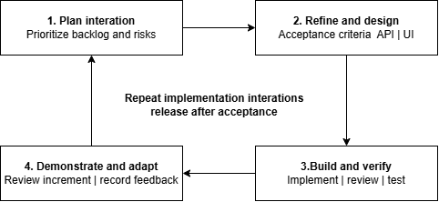

# I. Record of Changes

| Date | A* / M, D | In charge | Change Description |
| --- | --- | --- | --- |
| 11 Sep 2026 | A | Team | Version 1.0: Initial Project Management Plan (PMP). |
| 03 Nov 2026 | M | Team | Version 2.0: Synchronized WBS, risk register, RACI matrix, and quality plan with the 5-role / 8-feature target. |
| 17 Nov 2026 | M | Team | Version 3.0: Rewritten against the delivered product. WBS re-derived for the then-current six-feature set (`FE-01`–`FE-06`) and twelve functions; effort re-estimated and reconciled with available team capacity; risk register, training plan, deliverables, RACI, and tools aligned to the four-role scope and the `V1`+`V2` schema baseline. |

| 18 Nov 2026 | M | Team | Version 3.1: WBS re-derived for the four-main-flow, eight-feature model (`MF1`–`MF4`, `FE-01`–`FE-08`, two features per flow) at sixteen functions. Total effort re-estimated to 208 man-days and reconciled against the same 300 person-day raw allocation at 70% effective capacity. Risk 1, the objectives, the quality table, the training plan, and the deliverable descriptions updated to match. |
| 19 Nov 2026 | M | Team | Version 3.2: Synchronized scope, WBS, risk register, deliverables, and tooling with the delivered forward-only `V1`–`V4` and `V60`–`V62` schema (45 application tables / 47 total PostgreSQL tables) and `DroneKnowledgeAI` historical-case recommendation; recorded Mobile Customer parity (`PR #27`) and the final verified automated test execution. Total effort remains reconciled at 208 man-days across 300 raw person-days. |
| 20 Nov 2026 | M | Team | Version 3.3: Extended the schema and AI tooling baseline through `V63`–`V65` (applied Flyway set `V1`–`V4` and `V60`–`V65`, retaining 45 application tables / 47 total PostgreSQL tables): `70.00` default AI auto-confirm threshold (`V63`), historical published-case backfill (`V64`), local `fastembed` `vector(384)` multilingual embeddings hosted in `ai-inference` (`V65`), finding/batch AI note drafting (`Draft note with AI` / `Draft all notes`), and finding confirmation status filter chips. |

*A - Added M - Modified D - Deleted

# II. Project Management Plan

## 1. Overview

### 1.1 Scope & Estimation

SmartDroneInspection is a platform-operated service for infrastructure inspection. Customer organizations register their assets, raise one-time or recurring inspection service requests, negotiate priced quotations, accept them, and sign a paper service agreement. The platform then coordinates qualified partner drone Inspectors to execute the flights, collect photographic and video evidence, confirm defect findings against vision-model proposals, and produce an inspection report that a Manager independently reviews and publishes for the Customer's acceptance and payment.

The delivered scope covers four main flows — onboarding (`MF1`), buildings and commercial agreement through dispatch (`MF2`), field work through evidence and findings (`MF3`), and report review through payment settlement (`MF4`) — organised as eight product features and sixteen functions, two features per flow. Work is decomposed below; complexity uses the three levels `Simple`, `Medium`, and `Complex`, and effort is expressed in man-days.

The delivered persistence baseline is the forward-only migration set `V1`–`V4` and `V60`–`V65`: 45 application tables and 47 total PostgreSQL tables in the `public` schema, consolidated from a single baseline and asserted by an automated migration-set test. It includes the tenant-isolated `DroneKnowledgeAI` retrieval layer (`pgvector` `vector(384)` HNSW cosine index backed by local `fastembed` embeddings with a deterministic `HYBRID_MATCH` fallback), the `70.00` default AI auto-confirm threshold (`V63`), historical published-case backfill (`V64`), the re-inspection verdict-validity and payment-due migrations, optional quotation-stage partner assignment, and Inspector–Customer inspection chat, with Customer mobile parity (`PR #27`). This delivered work is absorbed within the feature estimates below; the total remains reconciled at 208 man-days against 300 raw person-days.

| # | WBS Item | Complexity | Est. Effort (man-days) |
| --- | --- | --- | --- |
| 1 | `MF1` Onboarding and partner admission (Owner: Trần Hoàng Trung Hiếu) | Complex | 45 |
| 1.1 | FE-01 Registration, Sign-in and Account Access | Complex | 22 |
| 1.1.1 | Customer organization registration with airspace screening, secure sign-in, OTP, and Google authentication | Complex | 11 |
| 1.1.2 | Session and refresh-token handling, account profile, and four-role access control | Complex | 11 |
| 1.2 | FE-02 Partner Inspector and Drone Registration | Complex | 23 |
| 1.2.1 | Platform-governed Inspector admission, qualification review, and pilot-licence records | Medium | 10 |
| 1.2.2 | Inspector-owned drone registration with the configured document set and platform review | Complex | 13 |
| 2 | `MF2` Buildings, requests, quotations and dispatch (Owner: Phùng Trung Quốc) | Complex | 59 |
| 2.1 | FE-03 Buildings, Airspace Screening and Notifications | Complex | 33 |
| 2.1.1 | Customer buildings, inspection checkpoints, reference documents, and restricted-airspace review under the airspace gate | Complex | 13 |
| 2.1.2 | Recurring service-request planning, occurrence generation, and lifecycle notifications with duplicate suppression | Complex | 20 |
| 2.2 | FE-04 Service Requests, VND Quotations, Agreements and Dispatch | Complex | 26 |
| 2.2.1 | One-time and recurring requests, order-chat negotiation, and versioned quotations | Complex | 13 |
| 2.2.2 | Quotation acceptance, recorded signed agreements, and partner assignment with availability checks | Complex | 13 |
| 3 | `MF3` Field delivery and evidence (Owner: Trần Tùng Bách) | Complex | 46 |
| 3.1 | FE-05 Flight Permit and On-site Field Sessions | Complex | 23 |
| 3.1.1 | Mission flight-permit submission, verification, and permit release gate | Complex | 11 |
| 3.1.2 | Field-session recording (start, complete, reasoned abort) and Manager reschedule, reassign, or cancel | Complex | 12 |
| 3.2 | FE-06 Evidence Intake and Human-Reviewed Defect Detection | Complex | 23 |
| 3.2.1 | Photograph and video evidence intake, normalization, resumable upload, and streaming playback | Complex | 12 |
| 3.2.2 | Vision-assisted defect proposals, tenant-isolated `DroneKnowledgeAI` advisory recommendations, and human confirmation of the findings baseline | Complex | 11 |
| 4 | `MF4` Report review and payment settlement (Owner: Trương Thái Như) | Complex | 28 |
| 4.1 | FE-07 Inspection Report Preparation, Review and Publication | Complex | 14 |
| 4.1.1 | Report compilation from confirmed findings with the AI executive summary and its matched-case and engineering-standard knowledge references | Complex | 8 |
| 4.1.2 | Independent Manager review, publication of a locked version, and PDF rendering | Complex | 6 |
| 4.2 | FE-08 Customer Report Acceptance and Payment Settlement | Complex | 14 |
| 4.2.1 | Customer report acceptance, PayOS and VNPay settlement, partner payouts and refunds | Complex | 9 |
| 4.2.2 | Re-inspection loop with three-way defect resolution recording | Medium | 5 |
| 5 | Cross-cutting foundation | Medium | 18 |
| 5.1 | Module boundaries, authorization policy, and audit trail | Medium | 8 |
| 5.2 | Object storage, media pipeline, and bilingual localization | Medium | 10 |
| 6 | Verification and documentation | Medium | 12 |
| 6.1 | Automated suites and regression | Medium | 7 |
| 6.2 | Report set and test workbooks | Simple | 5 |
| Total Estimated Effort (man-days) | 208 |  |  |

**Capacity reconciliation.** Four team members work across a fifteen-week semester at an assumed twenty working days per month, giving a raw allocation of `4 members × 3.75 months × 20 days = 300` person-days. Applied at roughly 70% effective capacity — allowing for lectures, review preparation, and rework, with documentation counted inside the breakdown above rather than deducted from it — the available development capacity is about 208 man-days, which matches the estimate above.

### 1.2 Project Objectives

The objective is to deliver a working, demonstrable platform that completes the four main flows end to end across web and mobile, with a backend that enforces role, ownership, and assignment boundaries.

Quality targets, measured against the final integrated build: every delivered feature linked to executed automated or manual test evidence; at least 80% line coverage on the backend core modules; zero Spring Modulith boundary violations; and no open Critical defects at submission.

| # | Testing Stage | Test Coverage | No. of Defects | % of Defect | Notes |
| --- | --- | --- | --- | --- | --- |
| 1 | Reviewing | Peer review on every pull request | Not tracked by count | Not applicable | Review is a gate, not a defect metric. |
| 2 | Unit Test | Target ≥ 80% line coverage on backend core modules; frontend and mobile unit suites maintained | Recorded in Report 5 | Recorded in Report 5 | Executed totals and coverage are reported in Report 5. |
| 3 | Integration Test | Backend API and persistence contracts exercised against real PostgreSQL and object storage | Recorded in Report 5 | Recorded in Report 5 | Executed totals are reported in Report 5. |
| 4 | System Test | End-to-end flows `MF1`–`MF4` across all four roles | Recorded in Report 5 | Recorded in Report 5 | Executed totals are reported in Report 5. |
| 5 | Acceptance Test | Customer, Manager, Inspector, and Administrator scenarios on the deployed build | Recorded in Report 5 | Recorded in Report 5 | Executed totals are reported in Report 5. |

Milestone Timeliness (%): target at least 90%; Review 1 in Week 4, Review 2 in Week 8, Defense 1.1 in Week 13, and final submission in Week 15.

Allocated Effort (man-days): requirements and project management 20; architectural and database design 14; implementation 140; testing, deployment, and documentation 34. Total 208 man-days.

### 1.3 Project Risks

| # | Risk Description | Impact | Possibility | Response Plans |
| --- | --- | --- | --- | --- |
| 1 | Scope exceeds four-person capacity across backend, web, mobile, and AI work. | High | Medium | Bound the scope to eight features and sixteen functions, assign two features per member, and track the WBS weekly. Corrective maintenance was removed from scope when it threatened the schedule. |
| 2 | Contract drift between the four repositories — a backend contract change not reflected in the web or mobile client. | High | High | Keep one focused pull request per repository and merge in a documented order; exercise the changed endpoint through the client tests before merging; re-read live code rather than stale documentation when reconciling. |
| 3 | The self-hosted vision model or the external language-model endpoint is unavailable during a demonstration. | High | Medium | Route inference through a primary-with-fallback strategy; accept manually entered findings when no detector responds; keep report compilation deterministic so a report can always be produced; for `DroneKnowledgeAI` recommendations, fall back to deterministic `HYBRID_MATCH` similarity when embeddings are unconfigured, and keep recommendations advisory so findings can still be confirmed by the Inspector. |
| 4 | Report content diverges from the confirmed findings. | High | Low | Compile the report from confirmed findings rather than free text, and require an independent Manager to approve publication. |
| 5 | Cross-customer data leakage or privilege escalation between the four roles. | High | Low | Enforce role checks at every endpoint, add ownership and assignment checks inside services, and keep separation of duties between report author and report reviewer. |
| 6 | The same Inspector or aircraft is double-booked across two customer organizations. | High | Medium | Check schedule conflicts across all customer organizations before assigning an occurrence, and require a currently valid pilot licence and an eligible aircraft. |
| 7 | Unverified payment or report download before settlement. | High | Low | Accept payment only through gateway callbacks with verified signatures, and withhold the report deliverable until the occurrence is accepted or paid. |
| 8 | Large photographs and video exhaust storage or memory during upload. | Medium | Medium | Normalise images on intake, accept video through resumable chunked uploads, transcode asynchronously, and stream playback with signed, time-limited access. |
| 9 | Database schema churn destabilises the deployment. | Medium | Medium | Consolidate the migration history into a single baseline plus forward-only changes, and assert the migration set in an automated test. |
| 10 | Concurrent deployments from separate repositories collide on the shared host. | Medium | Low | Serialise deployments behind a lock and take a database backup before each release. |

## 2. Management Approach

The team delivers in short iterations with a prioritised work breakdown, weekly checkpoints, and mandatory peer review before any merge. Each feature has a single primary owner, verified against commit authorship. The team works in four independent repositories — backend, web frontend, mobile, and documentation — and accepts the coordination cost of that split in exchange for independent release.

### 2.1 Project Process

Each iteration selects the highest-priority work, agrees its acceptance criteria and its API and data contracts, builds the backend slice with tests, follows with the web and mobile clients, and merges through a pull request only after the local verification suite passes. Integration is continuous: because the clients and the backend evolve in separate repositories, every contract change is made in one coordinated set of pull requests that are merged in a stated order.

Figure 1. Iterative delivery process.

### 2.2 Quality Management

- **Defect Prevention:** enforce module boundaries automatically, keep the TypeScript build strict, run the mobile static analyser, and assert the database migration set in a test.
- **Peer Review:** every change is reviewed by a non-author before merge.
- **Unit and Integration Testing:** maintain backend unit and integration suites against real PostgreSQL and object storage, plus web and mobile test suites, and track coverage on the backend core.
- **System and Acceptance Testing:** trace functional cases from each feature to executed results, and record failures rather than omitting them.

### 2.3 Training Plan

| Training Area | Participants | When, Duration | Waiver Criteria |
| --- | --- | --- | --- |
| Inspection service domain and the `MF1`–`MF4` workflows | All members | Week 1, 2 hours | Walk through all four flows and every status transition unaided. |
| Spring Boot 4.1, Spring Modulith, PostgreSQL, and object storage | All members | Week 2, 2 hours | Deliver one scoped endpoint with an integration test against real infrastructure. |
| React 19, Material UI, and Flutter | All members | Week 2, 2 hours | Build a role-guarded web screen and a mobile upload flow. |
| Vision-model inference, report rendering, and payment gateways | Bách, Quốc, Như | Week 3, 2 hours | Run detector inference, render a report to PDF, and complete a gateway callback in a sandbox. |

## 3. Project Deliverables

| # | Deliverable | Due Date | Notes |
| --- | --- | --- | --- |
| D1 | Report 1 — Project Introduction | Week 2 | Product background, three-system comparison, vision, and eight-feature scope. |
| D2 | Report 2 — Project Management Plan | Week 3 | Eight-feature work breakdown, risk register, RACI, and quality plan. |
| D3 | Review 1 Gate Package | Week 4 | Registration form, management plan, draft requirements, and architecture baseline. |
| D4 | Report 3 — Software Requirement Specification | Week 8 | Complete requirements for four roles and eight features, with screen and authorization matrices. |
| D5 | Report 4 — Software Design Document | Week 8 | System architecture, package and database design, and per-feature diagrams. |
| D6 | Report 5 — Test Documentation and Test Report | Week 8, updated Week 13 | Testing plan plus the executed test-case workbook. |
| D7 | Review 2 Submission Package | Week 8 | The four review artefacts required at the second review. |
| D8 | Integrated Release and Verification | Week 13 | All four flows demonstrated on the deployed build. |
| D9 | Final Submission Package (Reports 1–7) | Weeks 14–15 | Final release, deployed demonstration, and complete documentation. |

## 4. Responsibility Assignments

One primary owner is assigned to each of the twelve functions, matching commit authorship across the backend, web, mobile, and documentation repositories. Columns use the four students' initials: **H** — Trần Hoàng Trung Hiếu (`SE184212`); **Q** — Phùng Trung Quốc (`SE170027`); **N** — Trương Thái Như (`SE180082`); **B** — Trần Tùng Bách (`SE180220`).

D~Do; R~Review; S~Support; I~Informed; <blank>- Omitted

| Responsibility | H | Q | N | B | Supervisors |
| --- | --- | --- | --- | --- | --- |
| 1.1 Customer registration, airspace screening, sign-in, and Google authentication | D | S | S | R | I |
| 1.2 Session and refresh handling, account profile, and four-role access | D | S | S | R | R |
| 2.1 Inspector admission, qualification review, and pilot-licence records | D | S | S | R | I |
| 2.2 Drone registration with document review, and customer asset management | D | R | S | S | R |
| 3.1 Recurring service requests and inspection occurrences | R | D | S | S | R |
| 3.2 Lifecycle notifications with duplicate suppression | S | D | S | R | I |
| 4.1 Service requests, order chat, and versioned quotations | R | D | S | S | R |
| 4.2 Quotation acceptance, signed agreements, and partner dispatch | R | D | S | S | R |
| 5.1 Flight-permit submission and verification gate | R | S | S | D | R |
| 5.2 Field-session recording and Manager reschedule, reassign, or cancel | R | S | S | D | I |
| 6.1 Evidence intake, vision-assisted defect proposals, and findings confirmation | S | R | S | D | R |
| 6.2 Report compilation, independent review and publication, and payment settlement | R | S | S | D | R |
| 7.1 Project documentation and report publication pipeline | R | S | D | S | R |
| 7.2 Test evidence tracking and release verification | R | S | D | S | R |

## 5. Project Communications

| Communication Item | Who/ Target | Purpose | When, Frequency | Type, Tool, Method(s) |
| --- | --- | --- | --- | --- |
| Daily progress sync | All members | Report progress and clear blockers | Working days | Chat channel and pull-request comments |
| Weekly planning and work-breakdown review | Leader and team | Update the breakdown, defects, and weekly report | Weekly | Online meeting with the tracking workbook |
| Supervisor checkpoint | Team and supervisors | Review requirements, design, and test artefacts; demonstrate progress | Weekly to bi-weekly | In person or video call, with document review |
| Pull request and verification gate | Author and reviewer | Confirm module boundaries and all test suites pass | Every change before merge | Pull request with local verification record |
| Milestone gate review | Team, supervisors, and council | Review 1 (Week 4), Review 2 (Week 8), Defense 1.1 (Week 13) | Weeks 4, 8, 13, and 15 | Live demonstration and formal submission |

## 6. Configuration Management

### 6.1 Document Management

Project documents are authored in version-controlled Markdown under the documentation repository and converted to the official university Word and Excel templates by a Python export toolchain. That toolchain fills the templates rather than rebuilding them, so each release keeps the official styles, numbering, and formulas intact; the Markdown remains the editable source and every change is reviewable in version control.

### 6.2 Source Code Management

Source code is managed in four independent GitHub repositories — backend, web frontend, mobile application, and documentation. Each repository has its own workflow, and a cross-repository change is delivered as one focused pull request per repository, merged in a documented order. Database evolution is forward-only: the migration history is a single consolidated baseline plus subsequent forward migrations, and an automated test asserts the exact set of applied versions so an accidental renumbering fails the build.

### 6.3 Tools & Infrastructures

| Category | Tools / Infrastructure |
| --- | --- |
| Technology | Java 21, Spring Boot 4.1, Spring Modulith, Spring Security with JWT and Google OAuth2, Hibernate/JPA, Flyway; Python with FastAPI and Ultralytics for the vision service; React 19, TypeScript, Vite, Material UI, TanStack Query; Flutter with Riverpod and GoRouter |
| Database | PostgreSQL 17 with pgcrypto and pgvector (`vector(384)`, HNSW cosine index for the `DroneKnowledgeAI` `inspection_knowledge_chunks` and `historical_finding_cases` retrieval layer powered by local `fastembed` `paraphrase-multilingual-MiniLM-L12-v2` embeddings; `HYBRID_MATCH` fallback when the embedding endpoint is unavailable) |
| IDEs/Editors | Visual Studio Code, IntelliJ IDEA, Android Studio |
| Diagramming | Mermaid and Draw.io sources kept in version control alongside the reports |
| Documentation | Markdown in the documentation repository with automated OOXML export to the official Word and Excel templates |
| Version Control | Git and GitHub, with protected branches and pull-request review |
| Deployment server | Docker Compose on a Linux host, Nginx for the web client, object storage for evidence media |
| Project management | GitHub pull requests and issues, a project tracking workbook, and weekly reporting |
