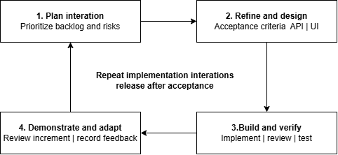

# I. Record of Changes

| Date | A* M, D | In charge | Change Description |
| --- | --- | --- | --- |
| 11 Sep 2026 | A | Team | Version 1.0: Initial Project Management Plan (PMP) content. |
| 14 Sep 2026 | M | Team | Version 1.5: Organized WBS as software features/functions and responsibility matrix. |
| 21 Oct 2026 | M | Team | Version 1.7: Integrated PayPal Orders v2 online payment for Enterprise SaaS subscription billing. |
| 27 Oct 2026 | M | Team | Version 2.0: Synchronized WBS, effort estimation, risk register, responsibility matrix (RACI), and tool stack with the 12-Feature (FE-01 to FE-12, 24 functions) Review 2 baseline and Git-verified member ownership. |

*A - Added M - Modified D - Deleted

# II. Project Management Plan

## 1. Overview

### 1.1 Scope & Estimation

SmartDroneInspection is a multi-tenant Enterprise Software-as-a-Service (SaaS) and B2B Drone Leasing platform engineered for infrastructure-owning organizations to govern their workforce, subscriptions, infrastructure assets, owned/leased drone fleets, recurring and one-off inspection missions, Vietnam airspace advisories, aviation flight permits, field flight sessions, YOLO11 defect detection, certified PDF reports, and RAG-assisted maintenance work orders. The Work Breakdown Structure (WBS) is decomposed into **12 high-level product features (`FE-01` to `FE-12`)** and **24 functional items (`3` features / `6` functions per team member)** totaling **135 man-days**:

| # | WBS Item | Complexity | Est. Effort (man-days) |
| --- | --- | --- | --- |
| 1 | FE-01 Authentication & Access Control (Owner: Trần Tùng Bách) |  | 11 |
| 1.1 | Organization Self-Registration & Argon2id User Sign-In (Web & Mobile) | Medium | 5 |
| 1.2 | HS256 JWT, HmacSHA256 Refresh Rotation, CSRF/Rate-Limit & 5-Role RBAC | Complex | 6 |
| 2 | FE-02 Workforce & Subscription Management (Owner: Trần Hoàng Trung Hiếu) |  | 11 |
| 2.1 | Platform User Admin, Workforce Provisioning & Pilot License Profile | Medium | 5 |
| 2.2 | Enterprise Subscription Billing (1–120m Wire & PayPal Orders v2 + Webhooks) | Complex | 6 |
| 3 | FE-03 Asset & Drone Fleet Management (Owner: Trần Hoàng Trung Hiếu) |  | 12 |
| 3.1 | Infrastructure Asset Catalog, Checkpoints, Reference Documents & Retirement | Complex | 6 |
| 3.2 | Owned Drone Inventory & B2B Platform Drone Leasing (Pool, Lease, Reclaim) | Complex | 6 |
| 4 | FE-04 Recurring Schedule & Notifications (Owner: Trần Hoàng Trung Hiếu) |  | 11 |
| 4.1 | Timezone-Anchored Recurring Inspection Schedules & Rolling Occurrence Job | Complex | 6 |
| 4.2 | Spring Modulith Outbox & Deduplicated In-App Notification Inbox | Medium | 5 |
| 5 | FE-05 Mission Dispatch & Airspace Advisory (Owner: Phùng Trung Quốc) |  | 11 |
| 5.1 | One-Off Inspection Mission Scheduling & Direct Inspector/Drone Conflict Check | Complex | 6 |
| 5.2 | Interactive Vietnam Airspace & No-Fly Zone Map (Web & Mobile Haversine Radar) | Complex | 5 |
| 6 | FE-06 Flight Readiness & Field Execution (Owner: Phùng Trung Quốc) |  | 11 |
| 6.1 | Self-Service Aviation Flight Permit Upload & Readiness Gate (Ready for Flight) | Medium | 5 |
| 6.2 | Web & Flutter Mobile On-Site Field Flight Session Logging | Complex | 6 |
| 7 | FE-07 Operational Dashboard & Schedule Calendar (Owner: Phùng Trung Quốc) |  | 10 |
| 7.1 | Multi-Role Operational Analytics Dashboard & Server-Paged Queues | Medium | 5 |
| 7.2 | Inspector Schedule Calendar Board, Enterprise Dark Mode & EN/VI Localization | Medium | 5 |
| 8 | FE-08 Evidence Management & AI Defect Detection (Owner: Trần Tùng Bách) |  | 12 |
| 8.1 | Multipart Evidence Upload to MinIO, EXIF GPS Extraction & Soft-Retirement | Complex | 6 |
| 8.2 | Self-Hosted FastAPI YOLO11 Defect Detection, Fallback & Finding Confirmation | Complex | 6 |
| 9 | FE-09 Inspection Reporting & Publication (Owner: Trần Tùng Bách) |  | 12 |
| 9.1 | Context-Grounded LLM & Manual Report Drafting and Author Verification | Complex | 6 |
| 9.2 | Independent Review, Immutable A4 PDF Publication & Maintenance Handoff | Complex | 6 |
| 10 | FE-10 Maintenance Planning & AI Scope Advisory (Owner: Trương Thái Như) |  | 11 |
| 10.1 | Work Order Creation & pgvector RAG Repair Scope Advisory (TCVN/EN/ISO) | Complex | 6 |
| 10.2 | Maintenance Engineering Team Role Allocation & Task Decomposition | Medium | 5 |
| 11 | FE-11 Cost Estimation & Repair Execution (Owner: Trương Thái Như) |  | 12 |
| 11.1 | Versioned Itemized Cost Estimation, Budget Approval & Change Orders | Complex | 6 |
| 11.2 | Web & Mobile Field Repair Task Execution & Team Lead Work Log Verification | Complex | 6 |
| 12 | FE-12 Maintenance Acceptance & Cost Closure (Owner: Trương Thái Như) |  | 11 |
| 12.1 | Maintenance Completion Report PDF & Independent Technical Acceptance | Complex | 6 |
| 12.2 | Actual Cost Line Recording, Variance Reconciliation & Work Order Closure | Complex | 5 |
| Total Estimated Effort (man-days) | 135 |  |  |

### 1.2 Project Objectives

The objective is to deliver a production-grade, multi-tenant Enterprise SaaS and B2B Drone Leasing platform covering the complete four-stage lifecycle (`WF-01` to `WF-04`) across Web (`React 19`) and Mobile (`Flutter`), backed by `850` automated backend JUnit/Testcontainers tests, `602` frontend Vitest tests, `20` Flutter mobile tests, and `64` functional test cases across `Feature 1`–`Feature 12` in `Report5_Test Report.xlsx`.

Quality targets: 100% of mandatory features (`FE-01`–`FE-12`) are linked to automated and staging test evidence; `>= 90%` functional test pass rate (`93.75%` achieved at Review 2); `>= 80%` backend JaCoCo coverage; `0` Spring Modulith boundary violations; and `0` open Critical or High defects.

| # | Testing Stage | Test Coverage | No. of Defects | % of Defect | Notes |
| --- | --- | --- | --- | --- | --- |
| 1 | Reviewing | 100% baseline documents | 0 Open | 0% | Cross-review across Registration, SRS, SDD, Test Report, and BM01–BM04. |
| 2 | Unit Test | >=80% JaCoCo coverage in core modules | 2 Closed | 33.3% | Verified by 850 backend JUnit tests, 602 Vitest tests, and 20 Flutter tests. |
| 3 | Integration Test | 100% critical API & DB contracts | 3 Closed | 50.0% | Containerized PostgreSQL 17 (pgvector), MinIO, YOLO11, OpenHTMLtoPDF, and PayPal/Wire. |
| 4 | System Test | 93.75% (60/64 Passed, 4 Pending) | 1 Closed | 16.7% | Full-stack WF-01..WF-04 E2E tests and 5-role multi-tenant isolation checks. |
| 5 | Acceptance Test | 100% happy-path & 8 Demo Scenarios | 0 Open | 0% | Live cloud staging at https://smartdroneinspection.duckdns.org. |

Milestone Timeliness (%): target at least 90%; Review 1 in Week 4, Review 2 in Week 8, Faculty Council (Defense 1.1) in Week 13, and final submission in Week 15.

Allocated Effort (man-days): requirements and project management 18; architectural & database design 12; full-stack & AI implementation 85; testing, deployment, and documentation 20. Total: 135 man-days.

### 1.3 Project Risks

| # | Risk Description | Impact | Possibility | Response Plans |
| --- | --- | --- | --- | --- |
| 1 | Scope exceeds four-person capacity across Web, Mobile, Backend, and AI. | High | Medium | Partition scope into 12 balanced features (FE-01 to FE-12, 3 features / 6 functions per member) and enforce strict weekly WBS tracking. |
| 2 | Self-hosted YOLO11 container or external LLM/Vision API is unreachable during field operations. | High | Medium | Isolate behind PrimaryWithFallbackInference, provide manual finding entry (POST /findings), manual report drafting (/report/draft/manual), and DeterministicScopeFallback for RAG maintenance advice. |
| 3 | LLM report draft contains unverified claims or drifts from confirmed findings after edits. | High | Medium | Lock confirmed findings snapshot before drafting; reject stale report drafts with 409 Report Snapshot Stale and require explicit author verification (Author Verified) + independent Organization Manager approval. |
| 4 | Cross-tenant data leakage or privilege escalation across the 5 roles. | High | Low | Enforce composite tenant FKs (id, organization_id) in PostgreSQL 17, @PreAuthorize role guards, Platform Admin and Platform Manager single-role separation separation of duties, and independent reviewer checks. |
| 5 | Month-end and leap-year date drift or resource double-booking in recurring schedules. | Medium | Medium | Implement original-anchor timezone arithmetic with month-end clamping in RecurringInspectionSchedule and record explicit Blocked occurrences on Inspector/Drone conflict. |
| 6 | Client-side payment spoofing or replay on Enterprise subscriptions and B2B drone leases. | High | Low | Verify PayPal Orders v2 captures server-to-server, validate webhook signatures, enforce uq_payment_transactions_paypal_capture_id, and require Platform Manager confirmation for wire transfers. |
| 7 | Corrupt or oversized image uploads degrade MinIO storage or YOLO11 inference. | Medium | Medium | Enforce 10 MB per-file limit, ImageIO decode validation (400 Evidence Invalid on corrupt bytes), and duplicate document detection on asset uploads. |
| 8 | Concurrent CI/CD deployments from Backend and Frontend repositories collide on staging VPS. | Medium | Low | Serialize deployments in deploy.yml via flock -w 900 /tmp/sdi-deploy.lock and take automated pre-deploy pg_dump backups. |

## 2. Management Approach

The team uses iterative, risk-driven delivery with a prioritized WBS in `Report3_Project Tracking.xlsx`, weekly checkpoints, non-author pull-request reviews, automated GitHub Actions CI gates, and live staging verification at university review milestones. Trần Hoàng Trung Hiếu coordinates overall project planning and integration. Every feature (`FE-01`–`FE-12`) has a single primary owner (`3` features per member) verified against Git commit authorship.

### 2.1 Project Process

Each iteration selects prioritized features, refines acceptance criteria and database/API contracts, implements backend/frontend/mobile slices with unit and Testcontainers integration tests, merges via pull request after green CI, and deploys to staging (`https://smartdroneinspection.duckdns.org`).

Figure 1. Iterative development process.

### 2.2 Quality Management

- **Defect Prevention**: Enforce compile-time Spring Modulith boundaries (`ModulithArchitectureTest`), Flyway `V1`–`V5` schema migration tests (`FullDatabaseSchemaMigrationTest`), TypeScript strict builds, and `flutter analyze`.
- **Peer Review**: Require pull-request review and automated CI verification before merging to `main`.
- **Unit & Integration Testing**: Maintain `>= 80%` backend JaCoCo coverage (`850` JUnit/Testcontainers tests), `602` frontend Vitest tests, and `20` Flutter tests.
- **System & Acceptance Testing**: Execute all `64` functional test cases across `Feature 1`–`Feature 12` in `Report5_Test Report.xlsx` (`60 Passed`, `0 Failed`, `4 Pending` manual staging walkthroughs scheduled for Milestone 4).

### 2.3 Training Plan

| Training Area | Participants | When, Duration | Waiver Criteria |
| --- | --- | --- | --- |
| Enterprise SaaS & B2B Drone Leasing Domain Flows (WF-01..WF-04) | All members | Week 1, 2 hours | Complete end-to-end workflow and state machine walkthrough. |
| Spring Boot 4.1, Spring Modulith 2.1, PostgreSQL 17 (pgvector) & MinIO | Bách, Hiếu, Quốc, Như | Week 2, 2 hours | Implement a tenant-scoped endpoint with Testcontainers integration test. |
| React 19, MUI v9, TanStack Query & Flutter Riverpod Mobile | All members | Week 2, 2 hours | Build and test a role-guarded web screen and mobile repository slice. |
| FastAPI YOLO11 (MBDD2025), OpenHTMLtoPDF & pgvector RAG | Bách, Như | Week 3, 2 hours | Run container inference, server-side PDF rendering, and RAG retrieval. |

## 3. Project Deliverables

| # | Deliverable | Due Date | Notes |
| --- | --- | --- | --- |
| D1 | Report 1 — Project Introduction | Week 2 / Updated W8 | Vision, background, 5-role governance, and 12 features (FE-01..FE-12). |
| D2 | Report 2 — Project Management Plan | Week 3 / Updated W8 | 12-feature WBS (135 man-days), risk register, RACI matrix, and quality plan. |
| D3 | Review 1 Gate Package | Week 4 | Initial Registration Form, PMP, SRS Draft, and architecture baseline. |
| D4 | Report 3 — Software Requirement Specification (SRS v2.0) | Week 8 (Review 2) | Full 5-role, 12-feature (24 functions) SRS + Report3_Project Tracking.xlsx. |
| D5 | Report 4 — Software Design Document (SDD v2.0) | Week 8 (Review 2) | System architecture, 30-table DB design, and 12-feature detailed design (24 diagrams). |
| D6 | Report 5 — Test Documentation & Test Report (v5.00) | Week 8 (Review 2) | Report5_Test Documentation.docx + Report5_Test Report.xlsx (12 Feature sheets, 64 TCs). |
| D7 | SWP490 Review 2 Submission Package (BM01–BM04) | Week 8 (Review 2) | Registration v2.0 + BM03, Self-Review BM02, Design Brief BM01 + Appendix A, Commitment BM04. |
| D8 | Milestone 4 Pending Case Closure & Stress Verification | Week 11 | Close remaining 4 manual staging/mobile walkthroughs (64/64 Passed). |
| D9 | Defense 1.1 & Final Submission Package (Reports 1–7) | Weeks 13–15 | Final software release, live staging demo, and complete SEP490 documentation. |

## 4. Responsibility Assignments

The RACI matrix assigns one primary Do (`D`) owner to each of the 24 WBS functions (`FE-01` to `FE-12`, 3 features / 6 functions per member), matching actual Git authorship across `SmartDroneInspection-backend`, `-frontend`, `-mobile`, and `-docs`. H = Trần Hoàng Trung Hiếu (`SE184212`); Q = Phùng Trung Quốc (`SE170027`); N = Trương Thái Như (`SE180082`); B = Trần Tùng Bách (`SE180220`).

D~Do; R~Review; S~Support; I~Informed; <blank>- Omitted

| Responsibility | H | Q | N | B | Supervisors |
| --- | --- | --- | --- | --- | --- |
| 1.1 FE-01 Organization Registration & User Sign-In (W6) | R | S | S | D | I |
| 1.2 FE-01 Session Management & 5-Role RBAC (W6) | R | S | S | D | R |
| 2.1 FE-02 Workforce Provisioning & Pilot License Profile (W7) | D | S | S | R | I |
| 2.2 FE-02 Enterprise Subscription & Online Payment (W7) | D | S | S | R | R |
| 3.1 FE-03 Infrastructure Asset & Document Management (W7) | D | R | S | S | I |
| 3.2 FE-03 Drone Inventory & B2B Drone Leasing (W8) | D | R | S | S | R |
| 4.1 FE-04 Recurring Inspection Schedule Management (W8) | D | R | S | S | R |
| 4.2 FE-04 Event-Driven In-App Notifications (W8) | D | S | S | R | I |
| 5.1 FE-05 Inspection Mission Scheduling & Conflict Check (W7) | R | D | S | S | I |
| 5.2 FE-05 Interactive Airspace & No-Fly Zone Map (W8) | R | D | S | S | R |
| 6.1 FE-06 Flight Permit Upload & Readiness Gate (W8) | R | D | S | S | R |
| 6.2 FE-06 On-Site Field Flight Session Logging (W8) | S | D | R | S | I |
| 7.1 FE-07 Multi-Role Operational Analytics Dashboard (W8) | R | D | S | S | I |
| 7.2 FE-07 Inspector Schedule Calendar & Localization (W8) | S | D | R | S | I |
| 8.1 FE-08 Inspection Evidence Upload & Metadata Management (W7) | S | R | S | D | I |
| 8.2 FE-08 AI Defect Detection (YOLO11) & Finding Verification (W8) | R | S | S | D | R |
| 9.1 FE-09 AI-Assisted & Manual Report Drafting (W8) | R | S | S | D | R |
| 9.2 FE-09 Report Review, PDF Publication & Maintenance Handoff (W8) | R | S | S | D | R |
| 10.1 FE-10 Work Order Creation & AI Repair Scope Advisory (W8) | R | S | D | S | R |
| 10.2 FE-10 Maintenance Team & Task Assignment (W8) | R | S | D | S | I |
| 11.1 FE-11 Cost Estimation, Budget Approval & Change Orders (W8) | R | S | D | S | R |
| 11.2 FE-11 Field Repair Execution & Work Log Verification (W8) | S | R | D | S | I |
| 12.1 FE-12 Maintenance Completion Reporting & Technical Acceptance (W8) | R | S | D | S | R |
| 12.2 FE-12 Cost Reconciliation & Work Order Closure (W8) | R | S | D | S | R |

## 5. Project Communications

| Communication Item | Who/ Target | Purpose | When, Frequency | Type, Tool, Method(s) |
| --- | --- | --- | --- | --- |
| Daily progress sync | All members | Track task progress and resolve blockers | Working days | Discord / Zalo & GitHub PRs |
| Weekly planning and WBS review | Leader and team | Update WBS, Issues, Defects & Weekly Report | Weekly | Online meeting & Report3_Project Tracking.xlsx |
| Supervisor checkpoint | Team and supervisors | Review SRS/SDD/Test artifacts and demo | Weekly / Bi-weekly | In-person / Google Meet & document review |
| Pull request & CI gate review | Author and reviewer | Verify Modulith, JUnit, Vitest & Flutter tests | Every PR before merge | GitHub Pull Requests & GitHub Actions |
| Milestone gate review | Team, supervisors & council | Review 1 (W4), Review 2 (W8), Defense 1.1 (W13) | Weeks 4, 8, 13, 15 | Live staging demo & official submission pack |

## 6. Configuration Management

### 6.1 Document Management

Project documents are authored in version-controlled Markdown under `SmartDroneInspection-docs/reports/` with automated Python OOXML exporters (`tools/export_all.py`, `tools/export_review2_pack.py`) that populate the official FPT University SEP490 Word and Excel templates while preserving all template styles, numbering, and formulas byte-for-byte.

### 6.2 Source Code Management

Source code is managed across four GitHub repositories (`SmartDroneInspection-backend`, `-frontend`, `-mobile`, `-docs`) with branch protection, mandatory CI verification, and release tags (`review-2`). Database schema evolution is strictly forward-only via Flyway migrations `V1` through `V5`.

### 6.3 Tools & Infrastructures

| Category | Tools / Infrastructure |
| --- | --- |
| Backend & Modular Architecture | Java 21, Spring Boot 4.1.0, Spring Modulith 2.1.1, Spring Security OAuth2 JWT, Hibernate/JPA, Flyway, OpenHTMLtoPDF 1.0.10 |
| AI & Computer Vision Services | Python 3.11, FastAPI 0.115.6, Ultralytics 8.3.55 (YOLO11 mbdd2025-v1), OpenAI-compatible LLM/Vision Fallback, pgvector RAG |
| Frontend Web & Mobile Clients | React 19.2.8, TypeScript 6.0.2, Vite 8.2.2, MUI 9.4.0, TanStack Query v5; Flutter 3.13.2, Riverpod 3.4.2, Dio 5.11.0 |
| Database, Storage & Payments | PostgreSQL 17 (pgvector:pg17 + pgcrypto), MinIO S3 Object Storage, PayPal REST API v2 (Orders v2 & Webhooks) |
| CI/CD, Testing & Cloud Staging | GitHub Actions, Testcontainers, JUnit 5, JaCoCo, Vitest, Playwright, Docker Compose, Nginx, Tailscale SSH (smartdroneinspection.duckdns.org) |
