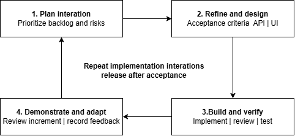

# I. Record of Changes

| Date | A* M, D | In charge | Change Description |
| --- | --- | --- | --- |
| 11 Sep 2026 | A | Team | Version 1.0: Initial Project Management Plan (PMP) content. |
| 14 Sep 2026 | M | Team | Version 1.5: Organized WBS as software features/functions and responsibility matrix. |
| 27 Oct 2026 | M | Team | Version 2.0: Synchronized WBS, effort estimation, risk register, responsibility matrix (RACI), and tool stack with Review 2 baseline. |
| 01 Nov 2026 | M | Team | Version 3.0: Synchronized WBS, RACI matrix, and risk controls with the 5-Role Platform Inspection Service model (ADMIN, MANAGER, CUSTOMER, INSPECTOR, MAINTENANCE_ENGINEER) and narrowed scope to 8 product features (FE-01 to FE-08, 16 functions, 2 features per team member) with PayOS VietQR payment, 6-state inspections, 5-state auto-compiled reports, and 3-way re-inspection verification. |

*A - Added M - Modified D - Deleted

# II. Project Management Plan

## 1. Overview

### 1.1 Scope & Estimation

SmartDroneInspection is a platform-managed Infrastructure Inspection and Corrective Maintenance Service platform engineered for customer organizations to register airspace-verified infrastructure assets, submit commercial service requests, negotiate VND/USD quotations, sign paper contracts, track 5-stage mission progress, accept published PDF inspection reports, pay via PayOS (VietQR), and govern `pgvector` RAG-assisted maintenance work orders and 3-way re-inspection verification, while the Platform coordinates a vetted network of partner drone Inspectors and their owned drones. The Work Breakdown Structure (WBS) is decomposed into **8 high-level product features (`FE-01` to `FE-08`)** and **16 functional items (`2` features / `4` functions per team member)** totaling **135 man-days**:

| # | WBS Item | Complexity | Est. Effort (man-days) |
| --- | --- | --- | --- |
| 1 | FE-01 Authentication, Google OAuth2 & 5-Role Access Control (Owner: Trần Tùng Bách) |  | 16 |
| 1.1 | Customer Airspace Registration, Argon2id Sign-In & Google OAuth2 (Web & Mobile) | Complex | 8 |
| 1.2 | HS256 JWT, Refresh Rotation, `/users/me` Profile & 5-Role `ActorZone` RBAC | Complex | 8 |
| 2 | FE-02 Partner Onboarding, Workforce, Asset & Inspector Drone Registry (Owner: Trần Hoàng Trung Hiếu) |  | 17 |
| 2.1 | Partner Inspector Onboarding, Pilot License Review & Customer Maintenance Workforce | Medium | 8 |
| 2.2 | Infrastructure Asset Catalog, No-Fly Zone Guard & Inspector-Owned Drone 3-Doc Review | Complex | 9 |
| 3 | FE-03 Recurring Schedules, Contract Occurrences & Outbox Notifications (Owner: Trần Hoàng Trung Hiếu) |  | 16 |
| 3.1 | Timezone-Anchored Recurring Schedules & Multi-Occurrence Contract Inheritance (D2) | Complex | 8 |
| 3.2 | Spring Modulith Transactional Outbox & Deduplicated In-App Notification Inbox | Medium | 8 |
| 4 | FE-04 Service Requests, Quotations, Contracts, Dispatch & Airspace Map (Owner: Phùng Trung Quốc) |  | 17 |
| 4.1 | Service Requests, VND/USD Quotations, Order Chat & Signed Paper Contract Upload | Complex | 9 |
| 4.2 | Cross-Org Partner Inspector/Drone Dispatch, Abort Re-Dispatch & Vietnam Airspace Map | Complex | 8 |
| 5 | FE-05 Flight Permit Gate, Field Execution, Dashboard & Calendar (Owner: Phùng Trung Quốc) |  | 16 |
| 5.1 | Aviation Flight Permit Upload Gate & Web/Mobile Field Flight Sessions (Start/Complete/Abort) | Complex | 8 |
| 5.2 | 5-Role Operational Analytics Dashboard, Schedule Calendar & Customer 5-Stage Progress Tracker | Medium | 8 |
| 6 | FE-06 Evidence Intake, YOLO11 Detection, Auto-Compiled Report & PayOS (Owner: Trần Tùng Bách) |  | 19 |
| 6.1 | Photo & Streaming MP4 Video Intake, YOLO11 + Vision Fallback & Findings Confirmation | Complex | 9 |
| 6.2 | Auto-Compiled Report (`SUBMITTED`), AI Executive Summary, Manager PDF Publish & PayOS VietQR | Complex | 10 |
| 7 | FE-07 Maintenance Work Orders, RAG Scope/Norms Advisor & Repair Execution (Owner: Trương Thái Như) |  | 17 |
| 7.1 | Work Order Creation, `pgvector` RAG Scope Advisor & 1-Click Initial Task Provisioning | Complex | 8 |
| 7.2 | RAG Cost Norms Estimator, Customer Budget/Change Order Approval & 1-Click Batch Log Verify | Complex | 9 |
| 8 | FE-08 Completion Report, 3-Way Re-inspection Verification & Cost Closure (Owner: Trương Thái Như) |  | 17 |
| 8.1 | Smart Auto-Drafted Maintenance Completion Report & RAG Acceptance Compliance Audit | Complex | 8 |
| 8.2 | 3-Step / 3-Way Re-inspection Defect Verification Loop, Independent Acceptance & Cost Closure | Complex | 9 |
| Total Estimated Effort (man-days) | 135 |  |  |

### 1.2 Project Objectives

The objective is to deliver a production-grade, platform-managed Infrastructure Inspection and Corrective Maintenance Service platform covering the complete four-stage lifecycle (`MF1` to `MF4` / `WF-01` to `WF-04`) across Web (`React 19`) and Mobile (`Flutter`), organized into 8 core features (`FE-01` to `FE-08`) and backed by automated backend JUnit/Testcontainers tests, frontend Vitest suites, Flutter mobile tests, and functional test cases across `Feature 1`–`Feature 8` in `Report5_Test Report.xlsx`.

Quality targets: 100% of mandatory features (`FE-01`–`FE-08`) are linked to automated and staging test evidence; `>= 90%` functional test pass rate; `>= 80%` backend JaCoCo coverage; `0` Spring Modulith boundary violations; and `0` open Critical or High defects.

| # | Testing Stage | Test Coverage | No. of Defects | % of Defect | Notes |
| --- | --- | --- | --- | --- | --- |
| 1 | Reviewing | 100% baseline documents | 0 Open | 0% | Cross-review across Registration, SRS, SDD, Test Report, and BM01–BM04. |
| 2 | Unit Test | >=80% JaCoCo coverage in core modules | 2 Closed | 33.3% | Verified by backend JUnit tests, frontend Vitest suites, and Flutter mobile tests. |
| 3 | Integration Test | 100% critical API & DB contracts | 3 Closed | 50.0% | Containerized PostgreSQL 17 (pgvector, V1–V17), MinIO, YOLO11, OpenHTMLtoPDF, and PayOS. |
| 4 | System Test | >=90% across Feature 1–Feature 8 | 1 Closed | 16.7% | Full-stack MF1..MF4 E2E tests and 5-role ActorZone isolation checks. |
| 5 | Acceptance Test | 100% happy-path & Demo Scenarios | 0 Open | 0% | Live cloud staging at https://smartdroneinspection.duckdns.org. |

Milestone Timeliness (%): target at least 90%; Review 1 in Week 4, Review 2 in Week 8, Faculty Council (Defense 1.1) in Week 13, and final submission in Week 15.

Allocated Effort (man-days): requirements and project management 18; architectural & database design 12; full-stack & AI implementation 85; testing, deployment, and documentation 20. Total: 135 man-days.

### 1.3 Project Risks

| # | Risk Description | Impact | Possibility | Response Plans |
| --- | --- | --- | --- | --- |
| 1 | Scope exceeds four-person capacity across Web, Mobile, Backend, and AI. | High | Medium | Narrow and partition scope into 8 balanced features (FE-01 to FE-08, 2 features / 4 functions per member) and enforce strict weekly WBS tracking. |
| 2 | Self-hosted YOLO11 container or external LLM/Vision API is unreachable during field operations. | High | Medium | Isolate behind PrimaryWithFallbackInference, provide Vision LLM fallback, manual finding entry (POST /findings), deterministic report compilation, and DeterministicScopeFallback for RAG advice. |
| 3 | Report content drifts from confirmed findings or requires manual note duplication. | High | Low | Drop manual content_snapshot notes (V16) and DRAFT/AUTHOR_VERIFIED states (V17); auto-compile reports deterministically from confirmed findings upon tab visit and require independent MANAGER publication. |
| 4 | Cross-tenant data leakage or privilege escalation across the 5 roles. | High | Low | Enforce ActorZone constraints (PLATFORM, CUSTOMER_ORGANIZATION, INSPECTOR_PARTNER), composite tenant FKs (id, organization_id), @PreAuthorize guards, and independent reviewer checks. |
| 5 | Partner Inspector or Drone double-booking across different customer organizations. | High | Medium | Enforce cross-organization conflict checking (hasPlatformPartnerScheduleConflict) and 3-document inspector-owned drone verification before occurrence assignment. |
| 6 | Unverified online payment or unauthorized PDF report downloads before settlement. | High | Low | Require Customer report acceptance (PAYMENT_DUE), verify PayOS VietQR webhooks via HMAC-SHA256 signature, and block PDF downloads with 402 Payment Required until PAID. |
| 7 | Corrupt or oversized media uploads (photos and MP4 videos) degrade MinIO storage. | Medium | Medium | Enforce 10 MB per-file limit, ImageIO decode validation on images, chunked streaming upload (MultipartFile.fromStream on Mobile, AuthenticatedMedia on Web), and SHA-256 contract/document hashing. |
| 8 | Concurrent CI/CD deployments from Backend and Frontend repositories collide on staging VPS. | Medium | Low | Serialize deployments in deploy.yml via flock -w 900 /tmp/sdi-deploy.lock and take automated pre-deploy pg_dump backups. |

## 2. Management Approach

The team uses iterative, risk-driven delivery with a prioritized WBS in `Report3_Project Tracking.xlsx`, weekly checkpoints, non-author pull-request reviews, automated GitHub Actions CI gates, and live staging verification at university review milestones. Trần Hoàng Trung Hiếu coordinates overall project planning and integration. Every feature (`FE-01`–`FE-08`) has a single primary owner (`2` features per member) verified against Git commit authorship.

### 2.1 Project Process

Each iteration selects prioritized features, refines acceptance criteria and database/API contracts, implements backend/frontend/mobile slices with unit and Testcontainers integration tests, merges via pull request after green CI, and deploys to staging (`https://smartdroneinspection.duckdns.org`).

Figure 1. Iterative development process.

### 2.2 Quality Management

- **Defect Prevention**: Enforce compile-time Spring Modulith boundaries (`ModulithArchitectureTest`), Flyway `V1`–`V17` schema migration tests (`FullDatabaseSchemaMigrationTest`), TypeScript strict builds, and `flutter analyze`.
- **Peer Review**: Require pull-request review and automated CI verification before merging to `main`.
- **Unit & Integration Testing**: Maintain `>= 80%` backend JaCoCo coverage, comprehensive frontend Vitest suites, and Flutter mobile tests.
- **System & Acceptance Testing**: Execute all functional test cases across `Feature 1`–`Feature 8` in `Report5_Test Report.xlsx`.

### 2.3 Training Plan

| Training Area | Participants | When, Duration | Waiver Criteria |
| --- | --- | --- | --- |
| 5-Role Platform Inspection Service & Contract Flows (MF1..MF4) | All members | Week 1, 2 hours | Complete end-to-end workflow and state machine walkthrough. |
| Spring Boot 4.1, Spring Modulith 2.1, PostgreSQL 17 (pgvector) & MinIO | Bách, Hiếu, Quốc, Như | Week 2, 2 hours | Implement a scoped endpoint with Testcontainers integration test. |
| React 19, MUI v9, TanStack Query & Flutter Riverpod Mobile | All members | Week 2, 2 hours | Build and test a role-guarded web screen and mobile streaming upload slice. |
| FastAPI YOLO11 (MBDD2025), OpenHTMLtoPDF, PayOS & pgvector RAG | Bách, Quốc, Như | Week 3, 2 hours | Run container inference, server-side PDF rendering, PayOS webhook, and RAG retrieval. |

## 3. Project Deliverables

| # | Deliverable | Due Date | Notes |
| --- | --- | --- | --- |
| D1 | Report 1 — Project Introduction | Week 2 / Updated W8 | Vision, background, 5-role governance, and 8 features (FE-01..FE-08). |
| D2 | Report 2 — Project Management Plan | Week 3 / Updated W8 | 8-feature WBS (135 man-days), risk register, RACI matrix, and quality plan. |
| D3 | Review 1 Gate Package | Week 4 | Initial Registration Form, PMP, SRS Draft, and architecture baseline. |
| D4 | Report 3 — Software Requirement Specification (SRS) | Week 8 (Review 2) | Full 5-role, 8-feature (16 functions) SRS + Report3_Project Tracking.xlsx. |
| D5 | Report 4 — Software Design Document (SDD) | Week 8 (Review 2) | System architecture, V1–V17 DB design, and 8-feature detailed design. |
| D6 | Report 5 — Test Documentation & Test Report | Week 8 (Review 2) | Report5_Test Documentation.docx + Report5_Test Report.xlsx (8 Feature sheets). |
| D7 | SWP490 Review 2 Submission Package (BM01–BM04) | Week 8 (Review 2) | Registration + BM03, Self-Review BM02, Design Brief BM01 + Appendix A, Commitment BM04. |
| D8 | Milestone 4 Verification & Hardening | Week 11 | Complete full-stack verification across MF1–MF4 and 3-way re-inspection loop. |
| D9 | Defense 1.1 & Final Submission Package (Reports 1–7) | Weeks 13–15 | Final software release, live staging demo, and complete SEP490 documentation. |

## 4. Responsibility Assignments

The RACI matrix assigns one primary Do (`D`) owner to each of the 16 WBS functions (`FE-01` to `FE-08`, 2 features / 4 functions per member), matching actual Git authorship across `SmartDroneInspection-backend`, `-frontend`, `-mobile`, and `-docs`. H = Trần Hoàng Trung Hiếu (`SE184212`); Q = Phùng Trung Quốc (`SE170027`); N = Trương Thái Như (`SE180082`); B = Trần Tùng Bách (`SE180220`).

D~Do; R~Review; S~Support; I~Informed; <blank>- Omitted

| Responsibility | H | Q | N | B | Supervisors |
| --- | --- | --- | --- | --- | --- |
| 1.1 FE-01 Customer Airspace Registration, Sign-In & Google OAuth2 | R | S | S | D | I |
| 1.2 FE-01 Session Management, `/users/me` Profile & 5-Role RBAC | R | S | S | D | R |
| 2.1 FE-02 Partner Inspector Onboarding & Customer Workforce Provisioning | D | S | S | R | I |
| 2.2 FE-02 Infrastructure Asset Registry, Airspace Guard & Drone 3-Doc Review | D | R | S | S | R |
| 3.1 FE-03 Timezone-Anchored Recurring Schedules & Contract Occurrences | D | R | S | S | R |
| 3.2 FE-03 Transactional Outbox & Deduplicated Notification Inbox | D | S | S | R | I |
| 4.1 FE-04 Service Requests, VND/USD Quotes, Order Chat & Signed Contracts | R | D | S | S | R |
| 4.2 FE-04 Cross-Org Partner Dispatch, Abort Re-Dispatch & Airspace Map | R | D | S | S | R |
| 5.1 FE-05 Flight Permit Upload Gate & Field Sessions (Start/Complete/Abort) | R | D | S | S | R |
| 5.2 FE-05 5-Role Dashboard, Schedule Calendar & 5-Stage Progress Tracker | R | D | S | S | I |
| 6.1 FE-06 Photo/MP4 Evidence Intake, YOLO11 + Vision Fallback & Findings | S | R | S | D | R |
| 6.2 FE-06 Auto-Compiled Report, AI Summary, Manager Publish & PayOS VietQR | R | S | S | D | R |
| 7.1 FE-07 Work Order Creation, RAG Scope Advisor & 1-Click Initial Tasks | R | S | D | S | R |
| 7.2 FE-07 RAG Cost Norms Estimator, Budget Approval & 1-Click Batch Log Verify | R | S | D | S | R |
| 8.1 FE-08 Smart Auto-Draft Completion Report & RAG Acceptance Compliance Audit | R | S | D | S | R |
| 8.2 FE-08 3-Step / 3-Way Re-inspection Verification, Acceptance & Cost Closure | R | S | D | S | R |

## 5. Project Communications

| Communication Item | Who/ Target | Purpose | When, Frequency | Type, Tool, Method(s) |
| --- | --- | --- | --- | --- |
| Daily progress sync | All members | Track task progress and resolve blockers | Working days | Discord / Zalo & GitHub PRs |
| Weekly planning and WBS review | Leader and team | Update WBS, Issues, Defects & Weekly Report | Weekly | Online meeting & Report3_Project Tracking.xlsx |
| Supervisor checkpoint | Team and supervisors | Review SRS/SDD/Test artifacts and demo | Weekly / Bi-weekly | In-person / Google Meet & document review |
| Pull request & CI gate review | Author and reviewer | Verify Modulith, JUnit, Vitest & Flutter tests | Every PR before merge | GitHub Pull Requests & GitHub Actions |
| Milestone gate review | Team, supervisors & council | Review 1 (W4), Review 2 (W8), Defense 1.1 (W13) | Weeks 4, 8, 13, 15 | Live staging demo & official submission pack |

## 6. Configuration Management

### 6.1 Document Management

Project documents are authored in version-controlled Markdown under `SmartDroneInspection-docs/reports/` with automated Python OOXML exporters (`tools/export_all.py`, `tools/export_review2_pack.py`) that populate the official FPT University SEP490 Word and Excel templates while preserving all template styles, numbering, and formulas byte-for-byte.

### 6.2 Source Code Management

Source code is managed across four GitHub repositories (`SmartDroneInspection-backend`, `-frontend`, `-mobile`, `-docs`) with branch protection and mandatory CI verification. Database schema evolution is strictly forward-only via Flyway migrations `V1` through `V17`.

### 6.3 Tools & Infrastructures

| Category | Tools / Infrastructure |
| --- | --- |
| Backend & Modular Architecture | Java 21, Spring Boot 4.1.0, Spring Modulith 2.1.1, Spring Security OAuth2 JWT & Google OAuth2, Hibernate/JPA, Flyway (V1–V17), OpenHTMLtoPDF 1.0.10 |
| AI, Vision & RAG Services | Python 3.11, FastAPI 0.115.6, Ultralytics 8.3.55 (YOLO11 mbdd2025-v1), Multimodal Vision Fallback, LLM Executive Summary, pgvector RAG (Scope, Cost Norms, Compliance) |
| Frontend Web & Mobile Clients | React 19.2.8, TypeScript 6.0.2, Vite 8.2.2, MUI 9.4.0, TanStack Query v5; Flutter 3.13.2, Riverpod 3.4.2, Dio 5.11.0, file_picker 12.1.3 |
| Database, Storage & Payments | PostgreSQL 17 (pgvector:pg17 + pgcrypto), MinIO S3 Object Storage, PayOS VietQR Payment Gateway & HMAC-SHA256 Webhooks |
| CI/CD, Testing & Cloud Staging | GitHub Actions, Testcontainers, JUnit 5, JaCoCo, Vitest, Docker Compose, Nginx, Tailscale SSH (smartdroneinspection.duckdns.org) |
