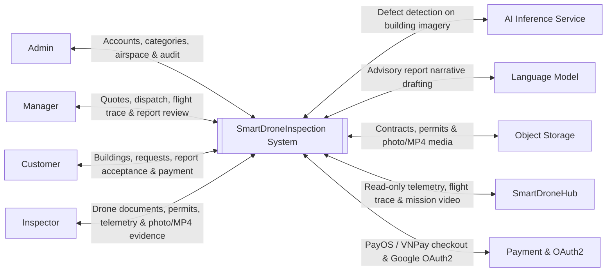

# II. Software Requirement Specification

## 1. Product Overview

SmartDroneInspection is an infrastructure inspection service for customer organizations operating **buildings**. This SRS defines the required business behaviour of the delivered service across the lifecycle from inspection requests and partner assignment through field evidence, inspection reporting, and payment. The service supports Customers managing buildings, requesting one-time or recurring inspections, reviewing and accepting VND quotations, recording signed service agreements, and following inspection progress.

**In-scope asset domain.** The product covers **building structures** only, classified into six platform-managed categories: high-rise office towers and curtain-wall façades; residential apartment towers with balconies, loggias, and external waterproofing; commercial malls and podium blocks with skylights and aluminium composite façades; industrial factories and warehouses with steel structure, industrial roofing, and rooftop solar; hotel, hospital, and public-building complexes with architectural domes and chiller plant areas; and telecom antenna masts mounted on building rooftops. All inspection items, defect classes, and report content are expressed for these building elements. Every other infrastructure domain — bridges and viaducts, power transmission towers, solar farms and ground-mounted plants, roads and pavements, dams, tunnels, ports, and pipelines — is excluded and recorded in §6.2 of Report 1 and in the limitations of this specification.

The service supports four human login roles:

- **`ADMIN`**: Governs platform accounts and the building asset category catalogue; reviews customer airspace cases, partner Inspector applications, and drone registrations; maintains pilot-licence classes, required drone documents, finance settings, and AI inference settings; and reviews platform activity history.
- **`MANAGER`**: Coordinates Inspectors and registered drones, reviews partner applications, handles customer service requests and VND quotations, records signed service agreements, assigns inspection occurrences, manages dispatch changes, independently reviews and publishes inspection reports, and oversees partner settlement and refunds.
- **`CUSTOMER`**: Registers a customer organization and its initial building subject to airspace screening; manages buildings, inspection checkpoints, and building documents; requests inspections; negotiates and accepts quotations; follows inspection progress; accepts published reports; and pays service fees.
- **`INSPECTOR`**: Applies to join the platform through a public self-service application supplying pilot credentials and partner information, which `ADMIN` or `MANAGER` reviews before an account is created. After approval the Inspector registers owned drones with registration, ownership, and technical inspection documents, records assigned field sessions and evidence, reviews proposed findings, and prepares inspection reports.

**System boundaries.** The service governs commercial building-inspection work, records aviation compliance documents, coordinates field sessions, manages inspection evidence and human-reviewed analysis, publishes inspection reports, and records service payment across eight product features (`FE-01` to `FE-08`) grouped as two features per main flow (`MF1` to `MF4`). It does not pilot or control aircraft. Completing a workflow step or recording a document does not itself grant government aviation clearance or a professional qualification. AI findings and summaries are advisory; an authorized person must review and confirm any official decision (`BR-16`, `BR-20`, `BR-27`). Corrective repair execution — work orders, repair scoping, repair cost estimation, repair execution, and maintenance acceptance — is outside the application scope and is arranged by the Customer outside the platform. A re-inspection of previously confirmed defects is in scope and reuses the same dispatch, field, and reporting flows.
