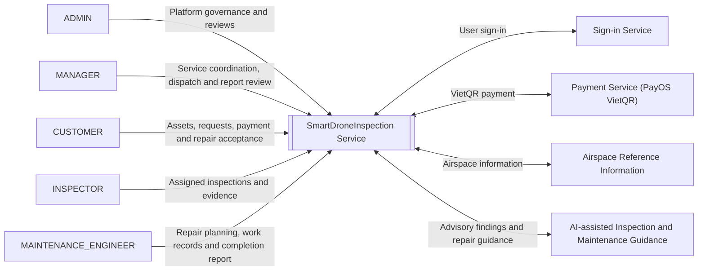

# II. Software Requirement Specification

## 1. Product Overview

SmartDroneInspection is an infrastructure inspection and corrective maintenance service for customer organizations. This SRS defines the target business requirements across the lifecycle from inspection requests and partner assignment through field evidence, inspection reporting, payment, repair, re-inspection, and work-order closeout; it is not a statement that every requirement is currently available. The target service supports Customers managing assets, requesting one-time or recurring inspections, reviewing and accepting VND quotations, recording signed service agreements, following inspection progress, and governing repairs. Implementation status (checked 2026-11-02): platform staff provision Inspector accounts; self-service Inspector applications are unavailable. Recurring requests are supported, and planned occurrences are materialized when the Customer accepts a quotation. This is acceptance-triggered, not time-based generation; automatic future-occurrence reminders are not implemented.

The service supports five human login roles:

- **`ADMIN`**: Governs platform accounts and asset categories; reviews customer airspace cases, partner qualification information, and drone registrations; manages platform financial settings; and reviews activity history. In the current service, platform staff provision Inspector accounts; self-service Inspector applications are not available.
- **`MANAGER`**: Coordinates partner Inspectors and registered drones, handles customer service requests and VND quotations, records signed service agreements, assigns inspection occurrences, manages dispatch changes, independently reviews and publishes inspection reports, and oversees partner settlement.
- **`CUSTOMER`**: Registers a customer organization and its initial asset subject to airspace screening; manages assets and inspection checkpoints; provisions Maintenance Engineers; requests inspections; reviews and accepts quotations and reports; pays service fees; and governs corrective work, budgets, re-inspection, acceptance, and cost closeout.
- **`INSPECTOR`**: In the target partner-admission process, provides required pilot credentials and partner information for platform review; drone ownership is not a prerequisite. The current service provisions Inspector accounts through platform staff rather than self-service application. An Inspector may register owned drones with registration, ownership, and technical inspection documents; records assigned field sessions and evidence; reviews proposed findings; submits inspection reports; and verifies defects during re-inspection.
- **`MAINTENANCE_ENGINEER`**: Works within a Customer organization to plan and perform assigned repairs as a Team Lead, Report Author, or Team Member; records repair evidence and work performed; reviews assigned team records; and prepares maintenance completion reports.

**System boundaries**: The service governs commercial inspection work, records aviation compliance documents, coordinates field sessions, manages inspection evidence and human-reviewed analysis, publishes inspection reports, records service payment, and tracks corrective maintenance across eight product features (`FE-01` to `FE-08`). It does not pilot or control aircraft. Completing a workflow step or recording a document does not itself grant government aviation clearance or a professional qualification. AI findings, summaries, and repair guidance are advisory; an authorized person must review and confirm any official decision (`BR-16`, `BR-20`, `BR-27`).
