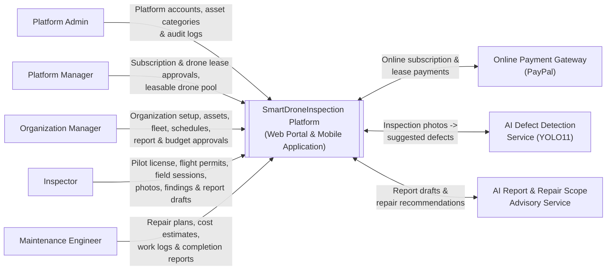

# II. Software Requirement Specification

## 1. Product Overview

SmartDroneInspection is an enterprise web and mobile platform that helps infrastructure-owning organizations (such as bridge authorities, building operators, power utilities, and industrial facilities) manage structural inspections and maintenance repairs from start to finish. Organizations can subscribe to the platform, register their infrastructure assets and drone fleets (or lease drones from the platform), schedule one-off or recurring inspections, check restricted airspace zones, log field flight sessions, review AI-detected defects on inspection photos, publish official PDF inspection reports, and manage maintenance repair work orders and costs.

The platform supports five user roles across two management levels:
- **Platform Admin**: Manages platform-level administrator accounts, initial customer organization accounts, standard infrastructure asset categories, and system audit logs.
- **Platform Manager**: Manages commercial subscription requests, confirms bank transfer or online payments, manages the platform's leasable drone catalog, and approves or reclaims B2B drone leases.
- **Organization Manager**: Manages a customer organization's workspace, workforce accounts, subscriptions, owned and leased drones, infrastructure assets, inspection schedules, report approvals, and maintenance budgets and acceptance.
- **Inspector**: Manages remote pilot license details, checks airspace advisories, uploads mission flight permits, logs field flight sessions on Web or Mobile, uploads inspection photos, reviews AI-suggested defects, and writes inspection reports.
- **Maintenance Engineer**: Plans and executes maintenance work orders as a Team Lead, Report Author, or Team Member, prepares repair cost estimates, logs repair work, and writes maintenance completion reports.

**System Boundaries**: SmartDroneInspection manages inspection planning, compliance records, photos, AI-assisted analysis, reporting, and maintenance tracking. It does not pilot physical drones or connect directly to drone flight controllers (`BR-16`). All AI defect detections and AI-generated text are suggestions only and require human review before becoming official records (`BR-20`, `BR-27`).
