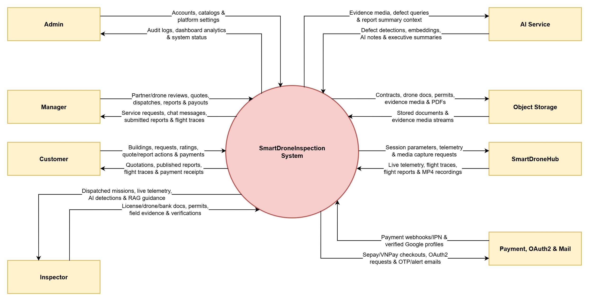

# II. Software Requirement Specification

## 1. Product Overview

SmartDroneInspection is an infrastructure inspection service for Customers who operate **buildings**. This SRS defines the required business behaviour of the delivered service across the lifecycle from inspection requests and partner assignment through field evidence, inspection reporting, and payment. Customers manage buildings through their own accounts, request one-time or recurring inspections, review VND quotations, record signed service agreements, and follow inspection progress.

**In-scope asset domain.** The product covers **building structures** only, classified into six platform-managed categories: high-rise office towers and curtain-wall façades; residential apartment towers with balconies, loggias, and external waterproofing; commercial malls and podium blocks with skylights and aluminium composite façades; industrial factories and warehouses with steel structure, industrial roofing, and rooftop solar; hotel, hospital, and public-building complexes with architectural domes and chiller plant areas; and telecom antenna masts mounted on building rooftops. All inspection items, defect classes, and report content are expressed for these building elements. Every other infrastructure domain — bridges and viaducts, power transmission towers, solar farms and ground-mounted plants, roads and pavements, dams, tunnels, ports, and pipelines — is excluded and recorded in §6.2 of Report 1 and in the limitations of this specification.

Figure 1.1 System Context Diagram.

The service supports four human login roles:

- **`ADMIN`**: Governs platform accounts and the building asset category catalogue; reviews customer airspace cases, partner Inspector applications, and drone registrations; maintains pilot-licence classes, required drone documents, finance settings, and AI inference settings; and reviews platform activity history.
- **`MANAGER`**: Coordinates Inspectors and registered drones, reviews partner applications, handles customer service requests and VND quotations, records signed service agreements, assigns inspection occurrences, manages dispatch changes, independently reviews and publishes inspection reports, and oversees partner settlement and refunds.
- **`CUSTOMER`**: Registers a direct Customer account and its initial building subject to airspace screening, manages buildings and reference documents, requests inspections, accepts quotations, tracks inspection progress, reviews published reports, and pays service fees.
- **`INSPECTOR`**: Applies to join the platform through a public self-service application supplying pilot credentials and partner information, which `MANAGER` reviews before an account is created (`ADMIN` retains read-only oversight). After approval the Inspector registers owned drones with registration, ownership, and technical inspection documents, records assigned field sessions and evidence, reviews proposed findings, and prepares inspection reports.

**Automated actors.** Four automated actors support the four human roles without signing in. `SYSTEM` enforces lifecycle gates, emits lifecycle notices, expires pending assignments on the configured acceptance timeout, and runs other scheduled jobs. `YOLO11` performs building-defect detection on evidence imagery with a configured vision fallback. `LLM` drafts advisory report narrative and executive summaries. `DroneKnowledgeAI` is the `pgvector`-backed advisor that retrieves tenant-isolated historical defect cases and engineering standards to support finding review and report compilation. All automated output is advisory; an authorized person must review and confirm any official decision (`BR-16`, `BR-20`, `BR-27`, `BR-55`).

**Customer mobile parity.** The native application serves the `CUSTOMER` role only. It mirrors the web experience for re-inspection verdict expiry warnings, downloadable payment-notice and payment-receipt PDFs, private Inspector–Customer inspection chat, and a collapsible historical-case and engineering-standard reference strip on inspection detail that hides cleanly when no references are available. Inspectors and platform staff use the web portals for field capture and operations.

**System boundaries.** The service governs commercial building-inspection work, records aviation compliance documents, coordinates field sessions, manages inspection evidence and human-reviewed analysis, publishes inspection reports, and records service payment across twenty-four atomic product features (`FE-01` to `FE-24`) under the four main flows (`MF1` to `MF4`). It does not pilot or control aircraft. Completing a workflow step or recording a document does not itself grant government aviation clearance or a professional qualification. AI findings, summaries, and knowledge recommendations are advisory; an authorized person must review and confirm any official decision (`BR-16`, `BR-20`, `BR-27`, `BR-55`). Inspection defect-history and engineering-standard advisory retrieval (`DroneKnowledgeAI`) is in scope. Corrective repair execution — work orders, repair scoping, repair cost estimation, repair execution, and maintenance acceptance — is outside the application scope and is arranged by the Customer outside the platform; a corrective-maintenance repair knowledge base and any external CMMS or work-order execution are likewise out of scope. A re-inspection of previously confirmed defects is in scope (`FE-24`) and reuses the same dispatch, field, and reporting flows.
