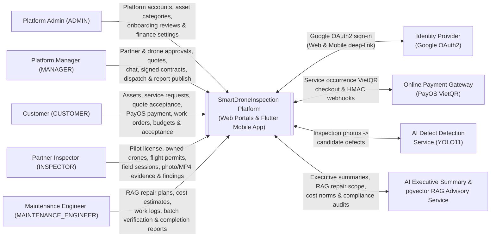

# II. Software Requirement Specification

## 1. Product Overview

SmartDroneInspection is a web and mobile infrastructure inspection and corrective maintenance service platform that helps infrastructure-owning customer organizations (such as bridge authorities, building operators, power utilities, and industrial facilities) commission certified drone inspections and govern engineering repairs from start to finish. Customer organizations register their workspace with an initial infrastructure asset verified against Vietnam prohibited airspace zones, submit one-time or recurring inspection service requests, negotiate VND/USD quotations via order chat, sign offline service contracts, track 5-stage mission progress, accept published PDF inspection reports, pay online via PayOS (VietQR), and manage RAG-assisted maintenance repair work orders, 3-way re-inspection verification, and cost closure. Meanwhile, the Platform coordinates a vetted network of third-party partner Inspectors and their registered drones across customer engagements.

The platform enforces five canonical login roles across three operational zones (`PLATFORM`, `CUSTOMER_ORGANIZATION`, and `INSPECTOR_PARTNER`):
- **Platform Admin (`ADMIN`)**: Manages platform-level internal accounts, standard infrastructure asset categories, customer airspace review queues, partner inspector and drone registration approvals, platform finance settings (commission, VAT, and PIT/TNCN withholding rates), and system audit logs.
- **Platform Manager (`MANAGER`)**: Manages third-party partner Inspectors and their registered drones, reviews customer service requests, negotiates via order chat, issues versioned VND/USD quotations, uploads executed paper service contracts, dispatches partner Inspectors and drones across occurrences with cross-organization conflict checking, handles aborted-session rescheduling/reassignment, independently reviews and publishes immutable PDF inspection reports, and records partner payouts.
- **Customer (`CUSTOMER`)**: Registers the customer organization and initial asset through the airspace no-fly zone gate, manages infrastructure assets and checkpoints, provisions customer Maintenance Engineer accounts, submits one-time or recurring service requests, accepts quotations, tracks 5-stage mission progress, accepts published inspection reports, settles service fees via PayOS (VietQR), creates maintenance work orders from confirmed defects, approves repair budgets and Change Orders, requests re-inspection verification flights, and performs independent technical acceptance and cost closure.
- **Inspector (`INSPECTOR`)**: Applies as a licensed partner drone pilot (without requiring drone ownership at signup), registers owned drones with three mandatory documents (registration, ownership, and technical inspection), uploads mission flight permits, executes on-site field flight sessions (`Start`, `Complete`, `Abort`) on Web or Mobile, uploads geotagged photos and MP4 videos, reviews `YOLO11` defect suggestions, confirms the findings baseline, submits auto-compiled inspection reports, and performs 3-way defect verification during re-inspection missions.
- **Maintenance Engineer (`MAINTENANCE_ENGINEER`)**: Provisioned within a Customer organization to plan and execute maintenance work orders as a designated `Team Lead`, `Report Author`, or `Team Member`, uses the `pgvector` RAG advisor for 1-click task initialization and norm-based cost estimation, logs field repair work with before-and-after proof, batch-verifies team work logs, and submits auto-drafted maintenance completion reports.

**System Boundaries**: SmartDroneInspection governs commercial service requests, aviation compliance records, aerial photo/video evidence, human-verified AI defect analysis, official PDF reporting, PayOS settlement, and engineering maintenance tracking across eight product features (`FE-01` to `FE-08`). It does not pilot physical drones or connect directly to aircraft flight controllers (`BR-16`). All AI defect detections, executive summaries, and RAG engineering recommendations are advisory only and require explicit human verification before becoming official records (`BR-20`, `BR-27`).
