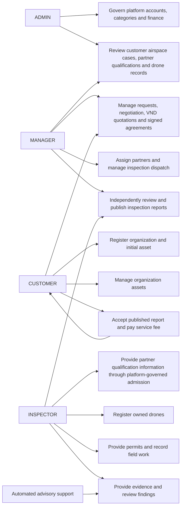

## 2. User Requirements

This SRS describes target business requirements, not a statement that every capability is currently available. In the current service, platform staff provision Inspector accounts and maintain qualification profiles; self-service Inspector applications are unavailable. Recurring service requests are supported, and accepting a quotation materializes their planned occurrences. This is acceptance-triggered, not time-based generation; automatic future-occurrence reminders are not implemented.

### 2.1 Actors

| # | Actor | Description |
| --- | --- | --- |
| 1 | `ADMIN` | Manages platform accounts and standard asset categories; reviews customer airspace cases, partner qualification information, and drone registrations; maintains platform financial settings; and reviews platform activity records. |
| 2 | `MANAGER` | Coordinates Inspector and drone records, responds to customer service requests, negotiates and issues VND quotations, records signed service agreements, assigns Inspectors and drones to inspection occurrences, manages dispatch changes, independently reviews and publishes inspection reports, and oversees partner settlement. |
| 3 | `CUSTOMER` | Represents a customer organization; registers its workspace and initial asset subject to airspace screening; manages assets; requests one-time or recurring inspections; negotiates and accepts quotations; follows inspection progress; accepts published reports and pays service fees. |
| 4 | `INSPECTOR` | In the target business process, provides required pilot credentials and partner information for review by `ADMIN` or `MANAGER`. In the current service, platform staff provision partner accounts and maintain qualification profiles; self-service application is unavailable. Drone ownership is not required for admission. Inspectors register owned drones with registration, ownership, and technical inspection documents; conduct assigned field work; provide inspection evidence; review proposed findings; and submit reports. |
| 6 | Automated System and AI | The service may support airspace screening, schedule-conflict checks, notices, candidate defect analysis, and report preparation. Automated recommendations are advisory, and official findings and decisions require human review. Corrective maintenance planning, repair guidance, and maintenance acceptance are outside this application's scope. |
| 7 | External Payment and Identity Services | Support user sign-in and VietQR service-payment processing. These services do not replace the platform's authorization, review, or recordkeeping responsibilities. |

### 2.2 Use Cases

#### 2.2.1 Diagram(s)

#### 2.2.2 Descriptions

| ID | Use Case | Actors | Use Case Description |
| --- | --- | --- | --- |
| UC-01 | Sign In and Manage Account | All Roles | Users securely sign in, manage their personal account information, and end their own active sessions. |
| UC-02 | Govern Platform Accounts, Categories, and Finance | `ADMIN`, `MANAGER` | Authorized platform staff manage platform accounts and standard infrastructure categories; `ADMIN` maintains platform financial settings. |
| UC-03 | Register Customer Organization and Initial Asset | `CUSTOMER`, `ADMIN` | A Customer registers its organization with an initial asset. The service screens the location: prohibited airspace prevents registration, locations requiring review remain pending until `ADMIN` review, and eligible locations may proceed. A recorded result is not governmental clearance. |
| UC-04 | Manage Infrastructure Assets and Documents | `CUSTOMER` | Customers register and maintain organization assets, inspection checkpoints, and related reference documents; they may retire assets no longer in service. Asset locations are screened for prohibited airspace. |
| UC-05 | Govern Inspector Admission and Manage Customer Workforce | `INSPECTOR`, `ADMIN`, `MANAGER`, `CUSTOMER` | The target business process requires platform review of partner qualifications and documentation; drone ownership is not a condition of partner admission. The current service does not offer self-service Inspector applications: platform staff provision Inspector accounts and maintain qualification information. A  |
| UC-06 | Register and Review Inspector-Owned Drones | `INSPECTOR`, `ADMIN`, `MANAGER` | An Inspector registers an owned drone and supplies registration, ownership, and technical inspection documents. Authorized platform staff review the documentation before the drone is eligible for assignment. |
| UC-07 | Request Inspection, Negotiate, and Accept a Quotation | `CUSTOMER`, `MANAGER` | A Customer submits a one-time or recurring service request, exchanges messages with `MANAGER`, reviews a VND quotation, and accepts the agreed quotation version. Changes to commercial terms require a revised quotation. |
| UC-08 | Record Signed Service Agreement and Arrange Occurrences | `MANAGER`, `CUSTOMER` | After the parties sign an offline service agreement, `MANAGER` records the signed document. For a recurring request, the agreement covers the occurrences within its agreed term. Each occurrence is separately prepared for assignment and delivery. |
| UC-09 | Assign, Reschedule, Reassign, or Cancel an Inspection | `MANAGER`, `INSPECTOR`, System | `MANAGER` assigns a qualified Inspector and an eligible drone to an occurrence, accounting for availability across customer organizations. After an aborted field session, `MANAGER` may reschedule, reassign, or cancel the inspection. |
| UC-10 | Provide Mission Flight Permit | `INSPECTOR`, `MANAGER`, `CUSTOMER` | The assigned Inspector provides the flight permit required for the mission before starting field work. The service's document check is not government authorization. |
| UC-11 | Record Field Session | `INSPECTOR` | The assigned Inspector records the start, normal completion, or abort of an on-site session, including required safety notes and an outcome or abort reason. An abort prompts dispatch follow-up by `MANAGER`. |
| UC-13 | Review Airspace Information | All Roles | Users may review airspace information relevant to asset and mission locations. Information shown is advisory and does not constitute permission to fly. |
| UC-14 | Provide Inspection Evidence | `INSPECTOR`, `MANAGER`, `CUSTOMER` | Inspectors provide photographs and video records, associate them with structural locations, and identify unusable captures. Authorized users may review evidence according to their responsibilities. |
| UC-15 | Review Candidate Findings and Confirm Findings | `INSPECTOR`, System | The service may suggest candidate defects from inspection images. The assigned Inspector reviews, edits, rejects, or supplements suggestions and confirms the findings baseline. Only human-confirmed findings become official inspection findings. |
| UC-16 | Prepare and Submit Inspection Report | `INSPECTOR`, System | After confirming findings, the report author reviews and prepares the inspection report for submission to `MANAGER`. The service may provide an AI-generated summary as advisory material. Submission occurs through the report preparation process; it is not defined by merely visiting a particular screen. |
| UC-17 | Independently Review and Publish Inspection Report | `MANAGER`, `ADMIN` | An authorized reviewer who is not the report author independently reviews a submitted report, approves it for publication or returns it with reasons, and publishes the approved official report. Published reports are preserved; amendments are made as a new version. |
| UC-18 | Follow Inspection, Accept Report, and Pay Service Fee | `CUSTOMER`, `MANAGER`, Payment Service | Customers follow inspection progress, review the published report, record acceptance, and settle the applicable service fee through the supported payment process. Customers can access official deliverables according to the applicable payment rules. Partner settlement is tracked separately. |
| UC-20 | View Role-Appropriate Dashboard, Calendar, and Notifications | All Roles | Users review operational information, inspection schedules, progress, and available notices within their authorized responsibilities. Automatic recurring-occurrence reminders remain a target requirement, not a current capability claim. |
| UC-28 | Review Activity History | Authorized Roles | Authorized users review attributable records of important onboarding, commercial, inspection, payment, and acceptance decisions within their access scope. |
