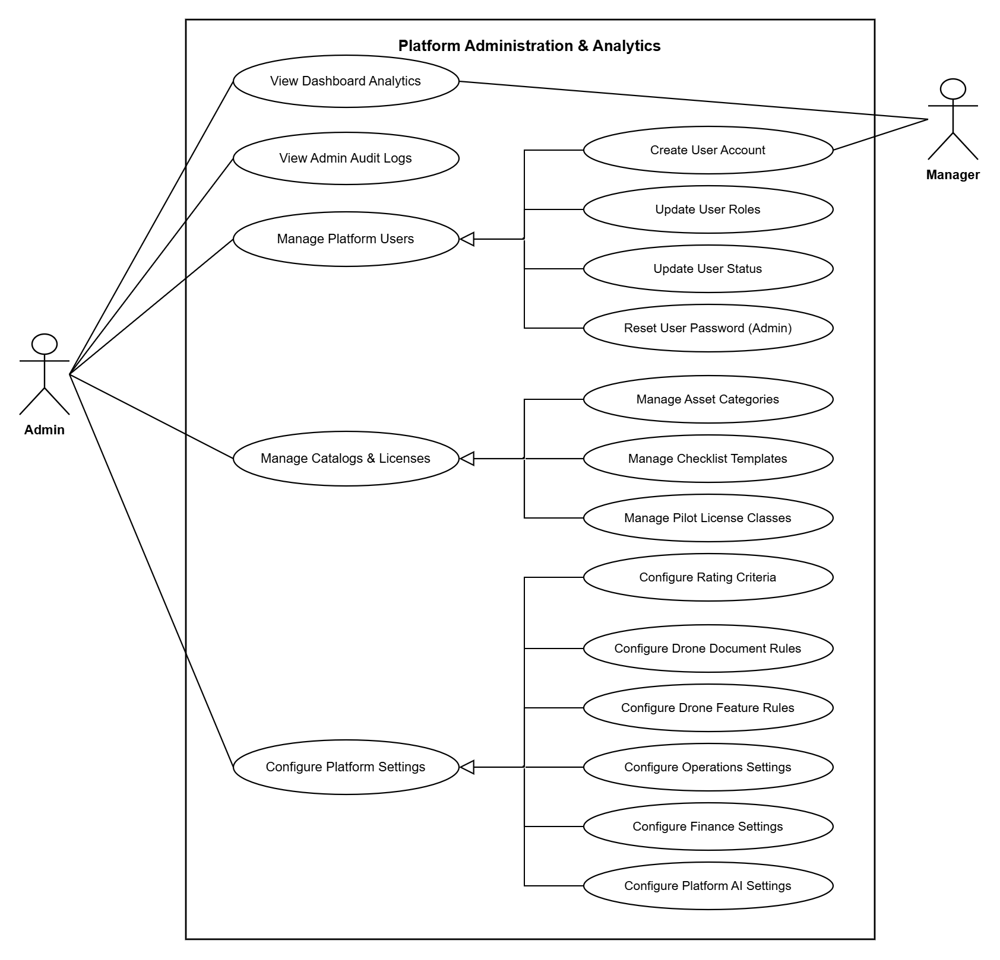

## 2. User Requirements

This section defines the actors of the building-inspection service and the business goals they pursue. The scope is limited to building structures as described in §1, and the use cases below are grouped across the four main flows `MF1`–`MF4` that §3 details as twenty-four atomic features (`FE-01`–`FE-24`). Partner Inspector admission is a public self-service application reviewed by platform staff; an Inspector account is created only after that review succeeds. Recurring service requests are supported, and accepting a quotation materializes their planned occurrences. Occurrence materialization is acceptance-triggered, not time-based generation.

### 2.1 Actors

| # | Actor | Description |
| --- | --- | --- |
| 1 | `ADMIN` | Platform administrator. Manages platform accounts and the building asset category catalogue; views partner Inspector applications and drone registrations in read-only oversight mode; maintains pilot-licence classes, required drone document configuration, finance settings, and AI inference settings; and reviews platform activity records. |
| 2 | `MANAGER` | Platform manager. Coordinates Inspector and drone records, reviews and approves partner Inspector applications and drone registrations, responds to customer service requests, negotiates and issues VND quotations, records signed service agreements, assigns Inspectors and drones to inspection occurrences, manages dispatch changes, independently reviews and publishes inspection reports, and manages partner payouts and refunds. |
| 3 | `CUSTOMER` | Direct Customer account holder (building owner or facility operator). Registers a Customer account and initial building subject to airspace screening; manages buildings, inspection checkpoints, and building documents; requests one-time or recurring inspections; negotiates and accepts quotations; follows inspection progress; accepts published reports; rates Inspectors; and pays service fees. |
| 4 | `INSPECTOR` | Partner drone inspector. Submits a public self-service application with pilot credentials and partner information; after platform approval an account is created. The Inspector then registers owned drones with registration, ownership, and technical inspection documents, conducts assigned field work, provides inspection evidence, reviews proposed findings, and prepares and submits inspection reports. Drone ownership is not a condition of partner admission. |
| 5 | Automated System and AI Actors | Four automated actors act without a login: `SYSTEM` performs airspace screening, schedule-conflict checks, lifecycle notices, assignment timeouts, and other scheduled jobs; the **AI Defect Detection Service** analyses building imagery for candidate defects with an optional secondary vision fallback; the **Advisory Narrative Service** drafts advisory finding notes and report executive summaries; and `DroneKnowledgeAI` retrieves customer-isolated historical defect cases and engineering standards. Automated output is advisory; official findings and decisions require human review. |
| 6 | External Payment and Identity Services | Google Sign-In identity service, Sepay VietQR, and VNPay service-payment processing. These services do not replace the platform's authorization, review, or recordkeeping responsibilities. |
| 7 | SmartDroneHub | An optional ground-station integration that supplies read-only flight telemetry, flight traces, and mission video for a permitted field session. It does not receive flight commands from the platform. |

The `CUSTOMER` role is also served by a native mobile application that mirrors the web experience for verdict expiry, the payment-notice and payment-receipt PDF, Inspector–Customer chat, and the compact knowledge-references strip. Other roles use the web portals.

### 2.2 Use Cases

#### 2.2.1 Diagram(s)

The system use cases are organized into five role- and capability-focused UML views (`UC-1` through `UC-5`), covering public access and authentication, asset/drone onboarding, commercial contracting and field execution, AI inspection and settlement, and platform administration.

Figure 2.1 Use Case Diagram — `UC-1` Authentication & Public Access.

Figure 2.2 Use Case Diagram — `UC-2` Assets, Drones & Partner Onboarding.

Figure 2.3 Use Case Diagram — `UC-3` Contracting, Dispatch & Field Execution.

Figure 2.4 Use Case Diagram — `UC-4` AI Inspection, Reporting & Financial Settlement.

Figure 2.5 Use Case Diagram — `UC-5` Platform Administration & Analytics.

#### 2.2.2 Descriptions

| ID | Use Case | Actors | Use Case Description |
| --- | --- | --- | --- |
| UC-01 | Sign In and Manage Account | All Roles | Users securely sign in by password, one-time code, or Google, manage their personal account information, and end their own active sessions. |
| UC-02 | Govern Platform Accounts, Building Categories, and Finance | `ADMIN`, `MANAGER` | Authorized platform staff manage platform accounts and the building asset category catalogue; `ADMIN` maintains pilot-licence classes, required drone-document configuration, Inspector rating criteria, finance settings, and AI inference settings. |
| UC-03 | Register Customer Account and Initial Building | `CUSTOMER`, public | A prospective Customer registers a Customer account with an initial building. The service screens the location: prohibited airspace prevents registration, restricted airspace attaches an amber flight-permit advisory warning while activating the account and initial building immediately, and clear locations proceed normally. Screening does not grant governmental clearance. |
| UC-04 | Manage Buildings and Reference Documents | `CUSTOMER` | Customers register and maintain their buildings and reference documents, and may retire buildings no longer in service. Building locations are screened for prohibited airspace. |
| UC-05 | Submit and Review Partner Inspector Application | Public, `INSPECTOR`, `MANAGER`, `ADMIN` (read-only) | A prospective partner Inspector submits a public application with identity, pilot-licence details, and a licence scan. `MANAGER` reviews it, approves it or rejects it with reasons, and records the signed partner contract (`ADMIN` has read-only oversight). An account is created only after approval; approval does not require drone ownership. |
| UC-06 | Register and Review Inspector-Owned Drones | `INSPECTOR`, `MANAGER`, `ADMIN` (config &amp; read-only) | An Inspector registers an owned drone with photographs, outdoor flight capabilities, safety checklist items, and the registration, ownership, and technical-inspection documents configured by `ADMIN`. `MANAGER` reviews and approves or rejects the application before the drone becomes eligible for assignment. |
| UC-07 | Request Inspection, Negotiate, and Accept a Quotation | `CUSTOMER`, `MANAGER` | A Customer submits a one-time or recurring service request for a building, exchanges messages with the assigned `MANAGER`, reviews a VND quotation, and accepts the current active quotation. Changes to commercial terms require a revised quotation. |
| UC-08 | Record Signed Service Agreement and Arrange Occurrences | `MANAGER`, `CUSTOMER` | After the parties sign an offline service agreement, `MANAGER` records the signed document. For a recurring request, the agreement covers the occurrences within its agreed term. Each occurrence is separately prepared for assignment and delivery. |
| UC-09 | Assign, Reschedule, Reassign, or Cancel an Inspection | `MANAGER`, `INSPECTOR`, Automated System | `MANAGER` assigns a qualified Inspector and an eligible owned drone to an occurrence, accounting for availability across all customers. After an aborted field session, `MANAGER` may reschedule, reassign, or cancel the dispatch. |
| UC-10 | Provide Mission Flight Permit (Inspector Self-Attestation) | `INSPECTOR` (uploader and accountable self-attestor), `MANAGER`/`ADMIN` (read-only view and audit trail) | The assigned Inspector uploads the mission flight permit with structured metadata and is responsible for it; the permit becomes effective immediately once validation passes, with no Manager or Administrator verification or approval step. A drone change or an out-of-window reschedule invalidates the permit and requires an Inspector re-upload. The service's document check is not government authorization. |
| UC-11 | Record Field Session | `INSPECTOR` | The assigned Inspector records the start, multi-flight sorties, normal completion, or abort of an on-site session, including the required pre-flight safety checklist and an outcome or abort reason. An abort prompts dispatch follow-up by `MANAGER`. |
| UC-12 | Capture Flight Evidence | `INSPECTOR`, SmartDroneHub | The Inspector provides read-only flight telemetry, imports an exported flight log, submits an accountable manual flight declaration, or receives mission video, and the persisted flight trace can be reviewed afterwards. |
| UC-13 | Review Airspace Information | All Roles | Users may review airspace information relevant to building and mission locations. Information shown is advisory and does not constitute permission to fly. |
| UC-14 | Provide Inspection Evidence | `INSPECTOR`, `MANAGER`, `CUSTOMER` | Inspectors upload building photographs and video, associate them with structural locations, and identify unusable captures. Authorized users review evidence according to their responsibilities. |
| UC-15 | Review Candidate Findings and Confirm Findings | `INSPECTOR`, Automated System | The service suggests candidate building defects from inspection images. The assigned Inspector reviews, edits, rejects, or supplements each suggestion, and confirms the findings baseline. Only human-confirmed findings become official inspection findings. |
| UC-16 | Prepare and Submit Inspection Report | `INSPECTOR`, Automated System | After confirming findings, the report author prepares and submits the inspection report for independent review. The service may supply an AI-drafted summary as advisory material. Submission is an explicit action, not the act of opening a screen. |
| UC-17 | Independently Review and Publish Inspection Report | `MANAGER`, `ADMIN` (read-only) | A `MANAGER` who is not the report author independently reviews a submitted report, approves it for publication or returns it with reasons, and publishes the approved official report (`ADMIN` retains read-only visibility only). Published reports are preserved; corrections are issued as a new version. |
| UC-18 | Follow Inspection, Accept Report, Rate Inspector, and Pay Service Fee | `CUSTOMER`, `MANAGER`, Payment Service | Customers follow inspection progress, review the published report, record acceptance, optionally rate the assigned Inspector against configured criteria, and settle the applicable service fee through Sepay VietQR or VNPay. Official deliverables are available from publication onward, while `MANAGER` settles the Partner Inspector payout prior to report publication. |
| UC-19 | Manage Partner Settlement, Payouts, and Refunds | `MANAGER` | `MANAGER` records Inspector payouts against verified customer payment, initiates and completes refunds with evidence-backed allocations, and records recovery of Inspector receivables. |
| UC-20 | View Role-Appropriate Dashboard, Calendar, and Notifications | All Roles | Users review operational information, inspection schedules, progress, and available notices within their authorized responsibilities. |
| UC-21 | Review Activity History | Authorized Roles | Authorized users review attributable records of important onboarding, commercial, inspection, payment, and acceptance decisions within their access scope. |

#### 2.2.3 Detailed Use Case Specifications

The specifications below detail preconditions, main flows, alternative/exception paths, and postconditions for the ten core end-to-end use cases governing onboarding, commercial contracting, flight readiness, evidence/AI review, independent report publication, and financial settlement.

**UC-03 — Register Customer Account and Initial Building**

| Use Case Element | Specification |
| --- | --- |
| **Use Case ID & Name** | `UC-03` — Register Customer Account and Initial Building |
| **Actors** | Prospective `CUSTOMER` (primary); `SYSTEM` (OTP verification & airspace screening) |
| **Trigger** | Prospective Customer selects **Sign up as Customer** on the public portal or Customer Mobile app. |
| **Preconditions** | Applicant email is not already registered; coordinates lie within valid `[-90, 90]` / `[-180, 180]` geographic bounds. |
| **Main Success Flow** | 1. Applicant enters full name, email, password (meeting security policy), and phone number. 2. Applicant selects one of the six building categories, enters building code/name/specifications and optional plain-text ownership notes (`<= 1,000` chars), and pins coordinates on the interactive map. 3. `SYSTEM` screens coordinates against configured airspace polygons (`FE-04`, `FE-07`). 4. Applicant verifies the one-time code sent to their email (`FE-01`). 5. `SYSTEM` activates the `CUSTOMER` account and initial building immediately, seeding category checkpoints. |
| **Alternative & Exception Flows** | - **Restricted airspace:** `SYSTEM` attaches amber `MSG28` advisory warning (zone name, authority, altitude ceiling, `cambay.mod.gov.vn`) and still activates the account and building immediately (`FE-07`). - **No-Fly Zone:** `SYSTEM` blocks submission and refuses account/building creation. - **Invalid OTP / duplicate email:** Registration fails with validation message (`MSG04`, `MSG11`) and creates no active account. |
| **Postconditions** | Active `CUSTOMER` account and initial `Building Asset` are persisted and ready for `FE-08` service requests. |
| **Related Rules & Messages** | `BR-01`, `BR-06`, `BR-07`; `MSG02`, `MSG03`, `MSG04`, `MSG11`, `MSG23`, `MSG28`. |

**UC-05 — Submit and Review Partner Inspector Application**

| Use Case Element | Specification |
| --- | --- |
| **Use Case ID & Name** | `UC-05` — Submit and Review Partner Inspector Application |
| **Actors** | Public Applicant (primary); `MANAGER` (reviewer/decider); `ADMIN` (read-only oversight); `SYSTEM` |
| **Trigger** | Prospective drone pilot submits the public partner Inspector application form (`FE-02`). |
| **Preconditions** | Applicant email is unique across accounts and pending applications; pilot licence has a recognized class and future expiry date. |
| **Main Success Flow** | 1. Applicant provides identity details, pilot-licence number, recognized licence class, future expiry date, and uploads a valid licence scan. 2. `SYSTEM` stores the application as pending without creating any login account (`BR-09`). 3. An active `MANAGER` inspects the application and licence scan in Onboarding Reviews and approves it. 4. `SYSTEM` provisions the active `INSPECTOR` account and qualification profile and sends a bilingual approval notification/email. 5. `MANAGER` records the offline signed partner contract scan against the approved application. |
| **Alternative & Exception Flows** | - **Rejection:** `MANAGER` rejects the application with a mandatory written reason (`MSG15`); no account is created and applicant is notified. - **Non-Manager decision:** Attempts by `ADMIN`, `CUSTOMER`, or `INSPECTOR` to approve/reject or upload the partner contract are refused. - **Expired/invalid credential:** Corrupt file (`MSG16`), past expiry date, or unrecognized licence class fails validation (`MSG24`). |
| **Postconditions** | Approved `INSPECTOR` can sign in and register owned drones (`UC-06`); `ADMIN` retains read-only audit visibility. |
| **Related Rules & Messages** | `BR-08`, `BR-09`, `BR-10`; `MSG15`, `MSG16`, `MSG24`, `MSG25`, `MSG27`. |

**UC-06 — Register and Review Inspector-Owned Drones**

| Use Case Element | Specification |
| --- | --- |
| **Use Case ID & Name** | `UC-06` — Register and Review Inspector-Owned Drones |
| **Actors** | `INSPECTOR` (primary); `MANAGER` (reviewer/decider); `ADMIN` (document/checklist config & read-only view); `SYSTEM` |
| **Trigger** | Approved `INSPECTOR` submits a new owned drone or renewal dossier in `My drones` (`FE-03`). |
| **Preconditions** | Actor holds an active `INSPECTOR` account; `ADMIN` has configured required drone compliance documents and capability checklists. |
| **Main Success Flow** | 1. `INSPECTOR` enters model, manufacturer, serial number, weight class (`Decree 288/2025/ND-CP` Article 4), outdoor capabilities, and safety checklist items. 2. `INSPECTOR` uploads at least one real aircraft photograph plus all `ADMIN`-required documents (registration, ownership, and configured technical inspection). 3. `MANAGER` reviews the photos and compliance files and approves the drone. 4. `SYSTEM` marks the drone active and eligible for dispatch when matched with an appropriately licensed Inspector. |
| **Alternative & Exception Flows** | - **Weight vs. licence mismatch:** Airframes `>= 2.0 kg` paired with a Class A pilot are blocked at eligibility checks (`BR-12`). - **Serviceability changes:** `INSPECTOR` may toggle owned non-suspended drones between `ACTIVE`, `MAINTENANCE`, and `RETIRED` (renewals blocked while `RETIRED`, `BR-13`). - **Duplicate serial or missing file:** Rejected (`MSG26`). Non-`MANAGER` approval attempts are refused. |
| **Postconditions** | Approved, active, non-expired drone becomes selectable during occurrence dispatch (`UC-09`). |
| **Related Rules & Messages** | `BR-11`, `BR-12`, `BR-13`; `MSG15`, `MSG16`, `MSG26`, `MSG27`, `MSG36`. |

**UC-07 — Request Inspection, Negotiate, and Accept a Quotation**

| Use Case Element | Specification |
| --- | --- |
| **Use Case ID & Name** | `UC-07` — Request Inspection, Negotiate, and Accept a Quotation |
| **Actors** | `CUSTOMER` (primary); `MANAGER` (claimer & quoter); `ADMIN` (Manager assignment oversight only); `SYSTEM` |
| **Trigger** | `CUSTOMER` submits a one-time or monthly recurring service request for an active building (`FE-08`). |
| **Preconditions** | Selected building is active; first requested inspection date is `>= 20` calendar days ahead in `Asia/Ho_Chi_Minh` (`BR-18`). |
| **Main Success Flow** | 1. `CUSTOMER` chooses one-time or recurring (`1–120` months, `2–100` occurrences) and submits the request (`OPEN`). 2. An active `MANAGER` claims the request atomically (or `ADMIN` assigns Manager ownership) and reviews building checkpoints. 3. `CUSTOMER` and claiming `MANAGER` exchange commercial clarification messages in Order Chat (`FE-10`). 4. `MANAGER` configures per-request checkpoints and saves a VND quotation with explicit start/end schedule (`QUOTED`). 5. `CUSTOMER` reviews and accepts the active quotation (`ACCEPTED`), locking commercial terms into an immutable snapshot (`BR-16`). |
| **Alternative & Exception Flows** | - **Concurrent claim:** Second Manager claim fails with `MSG31`. - **Out-of-bounds schedule:** Lead time `< 20` days, quote earlier than Customer-requested first date, or recurring count outside `2–100` is rejected. - **Version drift:** Accepting an outdated quote fails (`MSG13`). Unaccepted requests may be cancelled by the assigned Manager (`OPEN/QUOTED -> CANCELLED`). |
| **Postconditions** | Request transitions to `ACCEPTED`; planned occurrences materialize with month-end anchoring (`FE-09`). |
| **Related Rules & Messages** | `BR-14`, `BR-16`, `BR-17`, `BR-18`, `BR-19`, `BR-03`, `BR-05`; `MSG13`, `MSG14`, `MSG29`, `MSG31`. |

**UC-08 — Record Signed Service Agreement and Arrange Occurrences**

| Use Case Element | Specification |
| --- | --- |
| **Use Case ID & Name** | `UC-08` — Record Signed Service Agreement and Arrange Occurrences |
| **Actors** | `MANAGER` (primary); `CUSTOMER` (agreement counterparty); `SYSTEM` |
| **Trigger** | `MANAGER` uploads the executed offline paper service agreement for an `ACCEPTED` request (`FE-09`). |
| **Preconditions** | Request is `ACCEPTED` with an immutable quotation snapshot; planned occurrences are materialized (`PENDING_ASSIGNMENT`). |
| **Main Success Flow** | 1. Both parties sign the offline paper service contract covering the one-time or recurring term. 2. `MANAGER` uploads the signed contract scan (`PDF/DOCX/JPEG/PNG`) to private storage. 3. `SYSTEM` stores the agreement with checksum, moves the request to `CONTRACT_SIGNED`, and unlocks per-occurrence crew dispatch (`BR-15`). |
| **Alternative & Exception Flows** | - **Dispatch before contract upload:** Attempting to assign an Inspector or drone before `CONTRACT_SIGNED` is rejected. - **Individual occurrence cancellation:** After signing, `MANAGER` may cancel individual occurrences subject to inspection and settlement state; cancelling all contracted occurrences frees the building for a new request. - **Invalid file / unauthorized role:** Unsupported file types (`MSG16`) or non-owning callers fail closed. |
| **Postconditions** | Signed agreement is preserved in private storage; each materialized occurrence is ready for independent assignment (`UC-09`). |
| **Related Rules & Messages** | `BR-15`, `BR-16`, `BR-20`, `BR-51`; `MSG16`, `MSG35`. |

**UC-09 — Assign, Reschedule, Reassign, or Cancel an Inspection**

| Use Case Element | Specification |
| --- | --- |
| **Use Case ID & Name** | `UC-09` — Assign, Reschedule, Reassign, or Cancel an Inspection |
| **Actors** | `MANAGER` (primary); `INSPECTOR` (accept/decline/withdraw); `SYSTEM` (conflict & timeout checks) |
| **Trigger** | `MANAGER` uploads the executed offline paper contract (`CONTRACT_SIGNED`) and dispatches an Inspector and owned drone to an occurrence (`FE-09`). |
| **Preconditions** | Request is `CONTRACT_SIGNED`; selected Inspector holds active status and valid pilot licence matching the selected drone's Decree 288 weight class at occurrence start (`BR-21`, `BR-22`). |
| **Main Success Flow** | 1. `MANAGER` selects an eligible Inspector and owned active drone (or runs bulk assignment across remaining occurrences). 2. `SYSTEM` verifies zero cross-customer time conflicts and moves the occurrence to `ASSIGNED` / `SCHEDULED` (`Pending Acceptance`). 3. `INSPECTOR` accepts the assignment within the administrator-configured timeout (`1–720` hours, default `24` hours). |
| **Alternative & Exception Flows** | - **Acceptance timeout (`FE-11`):** If unaccepted past the deadline, `SYSTEM` cancels the unaccepted inspection, releases crew schedules, reverts occurrence to `PENDING_ASSIGNMENT`, and alerts `MANAGER` and `INSPECTOR`. - **Pre-field withdrawal:** While `SCHEDULED` and before field work starts for the current assignment, `INSPECTOR` may withdraw with a mandatory reason, flagging the occurrence for Manager reassignment or cancellation. - **Post-abort recovery:** After an aborted field session, `MANAGER` reschedules, reassigns, or cancels with a written reason (`BR-27`). |
| **Postconditions** | Confirmed crew and schedule are locked onto the inspection occurrence for Stage 1 permit readiness. |
| **Related Rules & Messages** | `BR-15`, `BR-19`, `BR-20`, `BR-21`, `BR-22`, `BR-27`; `MSG12`, `MSG15`, `MSG35`, `MSG36`. |

**UC-10 — Provide Mission Flight Permit (Inspector Self-Attestation)**

| Use Case Element | Specification |
| --- | --- |
| **Use Case ID & Name** | `UC-10` — Provide Mission Flight Permit (Inspector Self-Attestation) |
| **Actors** | Assigned `INSPECTOR` (uploader & self-attestor); `MANAGER` & `ADMIN` (read-only audit view); `SYSTEM` |
| **Trigger** | Assigned `INSPECTOR` opens Workspace Stage 1 (`Flight Permit`) on a `SCHEDULED` inspection and uploads a permit file (`FE-13`). |
| **Preconditions** | Inspection is `SCHEDULED` and assigned to the acting `INSPECTOR`; pilot licence and assigned drone registration are active. |
| **Main Success Flow** | 1. `INSPECTOR` uploads a permit file (`<= 25 MB`, `PDF/PNG/JPG/WEBP`) and submits permit number, issuing authority, validity window, drone serial, and optional maximum altitude (`1–2,000 m`). 2. `SYSTEM` validates file signature, checksum, drone serial match, active credentials, and schedule coverage. 3. `SYSTEM` marks the permit effective immediately as Inspector self-attestation (`BR-24`), unlocks Stage 2 Pre-flight, and notifies Managers FYI (`FE-12`). |
| **Alternative & Exception Flows** | - **Restricted zone ceiling:** Missing altitude or altitude exceeding the restricted zone ceiling is rejected. - **Invalidation on change:** Reassigning a different drone or rescheduling outside the permit window resets permit readiness and requires an Inspector re-upload (`BR-25`, `MSG42`). - **No Manager/Admin approval action:** Permit review/approval endpoints do not exist; `MANAGER` and `ADMIN` retain read-only visibility and audit history only. |
| **Postconditions** | Effective flight permit is recorded and attributable to the assigned `INSPECTOR`, enabling field session start. |
| **Related Rules & Messages** | `BR-23`, `BR-24`, `BR-25`, `BR-26`, `BR-51`; `MSG16`, `MSG27`, `MSG37`, `MSG40`, `MSG41`, `MSG42`. |

**UC-14 — Provide Inspection Evidence & Record Field Session**

| Use Case Element | Specification |
| --- | --- |
| **Use Case ID & Name** | `UC-14` — Provide Inspection Evidence & Record Field Session |
| **Actors** | Assigned `INSPECTOR` (primary); `SmartDroneHub` (optional read-only telemetry); `MANAGER`, `CUSTOMER`, `ADMIN` (scoped viewers); `SYSTEM` |
| **Trigger** | Assigned `INSPECTOR` completes the 8-item pre-flight safety checklist and starts an on-site field session (`FE-14`, `FE-15`). |
| **Preconditions** | Effective self-attested flight permit covers the flight window; pilot and drone credentials are current; no other field session is open. |
| **Main Success Flow** | 1. `INSPECTOR` records pre-flight checklist + safety note and starts the session (`SCHEDULED -> IN_PROGRESS`). 2. `INSPECTOR` captures one or more flight sorties with read-only `SmartDroneHub` telemetry, imported flight log (`SRT/CSV/KML/GPX`), or manual declaration (`BR-28`). 3. `INSPECTOR` uploads building photos (`<= 10 MB`) and resumable chunked MP4 videos (`<= 2 GiB`, `10 MiB` chunks), promoting keyframes as needed. 4. `INSPECTOR` completes the 4-item post-flight checklist and target checkpoints (`IN_PROGRESS -> FIELD_COMPLETED`). |
| **Alternative & Exception Flows** | - **Session abort:** `INSPECTOR` aborts with a written reason (`BR-27`), reopening the inspection to `SCHEDULED` and notifying Managers. - **Multi-day sortie:** While `FIELD_COMPLETED` and prior to findings confirmation, `INSPECTOR` may open additional field days/sorties. - **Duplicate filename / transcode failure:** Duplicate evidence filenames receive sequential suffixes (`MSG17`); failed video transcodes retain the raw file for retry (`NFR-06`). |
| **Postconditions** | Normalized photographs, `480 px` thumbnails, `1080p` transcoded video, and flight traces are stored privately behind `5-minute` signed playback tickets. |
| **Related Rules & Messages** | `BR-23`, `BR-27`, `BR-28`, `BR-30`, `BR-31`, `BR-32`, `BR-33`; `MSG16`, `MSG17`, `MSG18`, `MSG32`, `MSG43`, `MSG44`, `MSG45`. |

**UC-15 — Review Candidate Findings and Confirm Findings**

| Use Case Element | Specification |
| --- | --- |
| **Use Case ID & Name** | `UC-15` — Review Candidate Findings and Confirm Findings |
| **Actors** | Assigned `INSPECTOR` (primary); Automated Defect Detection Service, Vision Fallback, `DroneKnowledgeAI` (advisory) |
| **Trigger** | `INSPECTOR` triggers batch/single-image/frame AI defect detection or adds manual findings in Stage 6 (`FE-16`, `FE-17`). |
| **Preconditions** | Inspection is `FIELD_COMPLETED`; evidence items are uploaded; report is not yet submitted or published. |
| **Main Success Flow** | 1. Primary detector analyses building evidence across the five defect classes (`crack`, `leakage`, `abscission`, `corrosion`, `bulge`), invoking secondary Vision fallback only if enabled for the user. 2. `INSPECTOR` filters `Unconfirmed` candidates, adjusts bounding boxes/severities, inspects up to `3` `DroneKnowledgeAI` matched cases/standards, and optionally uses `Draft note with AI` / `Draft all notes`. 3. `INSPECTOR` accepts, edits, rejects, or adds manual findings (`BR-34`, `BR-36`). 4. With zero unreviewed pending items remaining, `INSPECTOR` explicitly confirms the official findings baseline (`MSG38`). |
| **Alternative & Exception Flows** | - **Unreviewed candidates remain:** Confirmation fails with `MSG21`. - **AI unavailable / opt-out:** Manual finding entry and keyword retrieval fallback proceed without blocking (`MSG19`, `BR-36`, `BR-55`). - **Re-inspection verdicts (`FE-24`):** For re-inspections, `INSPECTOR` assigns `Resolved`, `Unresolved`, or `Inconclusive` per prior defect; `Resolved` requires fresh in-session evidence and records a `90`-day validity expiry. |
| **Postconditions** | Confirmed findings baseline is locked for deterministic report compilation (`FE-18`). |
| **Related Rules & Messages** | `BR-34`, `BR-35`, `BR-36`, `BR-54`, `BR-55`; `MSG19`, `MSG21`, `MSG33`, `MSG38`. |

**UC-17 — Independently Review and Publish Inspection Report**

| Use Case Element | Specification |
| --- | --- |
| **Use Case ID & Name** | `UC-17` — Independently Review and Publish Inspection Report |
| **Actors** | Non-author `MANAGER` (independent reviewer & publisher); `INSPECTOR` (report author); `ADMIN` (read-only oversight); `SYSTEM` |
| **Trigger** | Assigned `INSPECTOR` explicitly submits a compiled report version (`SUBMITTED`), and another `MANAGER` opens Workspace Review (`FE-18`). |
| **Preconditions** | Findings baseline is confirmed; report version is `SUBMITTED`; reviewing `MANAGER` is not the report author (`BR-38`). |
| **Main Success Flow** | 1. Independent `MANAGER` inspects confirmed findings, evidence photos/videos, field audit trail, and deterministic report sections side by side. 2. `MANAGER` approves the report (`APPROVED`), making the Partner Inspector payout `ELIGIBLE`. 3. `MANAGER` settles the Inspector payout (`PAID`, `FE-22`), then publishes the official report (`PUBLISHED`, `COMPLETED`), indexing confirmed findings into `DroneKnowledgeAI` (`BR-55`). |
| **Alternative & Exception Flows** | - **Self-review / Admin decision attempt:** Author self-approval or any `ADMIN` review/publication attempt is refused (`BR-38`). - **Return for revision:** `MANAGER` returns the report with mandatory written reasons (`RETURNED`, `MSG15`, `MSG30`), reverting the occurrence to `FIELD_COMPLETED`. - **Superseding version:** Publishing a revised report marks the prior published version `SUPERSEDED` while preserving it (`BR-40`). |
| **Postconditions** | Immutable `PUBLISHED` report and cached A4 PDF become visible to the owning `CUSTOMER` from publication onward (`BR-39`, `BR-44`). |
| **Related Rules & Messages** | `BR-37`, `BR-38`, `BR-39`, `BR-40`, `BR-42`, `BR-43`, `BR-46`, `BR-55`; `MSG15`, `MSG20`, `MSG22`, `MSG30`. |

**UC-18 & UC-19 — Independent Report Publication, Customer Acceptance, Payment, Payout & Refund**

| Use Case Element | Specification |
| --- | --- |
| **Use Case ID & Name** | `UC-18` & `UC-19` — Independent Report Publication, Customer Acceptance, Payment, Payout & Refund |
| **Actors** | `MANAGER` (independent reviewer & payout/refund operator); `CUSTOMER` (acceptor & payer); `INSPECTOR` (report author & payout recipient); `Sepay` / `VNPay`; `SYSTEM` |
| **Trigger** | Assigned `INSPECTOR` submits a compiled inspection report (`SUBMITTED`, `FE-18`). |
| **Preconditions** | Findings baseline is confirmed; any `Resolved` re-inspection verdicts remain within their `90`-day validity window. |
| **Main Success Flow** | 1. An independent non-author `MANAGER` reviews the report (`BR-38`) and approves it (`APPROVED`), moving Inspector payout to `ELIGIBLE`. 2. `MANAGER` settles the net Partner Inspector payout via `Sepay` VietQR or manual transfer recording (`PAID`, `FE-22`), then publishes the report (`PUBLISHED`, `COMPLETED`). 3. Owning `CUSTOMER` reviews the `PUBLISHED` report (on Web or Mobile), optionally requests pre-acceptance clarification, and clicks **Accept report** (`PAYMENT_DUE`, `15`-day due window, `FE-19`, `FE-21`). 4. `CUSTOMER` pays via `Sepay` VietQR, `VNPay`, or Manager manual wire confirmation (`PAID`, `FE-20`), unlocking the Payment Receipt PDF, and optionally rates the `INSPECTOR` (`1–5`, editable for `7` days). |
| **Alternative & Exception Flows** | - **Returned report:** Reviewer returns the report with mandatory reasons (`RETURNED`, `MSG15`, `MSG30`), reverting the inspection for Inspector revision. - **Payout gate & hold:** Publication is blocked until Inspector payout is `PAID`; active pending refunds place a hold on unpaid payouts (`BR-46`, `BR-48`). - **Evidence-backed refund (`FE-23`):** `MANAGER` initiates a refund (`INITIATED`), completes external transfer, and records exact 5-part allocation (`COMPLETED`), creating a separate Inspector receivable if payout was already `PAID` (`BR-50`). |
| **Postconditions** | Official versioned deliverable, verified payment ledger, payout/receivable records, and `DroneKnowledgeAI` indexed findings are preserved. |
| **Related Rules & Messages** | `BR-37`–`BR-51`; `MSG07`, `MSG15`, `MSG20`, `MSG22`, `MSG30`, `MSG46`–`MSG50`. |
