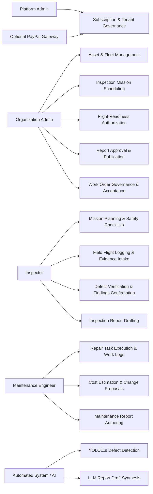

## 2. User Requirements

### 2.1 System Actors

The platform defines four primary human roles across platform governance and enterprise operations, alongside automated system processing components.

| # | Actor | Description |
| --- | --- | --- |
| 1 | Platform Admin (`ADMIN`) | Governs multi-tenant platform operations, creates and manages enterprise customer workspaces, activates and renews enterprise subscriptions, configures system-wide security policies, and monitors audit logs. Does not participate in customer engineering reviews or maintenance budgeting. |
| 2 | Organization Admin (`ORG_ADMIN`) | Manages the enterprise workspace. Responsible for workforce accounts, credential verification, drone fleet management, flight permit compliance, infrastructure asset registration, and inspection scheduling. Authorizes flight readiness, approves inspection reports for publication, forwards confirmed defects to maintenance, approves repair budgets, and performs final technical acceptance. |
| 3 | Inspector (`INSPECTOR`) | Qualified remote pilot and inspection specialist. Accepts assigned inspection missions, defines component shot-lists, completes pre-flight safety checklists, logs field survey sessions, uploads raw image evidence, evaluates evidence quality, verifies AI defect candidates, authors manual findings, verifies report drafts, and submits reports for administrative review. |
| 4 | Maintenance Engineer (`MAINTENANCE_ENGINEER`) | Infrastructure maintenance technician. Executes assigned repair tasks, logs labor hours, material consumption, and equipment utilization, uploads before/after repair evidence, and records completion declarations. When designated, serves as Maintenance Team Lead (planning tasks and cost estimates) or Report Author (synthesizing completion reports). |
| — | Automated System (`SYSTEM` / AI Engine) | Automated backend services including YOLO11s defect detection microservice, LLM report drafting engine, cryptographic hashing workers, and scheduled due-cycle generators. Operates under strict human oversight and carries no autonomous approval authority. |
| — | PayPal Payment Gateway (Optional External Service) | When configured for a deployment, creates and captures approved subscription orders through PayPal Orders v2 and provides signed webhook notifications; it has no platform role or authority and cannot set contract prices. |

### 2.2 Use Cases

#### 2.2.1 Diagram(s)

#### 2.2.2 Descriptions

The system defines 32 primary use cases covering the complete operational lifecycle from tenant governance to maintenance closeout.

| ID | Use Case | Actors | Use Case Description |
| --- | --- | --- | --- |
| UC-01 | Authenticate User | All Roles, System | User signs in using verified email and password; system validates credentials, issues access/refresh tokens, enforces role-based permissions, and supports session logout. |
| UC-02 | Manage Platform Settings & Subscription Terms | Platform Admin | Configure system-wide technical parameters and review tenant subscription requests, proposed commercial terms, and settlement records. Standard subscription pricing is application configuration, not a dynamic plan catalog; provider credentials are deployment secrets, not editable through this use case. |
| UC-03 | Request Enterprise Subscription & Reconcile Payment | Organization Admin, Platform Admin, System, optional PayPal Gateway | Review versioned terms and standard pricing; request a standard/custom term with an optional price proposal; settle by corporate wire/invoice with Platform Admin reconciliation, or use optional configured PayPal checkout only for a platform-approved contract amount. Activate entitlement only after authorized, verified settlement. |
| UC-04 | Register Infrastructure Asset | Organization Admin, System | Register physical infrastructure assets (bridges, towers, facilities), specify asset specifications, upload engineering drawings, and assign a default responsible Inspector and Drone. |
| UC-05 | Manage Workforce Credentials | Organization Admin, System | Provision Inspector and Maintenance Engineer accounts; record professional pilot licenses, safety certifications, and track document expiration dates. |
| UC-06 | Manage Drone Fleet & Permits | Organization Admin, System | Register drone hardware (model, serial number, serviceability status); link government-issued flight permits and legal authorizations. |
| UC-07 | Schedule Inspection Mission | Organization Admin, System | Create scheduled or ad-hoc inspection missions, define inspection scope and time windows, inherit default Inspector and Drone assignments, and detect resource scheduling conflicts. |
| UC-08 | Reassign Inspection Pair | Organization Admin, System | Reassign the designated Inspector or Drone for an inspection mission with mandatory justification; revalidate availability and invalidate outdated readiness approvals. |
| UC-09 | Respond to Mission Assignment | Inspector, System | Assigned Inspector reviews mission parameters and accepts or rejects the assignment; rejection requires a mandatory reason and returns the mission to the administrator. |
| UC-10 | Authorize Flight Readiness | Organization Admin, Inspector, System | Review submitted mission preparation, verify valid flight permits, remote pilot credentials, and weather parameters; issue formal readiness approval or return for revision. |
| UC-11 | Prepare Inspection Shot-List | Inspector | Define required structural component shot-lists, capture angles, ground sampling distance (GSD) requirements, and complete safety acknowledgments. |
| UC-12 | Log Field Flight Session | Inspector, System | Verify pre-flight checklist on site; start field session against active readiness approval; record session completion, pause, postponement, or abort with field notes. |
| UC-13 | Evaluate Evidence Quality | Inspector, System | Compare captured visual media against planned shot-lists; evaluate coverage, sharpness, and lighting; mark evidence set as accepted or request supplementary capture. |
| UC-14 | Ingest Digital Evidence | Inspector, Maintenance Engineer, System | Upload high-resolution aerial photographs and telemetry; system computes SHA-256 checksums, extracts EXIF/GPS metadata, and rejects duplicate files. |
| UC-15 | Verify Defect Findings | Inspector, System | Review AI defect candidate suggestions; confirm, modify, or reject candidates; record manual defect observations; confirm official findings inventory. |
| UC-16 | Select Report Drafting Method | Inspector, System / LLM | Following findings confirmation, select automated LLM-assisted section drafting or manual structured authoring; system enforces input consistency. |
| UC-17 | Verify Inspection Report Draft | Inspector | Review and edit synthesized report sections (Executive Summary, Scope, Methodology, Finding Discussions); ensure factual alignment with verified evidence; submit for review. |
| UC-18 | Approve Inspection Report | Organization Admin, System | Independent administrator reviews submitted report draft and confirmed defect findings; approves report for formal release or returns to author with comments. |
| UC-19 | Publish Inspection Report | System, Organization Admin | Compile approved report into an immutable, structured PDF deliverable; record cryptographic SHA-256 hash and archive publication record. |
| UC-20 | Forward Defects to Maintenance | Organization Admin, System | Review confirmed findings from published report; select repair-required defects in batch and hand them over as candidates for maintenance remediation. |
| UC-21 | Publish Report Correction | Report Author, Organization Admin, System | Issue an amended inspection report version to rectify administrative errors; link to original report while preserving complete historical revision trail. |
| UC-22 | Monitor Operations Dashboard | All Roles, System | Access role-tailored dashboards displaying active missions, pending approvals, defect severities, maintenance tasks, and compliance alerts. |
| UC-23 | Create Maintenance Work Order | Organization Admin, System | Create formal maintenance work order referencing confirmed defect candidates; establish corrective scope, priority level, and target completion deadlines. |
| UC-24 | Formulate Repair Scope | Maintenance Team Lead | Assess physical defects, determine engineering repair methods, decompose work into specific tasks, and define technical acceptance criteria. |
| UC-25 | Prepare Cost Estimate | Maintenance Team Lead, System | Formulate itemized repair estimates covering labor hours, replacement materials, equipment rentals, and specialized services; calculate exact decimal baseline totals. |
| UC-26 | Approve Repair Budget & Team | Organization Admin, System | Designate engineering team members, appoint Team Lead and Report Author; review itemized estimate and formally approve scope and budget baseline. |
| UC-27 | Log Repair Execution | Assigned Maintenance Engineers, Team Lead | Log daily work execution, labor hours, material consumption, and task completion notes; update real-time task progress. |
| UC-28 | Submit Repair Evidence | Assigned Maintenance Engineers, Report Author | Upload before-and-after photographs, material test certificates, and structural inspection logs demonstrating defect rectification. |
| UC-29 | Manage Scope & Cost Changes | Maintenance Team Lead, Organization Admin, System | Submit formal Change Requests for unexpected site conditions requiring additional labor or materials; administrator approves or rejects proposed variance. |
| UC-30 | Author Maintenance Report | Designated Report Author, System / LLM | Synthesize maintenance completion report from task logs, repair evidence, and financial actuals; verify technical accuracy and submit for acceptance. |
| UC-31 | Accept Work & Close Order | Independent Organization Admin, System | Conduct independent technical review of repaired assets; verify test results and before/after proof; reconcile actual costs against budget; formally close work order. |
| UC-32 | Audit Inspection & Repair Trail | Authorized Roles, System | Query end-to-end audit logs tracking asset condition history, flight authorizations, evidence provenance, reviewer decisions, and maintenance expenditures. |
