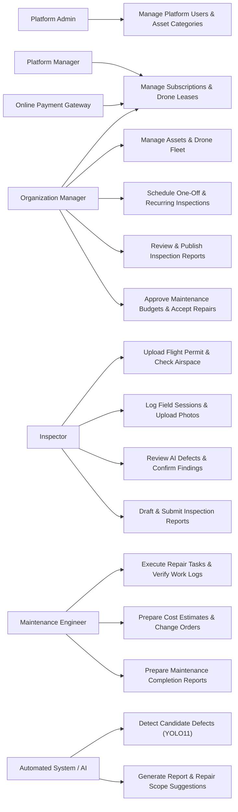

## 2. User Requirements

### 2.1 Actors

| # | Actor | Description |
| --- | --- | --- |
| 1 | Platform Admin | Manages platform-level user accounts, initial customer workspace accounts, standard infrastructure asset categories, and system-wide audit logs. Does not approve commercial payments, customer inspection reports, or maintenance budgets. |
| 2 | Platform Manager | Manages commercial subscription requests, confirms bank transfer and online payments, maintains the platform's leasable drone catalog, and approves or reclaims drone leases for customer organizations. |
| 3 | Organization Manager | Manages a customer organization's workspace, including subscriptions, drone leases, workforce accounts, owned and leased drones, infrastructure assets, inspection schedules, report publication, and maintenance budget and acceptance decisions. |
| 4 | Inspector | Licensed drone pilot and inspection specialist who updates pilot license details, uploads flight permits, logs field flight sessions, uploads inspection photos, reviews AI defect suggestions, and drafts inspection reports. |
| 5 | Maintenance Engineer | Engineering technician who plans repair tasks, prepares cost estimates, executes field repairs, records work logs, and prepares maintenance completion reports. |
| 6 | Automated System (AI & Background Services) | System services that generate recurring inspection missions, send reminder notifications, detect candidate defects on photos (`YOLO11`), and draft report or repair scope suggestions under human supervision. |
| 7 | Online Payment Gateway (PayPal) | Optional external payment service that processes online checkout for enterprise subscriptions and drone leases. |

### 2.2 Use Cases

#### 2.2.1 Diagram(s)

#### 2.2.2 Descriptions

| ID | Use Case | Actors | Use Case Description |
| --- | --- | --- | --- |
| UC-01 | Sign In & Manage Session | All Roles | Sign in with email and password, set up a new password on first login, and sign out across web and mobile devices. |
| UC-02 | Manage Platform Accounts & Asset Categories | Platform Admin | Create and manage platform accounts, initial customer manager accounts, and standard infrastructure asset categories. |
| UC-03 | Request Subscription & Confirm Payment | Organization Manager, Platform Manager, Payment Gateway | Request a 1- to 120-month enterprise subscription and activate it via bank transfer confirmation or online PayPal payment. |
| UC-04 | Register Infrastructure Asset & Documents | Organization Manager | Register infrastructure assets with map coordinates, standard inspection checkpoints, and reference engineering documents, or archive completed assets. |
| UC-05 | Manage Workforce & Pilot License Profile | Organization Manager, Inspector | Create Inspector and Maintenance Engineer accounts and allow Inspectors to record their remote pilot license details. |
| UC-06 | Manage Drone Fleet & B2B Drone Leasing | Organization Manager, Platform Manager, Payment Gateway | Register owned drones, lease drones from the platform catalog, and return leased drones when a contract ends. |
| UC-07 | Schedule One-Off or Recurring Inspection | Organization Manager, System | Schedule a one-off inspection or set up a weekly, monthly, or yearly recurring inspection schedule with automatic conflict checking. |
| UC-08 | Reassign Inspection Resources | Organization Manager | Change the assigned Inspector or Drone for a scheduled inspection after checking availability. |
| UC-09 | Upload Flight Permit | Inspector, Organization Manager | Upload the aviation flight permit for an assigned inspection to mark the mission `Ready for Flight`. |
| UC-10 | Log Field Flight Session | Inspector | Record pre-flight safety notes and log the start, postponement, abort, or completion of an on-site drone flight session. |
| UC-11 | Start Additional Field Session | Inspector | Start an additional flight session when extra aerial photos are needed before finalizing the findings. |
| UC-12 | Check Airspace & No-Fly Zones | Organization Manager, Inspector | View the interactive Vietnam airspace map to check whether asset or mission coordinates fall inside a No-Fly Zone or Restricted Zone. |
| UC-13 | Upload & Manage Inspection Photos | Inspector, Organization Manager | Upload inspection photos, view capture time and GPS location, tag structural locations, and retire unusable photos. |
| UC-14 | Run AI Defect Detection | Inspector, System | Run `YOLO11` visual detection on selected inspection photos to highlight candidate structural defects. |
| UC-15 | Verify & Confirm Defect Findings | Inspector | Confirm, edit, or remove AI-suggested defects, add manual findings, and lock the final findings list for reporting. |
| UC-16 | Generate AI or Manual Report Draft | Inspector, System | Create a structured inspection report draft using AI assistance or a manual template based on the confirmed findings. |
| UC-17 | Verify & Submit Inspection Report | Inspector | Edit report sections, preview the formatted PDF, verify accuracy, and submit the report to an Organization Manager. |
| UC-18 | Review Inspection Report | Organization Manager | Review a submitted inspection report and either approve it for publication or return it to the author with comments. |
| UC-19 | Publish Official PDF Report | Organization Manager, System | Generate and lock the final A4 PDF inspection report for viewing and download. |
| UC-20 | Forward Defects to Maintenance | Organization Manager | Select confirmed defects from a published report that require physical repair and hand them off to maintenance. |
| UC-21 | Publish Amended Inspection Report | Inspector, Organization Manager | Create and publish a new report version when corrections are needed while keeping previous published versions in history. |
| UC-22 | View Dashboard, Calendar & Notifications | All Roles | View role-specific dashboards, check the Inspector Schedule Calendar, and read in-app notifications. |
| UC-23 | Create Maintenance Work Order | Organization Manager | Create a maintenance work order from a forwarded defect with priority, due date, repair scope, and acceptance criteria. |
| UC-24 | Use AI Repair Scope Advisor & Plan Tasks | Maintenance Engineer, Organization Manager, System | Generate suggested repair steps from civil engineering standards and break the work order down into repair tasks. |
| UC-25 | Prepare Repair Cost Estimate | Maintenance Engineer | Create an itemized cost estimate covering labor, materials, equipment, and services for a work order. |
| UC-26 | Assign Maintenance Team & Approve Budget | Organization Manager | Assign the Team Lead, Report Author, Team Members, and independent Accepting Reviewer, and approve or reject the cost estimate. |
| UC-27 | Log & Verify Field Repair Work | Maintenance Engineer, Team Lead | Release and start repair work, log task hours and test readings, verify work logs as Team Lead, and mark repair work complete. |
| UC-28 | Upload Repair Evidence | Maintenance Engineer | Record before-and-after repair conditions and field test measurements for completed tasks. |
| UC-29 | Request & Approve Change Order | Maintenance Engineer, Organization Manager | Submit and review a Change Order when unexpected site conditions require budget or scope adjustments. |
| UC-30 | Submit Maintenance Completion Report | Maintenance Engineer (Report Author) | Prepare, verify, and submit the maintenance completion report once physical repair tasks are finished. |
| UC-31 | Accept Maintenance Work & Close Work Order | Organization Manager | Perform independent technical acceptance (accept, request rework, or request re-inspection), record actual costs, and close the work order. |
| UC-32 | View Activity & Audit History | Authorized Roles | Review the history of account actions, approvals, published reports, and closed work orders. |
