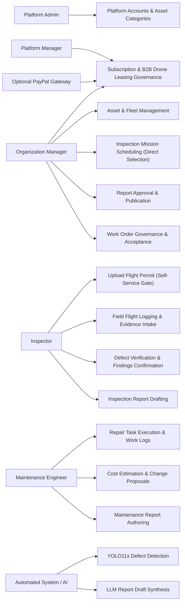

## 2. User Requirements

### 2.1 System Actors

The platform defines five primary human roles across platform governance and enterprise operations, alongside automated system processing components.

| # | Actor | Description |
| --- | --- | --- |
| 1 | Platform Admin (`ADMIN`) | Governs multi-tenant platform technical administration, provisions and manages platform-level accounts (`ADMIN`, `PLATFORM_MANAGER`) and initial workspace accounts, maintains standard infrastructure asset categories, configures system-wide security policies, and monitors platform-wide read-only audit/operational views. Does not approve commercial subscription settlements, drone leases, customer engineering reviews, or maintenance budgets. |
| 2 | Platform Manager (`PLATFORM_MANAGER`) | Governs platform commercial and equipment-leasing operations. Reviews enterprise subscription requests and negotiated pricing proposals, reconciles wire/PayPal subscription payments to activate tenant entitlements, manages the platform's serial-numbered leasable drone pool (`platform_drones`), approves and provisions B2B drone lease contracts (`drone_leases`) into customer fleets, and reclaims leased drones upon contract completion. |
| 3 | Organization Manager (`ORG_MANAGER`) | Manages the customer enterprise workspace (formerly referred to as `ORG_ADMIN`). Requests enterprise subscriptions and B2B drone leases, manages workforce accounts, drone fleet inventory (owned and leased with registration numbers and expiry), infrastructure asset registration with inspection checkpoints, and inspection scheduling (direct Inspector + Drone selection). Approves inspection reports for publication, forwards confirmed defects to maintenance, approves repair budgets, and performs final technical acceptance. |
| 4 | Inspector (`INSPECTOR`) | Qualified remote pilot and inspection specialist. Self-declares remote pilot license credentials in user profile, uploads mission flight permits, executes field survey sessions guided by asset inspection checkpoints, completes on-site pre-flight safety checklist notes, uploads raw image evidence, verifies AI defect candidates, authors manual findings, authors coverage disclosures, verifies report drafts, and submits reports for administrative review. |
| 5 | Maintenance Engineer (`MAINTENANCE_ENGINEER`) | Infrastructure maintenance technician. Executes assigned repair tasks, logs labor hours, material consumption, and equipment utilization, uploads before/after repair evidence, and records completion declarations. When designated, serves as Maintenance Team Lead (planning tasks and cost estimates) or Report Author (synthesizing completion reports). |
| — | Automated System (`SYSTEM` / AI Engine) | Automated backend services including YOLO11s defect detection microservice, LLM report drafting engine, cryptographic hashing workers, and scheduled due-cycle generators. Operates under strict human oversight and carries no autonomous approval authority. |
| — | PayPal Payment Gateway (Optional External Service) | When configured for a deployment, creates and captures approved subscription and B2B drone lease orders through PayPal Orders v2 and provides signed webhook notifications; it has no platform role or authority and cannot set contract prices. |

### 2.2 Use Cases

#### 2.2.1 Diagram(s)

#### 2.2.2 Descriptions

The system defines 32 primary use cases covering the complete operational lifecycle from tenant governance to maintenance closeout.

| ID | Use Case | Actors | Use Case Description |
| --- | --- | --- | --- |
| UC-01 | Authenticate User | All Roles, System | User signs in using verified email and password; system validates credentials, issues access/refresh tokens, enforces role-based permissions, and supports session logout. |
| UC-02 | Manage Platform Settings & Subscription Terms | Platform Admin, Platform Manager | Platform Admin configures system-wide technical parameters, provisions platform-level accounts (`ADMIN`, `PLATFORM_MANAGER`) and initial workspace accounts, maintains standard infrastructure asset categories, and retains read-only visibility across commercial records. Platform Manager reviews tenant subscription requests, proposed commercial terms, and settlement records. Standard subscription pricing is application configuration, not a dynamic plan catalog; provider credentials are deployment secrets, not editable through this use case. |
| UC-03 | Request Enterprise Subscription & Reconcile Payment | Organization Manager, Platform Manager, System, optional PayPal Gateway | Review versioned terms and standard pricing; request a standard/custom term with an optional price proposal; settle by corporate wire/invoice with Platform Manager reconciliation, or use optional configured PayPal checkout only for a platform-approved contract amount. Activate entitlement only after authorized, verified settlement. |
| UC-04 | Register Infrastructure Asset | Organization Manager, System | Register physical infrastructure assets (bridges, towers, facilities), specify asset specifications, location coordinates, upload engineering drawings, and configure standardized inspection checkpoints (`inspectionItems`). |
| UC-05 | Self-Declare Pilot License & Workforce Provisioning | Organization Manager, Inspector, System | Provision Inspector and Maintenance Engineer accounts; allow Inspectors to self-declare remote pilot license credentials (license number, class, expiration date, certificate file). |
| UC-06 | Manage Drone Fleet & B2B Leasing | Organization Manager, Platform Manager, System, optional PayPal Gateway | Organization Manager registers owned drone hardware (model, serial number, serviceability status, registration number, expiration date) and requests B2B leases from the platform pool. Platform Manager provisions leased drones and reclaims them upon contract completion. |
| UC-07 | Schedule Inspection Mission | Organization Manager, System | Create scheduled or ad-hoc inspection missions, define planned time window, directly assign responsible Inspector and Drone, and detect resource scheduling conflicts. |
| UC-08 | Reassign Mission Resources | Organization Manager, System | Reassign the designated Inspector or Drone for an inspection mission; revalidate availability and conflict status. |
| UC-09 | Upload Flight Permit & Authorize Readiness | Inspector, System | Assigned Inspector uploads mission-specific aviation flight permit document; system validates Inspector's active pilot license and automatically transitions inspection to `READY_FOR_FLIGHT`. |
| UC-10 | Log Field Flight Session | Inspector, System | Verify on-site pre-flight checklist note; execute survey session guided by `assets.inspection_items`; log start time, session completion, postponement, or abort with field notes. |
| UC-11 | Initiate Additional Field Session | Inspector, System | Assigned Inspector initiates an additional field flight session directly while in `FIELD_COMPLETED` when additional survey coverage is required. |
| UC-12 | Review Evidence Coverage | Inspector, System | Review captured visual media against inspection checkpoints; disclose coverage and limitations in the report. |
| UC-13 | Ingest Digital Evidence | Inspector, Maintenance Engineer, System | Upload high-resolution aerial photographs and telemetry; system extracts EXIF/GPS metadata and rejects duplicate filenames within inspection scope. |
| UC-14 | Ingest Digital Evidence | Inspector, Maintenance Engineer, System | Upload high-resolution aerial photographs and telemetry; system extracts EXIF/GPS metadata and rejects duplicate filenames within inspection scope. |
| UC-15 | Verify Defect Findings | Inspector, System | Review AI defect candidate suggestions; confirm, modify, or reject candidates; record manual defect observations; confirm official findings inventory. |
| UC-16 | Select Report Drafting Method | Inspector, System / LLM | Following findings confirmation, select automated LLM-assisted section drafting or manual structured authoring; system enforces input consistency. |
| UC-17 | Verify Inspection Report Draft | Inspector | Review and edit synthesized report sections (Executive Summary, Scope, Methodology, Finding Discussions); ensure factual alignment with verified evidence; submit for review. |
| UC-18 | Approve Inspection Report | Organization Manager, System | Independent Organization Manager reviews submitted report draft and confirmed defect findings; approves report for formal release or returns to author with comments. |
| UC-19 | Publish Inspection Report | System, Organization Manager | Compile approved report into an immutable, structured PDF deliverable; record cryptographic SHA-256 hash and archive publication record. |
| UC-20 | Forward Defects to Maintenance | Organization Manager, System | Review confirmed findings from published report; select repair-required defects in batch and hand them over as candidates for maintenance remediation. |
| UC-21 | Publish Report Correction | Report Author, Organization Manager, System | Issue an amended inspection report version to rectify administrative errors; link to original report while preserving complete historical revision trail. |
| UC-22 | Monitor Operations Dashboard | All Roles, System | Access role-tailored dashboards displaying active missions, pending approvals, defect severities, maintenance tasks, and compliance alerts. |
| UC-23 | Create Maintenance Work Order | Organization Manager, System | Create formal maintenance work order referencing confirmed defect candidates; establish corrective scope, priority level, and target completion deadlines. |
| UC-24 | Formulate Repair Scope | Maintenance Team Lead | Assess physical defects, determine engineering repair methods, decompose work into specific tasks, and define technical acceptance criteria. |
| UC-25 | Prepare Cost Estimate | Maintenance Team Lead, System | Formulate itemized repair estimates covering labor hours, replacement materials, equipment rentals, and specialized services; calculate exact decimal baseline totals. |
| UC-26 | Approve Repair Budget & Team | Organization Manager, System | Designate engineering team members, appoint Team Lead and Report Author; review itemized estimate and formally approve scope and budget baseline. |
| UC-27 | Log Repair Execution | Assigned Maintenance Engineers, Team Lead | Log daily work execution, labor hours, material consumption, and task completion notes; update real-time task progress. |
| UC-28 | Submit Repair Evidence | Assigned Maintenance Engineers, Report Author | Upload before-and-after photographs, material test certificates, and structural inspection logs demonstrating defect rectification. |
| UC-29 | Manage Scope & Cost Changes | Maintenance Team Lead, Organization Manager, System | Submit formal Change Requests for unexpected site conditions requiring additional labor or materials; Organization Manager approves or rejects proposed variance. |
| UC-30 | Author Maintenance Report | Designated Report Author, System / LLM | Synthesize maintenance completion report from task logs, repair evidence, and financial actuals; verify technical accuracy and submit for acceptance. |
| UC-31 | Accept Work & Close Order | Independent Organization Manager, System | Conduct independent technical review of repaired assets; verify test results and before/after proof; reconcile actual costs against budget; formally close work order. |
| UC-32 | Audit Inspection & Repair Trail | Authorized Roles, System | Query end-to-end audit logs tracking asset condition history, flight authorizations, evidence provenance, reviewer decisions, and maintenance expenditures. |
