## 2. User Requirements

This section defines the actors of the building-inspection service and the business goals they pursue. The scope is limited to building structures as described in §1, and the use cases below are grouped across the four main flows `MF1`–`MF4` that §3 details as twenty-four atomic features (`FE-01`–`FE-24`). Partner Inspector admission is a public self-service application reviewed by platform staff; an Inspector account is created only after that review succeeds. Recurring service requests are supported, and accepting a quotation materializes their planned occurrences. Occurrence materialization is acceptance-triggered, not time-based generation.

### 2.1 Actors

| # | Actor | Description |
| --- | --- | --- |
| 1 | `ADMIN` | Platform administrator. Manages platform accounts and the building asset category catalogue; reviews customer airspace cases, partner Inspector applications, and drone registrations; maintains pilot-licence classes, required drone document configuration, finance settings, and AI inference settings; and reviews platform activity records. |
| 2 | `MANAGER` | Platform manager. Coordinates Inspector and drone records, reviews partner Inspector applications, responds to customer service requests, negotiates and issues VND quotations, records signed service agreements, assigns Inspectors and drones to inspection occurrences, manages dispatch changes, independently reviews and publishes inspection reports, and manages partner payouts and refunds. |
| 3 | `CUSTOMER` | Customer organization representative. Registers its organization and initial building subject to airspace screening; manages buildings, inspection checkpoints, and building documents; requests one-time or recurring inspections; negotiates and accepts quotations; follows inspection progress; accepts published reports; and pays service fees. |
| 4 | `INSPECTOR` | Partner drone inspector. Submits a public self-service application with pilot credentials and partner information; after platform approval an account is created. The Inspector then registers owned drones with registration, ownership, and technical inspection documents, conducts assigned field work, provides inspection evidence, reviews proposed findings, and prepares and submits inspection reports. Drone ownership is not a condition of partner admission. |
| 5 | Automated System and AI Actors | Four automated actors act without a login: `SYSTEM` performs airspace screening, schedule-conflict checks, lifecycle notices, assignment timeouts, and other scheduled jobs; `YOLO11` analyses building imagery for candidate defects with a configured vision fallback; `LLM` drafts advisory report narrative and executive summaries; and `DroneKnowledgeAI` retrieves tenant-isolated historical defect cases and engineering standards over `pgvector`. Automated output is advisory; official findings and decisions require human review. |
| 6 | External Payment and Identity Services | Google OAuth2 sign-in, PayOS VietQR and VNPay service-payment processing. These services do not replace the platform's authorization, review, or recordkeeping responsibilities. |
| 7 | SmartDroneHub | An optional ground-station integration that supplies read-only MAVLink telemetry, flight traces, and mission video for a permitted field session. It does not receive flight commands from the platform. |

The `CUSTOMER` role is also served by a native mobile application that mirrors the web experience for verdict expiry, the payment-notice and payment-receipt PDF, Inspector–Customer chat, and the compact knowledge-references strip. Other roles use the web portals.

### 2.2 Use Cases

#### 2.2.1 Diagram(s)

```mermaid
%% title: Use Case Diagram
flowchart TD
  ADMIN["ADMIN"]
  MANAGER["MANAGER"]
  CUSTOMER["CUSTOMER"]
  INSPECTOR["INSPECTOR"]
  PUBLIC["Prospective<br/>Inspector"]

  GOV["Govern accounts, categories<br/>and finance"]
  REVIEW["Review airspace cases,<br/>applications<br/>and drone records"]
  APPLY["Submit partner<br/>Inspector application"]
  REGISTER["Register organization<br/>and initial building"]
  BUILDING["Manage buildings,<br/>checkpoints and documents"]
  DRONE["Register owned drones"]

  COMMERCIAL["Create request, negotiate<br/>and accept VND quotation"]
  DISPATCH["Assign partner<br/>and manage dispatch"]
  PUBLISH["Review and publish<br/>inspection report"]
  FINANCE["Manage payouts and refunds"]
  FIELD["Provide permit and<br/>record field session"]
  EVIDENCE["Provide evidence<br/>and confirm findings"]
  PREPARE["Prepare and submit<br/>inspection report"]
  PAYMENT["Accept report and<br/>pay service fee"]

  AI["Automated<br/>advisory support"]
  HUB["SmartDroneHub"]

  ADMIN --> GOV
  ADMIN --> REVIEW
  MANAGER --> REVIEW
  MANAGER --> COMMERCIAL
  MANAGER --> DISPATCH
  MANAGER --> PUBLISH
  MANAGER --> FINANCE
  CUSTOMER --> REGISTER
  CUSTOMER --> BUILDING
  CUSTOMER --> COMMERCIAL
  CUSTOMER --> PAYMENT
  PUBLIC --> APPLY
  INSPECTOR --> DRONE
  INSPECTOR --> FIELD
  INSPECTOR --> EVIDENCE
  INSPECTOR --> PREPARE
  AI --> EVIDENCE
  HUB --> FIELD

  GOV ~~~ COMMERCIAL
  REGISTER ~~~ COMMERCIAL
  DRONE ~~~ COMMERCIAL
```

#### 2.2.2 Descriptions

| ID | Use Case | Actors | Use Case Description |
| --- | --- | --- | --- |
| UC-01 | Sign In and Manage Account | All Roles | Users securely sign in by password, one-time code, or Google, manage their personal account information, and end their own active sessions. |
| UC-02 | Govern Platform Accounts, Building Categories, and Finance | `ADMIN`, `MANAGER` | Authorized platform staff manage platform accounts and the building asset category catalogue; `ADMIN` maintains pilot-licence classes, required drone-document configuration, finance settings, and AI inference settings. |
| UC-03 | Register Customer Organization and Initial Building | `CUSTOMER`, public | A prospective Customer registers its organization with an initial building. The service screens the location: prohibited airspace prevents registration, locations requiring review remain pending until `ADMIN` decides, and eligible locations proceed. A recorded result is not governmental clearance. |
| UC-04 | Manage Buildings, Checkpoints, and Documents | `CUSTOMER` | Customers register and maintain organization buildings, their inspection checkpoints, and reference documents, and may retire buildings no longer in service. Building locations are screened for prohibited airspace. |
| UC-05 | Submit and Review Partner Inspector Application | Public, `INSPECTOR`, `ADMIN`, `MANAGER` | A prospective partner Inspector submits a public application with identity, pilot-licence details, and a licence scan. Platform staff review it, approve it or reject it with reasons, and record the signed partner contract. An account is created only after approval; approval does not require drone ownership. |
| UC-06 | Register and Review Inspector-Owned Drones | `INSPECTOR`, `ADMIN`, `MANAGER` | An Inspector registers an owned drone with photographs, outdoor flight capabilities, safety checklist items, and the registration, ownership, and technical-inspection documents the platform requires. Platform staff review the documentation before the drone becomes eligible for assignment. |
| UC-07 | Request Inspection, Negotiate, and Accept a Quotation | `CUSTOMER`, `MANAGER` | A Customer submits a one-time or recurring service request for a building, exchanges messages with the assigned `MANAGER`, reviews a VND quotation, and accepts the current active quotation. Changes to commercial terms require a revised quotation. |
| UC-08 | Record Signed Service Agreement and Arrange Occurrences | `MANAGER`, `CUSTOMER` | After the parties sign an offline service agreement, `MANAGER` records the signed document. For a recurring request, the agreement covers the occurrences within its agreed term. Each occurrence is separately prepared for assignment and delivery. |
| UC-09 | Assign, Reschedule, Reassign, or Cancel an Inspection | `MANAGER`, `INSPECTOR`, Automated System | `MANAGER` assigns a qualified Inspector and an eligible owned drone to an occurrence, accounting for availability across customer organizations. After an aborted field session, `MANAGER` may reschedule, reassign, or cancel the dispatch. |
| UC-10 | Provide and Verify Mission Flight Permit | `INSPECTOR`, `MANAGER`, `ADMIN` | The assigned Inspector uploads the mission flight permit with structured metadata. A distinct Manager or Administrator verifies it before field work can start. The service's document check is not government authorization. |
| UC-11 | Record Field Session | `INSPECTOR` | The assigned Inspector records the start, normal completion, or abort of an on-site session, including the required pre-flight safety note and an outcome or abort reason. An abort prompts dispatch follow-up by `MANAGER`. |
| UC-12 | Capture Flight Evidence | `INSPECTOR`, SmartDroneHub | The Inspector provides read-only MAVLink telemetry, imports an exported flight log, submits an accountable manual flight declaration, or receives mission video, and the persisted flight trace can be reviewed afterwards. |
| UC-13 | Review Airspace Information | All Roles | Users may review airspace information relevant to building and mission locations. Information shown is advisory and does not constitute permission to fly. |
| UC-14 | Provide Inspection Evidence | `INSPECTOR`, `MANAGER`, `CUSTOMER` | Inspectors upload building photographs and video, associate them with structural locations, and identify unusable captures. Authorized users review evidence according to their responsibilities. |
| UC-15 | Review Candidate Findings and Confirm Findings | `INSPECTOR`, Automated System | The service suggests candidate building defects from inspection images. The assigned Inspector reviews, edits, rejects, or supplements each suggestion, and confirms the findings baseline. Only human-confirmed findings become official inspection findings. |
| UC-16 | Prepare and Submit Inspection Report | `INSPECTOR`, Automated System | After confirming findings, the report author prepares and submits the inspection report for independent review. The service may supply an AI-drafted summary as advisory material. Submission is an explicit action, not the act of opening a screen. |
| UC-17 | Independently Review and Publish Inspection Report | `MANAGER`, `ADMIN` | A reviewer who is not the report author independently reviews a submitted report, approves it for publication or returns it with reasons, and publishes the approved official report. Published reports are preserved; corrections are issued as a new version. |
| UC-18 | Follow Inspection, Accept Report, and Pay Service Fee | `CUSTOMER`, `MANAGER`, Payment Service | Customers follow inspection progress, review the published report, record acceptance, and settle the applicable service fee through PayOS or VNPay. Official deliverables are released according to the payment rule. Partner settlement is tracked separately. |
| UC-19 | Manage Partner Settlement, Payouts, and Refunds | `MANAGER` | `MANAGER` records Inspector payouts against verified customer payment, initiates and completes refunds with evidence-backed allocations, and records recovery of Inspector receivables. |
| UC-20 | View Role-Appropriate Dashboard, Calendar, and Notifications | All Roles | Users review operational information, inspection schedules, progress, and available notices within their authorized responsibilities. |
| UC-21 | Review Activity History | Authorized Roles | Authorized users review attributable records of important onboarding, commercial, inspection, payment, and acceptance decisions within their access scope. |
