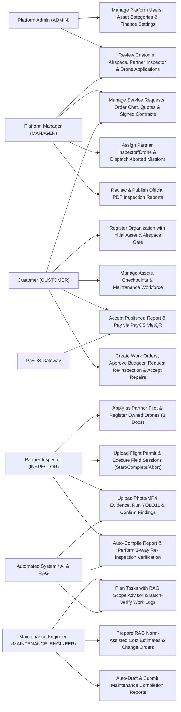

## 2. User Requirements

### 2.1 Actors

| # | Actor | Description |
| --- | --- | --- |
| 1 | Platform Admin (`ADMIN`) | Platform-scoped administrator (`ActorZone.PLATFORM`) who manages internal platform accounts, standard infrastructure asset categories, customer restricted-airspace onboarding reviews, partner inspector and drone registration approvals, platform finance settings (commission, VAT, TNCN rates), and system-wide audit logs. |
| 2 | Platform Manager (`MANAGER`) | Platform-scoped operations manager (`ActorZone.PLATFORM`) who manages the partner Inspector and drone registry, handles customer service requests and order chat, issues versioned VND/USD quotations, uploads signed paper service contracts, assigns partner Inspectors and drones with cross-organization conflict checks, dispatches rescheduled/reassigned missions after field aborts, independently reviews and publishes official PDF inspection reports, and records partner payouts. |
| 3 | Customer (`CUSTOMER`) | Customer organization owner/manager (`ActorZone.CUSTOMER_ORGANIZATION`) who completes airspace-gated onboarding with an initial asset, manages organization assets and checkpoints, provisions Maintenance Engineer accounts, submits one-time or recurring inspection service requests, negotiates and accepts quotations, tracks 5-stage inspection progress, accepts published inspection reports, pays via PayOS (VietQR), creates maintenance work orders, approves repair budgets and Change Orders, requests re-inspection verification flights, and performs independent maintenance acceptance and cost closure. |
| 4 | Inspector (`INSPECTOR`) | Independent licensed drone partner (`ActorZone.INSPECTOR_PARTNER`) who applies with a remote pilot license (drone optional at onboarding), registers owned drones with registration/ownership/inspection documents, uploads mission flight permits, logs field flight sessions (`Start`, `Complete`, `Abort`) on Web or Mobile, uploads inspection photos and MP4 videos, verifies AI defect candidates, submits auto-compiled inspection reports, and executes 3-way defect verification on re-inspection missions. |
| 5 | Maintenance Engineer (`MAINTENANCE_ENGINEER`) | Customer-scoped engineering technician (`ActorZone.CUSTOMER_ORGANIZATION`) who plans repair tasks using the RAG Scope Advisor, prepares norm-assisted cost estimates, executes field repairs, records before-and-after repair proof, batch-verifies work logs as `Team Lead`, and submits auto-drafted maintenance completion reports as `Report Author`. |
| 6 | Automated System (AI, RAG & Schedulers) | Internal services that evaluate Vietnam airspace zones, check cross-organization scheduling conflicts, dispatch transactional outbox notifications, detect candidate defects on photos (`YOLO11` with Vision LLM fallback), compile report drafts and AI executive summaries, and retrieve `pgvector` civil engineering standards for repair scope, cost norms, and acceptance compliance audits. |
| 7 | External Payment & Identity Providers (PayOS & Google OAuth2) | External integrations providing VietQR online payment links and HMAC-verified payment webhooks (`PayOS`) for accepted inspection occurrences, and OAuth 2.0 federated sign-in (`Google OAuth2`) across Web and Mobile deep links. |

### 2.2 Use Cases

#### 2.2.1 Diagram(s)

#### 2.2.2 Descriptions

| ID | Use Case | Actors | Use Case Description |
| --- | --- | --- | --- |
| UC-01 | Sign In, Google OAuth2 & Manage Session | All Roles | Sign in with email/password or Google OAuth2 (Web callback and Mobile `smartdrone://auth` deep link), rotate refresh tokens, and manage active device sessions and `/users/me` profile details. |
| UC-02 | Manage Platform Accounts, Asset Categories & Finance Settings | Platform Admin, Platform Manager | Create and manage platform accounts, standard infrastructure asset categories, and platform financial settlement rates (commission, VAT, and PIT/TNCN withholding). |
| UC-03 | Register Customer Organization with Airspace Gate | Customer, Platform Admin, System | Register a new customer organization together with its first infrastructure asset; automatically block locations in a No-Fly Zone, queue Restricted Zone locations for Admin review, and activate Clear Zone accounts immediately. |
| UC-04 | Register Infrastructure Asset & Documents | Customer | Register additional infrastructure assets with Nominatim/landmark address search, GPS coordinates, no-fly zone validation, standard inspection checkpoints, and reference engineering documents, or retire completed assets. |
| UC-05 | Onboard Partner Inspector & Manage Maintenance Workforce | Inspector, Platform Admin, Platform Manager, Customer | Review partner Inspector applications with remote pilot licenses and executed partner contracts (without requiring a drone at signup), and allow Customers to provision organization Maintenance Engineer accounts. |
| UC-06 | Register & Review Inspector-Owned Drones | Inspector, Platform Admin, Platform Manager | Submit inspector-owned drone registration applications with three mandatory evidence files (`REGISTRATION`, `OWNERSHIP`, `INSPECTION`) and approve serviceable drones into the partner assignment pool. |
| UC-07 | Submit Service Request, Negotiate via Chat & Accept Quote | Customer, Platform Manager | Submit a one-time or recurring inspection service request, exchange contextual messages in order chat, issue versioned VND or USD quotations with a selected partner Inspector and owned drone, and accept the agreed quote version. |
| UC-08 | Upload Signed Service Contract & Assign Partner Occurrences | Platform Manager, Customer, System | Upload the executed offline paper service contract scan (`PDF`, `DOCX`, `JPEG`, `PNG` with SHA-256 checksum), inherit the contract across recurring occurrences, and assign a partner Inspector and drone with cross-organization conflict checking to create a `SCHEDULED` inspection. |
| UC-09 | Reschedule, Reassign or Cancel Mission Dispatch | Platform Manager, System | Reschedule planned dates, reassign the partner Inspector and drone, or cancel a scheduled inspection after an on-site field session abort notification. |
| UC-10 | Upload Mission Flight Permit | Inspector, Platform Manager, Customer | Upload the aviation flight permit document for an assigned inspection to satisfy the flight readiness guard prior to starting an on-site field session. |
| UC-11 | Log Field Flight Session (Start, Complete, Abort) | Inspector, System | Record pre-flight safety checklist notes and log the start, normal completion (`FIELD_COMPLETED`), or emergency abort (`ABORTED`) of a field session on Web or Mobile; aborting reverts the mission to `SCHEDULED` and alerts the Platform Manager. |
| UC-12 | Start Additional Field Session | Inspector | Open an additional field flight session from `FIELD_COMPLETED` when supplementary aerial captures are required before confirming the findings baseline. |
| UC-13 | Check Interactive Vietnam Airspace & No-Fly Zones | All Roles | View the interactive OpenStreetMap airspace radar on Web and Mobile to inspect prohibited No-Fly Zones and Restricted Zones around asset and mission coordinates. |
| UC-14 | Upload & Stream Photo and MP4 Video Evidence | Inspector, Platform Manager, Customer | Upload geotagged inspection photos and `video/mp4` captures (including Mobile `file_picker` streaming upload), preview media via authenticated streaming, tag structural locations, and retire unusable captures. |
| UC-15 | Run AI Defect Detection & Confirm Findings Baseline | Inspector, System | Run `YOLO11` visual detection (with automatic Vision LLM fallback when empty) on inspection photos, review findings preview chips on the evidence register, confirm/edit/reject AI candidates, add manual findings, and confirm the official findings baseline. |
| UC-16 | Auto-Compile Inspection Report & Generate AI Summary | Inspector, Platform Manager, Customer, System | Automatically compile and submit the structured inspection report (`SUBMITTED`, moving the mission to `UNDER_REVIEW`) upon visiting the Report tab with confirmed findings, and generate an LLM Executive Summary card highlighting overall risk and key recommendations. |
| UC-17 | Review & Publish Immutable PDF Inspection Report | Platform Manager, System | Independently review a submitted inspection report (`APPROVED` or `RETURNED` with mandatory reason) and publish the final immutable A4 PDF report with SHA-256 verification (`PUBLISHED`, moving the mission to `COMPLETED`). |
| UC-18 | Track Progress, Accept Report & Settle via PayOS VietQR | Customer, Platform Manager, PayOS Gateway | Monitor mission execution via the 5-stage Customer Progress Tracker, formally accept the published inspection report (`PAYMENT_DUE`), complete online VietQR checkout via PayOS (`PAID`), download the official PDF deliverable, and record partner Inspector net payouts. |
| UC-19 | Forward Confirmed Defects to Maintenance | Customer, Platform Manager | Select confirmed defects from a published inspection report that require physical remediation and hand them off to the maintenance workflow. |
| UC-20 | View Role Dashboard, Calendar & Notification Inbox | All Roles | View role-scoped operational analytics dashboards across `/admin`, `/client`, and `/operations`, inspect the Inspector Schedule Calendar, and manage deduplicated in-app outbox notifications. |
| UC-21 | Create Work Order with 1-Click RAG Tasks & Assign Team | Customer, Maintenance Engineer, System | Create a maintenance work order from a forwarded defect, query the `pgvector` RAG Scope Advisor for civil engineering standards (`TCVN`/`EN`/`ISO`), auto-provision suggested tasks in 1 click, and assign the `Team Lead`, `Report Author`, `Team Member`, and independent reviewer roles. |
| UC-22 | Prepare RAG Norm-Assisted Cost Estimate & Approve Budget | Maintenance Engineer, Customer, System | Generate standard Vietnamese engineering cost norms (`LABOR`, `MATERIAL`, `EQUIPMENT`, `CONTINGENCY`) via RAG (`suggest-estimate`), submit versioned cost estimates, and independently approve or reject the repair budget as Customer. |
| UC-23 | Execute Field Repairs, Upload Proof & Batch-Verify Logs | Maintenance Engineer, Team Lead | Release and start repair execution, record task hours, quantitative test readings, and before-and-after repair proof on Web or Mobile, batch-verify all submitted work logs in 1 click as `Team Lead` (`batch-verify`), and mark repair work complete. |
| UC-24 | Request & Approve Maintenance Change Order | Maintenance Engineer, Customer | Submit and independently review a Change Order when unexpected field conditions require scope, schedule, or budget ceiling adjustments. |
| UC-25 | Auto-Draft Completion Report & Run RAG Compliance Audit | Maintenance Engineer (Report Author), Customer, System | Auto-synthesize the structured 5-part Maintenance Completion Report from completed tasks and verified work logs (`auto-draft`), submit it to the Customer, and run the automated RAG Acceptance Compliance Audit (`acceptance-compliance`) comparing field test readings against TCVN thresholds. |
| UC-26 | Execute 3-Step / 3-Way Re-inspection Verification Loop | Customer, Platform Manager, Inspector, System | Request a verification re-inspection (`REINSPECTION_REQUIRED`) to automatically spawn a linked `RE_INSPECTION` mission, perform 3-way defect verification (Prior Defect vs Engineer Repair Proof vs Drone Re-capture as `RESOLVED`, `UNRESOLVED`, or `INCONCLUSIVE`), publish the Re-inspection Report, and reinstate the Work Order for final Customer acceptance. |
| UC-27 | Accept Maintenance Work, Reconcile Costs & Close Work Order | Customer | Record independent technical acceptance (`ACCEPTED`), inherit and reconcile actual expenditures against the approved baseline and Change Orders (`COST_RECONCILED`), and close the completed work order (`CLOSED`). |
| UC-28 | View Activity & Cryptographic Audit History | Authorized Roles | Inspect the immutable audit trail of onboarding decisions, contract uploads, mission dispatch, report publications, PayOS settlements, budget approvals, and closed work orders. |
