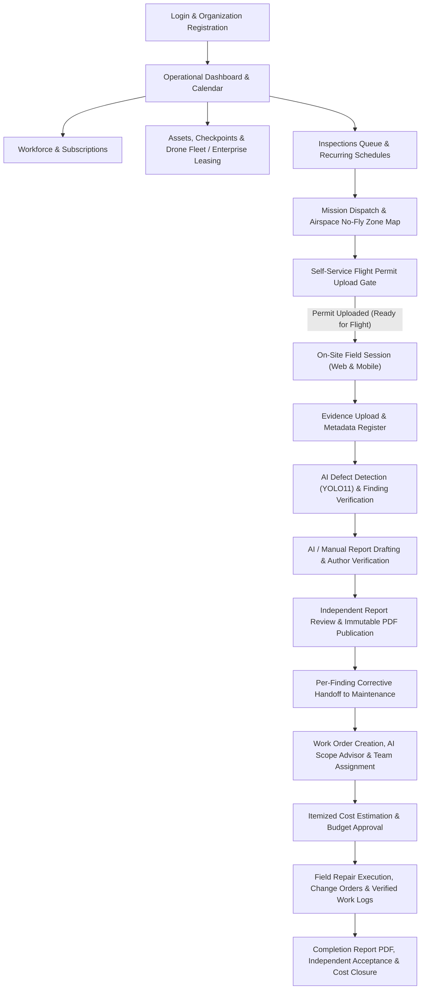

## 3. Functional Requirements

### 3.1 System Functional Overview

The SmartDroneInspection platform provides a web portal and mobile application organized into **twelve product features (`FE-01` to `FE-12`)** that support the complete infrastructure inspection and maintenance workflow.

#### 3.1.1 Screens Flow



#### 3.1.2 Screen Descriptions

| # | Feature | Screen | Description |
| --- | --- | --- | --- |
| 1 | FE-01 | Organization Registration & Sign In | Allows a new customer organization to register a workspace and allows users to sign in on Web or Mobile. |
| 2 | FE-01 | Account Security & Session Control | Allows users to change their password, sign out of active devices, and switch between authorized portals. |
| 3 | FE-02 | Platform Users & Workforce Management | Allows Platform Admins to manage platform accounts, Organization Managers to manage staff accounts, and Inspectors to record their pilot license details. |
| 4 | FE-02 | Enterprise Subscriptions & Payment | Allows Organization Managers to request a subscription plan and pay online via PayPal, and allows Platform Managers to confirm bank transfer payments. |
| 5 | FE-03 | Asset Registry & Reference Documents | Allows Organization Managers to register infrastructure assets with map coordinates, inspection checkpoints, and reference documents, or archive completed assets. |
| 6 | FE-03 | Drone Fleet & Drone Leasing | Allows Organization Managers to manage owned drones and lease drones from the platform catalog, and allows Platform Managers to manage the leasable drone pool. |
| 7 | FE-04 | Recurring Inspection Schedules | Allows Organization Managers to set up weekly, monthly, or yearly inspection schedules and manage paused or blocked occurrences. |
| 8 | FE-04 | In-App Notification Inbox | Displays system alerts and reminders in a notification bell and inbox with unread counts and links to related records. |
| 9 | FE-05 | Inspection Queue & Mission Dispatch | Displays the list of inspections and allows Organization Managers to schedule new missions with an available Inspector and Drone. |
| 10 | FE-05 | Interactive Airspace & No-Fly Zone Map | Displays an interactive map on Web and Mobile showing Vietnam prohibited No-Fly Zones and Restricted Zones around asset and mission locations. |
| 11 | FE-06 | Flight Permit Upload | Allows the assigned Inspector to upload the aviation flight permit for an inspection so the mission becomes `Ready for Flight`. |
| 12 | FE-06 | Field Flight Session Workspace | Allows the assigned Inspector on Web or Mobile to record pre-flight safety notes and log the start, postponement, abort, or completion of a flight session. |
| 13 | FE-07 | Operational Analytics Dashboard | Displays summary cards, charts, and work queues tailored to the signed-in user's role. |
| 14 | FE-07 | Schedule Calendar & Preferences | Displays planned inspections on a Month, Week, or Agenda calendar and lets users switch between Light/Dark mode and English/Vietnamese. |
| 15 | FE-08 | Inspection Photo Gallery & Upload | Allows Inspectors to upload inspection photos, view capture times and map locations, add location notes, and remove unusable photos. |
| 16 | FE-08 | AI Defect Detection & Findings Review | Allows Inspectors to run `YOLO11` defect detection on photos, review suggested defects, add manual findings, and confirm the final findings list. |
| 17 | FE-09 | Inspection Report Drafting & Preview | Allows Inspectors to generate an AI-assisted or manual report draft, edit report sections, preview the PDF, and submit the report for review. |
| 18 | FE-09 | Report Review, Publication & Handoff | Allows an Organization Manager to approve or return a submitted report, publish the final PDF report, and forward defects that need repair to maintenance. |
| 19 | FE-10 | Maintenance Work Orders & Repair Advisor | Allows Organization Managers and Maintenance Engineers to create work orders from forwarded defects, get AI repair suggestions, assign the repair team, and plan tasks. |
| 20 | FE-11 | Cost Estimation & Change Orders | Allows Maintenance Engineers to submit itemized repair cost estimates and Change Orders, and allows Organization Managers to approve or reject them. |
| 21 | FE-11 | Field Repair Execution & Work Logs | Allows Maintenance Engineers on Web or Mobile to start repair work, log daily task hours and test results, verify work logs as Team Lead, and mark repair work complete. |
| 22 | FE-12 | Maintenance Acceptance & Cost Closure | Allows the Report Author to submit the completion report and allows an independent Organization Manager to accept the repair, record actual costs, and close the work order. |

#### 3.1.3 Screen Authorization

| Screen | Platform Admin | Platform Manager | Organization Manager | Inspector | Maintenance Engineer |
| --- | :---: | :---: | :---: | :---: | :---: |
| **Organization Registration, Sign In & Session Control (FE-01)** | X | X | X | X | X |
| - Sign In, Set Up Password & Manage Active Sessions | X | X | X | X | X |
| - Manage Platform User Accounts | X |  |  |  |  |
| **Workforce & Enterprise Subscriptions (FE-02)** | X | X | X | X |  |
| - Create & Manage Workforce Accounts (Inspector, Maintenance Engineer) |  |  | X |  |  |
| - Update Remote Pilot License Profile |  |  |  | X |  |
| - View Platform Subscription List | X | X |  |  |  |
| - Request Subscription & Pay Online via PayPal |  |  | X |  |  |
| - Confirm Bank Transfer Payment & Activate Subscription |  | X |  |  |  |
| **Asset Registry, Drone Fleet & Drone Leasing (FE-03)** | X | X | X | X | X |
| - Manage Standard Asset Categories | X |  |  |  |  |
| - Register, Edit, Attach Documents & Archive Organization Assets |  |  | X |  |  |
| - Manage Platform Drone Pool, Approve Lease & Reclaim Drone |  | X |  |  |  |
| - Request Drone Lease & Manage Customer Drone Fleet |  |  | X |  |  |
| - View Assigned Asset & Drone Information | X | X | X | X | X |
| **Recurring Schedules & Notification Inbox (FE-04)** | X | X | X | X | X |
| - Create, Pause, Resume, End Schedules & Retry/Skip Occurrences |  |  | X |  |  |
| - View Own Notification Inbox & Mark Notifications as Read | X | X | X | X | X |
| **Mission Dispatch & Airspace Advisory Map (FE-05)** | X |  | X | X |  |
| - Schedule One-Off Inspection & Assign Inspector and Drone |  |  | X |  |  |
| - View Interactive Airspace & No-Fly Zone Map | X |  | X | X |  |
| **Flight Permit Gate & Field Flight Sessions (FE-06)** |  |  | X | X |  |
| - Upload Mission Flight Permit (`Assigned` to `Ready for Flight`) |  |  | X | X |  |
| - Start, Postpone, Abort, Complete & Log Additional Field Sessions |  |  |  | X |  |
| **Operational Dashboard & Schedule Calendar (FE-07)** | X | X | X | X | X |
| - View Role-Scoped Operational Dashboard & Schedule Calendar | X | X | X | X | X |
| **Evidence Intake & AI Defect Detection (FE-08)** |  |  | X | X |  |
| - View Inspection Photo Gallery & Defect Findings |  |  | X | X |  |
| - Upload/Remove Photos, Run AI Analysis & Confirm Findings |  |  |  | X |  |
| **Inspection Report Authoring, Review & Handoff (FE-09)** | X |  | X | X | X |
| - Generate Draft, Edit Sections, Verify & Submit Report |  |  |  | X |  |
| - Approve/Return Report, Publish Final PDF & Forward Findings |  |  | X |  |  |
| **Maintenance Planning, AI Advisor & Team Assignment (FE-10)** | X |  | X |  | X |
| - Create Work Order & Assign Team / Independent Reviewer |  |  | X |  |  |
| - Use AI Repair Scope Advisor & Plan Maintenance Tasks |  |  | X |  | X |
| **Cost Estimation, Change Orders & Repair Execution (FE-11)** |  |  | X |  | X |
| - Submit Cost Estimate, Request Change Order & Log/Verify Work |  |  |  |  | X |
| - Approve or Reject Cost Estimate & Change Order |  |  | X |  |  |
| **Maintenance Completion, Acceptance & Cost Closure (FE-12)** |  |  | X |  | X |
| - Prepare, Verify & Submit Maintenance Completion Report |  |  |  |  | X |
| - Record Independent Acceptance, Reconcile Costs & Close Order |  |  | X |  |  |

#### 3.1.4 Non-Screen Functions

| # | Feature | System Function | Description |
| --- | --- | --- | --- |
| 1 | FE-01 | Sign-In & Session Protection | Protects user sign-in, keeps active sessions signed in across page refreshes, and temporarily locks accounts after repeated failed password attempts. |
| 2 | FE-02 / FE-03 | Online Payment Verification | Verifies completed PayPal payments before automatically activating a customer subscription or drone lease. |
| 3 | FE-04 | Recurring Inspection Generator | Automatically creates upcoming inspection missions 14 days in advance based on active weekly, monthly, or yearly schedules. |
| 4 | FE-04 | Upcoming Inspection Reminder | Automatically sends an in-app reminder 3 days before a scheduled inspection is due to start. |
| 5 | FE-04 | In-App Notification Service | Sends alerts to users' notification inboxes whenever an inspection, report, estimate, or work order requires their attention. |
| 6 | FE-05 | Schedule Conflict Checker | Checks Inspector and Drone schedules before creating or updating an inspection so the same person or drone is never double-booked. |
| 7 | FE-05 | Airspace Zone Checker | Calculates the distance between an asset or mission location and published Vietnam No-Fly Zones and Restricted Zones to display safety warnings. |
| 8 | FE-08 | Photo Validator & Location Reader | Checks that uploaded inspection photos are valid image files and reads the capture time and GPS location stored by the camera. |
| 9 | FE-08 | AI Defect Detection Service | Runs the `YOLO11` visual detection model on selected inspection photos to highlight candidate structural defects for the Inspector to review. |
| 10 | FE-09 | AI Report Drafting Service | Generates a draft inspection report from the asset's checkpoints, flight session notes, and confirmed defect findings. |
| 11 | FE-09 / FE-12 | PDF Report Generator | Generates official, uneditable PDF files for approved inspection reports and accepted maintenance completion reports so users can view and download them. |
| 12 | FE-10 / FE-12 | AI Repair Advisor & Re-Inspection Trigger | Suggests repair steps based on civil engineering standards when planning a work order, and automatically creates a follow-up inspection mission when a repair requires re-inspection. |

#### 3.1.5 Entity Relationship Diagram

```mermaid
%% title: Database Entity Relationship Diagram (ERD)
erDiagram
  organizations ||--o{ users : employs
  organizations ||--o{ subscriptions : holds
  subscriptions ||--o{ payment_transactions : settles
  organizations ||--o{ drones : owns
  organizations ||--o{ drone_leases : contracts
  platform_drones ||--o{ drone_leases : leased_via
  drone_leases ||--o| drones : provisions
  users ||--o{ drone_leases : requests
  organizations ||--o{ assets : owns
  asset_categories ||--o{ assets : categorizes
  assets ||--o{ asset_documents : attaches
  organizations ||--o{ audit_events : records
  organizations ||--o{ notifications : scopes
  users ||--o{ notifications : receives
  users ||--o{ auth_sessions : opens
  organizations ||--o{ inspections : owns
  assets ||--o{ inspections : undergoes
  users ||--o{ inspections : assigned_inspector
  drones ||--o{ inspections : assigned_drone
  organizations ||--o{ recurring_inspection_schedules : schedules
  assets ||--o{ recurring_inspection_schedules : recurs_for
  users ||--o{ recurring_inspection_schedules : default_inspector
  drones ||--o{ recurring_inspection_schedules : default_drone
  recurring_inspection_schedules ||--o{ schedule_occurrences : generates
  organizations ||--o{ schedule_occurrences : scopes
  inspections |o--o{ schedule_occurrences : fulfills
  recurring_inspection_schedules ||--o{ inspections : dispatches
  inspections ||--o{ field_sessions : executes
  inspections ||--o{ evidence : contains
  field_sessions ||--o{ evidence : captures
  inspections ||--o{ findings : records
  evidence ||--o{ findings : locates
  inspections ||--o{ inspection_reports : delivers
  organizations ||--o{ maintenance_work_orders : owns
  assets ||--o{ maintenance_work_orders : remediates
  users ||--o{ maintenance_work_orders : governs
  findings ||--o{ maintenance_work_orders : initiates
  inspection_reports ||--o{ maintenance_work_orders : references
  maintenance_work_orders ||--o{ maintenance_team_members : deploys
  maintenance_work_orders ||--o{ maintenance_tasks : deconstructs
  maintenance_work_orders ||--o{ maintenance_estimate_versions : projects
  maintenance_estimate_versions ||--o{ maintenance_cost_lines : itemizes
  maintenance_tasks ||--o{ maintenance_cost_lines : accrues
  maintenance_work_orders ||--o{ maintenance_change_orders : requests
  maintenance_tasks ||--o{ maintenance_work_logs : tracks
  maintenance_work_orders ||--o{ maintenance_reports : delivers
  maintenance_reports ||--o{ maintenance_acceptance_decisions : accepts
  organizations {
    uuid id PK
    uuid created_by_user_id FK
    timestamptz created_at
    timestamptz updated_at
    varchar legal_name
    varchar display_name
    varchar registration_code
    varchar timezone
    varchar status
    bigint row_version
  }
  users {
    uuid id PK
    uuid organization_id FK
    varchar email
    varchar normalized_email
    varchar full_name
    varchar password_hash
    varchar status
    varchar actor_zone
    integer auth_version
    integer failed_login_count
    timestamptz lockout_until
    boolean must_change_password
    timestamptz last_login_at
    varchar last_login_ip
    timestamptz created_at
    timestamptz updated_at
    boolean vision_fallback_enabled
    varchar phone_number
    varchar avatar_url
    varchar roles
    varchar pilot_license_number
    varchar pilot_license_class
    timestamptz pilot_license_expires_at
    varchar pilot_license_file_key
  }
  auth_sessions {
    uuid id PK
    uuid user_id FK
    varchar client_type
    varchar token_hash
    varchar previous_token_hash
    timestamptz issued_at
    timestamptz expires_at
    timestamptz revoked_at
    varchar revoked_reason
  }
  subscriptions {
    uuid id PK
    uuid organization_id FK
    uuid confirmed_by_user_id FK
    varchar plan_code
    integer billing_period_months
    numeric agreed_amount_usd
    varchar status
    timestamptz starts_at
    timestamptz ends_at
    varchar external_reference
    jsonb terms_snapshot
    timestamptz confirmed_at
    timestamptz created_at
    timestamptz updated_at
    bigint row_version
  }
  payment_transactions {
    uuid id PK
    uuid subscription_id FK
    varchar paypal_order_id
    varchar paypal_capture_id
    numeric amount
    varchar currency
    varchar status
    varchar payer_email
    timestamptz captured_at
    timestamptz created_at
    timestamptz updated_at
    bigint row_version
  }
  platform_drones {
    uuid id PK
    varchar serial_number
    varchar model
    varchar manufacturer
    jsonb payload_metadata
    numeric monthly_rate_usd
    varchar status
    varchar notes
    timestamptz created_at
    timestamptz updated_at
    bigint row_version
  }
  drone_leases {
    uuid id PK
    uuid platform_drone_id FK
    uuid organization_id FK
    uuid customer_drone_id FK
    uuid requested_by_user_id FK
    uuid confirmed_by_user_id FK
    integer lease_period_months
    numeric monthly_rate_usd
    numeric agreed_amount_usd
    varchar status
    timestamptz starts_at
    timestamptz ends_at
    timestamptz reclaimed_at
    varchar external_reference
    varchar paypal_order_id
    varchar paypal_capture_id
    timestamptz confirmed_at
    varchar notes
    timestamptz created_at
    timestamptz updated_at
    bigint row_version
  }
  drones {
    uuid id PK
    uuid organization_id FK
    uuid lease_id FK
    varchar serial_number
    varchar model
    varchar manufacturer
    jsonb payload_metadata
    varchar serviceability
    timestamptz last_maintenance_at
    timestamptz next_maintenance_at
    varchar notes
    varchar registration_number
    varchar registration_file_key
    timestamptz registration_expires_at
    timestamptz created_at
    timestamptz updated_at
    bigint row_version
    varchar ownership_type
    timestamptz lease_expires_at
  }
  asset_categories {
    uuid id PK
    varchar code
    varchar name
    varchar description
    boolean active
    timestamptz created_at
    timestamptz updated_at
    bigint row_version
  }
  assets {
    uuid id PK
    uuid organization_id FK
    uuid category_id FK
    varchar name
    varchar description
    numeric latitude
    numeric longitude
    varchar status
    timestamptz created_at
    timestamptz updated_at
    bigint row_version
    varchar asset_code
    jsonb location
    jsonb technical_profile
    jsonb inspection_items
  }
  asset_documents {
    uuid id PK
    uuid asset_id FK
    uuid uploaded_by_user_id FK
    varchar document_type
    varchar file_name
    varchar content_type
    bigint size_bytes
    character checksum_sha256
    varchar object_key
    date document_date
    timestamptz created_at
  }
  recurring_inspection_schedules {
    uuid id PK
    uuid organization_id FK
    uuid asset_id FK
    uuid created_by_user_id FK
    uuid inspector_id FK
    uuid drone_id FK
    timestamp anchor_date
    varchar timezone
    varchar recurrence_unit
    integer recurrence_interval
    bigint duration_seconds
    integer reminder_days
    timestamptz ends_at
    bigint next_occurrence
    varchar status
    timestamptz created_at
    timestamptz updated_at
    bigint row_version
  }
  schedule_occurrences {
    uuid id PK
    uuid schedule_id FK
    uuid organization_id FK
    uuid inspection_id FK
    bigint occurrence_index
    varchar occurrence_key
    timestamptz planned_start_at
    timestamptz planned_end_at
    varchar status
    varchar blocked_reason
    integer retry_count
    timestamptz reminder_sent_at
    timestamptz created_at
    timestamptz updated_at
    bigint row_version
  }
  inspections {
    uuid id PK
    uuid asset_id FK
    uuid organization_id FK
    uuid inspector_id FK
    uuid drone_id FK
    uuid recurring_schedule_id FK
    varchar status
    timestamptz created_at
    timestamptz updated_at
    bigint row_version
    timestamptz planned_start_at
    timestamptz planned_end_at
    varchar flight_permit_file_key
    varchar flight_permit_file_name
    timestamptz flight_permit_uploaded_at
    timestamptz findings_confirmed_at
    varchar findings_snapshot_hash
  }
  field_sessions {
    uuid id PK
    uuid inspection_id FK
    varchar status
    timestamptz started_at
    timestamptz ended_at
    varchar postponement_reason
    varchar abort_reason
    timestamptz created_at
    timestamptz updated_at
    bigint row_version
    varchar pre_flight_checklist_note
    varchar outcome_notes
  }
  evidence {
    uuid id PK
    uuid inspection_id FK
    uuid field_session_id FK
    varchar file_name
    varchar content_type
    bigint size_bytes
    varchar object_key
    timestamptz capture_time
    numeric latitude
    numeric longitude
    varchar location_description
    boolean is_deleted
    timestamptz created_at
  }
  findings {
    uuid id PK
    uuid inspection_id FK
    uuid evidence_id FK
    varchar finding_code
    varchar defect_label
    varchar severity
    jsonb bounding_box
    varchar technical_notes
    varchar recommended_action
    varchar status
    varchar model_name
    numeric confidence
    timestamptz forwarded_to_maintenance_at
    boolean is_deleted
    timestamptz created_at
  }
  inspection_reports {
    uuid id PK
    uuid inspection_id FK
    uuid reviewer_user_id FK
    integer version_no
    varchar status
    jsonb content_snapshot
    timestamptz submitted_at
    timestamptz reviewed_at
    varchar return_reason
    varchar rendered_object_key
    character rendered_checksum_sha256
    timestamptz published_at
    timestamptz created_at
  }
  repair_knowledge_chunks {
    uuid id PK
    varchar standard_code
    varchar title
    varchar category
    varchar defect_patterns
    text content
    varchar reference_url
    timestamptz created_at
  }
  notifications {
    uuid id PK
    uuid recipient_user_id FK
    uuid organization_id FK
    varchar event_type
    varchar channel
    varchar title
    varchar body
    varchar target_path
    varchar status
    integer attempt_count
    varchar last_error_code
    timestamptz sent_at
    timestamptz read_at
    timestamptz created_at
    varchar aggregate_type
    uuid aggregate_id
    varchar deduplication_key
  }
  audit_events {
    uuid id PK
    uuid organization_id FK
    uuid actor_user_id FK
    varchar action
    varchar aggregate_type
    uuid aggregate_id
    varchar before_status
    varchar after_status
    bigint aggregate_version
    varchar reason
    varchar trace_id
    jsonb safe_metadata
    timestamptz created_at
  }
  event_publication {
    uuid id PK
    text listener_id
    text event_type
    text serialized_event
    timestamptz publication_date
    timestamptz completion_date
    text status
    integer completion_attempts
    timestamptz last_resubmission_date
  }
  maintenance_work_orders {
    uuid id PK
    uuid organization_id FK
    uuid asset_id FK
    uuid source_report_version_id FK
    uuid source_finding_id FK
    uuid owner_user_id FK
    uuid budget_approver_user_id FK
    uuid team_lead_user_id FK
    uuid report_author_user_id FK
    uuid accepting_reviewer_user_id FK
    varchar status
    varchar priority
    timestamptz due_at
    varchar corrective_scope
    varchar acceptance_criteria
    timestamptz created_at
    timestamptz updated_at
    bigint row_version
  }
  maintenance_team_members {
    uuid id PK
    uuid work_order_id FK
    uuid engineer_user_id FK
    uuid assigned_by_user_id FK
    varchar member_role
    timestamptz effective_from
    timestamptz effective_until
    varchar reason
    boolean active
    timestamptz created_at
  }
  maintenance_tasks {
    uuid id PK
    uuid work_order_id FK
    uuid assigned_engineer_user_id FK
    integer task_number
    varchar name
    varchar method
    timestamptz planned_start_at
    timestamptz planned_end_at
    varchar acceptance_criteria
    varchar status
    timestamptz created_at
    timestamptz updated_at
    bigint row_version
  }
  maintenance_estimate_versions {
    uuid id PK
    uuid work_order_id FK
    uuid prepared_by_user_id FK
    uuid approved_by_user_id FK
    integer version_no
    varchar status
    timestamptz approved_at
    character currency
    numeric baseline_total
    varchar assumptions
    timestamptz created_at
  }
  maintenance_cost_lines {
    uuid id PK
    uuid work_order_id FK
    uuid estimate_version_id FK
    uuid task_id FK
    uuid entered_by_user_id FK
    varchar line_kind
    varchar state
    varchar description
    numeric quantity
    varchar unit
    numeric unit_rate
    numeric amount
    character currency
    timestamptz created_at
  }
  maintenance_change_orders {
    uuid id PK
    uuid work_order_id FK
    uuid requested_by_user_id FK
    uuid decided_by_user_id FK
    integer change_number
    varchar reason
    numeric proposed_delta
    varchar status
    timestamptz decided_at
    varchar decision_reason
    timestamptz created_at
    timestamptz updated_at
    bigint row_version
  }
  maintenance_work_logs {
    uuid id PK
    uuid work_order_id FK
    uuid task_id FK
    uuid engineer_user_id FK
    timestamptz started_at
    timestamptz ended_at
    numeric hours
    varchar as_left_condition
    varchar test_readings
    varchar status
    timestamptz created_at
    timestamptz updated_at
    bigint row_version
  }
  maintenance_reports {
    uuid id PK
    uuid work_order_id FK
    integer version_no
    varchar status
    timestamptz author_verified_at
    text content_snapshot
    varchar rendered_object_key
    character rendered_checksum_sha256
    timestamptz created_at
  }
  maintenance_acceptance_decisions {
    uuid id PK
    uuid work_order_id FK
    uuid report_version_id FK
    uuid reviewer_user_id FK
    varchar decision
    varchar technical_comments
    varchar acceptance_checklist
    varchar test_result
    timestamptz decided_at
  }
```



**Entities Description**

| # | Entity | Description |
| --- | --- | --- |
| 1 | Organization | Customer enterprise subscribing to the platform; groups and isolates all workforce, asset, fleet, inspection, and maintenance records. |
| 2 | User | User account for a Platform Admin, Platform Manager, Organization Manager, Inspector, or Maintenance Engineer, including remote pilot license details for Inspectors. |
| 3 | Authentication Session | Active sign-in session for a user across web and mobile devices. |
| 4 | Subscription | Enterprise subscription contract tracking billing duration (1 to 120 months), agreed price, accepted terms, and status (`Pending`, `Active`, `Past Due`, `Suspended`, `Expired`, `Cancelled`). |
| 5 | Payment Transaction | Online payment record linked to an enterprise subscription request. |
| 6 | Platform Drone | Leasable drone in the platform catalog with model, serial number, monthly lease rate, and status (`Available`, `Leased`, `Maintenance`, `Retired`). |
| 7 | Drone Lease | Drone lease contract between the platform and a customer organization tracking lease months, payment status, active dates, and return status. |
| 8 | Drone | Drone in a customer organization's fleet (`Owned` or `Leased`), tracking serial number, model, aviation registration expiry, and serviceability (`Active`, `Maintenance`, `Suspended`, `Retired`). |
| 9 | Asset Category | Standard infrastructure category (such as Bridge, Building, Power Tower, Wind Turbine, or Solar Facility) managed by the Platform Admin. |
| 10 | Asset | Physical infrastructure asset owned by an organization, including map coordinates and a list of standard inspection checkpoints. |
| 11 | Asset Document | Engineering drawing, specification, or reference document attached to an infrastructure asset. |
| 12 | Inspection | Scheduled inspection mission linking an asset, assigned Inspector, assigned Drone, planned time window, uploaded flight permit, and mission status. |
| 13 | Recurring Inspection Schedule | Repeating inspection rule (`Weekly`, `Monthly`, or `Yearly`) configured for an asset with a default Inspector and Drone. |
| 14 | Schedule Occurrence | Individual upcoming inspection occurrence (`Generated`, `Blocked`, or `Skipped`) created by a recurring schedule. |
| 15 | Field Session | On-site drone flight session logged for an inspection, recording pre-flight safety notes, start/end times, and session outcome (`Planned`, `In Progress`, `Field Completed`, `Postponed`, `Aborted`). |
| 16 | Evidence | Aerial photograph uploaded for an inspection, storing capture time, GPS coordinates, structural location notes, and active/retired status. |
| 17 | Finding | Defect record linked to an inspection photo, tracking AI-suggested candidates (`Pending`) and Inspector-confirmed defects (`Confirmed`) with severity and bounding box location. |
| 18 | Inspection Report | Versioned inspection report containing structured report sections, author and reviewer decisions, and the final published PDF file. |
| 19 | Maintenance Work Order | Repair project created from a forwarded inspection defect, tracking repair scope, acceptance criteria, assigned team roles, and work order status. |
| 20 | Maintenance Team Member | Maintenance Engineer assigned to a work order as `Team Lead`, `Report Author`, or `Team Member`. |
| 21 | Maintenance Task | Individual repair task within a work order specifying the repair method, target dates, assigned engineer, and task status. |
| 22 | Maintenance Estimate Version | Versioned cost estimate (`Draft`, `Submitted`, `Approved`, `Rejected`, `Superseded`) summarizing the planned repair budget. |
| 23 | Maintenance Cost Line | Itemized cost entry (`Labor`, `Material`, `Equipment`, `External Service`, `Other`, or `Contingency`) recorded as either an `Estimate` or `Actual` cost. |
| 24 | Maintenance Change Order | Request to adjust the approved repair scope or budget (`Draft`, `Awaiting Approval`, `Approved`, `Rejected`, `Returned`, `Superseded`) during field execution. |
| 25 | Maintenance Work Log | Daily repair log recording task hours, as-left structural condition, and test measurements, verified by the Team Lead. |
| 26 | Maintenance Report | Versioned maintenance completion report prepared by the Report Author and compiled into a final PDF upon acceptance. |
| 27 | Maintenance Acceptance Decision | Independent technical review decision (`Accepted`, `Rework Required`, or `Re-Inspection Required`) recorded by an Organization Manager. |
| 28 | Repair Knowledge Chunk | Reference civil engineering repair standard (`TCVN`, `EN`, `ISO`) used by the AI Repair Scope Advisor to suggest repair methods. |
| 29 | Notification | In-app alert delivered to a user's notification inbox (`Pending`, `Sent`, `Read`, `Failed`). |
| 30 | Audit Event | Historical log entry recording important user and workflow actions across the system. |
| 31 | Event Publication | Background system event record used to trigger reliable in-app notifications. |

---

### 3.2 FE-01 Authentication & Access Control

#### 3.2.1 Organization Registration & User Sign-In
- **Function trigger**: A customer representative opens the **Organization Registration** page and submits the form, or a user opens the **Sign In** screen on Web or Mobile and enters their email and password.
- **Function description**: Actors: All Roles (`Platform Admin`, `Platform Manager`, `Organization Manager`, `Inspector`, `Maintenance Engineer`). Allows a new customer organization to register a workspace with its first Organization Manager account after accepting the Terms of Service and Privacy Notice, and allows existing users to sign in to their assigned portal.
- **Screen layout**: Mock-up prototype of the `Organization Registration & User Sign-In` screen:

```mermaid
%% title: Screen Layout Placeholder - 3.2.1 Organization Registration & User Sign-In
```

- **Function Details**:
  - *Data & Validation*: Registration requires **Full Name**, **Work Email**, **Organization Name**, **Business Registration Code**, **Password**, and acceptance of the **Terms of Service** and **Privacy Notice**. Sign-in requires **Email** and **Password**.
  - *Business Rules*: Enforces `BR-01`, `BR-06`, `BR-38`, and `BR-40`. Self-registration creates only a customer Organization and its initial Organization Manager account.
  - *Normal Cases*: Valid registration creates the organization and manager account (`MSG05`) and redirects to the sign-in screen. Valid sign-in opens the user's home dashboard (or prompts for a new password if signing in with a temporary password for the first time).
  - *Abnormal Cases*: Missing fields, unaccepted policy checkboxes, or weak passwords show an inline error (`MSG02`, `MSG11`). Duplicate emails or registration codes are rejected. Entering a wrong password 5 times locks the account for 15 minutes (`MSG08`, `MSG09`).

#### 3.2.2 Session Management & Role-Based Access Control
- **Function trigger**: A signed-in user navigates between screens, resumes using the app on Web or Mobile, or clicks **Sign Out** / **Sign Out All Devices**.
- **Function description**: Actors: All Roles, `Automated System`. Keeps active users signed in while they work, signs them out when they choose **Sign Out** or when their password or role changes, and restricts every screen and record to the user's role and organization.
- **Screen layout**: Mock-up prototype of the `Account Security & Multi-Portal Access Control` screen:

```mermaid
%% title: Screen Layout Placeholder - 3.2.2 Session Management & Role-Based Access Control
```

- **Function Details**:
  - *Data & Validation*: Checks the signed-in user's session status, assigned role, and organization before opening any screen or saving any change.
  - *Business Rules*: Enforces `BR-01`, `BR-02`, `BR-03`, `BR-04`, `BR-29`, `BR-39`, and `BR-40`. Platform Admin and Platform Manager roles are kept separate, and customer users can access only their own organization's data.
  - *Normal Cases*: Authorized users move smoothly between screens in their portal. Clicking **Sign Out** ends the current session (`MSG06`), and **Sign Out All Devices** signs out all active web and mobile sessions.
  - *Abnormal Cases*: Expired sessions return the user to the sign-in screen (`MSG10`). Opening a page outside the user's role or organization shows an access-denied screen.

---

### 3.3 FE-02 Workforce & Subscription Management

#### 3.3.1 Workforce Provisioning & Pilot License Profile
- **Function trigger**: A `Platform Admin` opens **Platform Users** to add a platform or organization manager, an `Organization Manager` opens **Workforce** and clicks **Add Member**, or an `Inspector` opens **Account & Pilot License** to save their pilot license details.
- **Function description**: Actors: `Platform Admin`, `Organization Manager`, `Inspector`. Allows administrators to create and manage staff accounts with a temporary first-time password, and allows Inspectors to record their remote pilot license information for flight readiness checks.
- **Screen layout**: Mock-up prototype of the `Workforce Provisioning & Pilot License Profile` screen:

```mermaid
%% title: Screen Layout Placeholder - 3.3.1 Workforce Provisioning & Pilot License Profile
```

- **Function Details**:
  - *Data & Validation*: Staff creation requires **Full Name**, **Email**, and **Role** (`Inspector` or `Maintenance Engineer`). Pilot license profile requires **License Number**, **License Class**, **Expiration Date**, and **Certificate File**.
  - *Business Rules*: Enforces `BR-02`, `BR-03`, `BR-05`, `BR-40`, and `BR-41`. Organization Managers can create only `Inspector` and `Maintenance Engineer` accounts within their own organization.
  - *Normal Cases*: Adding a staff member creates an `Active` account with a one-time temporary password (`MSG05`). Saving pilot license details updates the Inspector's profile (`MSG06`, `MSG27`).
  - *Abnormal Cases*: Duplicate emails within the same organization or attempts to assign administrative roles through the workforce screen are rejected.

#### 3.3.2 Enterprise Subscription & Online Payment
- **Function trigger**: An `Organization Manager` opens **Subscriptions** to request a subscription plan or pay via PayPal, or a `Platform Manager` opens **Subscriptions** in the Admin Portal and clicks **Confirm Payment**.
- **Function description**: Actors: `Organization Manager`, `Platform Manager`, `Online Payment Gateway`. Manages customer subscription plans (1, 6, 12, or custom 1–120 months) and activates organization workspace access once bank transfer or online PayPal payment is confirmed.
- **Screen layout**: Mock-up prototype of the `Enterprise Subscription & Online Payment` screen:

```mermaid
%% title: Screen Layout Placeholder - 3.3.2 Enterprise Subscription & Online Payment
```

- **Function Details**:
  - *Data & Validation*: Subscription request requires **Billing Period (1–120 months)**, **Terms Acceptance**, and optional **Proposed Price / Notes**. Bank transfer confirmation requires **Payment Reference** and **Confirmed Amount (USD)**.
  - *Business Rules*: Enforces `BR-01`, `BR-06`, `BR-10`, `BR-11`, `BR-13`, and `BR-29`. Each organization has at most one `Active` subscription at a time; activating a renewal automatically marks the previous subscription `Expired`.
  - *Normal Cases*: Requesting a plan creates a `Pending` subscription (`MSG29`). When the Platform Manager confirms bank transfer payment (or PayPal checkout completes), the subscription becomes `Active` (`MSG35`, `MSG47`).
  - *Abnormal Cases*: Unverified online payments, duplicate payment references, or attempts by a Platform Admin to confirm payments are rejected (`MSG48`).

---

### 3.4 FE-03 Asset & Drone Fleet Management

#### 3.4.1 Infrastructure Asset & Document Management
- **Function trigger**: An `Organization Manager` opens **Assets** and clicks **New Asset**, uploads a file under **Asset Documents**, or clicks **Complete & Archive Asset**.
- **Function description**: Actors: `Organization Manager`, `Platform Admin` (manages asset categories). Maintains the organization's list of infrastructure assets (bridges, buildings, towers, solar/wind sites) with map coordinates, standard inspection checkpoints, and reference documents, and archives retired assets.
- **Screen layout**: Mock-up prototype of the `Infrastructure Asset & Document Management` screen:

```mermaid
%% title: Screen Layout Placeholder - 3.4.1 Infrastructure Asset & Document Management
```

- **Function Details**:
  - *Data & Validation*: Requires a unique **Asset Code**, **Asset Name**, **Category**, **Latitude / Longitude**, **Address**, and **Inspection Checkpoints** (components to inspect). Attached documents accept `PDF`, `PNG`, or `JPEG` files up to `10 MB`.
  - *Business Rules*: Enforces `BR-02` and `BR-42`. Duplicate files on the same asset are prevented. Archiving an asset marks it `Retired` so no new edits or schedules can be added while keeping past inspection records readable.
  - *Normal Cases*: Saving an asset registers it as `Active` (`MSG05`). Uploading a document attaches it for download. Archiving transitions the asset from `Active` to `Retired` (`MSG06`).
  - *Abnormal Cases*: Duplicate asset codes, duplicate files on the same asset, or attempts to edit or schedule a `Retired` asset are rejected.

#### 3.4.2 Drone Inventory & Drone Equipment Leasing
- **Function trigger**: An `Organization Manager` opens **Fleet & Drone Leasing** to add an owned drone or request a drone lease, or a `Platform Manager` opens **Drone Leasing** in the Admin Portal to add pool drones, confirm lease payment, or reclaim a leased drone.
- **Function description**: Actors: `Organization Manager`, `Platform Manager`, `Online Payment Gateway`. Manages owned and leased drones in the customer's fleet, tracks serial numbers, registration expiry dates, and serviceability status (`Active`, `Maintenance`, `Suspended`, `Retired`), and handles drone equipment leasing from the platform catalog.
- **Screen layout**: Mock-up prototype of the `Drone Inventory & Drone Equipment Leasing` screen:

```mermaid
%% title: Screen Layout Placeholder - 3.4.2 Drone Inventory & Drone Equipment Leasing
```

- **Function Details**:
  - *Data & Validation*: Owned drone registration requires **Serial Number**, **Model**, **Status**, and optional **Registration Number & Expiry Date**. Leasing requires selecting an **Available Pool Drone**, **Lease Duration (1–60 months)**, and **Terms Acceptance**.
  - *Business Rules*: Enforces `BR-01`, `BR-11`, `BR-29`, and `BR-41`. Only `Available` platform drones can be leased, and only `Active` customer drones can be assigned to inspections.
  - *Normal Cases*: Confirming payment on a `Pending` lease marks the lease `Active`, marks the platform drone `Leased`, and automatically adds the drone to the customer's fleet as an `Active` leased drone. Reclaiming a finished lease marks the lease `Reclaimed`, retires the customer drone record, and returns the platform drone to `Available`.
  - *Abnormal Cases*: Requesting a drone that is already `Leased` or in `Maintenance`, or trying to reactivate a reclaimed leased drone, is rejected.

---

### 3.5 FE-04 Recurring Schedule & Notifications

#### 3.5.1 Recurring Inspection Schedule Management
- **Function trigger**: An `Organization Manager` opens the **Recurring Schedules** tab and clicks **Create Recurring Schedule**, pauses/resumes/ends a schedule, or clicks **Retry** / **Skip** on a `Blocked` occurrence.
- **Function description**: Actors: `Organization Manager`, `Automated System`. Sets up repeating weekly, monthly, or yearly inspection schedules for an asset and automatically creates upcoming inspection missions 14 days in advance.
- **Screen layout**: Mock-up prototype of the `Recurring Inspection Schedule Management` screen:

```mermaid
%% title: Screen Layout Placeholder - 3.5.1 Recurring Inspection Schedule Management
```

- **Function Details**:
  - *Data & Validation*: Requires **Asset**, **Default Inspector**, **Default Drone**, **Start Date & Time**, **Timezone**, **Recurrence Unit** (`Week`, `Month`, `Year`), **Interval (1–120)**, **Duration**, and **Reminder Lead Days (0–30)**.
  - *Business Rules*: Enforces `BR-09`. Each asset can have at most one `Active` recurring schedule at a time.
  - *Normal Cases*: Creating a schedule marks it `Active` (`MSG05`). When an upcoming date is within 14 days and the assigned Inspector and Drone are available, the system automatically creates an `Assigned` inspection and marks the occurrence `Generated`. The manager can **Pause**, **Resume**, or **End** the schedule at any time.
  - *Abnormal Cases*: If the assigned Drone is in `Maintenance`, the Inspector's pilot license is expired, or a schedule conflict exists, the occurrence is marked `Blocked` with the reason shown so the manager can fix the issue and click **Retry** (or **Skip**).

#### 3.5.2 Event-Driven In-App Notifications
- **Function trigger**: A workflow event occurs (such as a new inspection assignment, a 3-day upcoming inspection reminder, a budget approval, or a report decision), or a user clicks the **Notification Bell**.
- **Function description**: Actors: All Roles, `Automated System`. Sends alerts to the user's in-app notification inbox with an unread badge count, mark-as-read action, and direct link to the relevant screen.
- **Screen layout**: Mock-up prototype of the `Event-Driven In-App Notifications` screen:

```mermaid
%% title: Screen Layout Placeholder - 3.5.2 Event-Driven In-App Notifications
```

- **Function Details**:
  - *Data & Validation*: Shows **Title**, **Message**, **Category**, **Time**, and **Read / Unread** status, with an **Unread Only** filter.
  - *Business Rules*: Enforces `BR-39`. Users can view and mark only their own notifications, and duplicate reminders for the same event are prevented.
  - *Normal Cases*: Clicking a notification marks it `Read`, updates the unread counter, and opens the linked inspection, report, or work order screen.
  - *Abnormal Cases*: If a user clicks an old notification for a record they no longer have permission to view, access is blocked (`BR-39`).

---

### 3.6 FE-05 Mission Dispatch & Airspace Advisory

#### 3.6.1 Inspection Mission Scheduling & Conflict Check
- **Function trigger**: An `Organization Manager` clicks **Create Inspection** on the **Inspections** or **Assets** page, selects the asset, Inspector, Drone, and planned time window, and submits the form.
- **Function description**: Actors: `Organization Manager`, `Automated System`. Creates a one-off inspection mission, assigns an active Inspector and Drone, checks that neither is already booked during that time window, and notifies the Inspector.
- **Screen layout**: Mock-up prototype of the `Inspection Mission Scheduling & Conflict Check` screen:

```mermaid
%% title: Screen Layout Placeholder - 3.6.1 Inspection Mission Scheduling & Conflict Check
```

- **Function Details**:
  - *Data & Validation*: Requires **Asset**, **Assigned Inspector**, **Assigned Drone**, **Planned Start Time**, and **Planned End Time**.
  - *Business Rules*: Enforces `BR-02`, `BR-04`, `BR-09`, `BR-15`, and `BR-38`. Both the asset and drone must be `Active`.
  - *Normal Cases*: Creates the inspection in `Assigned` status (`MSG12`), copies the asset's coordinates and inspection checkpoints to the mission, and sends an in-app notification to the assigned Inspector.
  - *Abnormal Cases*: If the Inspector or Drone already has another overlapping inspection during the selected time window, the system rejects the booking and displays the conflict.

#### 3.6.2 Interactive Airspace & No-Fly Zone Map
- **Function trigger**: An `Organization Manager` or `Inspector` views the **Airspace & No-Fly Zone Map** while creating or viewing an asset or preparing an inspection mission on Web or Mobile.
- **Function description**: Actors: `Organization Manager`, `Inspector`, `Automated System`. Displays an interactive map showing published Vietnam prohibited (`No-Fly Zone`) and restricted (`Restricted Zone`) airspace areas and checks how close the asset or mission location is to those zones.
- **Screen layout**: Mock-up prototype of the `Interactive Airspace & No-Fly Zone Map` screen:

```mermaid
%% title: Screen Layout Placeholder - 3.6.2 Interactive Airspace & No-Fly Zone Map
```

- **Function Details**:
  - *Data & Validation*: Evaluates **Latitude** (`-90..90`) and **Longitude** (`-180..180`) from the asset or map pin.
  - *Business Rules*: Enforces `BR-08` and `BR-41`. Shows whether the location is in a `No-Fly Zone`, `Restricted Zone`, or `Clear Airspace` along with warning `MSG28` and a reference link to `https://cambay.mod.gov.vn`.
  - *Normal Cases*: Highlights prohibited zones in red and restricted buffer zones in amber on the map (and on the mobile airspace card) and lists the nearest zones by distance.
  - *Abnormal Cases*: Coordinates outside valid geographic ranges show a validation error.

---

### 3.7 FE-06 Flight Readiness & Field Execution

#### 3.7.1 Flight Permit Upload & Readiness Gate
- **Function trigger**: The assigned `Inspector` opens an `Assigned` inspection on Web or Mobile and uploads the aviation flight permit file.
- **Function description**: Actors: `Inspector`, `Organization Manager`, `Automated System`. Checks that the assigned Inspector has a valid, unexpired remote pilot license, saves the uploaded flight permit document, and automatically updates the inspection status from `Assigned` to `Ready for Flight`.
- **Screen layout**: Mock-up prototype of the `Flight Permit Upload & Readiness Gate` screen:

```mermaid
%% title: Screen Layout Placeholder - 3.7.1 Flight Permit Upload & Readiness Gate
```

- **Function Details**:
  - *Data & Validation*: Requires a **Flight Permit File** (`PDF`, `PNG`, or `JPEG`, up to `10 MB`).
  - *Business Rules*: Enforces `BR-04`, `BR-05`, `BR-08`, `BR-15`, `BR-38`, and `BR-41`. The Inspector's pilot license must not be expired on the planned flight date, and the assigned drone must be `Active`.
  - *Normal Cases*: Saves the permit file and transitions the inspection from `Assigned` to `Ready for Flight` (`MSG27`), unlocking the field session screen.
  - *Abnormal Cases*: If the Inspector's pilot license is missing or expired, the upload is blocked (`MSG26`, `MSG37`) and the mission stays `Assigned`.

#### 3.7.2 On-Site Field Flight Session Logging
- **Function trigger**: The assigned `Inspector` opens the **Field Session** screen on Mobile or Web and clicks **Start Session**, **Postpone Session**, **Abort Session**, **Complete Session**, or **Start Additional Session**.
- **Function description**: Actors: `Inspector`. Displays the asset's inspection checkpoints, records pre-flight safety notes, and logs the start, postponement, abort, or completion of on-site flight sessions.
- **Screen layout**: Mock-up prototype of the `On-Site Field Flight Session Logging` screen:

```mermaid
%% title: Screen Layout Placeholder - 3.7.2 On-Site Field Flight Session Logging
```

- **Function Details**:
  - *Data & Validation*: Starting requires a **Pre-Flight Safety Checklist Note**. Completing requires **Outcome Notes**. Postponing or aborting requires a **Reason**.
  - *Business Rules*: Enforces `BR-04`, `BR-07`, `BR-14`, `BR-16`, `BR-37`, and `BR-42`. Only one session can be `In Progress` at a time for an inspection.
  - *Normal Cases*: **Start Session** moves the inspection from `Ready for Flight` to `In Progress`. **Complete Session** moves the session and inspection to `Field Completed`. **Postpone Session** returns the inspection to `Ready for Flight` to resume later. An Inspector can also start an additional session from `Field Completed` if more photos are needed.
  - *Abnormal Cases*: Starting a session without an uploaded flight permit (`MSG37`) or without a pre-flight safety note (`MSG02`, `MSG32`) is blocked.

---

### 3.8 FE-07 Operational Dashboard & Schedule Calendar

#### 3.8.1 Multi-Role Operational Analytics Dashboard
- **Function trigger**: A signed-in user opens the **Dashboard** or the **Inspections / Reports** list in their portal.
- **Function description**: Actors: All Roles. Displays role-specific summary cards, charts (asset health, mission status, confirmed defect severity, maintenance budget), and paginated work queues.
- **Screen layout**: Mock-up prototype of the `Multi-Role Operational Analytics Dashboard` screen:

```mermaid
%% title: Screen Layout Placeholder - 3.8.1 Multi-Role Operational Analytics Dashboard
```

- **Function Details**:
  - *Data & Validation*: Supports keyword search, status filters, and page navigation.
  - *Business Rules*: Enforces `BR-01`, `BR-02`, `BR-04`, and `BR-21`. Unconfirmed (`Pending`) AI defect suggestions are excluded from official defect totals.
  - *Normal Cases*: Shows platform-wide metrics for Platform Admins and Platform Managers, organization-wide metrics for Organization Managers, and assigned work queues for Inspectors and Maintenance Engineers.
  - *Abnormal Cases*: Searches with no matching records display `MSG01`.

#### 3.8.2 Inspector Schedule Calendar & Localization
- **Function trigger**: A user opens the **Schedule Calendar** view (`Month`, `Week`, or `Agenda`), clicks a scheduled inspection on the calendar, or switches the **Language (`EN` / `VI`)** or **Theme (`Light` / `Dark`)** toggle.
- **Function description**: Actors: `Inspector`, `Organization Manager`, All Roles. Displays scheduled inspections on an interactive calendar with a quick-detail popup, and allows users to switch between Light/Dark mode and English/Vietnamese interface languages.
- **Screen layout**: Mock-up prototype of the `Inspector Schedule Calendar & Localization` screen:

```mermaid
%% title: Screen Layout Placeholder - 3.8.2 Inspector Schedule Calendar & Localization
```

- **Function Details**:
  - *Data & Validation*: Calendar view (`Month`, `Week`, `Agenda`), date navigation (`Previous`, `Today`, `Next`), status filter, language (`EN` / `VI`), and theme (`Light` / `Dark`).
  - *Business Rules*: Enforces `BR-02` and `BR-04`. Switching language translates menus, buttons, and system messages while keeping user-written notes unchanged.
  - *Normal Cases*: Renders planned inspections on their scheduled dates and opens the mission summary dialog when clicked.

---

### 3.9 FE-08 Evidence Management & AI Defect Detection

#### 3.9.1 Inspection Evidence Upload & Metadata Management
- **Function trigger**: The assigned `Inspector` opens the **Evidence** screen on Web or Mobile and uploads inspection photos, edits location notes, filters the gallery, or removes unusable photos.
- **Function description**: Actors: `Inspector` (upload and manage), `Organization Manager` (view). Stores inspection photographs, reads capture time and GPS coordinates from the photo, prevents duplicate filenames in the same inspection, and allows retiring blurry or unusable photos.
- **Screen layout**: Mock-up prototype of the `Inspection Evidence Upload & Metadata Management` screen:

```mermaid
%% title: Screen Layout Placeholder - 3.9.1 Inspection Evidence Upload & Metadata Management
```

- **Function Details**:
  - *Data & Validation*: Accepts `JPEG` and `PNG` image files (up to `10 MB` per photo / `20 MB` per upload) with optional **Field Session**, **Latitude / Longitude**, and **Component Location Note**.
  - *Business Rules*: Enforces `BR-17`, `BR-18`, `BR-19`, and `BR-43`. Photos cannot be added, edited, or removed while the inspection report is `Submitted` or `Published`.
  - *Normal Cases*: Valid photos are saved and shown in the gallery with their capture time and GPS coordinates (`MSG18`). Retiring a photo moves it to the `Retired` tab while keeping it in history.
  - *Abnormal Cases*: Corrupt or oversized files (`MSG16`), duplicate filenames in the same inspection (`MSG17`), or attempts to retire a photo currently used by an active finding are rejected.

#### 3.9.2 AI Defect Detection & Finding Verification
- **Function trigger**: The assigned `Inspector` opens the **Findings** screen, clicks **AI Analyze** on selected photos, reviews the suggested defects (`Confirm`, `Edit`, `Remove`), adds manual findings, and clicks **Confirm Findings Set**.
- **Function description**: Actors: `Inspector`, `Automated System` (`YOLO11` AI Service and configured vision-capable LLM). Runs `YOLO11` visual detection on selected photos to suggest structural defects (`crack`, `leakage`, `abscission`, `corrosion`, `bulge`) with bounding boxes; if YOLO returns no detections, the configured vision-capable LLM used for report drafting analyzes the same photo as a fallback. The Inspector must review and confirm every suggestion, and the confirmed findings list is locked for report drafting.
- **Screen layout**: Mock-up prototype of the `AI Defect Detection & Finding Verification` screen:

```mermaid
%% title: Screen Layout Placeholder - 3.9.2 AI Defect Detection & Finding Verification
```

- **Function Details**:
  - *Data & Validation*: Each finding includes **Photo Reference**, **Defect Type**, **Severity** (`Low`, `Medium`, `High`, `Critical`), **Bounding Box**, **Technical Notes**, and **Recommended Action**. If no defects are found, the Inspector must check **Acknowledge Zero Defects**.
  - *Business Rules*: Enforces `BR-20`, `BR-21`, `BR-22`, and `BR-44`. AI suggestions start as `Pending` and must be confirmed or removed by the Inspector before the findings set can be finalized.
  - *Normal Cases*: **AI Analyze** displays `Pending` defect boxes on the photo. The Inspector confirms valid defects (`Pending` -> `Confirmed`) or adds manual findings, then clicks **Confirm Findings Set** (`MSG38`) to move the inspection from `Field Completed` to `Report Draft`.
  - *Abnormal Cases*: Finalizing the findings set while any `Pending` AI suggestion remains unreviewed is blocked. If both YOLO and the configured vision fallback are unavailable, `MSG19` is shown and the Inspector can enter findings manually.

---

### 3.10 FE-09 Inspection Reporting & Publication

#### 3.10.1 AI-Assisted & Manual Report Drafting
- **Function trigger**: The assigned `Inspector` opens the **Report** screen on a `Report Draft` inspection and clicks **Generate AI Draft** or **Create Manual Draft**, edits the report sections, previews the PDF, clicks **Verify Draft**, and clicks **Submit for Review**.
- **Function description**: Actors: `Inspector` (Report Author), `Automated System`. Creates a structured inspection report draft from the confirmed findings (using AI assistance or a manual template), provides a live PDF preview, and lets the Inspector verify and submit the report to an Organization Manager.
- **Screen layout**: Mock-up prototype of the `AI-Assisted & Manual Report Drafting` screen:

```mermaid
%% title: Screen Layout Placeholder - 3.10.1 AI-Assisted & Manual Report Drafting
```

- **Function Details**:
  - *Data & Validation*: Report sections include **Executive Summary**, **Methodology & Equipment**, **Conclusions & Recommendations**, **Overall Asset Condition**, **Coverage Assessment**, and **Limitations / Omissions**.
  - *Business Rules*: Enforces `BR-12`, `BR-23`, `BR-25`, `BR-44`, and `BR-48`. If the Inspector changes the findings after creating a draft, the old draft is marked outdated and must be refreshed before submission.
  - *Normal Cases*: **Verify Draft** moves the report from `Draft` to `Author Verified`, and **Submit for Review** moves it to `Submitted` (`MSG20`). The Inspector can also click **Withdraw** before manager review to make further edits.
  - *Abnormal Cases*: Submitting an outdated draft after findings were changed is blocked (`MSG13`, `MSG33`). If AI drafting is unavailable, `MSG39` is shown and manual drafting remains available.

#### 3.10.2 Report Review, PDF Publication & Maintenance Handoff
- **Function trigger**: An independent `Organization Manager` opens a `Submitted` report to click **Approve** or **Return**, clicks **Publish PDF**, and then selects which defects to send to maintenance in the **Maintenance Handoff** panel.
- **Function description**: Actors: `Organization Manager` (Independent Reviewer), `Automated System`. Requires an Organization Manager who did not write the report to review and approve it, generates the final uneditable PDF report, and forwards repair-required defects to maintenance (`Repair Pending`) or closes the inspection (`Completed`).
- **Screen layout**: Mock-up prototype of the `Report Review, PDF Publication & Maintenance Handoff` screen:

```mermaid
%% title: Screen Layout Placeholder - 3.10.2 Report Review, PDF Publication & Maintenance Handoff
```

- **Function Details**:
  - *Data & Validation*: Review requires **Approve** or **Return** (with a **Return Reason**). Maintenance handoff requires selecting the **Confirmed Defects** that need repair (or confirming that no repair is needed).
  - *Business Rules*: Enforces `BR-12`, `BR-24`, `BR-26`, `BR-27`, `BR-28`, `BR-31`, and `BR-38`. Published PDF reports cannot be edited; if an amendment is published later, the earlier published version is marked `Superseded` and kept in history.
  - *Normal Cases*: **Return** sends the report back to the Inspector (`Returned`, `MSG30`). **Approve** and **Publish PDF** generate the final PDF and mark the report `Published` (`MSG22`) and the inspection `Report Published`. Completing **Maintenance Handoff** moves the inspection to `Repair Pending` (if defects are forwarded) or `Completed` (if no repairs are needed).
  - *Abnormal Cases*: Returning a report without a reason (`MSG02`) or attempting to approve one's own report (`BR-24`) is blocked.

---

### 3.11 FE-10 Maintenance Planning & AI Scope Advisory

#### 3.11.1 Work Order Creation & AI Repair Scope Advisory
- **Function trigger**: A `Customer` opens **Maintenance Work Orders**, selects a confirmed defect from a published Inspection Report, optionally clicks **Suggest Repair Scope**, and submits the **Create Work Order** form.
- **Function description**: Actors: `Customer`, `Maintenance Engineer`, `Automated System`. Suggests recommended repair methods, acceptance criteria, and repair tasks based on civil engineering standards (`TCVN`, `EN`, `ISO`), and creates a new Maintenance Work Order linked to the defect and published inspection report.
- **Screen layout**: Mock-up prototype of the `Work Order Creation & AI Repair Scope Advisory` screen:

```mermaid
%% title: Screen Layout Placeholder - 3.11.1 Work Order Creation & AI Repair Scope Advisory
```

- **Function Details**:
  - *Data & Validation*: Requires **Forwarded Defect**, **Published Report Version**, **Priority** (`Low`, `Normal`, `High`, `Urgent`), **Due Date**, **Repair Scope**, and **Acceptance Criteria**.
  - *Business Rules*: Enforces `BR-31` and `BR-45`. Work orders can be created only by the Asset's `Customer` from confirmed defects that were published in an inspection report.
  - *Normal Cases*: **Suggest Repair Scope** fills in recommended repair steps and acceptance criteria from engineering standards. Submitting the form creates the work order in `Draft` status (`MSG05`).
  - *Abnormal Cases*: Creating a work order without required scope fields or from an unpublished finding is rejected (`MSG02`).

#### 3.11.2 Maintenance Team & Task Assignment
- **Function trigger**: A `Customer` opens a work order to assign the **Maintenance Team**, and the `Team Lead` adds repair tasks under the **Tasks** tab.
- **Function description**: Actors: `Customer`, `Maintenance Engineer` (`Team Lead`). Assigns the repair team (`Team Lead`, `Report Author`, `Team Members`), and breaks the repair scope down into planned tasks.
- **Screen layout**: Mock-up prototype of the `Maintenance Team & Task Assignment` screen:

```mermaid
%% title: Screen Layout Placeholder - 3.11.2 Maintenance Team & Task Assignment
```

- **Function Details**:
  - *Data & Validation*: Team assignment requires one **Team Lead**, one **Report Author**, and optional **Team Members**. Each task requires **Task Name**, **Repair Method**, **Acceptance Criteria**, **Planned Dates**, and **Assigned Engineer**.
  - *Business Rules*: Enforces `BR-45` and `BR-46`. The executing repair team members cannot approve their own estimates or make final customer acceptance decisions.
  - *Normal Cases*: Saving the team notifies the assigned engineers (`MSG06`), and adding tasks creates them in `Planned` status.
  - *Abnormal Cases*: Assigning engineers outside the Customer's organization scope is rejected (`MSG31`, `MSG44`).

---

### 3.12 FE-11 Cost Estimation & Repair Execution

#### 3.12.1 Cost Estimation, Budget Approval & Change Orders
- **Function trigger**: A `Maintenance Engineer` submits a **Cost Estimate** or **Change Order** on a work order, and the `Customer` clicks **Approve**, **Reject**, or **Return**.
- **Function description**: Actors: `Maintenance Engineer`, `Customer`. Manages itemized repair cost estimates (`Labor`, `Material`, `Equipment`, `Service`), requires Customer approval of the repair budget before work begins, and handles Change Orders when additional work or budget is needed.
- **Screen layout**: Mock-up prototype of the `Cost Estimation, Budget Approval & Change Orders` screen:

```mermaid
%% title: Screen Layout Placeholder - 3.12.1 Cost Estimation, Budget Approval & Change Orders
```

- **Function Details**:
  - *Data & Validation*: Each cost line requires **Category**, **Description**, **Quantity (`>= 0`)**, **Unit**, **Unit Price (`>= 0`)**, and **Currency**. Each Change Order requires **Reason** and **Proposed Budget Change**.
  - *Business Rules*: Enforces `BR-12`, `BR-32`, `BR-34`, `BR-36`, and `BR-47`. Approved Change Orders update the authorized budget ceiling while keeping the original approved estimate in history.
  - *Normal Cases*: Submitting an estimate moves the work order from `Draft` to `Awaiting Approval`. Customer approval moves it to `Approved` (`MSG34`) (or `Rework Required` if rejected). Submitting a Change Order places it in `Awaiting Approval` (`MSG23`) until the Customer decides.
  - *Abnormal Cases*: Negative quantities or prices (`MSG41`) or attempts by an engineer to approve their own estimate are rejected.

#### 3.12.2 Field Repair Execution & Work Log Verification
- **Function trigger**: A `Maintenance Engineer` opens an `Approved` work order on Web or Mobile, clicks **Release**, **Start Work**, and submits **Work Logs**; the `Team Lead` clicks **Verify Work Log** and **Declare Work Completed**.
- **Function description**: Actors: `Maintenance Engineer`, `Team Lead`. Tracks field repair progress from `Approved` -> `Ready` -> `In Progress` -> `Work Completed`, recording daily task hours, as-left conditions, and test readings verified by the Team Lead.
- **Screen layout**: Mock-up prototype of the `Field Repair Execution & Work Log Verification` screen:

```mermaid
%% title: Screen Layout Placeholder - 3.12.2 Field Repair Execution & Work Log Verification
```

- **Function Details**:
  - *Data & Validation*: Each work log requires **Task**, **Start / End Time**, **Hours Worked (`>= 0`)**, **As-Left Condition**, and **Test Readings**.
  - *Business Rules*: Enforces `BR-04`, `BR-16`, `BR-35`, and `BR-46`. Every submitted work log must be `Verified` by the Team Lead before the work order can be marked `Work Completed`.
  - *Normal Cases*: **Release** moves the work order to `Ready`, and **Start Work** moves it to `In Progress`. Engineers submit work logs (`Submitted`), the Team Lead verifies them (`Verified`), and **Declare Work Completed** moves the work order to `Work Completed` (`MSG42`).
  - *Abnormal Cases*: Marking the work order complete while any work log is still unverified is blocked (`MSG43`).

---

### 3.13 FE-12 Maintenance Acceptance & Cost Closure

#### 3.13.1 Maintenance Completion Reporting, Reinspection & Technical Acceptance
- **Function trigger**: The `Report Author` (`Maintenance Engineer`) verifies and submits the **Maintenance Completion Report** to the `Customer`. The `Customer` either accepts the repair, returns it for repair/supplement, or forwards a versioned report with selected defects to the `Manager` for a new reinspection mission.
- **Function description**: Actors: `Maintenance Engineer` (`Report Author`), `Customer`, `Manager`, `Inspector`. Submits the maintenance completion report for customer review. When reinspection is required, the Customer submits an explicit request to the platform Manager; the Manager assigns an Inspector and drone to execute an MF3 inspection; the Manager reviews and publishes the reinspection report; and the Customer makes an independent acceptance decision on the published result.
- **Screen layout**: Mock-up prototype of the `Maintenance Completion Reporting & Technical Acceptance` screen:

```mermaid
%% title: Screen Layout Placeholder - 3.13.1 Maintenance Completion Reporting & Technical Acceptance
```

- **Function Details**:
  - *Data & Validation*: Requires **Maintenance Report Version**, **Selected Defects to Verify**, **Customer Decision** (`Accepted`, `Repair Required`), **Comments**, and independent inspection report publication.
  - *Business Rules*: Enforces `BR-27`, `BR-28`, `BR-35`, `BR-37`, `BR-45`, and `BR-49`. Reinspection never auto-creates an inspection mission from an acceptance rejection; it requires an explicit Customer-to-Manager request and Manager assignment. If reinspection defects remain unresolved, the Customer returns the order to repair/supplement.
  - *Normal Cases*: Submitting the report moves the work order from `Work Completed` to `Awaiting Customer Acceptance`. Customer forwarding moves it to `Awaiting Reinspection`; Manager assignment moves it to `Reinspection in Progress`; MF3 publication moves it to `Awaiting Customer Acceptance`. If the Customer records `Accepted`, the order moves to `Accepted`. If the Customer records `Repair Required`, the order moves to `Repair Supplement Required` so engineers can resume work.
  - *Abnormal Cases*: Any attempt to reconcile costs or close a work order before published reinspection result and Customer acceptance is blocked (`MSG44`, `MSG45`).

#### 3.13.2 Cost Reconciliation & Work Order Closure
- **Function trigger**: A `Customer` opens an `Accepted` work order, enters the **Actual Cost Lines**, clicks **Reconcile Costs**, and clicks **Close Work Order**.
- **Function description**: Actors: `Customer`. Records the actual labor, material, equipment, and service costs spent on the repair, compares actual spending against the approved budget, and closes the work order.
- **Screen layout**: Mock-up prototype of the `Cost Reconciliation & Work Order Closure` screen:

```mermaid
%% title: Screen Layout Placeholder - 3.13.2 Cost Reconciliation & Work Order Closure
```

- **Function Details*:
  - *Data & Validation*: Requires itemized **Actual Cost Lines** (`Category`, `Description`, `Quantity >= 0`, `Unit`, `Unit Price >= 0`, `Currency`).
  - *Business Rules*: Enforces `BR-12`, `BR-36`, `BR-38`, and `BR-47`. A work order can be closed only after customer technical acceptance (`Accepted`) and cost reconciliation (`Cost Reconciled`) are both completed.
  - *Normal Cases*: Saving actual costs calculates the budget variance and moves the work order from `Accepted` to `Cost Reconciled`. Clicking **Close Work Order** moves the work order to `Closed` (`MSG25`).
  - *Abnormal Cases*: Attempting to close a work order before reconciling actual costs is blocked (`MSG45`).
