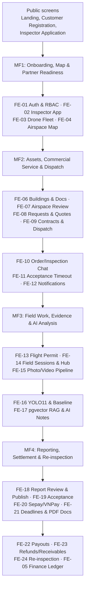
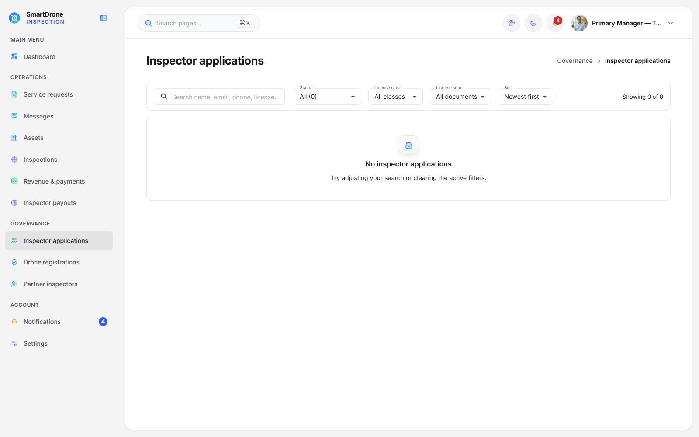
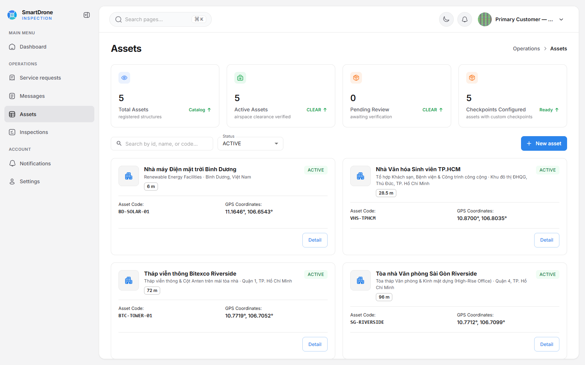
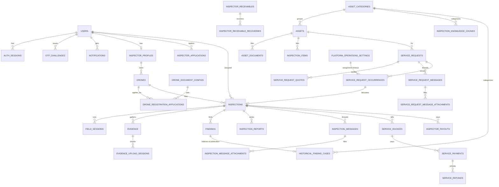

## 3. Functional Requirements

### 3.1 System Functional Overview

SmartDroneInspection delivers twenty-four atomic product features (`FE-01` to `FE-24`) organized under four connected main flows (`MF1` to `MF4`): identity, partner onboarding, airspace map & financial ledger (`FE-01`–`FE-05`); building assets, restricted-airspace decisions, service requests, quotations, signed agreements, dispatch, dual-channel messaging, acceptance timeouts & notifications (`FE-06`–`FE-12`); flight permits, live field sessions, evidence processing, AI defect detection & `DroneKnowledgeAI` RAG (`FE-13`–`FE-17`); and inspection report publication, acceptance, Sepay/VNPay checkout, payment documents, payouts, refunds & re-inspection verification (`FE-18`–`FE-24`, with `FE-05` surfacing financial ledgers across roles). The product scope is limited to **building structures**; every other infrastructure domain is excluded.

The service is delivered through four web portals, one per login role, and a Customer mobile application. Each portal exposes only the navigation sections its role may reach; a section a role may not use has no route at all rather than being hidden in the interface.

#### 3.1.1 Screens Flow

#### 3.1.2 Screen Descriptions

The screens below are the implemented application surfaces. Screenshots were captured from the running system with real project assets.

| # | Feature | Screen | Description |
| --- | --- | --- | --- |
| 1 | — | Public landing page | Introduces the service, its workflows, and the entry points to sign-in and registration. |
| 2 | FE-01, FE-04 | Customer organization registration | Two-step public form collecting the responsible person, organization identity, and initial building with interactive map coordinates for airspace screening. |
| 3 | FE-02 | Partner Inspector application | Public form collecting Inspector identity, pilot-licence details, and a licence scan for platform review. Accounts are created only after approval. |
| 4 | FE-01 | Sign-in | Credential sign-in with a one-time-code path and Google sign-in; routes the user to the portal for their role. |
| 5 | FE-01 | Password reset | Sends a one-time code and sets a new password. |
| 6 | FE-01 | Admin dashboard | Platform-wide counts of accounts, applications, buildings, and inspections, with recent activity. |
| 7 | FE-02, FE-03, FE-07 | Onboarding reviews | Queue of pending customer restricted-airspace cases, partner Inspector applications, and drone registration applications awaiting a platform decision. |
| 8 | FE-01 | Platform accounts | Administrator-managed account list with activation, deactivation, and forced-password-change actions. |
| 9 | FE-06 | Building asset catalogue | Maintains the six building categories available to Customers. |
| 10 | FE-02 | UAV licence classes | Maintains the pilot-licence classes used for assignment qualification. |
| 11 | FE-03 | Required drone documents | Maintains the set of registration, ownership, and technical-inspection documents an Inspector must supply. |
| 12 | FE-20, FE-21 | Finance settings | Maintains the platform commission, VAT, TNCN, and payment-due window settings used in settlement. |
| 13 | FE-08 | Admin service requests | Read-only assignment registry letting `ADMIN` assign, reassign, or unassign Manager request ownership. |
| 14 | FE-06 | Admin buildings | Platform-wide building list across all customer organizations. |
| 15 | FE-16 | AI settings | Maintains the system-wide AI configuration: automatic defect-confirmation threshold (`70%` default) and secondary vision fallback preference. |
| 16 | FE-14 | Manager dashboard | Workload summary for the Manager's claimed requests, inspections, and reports awaiting review. |
| 17 | FE-08, FE-09 | Manager service requests | Compact four-column queue (`Request & Asset`, `Schedule`, `Stage`, `Action`) with status chips and concise schedule ranges; claiming a request opens its commercial detail panel directly. |
| 18 | FE-10 | Manager messages | Dedicated inbox carrying the order-chat negotiation for assigned requests, with attachments. |
| 19 | FE-06 | Manager buildings | Building records across the customer organizations the Manager serves. |
| 20 | FE-09, FE-13, FE-14 | Manager inspections | Every inspection occurrence with its assignment, acceptance timeout state, inspector-uploaded permit status (read-only), and delivery state. |
| 21 | FE-18 | Manager reports | Report queue filtered to occurrences whose report is submitted for review or already published. |
| 22 | FE-02 | Partner inspectors | Inspector roster with partner status, pilot-licence class and expiry, and linked drone eligibility. |
| 23 | FE-14, FE-19 | Inspection workspace — tracking | Occurrence summary, lifecycle position, and the role-appropriate next action. |
| 24 | FE-13 | Inspection workspace — permit | Inspector self-attested permit upload with structured metadata, effective immediately once validation passes; Manager/Admin read-only view and audit trail. |
| 25 | FE-14 | Inspection workspace — pre-flight checklist | Configurable pre-flight safety checklist recorded before the session starts. |
| 26 | FE-14 | Inspection workspace — field session | Start, complete, or abort the on-site session with optional `SmartDroneHub` live MAVLink telemetry or log import. |
| 27 | FE-14 | Inspection workspace — post-flight checklist | Configurable post-flight checklist and target building checkpoint completion recorded at closure. |
| 28 | FE-15 | Inspection workspace — evidence | Photograph and video intake, resumable chunked MP4 upload, thumbnail review, and video keyframe extraction. |
| 29 | FE-16, FE-17, FE-24 | Inspection workspace — findings | Candidate defect proposals with confidence, confirmation filter chips, `DroneKnowledgeAI` `Draft note with AI` / batch `Draft all notes` + collapsed `References`, manual findings with bounding box, and three-way re-inspection verification. |
| 30 | FE-17, FE-18 | Inspection workspace — report | Report preparation, AI-drafted summary with `Matched Cases & Standards`, submission, and the published version. |
| 31 | FE-13, FE-14 | Inspection workspace — audit | Attributable permit upload and flight-session decision history for the occurrence. |
| 32 | FE-18, FE-22, FE-23 | Inspection workspace — review and settlement | Independent reviewer decision panel alongside the payout, refund, and receivable ledger. |
| 33 | FE-01, FE-14 | Customer dashboard | Summary of the organization's buildings, active requests, upcoming inspections, and outstanding payment. |
| 34 | FE-08, FE-09 | Customer service requests | Create a one-time or recurring request and follow it through quotation, acceptance, agreement, and occurrence dispatch. |
| 35 | FE-10 | Customer messages | Unified messages inbox toggling between Manager order-chat threads and assigned-Inspector per-inspection threads. |
| 36 | FE-04, FE-06 | Customer buildings | Building inventory with interactive airspace map, plain-text ownership details, inspection checkpoints, and uploaded reference documents. |
| 37 | FE-14, FE-24 | Customer inspections | Occurrences for the organization with progress, re-inspection creation, and verdict-expiry alerts. |
| 38 | FE-18, FE-19, FE-20, FE-21 | Customer reports | Published reports available for review, acceptance/clarification, notice/receipt PDF download, and Sepay/VNPay payment. |
| 39 | FE-01, FE-14 | Inspector dashboard | The Inspector's assigned workload, upcoming occurrences, and credential-expiry warnings. |
| 40 | FE-11, FE-14 | Inspector inspections | Assigned occurrences with accept/decline timeout status, readiness state, and entry into the inspection workspace. |
| 41 | FE-03 | My drones | Drone registration applications with photographs, capabilities, checklist items, and uploaded documents. |
| 42 | FE-12 | Notifications | In-app notices with read state, deduplicated per event. |
| 43 | FE-01 | Settings | Profile, security, and notification preferences for the signed-in user. |
| 44 | FE-05 | Financial history ledger | Role-scoped financial ledgers for the Customer (payments and receipts), Inspector (mission fees and net payouts), and Manager (platform revenue, commissions, and taxes). |

Figure 3.1 Public landing page.

Figure 3.2 Customer organization registration with initial building.

Figure 3.3 Public partner Inspector application.

Figure 3.4 Administrator dashboard.

Figure 3.5 Platform onboarding review queue.

Figure 3.6 Manager partner Inspector roster.

Figure 3.7 Manager service request queue.

Figure 3.8 Customer building inventory.

Figure 3.9 Inspection workspace findings review.

Figure 3.10 Manager report review and settlement.

#### 3.1.3 Screen Authorization

The matrix below states which roles may use each screen. A visible screen is not by itself permission to act: organization ownership, work assignment, qualification, and separation of duties are enforced in addition to role. A section a role may not use is not routed for that role at all. The last two rows record the data-scope rule that applies across every screen.

| Screen | `ADMIN` | `MANAGER` | `CUSTOMER` | `INSPECTOR` |
| --- | :---: | :---: | :---: | :---: |
| Public landing, registration, Inspector application | X | X | X | X |
| Sign-in, password reset, account settings | X | X | X | X |
| Dashboard | X | X | X | X |
| Onboarding reviews | X | X |  |  |
| Platform accounts | X | X |  |  |
| Partner inspectors roster |  | X |  |  |
| Building asset catalogue | X |  |  |  |
| UAV licence classes | X |  |  |  |
| Required drone documents | X |  |  |  |
| Finance settings / Operations settings / AI settings | X |  |  |  |
| Service requests | X | X | X |  |
| Messages (Order chat & Inspection chat) |  | X | X | X |
| Buildings | X | X | X |  |
| Inspections | X | X | X | X |
| Reports | X | X | X | X |
| Financial history ledger |  | X | X | X |
| My drones |  |  |  | X |
| Notifications | X | X | X | X |
| Query All Data | X | X |  |  |
| Query Own Data |  |  | X | X |

`Query All Data` means the role may list records across the whole platform or across every customer organization it serves. `Query Own Data` means the list is restricted to the acting user's own organization or own work assignment. `ADMIN` and `MANAGER` are additionally subject to the ownership and assignment rules in §5.1; a Manager sees only requests they hold, and an Inspector sees only occurrences assigned to them.

#### 3.1.4 Non-Screen Functions

These capabilities have no dedicated screen of their own; they run inside a user action, on a schedule, or in response to a domain event.

| # | Feature | System Function | Description |
| --- | --- | --- | --- |
| 1 | FE-01 | One-time-code issue and verify | Issues and validates short-lived codes for registration, sign-in, and password reset, with per-IP rate limiting. |
| 2 | FE-01 | Session issuance and refresh rotation | Issues access and refresh credentials, rotates the refresh token, and records the prior hash so a replayed token can be detected. |
| 3 | FE-02 | Pilot-licence expiry sweep | A scheduled job that flags Inspectors whose licence has lapsed and notifies them and the platform. |
| 4 | FE-04 | Airspace position screening | Compares a building's coordinates with the configured airspace zones and returns a prohibited, review-required, or clear outcome. |
| 5 | FE-06 | Building-inspection item seeding | Generates the default inspection checkpoints for a building from its category on registration and stores plain-text building ownership details. |
| 6 | FE-09 | Occurrence materialization | Creates the individual inspection occurrences covered by an accepted recurring agreement with month-end anchoring. |
| 7 | FE-09 | Schedule-conflict detection | Detects overlapping Inspector or drone commitments across all customer organizations before assignment. |
| 8 | FE-08, FE-09 | Quotation validity evaluation | Revalidates pilot licence and drone registration against every scheduled occurrence before a quote is saved or accepted. |
| 9 | FE-11 | Assignment acceptance timeout monitor | Scheduled job that automatically cancels unaccepted assignments after the administrator-configured response deadline, frees crew schedules, returns the occurrence for reassignment, and notifies the owning Manager. |
| 10 | FE-12 | Duplicate-notification suppression | Ensures retried lifecycle events produce at most one notification per intended recipient. |
| 11 | FE-13 | Permit re-upload required | Invalidates the inspector-uploaded permit and requires a fresh inspector upload when the drone is changed or the schedule moves outside the permit window. |
| 12 | FE-14 | Inspection lifecycle monitor | A scheduled job that advances or flags occurrences whose scheduled window has passed without the expected session activity. |
| 13 | FE-14 | Flight-log import and normalisation | Parses an imported SRT, CSV, KML, or GPX log and normalises available position, time, altitude, speed, heading, and battery values, marking absent fields as unavailable. |
| 14 | FE-15 | Image normalization and thumbnailing | Extracts available capture metadata, normalises oversized or rotated photographs, and generates a 480 px thumbnail alongside the original. |
| 15 | FE-15 | Asynchronous video processing | Converts uploaded inspection video into a web-playable format with a poster thumbnail in the background, retaining the original until processing succeeds. |
| 16 | FE-15 | Duplicate evidence disambiguation | Detects a repeated filename in an inspection and saves it with a sequential suffix rather than rejecting the upload. |
| 17 | FE-16 | Candidate defect inference | Runs the automated detection service (`YOLO11`) and optional vision fallback over evidence and records candidate defects with confidence scores (`70%` default auto-confirm setting). |
| 18 | FE-17 | Knowledge indexing & retrieval preparation | Indexes confirmed findings automatically when a report is published and maintains vector similarity search with keyword-matching fallback. |
| 19 | FE-17, FE-18 | Advisory narrative & note drafting + structured report compilation | Generates advisory finding notes or single-shot executive summary with matched references, while official report sections assemble consistently from confirmed findings. |
| 20 | FE-20 | Payment gateway callback verification | Verifies the caller (`Authorization: Apikey` or VNPay HMAC-SHA512) of a Sepay or VNPay callback before treating a payment as settled. |
| 21 | FE-21 | Invoice & overdue reminder scan | Captures commercial rate snapshots when a report is accepted, sets the payment due date, and sends a single overdue reminder without revoking report access. |
| 22 | FE-22, FE-23 | Payout hold & allocation reconciliation | Enforces refund holds on unpaid payouts, requires balanced refund allocations after external transfer, and tracks separate Inspector receivables for post-payout refunds. |

#### 3.1.5 Entity Relationship Diagram

The persisted model comprises 48 core application entities spanning identity, buildings, partner compliance, commercial workflows, field operations, evidence/AI analysis, reporting, and financial settlement (described technically in Report 4 §2). The diagram shows the principal entities and their relationships; configuration, gateway audit (`gateway_inbound_transactions`), split 1-to-1 operational tables (`inspection_flight_permits`, `field_session_telemetry`), and audit entities are listed in the Entities Description table below.

**Entities Description**

| # | Entity | Description |
| --- | --- | --- |
| 1 | `users` | Platform account with exactly one role, lockout and one-time-code state, and a per-user preference controlling whether advisory inference fallback may be used. |
| 2 | `auth_sessions` | Refresh session for a signed-in client, recording the current and previous refresh-token hashes so rotation and replay can be detected. |
| 3 | `otp_challenges` | Short-lived one-time code for registration, sign-in, or password reset, with attempt count and expiry. |
| 4 | `audit_events` | Attributable record of an important decision: actor, action, subject, prior and new status, trace identifier. |
| 5 | `prospective_customer_registrations` | Pre-account customer application holding organization identity, initial building, plain-text ownership details, and the airspace review outcome. |
| 6 | `pilot_license_classes` | Catalogue of pilot-licence classes used to qualify an Inspector for an aircraft weight category. |
| 7 | `event_publication` | Transactional event record coordinating reliable background lifecycle notifications. |
| 8 | `asset_categories` | Catalogue of the six building categories available to Customers. |
| 9 | `assets` | Customer-owned building with location, dedicated plain-text ownership details (up to 1,000 characters), structural specifications, and lifecycle state. |
| 10 | `asset_documents` | Reference document attached to a building, stored by object key with a checksum. |
| 11 | `inspection_items` | Individual inspection checkpoint defined for a building. |
| 12 | `checklist_templates` | Configurable pre-flight and post-flight checklist row. |
| 13 | `drones` | Registered aircraft with a single ownership scope, weight category, and serviceability state. |
| 14 | `drone_document_configs` | Administrator-configured set of documents an Inspector must supply for drone registration. |
| 15 | `drone_feature_configs` | Administrator-configured catalogue of drone features and safety checklist items. |
| 16 | `drone_registration_applications` | Inspector drone registration or renewal submission with its documents and review outcome. |
| 17 | `inspections` | Inspection occurrence: lifecycle status, assignment, clarification count, and schedule (linked 1-to-1 with `inspection_flight_permits`). |
| 18 | `field_sessions` | On-site session lifecycle status, pre-flight safety note, outcome notes, and abort/hung state (linked 1-to-1 with `field_session_telemetry`). |
| 19 | `evidence` | Photograph or video evidence with processing state, storage keys, and its source-video lineage. |
| 20 | `evidence_upload_sessions` | State of a resumable chunked upload for a large video. |
| 21 | `findings` | Confirmed or candidate building defect with its bounding region and the model confidence where applicable. |
| 22 | `inspection_reports` | Versioned inspection report with its status, return reason, and advisory summary. |
| 23 | `inspector_reliability_events` | Assignment and field reliability signal recorded against an Inspector. |
| 24 | `reinspection_defect_verifications` | Verification outcome recorded when a defect is re-examined in a later inspection (`Resolved`, `Unresolved`, or `Inconclusive`, plus verification and expiry dates). |
| 25 | `service_requests` | One-time or recurring inspection request raised for a building, with concise recurring title, owner customer, and assigned Manager. |
| 26 | `service_request_quotes` | VND quotation stating scope, timing, required drone features, and price per occurrence. Legacy nullable partner/drone references remain for historical rows only; current quotes choose the pair at dispatch. |
| 27 | `service_request_occurrences` | Individual occurrence covered by a request, carrying its own schedule and delivery state. |
| 28 | `service_request_messages` | Order-chat message exchanged between the Customer and the assigned Manager. |
| 29 | `service_request_message_attachments` | File attached to an order-chat message. |
| 30 | `service_invoices` | Service invoice derived from an accepted occurrence. |
| 31 | `service_payments` | Customer payment against an invoice, including active gateway order code and creation timestamp (`gateway_order_created_at`, `V67`), payment due date, overdue notice guard, refunded amount, and refund state. |
| 32 | `service_refunds` | Refund allocation across Inspector payout reduction, platform commission, VAT, personal income tax, and platform absorption. |
| 33 | `inspector_payouts` | Amount payable to an Inspector following verified customer payment. |
| 34 | `inspector_receivables` | Amount owed back by an Inspector after a refund against an already-disbursed payout. |
| 35 | `inspector_receivable_recoveries` | Recorded recovery of an Inspector receivable. |
| 36 | `inspection_finance_settings` | Singleton rates for platform commission, VAT, and personal income tax. |
| 37 | `inspector_applications` | Public partner Inspector application with identity, licence details, and review outcome. |
| 38 | `inspector_profiles` | Approved Inspector profile holding licence data and partner status. |
| 39 | `inspector_flight_logs` | Intake record for an imported flight log, including non-MAVLink source formats. |
| 40 | `notifications` | In-app or email notice with its deduplication key and read state. |
| 41 | `platform_ai_settings` | Singleton inference configuration holding the auto-confirm flag and its confidence threshold (`70%` default). |
| 42 | `platform_operations_settings` | Singleton operations configuration holding the Administrator-configurable assignment-acceptance timeout (24 hours by default). |
| 43 | `inspection_messages` | Inspector–Customer inspection chat message, scoped to the inspection and its organization. |
| 44 | `inspection_message_attachments` | File attached to an inspection chat message, scoped with its message. |
| 45 | `inspection_knowledge_chunks` | Engineering standard or guideline reference used by `DroneKnowledgeAI` for retrieval grounding across all organizations. |
| 46 | `historical_finding_cases` | Historical defect case indexed from a confirmed finding at report publication, or an anonymized benchmark case, isolated by organization and excluding the current inspection from self-matching. |
| 47 | `gateway_inbound_transactions` | Idempotent inbound payment-gateway webhook audit log (`V68`) recording gateway transaction ID, order code, transfer amount, receiving account, raw payload, outcome (`APPLIED`, `AMOUNT_MISMATCH`, `ORDER_NOT_FOUND`, `REJECTED`, `ERROR`), and detail. |
| 48 | `inspection_flight_permits` | Dedicated 1-to-1 mission flight-permit upload metadata and inspector self-attestation record split from `inspections` (`V69`). |
| 49 | `field_session_telemetry` | Dedicated 1-to-1 SmartDroneHub mission telemetry metrics, GPS flight-trace JSON, and synced flight-video reference split from `field_sessions` (`V69`). |

The table summarizes the domain's core persisted entities across identity, buildings, partner onboarding, commercial workflow, field operations, AI/knowledge retrieval, reporting, and financial settlement.

---

### 3.2 `MF1` — `FE-01` Account Authentication, OTP & 4-Role Access Control

- **Function trigger**: A prospective Customer registers an organization and its first building, a user signs in by password/OTP/Google, updates profile information, resets password, or ends an active session, or `ADMIN` manages platform accounts.
- **Actors**: All Roles (`ADMIN`, `MANAGER`, `CUSTOMER`, `INSPECTOR`); prospective Customer; automated identity service.
- **Function description**: Authenticate users securely across web and mobile portals, maintain refresh-token rotation and IP lockout controls, and enforce strict four-role access and scope separation across every route and endpoint.
- **Screen layout (mock-up)**: Public landing, customer registration, credential/OTP/Google sign-in, password reset, Admin platform accounts console, and Account settings (`Profile` / `Security` / `Notification` tabs). See Figure 3.2 and Figure 3.4.
- **Requirements**:
  - Recognized human login roles are `ADMIN`, `MANAGER`, `CUSTOMER`, and `INSPECTOR`. Every user holds exactly one role; deprecated maintenance roles are not active login roles.
  - Password sign-in locks an account for fifteen minutes after five consecutive failed attempts; sign-in and one-time-code actions enforce per-IP rate limiting.
  - Consolidated OTP challenges (registration, sign-in, password reset) expire after their window, enforce attempt caps, and reject reuse after consumption.
  - Federated Google OAuth 2.0 authenticates verified active accounts and issues a rotated user session for web portals or the mobile deep-link flow.
  - Authenticated users may update their own full name and phone number in Account Settings; email and role remain read-only. Security-sensitive changes (password change, deactivation, role update) revoke active sessions while retaining attributable history.
  - `CUSTOMER` access is restricted to its own organization, `INSPECTOR` to its own assigned occurrences and owned drones, `MANAGER` to claimed requests and platform work, and `ADMIN` to platform governance (without bypassing separation of duties or issuing quotes/reports). Denied sections present no routes or actions in web or mobile interfaces.
- **Normal cases**: Authorized users sign in with password + OTP or Google, land on their single role portal, manage profile/password/sessions cleanly, and cannot reach unauthorized portal paths.
- **Abnormal cases**: Repeated invalid credentials trigger temporary lockout; excessive request bursts are throttled; replayed sessions or consumed OTP codes are refused; cross-role or cross-organization access attempts are blocked (`BR-01`, `BR-02`).

---

### 3.3 `MF1` — `FE-02` Partner Inspector Application & Qualification Management

- **Function trigger**: A prospective partner Inspector submits a public application, or `ADMIN`/`MANAGER` reviews it, records the signed partner contract, or updates qualification records.
- **Actors**: Public applicant, `ADMIN`, `MANAGER`, `INSPECTOR`.
- **Function description**: Admit qualified partner drone pilots through a platform-reviewed self-service application (without requiring drone ownership at signup) and maintain pilot licence classes, expiry dates, scans, signed partner contracts, and flight logs.
- **Screen layout (mock-up)**: Multi-step public Inspector application form, Onboarding Reviews queue (`Inspector Applications` tab), Partner Inspectors roster, Admin UAV Licence Classes screen, and Inspector profile security/qualification panel. See Figure 3.3 and Figure 3.6.
- **Requirements**:
  - Public application collects identity, contact details, pilot-licence number, recognized licence class, future expiry date, and a verified licence scan stored in private object storage.
  - Submission creates no login account immediately. Only an attributable approval decision by `ADMIN` or `MANAGER` provisions an active `INSPECTOR` account and qualification profile together; rejection requires a written reason and notifies the applicant (`BR-09`).
  - Applicant emails must be unique across existing accounts and open pending applications.
  - Drone ownership is not a precondition of partner admission (`BR-08`). After admission, platform staff record the offline signed partner contract scan against the approved application, and Inspectors may renew licence details or record flight history logs.
  - A scheduled licence-expiry sweep checks active Inspector licences and flags lapsed credentials, sending duplicate-free alerts and blocking dispatch readiness until renewed (`BR-10`).
- **Normal cases**: A prospective Inspector submits complete licence details and scan; a reviewer inspects the scan, approves the application (provisioning the account), and records the signed partner contract.
- **Abnormal cases**: Duplicate email, missing/corrupt licence scan, expired licence at application time, unrecognized licence class, rejection without reason, or non-reviewer approval attempt is rejected.

---

### 3.4 `MF1` — `FE-03` Inspector-Owned Drone Registration & Fleet Management

- **Function trigger**: An approved `INSPECTOR` submits, renews, maintains, or retires an owned drone, or `ADMIN` configures required drone documents and capability checklists, or `MANAGER`/`ADMIN` reviews a pending drone application.
- **Actors**: `INSPECTOR`, `ADMIN`, `MANAGER`.
- **Function description**: Maintain administrator-configurable drone compliance rules and allow partner Inspectors to register owned drones with photographs, outdoor capabilities, and required documents for platform review prior to mission dispatch.
- **Screen layout (mock-up)**: Inspector `My drones` fleet inventory and registration modal, Onboarding Reviews `Drone Registrations` tab, and Admin Flight & Drone Configuration (`Required Documents` and feature checklist tabs). See Figure 3.5.
- **Requirements**:
  - `ADMIN` maintains required and optional drone compliance documents (registration and ownership documents active and required by default; technical inspection document configurable) and configurable drone capability/safety checklist items (`BR-11`).
  - Inspector submissions require identifying serial, model, and manufacturer data, at least one real aircraft photograph, outdoor flight capabilities (wind resistance, optical zoom, thermal/RTK), selected safety checklist items, and all required supporting documents.
  - Aircraft weight categories follow Decree 288/2025/ND-CP Article 4; airframes at `>= 2.0 kg` require the assigned Inspector to hold a recognized Class B pilot licence (Article 27), whereas Class A covers known airframes `< 2.0 kg`. Unknown weight or unknown licence class fails eligibility (`BR-12`).
  - Duplicate serial numbers belonging to another owner or submitting a second pending update while one is already pending review are rejected.
  - Inspectors may renew active drone registrations, switch serviceability between Active and In Maintenance, or permanently retire an aircraft (`Retired` is terminal). Only active, approved, non-expired drones owned by the assigned Inspector are selectable at dispatch (`BR-13`).
- **Normal cases**: `ADMIN` configures required documents; Inspector registers a `DJI` aircraft with real photos and required files; staff approve the drone, enabling assignment.
- **Abnormal cases**: Missing photo or required document, duplicate external serial, Class A pilot paired with heavy drone, expired registration, or retired serviceability blocks assignment.

---

### 3.5 `MF1` — `FE-04` Interactive Location Map & No-Fly Zone Airspace Screening

- **Function trigger**: A Customer pins an initial building location during organization signup or adds/edits a building, or any authorized user evaluates coordinates/altitude against Vietnam airspace zones.
- **Actors**: Public applicant, `CUSTOMER`, `ADMIN`, `MANAGER`, `INSPECTOR`, `SYSTEM`.
- **Function description**: Screen building and mission coordinates against platform-configured prohibited (`No-Fly Zone`), restricted (`Restricted Zone`), and clear (`Clear Zone`) airspace regions using interactive maps on Web and Mobile alongside server-side distance checks.
- **Screen layout (mock-up)**: Interactive coordinate picker modal on the Web portal, customer registration step-2 map preview, and mobile airspace advisory summary card. See Figure 3.2 and Figure 3.8.
- **Requirements**:
  - Airspace evaluation validates latitude (`[-90, 90]`) and longitude (`[-180, 180]`), measures proximity against active airspace polygons, and classifies locations into Clear Zone, Restricted Zone, or No-Fly Zone.
  - Coordinates falling inside a No-Fly Zone block self-service organization registration and building creation.
  - Coordinates in a Restricted Zone during signup place the registration into pending platform review (`FE-07`) with advisory warning `MSG28`.
  - Every UI surface explicitly states that airspace screening is an internal advisory check and does not grant statutory or military aviation clearance (`BR-06`, `BR-26`, `MSG49`).
- **Normal cases**: User selects coordinates on the interactive map, inspects live zone classification and buffers, and proceeds when outside prohibited airspace.
- **Abnormal cases**: Out-of-bounds coordinates fail validation; prohibited zone coordinates fail closed and never create an active building.

---

### 3.6 `MF4` — `FE-05` Financial History & Revenue/Payment Ledger

- **Function trigger**: An authenticated `CUSTOMER`, `INSPECTOR`, or `MANAGER` opens their role-scoped financial history view or inspects per-occurrence invoice/payment/payout summaries.
- **Actors**: `CUSTOMER`, `INSPECTOR`, `MANAGER`.
- **Function description**: Provide each non-admin operational role with a dedicated, permission-scoped financial ledger tracking Customer payments and downloadable receipts, Inspector net payouts and deductions, and Platform Manager revenue, commissions, VAT/TNCN taxes, and refund adjustments.
- **Screen layout (mock-up)**: Dedicated role-scoped Financial History ledger pages and occurrence financial detail panels across Customer, Inspector, and Manager portals.
- **Requirements**:
  - Customer view lists only occurrences belonging to the signed-in Customer's organization, displaying agreed VND totals, invoice/VAT breakdown, payment due date/status, gateway transaction reference, and receipt download actions, while hiding internal partner payout and receivable figures.
  - Inspector view lists only occurrences assigned to the signed-in Inspector, showing mission gross amount, platform commission (`15%`), personal income tax (TNCN) withholding, hold status, and net disbursed payout reference.
  - Manager view aggregates platform inflows, earned commission revenue, VAT/TNCN totals, and occurrence-level payout, refund, and receivable summaries for managed occurrences.
  - Unauthenticated users or callers attempting to read another organization's or unassigned occurrence's financial record are refused (`BR-02`, `BR-04`).
- **Normal cases**: Customer audits historical payments/receipts, Inspector verifies net earnings and TNCN deductions, and Manager reconciles platform revenue and commission totals.
- **Abnormal cases**: Cross-role or cross-organization ledger queries (such as a Customer opening Manager revenue totals or an Inspector inspecting a colleague's occurrence) are rejected.

---

### 3.7 `MF2` — `FE-06` Building Asset Registry, Checkpoints & Reference Documents

- **Function trigger**: `ADMIN` maintains the six building categories, or a `CUSTOMER` creates, updates, inspects checkpoints on, uploads reference documents for, or retires a building, or `MANAGER`/`ADMIN` views authorized building records.
- **Actors**: `CUSTOMER`, `ADMIN`, `MANAGER`.
- **Function description**: Maintain the building-only asset inventory, category-seeded inspection checkpoints, plain-text ownership metadata, and duplicate-free engineering reference documents under the airspace gate.
- **Screen layout (mock-up)**: Customer `Assets` register and detail view, New/Edit Building modal, Admin `Asset Catalog` and category dialog, and Admin/Manager building directories. See Figure 3.8.
- **Requirements**:
  - Supported asset categories are restricted exclusively to the six platform-managed **building categories**. Non-building infrastructure categories cannot be registered (`BR-07`, `MSG23`). Updating a category does not retroactively mutate existing buildings' checkpoints.
  - Building ownership details are stored as dedicated plain text (up to `1,000` characters) alongside structural specifications so users can enter readable ownership notes without JSON formatting.
  - Asset creation validates a unique building code within the owning organization, enforces the No-Fly Zone gate (`FE-04`), and seeds default inspection checkpoints from the chosen category. Customers may adjust checkpoints only before the first inspection is created; once any inspection exists, checkpoints lock automatically. Asset list and detail responses expose a `checkpointsLocked` flag; once true, the Customer detail renders the checkpoint list read-only with an explanatory lock and the checkpoint endpoint rejects edits with `409 INSPECTION_HISTORY_EXISTS`.
  - Reference documents compute cryptographic file checksums, reject empty or duplicate-checksum files for the same building, store binaries in private object storage, and allow download exclusively after ownership/role authorization checks.
  - Retiring an active building preserves all historical inspections while blocking new service requests (`MSG46`).
- **Normal cases**: Customer creates an active building with plain-text ownership details, customizes pre-inspection checkpoints, uploads unique PDF/PNG CAD blueprints, and later retires end-of-life structures cleanly.
- **Abnormal cases**: Duplicate asset code, duplicate SHA-256 document checksum, empty file, prohibited coordinates, post-inspection checkpoint mutation, foreign-organization document read, or service request on a retired asset is rejected.

---

### 3.8 `MF2` — `FE-07` Restricted Airspace Review & Clearance Decision

- **Function trigger**: A customer organization signup whose initial building falls inside a restricted airspace zone enters pending onboarding review, and `ADMIN` reviews it.
- **Actors**: `ADMIN`, Prospective Customer.
- **Function description**: Hold self-service registrations with restricted-zone coordinates out of active service until platform staff inspect the location context and record an attributable approval or rejection decision.
- **Screen layout (mock-up)**: Admin Onboarding Reviews (`Customer Airspace` tab) listing pending pre-registrations, coordinates, plain-text ownership details, and Approve/Reject modal controls. See Figure 3.5.
- **Requirements**:
  - The restricted-airspace review queue lists all held customer onboarding applications awaiting review.
  - Approving a pending application atomically activates the `CUSTOMER` organization account, creates its initial building record carrying plain-text ownership details and default checkpoints, records an attributable audit entry, and notifies the applicant.
  - Rejecting a pending application requires a non-blank written reason (`MSG15`) and retains the application in `Rejected` state with no active customer login.
- **Normal cases**: Reviewer evaluates restricted-zone coordinates, approves legitimate building onboarding (activating the account and initial building cleanly with plain-text ownership), or rejects ineligible coordinates with a clear reason.
- **Abnormal cases**: Re-approving an already decided registration, rejecting without a written reason, or unauthorized role access is blocked.

---

### 3.9 `MF2` — `FE-08` Service Requests (One-Time & Recurring) & VND Quotations

- **Function trigger**: A `CUSTOMER` creates a one-time or recurring request for an active building; an active `MANAGER` claims it (or `ADMIN` assigns/reassigns Manager ownership); and the `MANAGER` issues and updates a VND quotation.
- **Actors**: `CUSTOMER`, `MANAGER`, `ADMIN` (assignment oversight only).
- **Function description**: Capture one-time and monthly recurring inspection demand with deterministic scheduling bounds, single-Manager request ownership, and active VND quotation negotiation.
- **Screen layout (mock-up)**: Compact 4-column desktop request list (`Request & Asset`, `Schedule`, `Stage`, `Action`) with service-type chip, compact time range (`08:00 – 17:00`), occurrence count summary, immediate detail opening after Manager claim, quote summary card, and streamlined Manager quote workspace (omitting redundant capability toggles). See Figure 3.7.
- **Requirements**:
  - One-time requests specify a single date; recurring requests specify `1–120` month intervals and either `2–100` occurrences or an end date yielding `2–100` occurrences (`BR-17`, `BR-28`). Auto-generated titles use concise readable patterns (such as `<Building> · Monthly inspection`).
  - First requested inspection date must be at least `20` calendar days ahead in Vietnam business time (`Asia/Ho_Chi_Minh`, `BR-18`).
  - Managers claim unassigned open requests safely without race conditions; claiming opens the commercial detail workspace immediately. Only the assigned `MANAGER` may view negotiation details or quote/dispatch; `ADMIN` sees an assignment oversight registry to assign, reassign, or unassign Managers with audit logging and never quotes or negotiates (`BR-03`, `BR-05`).
  - `MANAGER` maintains a single active VND quotation per request. Recurring quotes must anchor the first occurrence strictly to the Customer-requested start date and stay within the agreed recurrence term (`BR-14`, `BR-19`). The quote deliberately does not select a partner Inspector or drone; partner eligibility is evaluated for the concrete occurrence during dispatch (`FE-09`).
  - Owning Customer views read-only contact info (name, avatar, email, phone) of the assigned `MANAGER` without direct `Email`/`Call` action buttons.
- **Normal cases**: Customer creates a recurring request; Manager claims it and lands immediately on the detail view; Manager saves a VND quote anchored to requested date; Customer reviews terms.
- **Abnormal cases**: Start date inside 20-day lead time, multi-day range on a one-time request, fewer than 2 or more than 100 recurring occurrences, shifting recurring first date in a quote, concurrent Manager claim (`MSG31`), or `ADMIN` commercial mutation attempt is refused. An expired partner credential at dispatch of a planned occurrence is rejected by `FE-09`.

---

### 3.10 `MF2` — `FE-09` Offline Signed Contract & Occurrence Dispatch Scheduling

- **Function trigger**: A `CUSTOMER` accepts the active VND quotation, `MANAGER` uploads the executed offline paper contract scan, and `MANAGER` dispatches eligible Inspector/drone pairs to materialized occurrences (or recovers an aborted field session).
- **Actors**: `CUSTOMER`, `MANAGER`, `INSPECTOR`, Automated System.
- **Function description**: Lock accepted commercial terms into an immutable snapshot, materialize recurring inspection occurrences, record offline signed paper contracts, and dispatch qualified Inspectors and owned drones without cross-organization double-booking.
- **Screen layout (mock-up)**: Quote acceptance action, four-stage Contract Lifecycle Stepper, Signed Paper Contract card, Partner Candidate selection table (clear spaced columns and clean detail icon preventing button overlap), `Apply this team to the remaining` bulk modal, and Manager abort recovery dialog (`Reschedule`, `Reassign`, `Cancel`).
- **Requirements**:
  - Quotation acceptance verifies the latest quote version, stores an immutable snapshot of agreed terms (`BR-16`), and creates each inspection occurrence using month-end date clamping (`Jan 31 -> Feb 28/29 -> Mar 31`). Partner Inspector and drone eligibility is evaluated at dispatch (`BR-19`), not frozen into the quote.
  - `MANAGER` uploads the offline signed agreement (`PDF`/`DOCX`/`JPEG`/`PNG`) to private object storage, moving the request to `Contract Signed`; dispatch is refused until the signed contract is recorded (`BR-15`).
  - Before dispatching any occurrence, the system verifies active Inspector status, valid pilot licence matching the drone's Decree 288 weight class, active owned approved drone with current registration, and zero cross-organization schedule conflicts (`BR-21`, `BR-22`).
  - Recurring engagements support bulk assignment (`Apply this team to the remaining`), validating each remaining unassigned occurrence independently and reporting skipped conflicts cleanly.
  - Reassignment of an accepted occurrence returns it to pending Inspector acceptance, while reassigning an inspection whose field work is already completed is blocked. Following an aborted field session, `MANAGER` records an attributable reschedule, reassign, or cancellation (`BR-27`).
- **Normal cases**: Customer accepts quote -> occurrences materialize -> Manager uploads signed paper contract -> Manager dispatches eligible crew (single or bulk) cleanly -> occurrences enter `Scheduled` (`Pending Acceptance`).
- **Abnormal cases**: Dispatch before signed contract upload, conflicting Inspector or drone schedule in another customer organization, expired credentials at occurrence start, unowned drone, or reassigning after field completion is rejected.

---

### 3.11 `MF2` — `FE-10` Dual-Channel Messaging (Order Chat & Inspection Chat)

- **Function trigger**: Customer and assigned Manager exchange pre-contract commercial messages on a request, or Customer and assigned Inspector exchange per-inspection site-access messages on a dispatched occurrence.
- **Actors**: `CUSTOMER`, `MANAGER`, `INSPECTOR`.
- **Function description**: Provide two strictly separated contextual chat channels — commercial Order Chat (Customer and Manager) and operational Inspection Chat (Customer and assigned Inspector) — with attachment validation and read receipts.
- **Screen layout (mock-up)**: Unified Customer `Messages` inbox switching between `Service requests` (Order Chat) and `Inspector` (Inspection Chat) tabs, Manager and Inspector Messages pages, quote `Messages` entry button, and Customer Mobile chat screens.
- **Requirements**:
  - **Order Chat** exclusively connects the owning Customer and the single assigned Manager on that service request.
  - **Inspection Chat** exclusively connects the owning Customer and the assigned Inspector on that inspection occurrence, remaining completely isolated from commercial pricing and explicitly inaccessible to `ADMIN` and `MANAGER`.
  - Both channels enforce a message body limit (`<= 4,000` characters, optional only when attachments exist) and up to `5` verified attachments (`PNG`/`JPG`/`WEBP`/`PDF`/`DOCX`, `10 MiB` per file and `20 MiB` total per message on both channels) stored privately with integrity checksums and file-type validation (`MSG34`).
  - `ADMIN` and uninvolved Managers, Inspectors, or foreign Customers are refused read, write, and attachment download access. Chat messages never alter quotation terms (`BR-41`).
- **Normal cases**: Customer negotiates quote terms with Manager in Order Chat using attached specs and later coordinates rooftop gate access with assigned Inspector in Inspection Chat on Web or Mobile.
- **Abnormal cases**: Oversized/disallowed attachment types (`MSG34`), blank text with zero files (`MSG19`), `ADMIN` or foreign-tenant download request, or commercial chat access by an unassigned Manager fails closed.

---

### 3.12 `MF2` — `FE-11` Assignment Acceptance Timeout & Escalation Handling

- **Function trigger**: A dispatched inspection remains awaiting partner acceptance longer than the administrator-configured acceptance window without an Inspector response, or `ADMIN` updates the timeout setting.
- **Actors**: `ADMIN`, `MANAGER`, `INSPECTOR`, `SYSTEM`.
- **Function description**: Enforce a bounded response deadline for partner inspection assignments so unaccepted missions automatically release crew schedules and escalate back to the owning Manager.
- **Screen layout (mock-up)**: Admin Operations Settings (`1–720` hours, default `24`h), Inspector assignment accept/decline actions, Manager contracts/inspections warning badges, and escalation deep-link notifications.
- **Requirements**:
  - `ADMIN` configures the assignment acceptance deadline (`1–720` hours, default `24` hours) in Operations Settings. Non-administrators cannot change this setting.
  - When a dispatched occurrence in `Pending Acceptance` exceeds the configured timeout window from its assignment timestamp, the scheduled timeout monitor atomically cancels the unaccepted inspection, clears the crew reservation, returns the occurrence to `Pending Assignment` (reopening an assigned parent request so a new crew can be chosen), and records which Inspector timed out and when.
  - Duplicate-free timeout escalation notifications alert both the owning `MANAGER` (linking straight to the request detail for reassignment) and the timed-out `INSPECTOR`, plus an audit entry.
- **Normal cases**: Admin sets timeout policy; if an Inspector fails to respond within the window, the monitor cleanly unassigns the occurrence, notifies Manager and Inspector, and enables immediate crew re-dispatch.
- **Abnormal cases**: Timeout values below `1` or above `720` hours are rejected; an Inspector attempting to accept after timeout cancellation is refused cleanly without resurrecting the cancelled dispatch (`MSG44`).

---

### 3.13 `MF2` — `FE-12` System Notifications & Alert Center

- **Function trigger**: Platform domain events occur (partner application submitted, license expiring, dispatch assigned, assignment timed out, permit submitted, field session aborted, report submitted/returned/published, payment settled, payment overdue) or a user opens Notifications.
- **Actors**: All Login Roles (`ADMIN`, `MANAGER`, `CUSTOMER`, `INSPECTOR`), `SYSTEM`.
- **Function description**: Deliver reliable, deduplicated, role-scoped in-app notifications backed by a transactional event outbox.
- **Screen layout (mock-up)**: Top-bar Notification Bell unread badge & popover, full Notifications inbox on Web and Customer Mobile, filter/mark-read actions, and safe record links.
- **Requirements**:
  - Event-driven notification listeners consume transactional platform events asynchronously and store deduplicated notifications so retried events never send duplicate alerts (`BR-47`).
  - Users see paged notifications, unread counts, and idempotent mark-as-read actions scoped strictly to notifications addressed to their own user account.
  - Both web and mobile clients sanitize notification target routes before navigating; following a notification link never bypasses server-side role, organization, or assignment authorization (`BR-52`).
- **Normal cases**: Domain transitions produce exactly one notice per recipient even on retry; user views unread count, navigates safely to permitted records, and marks notices read idempotently.
- **Abnormal cases**: Replayed domain events never insert duplicate rows; attempting to mark another user's notification read or open unsafe external redirect targets is blocked.

---

### 3.14 `MF3` — `FE-13` Flight Permit Upload & Inspector Self-Attestation Gate

- **Function trigger**: An assigned `INSPECTOR` uploads or replaces the aviation flight permit in Workspace Stage 1; a drone change or an out-of-window reschedule invalidates the current permit and requires an inspector re-upload.
- **Actors**: `INSPECTOR` (uploader and accountable self-attestor), `MANAGER`, `ADMIN` (read-only view and audit trail), `SYSTEM`.
- **Function description**: Enforce documented mission flight-permit submission (`<= 25 MB`, verified binary signature & `SHA-256`, structured permit metadata). The assigned Inspector uploads the permit and is responsible for it; the upload becomes effective immediately once validation passes, with no Manager or Admin approval. A valid, effective permit gates the start of any on-site field session, and Manager/Admin access is limited to read-only viewing and the audit trail.
- **Screen layout (mock-up)**: Inspector Workspace Stage 1 (`Permit` tab with preview modal & metadata form) and Manager/Admin read-only Permit view plus Trace ledger (`/audit`); no approve/reject controls are exposed.
- **Requirements**:
  - Permit upload is restricted to the assigned `INSPECTOR` while the inspection is scheduled; the service verifies a non-empty file (`<= 25 MB`), valid file signature (`PDF`/`PNG`/`JPG`/`WEBP`), integrity checksum, permit number, issuing authority, validity dates covering the planned mission schedule, optional maximum altitude (`1–2,000 m`), assigned drone serial number match, and active pilot licence plus drone registration (`BR-23`). The Inspector's upload is the self-attestation that these details are accurate.
  - A permit that passes validation becomes effective immediately with no `Pending Review` state and no `MANAGER`/`ADMIN` approval or rejection action; airspace classification (including `Clear Zone`) never changes this rule (`BR-24` is superseded).
  - `MANAGER` and `ADMIN` have read-only access to the permit and its audit trail only: they cannot approve, reject, or verify it. Permit actions remain attributable to the assigned Inspector (the `BR-51` permit-verification clause is superseded).
  - Reassigning a different drone or rescheduling outside the permit's validity window invalidates the permit and requires the assigned `INSPECTOR` to re-upload a valid permit (`BR-25`, `MSG42`). Upload or replacement is locked once field work begins.
- **Normal cases**: Inspector uploads a valid permit PDF with matching drone serial and validity dates; the permit is effective immediately, unlocking Stage 2 Pre-flight and Session Start, and the upload is recorded in the audit trail; Manager/Admin can view it read-only.
- **Abnormal cases**: Corrupt/oversized/mismatched file, missing or invalid metadata, permit dates outside the mission window, drone serial mismatch, or replacement after field start is rejected; invalidating changes (a different drone or an out-of-window reschedule) require a fresh inspector re-upload; no permit approve/reject/review action exists for any role.

---

### 3.15 `MF3` — `FE-14` On-Site Field Session & SmartDroneHub MAVLink Telemetry

- **Function trigger**: Assigned `INSPECTOR` completes pre-flight checklist and starts/completes/aborts a field session, connects read-only `SmartDroneHub` MAVLink telemetry, imports an offline log, submits a manual flight declaration, or users open Dashboards / Calendar.
- **Actors**: `INSPECTOR`, `MANAGER`, `CUSTOMER`, `ADMIN`, `SmartDroneHub`.
- **Function description**: Execute accountable on-site field sessions gated by valid inspector-uploaded permits and safety checklists, capture read-only flight telemetry/traces and mission MP4 video (or log/manual fallbacks without fabrication), handle aborts, and surface operational schedule/dashboard views.
- **Screen layout (mock-up)**: Pre-flight safety checklist tab, Flight Operation console (with live `SmartDroneHub` telemetry & gimbal status), Post-flight target building checkpoint verification, four-role Dashboards, and the Inspector Schedule Calendar.
- **Requirements**:
  - Session start verifies that the inspection is scheduled, a valid inspector-uploaded permit is in effect and covers the actual flight time, the assigned drone serial matches, pilot/drone credentials remain current, the pre-flight safety checklist plus a non-blank safety note are completed (`BR-23`, `BR-26`), and no other session is already active.
  - Active sessions may optionally connect to `SmartDroneHub` in strictly read-only telemetry mode (flight status, mode, GPS coordinates, altitude, speed, heading, battery, waypoint, and gimbal status; never sending flight actuation commands `BR-30`), saving the flight trace and synchronizing mission MP4 video.
  - When live telemetry is absent, Inspectors may import `SRT`, `CSV`, `KML`, or `GPX` flight logs (`<= 15 MB`) preserving missing fields as unavailable without fabrication, or submit an accountable manual flight declaration (reason, duration, altitude, note) clearly badged separately from measured telemetry (`BR-28`).
  - Completion records post-flight building checkpoints and moves the mission to `Field Completed`. Aborting requires a written reason (`BR-27`), records a reliability event against the Inspector, reopens the inspection to `Scheduled`, and notifies Managers. Role-scoped Dashboards count only confirmed findings, and the Inspector Schedule Calendar shows Month/Week/Agenda views with abort alerts.
- **Normal cases**: Inspector completes pre-flight checks, connects live telemetry via SmartDroneHub, flies mission, completes post-flight items -> `Field Completed`.
- **Abnormal cases**: Starting without a valid inspector-uploaded permit (`MSG37`, `MSG40`), expired permit/credentials, corrupt/position-less log import (`MSG45`), or missing safety/abort notes is rejected.

---

### 3.16 `MF3` — `FE-15` Field Evidence Intake & Chunked Video Processing Pipeline

- **Function trigger**: Assigned `INSPECTOR` uploads photographs or large MP4 videos, promotes video keyframes, or authorized users view thumbnails/stream playback via scoped tickets.
- **Actors**: `INSPECTOR`, `MANAGER`, `CUSTOMER`, `ADMIN`, `SYSTEM`.
- **Function description**: Handle reliable field photograph and large MP4 video intake with capture-metadata preservation, image normalization, resumable chunked uploads, background playback transcoding, duplicate filename auto-numbering, and secure time-limited media streaming.
- **Screen layout (mock-up)**: Inspector Workspace Stage 5 (`Evidence`) upload dropzone, chunked upload resume queue, Evidence grid with thumbnails/metadata/GPS map dialog, and video player with keyframe capture dialog.
- **Requirements**:
  - Photographs (`<= 10 MB`) preserve available capture metadata (GPS, timestamp, orientation) before upright resizing to a maximum `2,048 px` side length and generating a `480 px` thumbnail. Missing camera metadata is disclosed rather than fabricated (`BR-31`, `BR-33`).
  - Videos (`<= 2 GiB`) upload through resumable `10 MiB` chunks, retaining the raw upload safely until background conversion produces a web-playable `1080p` MP4 rendition and a `480 px` poster image (failed conversions remain retryable, `NFR-06`).
  - Duplicate filenames within the inspection auto-number cleanly (`name (1).ext`, `name (2).ext`) and notify the uploader (`MSG17`, `BR-32`).
  - Extracted video keyframes (`<= 1280×720`) promote into standalone linked evidence items. Stored media streams only through short-lived (`5-minute`) signed media tickets bound strictly to one evidence record and authorized user scope, supporting seekable playback (`NFR-05`).
- **Normal cases**: Inspector uploads crisp building photos and large MP4 inspection footage (resuming cleanly if network drops), extracts keyframes, and authorized reviewers stream 1080p video smoothly.
- **Abnormal cases**: Oversized or corrupt image, unsupported file type, requesting playback before video processing finishes (`MSG43`), expired or tampered playback token, or cross-organization stream attempt fails closed.

---

### 3.17 `MF3` — `FE-16` AI Defect Detection (`YOLO11` + Vision Fallback) & Findings Confirmation

- **Function trigger**: Assigned `INSPECTOR` triggers batch/single image detection or video frame detection, filters candidates, edits/accepts/rejects/adds manual findings, or confirms the findings baseline; or `ADMIN` configures AI threshold.
- **Actors**: `INSPECTOR`, `ADMIN`, `YOLO11`, OpenAI-compatible Vision Fallback.
- **Function description**: Run trained Ultralytics `YOLO11s` (`MBDD2025`, five building defect classes: `crack`, `leakage`, `abscission`, `corrosion`, `bulge`) with Vision LLM fallback and require explicit Inspector human confirmation before findings become official.
- **Screen layout (mock-up)**: Stage 6 (`Findings`) toolbar (`All active`, `Unconfirmed`, `Confirmed` status filter chips; `Analyze all images`), annotated bounding-box finding cards, Admin `AI Settings` (`70%` default threshold), and Profile vision-fallback opt-out toggle.
- **Requirements**:
  - Automated detection runs the primary building-defect model (`YOLO11`); if the primary detector is unavailable or returns no detections and the acting user allows secondary fallback, an OpenAI-compatible Vision model runs automatically. Users who opt out in Account Settings never invoke external Vision fallback.
  - Candidate findings start as unconfirmed advisory proposals unless the administrator-configured auto-confirm threshold (`70%` default) applies. Re-analyzing replaces only unreviewed pending suggestions while preserving already-confirmed findings.
  - Inspectors can add manual findings (with no invented AI confidence score, `BR-36`) and draw or adjust normalized defect bounding boxes on imagery.
  - Confirming the findings baseline requires zero unreviewed pending findings (or explicit zero-defect acknowledgement) (`BR-34`, `BR-35`). Any subsequent edit to findings or evidence clears the confirmation lock until re-confirmed, and findings become read-only once a report is submitted or published.
- **Normal cases**: Inspector runs batch AI detection, filters `Unconfirmed` proposals, inspects boxes, adds any missed defect manually, and confirms the official findings baseline.
- **Abnormal cases**: Unauthorized caller running detection, confirming while unreviewed proposals remain (`MSG21`), editing findings while a report is under review, or complete detector outage still allows full manual finding entry.

---

### 3.18 `MF3` — `FE-17` AI Case/Standard Retrieval (`pgvector` RAG), Note Drafting & Report Summary

- **Function trigger**: `INSPECTOR` views finding references or clicks `Draft note with AI` / batch `Draft all notes`, or generates an inspection report's AI Executive Summary, or Customer opens Mobile inspection detail, or a report publishes.
- **Actors**: `INSPECTOR`, `CUSTOMER`, `MANAGER`, `ADMIN`, Automated System (`DroneKnowledgeAI`, `LLM`).
- **Function description**: Ground Inspector finding notes and report summaries in tenant-isolated historical defect cases and seeded engineering standards (`TCVN 9343:2012`, `TCVN 9361:2012`, `EN 1504-9`, `ISO 12944-5`, `ASTM C1583`) using multilingual semantic similarity with automatic keyword-matching fallback (`BR-55`).
- **Screen layout (mock-up)**: Finding-card `Draft note with AI` button + collapsed `References` disclosure, toolbar `Draft all notes (N)`, report `AI Executive Summary` with `Matched Cases & Standards` footer, and Customer Mobile collapsible matched-references strip.
- **Requirements**:
  - **Recommendations & Note Drafting**: Each finding displays up to three matched historical cases or engineering standards and lets the Inspector generate a localized bilingual draft note individually (`Draft note with AI`) or in batch (`Draft all notes`), indicating whether vector similarity or keyword fallback was used. Drafted notes populate only the editable input field and never auto-save or auto-confirm findings (`BR-34`, `BR-55`).
  - **Tenant Isolation**: Historical case matching restricts results strictly to the current customer organization plus anonymized benchmark cases (`6` benchmark cases with zero tenant PII), and always excludes the current inspection from matching itself (`BR-55`).
  - **Embeddings & Indexing**: Semantic similarity search runs against locally generated multilingual embeddings, automatically indexing newly confirmed findings when a report is published (including re-inspection resolution outcomes) and pre-loading missing embeddings at startup. If the embedding service is unavailable, retrieval degrades cleanly to keyword-based matching without blocking workflows.
  - **Report Summary Grounding**: The inspection report summary retrieves up to four compact matched historical cases and engineering standard references for reader context (`BR-43`, `BR-55`), while Customer Mobile hides the strip cleanly when no references apply. Corrective-maintenance repair knowledge bases remain out of scope.
- **Normal cases**: Inspector drafts bilingual standard-grounded technical notes individually or in batch, reviews references, and generates an executive summary linked to matched cases/standards; Customer sees matched standards read-only on published deliverables.
- **Abnormal cases**: Cross-organization case exposure, self-matching within the current inspection, or temporary embedding service unavailability (handled by automatic keyword fallback or `MSG19`) never blocks findings or reporting workflows.

---

### 3.19 `MF4` — `FE-18` Inspection Report Compilation, Independent Review & Official Publication

- **Function trigger**: Assigned `INSPECTOR` opens Report tab / prepares & submits a report version after findings confirmation, or an independent `MANAGER`/`ADMIN` publishes or returns a submitted version, or an authorized reader downloads the rendered PDF.
- **Actors**: `INSPECTOR`, `MANAGER`, `ADMIN`, `CUSTOMER`.
- **Function description**: Consistently compile versioned inspection reports from confirmed findings and field telemetry, enforce independent non-author review, publish immutable official versions, and generate A4 PDFs on demand without buffering video bytes.
- **Screen layout (mock-up)**: Stage 7 (`Report` authoring panel with single-shot advisory narrative draft & PDF preview), Manager `Reports` review queue, Manager Workspace `Review` screen (Publish / Return-with-Reason), and Customer `Reports` archive. See Figure 3.10.
- **Requirements**:
  - **Compilation & Submission**: Report sections compile consistently from a fixed numbered structure using only confirmed findings, evidence metadata, and field session data once the findings baseline is confirmed (`BR-37`); opening the screen never submits automatically, and report generation never loads video files into memory (`NFR-05`, `NFR-06`). Authors may request a single advisory narrative draft clearly marked advisory (`BR-43`) before explicitly submitting the report for review.
  - **Independent Review & Publication**: A `MANAGER` or `ADMIN` who is not the report author independently publishes the report or returns it with a mandatory written reason (`BR-38`, `BR-42`, reverting the inspection for revision). Approval and publication happen together cleanly; previously published versions become `Superseded` while remaining preserved in history (`BR-40`).
  - **Customer Visibility & PDF**: Customers see only `Published` report versions (never `Submitted` or `Returned` drafts, `BR-39`). Normalized evidence photographs and confirmed findings render on demand into cached A4 PDFs stored in private object storage.
- **Normal cases**: Inspector prepares report `v1`, edits optional advisory summary, and submits; another Manager reviews side-by-side evidence/findings and publishes `v1` -> Customer downloads official PDF.
- **Abnormal cases**: Submitting before findings confirmation (`MSG33`), author attempting self-publication (`BR-38`, `MSG32`), returning without reason (`MSG15`), or Customer requesting an unpublished draft fails closed.

---

### 3.20 `MF4` — `FE-19` Customer Report Acceptance & Clarification Workflow

- **Function trigger**: An owning `CUSTOMER` inspects a published inspection report version on Web or Mobile and chooses to accept the official deliverable or request clarification/revision before acceptance.
- **Actors**: `CUSTOMER`, `MANAGER`, `INSPECTOR`.
- **Function description**: Record explicit Customer acceptance of a specific published report version to unlock billing settlement, and restrict pre-acceptance clarification requests strictly to the owning Customer organization.
- **Screen layout (mock-up)**: Customer Web official report deliverable viewer and settlement card, Manager/Inspector acceptance badge, and Customer Mobile `Report` & `Settlement` tabs (`#1: Accept official report`).
- **Requirements**:
  - Accepting a report verifies that the referenced version is `Published`, records acceptance against that exact version, stamps the acceptance timestamp on the invoice, and transitions payment status to `Payment Due` (`BR-44`).
  - Before acceptance, only the owning `CUSTOMER` may submit a pre-acceptance clarification request (`MANAGER`, `ADMIN`, `INSPECTOR`, or another organization cannot invoke clarification or acceptance). Acceptance cannot occur on unpublished versions or twice on an already-accepted occurrence.
- **Normal cases**: Owning Customer reviews published `v1` on Web or Mobile, optionally sends pre-acceptance clarification, then clicks **Accept report** to move cleanly into settlement.
- **Abnormal cases**: Non-owning organization, Manager, Admin, or Inspector invoking acceptance or clarification, accepting an unpublished/superseded version, or submitting clarification after acceptance is rejected.

---

### 3.21 `MF4` — `FE-20` Online Service Fee Payment (`Sepay` VietQR & `VNPay`)

- **Function trigger**: After report acceptance (`Payment Due`), Customer initiates `Sepay` VietQR or `VNPay` checkout, payment gateways send verified confirmation callbacks, or Manager confirms manual payment / clears an unpaid gateway order.
- **Actors**: `CUSTOMER`, `MANAGER`, `Sepay`, `VNPay`.
- **Function description**: Process VND inspection fee settlement through configuration-gated online payment gateways with webhook authentication (`Authorization: Apikey` / VNPay HMAC-SHA512) and safe fallback to authorized manual confirmation.
- **Screen layout (mock-up)**: Step 2 of Customer Settlement card (Sepay VietQR image & transfer code `SDI<orderCode>` or VNPay redirect launch), Manager unresolved-order clear action, and Finance Settings gateway switches.
- **Requirements**:
  - Initiating online checkout is allowed only after report acceptance (`Payment Due`) and validates whole-VND payable totals. Online checkout supports Sepay VietQR and VNPay: Sepay builds the VietQR image carrying the occurrence transfer code (`SDI<orderCode>`) and authenticates incoming bank-transfer webhooks via a constant-time `Authorization: Apikey` header check while checking receiving account number, rejecting mismatched transfer amounts, persisting every processed notification idempotently in `gateway_inbound_transactions` (`V68`), and returning HTTP `500` on transient failures so Sepay retries safely; the Web client polls occurrence status every 3 seconds and auto-closes the QR dialog once `PAID`. VNPay verifies its callback via HMAC-SHA512 secure hash (`BR-45`) and redirects the browser directly back to `/settlement`. Browser redirects alone never settle payment.
  - An unresolved gateway order cannot be silently overwritten or switched across providers (`MSG49`, `BR-47`); `V67` persists `gateway_order_created_at` so expired unresolved gateway orders and terminal VNPay failures (`vnp_ResponseCode` `24` cancel / `11` timeout) release automatically, whereas clearing an unpaid Sepay order before expiry remains an attributable Manager action (`BR-47`).
  - Both gateways may be disabled by configuration; when disabled, an authorized `MANAGER` may record an attributable manual payment confirmation. Verified payment immediately sets the Partner Inspector's payout status to `Eligible` without marking it `Paid` (`BR-46`).
- **Normal cases**: Customer pays via Sepay VietQR or VNPay -> verified callback arrives -> payment marks `Paid`, payout becomes `Eligible`, and stakeholders are notified (`MSG47`).
- **Abnormal cases**: Payment attempt before report acceptance, switching gateway while an earlier order is still pending (`MSG49`), forged callback header/signature or mismatched transfer amount, or duplicate gateway callback (safely ignored without double-counting) is handled cleanly.

---

### 3.22 `MF4` — `FE-21` Payment Deadlines, Invoices & Payment Document Management

- **Function trigger**: Customer report acceptance creates/stamps an invoice and due deadline; a daily background check monitors unpaid due windows; or an authorized Customer, Manager, or assigned Inspector downloads the payment notice or receipt PDF.
- **Actors**: `CUSTOMER`, `MANAGER`, `INSPECTOR`, `SYSTEM`.
- **Function description**: Snapshot financial rates onto per-occurrence invoices, enforce configurable payment-due deadlines with a single overdue reminder without revoking report access, and generate role-scoped non-tax-invoice payment notice and receipt PDFs.
- **Screen layout (mock-up)**: Payment-due countdown badge on Customer/Manager views, settlement invoice rate breakdown (commission, VAT, personal income tax, due days), and **Download payment notice / receipt PDF** actions across Web and Mobile.
- **Requirements**:
  - Every service invoice captures the agreed VND price plus configured platform commission, VAT, and personal income tax (TNCN) percentages at creation time.
  - Accepting a report stamps the payment due date as `accepted date + configured window` (`15` days by default). When an unpaid invoice passes its due date, the system sends at most one overdue reminder notification to the owning Customer and active Managers; overdue status never revokes access to the published report or alters `Payment Due` state.
  - Requesting the payment document PDF is refused before report acceptance, renders an internal A4 Payment Notice while payment is due (showing due date & VAT breakdown), and renders a Payment Receipt once paid (showing method, transaction reference, and timestamp). Both documents carry a non-VAT-tax-invoice notice, never mutate payment state, and are restricted to the owning Customer, assigned Inspector, `MANAGER`, and `ADMIN`.
- **Normal cases**: Customer accepts report (`due +15d` stamped), downloads notice PDF, pays later, and downloads verified receipt PDF on Web or Mobile.
- **Abnormal cases**: Requesting payment document before report acceptance, foreign Customer or unassigned Inspector requesting the document, or repeated daily checks firing duplicate overdue alerts is prevented cleanly.

---

### 3.23 `MF4` — `FE-22` Partner Inspector Payout Reconciliation

- **Function trigger**: Customer fee settles (`Paid`) making payout eligible, and the owning `MANAGER` executes the external bank transfer offline and records disbursement against the occurrence.
- **Actors**: `MANAGER`, `INSPECTOR`, `CUSTOMER`.
- **Function description**: Maintain strict separation between payout eligibility and actual partner disbursement, enforce payout holds and net reductions, and mask internal partner settlement fields from Customer views.
- **Screen layout (mock-up)**: Manager Workspace `Settlement` payout recording form (`Record payout` with external reference & net payout breakdown) and Inspector earnings payout status card.
- **Requirements**:
  - Verified customer payment sets the Inspector's payout status to `Eligible` with no transfer reference; a payout becomes `Paid` only when `MANAGER` explicitly records the disbursement with a unique non-blank external bank reference and timestamp (`BR-46`).
  - Final payable amount is capped after verified refund reductions (`FE-23`), and any active pending refund or unreconciled historical refund holds payout disbursement until resolved or released.
  - Finance views hide internal platform commission, personal income tax (TNCN), payout references, and receivable/recovery ledgers from `CUSTOMER` users while showing Manager/Inspector-permitted fields cleanly.
- **Normal cases**: After Customer pays, Manager transfers net payout offline (gross fee minus commission minus TNCN), records transfer reference once (safely idempotent on retry), and Inspector sees `Paid` status.
- **Abnormal cases**: Recording payout before verified Customer payment, recording payout while a refund hold or unallocated legacy refund is active, blank transfer reference, or Customer attempting payout actions is blocked.

---

### 3.24 `MF4` — `FE-23` Evidence-Backed Refunds & Receivable Recovery

- **Function trigger**: A `MANAGER` initiates a refund against a captured payment, completes it after offline external bank transfer with exact accounting allocation, cancels an untransferred pending refund, reconciles an older refund record individually, or records collection against a post-payout Inspector receivable.
- **Actors**: `MANAGER`, `INSPECTOR`.
- **Function description**: Track multi-stage offline-transferred refunds with exact five-way financial allocations, handle untransferred cancellations and historical row reconciliations, and record attributable post-payout Inspector receivables without modifying paid payouts or automatically deducting future payouts.
- **Screen layout (mock-up)**: Manager Settlement Console separate sections for Refund Initiation, Refund Completion/Cancellation, Legacy Allocation Reconciliation (by refund), and Inspector Receivable Recovery ledger.
- **Requirements**:
  - **Initiation**: Initiating a refund verifies remaining refundable balance (`BR-49`) and request uniqueness, creates an `Initiated` refund record, reserves the amount, and immediately places a hold on any unpaid payout (`BR-48`).
  - **Completion & Allocation**: After offline external bank transfer, completing the refund requires a globally unique external reference and an exact five-way allocation (`Inspector payout reduction + Platform commission + VAT + TNCN + Platform absorption == Refund amount`, `BR-48`). Cancelling an untransferred refund requires a written reason and is forbidden once completed (`MSG15`).
  - **Legacy Reconciliation**: Historical completed refunds lacking breakdown allocations are reconciled individually with a transfer evidence reference and note.
  - **Receivables & Recovery**: A refund against an already-disbursed payout leaves the paid payout immutable and creates an attributable Inspector receivable (`BR-50`). Recoveries are recorded separately against the receivable balance under concurrency protection and never automatically deduct from future mission payouts. Assigned `INSPECTOR` views expose a masked refund projection (`inspectorRefundSummaries`) showing only payout reduction and receivable impact while hiding platform absorption, commission/VAT adjustments, and internal notes.
- **Normal cases**: Manager initiates refund -> executes external bank transfer -> completes with exact 5-part allocation -> if post-payout, tracks receivable and logs manual recovery reference.
- **Abnormal cases**: Refund exceeding captured payment (`MSG50`), allocation sum mismatch (`MSG40`), duplicate external reference, cancelling a completed refund, over-recovering a receivable, or Customer/Inspector invoking refund actions is refused.

---

### 3.25 `MF4` — `FE-24` Post-Remediation Re-inspection & Defect Verification

- **Function trigger**: A `CUSTOMER` or `MANAGER` opens a follow-up re-inspection against a completed inspection with a `Published` report; assigned `INSPECTOR` verifies each prior finding three ways; Web and Mobile surface `Resolved` verdict expiry warnings.
- **Actors**: `CUSTOMER`, `MANAGER`, `INSPECTOR`, `ADMIN`.
- **Function description**: Reuse `MF2`–`MF4` flows to verify physical remediation outcomes (`Resolved`, `Unresolved`, `Inconclusive`) on each originally confirmed defect, enforcing fresh in-session evidence and verdict validity windows.
- **Screen layout (mock-up)**: Customer Inspections Re-inspection creation action, Before-vs-After defect verification cards, early `Resolved` verdict expiry banner on Web and Customer Mobile.
- **Requirements**:
  - Creating a re-inspection linked to a prior inspection is permitted only for the owning `CUSTOMER` or `MANAGER` against a completed inspection with a published report (`INSPECTOR` and `ADMIN` creation blocked), initializing one verification record per originally confirmed finding.
  - Editing verification verdicts is restricted to the assigned `INSPECTOR`, refused while the re-inspection is still scheduled or in flight (must be `Field Completed`), and locked once a report version is submitted or published.
  - Marking any defect `Resolved` requires fresh evidence captured inside a **completed** field session **of that re-inspection**, taken during that session's start-to-end flight window and never reused from the original inspection (`BR-54`).
  - Every `Resolved` verdict records verification time and a derived validity expiration timestamp; both Web and Customer Mobile warn early (`14` days before expiry), while server checks block report preparation, submission, or publication whenever any `Resolved` verdict has expired.
- **Normal cases**: Customer triggers quick re-inspection -> Inspector completes new field session with fresh evidence -> marks defect `Resolved` with Before/After proof -> submits & publishes within the validity window.
- **Abnormal cases**: Creating re-inspection on an incomplete inspection or by an Inspector, submitting `Resolved` without fresh in-session capture, editing after report submission, or attempting publication after verdict expiry fails closed.

---

### 3.26 Out-of-Scope Domains and Retired Capability

The application scope is limited to **building inspection** as described in §1. The following are outside the delivered product:

- **Non-building infrastructure.** Bridges, viaducts, power transmission lines and towers, ground-mounted solar farms, roads, dams, tunnels, ports, and pipelines are not supported. The inspection-item catalogue, the defect classes (`crack`, `leakage`, `abscission`, `corrosion`, `bulge`), and the report template are all built for building surfaces and building rooftop assets.
- **Corrective maintenance execution.** Work-order creation from published defects, repair scoping, repair cost estimation, field repair execution, maintenance completion reporting, maintenance acceptance, and cost reconciliation are not part of the application. The service ends at report acceptance and payment; the Customer arranges corrective work outside the platform. What the platform does provide is the re-inspection loop (`FE-24`), reusing `MF2`–`MF4` to assess prior defects three ways (`RESOLVED`, `UNRESOLVED`, `INCONCLUSIVE`).
- **Aircraft control.** The platform does not pilot, guide, or command an aircraft, and does not act as a ground control station.
- **Photogrammetric reconstruction.** Three-dimensional point-cloud and mesh generation are out of scope. Two-dimensional photographs and video, and the defect annotations derived from them, are in scope.
- **Inspection knowledge retrieval is in scope; maintenance knowledge is not.** `DroneKnowledgeAI` maintains a `pgvector` index of engineering standards and tenant-isolated historical defect cases for advisory inspection use (§3.18 / `FE-17`, `BR-55`). A corrective-maintenance repair knowledge base, RAG repair-scope or cost-norm advising, external CMMS integration, and work-order execution remain outside the application.
- **Mobile coverage for non-customer roles.** The mobile application serves the `CUSTOMER` role only; Inspectors and platform staff use the web portals.

Where maintenance-related records remain in the data store from earlier development, they are retained unchanged for data preservation and are not exposed as an application workflow.
