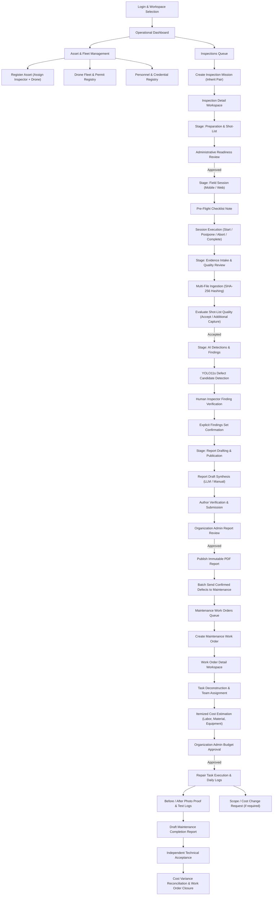
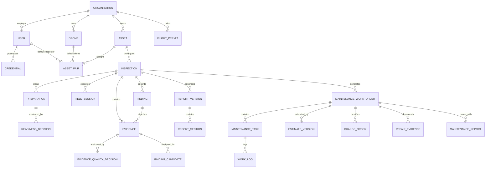

## 3. Functional Requirements

### 3.1 System Functional Overview

The SmartDroneInspection platform provides an integrated web and mobile software ecosystem supporting the full infrastructure inspection-to-maintenance lifecycle. The web application serves administrative, planning, analytical, and review functions for `Platform Admin` and `Organization Admin`, while offering inspection and maintenance workspaces for `Inspector` and `Maintenance Engineer`. The mobile application provides an on-site operational interface for remote pilots and inspectors to perform pre-flight checklists, track flight survey sessions, and record immediate field observations. Automated background services execute computer vision inference, structured report synthesis, data integrity hashing, and scheduled event notifications.

#### 3.1.1 Screens Flow

#### 3.1.2 Screen Descriptions

| # | Feature | Screen | Description |
| --- | --- | --- | --- |
| 1 | FE-01 | Sign In & Authentication | Secure login interface supporting credential verification, session management, and password recovery. |
| 2 | FE-01 | Platform Administration | Platform Admin portal for managing customer tenant workspaces, enterprise subscriptions, and platform-wide configurations. |
| 3 | FE-01 | Workforce & Credentials | Workspace for managing enterprise users (Inspectors, Engineers), professional licenses, safety certificates, and expiration dates. |
| 4 | FE-02 | Asset Registry | Master inventory of infrastructure assets (bridges, towers, facilities) displaying specifications, location, and assigned default Inspector-Drone pairs. |
| 5 | FE-02 | Asset Detail & Documents | Detailed view of an asset showing engineering drawings, historical inspection records, and default pair reassignment controls. |
| 6 | FE-02 | Drone Fleet & Permits | Catalog of organization drone hardware, serviceability statuses, maintenance logs, and attached aviation flight permits. |
| 7 | FE-03 | Inspection Mission Queue | Tabular overview of scheduled, active, and completed inspection missions with multi-criteria status, asset, and date filtering. |
| 8 | FE-03 | Create Inspection Dialog | Dialog for creating inspection missions, defining objectives and dates, inheriting the asset's default pair, and detecting scheduling conflicts. |
| 9 | FE-03 | Inspection Preparation Stage | Workspace for defining component shot-lists, verifying pilot credentials, linking applicable flight permits, and submitting for readiness review. |
| 10 | FE-03 | Readiness Review Panel | Organization Admin review interface to evaluate submitted preparations, verify regulatory compliance, and record approval or return decisions. |
| 11 | FE-04 | Field Session Stage (Web / Mobile) | On-site interface for recording mandatory pre-flight checklist notes, logging flight start/end times, and capturing postponement or abort reasons. |
| 12 | FE-04 | Evidence Intake Stage | Digital evidence management interface supporting multi-file uploads, progress tracking, cryptographic checksum display, and metadata inspection. |
| 13 | FE-04 | Evidence Quality Evaluation | Inspector interface to compare captured photographs against planned shot-lists, record unobserved scope disclosures, and approve or request re-surveys. |
| 14 | FE-05 | Findings Verification Stage | Defect verification interface displaying YOLO11s advisory detections, severity classification controls, manual defect authoring, and set confirmation. |
| 15 | FE-06 | Report Drafting Stage | Authoring workspace to trigger AI-assisted section drafting or manual authoring, edit narrative sections, and submit verified drafts for review. |
| 16 | FE-06 | Report Review & Document View | Administrative review interface displaying formatted report preview, finding summaries, and controls to approve publication or return with comments. |
| 17 | FE-06 | Published Report & Corrective Handoff | View of the published immutable PDF deliverable and batch selection interface to forward confirmed defect candidates to maintenance. |
| 18 | FE-07 | Maintenance Work Orders Queue | Management queue of maintenance work orders displaying status, defect references, assigned leads, and cost variances. |
| 19 | FE-07 | Work Order Detail & Planning | Workspace for breaking down defect remediation into tasks, appointing Team Lead and Report Author, and establishing acceptance criteria. |
| 20 | FE-07 | Cost Estimate & Budget Panel | Form for compiling itemized repair estimates (labor, materials, equipment), viewing calculated baseline totals, and recording budget approval. |
| 21 | FE-07 | Repair Execution & Work Logs | Interface for assigned Engineers to record daily task logs, consumed materials, equipment utilization, and upload before/after proof. |
| 22 | FE-07 | Change Request Dialog | Interface to propose scope, cost, or schedule adjustments with justification; provides administrative approval or rejection controls. |
| 23 | FE-07 | Maintenance Completion & Acceptance | Workspace to author completion reports, conduct independent technical acceptance, reconcile cost actuals against budget, and close work orders. |
| 24 | FE-08 | Operational Dashboard | Role-specific dashboard displaying mission metrics, pending approvals, defect severity breakdowns, upcoming permit expiries, and alerts. |

#### 3.1.3 Screen Authorization

| Screen | Platform Admin | Organization Admin | Inspector | Maintenance Engineer |
| --- | :---: | :---: | :---: | :---: |
| Sign In & Authentication | X | X | X | X |
| Platform Administration & Subscriptions | X | — | — | — |
| Workforce & Credentials Management | — | X | — | — |
| Asset Registry & Fleet Catalog | Read-Only | X | Read (Assigned) | Read (Assigned) |
| Inspection Mission Creation & Scheduling | — | X | — | — |
| Mission Preparation & Shot-List | — | Read | X (Assigned) | — |
| Readiness Authorization Panel | — | X | — | — |
| Field Session Logging (Web / Mobile) | — | Read | X (Assigned) | — |
| Evidence Intake & Quality Evaluation | — | Read | X (Assigned) | — |
| Defect Verification & Findings Confirmation | — | Read | X (Assigned) | — |
| Inspection Report Drafting | — | Read | X (Author) | — |
| Inspection Report Administrative Review | — | X | — | — |
| Published Report & Maintenance Handoff | Read-Only | X | Read (Assigned) | Read (Assigned) |
| Maintenance Work Order Creation | — | X | — | — |
| Work Order Task Planning & Estimation | — | Read | — | X (Team Lead) |
| Work Order Budget & Change Approval | — | X | — | — |
| Repair Execution & Work Logs | — | Read | — | X (Assigned) |
| Maintenance Completion Report Authoring | — | Read | — | X (Report Author) |
| Technical Acceptance & Cost Reconciliation | — | X | — | — |
| Operational Dashboard & Notifications | X (Platform) | X (Enterprise) | X (Assigned) | X (Assigned) |

#### 3.1.4 Non-Screen Functions

| # | Feature | System Function | Description |
| --- | --- | --- | --- |
| 1 | FE-01 | Session Token Verification & Revocation | Validates JSON Web Tokens on API requests; automatically checks token expiration, blacklists revoked sessions, and enforces role boundaries. |
| 2 | FE-02 | Resource Conflict Detection Engine | Evaluates scheduled time windows for Drones and Inspectors across concurrent missions to prevent overlapping assignments. |
| 3 | FE-03 | Periodic Inspection Mission Generator | Automated scheduled job that inspects asset maintenance frequencies and generates draft inspection missions with inherited default pairs. |
| 4 | FE-04 | Cryptographic Hashing & Deduplication | Computes SHA-256 digests on binary media during upload; cross-checks existing file hashes within the inspection scope to prevent duplicates. |
| 5 | FE-04 | Image EXIF Metadata Extractor | Extracts embedded capture timestamps, camera parameters, and GPS coordinates from uploaded JPEG files to populate evidence records. |
| 6 | FE-05 | Advisory YOLO11s Defect Detection Service | Computer vision microservice executing bounding-box defect detection on structural images, categorizing cracks, corrosion, and spalling. |
| 7 | FE-06 | Context-Grounded Report Synthesis Engine | Assembles verified asset, mission, checklist, and defect data into targeted LLM prompts to generate cohesive, structured report section drafts. |
| 8 | FE-06 | PDF Report Document Renderer | Compiles approved report sections, finding tables, attached evidence photos, and metadata into a publication-grade A4 PDF document with SHA-256 recording. |
| 9 | FE-07 | Deterministic Cost Calculation Engine | Computes baseline estimate totals, approved change order deltas, actual expenditures, and variance metrics using exact decimal precision. |
| 10 | FE-08 | Operational Event Notification Dispatcher | Event-driven notification worker delivering in-app alerts and email notifications for mission dispatches, readiness updates, and approval requests. |

#### 3.1.5 Entity Relationship Diagram

**Entities Description**

| # | Entity | Description |
| --- | --- | --- |
| 1 | Organization | Represents an enterprise customer tenant subscribing to the platform; isolates all workforce, asset, and operational data. |
| 2 | User | System user identity assigned to an organization with a specific role (`ADMIN`, `ORG_ADMIN`, `INSPECTOR`, `MAINTENANCE_ENGINEER`). |
| 3 | Credential | Professional qualification record (pilot license, non-destructive testing certification) with validity dates and verification status. |
| 4 | Drone | Hardware aircraft asset identified by model, serial number, equipment weight, payload capabilities, and serviceability status. |
| 5 | Flight Permit | Official aviation authorization issued by civil or military authorities, specifying permitted geographical bounding boxes and validity dates. |
| 6 | Asset | Physical infrastructure structure (bridge, pylon, tank, facility) managed by the organization, including location and technical metadata. |
| 7 | Asset Pair | Default operational assignment linking an infrastructure asset to a responsible Inspector and a specific Drone. |
| 8 | Inspection | Core operational mission record tracking purpose, scheduled time window, assigned personnel/equipment snapshot, and lifecycle status. |
| 9 | Preparation | Pre-flight planning record comprising the structural component shot-list, safety protocols, and regulatory compliance data. |
| 10 | Readiness Decision | Formal administrative authorization record approving or returning a mission preparation based on permit and credential validation. |
| 11 | Field Session | Individual on-site flight execution session capturing pre-flight checklist notes, start/end timestamps, and postponement/abort outcomes. |
| 12 | Evidence | High-resolution visual capture media (photograph, video frame) with server-calculated SHA-256 checksum and extracted GPS telemetry. |
| 13 | Evidence Quality Decision | Substantive evaluation recorded by the Inspector assessing capture completeness, coverage against shot-list, and visual sharpness. |
| 14 | Finding Candidate | Advisory defect proposal generated by YOLO11s computer vision, indicating defect classification, confidence score, and bounding coordinates. |
| 15 | Finding | Official structural defect record verified and confirmed by the human Inspector, including defect type, severity, location, and photo references. |
| 16 | Report Version | Versioned inspection report deliverable capturing structured authored sections, review decisions, and the compiled immutable PDF deliverable. |
| 17 | Maintenance Work Order | Corrective remediation project initiated from confirmed inspection findings, tracking repair scope, schedule, and closure state. |
| 18 | Maintenance Task | Decomposed unit of repair work assigned to a specific engineer, defining technical methods, required materials, and acceptance criteria. |
| 19 | Estimate Version | Versioned financial projection detailing required labor hours, replacement materials, equipment rentals, and approved budget baseline. |
| 20 | Change Order | Formal variance request documenting required adjustments to repair scope, budget, or completion date necessitated by site conditions. |
| 21 | Work Log | Daily execution log recorded by assigned engineers tracking labor hours, material consumption, and task milestone progress. |
| 22 | Repair Evidence | Before, during, and after photographic proof and non-destructive test certificates demonstrating structural defect remediation. |
| 23 | Maintenance Report | Formal completion report authored by the designated engineer, reviewed by the organization administrator, and archived upon work order closure. |

---

### 3.2 FE-01 Identity, Enterprise Subscription and Workforce Governance

#### 3.2.1 Enterprise Registration and Tenant Management
- **Function Trigger**: Public self-registration portal or Platform Admin workspace provisioning.
- **Function Description**: Onboards enterprise infrastructure-owning companies, creates the initial Organization Admin account, and establishes tenant data boundaries.
- **Function Details**:
  - *Inputs*: Enterprise legal name, tax identification, representative full name, business email, initial password.
  - *Validations*: Enforces unique email, compliant password complexity (minimum 8 characters with mixed case, numbers, and symbols), and valid corporate tax format.
  - *Processing*: Creates tenant organization, registers administrator with hashed password (Argon2id), provisions isolated workspace schemas, and initializes security policies.
  - *Outputs*: Initialized enterprise tenant workspace, email verification dispatch, active Organization Admin session.

#### 3.2.2 Workforce Provisioning and Credential Management
- **Function Trigger**: Organization Admin navigates to `Workforce Management` and selects `Add User` or `Manage Credentials`.
- **Function Description**: Provisions user accounts for Inspectors and Maintenance Engineers, associates professional certifications (UAV Remote Pilot License, ASNT Level II NDT), and tracks expiration dates.
- **Function Details**:
  - *Inputs*: Full name, corporate email, role selection (`INSPECTOR` or `MAINTENANCE_ENGINEER`), credential type, certificate number, issuing authority, issue date, expiration date, supporting document PDF.
  - *Validations*: Ensures email uniqueness within tenant; validates expiration date is in the future; verifies mandatory credential attachments.
  - *Processing*: Encrypts credential records; flags accounts with approaching expiration (30-day alert); blocks assignment dispatch if mandatory flight licenses expire.
  - *Outputs*: Provisioned workforce account, documented credential record with verification status.

#### 3.2.3 Subscription Entitlements and Billing Governance
- **Function Trigger**: Platform Admin navigates to `Enterprise Subscriptions` or Organization Admin views `Workspace Settings`.
- **Function Description**: Manages ENTERPRISE tier subscriptions, selects 1-, 6-, or 12-month billing periods, records payment confirmation, and enforces quota limits.
- **Function Details**:
  - *Inputs*: Organization ID, billing period (1, 6, 12 months), subscription start date, confirmed payment reference, approved storage quota.
  - *Validations*: Restricts plan selection to ENTERPRISE; verifies payment confirmation reference before activating term.
  - *Processing*: Calculates subscription active term; records versioned billing snapshot; enforces storage quotas and active asset limits; logs audit trail.
  - *Outputs*: Active enterprise subscription status, updated tenant quota limits, auditable billing confirmation record.

---

### 3.3 FE-02 Infrastructure Asset, Equipment Fleet and Compliance Registry

#### 3.3.1 Infrastructure Asset Catalog and Default Pair Assignment
- **Function Trigger**: Organization Admin navigates to `Assets` and selects `New Asset`.
- **Function Description**: Registers physical infrastructure assets, records structural attributes and GPS coordinates, and assigns a default responsible Inspector and Drone.
- **Function Details**:
  - *Inputs*: Asset code, asset name, category (Bridge, Power Tower, Industrial Plant, Building), location coordinates, structural drawings, default Inspector ID, default Drone ID.
  - *Validations*: Asset code must be unique within organization; selected Inspector and Drone must belong to the same tenant and possess active, serviceable status.
  - *Processing*: Persists asset master record; atomically records the operational default pair assignment; establishes asset condition history.
  - *Outputs*: Active asset record with linked default Inspector-Drone pair, available for inspection scheduling.

#### 3.3.2 Drone Fleet Management and Serviceability Tracking
- **Function Trigger**: Organization Admin navigates to `Drone Fleet` and selects `Register Drone`.
- **Function Description**: Catalogs unmanned aerial vehicles (UAVs), tracks payload equipment, serviceability status, and hardware maintenance logs.
- **Function Details**:
  - *Inputs*: Manufacturer, model, hardware serial number, maximum takeoff weight (MTOW), camera payload specifications, initial serviceability (`SERVICEABLE`, `MAINTENANCE_REQUIRED`, `RETIRED`).
  - *Validations*: Hardware serial number must be unique across tenant fleet; weight and payload fields must be positive numeric values.
  - *Processing*: Stores hardware profile; monitors flight hours logged from field sessions; triggers serviceability alerts when maintenance intervals are reached.
  - *Outputs*: Registered drone hardware profile available for mission assignment.

#### 3.3.3 Flight Permit Linkage and Legal Authorizations
- **Function Trigger**: Organization Admin navigates to `Compliance` and selects `Attach Flight Permit`.
- **Function Description**: Records official flight clearances issued by regulatory authorities (e.g., Department of Operations - Ministry of National Defence), defining permitted airspace boundaries and operational windows.
- **Function Details**:
  - *Inputs*: Permit reference number, issuing authority, geographical bounding polygon (latitude/longitude coordinates), permitted altitude ceiling, effective start date, expiration date, official permit PDF.
  - *Validations*: Permit validity period must be valid; polygon coordinates must form a closed geometric boundary; PDF document attachment is mandatory.
  - *Processing*: Attaches permit to organization compliance registry; links permit to relevant assets within geographical polygon; alerts on expiration.
  - *Outputs*: Verified flight permit record, referenced during pre-flight readiness checks.

---

### 3.4 FE-03 Flight Mission Planning and Readiness Authorization

#### 3.4.1 Inspection Mission Scheduling and Conflict Detection
- **Function Trigger**: Organization Admin selects `Create Inspection` from asset row or inspections list.
- **Function Description**: Schedules an inspection mission for an asset, establishes planned start/end dates, inherits the asset's default Inspector-Drone pair, and performs automated resource conflict checks.
- **Function Details**:
  - *Inputs*: Asset ID, inspection objective, planned inspection window (start date, end date), mission priority (Low, Normal, High, Urgent), optional pair reassignment with reason.
  - *Validations*: Planned end date must be on or after start date; designated Inspector and Drone must not have conflicting approved missions within the same window.
  - *Processing*: Evaluates concurrent mission schedules; presents conflict alerts if overlapping bookings exist; creates inspection record in `ASSIGNED` status with pair snapshot.
  - *Outputs*: Dispatched inspection mission record, automated notification to assigned Inspector.

#### 3.4.2 Component Shot-List and Pre-Flight Checklist Planning
- **Function Trigger**: Assigned Inspector opens mission detail and selects `Preparation` tab.
- **Function Description**: Inspector accepts mission assignment and compiles structural component shot-lists, capture angles, required ground sampling distance (GSD), and site access notes.
- **Function Details**:
  - *Inputs*: Target structural components (piers, girders, cables, deck joints), capture angles, minimum image resolution, planned sensor payloads, site safety notes.
  - *Validations*: Inspector must have accepted mission assignment; at least one structural component must be specified in the shot-list.
  - *Processing*: Assembles mission preparation draft (versioned); validates remote pilot license currency and linked flight permit validity; transitions status to `READY_FOR_REVIEW`.
  - *Outputs*: Submitted mission preparation version awaiting administrative readiness review.

#### 3.4.3 Administrative Flight Readiness Authorization
- **Function Trigger**: Organization Admin navigates to mission detail `Readiness Review` tab.
- **Function Description**: Administrative gate verifying legal flight permits, crew qualifications, hardware serviceability, and weather parameters before authorizing flight operations.
- **Function Details**:
  - *Inputs*: Inspection ID, preparation version ID, reviewer credential reference, decision (`APPROVE` or `RETURN`), return justification (mandatory on return).
  - *Validations*: Reviewer must hold Organization Admin role and be distinct from the assigned Inspector; active flight permit and valid pilot credentials must be attached.
  - *Processing*: On approval, records immutable readiness decision stamping timestamp and reviewer identity, transitioning mission to `APPROVED_FOR_FLIGHT`. On return, records reason and returns preparation to `PREPARING`.
  - *Outputs*: Formal flight readiness authorization record, unlocking field session execution on mobile app.

---

### 3.5 FE-04 Field Survey Execution and Evidence Management

#### 3.5.1 On-Site Pre-Flight Check and Field Session Logging
- **Function Trigger**: Inspector opens mission on mobile app or web `Field Session` tab and selects `Start Session`.
- **Function Description**: Records mandatory on-site physical checklist notes, confirms airspace safety, logs flight start time, and manages session outcomes (completion, postponement, abort).
- **Function Details**:
  - *Inputs*: Pre-flight checklist verification note (aircraft condition, battery levels, site weather, emergency landing area), session action (`START`, `POSTPONE`, `ABORT`, `COMPLETE`), outcome reason.
  - *Validations*: Mission must possess an active approved readiness decision; pre-flight note cannot be blank; only one session can be in progress concurrently.
  - *Processing*: `START` logs session start timestamp and transitions status to `IN_PROGRESS`. `POSTPONE` logs postponement reason and leaves mission startable. `ABORT` logs abort reason and ends session as terminal `ABORTED`. `COMPLETE` records completion notes and transitions mission to `FIELD_COMPLETED`.
  - *Outputs*: Auditable field flight session record with exact timestamps and operational logs.

#### 3.5.2 Digital Evidence Ingestion and Cryptographic Integrity
- **Function Trigger**: Inspector opens `Evidence` tab and selects `Upload Evidence`.
- **Function Description**: Ingests raw inspection photographs and video frames, extracts embedded telemetry, and enforces file integrity via SHA-256 cryptographic hashing.
- **Function Details**:
  - *Inputs*: High-resolution aerial image files (JPEG, PNG), optional camera telemetry files.
  - *Validations*: Allowed MIME types; file size within limits (up to 100MB per file); checks against duplicate SHA-256 digests within same mission scope.
  - *Processing*: Computes SHA-256 hash on server; stores original binary in MinIO object storage; extracts EXIF capture timestamp and GPS coordinates; generates thumbnail previews.
  - *Outputs*: Persisted evidence register items with tamper-evident checksums and metadata provenance.

#### 3.5.3 Inspector Evidence Completeness and Quality Evaluation
- **Function Trigger**: Inspector completes upload and selects `Evaluate Evidence Quality`.
- **Function Description**: Inspector compares ingested evidence against the planned component shot-list, discloses unobserved components, and records an official quality decision.
- **Function Details**:
  - *Inputs*: Shot-list comparison text, unobserved components disclosure, quality decision (`ACCEPTED`, `ADDITIONAL_SESSION_REQUIRED`).
  - *Validations*: At least one active evidence item must exist; shot-list comparison disclosure cannot be blank; reason mandatory if additional capture requested.
  - *Processing*: `ACCEPTED` confirms evidence adequacy and unlocks AI defect detection. `ADDITIONAL_SESSION_REQUIRED` supersedes current preparation, invalidates prior readiness, returns mission to `PREPARING`, and requires scheduling supplementary field capture.
  - *Outputs*: Attributable evidence quality decision record governing downstream analysis eligibility.

---

### 3.6 FE-05 AI-Assisted Defect Detection and Inspector Verification

#### 3.6.1 Automated YOLO11s Advisory Defect Candidate Detection
- **Function Trigger**: Automatic trigger upon evidence quality `ACCEPTED` decision, or explicit Inspector action `Run Defect Detection`.
- **Function Description**: Computer vision microservice executes YOLO11s deep learning inference on aerial photographs to locate, bound, and classify structural surface defects.
- **Function Details**:
  - *Inputs*: Preprocessed inspection image bytes, confidence threshold parameter (default 0.25).
  - *Validations*: Evidence item must be in `ACTIVE` status and belong to an accepted evidence set; duplicate inference on already analyzed images returns existing candidates.
  - *Processing*: Runs YOLO11s object detection model (MBDD2025 defect classes: crack, spalling, corrosion, leakage, exposure); extracts bounding box coordinates, defect class, and confidence score.
  - *Outputs*: Persistent advisory finding candidates linked to source images, labeled as unverified machine proposals.

#### 3.6.2 Human Defect Verification and Official Findings Confirmation
- **Function Trigger**: Inspector reviews candidates in `Findings` tab.
- **Function Description**: Inspector inspects each AI-detected defect candidate, confirms or adjusts classifications and severities, rejects false positives, records manual findings, and confirms the complete official findings set.
- **Function Details**:
  - *Inputs*: Decision per candidate (`CONFIRM`, `MODIFY`, `REJECT`), modified defect class, severity rating (Minor, Moderate, Severe, Critical), component location description, manual finding inputs.
  - *Validations*: All candidates must be resolved; rejection of AI candidate removes candidate from active findings; confirmation requires resolving all unreviewed items.
  - *Processing*: Converts confirmed/modified candidates into official findings; persists finding records with attached evidence photos; records explicit set confirmation timestamp.
  - *Outputs*: Confirmed official findings register, unlocking report drafting.

---

### 3.7 FE-06 Inspection Report Drafting, Review and Publication

#### 3.7.1 Structured Report Authoring and Context-Grounded LLM Drafting
- **Function Trigger**: Inspector selects `Generate Report Draft` or `Manual Authoring` in `Report` tab.
- **Function Description**: Synthesizes a structured inspection report draft. LLM drafting compiles verified asset data, inspection parameters, checklist notes, and confirmed findings into cohesive narrative sections without hallucinating external facts.
- **Function Details**:
  - *Inputs*: Selected drafting method (`AI_ASSISTED` or `MANUAL`), authored section content: Executive Summary, Scope & Methodology, Weather & Site Observations, Component Findings Discussion, Recommendations.
  - *Validations*: Finding set must be explicitly confirmed; generated draft sections must be manually reviewed and editable by the author prior to submission.
  - *Processing*: In AI mode, constructs grounded prompt referencing strictly verified database entities; saves section draft fields; author edits text in place; author submits draft for administrative review.
  - *Outputs*: Verified report draft version in `SUBMITTED` status, routed to Organization Admin review queue.

#### 3.7.2 Administrative Review, Digital Publication and Immutable Archival
- **Function Trigger**: Organization Admin opens submitted report in `Report Review` workspace.
- **Function Description**: Independent administrative review of report narrative, component findings, and attached evidence. Approves report for formal publication or returns it to author with comments.
- **Function Details**:
  - *Inputs*: Review decision (`APPROVE` or `RETURN`), return comments (mandatory on return).
  - *Validations*: Reviewer must be an Organization Admin distinct from the report author; all findings must be in an evaluated state.
  - *Processing*: On approval, compiles report data into formal A4 PDF template via openhtmltopdf, stores deliverable in MinIO, calculates SHA-256 digest, marks report version `PUBLISHED`, and transitions inspection status to `REPORT_PUBLISHED`. On return, marks version `RETURNED` and notifies author.
  - *Outputs*: Published immutable PDF inspection report, recorded cryptographic checksum, and public download endpoint.

#### 3.7.3 Batch Forwarding of Defect Candidates to Maintenance
- **Function Trigger**: Organization Admin opens `Send to Maintenance` tab on published inspection.
- **Function Description**: Displays all confirmed defects from the published report; administrator selects relevant defects in batch (default all selected, deselectable) to forward as candidates for maintenance remediation.
- **Function Details**:
  - *Inputs*: Inspection ID, array of selected finding IDs, optional global handoff notes.
  - *Validations*: Inspection report must be in `PUBLISHED` status; at least one finding must be selected if transitioning to repair pending.
  - *Processing*: Marks selected findings as forwarded repair candidates; if findings are forwarded, transitions inspection to `REPAIR_PENDING`. If all findings are deselected (no repair required), closes inspection as `COMPLETED`.
  - *Outputs*: Forwarded repair candidates available in Maintenance workspace; updated inspection status.

---

### 3.8 FE-07 Maintenance Remediation, Cost Control and Acceptance

#### 3.8.1 Maintenance Work Order Planning and Team Allocation
- **Function Trigger**: Organization Admin navigates to `Maintenance` and selects `Create Work Order`.
- **Function Description**: Initiates a formal maintenance work order linking forwarded defect candidates, decomposes corrective scope into tasks, and appoints the engineering team.
- **Function Details**:
  - *Inputs*: Source inspection ID, selected defect candidate IDs, work order title, priority, target completion date, assigned engineering team members, designated Team Lead, designated Report Author.
  - *Validations*: Must reference valid forwarded defect candidates; designated Team Lead and Report Author must belong to the approved team; neither may serve as independent reviewer.
  - *Processing*: Creates work order in `PLANNING` status; links defects to work order scope; initializes task inventory.
  - *Outputs*: Created work order with appointed team, ready for technical estimation.

#### 3.8.2 Itemized Cost Estimation and Change Order Governance
- **Function Trigger**: Maintenance Team Lead compiles estimate; Organization Admin reviews budget.
- **Function Description**: Compiles detailed itemized cost estimates across labor, replacement materials, equipment rentals, and specialized services. Supports formal Change Requests for emergent site conditions.
- **Function Details**:
  - *Inputs*: Line items (category, description, quantity, unit price, currency), change request justification, delta cost, delta schedule days.
  - *Validations*: Quantities and unit prices must be positive decimal numbers; budget approval requires Organization Admin role.
  - *Processing*: Calculates exact decimal baseline budget totals; on approval, freezes estimate baseline (`APPROVED`). Change requests require administrative review; approved changes calculate revised budget ceiling.
  - *Outputs*: Approved initial cost baseline, approved change order records, auditable financial ceiling.

#### 3.8.3 Repair Execution Logging and Before/After Evidence Documentation
- **Function Trigger**: Assigned Maintenance Engineers select task in `Work Order Execution`.
- **Function Description**: Records daily task execution logs, material consumption, labor hours, and uploads photographic proof demonstrating structural defect rectification.
- **Function Details*:
  - *Inputs*: Task ID, labor hours worked, materials consumed, equipment hours, task progress percentage, before-repair photos, during-repair photos, after-repair photos, test certificates.
  - *Validations*: Log entry restricted to assigned team members; completion of repair task requires mandatory after-repair photographic proof.
  - *Processing*: Persists chronological work logs; updates real-time task progress; stores repair evidence with SHA-256 integrity hashing; updates work order status to `IN_PROGRESS`.
  - *Outputs*: Documented repair logs and verifiable before/after evidence register.

#### 3.8.4 Completion Reporting, Independent Acceptance and Cost Reconciliation
- **Function Trigger**: Designated Report Author compiles report; Organization Admin performs acceptance.
- **Function Description**: Compiles maintenance completion report from task logs, test records, and financial actuals. Independent Organization Admin conducts technical acceptance and reconciles final costs against approved budget before closing work order.
- **Function Details**:
  - *Inputs*: Completion narrative, final acceptance test results, variance explanations, acceptance decision (`ACCEPT` or `REJECT`), final cost reconciliation sign-off.
  - *Validations*: Reviewing Organization Admin must be independent (not Team Lead or Report Author); all tasks must be completed with attached proof; cost variance must be documented.
  - *Processing*: Calculates financial variance (Budget vs. Actuals); on acceptance, marks work order `CLOSED`, publishes completion report deliverable, and updates asset maintenance history.
  - *Outputs*: Closed maintenance work order, reconciled financial statement, and updated asset structural health record.

---

### 3.9 FE-08 Operational Dashboard and System Notifications

#### 3.9.1 Multi-Role Operational Dashboards and Analytics
- **Function Trigger**: User signs in or navigates to `Dashboard`.
- **Function Description**: Delivers role-customized operational metrics, status summaries, defect distribution charts, and workload queues.
- **Function Details**:
  - *Platform Admin*: Tenant count, active enterprise subscriptions, total managed assets, system storage utilization.
  - *Organization Admin*: Asset condition summaries, active vs. completed inspection missions, defect severity distribution (Critical, Severe, Moderate, Minor), pending readiness reviews, maintenance budget variances.
  - *Inspector*: Assigned upcoming missions, pending pre-flight checklists, open field sessions, unreviewed AI defect queues.
  - *Maintenance Engineer*: Assigned repair tasks, work order deadlines, pending work log submissions.

#### 3.9.2 Automated Event-Driven Operational Notifications
- **Function Trigger**: System domain events (Mission Dispatched, Readiness Decision Recorded, Evidence Uploaded, Report Submitted, Work Order Budget Approved, Work Order Closed).
- **Function Description**: Dispatches real-time in-app alerts and asynchronous email notifications to relevant stakeholders, informing them of required workflow actions.
- **Function Details**:
  - *Inputs*: Domain event payload, recipient user IDs, notification template.
  - *Validations*: Recipient must have active account status and appropriate permission scope for the target entity.
  - *Processing*: Renders notification message with direct deep-link to target workspace screen; dispatches in-app notification via WebSockets/polling; sends email notification via SMTP gateway.
  - *Outputs*: Real-time notification badge increment, system notification record in user inbox, delivered email alert.
