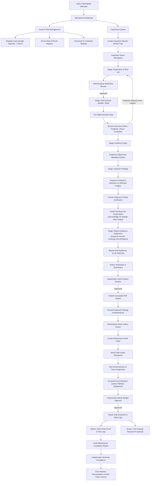

## 3. Functional Requirements

### 3.1 System Functional Overview

The SmartDroneInspection platform provides an integrated web and mobile software ecosystem supporting the full infrastructure inspection-to-maintenance lifecycle. The web application serves administrative, planning, analytical, and review functions for `Platform Admin` and `Organization Admin`, while offering inspection and maintenance workspaces for `Inspector` and `Maintenance Engineer`. The mobile application provides an on-site operational interface for remote pilots and inspectors to perform pre-flight checklists, track flight survey sessions, and record immediate field observations. Automated background services execute computer vision inference, structured report synthesis, data integrity hashing, and scheduled event notifications.

#### 3.1.1 Screens Flow

#### 3.1.2 Screen Descriptions

| # | Feature | Screen | Description |
| --- | --- | --- | --- |
| 1 | FE-01 | Sign In & Authentication | Secure login interface supporting credential verification, session management, and password recovery. |
| 2 | FE-01 | Platform Administration & Subscriptions | Platform Admin portal for managing customer tenant workspaces, enterprise subscriptions, offline payment reconciliation, and platform-wide configurations. |
| 3 | FE-01 | Workforce & Credentials | Workspace for managing enterprise users (Inspectors, Engineers), professional licenses, safety certificates, and expiration dates. |
| 4 | FE-02 | Asset Registry | Master inventory of infrastructure assets (bridges, towers, facilities) displaying specifications, location, and assigned default Inspector-Drone pairs. |
| 5 | FE-02 | Asset Detail & Documents | Detailed view of an asset showing engineering drawings, historical inspection records, and default pair reassignment controls. |
| 6 | FE-02 | Drone Fleet & Permits | Catalog of organization drone hardware, serviceability statuses, maintenance logs, and attached aviation flight permits. |
| 7 | FE-03 | Inspection Mission Queue | Tabular overview of scheduled, active, and completed inspection missions with multi-criteria status, asset, and date filtering. |
| 8 | FE-03 | Create Inspection Dialog | Dialog for creating inspection missions, defining objectives and dates, inheriting the asset's default pair, and detecting scheduling conflicts. |
| 9 | FE-03 | Inspection Preparation Stage | Workspace for defining component shot-lists, verifying pilot credentials, linking applicable flight permits, and submitting for readiness review. |
| 10 | FE-03 | Readiness Review Panel | Organization Admin review interface to evaluate submitted preparations, verify regulatory compliance, and record approval or return decisions. |
| 11 | FE-04 | Field Session Stage (Web / Mobile) | On-site interface for recording mandatory pre-flight checklist notes, logging flight start/end times, and capturing postponement or abort reasons. |
| 12 | FE-04 | Evidence Intake Stage | Digital evidence management interface supporting multi-file uploads, progress tracking, and capture metadata inspection. |
| 13 | FE-03 | Additional Field Session | MF2 action for the assigned Inspector to request another session after a field session ends; a new preparation and independent readiness approval are required before another session starts. |
| 14 | FE-05 | Findings Verification Stage | Inspector-invoked AI suggestions, manual finding authoring, severity classification, resolution of every finding, and explicit confirmation of the findings set (including acknowledgment when no damage was observed). |
| 15 | FE-06 | Report Drafting Stage | Authoring workspace to trigger AI-assisted section drafting or manual authoring, record coverage and limitations, edit narrative sections, and submit verified drafts for review. |
| 16 | FE-06 | Report Review & Document View | Administrative review interface displaying formatted report preview, finding summaries, and controls to approve publication or return with a reason. |
| 17 | FE-06 | Published Report & Corrective Handoff | View of the published immutable PDF deliverable and per-finding controls to forward selected findings to maintenance. |
| 18 | FE-07 | Maintenance Work Orders Queue | Management queue of maintenance work orders displaying status, defect references, assigned leads, and cost variances. |
| 19 | FE-07 | Work Order Detail & Planning | Workspace for breaking down defect remediation into tasks, appointing Team Lead and Report Author, and establishing acceptance criteria. |
| 20 | FE-07 | Cost Estimate & Budget Panel | Form for compiling itemized repair estimates (labor, materials, equipment), viewing calculated baseline totals, and recording budget approval. |
| 21 | FE-07 | Repair Execution & Work Logs | Interface for assigned Engineers to record daily task logs, consumed materials, equipment utilization, and upload before/after proof. |
| 22 | FE-07 | Change Request Dialog | Interface to propose scope, cost, or schedule adjustments with justification; provides administrative approval or rejection controls. |
| 23 | FE-07 | Maintenance Completion & Acceptance | Workspace to author completion reports, conduct independent technical acceptance, reconcile cost actuals against budget, and close work orders. |
| 24 | FE-08 | Operational Dashboard | Role-specific dashboard displaying mission metrics, pending approvals, defect severity breakdowns, upcoming permit expiries, and alerts. |

#### 3.1.3 Screen Authorization

| Screen | Platform Admin | Organization Admin | Inspector | Maintenance Engineer |
| --- | :---: | :---: | :---: | :---: |
| Sign In & Authentication | X | X | X | X |
| Platform Administration & Subscriptions | X | — | — | — |
| Workforce & Credentials Management | — | X | — | — |
| Asset Registry & Fleet Catalog | Read-Only | X | Read (Assigned) | Read (Assigned) |
| Inspection Mission Creation & Scheduling | — | X | — | — |
| Mission Preparation & Shot-List | — | Read | X (Assigned) | — |
| Readiness Authorization Panel | — | X | — | — |
| Field Session Logging (Web / Mobile) | — | Read | X (Assigned) | — |
| Evidence Intake | — | Read | X (Assigned) | — |
| Defect Verification & Findings Confirmation | — | Read | X (Assigned) | — |
| Inspection Report Drafting | — | Read | X (Author) | — |
| Inspection Report Administrative Review | — | X | — | — |
| Published Report & Maintenance Handoff | Read-Only | X | Read (Assigned) | Read (Assigned) |
| Maintenance Work Order Creation | — | X | — | — |
| Work Order Task Planning & Estimation | — | Read | — | X (Team Lead) |
| Work Order Budget & Change Approval | — | X | — | — |
| Repair Execution & Work Logs | — | Read | — | X (Assigned) |
| Maintenance Completion Report Authoring | — | Read | — | X (Report Author) |
| Technical Acceptance & Cost Reconciliation | — | X | — | — |
| Operational Dashboard & Notifications | X (Platform) | X (Enterprise) | X (Assigned) | X (Assigned) |

#### 3.1.4 Non-Screen Functions

| # | Feature | System Function | Description |
| --- | --- | --- | --- |
| 1 | FE-01 | Session Token Verification & Revocation | Validates JSON Web Tokens on API requests; automatically checks token expiration, blacklists revoked sessions, and enforces role boundaries. |
| 2 | FE-02 | Resource Conflict Detection Engine | Evaluates scheduled time windows for Drones and Inspectors across concurrent missions to prevent overlapping assignments. |
| 3 | FE-03 | Periodic Inspection Mission Generator | Automated scheduled job that inspects asset maintenance frequencies and generates draft inspection missions with inherited default pairs. |
| 4 | FE-04 | Evidence Intake Validation | Validates uploaded files and inspection/session scope, stores original bytes, and rejects a repeated sanitized filename within the inspection; evidence-file SHA-256 hashing is not part of the intake contract. |
| 5 | FE-04 | Image EXIF Metadata Extractor | Extracts embedded capture timestamps, camera parameters, and GPS coordinates from uploaded JPEG files to populate evidence records. |
| 6 | FE-05 | Inspector-Invoked Advisory Defect Detection | Optional computer vision service proposes defects only when the assigned Inspector explicitly requests analysis of selected images. |
| 7 | FE-06 | Context-Grounded Report Synthesis Engine | Assembles verified asset, mission, checklist, and defect data into targeted LLM prompts to generate cohesive, structured report section drafts. |
| 8 | FE-06 | PDF Report Document Renderer | Compiles approved report sections, finding tables, attached evidence photos, and metadata into a publication-grade A4 PDF document with SHA-256 recording. |
| 9 | FE-07 | Deterministic Cost Calculation Engine | Computes baseline estimate totals, approved change order deltas, actual expenditures, and variance metrics using exact decimal precision. |
| 10 | FE-08 | Operational Event Notification Dispatcher | Event-driven notification worker delivering in-app alerts and email notifications for mission dispatches, readiness updates, and approval requests. |
| 11 | FE-01 | Subscription Payment Capture and Reconciliation | When PayPal is explicitly configured, the server creates and captures provider orders, validates the provider-reported amount/currency and webhook signature before activation; otherwise online checkout fails closed and authorized ADMIN confirms wire/invoice payment. |

#### 3.1.5 Entity Relationship Diagram

```mermaid
%% title: Entity Relationship Diagram (ERD)
erDiagram
  ORGANIZATION ||--o{ USER : employs
  ORGANIZATION ||--o{ SUBSCRIPTION : holds
  ORGANIZATION ||--o{ ASSET_CATEGORY : defines
  ORGANIZATION ||--o{ DRONE : owns
  ORGANIZATION ||--o{ ASSET : owns
  ORGANIZATION ||--o{ FLIGHT_PERMIT : holds
  ORGANIZATION ||--o{ AUDIT_EVENT : records
  ORGANIZATION ||--o{ NOTIFICATION : receives

  USER ||--o{ USER_ROLE : assigned
  USER ||--o{ AUTH_SESSION : opens
  AUTH_SESSION ||--o{ REFRESH_TOKEN : issues
  USER ||--o{ WORKFORCE_CREDENTIAL : holds

  ASSET_CATEGORY ||--o{ CHECKLIST_TEMPLATE : configures
  CHECKLIST_TEMPLATE ||--o{ CHECKLIST_ITEM : contains
  ASSET_CATEGORY ||--o{ ASSET : categorizes

  ASSET ||--o{ ASSET_DOCUMENT : attaches
  ASSET ||--o{ ASSET_PAIR_ASSIGNMENT : binds
  USER ||--o{ ASSET_PAIR_ASSIGNMENT : "assigned inspector"
  DRONE ||--o{ ASSET_PAIR_ASSIGNMENT : "assigned drone"

  DRONE ||--o{ DRONE_DOCUMENT : attaches
  ASSET ||--o{ INSPECTION_SCHEDULE : schedules

  ASSET ||--o{ INSPECTION : undergoes
  INSPECTION ||--o{ INSPECTION_PREPARATION : plans
  INSPECTION_PREPARATION ||--o{ INSPECTION_READINESS_DECISION : evaluated_by
  INSPECTION ||--o{ FIELD_SESSION : executes
  FIELD_SESSION ||--o{ CHECKLIST_RESPONSE : logs
  CHECKLIST_ITEM ||--o{ CHECKLIST_RESPONSE : answers

  INSPECTION ||--o{ EVIDENCE : contains
  FIELD_SESSION ||--o{ EVIDENCE : captures
  INSPECTION ||--o{ FINDING : records
  EVIDENCE ||--o{ FINDING : locates

  INSPECTION ||--o{ INSPECTION_REPORT : owns
  INSPECTION_REPORT ||--o{ INSPECTION_REPORT_VERSION : publishes
  INSPECTION_REPORT_VERSION ||--o{ REPORT_VERSION_FINDING : includes
  INSPECTION_REPORT_VERSION ||--o{ REPORT_VERSION_EVIDENCE : includes

  INSPECTION ||--o{ MAINTENANCE_WORK_ORDER : initiates
  MAINTENANCE_WORK_ORDER ||--o{ MAINTENANCE_TEAM_MEMBER : deploys
  MAINTENANCE_WORK_ORDER ||--o{ MAINTENANCE_TASK : deconstructs
  MAINTENANCE_WORK_ORDER ||--o{ MAINTENANCE_ESTIMATE_VERSION : projects
  MAINTENANCE_ESTIMATE_VERSION ||--o{ MAINTENANCE_COST_LINE : itemizes
  MAINTENANCE_WORK_ORDER ||--o{ MAINTENANCE_CHANGE_ORDER : requests
  MAINTENANCE_TASK ||--o{ MAINTENANCE_WORK_LOG : tracks
  MAINTENANCE_WORK_ORDER ||--o{ MAINTENANCE_REPORT_VERSION : delivers
  MAINTENANCE_REPORT_VERSION ||--o{ MAINTENANCE_ACCEPTANCE_DECISION : accepts
```

**Entities Description**

| # | Entity | Table Name | Description |
| --- | --- | --- | --- |
| 1 | Organization | `organizations` | Tenant enterprise customer company subscribing to the platform; isolates all workforce, asset, and operational records. |
| 2 | User | `users` | System user account across Platform Admin, Organization Admin, Inspector, and Maintenance Engineer roles. |
| 3 | User Role | `user_roles` | Associates users with specific role privileges and access control scopes. |
| 4 | Auth Session | `auth_sessions` | Tracks active login sessions, device metadata, IP address, and revocation state. |
| 5 | Refresh Token | `refresh_tokens` | Stores cryptographically hashed refresh tokens for secure JWT session rotation. |
| 6 | Workforce Credential | `workforce_credentials` | Records professional pilot licenses, safety certifications, and technical qualifications with expiration tracking. |
| 7 | Subscription | `subscriptions` | Tracks ENTERPRISE subscription contracts, periods (1, 6, 12 months), and billing/payment status. |
| 8 | Asset Category | `asset_categories` | Structural categorization for infrastructure assets (Bridges, Power Towers, Industrial Facilities). |
| 9 | Checklist Template | `checklist_templates` | Inspection checklist templates associated with specific asset categories. |
| 10 | Checklist Item | `checklist_items` | Individual inspection checkpoints and verification criteria within a checklist template. |
| 11 | Asset | `assets` | Physical infrastructure asset (bridge, pylon, building, facility) managed by the organization. |
| 12 | Asset Document | `asset_documents` | Engineering schematics, structural drawings, and technical specifications attached to an asset. |
| 13 | Drone | `drones` | Hardware aircraft asset identified by model, serial number, MTOW, and serviceability status. |
| 14 | Drone Document | `drone_documents` | Airworthiness certificates, maintenance logs, and registration paperwork attached to a drone. |
| 15 | Flight Permit | `flight_permits` | Official aviation flight authorizations, permitted geographical bounding boxes, and validity windows. |
| 16 | Asset Pair Assignment | `asset_pair_assignments` | Operational default Inspector and Drone pairing assigned to an infrastructure asset. |
| 17 | Inspection Schedule | `inspection_schedules` | Periodic inspection schedule establishing recurrence frequencies and due cycles. |
| 18 | Inspection | `inspections` | Core inspection mission tracking scheduled windows, operational state, pair snapshot, and defect handoff. |
| 19 | Inspection Preparation | `inspection_preparations` | Versioned pre-flight planning data including component shot-lists, capture angles, and compliance declarations. |
| 20 | Checklist Response | `checklist_responses` | Pilot responses and notes recorded against individual checklist items during field sessions. |
| 21 | Inspection Readiness Decision | `inspection_readiness_decisions` | Administrative authorization records approving or returning a mission preparation based on permits and credentials. |
| 22 | Field Session | `field_sessions` | Individual on-site flight survey session capturing pre-flight checklist notes and operational outcomes (start, postpone, abort, complete). |
| 23 | Evidence | `evidence` | Digital media assets with stored object references, capture metadata, and extracted GPS coordinates. |
| 24 | Finding | `findings` | Unified findings table managing AI defect candidates and Inspector-confirmed official defect findings. |
| 25 | Inspection Report | `inspection_reports` | Master container anchoring report versions and active authoring drafts for an inspection. |
| 26 | Inspection Report Version | `inspection_report_versions` | Versioned inspection report deliverables, rendered PDF object keys, and SHA-256 hashes. |
| 27 | Maintenance Work Order | `maintenance_work_orders` | Remediation projects initiated from forwarded inspection findings, tracking repair scope, schedule, and state. |
| 28 | Maintenance Team Member | `maintenance_team_members` | Engineering team members allocated to a maintenance work order. |
| 29 | Maintenance Task | `maintenance_tasks` | Decomposed repair tasks with technical methods, criteria, and assigned engineers. |
| 30 | Maintenance Estimate Version | `maintenance_estimate_versions` | Versioned financial projection baselines for labor, materials, equipment, and services. |
| 31 | Maintenance Cost Line | `maintenance_cost_lines` | Individual itemized cost rows within an estimate baseline, change order, or actual expenditure. |
| 32 | Maintenance Change Order | `maintenance_change_orders` | Formal variance requests adjusting repair scope, budget ceiling, or completion schedule. |
| 33 | Maintenance Work Log | `maintenance_work_logs` | Daily execution entries logging labor hours, material consumption, and task milestone notes. |
| 34 | Maintenance Report Version | `maintenance_report_versions` | Versioned maintenance completion deliverables, verified by the author and accepted by the administrator. |
| 35 | Maintenance Acceptance Decision | `maintenance_acceptance_decisions` | Formal technical acceptance records evaluating repair completion and cost reconciliation. |
| 36 | Repair Knowledge Chunk | `repair_knowledge_chunks` | Civil/structural engineering repair standard chunks and embeddings supporting RAG scope suggestions. |
| 37 | Notification | `notifications` | Operational alerts and domain event notifications delivered to system users. |
| 38 | Audit Event | `audit_events` | Append-only security audit trail recording consequential domain transitions and access events. |
| 39 | Event Publication | `event_publication` | Outbox pattern transactional event publication log for reliable asynchronous domain event delivery. |

---

### 3.2 FE-01 Identity, Enterprise Subscription and Workforce Governance

#### 3.2.1 Enterprise Registration and Tenant Management
- **Function Trigger**: A first organization representative submits the public organization self-registration form.
- **Function Description**: Creates one active customer organization and its first active `ORG_ADMIN` account atomically; registration does not issue an authenticated session. The representative must separately affirm authority to represent the organization and acceptance of the active Terms of Service, and acknowledge/accept the active Privacy Notice before provisioning.
- **Function Details**:
  - *Inputs*: Representative full name, business email, organization name and unique organization code, password, `termsAccepted` and `privacyNoticeAccepted` (both explicitly `true`), and the displayed `termsVersion` and `privacyNoticeVersion`.
  - *Validations*: Enforces existing email/organization-code uniqueness, password policy, explicit true values for both consent flags, and exact matches against the server's active Terms and Privacy Notice versions. Missing, false, or stale consent/version values are rejected with HTTP 400 before organization/user persistence.
  - *Processing*: Creates the organization and first administrator in one transaction, hashes the password (Argon2id), assigns only `ORG_ADMIN` in `CUSTOMER_ORGANIZATION`, and records the accepted policy versions and server timestamp with registration IP/user-agent in the append-only `ORGANIZATION_REGISTRATION` audit event's `safe_metadata` within the same transaction. Passwords and credentials are never included in consent metadata. The audit entry is technical evidence of the recorded application interaction; it is not a certified digital signature and does not by itself guarantee legal enforceability or statutory compliance.
  - *Outputs*: Created organization and user profile; no access/refresh token or authenticated session is issued during registration.
- **Policy content status**: The displayed Terms and Privacy Notice are versioned product drafts pending legal review. They must not be represented as approved legal advice, guaranteed SLA, invoice commitment, absolute liability exclusion, or a certified-signature instrument until authorized review and operational approval are complete.

#### 3.2.2 Workforce Provisioning and Credential Management
- **Function Trigger**: Organization Admin navigates to `Workforce Management` and selects `Add User` or `Manage Credentials`.
- **Function Description**: Provisions user accounts for Inspectors and Maintenance Engineers, associates professional certifications (UAV Remote Pilot License, ASNT Level II NDT), and tracks expiration dates.
- **Function Details**:
  - *Inputs*: Full name, corporate email, role selection (`INSPECTOR` or `MAINTENANCE_ENGINEER`), credential type, certificate number, issuing authority, issue date, expiration date, supporting document PDF.
  - *Validations*: Ensures email uniqueness within tenant; validates expiration date is in the future; verifies mandatory credential attachments.
  - *Processing*: Encrypts credential records; flags accounts with approaching expiration (30-day alert); blocks assignment dispatch if mandatory flight licenses expire.
  - *Outputs*: Provisioned workforce account, documented credential record with verification status.

#### 3.2.3 Subscription Entitlements, Contract Terms and Settlement
- **Function Trigger**: Organization Admin requests or renews an ENTERPRISE subscription; Platform Admin reviews a pending request and reconciles cleared funds.
- **Function Description**: Provides a versioned terms preview and fixed standard price schedule for 1, 6, and 12-month terms. An Organization Admin may request a custom duration of 1–120 months and submit a proposed price and negotiation notes; these are a proposal, not an approved contract amount. A platform administrator confirms the final amount and subscription activation after reconciling a corporate wire/invoice reference. If PayPal is explicitly enabled and configured for the deployment, an Organization Admin may use provider-hosted approval for a platform-approved amount. Online payment is disabled by default.
- **Function Details**:
  - *Inputs*:
    - Subscription request: billing period (1–120 months), affirmative agreement to the displayed terms version, optional proposed price and negotiation notes.
    - Platform settlement confirmation: subscription ID, cleared external wire/invoice reference, effective period, final agreed amount and administrator attribution.
    - Optional configured PayPal checkout: subscription ID to create an order; provider order ID to request server-side capture. Capture ID, amount, currency and payer details are obtained from PayPal, never asserted by the browser.
  - *Validations*: The system validates term bounds, required terms agreement, tenant scope, authorization, and effective date ordering. A proposed price is not eligible for PayPal checkout until a platform-approved contract amount exists. For enabled PayPal checkout, the server requires provider capture status `COMPLETED`, exact order ownership, matching approved amount and supported currency, and an idempotently unique provider capture ID. Webhooks are signature-verified against the deployment's configured PayPal webhook ID and environment before a completion event can be applied. When PayPal is disabled or unconfigured, checkout fails closed and no payment transaction or subscription activation is created.
  - *Processing*:
    - Request: stores an immutable `terms_snapshot` containing the accepted terms version, actor, selected term, standard price estimate, and any customer price proposal/notes; the subscription remains `PENDING`.
    - Wire/invoice settlement: an authorized Platform Admin records the cleared external reference and final agreed amount, closes any prior active term, attributes the confirmation, and activates the approved subscription.
    - Optional PayPal settlement: server creates a provider order for the platform-approved contract amount, the payer approves on PayPal-hosted checkout, and the server captures and verifies the provider response before recording/completing `payment_transactions` and activating the subscription. A verified webhook is an idempotent reconciliation path. Payment-provider credentials are deployment secrets and are not stored in application tables.
  - *Outputs*: Current and historical subscription state, immutable request terms snapshot, deterministic wire/invoice payment instructions, administrative settlement attribution, and (only when configured and verified) a provider transaction record. Entitlement is granted only for an active subscription whose validity window covers the current time.
- **Scope and legal status**: Standard rate values and provider integration configuration are deployment/application configuration, not a dynamic Platform Admin pricing catalog. Customer proposals do not become accepted prices without platform confirmation. The printable terms view is a draft order/terms summary pending legal review; its recorded application acceptance is not a certified digital signature and does not itself guarantee legal enforceability.

---

### 3.3 FE-02 Infrastructure Asset, Equipment Fleet and Compliance Registry

#### 3.3.1 Infrastructure Asset Catalog and Default Pair Assignment
- **Function Trigger**: Organization Admin navigates to `Assets` and selects `New Asset`.
- **Function Description**: Registers physical infrastructure assets, records structural attributes and GPS coordinates, and assigns a default responsible Inspector and Drone.
- **Function Details**:
  - *Inputs*: Asset code, asset name, category (Bridge, Power Tower, Industrial Plant, Building), location coordinates, structural drawings, default Inspector ID, default Drone ID.
  - *Validations*: Asset code must be unique within organization; selected Inspector and Drone must belong to the same tenant and possess active, serviceable status.
  - *Processing*: Persists asset master record; atomically records the operational default pair assignment; establishes asset condition history.
  - *Outputs*: Active asset record with linked default Inspector-Drone pair, available for inspection scheduling.

#### 3.3.2 Drone Fleet Management and Serviceability Tracking
- **Function Trigger**: Organization Admin navigates to `Drone Fleet` and selects `Register Drone`.
- **Function Description**: Catalogs unmanned aerial vehicles (UAVs), tracks payload equipment, serviceability status, and hardware maintenance logs.
- **Function Details**:
  - *Inputs*: Manufacturer, model, hardware serial number, maximum takeoff weight (MTOW), camera payload specifications, initial serviceability (`SERVICEABLE`, `MAINTENANCE_REQUIRED`, `RETIRED`).
  - *Validations*: Hardware serial number must be unique across tenant fleet; weight and payload fields must be positive numeric values.
  - *Processing*: Stores hardware profile; monitors flight hours logged from field sessions; triggers serviceability alerts when maintenance intervals are reached.
  - *Outputs*: Registered drone hardware profile available for mission assignment.

#### 3.3.3 Flight Permit Linkage and Legal Authorizations
- **Function Trigger**: Organization Admin navigates to `Compliance` and selects `Attach Flight Permit`.
- **Function Description**: Records official flight clearances issued by regulatory authorities (e.g., Department of Operations - Ministry of National Defence), defining permitted airspace boundaries and operational windows.
- **Function Details**:
  - *Inputs*: Permit reference number, issuing authority, geographical bounding polygon (latitude/longitude coordinates), permitted altitude ceiling, effective start date, expiration date, official permit PDF.
  - *Validations*: Permit validity period must be valid; polygon coordinates must form a closed geometric boundary; PDF document attachment is mandatory.
  - *Processing*: Attaches permit to organization compliance registry; links permit to relevant assets within geographical polygon; alerts on expiration.
  - *Outputs*: Verified flight permit record, referenced during pre-flight readiness checks.

---

### 3.4 FE-03 Flight Mission Planning and Readiness Authorization

#### 3.4.1 Inspection Mission Scheduling and Conflict Detection
- **Function Trigger**: Organization Admin selects `Create Inspection` from asset row or inspections list.
- **Function Description**: Schedules an inspection mission for an asset, establishes planned start/end dates, inherits the asset's default Inspector-Drone pair, and performs automated resource conflict checks.
- **Function Details**:
  - *Inputs*: Asset ID, inspection objective, planned inspection window (start date, end date), mission priority (Low, Normal, High, Urgent), optional pair reassignment with reason.
  - *Validations*: Planned end date must be on or after start date; designated Inspector and Drone must not have conflicting approved missions within the same window.
  - *Processing*: Evaluates concurrent mission schedules; presents conflict alerts if overlapping bookings exist; creates inspection record in `ASSIGNED` status with pair snapshot.
  - *Outputs*: Dispatched inspection mission record, automated notification to assigned Inspector.

#### 3.4.2 Component Shot-List and Pre-Flight Checklist Planning
- **Function Trigger**: Assigned Inspector opens mission detail and selects `Preparation` tab.
- **Function Description**: Inspector accepts mission assignment and compiles structural component shot-lists, capture angles, required ground sampling distance (GSD), and site access notes.
- **Function Details**:
  - *Inputs*: Target structural components (piers, girders, cables, deck joints), capture angles, minimum image resolution, planned sensor payloads, site safety notes.
  - *Validations*: Inspector must have accepted mission assignment; at least one structural component must be specified in the shot-list.
  - *Processing*: Assembles mission preparation draft (versioned); validates remote pilot license currency and linked flight permit validity; transitions status to `READY_FOR_REVIEW`.
  - *Outputs*: Submitted mission preparation version awaiting administrative readiness review.

#### 3.4.3 Administrative Flight Readiness Authorization
- **Function Trigger**: Organization Admin navigates to mission detail `Readiness Review` tab.
- **Function Description**: Administrative gate verifying legal flight permits, crew qualifications, hardware serviceability, and weather parameters before authorizing flight operations.
- **Function Details**:
  - *Inputs*: Inspection ID, preparation version ID, reviewer credential reference, decision (`APPROVE` or `RETURN`), return justification (mandatory on return).
  - *Validations*: Reviewer must hold Organization Admin role and be distinct from the assigned Inspector; active flight permit and valid pilot credentials must be attached.
  - *Processing*: On approval, records immutable readiness decision stamping timestamp and reviewer identity, transitioning mission to `APPROVED_FOR_FLIGHT`. On return, records reason and returns preparation to `PREPARING`.
  - *Outputs*: Formal flight readiness authorization record, unlocking field session execution on mobile app.

#### 3.4.4 Additional Field Session Request (MF2-12)
- **Function Trigger**: After a field session ends, the assigned Inspector selects `Additional Session` when more field coverage is required.
- **Function Description**: Requests a further field session under MF2 preparation/readiness controls. This action is not part of the MF3 evidence workspace and does not make an evidence-quality decision.
- **Function Details**:
  - *Inputs*: Inspection ID and reason for requesting another field session.
  - *Validations*: The completed session must have active evidence; the current preparation must be `READY` and its current readiness decision `APPROVED`.
  - *Processing*: Records an `INVALIDATED` readiness decision with the request reason, supersedes the current preparation, creates the next preparation draft, and returns the inspection to `PREPARING`. The Inspector updates the planned session window; an independent Organization Admin readiness review is required before another session can start.
  - *Outputs*: A new preparation version awaiting independent readiness review, with earlier field sessions and evidence preserved.

---

### 3.5 FE-04 Field Records and Evidence

#### 3.5.1 On-Site Pre-Flight Check and Field Session Logging
- **Function Trigger**: Inspector opens mission on mobile app or web `Field Session` tab and selects `Start Session`.
- **Function Description**: Records mandatory on-site physical checklist notes, confirms airspace safety, logs flight start time, and manages session outcomes (completion, postponement, abort).
- **Function Details**:
  - *Inputs*: Pre-flight checklist verification note (aircraft condition, battery levels, site weather, emergency landing area), session action (`START`, `POSTPONE`, `ABORT`, `COMPLETE`), outcome reason.
  - *Validations*: Mission must possess an active approved readiness decision; pre-flight note cannot be blank; only one session can be in progress concurrently.
  - *Processing*: `START` logs session start timestamp and transitions status to `IN_PROGRESS`. `POSTPONE` logs postponement reason and leaves mission startable. `ABORT` logs abort reason and ends session as terminal `ABORTED`. `COMPLETE` records completion notes and transitions mission to `FIELD_COMPLETED`.
  - *Outputs*: Auditable field flight session record with exact timestamps and operational logs.

#### 3.5.2 Digital Evidence Intake and Retention
- **Function Trigger**: Inspector opens `Evidence` tab and selects `Upload Evidence`.
- **Function Description**: Stores inspection captures and their available metadata as evidence for findings and report preparation. Evidence quality is not a separate approval gate.
- **Function Details**:
  - *Inputs*: Supported image or document files, optional capture time and paired GPS coordinates.
  - *Validations*: Allowed content types and configured size limits; inspection, organization, and field-session scope; repeated sanitized filenames within the inspection are rejected.
  - *Processing*: Stores original bytes in MinIO, extracts available EXIF capture time and GPS, and keeps retired evidence as a soft-deleted audit copy without removing its stored bytes. Evidence intake does not compute or expose a SHA-256 digest.
  - *Outputs*: Evidence register items with file and capture metadata; active evidence can support findings and report content without an `ACCEPTED` quality decision.

The Inspector records coverage and limitations while authoring the report (§3.7.1), not as an evidence-set decision. If more field coverage is needed, the Inspector requests an Additional Session in MF2; readiness must be independently approved before the next session starts.

---

### 3.6 FE-05 AI-Assisted Defect Detection and Inspector Verification

#### 3.6.1 Inspector-Invoked Advisory Defect Detection
- **Function Trigger**: The assigned Inspector explicitly selects `Analyze` for an eligible active image; analysis never starts automatically when evidence is uploaded or another workflow step completes.
- **Function Description**: An optional computer-vision service proposes structural defect findings for human review. Its availability or omission does not prevent manual finding entry.
- **Function Details**:
  - *Inputs*: Selected active inspection image and the configured model confidence threshold.
  - *Validations*: The image must belong to the assigned inspection and remain active. No evidence-quality decision or accepted-set status is required.
  - *Processing*: Runs the configured detection model only on the Inspector's explicit request and records model provenance, defect label, confidence, and bounding box with each proposal. A repeated request returns existing proposals unless the Inspector explicitly requests a replacement run.
  - *Outputs*: Pending advisory finding proposals linked to their source images; no proposal becomes an official finding without Inspector confirmation.

#### 3.6.2 Human Finding Verification and Findings-Set Confirmation
- **Function Trigger**: The assigned Inspector opens `Findings` after evidence intake.
- **Function Description**: The Inspector resolves advisory AI proposals, records or edits manual findings, and confirms the complete findings set before report drafting.
- **Function Details**:
  - *Inputs*: Per-proposal decision (`CONFIRM`, `MODIFY`, `REJECT`); defect label, severity, technical notes, recommended action, linked active evidence, and any AI annotation.
  - *Validations*: Every pending proposal must be resolved before confirmation. A confirmed finding has supporting active evidence. An empty findings set is valid only after the Inspector explicitly acknowledges that no damage was observed within the inspection scope.
  - *Processing*: Confirmed or modified proposals and manual observations are maintained as findings; rejecting an AI proposal removes that proposal from the retained findings. The Inspector confirms the resolved set; material evidence or finding changes require confirmation again. Finding location is taken from linked evidence metadata when available rather than a separate UI-only component/location field.
  - *Outputs*: A current, Inspector-confirmed findings set (which may be explicitly empty) that permits report drafting.

---

### 3.7 FE-06 Inspection Report Drafting, Review and Publication

#### 3.7.1 Structured Report Authoring and Context-Grounded LLM Drafting
- **Function Trigger**: The assigned Inspector selects `Generate Report Draft` or `Manual Authoring` in the `Report` tab.
- **Function Description**: Creates a structured inspection report from the retained inspection scope, evidence, field-session records, Inspector-confirmed findings, and the Inspector's coverage and limitation assessment. Coverage disclosure belongs to the report, not a separate evidence-quality decision.
- **Function Details**:
  - *Inputs*: Selected drafting method (`AI_ASSISTED` or `MANUAL`); authored sections including Executive Summary, Scope & Methodology, Weather & Site Observations, Component Findings Discussion, Recommendations, `inspectorCoverageAssessment`, and `omissionDisclosure`.
  - *Validations*: The findings set must be confirmed, including explicit acknowledgment when empty; active evidence must exist for evidence-based claims. Generated draft sections must be reviewed and editable by the author before submission.
  - *Processing*: AI-assisted drafting is invoked only when the Inspector selects it. The prompt uses retained inspection scope fields (`objective`, `scope`, `component_scope`, `acceptance_criteria`) and available authorized records; manual authoring remains available without invoking AI. The Inspector reviews and edits the sections before submission.
  - *Outputs*: An author-reviewed report version submitted to the Organization Admin review queue.

#### 3.7.2 Administrative Review, Digital Publication and Immutable Archival
- **Function Trigger**: Organization Admin opens submitted report in `Report Review` workspace.
- **Function Description**: Independent administrative review of report narrative, component findings, and attached evidence. Approves report for formal publication or returns it to author with comments.
- **Function Details**:
  - *Inputs*: Review decision (`APPROVE` or `RETURN`), `return_reason` text (mandatory on return).
  - *Validations*: Reviewer must be an Organization Admin distinct from the report author; all findings must be in an evaluated state.
  - *Processing*: Submission records `submitted_at` on the report version. On approval, compiles report data into a formal A4 PDF, stores the deliverable in MinIO, calculates and records the PDF SHA-256 digest, marks the version `PUBLISHED`, and transitions the inspection to `REPORT_PUBLISHED`. On return, stores `return_reason`, marks the version `RETURNED`, and notifies the author; a subsequent review cycle may replace the current return reason.
  - *Outputs*: Published immutable PDF inspection report, its recorded PDF checksum, and an authorized download endpoint.

#### 3.7.3 Per-Finding Corrective Handoff
- **Function Trigger**: An Organization Admin opens `Send to Maintenance` for a published inspection.
- **Function Description**: The Organization Admin selects which Inspector-confirmed findings to forward to MF4. Each finding records its forwarding timestamp; the consequential reviewer decision and selected IDs are retained in the append-only audit event stream, not duplicated as handoff columns on the inspection.
- **Function Details**:
  - *Inputs*: The published inspection and the IDs of confirmed findings selected for forwarding.
  - *Validations*: The report must be published and the inspection not already `COMPLETED`; each selected finding must belong to the inspection, be confirmed, and not already have a `forwarded_to_maintenance_at` value.
  - *Processing*: Sets `forwarded_to_maintenance_at` for each selected finding and records the reviewer, report version, selected IDs and before/after inspection status in an append-only audit event. If one or more findings are forwarded, the inspection status becomes `REPAIR_PENDING`; if none are forwarded on a newly published inspection (including an explicitly confirmed empty findings set), its status becomes `COMPLETED`. A completed inspection cannot change its maintenance disposition afterward; the UI requires explicit confirmation before completing without forwarding. No no-repair rationale or duplicate handoff columns are stored on `inspections`.
  - *Outputs*: Individually traceable forwarded findings for MF4, an audit event for the Admin's selected IDs and an inspection status carrying the overall outcome. Per-version evidence/finding source membership is not currently persisted by the reserved report join tables. Forwarding does not create a maintenance work order.

---

### 3.8 FE-07 Maintenance Remediation, Cost Control and Acceptance

#### 3.8.1 Maintenance Work Order Planning and Team Allocation
- **Function Trigger**: Organization Admin navigates to `Maintenance` and selects `Create Work Order`.
- **Function Description**: Initiates a formal maintenance work order linking forwarded defect candidates, decomposes corrective scope into tasks (with optional RAG-assisted engineering standard scope and acceptance-criteria suggestions from `repair_knowledge_chunks` and deterministic fallback), and appoints the engineering team.
- **Function Details**:
  - *Inputs*: Source inspection ID, selected defect candidate IDs, work order title, priority, target completion date, assigned engineering team members, designated Team Lead, designated Report Author.
  - *Validations*: Must reference valid forwarded defect candidates; designated Team Lead and Report Author must belong to the approved team; neither may serve as independent reviewer.
  - *Processing*: Creates work order in `PLANNING` status; links defects to work order scope; initializes task inventory.
  - *Outputs*: Created work order with appointed team, ready for technical estimation.

#### 3.8.2 Itemized Cost Estimation and Change Order Governance
- **Function Trigger**: Maintenance Team Lead compiles estimate; Organization Admin reviews budget.
- **Function Description**: Compiles detailed itemized cost estimates across labor, replacement materials, equipment rentals, and specialized services. Supports formal Change Requests for emergent site conditions.
- **Function Details**:
  - *Inputs*: Line items (category, description, quantity, unit price, currency), change request justification, delta cost, delta schedule days.
  - *Validations*: Quantities and unit prices must be positive decimal numbers; budget approval requires Organization Admin role.
  - *Processing*: Calculates exact decimal baseline budget totals; on approval, freezes estimate baseline (`APPROVED`). Change requests require administrative review; approved changes calculate revised budget ceiling.
  - *Outputs*: Approved initial cost baseline, approved change order records, auditable financial ceiling.

#### 3.8.3 Repair Execution Logging and Before/After Evidence Documentation
- **Function Trigger**: Assigned Maintenance Engineers select task in `Work Order Execution`.
- **Function Description**: Records daily task execution logs, material consumption, labor hours, and uploads photographic proof demonstrating structural defect rectification.
- **Function Details*:
  - *Inputs*: Task ID, labor hours worked, materials consumed, equipment hours, task progress percentage, before-repair photos, during-repair photos, after-repair photos, test certificates.
  - *Validations*: Log entry restricted to assigned team members; completion of repair task requires mandatory after-repair photographic proof.
  - *Processing*: Persists chronological work logs; updates real-time task progress; stores repair evidence with SHA-256 integrity hashing; updates work order status to `IN_PROGRESS`.
  - *Outputs*: Documented repair logs and verifiable before/after evidence register.

#### 3.8.4 Completion Reporting, Independent Acceptance and Cost Reconciliation
- **Function Trigger**: Designated Report Author compiles report; Organization Admin performs acceptance.
- **Function Description**: Compiles maintenance completion report from task logs, test records, and financial actuals. Independent Organization Admin conducts technical acceptance and reconciles final costs against approved budget before closing work order.
- **Function Details**:
  - *Inputs*: Completion narrative, final acceptance test results, variance explanations, acceptance decision (`ACCEPT` or `REJECT`), final cost reconciliation sign-off.
  - *Validations*: Reviewing Organization Admin must be independent (not Team Lead or Report Author); all tasks must be completed with attached proof; cost variance must be documented.
  - *Processing*: Calculates financial variance (Budget vs. Actuals); on acceptance, marks work order `CLOSED`, publishes completion report deliverable, and updates asset maintenance history.
  - *Outputs*: Closed maintenance work order, reconciled financial statement, and updated asset structural health record.

---

### 3.9 FE-08 Operational Dashboard and System Notifications

#### 3.9.1 Multi-Role Operational Dashboards and Analytics
- **Function Trigger**: User signs in or navigates to `Dashboard`.
- **Function Description**: Delivers role-customized operational metrics, status summaries, defect distribution charts, and workload queues.
- **Function Details**:
  - *Platform Admin*: Tenant count, active enterprise subscriptions, total managed assets, system storage utilization.
  - *Organization Admin*: Asset condition summaries, active vs. completed inspection missions, defect severity distribution (Critical, Severe, Moderate, Minor), pending readiness reviews, maintenance budget variances.
  - *Inspector*: Assigned upcoming missions, pending pre-flight checklists, open field sessions, unreviewed AI defect queues.
  - *Maintenance Engineer*: Assigned repair tasks, work order deadlines, pending work log submissions.

#### 3.9.2 Automated Event-Driven Operational Notifications
- **Function Trigger**: System domain events (Mission Dispatched, Readiness Decision Recorded, Evidence Uploaded, Report Submitted, Work Order Budget Approved, Work Order Closed).
- **Function Description**: Dispatches real-time in-app alerts and asynchronous email notifications to relevant stakeholders, informing them of required workflow actions.
- **Function Details**:
  - *Inputs*: Domain event payload, recipient user IDs, notification template.
  - *Validations*: Recipient must have active account status and appropriate permission scope for the target entity.
  - *Processing*: Renders notification message with direct deep-link to target workspace screen; dispatches in-app notification via WebSockets/polling; sends email notification via SMTP gateway.
  - *Outputs*: Real-time notification badge increment, system notification record in user inbox, delivered email alert.
