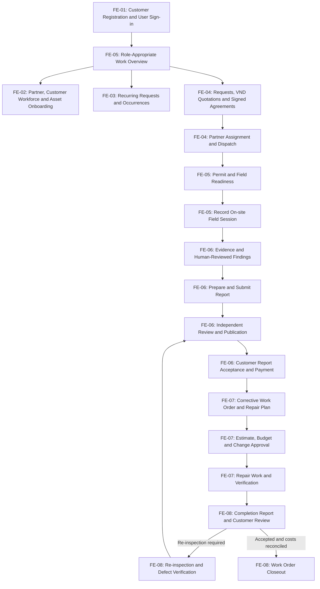
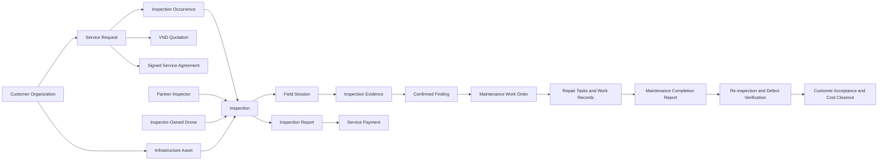

## 3. Functional Requirements

### 3.1 System Functional Overview

SmartDroneInspection supports eight product features (`FE-01` to `FE-08`) across the four business flows (`MF1` to `MF4`): user and organization onboarding; inspection requests and dispatch; field inspection, evidence, reporting, and payment; and corrective maintenance, re-inspection, and closeout. The requirements below describe expected service outcomes and business controls, not claims about current implementation.

#### 3.1.1 Screens Flow

#### 3.1.2 Screen Descriptions

| # | Feature | Screen | Description |
| --- | --- | --- | --- |
| 1 | FE-01 | Customer Registration and User Sign-in | Allows a Customer to register an organization with an initial asset subject to airspace screening, and allows users to sign in and manage their account. |
| 2 | FE-01 | Account and Session Management | Allows users to maintain their account information and end active sessions. Access is limited to their authorized responsibilities. |
| 3 | FE-02 | Partner Provisioning and Workforce | The target service requires platform-governed partner qualification and review, drone registration review, and Customer provisioning of Maintenance Engineers. The current service provisions Inspector accounts through platform staff; it does not provide self-service Inspector applications or application review. |
| 4 | FE-02 | Asset and Drone Registration | Supports Customer asset and checkpoint management and Inspector registration of owned drones with required supporting documents. |
| 5 | FE-03 | Recurring Requests and Occurrences | Allows Customers and `MANAGER` to manage recurring service requests and the inspection occurrences due under an agreed request. |
| 6 | FE-03 | Notifications | The target service requires relevant notices about records and decisions within authorized access, including reminders for future recurring occurrences. Automatic occurrence reminders are not implemented in the current service. |
| 7 | FE-04 | Service Requests, Quotations, Chat and Agreements | Allows Customers to request inspections, negotiate through contextual messages, review and accept VND quotations, and access the signed agreement record. |
| 8 | FE-04 | Partner Assignment and Airspace Information | Allows `MANAGER` to assign qualified Inspectors and eligible drones, account for schedule conflicts across customer organizations, and review relevant airspace information. |
| 9 | FE-05 | Permit and Field Session | Allows assigned Inspectors to provide a mission flight permit and record the start, completion, or abort of field work with required notes. |
| 10 | FE-05 | Work Overview, Calendar and Progress | Provides role-appropriate operational information, inspection schedules, and a Customer-facing view of inspection progress. |
| 11 | FE-06 | Evidence and Findings Review | Allows Inspectors to provide and review inspection photographs and videos, consider advisory defect suggestions, and confirm the findings baseline. |
| 12 | FE-06 | Report Preparation, Publication and Payment | Supports author preparation and submission, independent review and publication, Customer report acceptance, and service-fee payment (report export to PDF is an auxiliary deliverable download). |
| 13 | FE-07 | Maintenance Work Orders and Team Allocation | Allows Customers to create work orders from confirmed defects, assign repair responsibilities, and consider advisory repair-scope guidance. |
| 14 | FE-07 | Estimates, Change Requests and Work Records | Allows Engineers to prepare estimates, request changes, record repair work and evidence, and allows a designated Team Lead to verify work records. |
| 15 | FE-08 | Completion Report and Customer Review | Allows a Report Author to prepare a maintenance completion report and a Customer to review it, with optional advisory technical guidance. |
| 16 | FE-08 | Re-inspection, Acceptance and Closeout | Supports three-way defect verification, independent Customer acceptance, cost reconciliation, and work-order closure. |

#### 3.1.3 Screen Authorization

The following matrix describes which roles may carry out the named business activities. Access to a screen or record is not itself permission to perform an action; organization ownership, assignment, qualifications, and separation-of-duties requirements also apply.

| Business activity | `ADMIN` | `MANAGER` | `CUSTOMER` | `INSPECTOR` | `MAINTENANCE_ENGINEER` |
| --- | :---: | :---: | :---: | :---: | :---: |
| Sign in and manage own account | X | X | X | X | X |
| Govern platform accounts, asset categories, and finance settings | X |  |  |  |  |
| Review customer airspace cases, partner qualification records, and drone registrations | X | X |  |  |  |
| Provide partner qualification information through platform-governed admission; manage own drone registrations |  |  |  | X |  |
| Manage organization assets and maintenance workforce |  |  | X |  |  |
| Manage recurring service requests and occurrences |  | X | X |  |  |
| Create service request, negotiate, and accept quotation |  | X | X |  |  |
| Issue VND quotation and record signed agreement |  | X |  |  |  |
| Assign, reschedule, reassign, or cancel an inspection |  | X |  |  |  |
| Provide mission permit and record assigned field work |  |  |  | X |  |
| View role-appropriate progress and operational schedule | X | X | X | X | X |
| Provide evidence and confirm findings |  |  |  | X |  |
| Prepare and submit inspection report |  |  |  | X |  |
| Independently review and publish inspection report | X | X |  |  |  |
| Accept published report, pay fee, and refer defects |  |  | X |  |  |
| Create work order and assign repair team |  |  | X |  | X |
| Prepare estimate, work records, and completion report |  |  |  |  | X |
| Approve or reject repair estimate and change request |  |  | X |  |  |
| Conduct re-inspection defect verification |  | X |  | X |  |
| Independently accept repair, reconcile costs, and close work order |  |  | X |  |  |

#### 3.1.4 Business Support Functions

| # | Feature | Business support function | Required outcome |
| --- | --- | --- | --- |
| 1 | FE-01 | Sign-in and account protection | Only the account holder can use their account. Repeated failed sign-in attempts are limited, and a security-sensitive account change ends affected active sessions. |
| 2 | FE-02 / FE-04 | Airspace screening and information | Asset and mission locations are compared with relevant airspace information. The result informs internal review and does not grant legal permission to fly. |
| 3 | FE-03 | Recurring request coordination | Each occurrence under an accepted recurring service request is identifiable, assigned, and tracked separately while remaining linked to the agreed request and signed agreement. |
| 4 | FE-03 | Notifications | Relevant lifecycle updates are communicated to the responsible users without creating duplicate notices for the same event. |
| 5 | FE-04 | Partner qualification and availability | Assignment considers active partner status, current pilot credentials, drone eligibility, ownership, and overlapping commitments across customer organizations. |
| 6 | FE-06 | Evidence and advisory analysis | Inspection evidence is associated with the relevant field work. Automated defect suggestions remain unconfirmed until reviewed by the assigned Inspector. |
| 7 | FE-06 | Report preparation and publication | The Inspector prepares and submits the report; a different authorized reviewer makes the publication decision. Published reports are preserved, and a change is issued as a new version. |
| 8 | FE-06 | Service payment and settlement | Customer acceptance and payment are recorded against the applicable inspection occurrence; partner settlement is tracked distinctly from Customer payment. |
| 9 | FE-07 / FE-08 | Repair planning and acceptance guidance | Advisory repair scope, cost, or compliance recommendations support, but do not replace, the Engineer's and Customer's decisions. |
| 10 | FE-08 | Re-inspection and work-order closeout | Re-inspection results are linked to the defect and repair evidence under review. A work order closes only after independent acceptance and cost reconciliation. |

#### 3.1.5 Business Domain Concepts

The target business record set includes customer organizations and users; partner Inspector qualification information; owned drone registrations; infrastructure assets and reference documents; service requests, quotations, messages, signed agreements, and occurrences; inspections, permits, field sessions, evidence, findings, and report versions; payment and partner settlement records; maintenance work orders, team assignments, tasks, estimates, change requests, work records, completion reports, acceptance decisions, and re-inspection results; and relevant activity history. In the current service, Inspector accounts are provisioned by platform staff rather than through self-service applications. These concepts describe business information without prescribing how it is stored.

---

### 3.2 FE-01 Customer Registration, Sign-in and Account Access

#### 3.2.1 Customer Registration and User Sign-in
- **Function trigger**: A prospective Customer registers an organization and first asset, or a user signs in.
- **Actors**: All Roles; automated identity service.
- **Function description**: Register customer organizations subject to airspace screening and provide authorized users with secure access to their assigned responsibilities.
- **Requirements**:
  - Customer registration includes a responsible person, organization identity, and initial asset location and description.
  - A location within a prohibited No-Fly Zone is not eligible for registration. A location requiring review remains pending for `ADMIN` decision. A location that passes the service's screening may proceed; this is not legal flight clearance.
  - Users sign in using an available supported method and are directed to work appropriate to their role.
  - After five consecutive unsuccessful password attempts, sign-in is temporarily restricted for 15 minutes.
- **Normal cases**: A Customer whose initial location passes screening can proceed with organization and asset onboarding; an authorized user signs in successfully.
- **Abnormal cases**: A prohibited location is not accepted; an airspace case requiring review cannot be treated as approved until `ADMIN` records a decision; incorrect credentials do not grant access.

#### 3.2.2 Account Management and Five-Role Access
- **Function trigger**: A user updates their account information, changes a password, or ends an active session.
- **Actors**: All Roles.
- **Function description**: Maintain account access according to the five roles and the user's organization, partner, and work assignment.
- **Requirements**:
  - Recognized roles are `ADMIN`, `MANAGER`, `CUSTOMER`, `INSPECTOR`, and `MAINTENANCE_ENGINEER`.
  - `CUSTOMER` and `MAINTENANCE_ENGINEER` access is limited to their own customer organization. An `INSPECTOR` may access only assigned inspections. Engineers may act only on assigned maintenance responsibilities. `ADMIN` and `MANAGER` access is limited to their platform responsibilities.
  - Account or role changes and user-requested session revocation take effect for active access. Historical activity remains attributable to the responsible user.
  - A role, account, or screen does not confer legal aviation authority, professional qualification, or authority to bypass a review gate.
- **Normal cases**: Users manage their own allowed account information and access only the records and activities within their authorized scope.
- **Abnormal cases**: Attempts to access another organization's records, an unassigned inspection or work order, or an action outside the user's role are denied.

---

### 3.3 FE-02 Partner Qualification, Workforce, Assets and Drone Registration

#### 3.3.1 Partner Inspector Qualification and Customer Maintenance Workforce
- **Function trigger**: `ADMIN` or `MANAGER` provisions a partner Inspector account and maintains its qualification information, or a Customer provisions a Maintenance Engineer.
- **Actors**: `INSPECTOR`, `ADMIN`, `MANAGER`, `CUSTOMER`.
- **Function description**: The target business requirement is to admit partner Inspectors only after review of qualifications and supporting information. This is distinct from the current service process: platform staff provision Inspector accounts and maintain Inspector profiles; the current service does not offer self-service Inspector applications or an application-review workflow.
- **Requirements**:
  - Under the target admission requirement, identity, current remote-pilot credentials, relevant experience, and required partner documentation are reviewed by `ADMIN` or `MANAGER`. Drone ownership is not required for admission.
  - The admission decision and qualification information must be attributable. Admission does not replace applicable legal qualifications or mission flight-permit requirements.
  - A Customer may provision Maintenance Engineers for its own organization and assign their maintenance responsibilities.
  - A partner Inspector without a registered and approved drone may not be assigned to a mission that requires one.
- **Normal cases**: Under the current service process, platform staff provision an Inspector account and maintain its qualification profile. The target process additionally requires accountable review of qualifications for partner admission. A Customer provisions Engineers within its organization.
- **Abnormal cases**: Missing or invalid qualifications prevent mission assignment. A Customer cannot provision workforce for another organization.

#### 3.3.2 Infrastructure Assets, Airspace Screening and Inspector-Owned Drones
- **Function trigger**: A Customer registers or updates an asset, or an existing Inspector submits registration information for an owned drone. Drone registration is distinct from partner account admission.
- **Actors**: `CUSTOMER`, `INSPECTOR`, `ADMIN`, `MANAGER`.
- **Function description**: Maintain customer infrastructure and partner-owned drone records needed to plan and conduct inspections.
- **Requirements**:
  - An asset record identifies the infrastructure, its location and category, and the inspection checkpoints relevant to it. Related reference documents may be associated with the asset.
  - Asset creation is blocked for a location identified as prohibited airspace; a location requiring review follows the applicable human review process.
  - An Inspector drone registration includes its identifying details, registration evidence, ownership evidence, and technical inspection evidence. The three required document categories are `REGISTRATION`, `OWNERSHIP`, and `INSPECTION`.
  - `ADMIN` or `MANAGER` reviews the drone registration and records an attributable decision. Only a drone accepted for service may be considered for assignment to its owning Inspector.
- **Normal cases**: A Customer maintains eligible assets; an Inspector submits all required drone documents for review and, after approval, the drone may be considered for partner assignments.
- **Abnormal cases**: Prohibited locations cannot be registered as eligible assets; missing drone documents or an unresolved drone review prevents the drone from being used for an inspection.

---

### 3.4 FE-03 Recurring Service Requests, Occurrences and Notifications

#### 3.4.1 Recurring Service Requests and Occurrences
- **Function trigger**: A Customer submits or updates a recurring service request, or `MANAGER` prepares one of its inspection occurrences.
- **Actors**: `CUSTOMER`, `MANAGER`, automated service support.
- **Function description**: The target service shall support recurring inspection requests and the coordination of distinct service occurrences under one agreed request. In the current service, planned occurrences are materialized when the recurring request's quotation is accepted; this is not time-based generation, and automatic future-occurrence reminders are not implemented.
- **Requirements**:
  - A recurring request states the requested service period, frequency, and other agreed timing conditions in terms understandable to the Customer and `MANAGER`.
  - Each occurrence, when prepared for delivery, is identifiable by its planned period, assignment, delivery, and payment status, and remains associated with its parent request.
  - Where the parties agree, one signed service agreement may cover the occurrences within its stated term. Each occurrence still requires its own partner assignment, readiness checks, inspection, reporting, and settlement.
  - Occurrence planning and any reminders shall follow the agreed request. Time passing alone does not authorize an inspection or partner assignment.
- **Normal cases**: The parties agree a recurring service request, record its signed agreement, and coordinate each occurrence using the agreed timing and scope.
- **Abnormal cases**: An occurrence is not dispatched if the assigned partner or drone is unavailable or no longer meets applicable requirements. A change to the agreed frequency or term requires the parties' agreement.

#### 3.4.2 Notifications
- **Function trigger**: A significant service, inspection, payment, or maintenance decision occurs, or a user reviews available notices.
- **Actors**: All Roles; service support.
- **Function description**: The target service should inform responsible users about relevant events and actions while respecting access boundaries. Automatic recurring-occurrence reminders are a target requirement, not a current capability claim.
- **Requirements**:
  - Where provided, notices identify the event, when it occurred, and the relevant record or action.
  - The target notification service should avoid duplicate notices for the same event when processing is retried.
  - Following a notice never grants access to its target record; the user's normal authorization still applies.
  - Automatic reminders for future occurrences are required in the target service but are not implemented in the current service.

- **Normal cases**: A user receives and reviews a relevant notice and can navigate to an authorized record.
- **Abnormal cases**: A user cannot view or act on a record outside their organization, role, or assignment because they received a notice.

---

### 3.5 FE-04 Service Requests, Quotations, Agreements and Dispatch

#### 3.5.1 Service Request, VND Quotation, Negotiation and Signed Agreement
- **Function trigger**: A Customer submits a one-time or recurring service request, exchanges messages with `MANAGER`, or accepts a quotation; the parties sign an offline service agreement.
- **Actors**: `CUSTOMER`, `MANAGER`.
- **Function description**: Establish an agreed inspection scope and commercial terms before inspection work is dispatched.
- **Requirements**:
  - A service request identifies the asset, requested inspection scope, and requested timing. It may be one-time or recurring.
  - Customer and `MANAGER` can exchange contextual messages about the request. A message does not itself change agreed quotation terms.
  - `MANAGER` issues a VND quotation stating scope, timing, and price per occurrence. Any change to the offer is issued as a new version; the Customer accepts the version currently offered.
  - The parties sign the service agreement offline. `MANAGER` records the signed document after execution. A commercial request is not ready for field dispatch until the signed agreement has been recorded.
  - A recurring agreement applies only to the term and occurrences it describes.
- **Normal cases**: The Customer submits a request; the parties discuss it; `MANAGER` issues or revises a VND quotation; the Customer accepts the agreed version; the parties sign an agreement; and `MANAGER` records it.
- **Abnormal cases**: An obsolete quotation cannot be accepted. A dispatch cannot proceed without an accepted quotation and recorded signed agreement. A communication is not treated as acceptance or as a change in price or scope.

#### 3.5.2 Partner Assignment, Dispatch Recovery and Airspace Information
- **Function trigger**: `MANAGER` assigns an Inspector and owned drone to an agreed occurrence, or responds to an aborted field session.
- **Actors**: `MANAGER`, `ADMIN`, `CUSTOMER`, `INSPECTOR`, automated service support.
- **Function description**: Assign a qualified partner and eligible drone to an occurrence, manage dispatch changes, and provide relevant airspace information.
- **Requirements**:
  - Assignment uses a partner Inspector and drone eligible for the work; the drone must be owned by that Inspector and have passed its required review.
  - Assignment considers current pilot qualifications and overlapping commitments across all customer organizations.
  - After an abort, `MANAGER` may reschedule, reassign, or cancel the dispatch. The decision and its reason are attributable.
  - Airspace information supports planning but does not certify legal clearance or authorize flight.
- **Normal cases**: An available, qualified Inspector and eligible owned drone are assigned to an occurrence; after an abort, `MANAGER` records an appropriate recovery decision.
- **Abnormal cases**: Conflicting commitments, expired pilot credentials, an unapproved drone, or a drone not owned by the selected Inspector prevent assignment.

---

### 3.6 FE-05 Flight Readiness, Field Sessions and Progress

#### 3.6.1 Flight Permit and On-site Field Session
- **Function trigger**: The assigned Inspector prepares to perform field work, starts a session, completes it, or aborts it.
- **Actors**: `INSPECTOR`, `MANAGER`.
- **Function description**: Record the required mission documentation and accountable on-site session outcomes. The service records work; it does not control aircraft.
- **Requirements**:
  - Before field work begins, the assigned Inspector provides the required mission flight permit and current pilot credentials. These checks do not grant governmental authorization.
  - Starting a session records a pre-flight safety note addressing relevant aircraft, battery, and environmental conditions.
  - Completion records the outcome. An abort records the reason and alerts `MANAGER` to arrange rescheduling, reassignment, or cancellation.
  - A further session may be recorded when additional capture is needed before the findings baseline is confirmed.
- **Normal cases**: The Inspector records readiness, starts and completes a session, and provides field evidence; or the Inspector records an abort and `MANAGER` handles dispatch recovery.
- **Abnormal cases**: The service prevents a session from being recorded as ready to start when the required permit, current pilot credentials, or safety note is missing. A software record is not a physical flight command.

#### 3.6.2 Operational Overview, Calendar and Customer Progress
- **Function trigger**: A user reviews work assigned to their role, an inspection schedule, or a Customer inspection's progress.
- **Actors**: All Roles.
- **Function description**: Present operational information appropriate to the user's responsibilities and keep internal inspection material distinct from Customer-facing progress.
- **Requirements**:
  - Users see only records and summaries allowed by their role, organization, and assignment.
  - Customers can follow the main progress of an inspection without access to unapproved findings, internal field records, or unpublished reports.
  - Schedule information identifies planned inspections and relevant dispatch changes.
- **Normal cases**: A Customer follows authorized inspection stages; operational users review relevant assigned work and schedules.
- **Abnormal cases**: A user cannot obtain internal or cross-organization records by selecting a filter, opening a schedule item, or following a link.

---

### 3.7 FE-06 Evidence, Findings, Reports and Payment

#### 3.7.1 Inspection Evidence and Findings Confirmation
- **Function trigger**: An assigned Inspector provides inspection evidence and reviews candidate findings.
- **Actors**: `INSPECTOR`, automated advisory service.
- **Function description**: Maintain evidence for an inspection and establish an accurate, human-confirmed findings baseline.
- **Requirements**:
  - Evidence may include photographs and video, with relevant capture time, location information when available, and structural location notes. Missing camera or location metadata is disclosed and does not by itself invalidate otherwise suitable evidence.
  - Evidence that cannot be used or is a duplicate within the same inspection is identified for the Inspector.
  - Automated visual analysis may suggest possible defects. Each suggestion remains advisory until the assigned Inspector confirms, edits, or rejects it. The Inspector may record a finding manually when appropriate evidence is available.
  - Only findings confirmed by the Inspector are part of the official baseline and eligible for an inspection report or maintenance referral.
  - If automated analysis is unavailable, the Inspector can still review evidence and record findings manually.
- **Normal cases**: The Inspector reviews evidence, resolves each automated suggestion, adds any supported manual findings, and confirms the official findings baseline.
- **Abnormal cases**: The findings baseline cannot be confirmed while unresolved candidate suggestions remain. An unconfirmed or rejected suggestion is excluded from official findings and maintenance scope.

#### 3.7.2 Inspection Report Preparation, Independent Publication and Payment
- **Function trigger**: The report author prepares and submits an inspection report after findings confirmation; an independent reviewer assesses it; the Customer reviews the published report.
- **Actors**: `INSPECTOR`, `MANAGER`, `ADMIN`, `CUSTOMER`, automated advisory service, payment service.
- **Function description**: Deliver a human-prepared and independently reviewed inspection report, provide any AI summary as advisory material, and record Customer acceptance and service payment.
- **Requirements**:
  - The report author uses the confirmed findings and relevant field records to prepare and submit the inspection report for independent review. Submission is an explicit report-preparation action; merely visiting a screen does not submit it.
  - A report summary generated with AI is advisory, based on verified inspection information, and reviewed by a person before reliance on it.
  - A `MANAGER` or `ADMIN` reviewer who is not the report author approves a report for publication or returns it with reasons. Only an approved report may be published as the official deliverable.
  - A published report is preserved as a versioned record. Any correction is issued as a new version, with prior versions retained.
  - Customers see the official published report, not internal drafts or unapproved findings. The applicable payment rule governs access to the official deliverable.
  - When the Customer accepts a published report, the service records the acceptance and applicable fee as due. Payment is recorded against the relevant occurrence; partner settlement is a separate record.
  - If payment services are unavailable, the business must retain an authorized, attributable way to record payment confirmation rather than treat an unconfirmed payment as settled.
- **Normal cases**: The Inspector prepares and submits a report; an independent platform reviewer reviews and publishes it; the Customer reviews and accepts it and pays through the supported payment process.
- **Abnormal cases**: A report author cannot review or publish their own report. A returned report includes reasons and remains available for revision. A Customer cannot access an unpublished report as an official deliverable, and payment is not marked settled without confirmation.

---

### 3.8 FE-07 Maintenance Work Orders, Estimates and Repair Execution

#### 3.8.1 Work Order, Repair Scope and Team Assignment
- **Function trigger**: A Customer selects a confirmed defect in a published report and creates a corrective work order.
- **Actors**: `CUSTOMER`, `MAINTENANCE_ENGINEER`, automated advisory service.
- **Function description**: Govern a corrective repair from an official inspection finding and assign accountable engineering responsibilities.
- **Requirements**:
  - A work order identifies the source published report and confirmed defect, repair priority, planned timing, corrective scope, and acceptance conditions.
  - The Customer may consider advisory repair-scope recommendations, but remains responsible for authorizing the work order and its scope.
  - Assignments identify a Team Lead, a Report Author, and any Team Members. The Budget Approver and final Accepting Reviewer must be independent of the executing repair team.
  - An Engineer may not be assigned work or approval authority outside their Customer organization or designated responsibility.
- **Normal cases**: A Customer creates a work order from a confirmed defect in its published report, reviews and authorizes a repair scope, and assigns the appropriate team and independent reviewers.
- **Abnormal cases**: A work order cannot be based on an unconfirmed finding, unpublished report, or another organization's asset. An executing team member cannot approve the repair budget or accept the team's work.

#### 3.8.2 Repair Estimate, Budget and Change Approval; Work Verification
- **Function trigger**: An Engineer prepares an estimate, requests a change, performs repairs, and submits work records for verification.
- **Actors**: `MAINTENANCE_ENGINEER`, `CUSTOMER`, automated advisory service.
- **Function description**: Maintain a Customer-approved repair budget, govern additional work, and verify field work before reporting completion.
- **Requirements**:
  - The Engineer prepares an estimate with understandable quantities, rates, currency, and cost categories. Advisory cost guidance may inform the estimate but is not a binding price or approval.
  - The Customer independently approves or rejects the proposed budget. An approved baseline remains available for comparison throughout the work.
  - Any proposed increase or change to scope, cost, or schedule is submitted as a change request and must be approved by the Customer before the additional work is performed.
  - Engineers record assigned tasks, time or quantities where relevant, observed conditions, test readings, and before-and-after repair evidence.
  - A designated Team Lead reviews and verifies submitted work records. Work cannot be declared complete while required records remain unverified or a change request remains unresolved.
- **Normal cases**: The Engineer submits an estimate, the Customer approves it, the team performs authorized repairs and provides evidence, and the Team Lead verifies the work records before declaring completion.
- **Abnormal cases**: Additional work without prior Customer approval, incomplete required repair evidence, unverified work records, or an unresolved change request prevents completion.

---

### 3.9 FE-08 Completion, Re-inspection and Work-Order Closeout

#### 3.9.1 Maintenance Completion Report and Acceptance Guidance
- **Function trigger**: The designated Report Author prepares and submits the completion report after repair work is declared complete; the Customer reviews the submission.
- **Actors**: `MAINTENANCE_ENGINEER`, `CUSTOMER`, automated advisory service.
- **Function description**: Give the Customer an attributable account of completed repairs and a basis for independent acceptance.
- **Requirements**:
  - The completion report describes the approved repair scope, completed tasks, verified work records, relevant readings and conditions, repair evidence, and approved changes.
  - The Report Author reviews and submits the report; the service may assist with its preparation from recorded work, but an automatically prepared draft is not a submitted or accepted report until a person reviews and submits it.
  - The Customer may consider an advisory assessment against applicable technical acceptance criteria. The Customer, not the automated assessment, makes and records the acceptance decision.
  - Only the designated Report Author may submit the report. The accepting Customer reviewer is independent of the executing repair team.
- **Normal cases**: The Report Author reviews and submits a complete report; the Customer reviews the report, evidence, and any advisory assessment before deciding whether to accept, require rework, or request re-inspection.
- **Abnormal cases**: An incomplete work order cannot be submitted as complete. A repair team member cannot accept their own work.

#### 3.9.2 Re-inspection, Independent Acceptance and Cost Reconciliation
- **Function trigger**: The Customer requests re-inspection, a partner Inspector verifies the target defects, and the Customer completes acceptance and cost closeout.
- **Actors**: `CUSTOMER`, `MANAGER`, `INSPECTOR`.
- **Function description**: Verify the repair outcome against the original defect and repair evidence, then complete independent acceptance and financial closeout.
- **Requirements**:
  - A `REINSPECTION_REQUIRED` decision links the verification work to the source work order, published inspection report, and target findings.
  - For each target defect, the Inspector reviews the original finding, the Engineer's repair evidence, and new inspection evidence, and records `RESOLVED`, `UNRESOLVED`, or `INCONCLUSIVE` with supporting notes.
  - `MANAGER` independently reviews and publishes the re-inspection report. A factual report must not conceal an unresolved or inconclusive outcome.
  - The Customer reviews the published verification report and records the maintenance acceptance decision independently of the repair team. If defects remain unresolved, the Customer may require rework.
  - Actual costs are reconciled against the approved estimate and Customer-approved changes. The original estimate and subsequent approved changes remain attributable.
  - A work order may be closed only after independent Customer acceptance and cost reconciliation (`COST_RECONCILED`).
- **Normal cases**: Re-inspection evidence is reviewed and published; the Customer records acceptance, reconciles actual costs, and closes the work order when all conditions are met.
- **Abnormal cases**: An unresolved or inconclusive finding remains visible for Customer action. A work order cannot be closed without the required independent acceptance and completed cost reconciliation.
