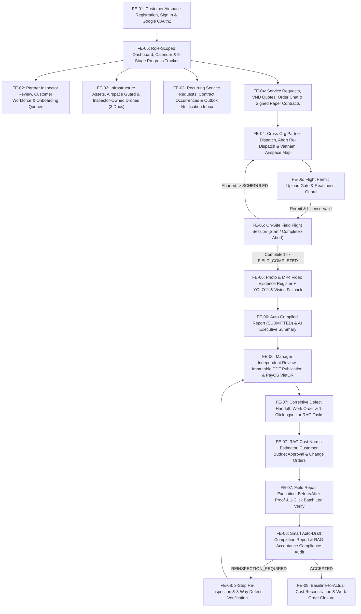
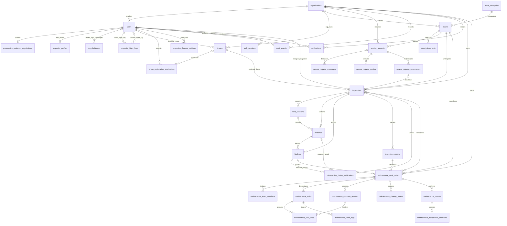

## 3. Functional Requirements

### 3.1 System Functional Overview

The SmartDroneInspection platform provides a multi-portal web application (`/admin`, `/client`, `/operations`) and a Flutter mobile application organized into **eight product features (`FE-01` to `FE-08`)** and **sixteen functional items** that support the complete four-stage infrastructure inspection and corrective maintenance lifecycle (`MF1` to `MF4`).

#### 3.1.1 Screens Flow



#### 3.1.2 Screen Descriptions

| # | Feature | Screen | Description |
| --- | --- | --- | --- |
| 1 | FE-01 | Customer Airspace Registration, Sign In & OAuth2 | Allows a prospective customer organization to register with its first infrastructure asset (evaluated against Vietnam No-Fly Zones) and allows users to sign in via email/password or Google OAuth2 on Web and Mobile. |
| 2 | FE-01 | Account Security, Profile (`/users/me`) & Sessions | Allows users to update personal profile and pilot license details, change passwords, revoke active device sessions, and navigate within their authorized portal (`/admin`, `/client`, `/operations`). |
| 3 | FE-02 | Inspector Provisioning, Profile, Review Queues & Workforce | Allows Platform Admins/Managers to provision Partner Inspector accounts and maintain their pilot-license profiles, review prospective Customer airspace and drone-registration applications, and lets Customers provision Maintenance Engineers. Inspector-owned drone registration remains optional and separate from account provisioning. |
| 4 | FE-02 | Asset Registry & Inspector-Owned Drone Registration | Allows Customers to register infrastructure assets with Nominatim address search, no-fly zone blocking, checkpoints, and engineering documents, and allows partner Inspectors to register owned drones with 3 mandatory documents (`REGISTRATION`, `OWNERSHIP`, `INSPECTION`). |
| 5 | FE-03 | Recurring Service Requests & Contract Occurrences | Allows Customers and Platform Managers to manage recurring service requests that materialize contract occurrences under the parent request; the separate internal schedule-rule engine is retired. |
| 6 | FE-03 | In-App Notification Inbox | Displays deduplicated transactional outbox alerts and reminders in a notification bell and inbox with unread counts and deep links to target records. |
| 7 | FE-04 | Service Requests, Quotations, Chat & Signed Contracts | Allows Customers to submit one-time or recurring service requests, negotiate with Platform Managers via in-context Order Chat, review and accept versioned VND quotes, and upload/download executed paper service contracts. |
| 8 | FE-04 | Partner Mission Dispatch & Airspace Advisory Map | Allows Platform Managers to assign partner Inspectors and their owned drones to contract occurrences with cross-organization conflict checking, reschedule/reassign/cancel aborted missions, and inspect the interactive Vietnam Airspace & No-Fly Zone map. |
| 9 | FE-05 | Flight Permit Gate & Field Flight Session Workspace | Allows the assigned Inspector on Web or Mobile to upload the mission flight permit, record pre-flight safety notes, and log the start, normal completion (`FIELD_COMPLETED`), or emergency abort (`ABORTED`) of an on-site flight session. |
| 10 | FE-05 | Operational Dashboard, Calendar & Progress Tracker | Displays role-scoped analytics dashboards, the Inspector Schedule Calendar (`Month`, `Week`, `Agenda`), and the 5-stage Customer Inspection Progress Tracker (`InspectionProgressPage`). |
| 11 | FE-06 | Evidence Register, Video Player & AI Findings Review | Allows Inspectors to upload and stream inspection photos and `video/mp4` captures, run `YOLO11` defect detection (with Vision LLM fallback), inspect findings preview chips directly beneath each capture, and confirm the official findings baseline. |
| 12 | FE-06 | Auto-Compiled Report, AI Summary, Publish & PayOS | Auto-compiles and submits the inspection report upon visiting the Report tab, displays the LLM Executive Summary card, enables Platform Manager review and immutable PDF publication, and provides Customer report acceptance and PayOS VietQR payment checkout. |
| 13 | FE-07 | Maintenance Work Orders, RAG Advisor & Team Allocation | Allows Customers to create work orders from confirmed published defects, query the `pgvector` RAG Scope Advisor for civil engineering standards (`TCVN`/`EN`/`ISO`), provision suggested tasks in 1 click, and allocate the repair team. |
| 14 | FE-07 | RAG Cost Norms Estimation, Change Orders & Batch Logs | Allows Maintenance Engineers to generate RAG-assisted cost norms (`suggest-estimate`), submit estimates and Change Orders for Customer approval, log field repair work with before/after proof, and batch-verify all submitted logs in 1 click as Team Lead. |
| 15 | FE-08 | Auto-Draft Completion Report & RAG Compliance Audit | Allows the Report Author to synthesize a 5-part completion report from tasks and logs (`auto-draft`) and provides the Accepting Reviewer with an automated RAG Technical Acceptance Compliance Audit (`acceptance-compliance`). |
| 16 | FE-08 | 3-Way Re-inspection Verification, Acceptance & Closure | Provides a specialized 3-step re-inspection workspace with 3-way comparative defect verification cards (Prior Defect vs Engineer Repair Proof vs Drone Re-capture), independent Customer acceptance, baseline-to-actual cost inheritance/reconciliation, and Work Order closure. |

#### 3.1.3 Screen Authorization

| Screen | Platform Admin (`ADMIN`) | Platform Manager (`MANAGER`) | Customer (`CUSTOMER`) | Inspector (`INSPECTOR`) | Maintenance Engineer (`MAINTENANCE_ENGINEER`) |
| --- | :---: | :---: | :---: | :---: | :---: |
| **Authentication, Google OAuth2 & 5-Role Access Control (FE-01)** | X | X | X | X | X |
| - Customer Airspace Registration, Password Sign-In & Google OAuth2 | X | X | X | X | X |
| - Manage Active Sessions, Password & `/users/me` Profile | X | X | X | X | X |
| - Manage Internal Platform User Accounts & Finance Settings | X | X |  |  |  |
| **Partner Onboarding, Workforce, Asset & Inspector Drone Registry (FE-02)** | X | X | X | X | X |
| - Review Customer Airspace & Drone Registration Applications; provision Partner Inspector accounts | X | X |  |  |  |
| - Maintain Inspector Pilot-License Profile & Register Owned Drone (3 Docs) |  |  |  | X |  |
| - Provision & Manage Customer Maintenance Engineer Workforce |  |  | X |  |  |
| - Manage Standard Asset Categories | X |  |  |  |  |
| - Register, Edit, Attach Documents & Retire Customer Assets | X | X | X |  |  |
| **Recurring Schedules, Contract Occurrences & Outbox Notifications (FE-03)** | X | X | X | X | X |
| - Manage Recurring Service Requests & Multi-Occurrence Contract Cycles |  | X | X |  |  |
| - View Own Notification Inbox & Mark Notifications as Read | X | X | X | X | X |
| **Service Requests, Quotations, Contracts, Dispatch & Airspace Map (FE-04)** | X | X | X | X |  |
| - Create Service Request, Negotiate in Order Chat & Accept Quote |  | X | X |  |  |
| - Issue VND Quote, Upload Signed Contract & Assign Occurrences |  | X |  |  |  |
| - Reschedule, Reassign or Cancel Aborted Inspections | X | X |  |  |  |
| - View Interactive Vietnam Airspace & No-Fly Zone Map | X | X | X | X |  |
| **Flight Permit Gate, Field Execution, Dashboard & Calendar (FE-05)** | X | X | X | X | X |
| - Upload Mission Flight Permit & Log Field Sessions (Start/Complete/Abort) |  | X |  | X |  |
| - View Role-Scoped Operational Dashboard, Calendar & 5-Stage Tracker | X | X | X | X | X |
| **Evidence Intake, YOLO11 Detection, Auto-Compiled Report & PayOS (FE-06)** | X | X | X | X |  |
| - Upload Photo/MP4 Evidence, Run YOLO11 & Confirm Findings Baseline |  |  |  | X |  |
| - Auto-Compile Report, View AI Executive Summary & Submit for Review | X | X |  | X |  |
| - Review (`Approve`/`Return`) & Publish Immutable PDF Report | X | X |  |  |  |
| - Accept Published Report, Pay via PayOS VietQR & Forward Defects |  | X | X |  |  |
| **Maintenance Work Orders, RAG Scope/Norms Advisor & Repair Execution (FE-07)** | X |  | X |  | X |
| - Create Work Order, 1-Click RAG Tasks & Assign Repair Team |  |  | X |  | X |
| - Generate RAG Cost Norms, Submit Estimate/Change Order & Batch-Verify Logs |  |  |  |  | X |
| - Approve or Reject Cost Estimate & Change Order |  |  | X |  |  |
| **Completion Report, 3-Way Re-inspection Verification & Cost Closure (FE-08)** | X | X | X | X | X |
| - Auto-Draft & Submit Maintenance Completion Report |  |  |  |  | X |
| - Execute 3-Way Re-inspection Defect Verification (`RESOLVED`/`UNRESOLVED`/`INCONCLUSIVE`) |  | X |  | X |  |
| - Run RAG Compliance Audit, Record Acceptance, Reconcile Costs & Close Order |  |  | X |  |  |

#### 3.1.4 Non-Screen Functions

| # | Feature | System Function | Description |
| --- | --- | --- | --- |
| 1 | FE-01 | Sign-In, OAuth2 & Session Protection | Validates Argon2id credentials and Google OAuth2 authorization codes, rotates refresh tokens, enforces 5-attempt lockout, and invalidates sessions on role/password changes. |
| 2 | FE-02 / FE-04 | Airspace Zone Haversine Radar | Evaluates asset and mission coordinates against published Decision 18/2020/QD-TTg and Decree 288/2025/ND-CP No-Fly Zones and Restricted Zones during registration, asset creation, and mission preparation. |
| 3 | FE-03 | Recurring Occurrence & Reminder Scheduler | Materializes multi-occurrence service contract schedules, inherits parent signed contracts across occurrences, and dispatches upcoming inspection reminders. |
| 4 | FE-03 | Transactional Outbox Notification Service | Publishes domain events through the Spring Modulith transactional outbox to deliver deduplicated in-app notifications for quotes, contracts, aborts, reports, and work orders. |
| 5 | FE-04 | Cross-Organization Partner Conflict Guard | Verifies partner Inspector pilot license currency, inspector-owned drone ownership/registration validity, and cross-organization schedule conflicts before assigning occurrences or re-dispatching aborted missions. |
| 6 | FE-06 | Media Streamer, EXIF Reader & YOLO11 + Vision Fallback | Streams photo and `video/mp4` evidence from MinIO, extracts EXIF GPS/capture metadata, and executes `YOLO11` defect detection with automatic fallback to the configured Vision LLM when YOLO returns zero candidates. |
| 7 | FE-06 | Deterministic Report Compiler, AI Summary & PDF Generator | Automatically compiles confirmed findings and field records into a `SUBMITTED` report, generates the LLM Executive Summary (`ReportAiSummaryResponse`), and renders immutable `SHA-256` A4 PDF reports via OpenHTMLtoPDF. |
| 8 | FE-06 | PayOS VietQR Gateway & HMAC Webhook Verifier | Generates unique 64-bit `payos_order_code` VietQR payment links for accepted reports, verifies PayOS HMAC-SHA256 webhook signatures, unlocks PDF downloads upon `PAID` settlement, and computes net partner payouts (`inspection_finance_settings`). |
| 9 | FE-07 / FE-08 | pgvector RAG Scope, Cost Norms & Compliance Engine | Queries 1536-dimensional `pgvector` HNSW engineering standard chunks (`TCVN`, `ACI`, `EN 1504`, `ISO 12944`) to suggest repair tasks, itemized Vietnamese construction cost norms (`suggest-estimate`), and quantitative acceptance compliance scores (`acceptance-compliance`). |
| 10 | FE-08 | Event-Driven Re-inspection Loop Orchestrator | Listens for `ReinspectionRequestedEvent` to spawn a linked `RE_INSPECTION` mission with pre-populated `reinspection_defect_verifications` rows, and listens for `ReinspectionReportPublishedEvent` to attach the published verification report and reinstate the Work Order for Customer acceptance. |

#### 3.1.5 Entity Relationship Diagram



**Entities Description**

| # | Entity | Description |
| --- | --- | --- |
| 1 | Organization | Customer enterprise organization (`ActorZone.CUSTOMER_ORGANIZATION`) that owns infrastructure assets, submits service requests, and governs maintenance work orders. |
| 2 | User | Authenticated account carrying one of the five canonical roles (`ADMIN`, `MANAGER`, `CUSTOMER`, `INSPECTOR`, `MAINTENANCE_ENGINEER`) and `actor_zone`; Inspector-specific pilot license attributes are stored separately in `inspector_profiles`. |
| 3 | Authentication Session | Active web or mobile refresh/access session (`auth_sessions`) supporting token rotation and immediate revocation. |
| 4 | Prospective Customer Registration | Onboarding record (`prospective_customer_registrations`) holding a prospective Customer's organization and initial asset details when airspace evaluation requires Admin review (`RESTRICTED_ZONE`). |
| 5 | Inspector Profile | Inspector-specific pilot-license, identity, qualification, and experience fields stored in `inspector_profiles`; partner accounts are provisioned by Platform Admin/Manager rather than through an Inspector application table. |
| 6 | Drone Registration Application | Application (`drone_registration_applications`) submitted by a partner Inspector to register an owned drone with three mandatory documents (`registration_file_key`, `ownership_file_key`, `inspection_file_key`). |
| 7 | Drone | Aircraft record (`drones`) scoped either to a partner Inspector (`inspector_owner_id`) or an organization (`organization_id`), tracking serial number, model, registration expiry, and serviceability (`ACTIVE`, `MAINTENANCE`, `SUSPENDED`, `RETIRED`). |
| 8 | Asset Category | Standard infrastructure classification (Bridge, Building, Power Tower, Wind Turbine, Solar Facility) managed by Platform Admin. |
| 9 | Asset | Physical infrastructure asset (`assets`) owned by a Customer organization with GPS coordinates, airspace classification, and standard inspection checkpoints. |
| 10 | Asset Document | Reference engineering drawing or specification (`asset_documents`) stored in MinIO with SHA-256 integrity. |
| 11 | Service Request | Commercial inspection order (`service_requests` — `ONE_TIME` or `RECURRING`) tracking lifecycle status (`OPEN`, `QUOTED`, `ACCEPTED`, `CONTRACT_SIGNED`, `ASSIGNED`, `CANCELLED`), accepted quote version, and signed-contract object key/upload timestamp. |
| 12 | OTP Challenge | Purpose-specific (`LOGIN`, `REGISTRATION`, `PASSWORD_RESET`) one-time verification challenge stored in the consolidated `otp_challenges` table. |
| 13 | Inspector Flight Log | Inspector flight-history entry (`inspector_flight_logs`) with mission, aircraft, duration, location, safety-incident, and recorder metadata. |
| 14 | Service Request Message | Contextual chat message (`service_request_messages`) exchanged between Customer and Platform Manager during scope and quote negotiation. |
| 15 | Service Request Quote | Versioned commercial quotation (`service_request_quotes`) specifying scope snapshot, proposed schedule, partner Inspector, inspector-owned Drone, and VND price per occurrence. |
| 16 | Service Request Occurrence | Individual inspection delivery cycle (`service_request_occurrences`) tracking assignment (`PENDING_ASSIGNMENT`, `ASSIGNED`, `CANCELLED`), partner/Drone assignment snapshots, PayOS order code, payment status (`PENDING`, `PAYMENT_DUE`, `PAID`), and payout status (`PENDING`, `ELIGIBLE`, `PAID`). Signed contract metadata is held on the parent Service Request. |
| 17 | Inspection Finance Settings | Platform financial configuration (`inspection_finance_settings`) storing platform commission rate, VAT rate, and PIT/TNCN withholding rate for VND occurrence settlement calculations. |
| 18 | Inspection | Core inspection mission (`inspections`) with 6 canonical states (`SCHEDULED`, `IN_PROGRESS`, `FIELD_COMPLETED`, `UNDER_REVIEW`, `COMPLETED`, `CANCELLED`), mission type (`INITIAL`, `RE_INSPECTION`), flight permit metadata, and source Work Order linkage. |
| 19 | Field Session | On-site flight execution record (`field_sessions`) with states `PLANNED`, `IN_PROGRESS`, `FIELD_COMPLETED`, and `ABORTED` (historical `POSTPONED` read-only), storing pre-flight checklist notes, outcome notes, and abort reasons. |
| 20 | Evidence | Uploaded inspection photo or `video/mp4` file (`evidence`) stored in MinIO with capture timestamp, EXIF GPS coordinates, structural location tags, and active/retired state. |
| 21 | Finding | Defect record (`findings`) linked to an evidence capture, tracking `YOLO11` / Vision fallback candidates (`PENDING`) and Inspector-confirmed defects (`CONFIRMED`) with severity, bounding box, and maintenance handoff timestamp. |
| 22 | Inspection Report | Versioned inspection deliverable (`inspection_reports`) with 5 canonical states (`SUBMITTED`, `RETURNED`, `APPROVED`, `PUBLISHED`, `SUPERSEDED`), auto-compiled from confirmed findings and rendered to an immutable SHA-256 PDF in MinIO. |
| 23 | Re-inspection Defect Verification | Three-way comparative verification record (`reinspection_defect_verifications`) linking a `RE_INSPECTION` mission to each target `source_finding_id`, Inspector repair-proof notes/evidence, drone `new_evidence_id`, and resolution status (`RESOLVED`, `UNRESOLVED`, `INCONCLUSIVE`). |
| 24 | Maintenance Work Order | Corrective repair project (`maintenance_work_orders`) with 12 lifecycle states (`DRAFT` to `CLOSED`), linking the source published report, target defect, repair team roles, and optional `reinspection_id` / `reinspection_report_version_id`. |
| 25 | Maintenance Team Member & Task | Assigned engineering personnel (`maintenance_team_members`: `TEAM_LEAD`, `REPORT_AUTHOR`, `TEAM_MEMBER`) and decomposed repair tasks (`maintenance_tasks`). |
| 26 | Maintenance Estimate, Cost Line & Change Order | Versioned repair budgets (`maintenance_estimate_versions`), itemized estimate/actual cost lines (`maintenance_cost_lines`: `LABOR`, `MATERIAL`, `EQUIPMENT`, `EXTERNAL_SERVICE`, `OTHER`, `CONTINGENCY`), and scope/budget adjustment requests (`maintenance_change_orders`). |
| 27 | Maintenance Work Log, Report & Acceptance Decision | Field execution logs (`maintenance_work_logs`) verified in batch by the Team Lead, versioned completion reports (`maintenance_reports`), and independent Customer acceptance decisions (`maintenance_acceptance_decisions`: `ACCEPTED`, `REWORK_REQUIRED`, `REINSPECTION_REQUIRED`). |
| 28 | Repair Knowledge Chunk, Notification & Audit Event | `pgvector` HNSW civil engineering standard chunks (`repair_knowledge_chunks`), deduplicated outbox notifications (`notifications`, `event_publication`), and immutable security/workflow audit logs (`audit_events`). |

---

### 3.2 FE-01 Authentication, Google OAuth2 & 5-Role Access Control

#### 3.2.1 Customer Airspace Registration, Password Sign-In & Google OAuth2
- **Function trigger**: A prospective customer submits the **Customer & First Asset Registration** form (`POST /api/v1/auth/register`), or a user signs in via email/password or clicks **Sign in with Google** (`/api/v1/auth/oauth2/authorize/google`) on Web or Mobile.
- **Function description**: Actors: All Roles (`ADMIN`, `MANAGER`, `CUSTOMER`, `INSPECTOR`, `MAINTENANCE_ENGINEER`), `Google OAuth2`. Evaluates the customer's first infrastructure asset location against Vietnam airspace zones before activating the organization and `CUSTOMER` account, and authenticates users across Web and Mobile (including `smartdrone://auth` deep-link callback).
- **Screen layout**: Mock-up prototype of the `Customer Airspace Registration, Password Sign-In & Google OAuth2` screen:

```mermaid
%% title: Screen Layout Placeholder - 3.2.1 Customer Airspace Registration, Password Sign-In & Google OAuth2
```

- **Function Details**:
  - *Data & Validation*: Customer registration requires **Full Name**, **Work Email**, **Password**, **Organization Name**, **Organization Code**, and **First Asset** (**Asset Code**, **Asset Name**, **Category**, **Address**, **Latitude `-90..90`**, **Longitude `-180..180`**). Sign-in requires **Email** and **Password** or a valid Google OAuth2 token.
  - *Business Rules*: Enforces `BR-01`, `BR-06`, `BR-08`, `BR-38`, and `BR-40`. If the first asset falls inside a `NO_FLY_ZONE`, registration is immediately blocked (`403 ASSET_IN_NO_FLY_ZONE`). If it falls inside a `RESTRICTED_ZONE`, a `PROSPECT_CUSTOMER` account and `PENDING` `prospective_customer_registrations` record are created for Admin review. If in `CLEAR_ZONE`, the organization, active `CUSTOMER` account, and first asset are provisioned atomically. Public self-registration for `INSPECTOR` is disabled (`e23d23f`).
  - *Normal Cases*: Clear-zone registration creates the organization and initial asset (`MSG05`). Valid password or Google OAuth2 sign-in opens the user's role-scoped portal (`/admin`, `/client`, or `/operations`).
  - *Abnormal Cases*: Locations inside a prohibited No-Fly Zone block account creation (`MSG28`). Entering a wrong password 5 consecutive times locks the account for 15 minutes (`MSG08`, `MSG09`).

#### 3.2.2 Session Management, User Profile (`/users/me`) & 5-Role Access Control
- **Function trigger**: A signed-in user navigates across routes, updates their profile or pilot license at `/api/v1/users/me`, or clicks **Sign Out** / **Sign Out All Devices**.
- **Function description**: Actors: All Roles, `Automated System`. Enforces `ActorZone` and 5-role permissions (`ADMIN`, `MANAGER`, `CUSTOMER`, `INSPECTOR`, `MAINTENANCE_ENGINEER` with legacy alias normalization for `PLATFORM_MANAGER` $\rightarrow$ `MANAGER` and `ORG_MANAGER` $\rightarrow$ `CUSTOMER`), manages decoupled user profile/pilot license endpoints, and rotates/revokes sessions.
- **Screen layout**: Mock-up prototype of the `Session Management, User Profile & 5-Role Access Control` screen:

```mermaid
%% title: Screen Layout Placeholder - 3.2.2 Session Management, User Profile & 5-Role Access Control
```

- **Function Details**:
  - *Data & Validation*: Verifies JWT signature, `auth_version`, `ActorZone`, organization membership, and mission/work-order assignment on every API call. Profile updates validate phone number, avatar, and pilot license number/class/expiry.
  - *Business Rules*: Enforces `BR-01`, `BR-02`, `BR-03`, `BR-04`, `BR-29`, `BR-39`, and `BR-40`. `ADMIN` and `MANAGER` operate in `ActorZone.PLATFORM` (`organization_id = NULL`); `CUSTOMER` and `MAINTENANCE_ENGINEER` operate in `ActorZone.CUSTOMER_ORGANIZATION`; `INSPECTOR` operates in `ActorZone.INSPECTOR_PARTNER`.
  - *Normal Cases*: Users access their designated portal (`/admin`, `/client`, `/operations`), update `/users/me` profile details (`MSG06`), and sign out cleanly.
  - *Abnormal Cases*: Role or password changes increment `auth_version` and immediately revoke active sessions (`MSG10`). Cross-tenant or unassigned resource requests are rejected (`403`/`404`).

---

### 3.3 FE-02 Partner Onboarding, Workforce, Asset & Inspector Drone Registry

#### 3.3.1 Platform Inspector Provisioning, Profile & Customer Maintenance Workforce
- **Function trigger**: A `Platform Admin` or `Platform Manager` provisions an Inspector account and manages its pilot-license profile, reviews pending customer-airspace/drone-registration items in the platform queues, or a `Customer` opens **Workforce** (`/client/workforce`) to provision a `MAINTENANCE_ENGINEER` account.
- **Function description**: Actors: `Platform Admin`, `Platform Manager`, `Customer`, `Inspector`. Provisions partner Inspector accounts under Platform administration and stores Inspector-specific license/profile data separately from core user identity, reviews restricted-airspace customer registrations and drone applications, and allows Customers to create and manage internal Maintenance Engineer accounts. Partner Inspector signup applications/contracts are not persisted in the current V25 schema.
- **Screen layout**: Mock-up prototype of the `Partner Inspector Onboarding & Customer Maintenance Workforce` screen:

```mermaid
%% title: Screen Layout Placeholder - 3.3.1 Partner Inspector Onboarding & Customer Maintenance Workforce
```

- **Function Details**:
  - *Data & Validation*: Platform Inspector provisioning assigns the `INSPECTOR` role and `INSPECTOR_PARTNER` actor zone through the platform-user administration API. License number, class, issue/expiry dates, authority, and license-scan key are maintained in the Inspector profile; Customer workforce provisioning requires **Full Name**, **Email**, and the `MAINTENANCE_ENGINEER` role.
  - *Business Rules*: Enforces `BR-01`, `BR-02`, `BR-03`, `BR-05`, and `BR-41`. A platform-provisioned Inspector partner may have an active account with `0` drones, but cannot be assigned to a flight mission until at least one owned drone is registered and approved. Profile separation is a persistence choice; it does not waive qualification or flight-permit checks.
  - *Normal Cases*: Platform Admin/Manager provisions an active `INSPECTOR` account in `ActorZone.INSPECTOR_PARTNER` and updates its `inspector_profiles` record. Customer workforce creation provisions a `MAINTENANCE_ENGINEER` scoped to the Customer's organization.
  - *Abnormal Cases*: Invalid or expired license data prevents mission readiness; cross-zone or unauthorized account provisioning is denied.

#### 3.3.2 Infrastructure Asset Registry, Airspace Guard & Inspector-Owned Drone 3-Document Review
- **Function trigger**: A `Customer` opens **Assets** to register an asset (with Nominatim/Vietnam landmark search and No-Fly Zone check), attach documents, or retire an asset; or an `Inspector` opens **My Drones** (`/operations/inspector-drones`) to submit a drone registration application with 3 documents for Admin/Manager review.
- **Function description**: Actors: `Customer`, `Inspector`, `Platform Admin`, `Platform Manager`. Manages customer infrastructure assets and checkpoints while blocking `NO_FLY_ZONE` locations, and governs the registration and 3-document verification of inspector-owned drones (`drones.inspector_owner_id`).
- **Screen layout**: Mock-up prototype of the `Infrastructure Asset Registry, Airspace Guard & Inspector-Owned Drone 3-Doc Review` screen:

```mermaid
%% title: Screen Layout Placeholder - 3.3.2 Infrastructure Asset Registry, Airspace Guard & Inspector-Owned Drone 3-Doc Review
```

- **Function Details**:
  - *Data & Validation*: Asset creation requires **Asset Code**, **Name**, **Category**, **Address**, **Latitude / Longitude** (blocked if `NO_FLY_ZONE`), and **Checkpoints**. Inspector drone registration (`POST /api/v1/drone-registration-applications`) requires **Serial Number**, **Model**, **Manufacturer**, **Registration Number**, **Registration Expiry Date**, and 3 uploaded files (`PDF`/`PNG`/`JPG`/`WEBP` up to `10 MB`): `REGISTRATION` (Giấy đăng ký), `OWNERSHIP` (Giấy tờ sở hữu), and `INSPECTION` (Giấy kiểm định kỹ thuật).
  - *Business Rules*: Enforces `BR-02`, `BR-08`, `BR-41`, and `BR-42`. Drone serial numbers are globally unique (`uq_drones_serial_number_global`). Approving a drone application creates an `ACTIVE` `Drone` record linked to `inspector_owner_id`.
  - *Normal Cases*: Valid assets are saved as `ACTIVE` (`MSG05`). Approved partner drones become eligible for Manager selection in quotations and occurrence assignments.
  - *Abnormal Cases*: Selecting coordinates inside a prohibited No-Fly Zone disables asset creation with a red airspace alert (`MSG28`). Missing any of the 3 mandatory drone documents blocks submission.

---

### 3.4 FE-03 Recurring Service Requests, Contract Occurrences & Outbox Notifications

#### 3.4.1 Recurring Service-Request Occurrences & Contract Inheritance
- **Function trigger**: A `Customer` submits a `RECURRING` service request (`DAY`, `WEEK`, or `MONTH` cadence), or a `Platform Manager` dispatches a generated contract occurrence.
- **Function description**: Actors: `Customer`, `Platform Manager`, `Automated System`. Materializes inspection occurrences from accepted recurring service requests and tracks each occurrence's planned window, assignment, payment, and payout lifecycle. The executed contract is stored on the parent service request; the separate organization-owned recurring-schedule engine (`recurring_inspection_schedules` / `schedule_occurrences`) is retired in the current V25 target schema. Database migration execution against PostgreSQL/Testcontainers remains pending.
- **Screen layout**: Mock-up prototype of the `Recurring Service-Request Occurrences & Contract Inheritance` screen:

```mermaid
%% title: Screen Layout Placeholder - 3.4.1 Recurring Service-Request Occurrences & Contract Inheritance
```

- **Function Details**:
  - *Data & Validation*: Recurring requests specify **Requested Date Range**, **Timezone**, **Window Start / End**, **Recurrence Unit** (`DAY`, `WEEK`, `MONTH`), **Interval (`1..52`)**, and either **Occurrence Count (`1..100`)** or **Recurrence End Date**.
  - *Business Rules*: A single signed contract on the parent `ServiceRequest` covers the generated occurrences without a new paper contract per occurrence. Each occurrence persists its planned window and assignment snapshots and still requires conflict checks, flight-permit upload, report publication, and settlement.
  - *Normal Cases*: Accepting a recurring quote and uploading the signed contract generates the planned `service_request_occurrences` rows (`PENDING_ASSIGNMENT`) ready for Manager dispatch.
  - *Abnormal Cases*: If a partner Inspector's license expires or a drone conflict arises on a future occurrence, assignment is blocked until the Manager selects an available valid partner pair.

#### 3.4.2 Event-Driven Transactional Outbox & Deduplicated Notification Inbox
- **Function trigger**: A domain event is published (quote issued/accepted, contract uploaded, mission assigned, field session aborted, report submitted/published, PayOS payment confirmed, or work order updated), or a user opens the **Notification Bell**.
- **Function description**: Actors: All Roles, `Automated System`. Persists domain events in the Spring Modulith transactional outbox (`event_publication`) and delivers deduplicated in-app notifications (`notifications`) with unread counters and deep links to the target workspace route.
- **Screen layout**: Mock-up prototype of the `Event-Driven Transactional Outbox & Deduplicated Notification Inbox` screen:

```mermaid
%% title: Screen Layout Placeholder - 3.4.2 Event-Driven Transactional Outbox & Deduplicated Notification Inbox
```

- **Function Details**:
  - *Data & Validation*: Displays **Title**, **Body**, **Event Type**, **Created Timestamp**, **Read / Unread** state, and **Target Path** resolved to the user's active portal (`/admin`, `/client`, `/operations`).
  - *Business Rules*: Enforces `BR-38` and `BR-39`. `deduplication_key` prevents duplicate notifications on retry.
  - *Normal Cases*: Clicking a notification marks it `READ` and navigates to the target contract, inspection, report, or work order.
  - *Abnormal Cases*: Attempting to access a notification or target record outside the caller's current role/tenant scope is rejected (`BR-39`).

---

### 3.5 FE-04 Service Requests, Quotations, Contracts, Dispatch & Airspace Map

#### 3.5.1 Service Request Intake, VND Quotations, Order Chat & Signed Paper Contract
- **Function trigger**: A `Customer` opens **Service Contracts** (`/client/contracts`) to create a service request, chat with a manager, or click **Accept Latest Quote**; or a `Platform Manager` opens `/admin/contracts` to reply in chat, issue a versioned VND quote, or upload the signed paper contract scan.
- **Function description**: Actors: `Customer`, `Platform Manager`. Orchestrates the commercial MF2 workflow (`OPEN` $\rightarrow$ `QUOTED` $\rightarrow$ `ACCEPTED` $\rightarrow$ `CONTRACT_SIGNED` $\rightarrow$ `ASSIGNED`) with in-context negotiation chat, versioned VND quotations bound to a specific partner Inspector and their owned drone, and cryptographic storage of the executed offline paper contract.
- **Screen layout**: Mock-up prototype of the `Service Request Intake, VND Quotes, Order Chat & Signed Paper Contract` screen:

```mermaid
%% title: Screen Layout Placeholder - 3.5.1 Service Request Intake, VND Quotes, Order Chat & Signed Paper Contract
```

- **Function Details**:
  - *Data & Validation*: Service request (`POST /api/v1/contracts/requests`) requires **Asset**, **Description**, **Date Window**, **Timezone**, and **Request Type** (`ONE_TIME` or `RECURRING`). Quote issuance (`POST /{id}/quotes`) requires **Scope Snapshot**, **First Occurrence Start/End**, **Partner Inspector**, **Inspector-Owned Drone** (`drone.inspectorOwnerId === inspectorId`), **Price per Occurrence in VND (`> 0`)**. Signed contract upload (`POST /{id}/signed-contract`) accepts `PDF`, `DOCX`, `JPEG`, or `PNG` up to `10 MB`.
  - *Business Rules*: Enforces `BR-01`, `BR-09`, `BR-10`, `BR-11`, `BR-12`, and `BR-27`. Chat messages (`service_request_messages`) never auto-modify quote terms; any commercial change requires issuing a new quote version (`version_no + 1`). Customers can accept only the latest quote version. Field execution cannot start until the signed contract scan is uploaded (`CONTRACT_SIGNED`).
  - *Normal Cases*: Customer creates request (`OPEN`) $\rightarrow$ Manager issues quote (`QUOTED`) $\rightarrow$ Customer and Manager negotiate via `RequestChatPanel` $\rightarrow$ Customer clicks **Accept Quote** (`ACCEPTED`) $\rightarrow$ both parties sign the paper contract offline and Manager uploads the scan (`CONTRACT_SIGNED`), enabling authenticated streaming download for both parties.
  - *Abnormal Cases*: Selecting a drone not owned by the chosen Inspector, uploading an unsupported contract file format, or attempting to accept a superseded quote version (`MSG13`) is rejected.

#### 3.5.2 Cross-Organization Partner Dispatch, Abort Re-Dispatch & Interactive Vietnam Airspace Map
- **Function trigger**: A `Platform Manager` assigns a partner Inspector and owned drone to a contract occurrence (`POST /occurrences/{occId}/assign`), executes **Reschedule** (`PUT /schedule`), **Reassign** (`PUT /assignment`), or **Cancel** (`POST /cancellation`) on an aborted inspection in `InspectionWorkDetailDialog`, or views the **Interactive Airspace Map**.
- **Function description**: Actors: `Platform Manager`, `Platform Admin`, `Customer`, `Inspector`, `Automated System`. Bridges commercial occurrences into `SCHEDULED` inspection missions while enforcing cross-organization schedule conflict checks across all customers, provides dispatch recovery actions after field aborts, and renders the interactive Vietnam Airspace & No-Fly Zone map.
- **Screen layout**: Mock-up prototype of the `Cross-Organization Partner Dispatch, Abort Re-Dispatch & Vietnam Airspace Map` screen:

```mermaid
%% title: Screen Layout Placeholder - 3.5.2 Cross-Organization Partner Dispatch, Abort Re-Dispatch & Vietnam Airspace Map
```

- **Function Details**:
  - *Data & Validation*: Occurrence assignment and reassignment require **Partner Inspector ID**, **Inspector-Owned Drone ID**, **Planned Start Time**, and **Planned End Time**. Airspace lookup evaluates **Latitude / Longitude** and address search queries via OpenStreetMap Nominatim and Vietnam infrastructure landmarks.
  - *Business Rules*: Enforces `BR-04`, `BR-05`, `BR-08`, `BR-09`, `BR-14`, and `BR-38`. `Mf2InspectionAssignmentAdapter` checks `hasPlatformPartnerScheduleConflict` across all customer organizations so a partner Inspector or drone is never double-booked across different clients at the same time.
  - *Normal Cases*: Assigning an occurrence creates an `Inspection` in `SCHEDULED` status (`partner_assignment = true`) and notifies the Inspector (`MSG12`). When a field session is aborted, the Manager uses the warning banner in `InspectionWorkDetailDialog` to reschedule or reassign the mission.
  - *Abnormal Cases*: Overlapping missions across any organization, expired pilot licenses, or unapproved drones are rejected with a conflict/readiness error.

---

### 3.6 FE-05 Flight Permit Gate, Field Execution, Dashboard & Calendar

#### 3.6.1 Aviation Flight Permit Upload & On-Site Field Flight Session Logging (Start, Complete, Abort)
- **Function trigger**: The assigned `Inspector` opens a `SCHEDULED` inspection on Web or Mobile, uploads the mission flight permit (`POST /flight-permit`), and logs the field flight session (`POST /field-sessions`, `/completion`, or `/abort`).
- **Function description**: Actors: `Inspector`, `Platform Manager`, `Automated System`. Verifies aviation flight permit presence and pilot license currency as a domain readiness guard (`hasFlightPermit()`), and logs on-site flight execution with a streamlined two-outcome session model (`Complete` or `Abort` — postponement removed).
- **Screen layout**: Mock-up prototype of the `Aviation Flight Permit Upload & On-Site Field Flight Session Logging` screen:

```mermaid
%% title: Screen Layout Placeholder - 3.6.1 Aviation Flight Permit Upload & On-Site Field Flight Session Logging
```

- **Function Details**:
  - *Data & Validation*: Flight permit upload accepts `PDF`, `PNG`, or `JPEG` up to `10 MB` (including Mobile `file_picker` intake). Starting a session requires a non-blank **Pre-Flight Safety Checklist Note**. Completing requires **Outcome Notes**. Aborting requires an **Abort Reason**.
  - *Business Rules*: Enforces `BR-04`, `BR-05`, `BR-07`, `BR-08`, `BR-14`, `BR-15`, `BR-16`, and `BR-37`. Flight readiness is verified directly via `hasFlightPermit()` and unexpired pilot license without a separate `READY_FOR_FLIGHT` status enum (`V15`). Starting a session transitions the inspection from `SCHEDULED` to `IN_PROGRESS`. Completing transitions the session and inspection to `FIELD_COMPLETED`. Aborting marks the session `ABORTED`, automatically reverts the inspection to `SCHEDULED`, and emits `FieldSessionAbortedEvent` to alert the Platform Manager for rescheduling, reassignment, or cancellation.
  - *Normal Cases*: Inspector uploads the permit (`MSG27`), starts the session (`IN_PROGRESS`), captures aerial media, and completes the session (`FIELD_COMPLETED`) or opens an additional session if supplementary captures are needed.
  - *Abnormal Cases*: Attempting to start a session without a permit on file (`MSG37`), with an expired pilot license (`MSG26`), or without pre-flight safety notes (`MSG32`) is blocked.

#### 3.6.2 Multi-Role Operational Dashboard, Schedule Calendar & Customer 5-Stage Progress Tracker
- **Function trigger**: A signed-in user opens the **Operational Dashboard**, the **Schedule Calendar** (`Month`, `Week`, `Agenda`), or a `Customer` opens an inspection detail route (`/client/inspections/:id/tracking`).
- **Function description**: Actors: All Roles. Renders role-scoped analytics cards and queues across `/admin`, `/client`, and `/operations`, provides an interactive calendar with abort warning banners for Inspectors and Managers, and presents Customers with a clean 5-stage **Inspection Progress Tracker** (`InspectionProgressPage.tsx`).
- **Screen layout**: Mock-up prototype of the `Multi-Role Operational Dashboard, Schedule Calendar & Customer 5-Stage Progress Tracker` screen:

```mermaid
%% title: Screen Layout Placeholder - 3.6.2 Multi-Role Operational Dashboard, Schedule Calendar & Customer 5-Stage Progress Tracker
```

- **Function Details**:
  - *Data & Validation*: Supports status filters (including `"Re-inspections only"`), keyword search, calendar view toggles (`Month`, `Week`, `Agenda`), theme (`Light` / `Dark`), and language (`EN` / `VI`).
  - *Business Rules*: Enforces `BR-01`, `BR-02`, `BR-04`, `BR-21`, and `BR-25`. Customers navigating to an in-progress inspection are automatically routed to the 5-stage Progress Tracker (*1. Mission dispatch & flight permit -> 2. Aerial drone survey -> 3. Evidence intake & AI defect analysis -> 4. Technical report review -> 5. Official report publication*), keeping unconfirmed findings and internal drafts private until publication.
  - *Normal Cases*: Displays real-time operational KPIs, calendar schedule blocks, and customer progress stages.
  - *Abnormal Cases*: Empty filter queries display `MSG01`.

---

### 3.7 FE-06 Evidence Intake, YOLO11 Detection, Auto-Compiled Report & PayOS

#### 3.7.1 Photo & MP4 Video Evidence Intake, YOLO11 + Vision Fallback & Findings Confirmation
- **Function trigger**: The assigned `Inspector` uploads inspection photos or `video/mp4` files on Web or Mobile (`POST /evidence`), previews media via `AuthenticatedMedia`, runs **AI Analyze** (`YOLO11`), reviews findings preview chips, and clicks **Confirm Findings Set** (`POST /findings/confirm`).
- **Function description**: Actors: `Inspector`, `Platform Manager`, `Customer`, `Automated System`. Ingests and streams geotagged photographs and MP4 videos from MinIO, runs `YOLO11` defect detection with automatic Vision LLM fallback when YOLO returns zero candidates, renders confirmed findings chips directly beneath each capture in the evidence register, and locks the confirmed findings baseline in `FIELD_COMPLETED`.
- **Screen layout**: Mock-up prototype of the `Photo & MP4 Video Evidence Intake, YOLO11 + Vision Fallback & Findings Confirmation` screen:

```mermaid
%% title: Screen Layout Placeholder - 3.7.1 Photo & MP4 Video Evidence Intake, YOLO11 + Vision Fallback & Findings Confirmation
```

- **Function Details**:
  - *Data & Validation*: Evidence upload accepts `image/jpeg`, `image/png`, `image/webp`, `image/tiff`, `video/mp4`, and `application/pdf` up to `10 MB` per file (Mobile uses `file_picker` + `MultipartFile.fromStream` chunked streaming). Findings record **Evidence Reference**, **Defect Label**, **Severity** (`LOW`, `MEDIUM`, `HIGH`, `CRITICAL`), **Bounding Box**, **Component / Location**, **Technical Notes**, and **Recommended Action**.
  - *Business Rules*: Enforces `BR-17`, `BR-18`, `BR-19`, `BR-20`, `BR-21`, `BR-22`, `BR-43`, and `BR-44`. Every `PENDING` AI candidate must be confirmed (`CONFIRMED`) or removed before confirming the findings baseline. Confirming findings records `findings_confirmed_at` and `findings_snapshot_hash` while keeping the inspection in `FIELD_COMPLETED` (`V15`).
  - *Normal Cases*: Photos and MP4 videos play inline via `AuthenticatedMedia` (`MSG18`). `YOLO11` (or Vision fallback) highlights candidate defects; the Inspector confirms valid findings and locks the baseline (`MSG38`).
  - *Abnormal Cases*: Duplicate filenames within the same inspection (`MSG17`), files over `10 MB` (`MSG16`), or unreviewed `PENDING` AI candidates block baseline confirmation.

#### 3.7.2 Auto-Compiled Inspection Report, AI Executive Summary, Manager Publication & PayOS Settlement
- **Function trigger**: The `Inspector` visits the **Report** tab (`InspectionDraftPage.tsx`) after confirming findings to auto-compile and submit the report; a `Platform Manager` reviews (`POST /review`) and publishes (`POST /publish`) the PDF report; and the `Customer` clicks **Accept Report** (`POST /accept`) and **Proceed to VietQR payment via PayOS** (`POST /payos/create-payment-link`).
- **Function description**: Actors: `Inspector`, `Platform Manager`, `Customer`, `PayOS Gateway`, `Automated System`. Eliminates manual draft buttons and free-text report notes (`V16`, `V17`) by auto-compiling the report directly into `SUBMITTED` status (moving the inspection to `UNDER_REVIEW`), generates an LLM Executive Summary card (`ReportAiSummaryCard`), enforces independent Platform Manager review and immutable PDF publication (`PUBLISHED`, moving the inspection to `COMPLETED`), and settles occurrence fees via PayOS VietQR before unlocking official PDF downloads and partner payouts.
- **Screen layout**: Mock-up prototype of the `Auto-Compiled Inspection Report, AI Executive Summary, Manager Publication & PayOS Settlement` screen:

```mermaid
%% title: Screen Layout Placeholder - 3.7.2 Auto-Compiled Inspection Report, AI Executive Summary, Manager Publication & PayOS Settlement
```

- **Function Details**:
  - *Data & Validation*: Report lifecycle has 5 canonical states (`SUBMITTED`, `RETURNED`, `APPROVED`, `PUBLISHED`, `SUPERSEDED`). AI Executive Summary (`GET /report/versions/{vId}/ai-summary`) returns `summary`, `keyHighlights`, `recommendedActions`, and `overallRisk` (`LOW`, `MEDIUM`, `HIGH`, `CRITICAL`). PayOS checkout generates `{ checkoutUrl, qrCode, orderCode }` and verifies `POST /api/v1/webhooks/payos` via HMAC-SHA256. Finance breakdown (`GET /occurrences/{occId}/finance`) computes customer total, VAT, platform commission, PIT/TNCN withholding, and inspector net payout.
  - *Business Rules*: Enforces `BR-11`, `BR-12`, `BR-23`, `BR-24`, `BR-25`, `BR-26`, `BR-27`, `BR-28`, `BR-31`, `BR-44`, and `BR-48`. An Inspector cannot review or publish their own report. Customers receive `403 REPORT_NOT_PUBLISHED` on unapproved reports and `402 Payment Required` on PDF artefact downloads when payment is due (`PAYMENT_DUE`) until PayOS or manager payment confirmation sets `payment_status = PAID`.
  - *Normal Cases*: Visiting the Report tab auto-compiles and submits the report (`SUBMITTED`, inspection `UNDER_REVIEW`, `MSG20`). Platform Manager approves (`APPROVED`) and publishes the immutable SHA-256 PDF (`PUBLISHED`, inspection `COMPLETED`, `MSG22`). Customer reviews the AI Summary and findings, clicks **Accept Report** (`PAYMENT_DUE`), completes VietQR payment on PayOS (`PAID`, `payout_status = ELIGIBLE`), downloads the official PDF, and forwards defects requiring repair to maintenance.
  - *Abnormal Cases*: Returning a report requires a mandatory reason (`MSG02`) and reverts the report to `RETURNED` and the inspection to `FIELD_COMPLETED` so the Inspector can adjust findings and re-compile.

---

### 3.8 FE-07 Maintenance Work Orders, RAG Scope/Norms Advisor & Repair Execution

#### 3.8.1 Work Order Creation, pgvector RAG Scope Advisor & 1-Click Task Provisioning
- **Function trigger**: A `Customer` or `Maintenance Engineer` selects a forwarded defect from a published report, clicks **Suggest Repair Scope** (`POST /api/v1/maintenance/suggest-scope`), keeps the **1-Click Auto-Create Suggested Tasks** checkbox enabled, submits the **Create Work Order** form, and assigns the repair team.
- **Function description**: Actors: `Customer`, `Maintenance Engineer` (`Team Lead`, `Report Author`, `Team Member`), `Automated System`. Retrieves civil engineering repair standards (`TCVN 9343:2012`, `ACI 224.1R`, `EN 1504-9`, `ISO 12944-5`, `ASTM C1583`) from `pgvector` (`repair_knowledge_chunks`) to recommend repair methods and quantitative acceptance criteria, automatically initializes the sequential `MaintenanceTask` list (`initialTasks`) in 1 click on Work Order creation, and assigns the repair team and independent Customer reviewer.
- **Screen layout**: Mock-up prototype of the `Work Order Creation, pgvector RAG Scope Advisor & 1-Click Task Provisioning` screen:

```mermaid
%% title: Screen Layout Placeholder - 3.8.1 Work Order Creation, pgvector RAG Scope Advisor & 1-Click Task Provisioning
```

- **Function Details**:
  - *Data & Validation*: `CreateWorkOrderRequest` requires **Source Report Version ID**, **Source Finding ID**, **Priority** (`LOW`, `NORMAL`, `HIGH`, `URGENT`), **Due Date**, **Corrective Scope**, **Acceptance Criteria**, and optional `initialTasks` array (`name`, `method`, `acceptanceCriteria`, `estimatedHours`). Team assignment designates one `TEAM_LEAD`, one `REPORT_AUTHOR`, `TEAM_MEMBER`s, and an independent `Accepting Reviewer` (`CUSTOMER`).
  - *Business Rules*: Enforces `BR-31`, `BR-45`, and `BR-46`. Work orders can only be created from confirmed defects of a `PUBLISHED` report within the Customer's organization. Neither the Budget Approver nor the Accepting Reviewer may belong to the executing repair team.
  - *Normal Cases*: RAG suggests standards-grounded scope and tasks; submitting creates the work order in `DRAFT` status along with all initial tasks (`Task #1..#N`) in a single transaction (`MSG05`).
  - *Abnormal Cases*: Assigning an executing engineer as Budget Approver or Accepting Reviewer is rejected (`MSG31`, `MSG44`).

#### 3.8.2 RAG Norm Cost Estimation, Budget/Change Order Approval & 1-Click Batch Work Log Verification
- **Function trigger**: A `Maintenance Engineer` clicks **AI Suggest Cost Norms (RAG)** (`POST /work-orders/{id}/suggest-estimate`) to populate itemized cost lines, submits the estimate or a Change Order for `Customer` approval, logs field repair work with before-and-after proof, and the `Team Lead` clicks **Verify All Work Logs (1-Click Batch Verify)** (`POST /work-orders/{id}/work-logs/batch-verify`) and **Declare Work Completed**.
- **Function description**: Actors: `Maintenance Engineer`, `Team Lead`, `Customer`, `Automated System`. Generates standard Vietnamese construction cost norm breakdowns (`LABOR`, `MATERIAL`, `EQUIPMENT`, `CONTINGENCY`) from planned tasks via RAG, enforces independent Customer budget and Change Order governance, records field repair execution (`APPROVED` $\rightarrow$ `READY` $\rightarrow$ `IN_PROGRESS` $\rightarrow$ `WORK_COMPLETED`), and allows the Team Lead to batch-verify all submitted work logs in 1 click.
- **Screen layout**: Mock-up prototype of the `RAG Norm Cost Estimation, Budget/Change Order Approval & 1-Click Batch Work Log Verification` screen:

```mermaid
%% title: Screen Layout Placeholder - 3.8.2 RAG Norm Cost Estimation, Budget/Change Order Approval & 1-Click Batch Work Log Verification
```

- **Function Details**:
  - *Data & Validation*: RAG `suggest-estimate` returns itemized norms (e.g., Sikadur-731/752 epoxy, Sika Monotop R, skilled technician hours, injection equipment, and 5% contingency) and engineering assumptions. Work logs require **Task**, **Hours (`>= 0`)**, **As-Left Condition**, **Test Readings**, and repair proof imagery (`repair_proof_url`).
  - *Business Rules*: Enforces `BR-04`, `BR-12`, `BR-16`, `BR-32`, `BR-34`, `BR-35`, `BR-46`, and `BR-47`. Every submitted work log must be `VERIFIED` and no Change Order may remain pending (`AWAITING_APPROVAL`) before `declareComplete()` transitions the work order to `WORK_COMPLETED`.
  - *Normal Cases*: Engineer applies RAG cost norms and submits the estimate (`AWAITING_APPROVAL`) $\rightarrow$ Customer approves (`APPROVED`, `MSG34`) $\rightarrow$ Team executes repairs and submits logs $\rightarrow$ Team Lead clicks **Batch Verify Work Logs** to verify all `SUBMITTED` logs in one action $\rightarrow$ Team Lead declares `WORK_COMPLETED` (`MSG42`).
  - *Abnormal Cases*: Declaring work complete with unverified work logs or pending Change Orders is blocked (`MSG43`).

---

### 3.9 FE-08 Completion Report, 3-Way Re-inspection Verification & Cost Closure

#### 3.9.1 Smart Template Auto-Drafted Completion Report & RAG Acceptance Compliance Audit
- **Function trigger**: The designated `Report Author` (`Maintenance Engineer`) clicks **Auto-Synthesize from Logs & Tasks** (`GET /work-orders/{id}/reports/auto-draft`), verifies, and submits the **Maintenance Completion Report** to the `Customer`; the `Customer` (`Accepting Reviewer`) views the **RAG Acceptance Compliance Audit** card (`GET /work-orders/{id}/acceptance-compliance`).
- **Function description**: Actors: `Maintenance Engineer` (`Report Author`), `Customer` (`Accepting Reviewer`), `Automated System`. Automatically aggregates repair scope, completed tasks, total verified hours, field test readings (`testReadings`), as-left conditions (`asLeftCondition`), and approved Change Orders into a structured 5-part completion report, and audits actual field test measurements against quantitative `TCVN` acceptance thresholds via RAG.
- **Screen layout**: Mock-up prototype of the `Smart Template Auto-Drafted Completion Report & RAG Acceptance Compliance Audit` screen:

```mermaid
%% title: Screen Layout Placeholder - 3.9.1 Smart Template Auto-Drafted Completion Report & RAG Acceptance Compliance Audit
```

- **Function Details**:
  - *Data & Validation*: `auto-draft` synthesizes the 5-section Markdown report snapshot. `acceptance-compliance` returns `complianceScore` (`0–100%`), `status` (`COMPLIANT`, `POTENTIAL_RISK`, `NON_COMPLIANT`), `recommendation` (`ACCEPTED`, `REWORK_REQUIRED`, `REINSPECTION_REQUIRED`), `technicalSummary`, and itemized measurement checks (e.g., ultrasonic pulse velocity, pull-off adhesion MPa, dry film thickness DFT, watertightness).
  - *Business Rules*: Enforces `BR-27`, `BR-28`, `BR-35`, `BR-45`, and `BR-49`. Only the designated `Report Author` can submit the completion report (`WORK_COMPLETED` $\rightarrow$ `SUBMITTED_FOR_ACCEPTANCE`), and only an independent `CUSTOMER` reviewer can record the acceptance decision.
  - *Normal Cases*: Report Author generates the auto-draft, verifies, and submits it (`MSG46`). Customer reviews the RAG Compliance Audit card and clicks **Apply Audit Conclusion** to pre-fill the acceptance decision and technical commentary.
  - *Abnormal Cases*: Submitting a completion report before the work order reaches `WORK_COMPLETED` or attempting self-acceptance by a repair team member (`MSG44`) is rejected.

#### 3.9.2 3-Step / 3-Way Re-inspection Defect Verification, Independent Acceptance & Cost Reconciliation
- **Function trigger**: The `Customer` records an acceptance decision (`POST /acceptance-decisions` with `REINSPECTION_REQUIRED`, `REWORK_REQUIRED`, or `ACCEPTED`); when `REINSPECTION_REQUIRED` is chosen, the assigned `Inspector` executes the **3-Step Re-inspection Workflow** and **3-Way Defect Verification** (`PUT /reinspection-verifications/{vId}`), the `Platform Manager` publishes the **Re-inspection Report**, and the `Customer` accepts the repair, clicks **Inherit from Approved Estimate**, reconciles actual costs (`POST /reconcile-costs`), and closes the Work Order (`POST /close`).
- **Function description**: Actors: `Customer`, `Platform Manager`, `Inspector`, `Automated System`. Closes the loop between physical maintenance and aerial verification by automatically spawning a linked `RE_INSPECTION` mission with a 3-column comparative defect verification interface, reinstating the Work Order upon Re-inspection Report publication, and enforcing actual-vs-budget cost reconciliation prior to closure.
- **Screen layout**: Mock-up prototype of the `3-Step / 3-Way Re-inspection Defect Verification, Independent Acceptance & Cost Reconciliation` screen:

```mermaid
%% title: Screen Layout Placeholder - 3.9.2 3-Step / 3-Way Re-inspection Defect Verification, Independent Acceptance & Cost Reconciliation
```

- **Function Details**:
  - *Data & Validation*: Choosing `REINSPECTION_REQUIRED` emits `ReinspectionRequestedEvent`, creating an `Inspection` (`inspection_type = 'RE_INSPECTION'`, linked via `work_order_id`, `source_inspection_id`, `source_report_version_id`) and pre-populating `reinspection_defect_verifications`. The 3-step UI (`field-session` with `TargetFlightShotList` $\rightarrow$ `findings` with `ReinspectionVerificationSection` $\rightarrow$ `report`) presents a 3-way comparison for each target defect:
    1. **Prior Defect (Lỗi ban đầu)**: Original inspection image (`sourceEvidenceId`), defect code, severity, and notes.
    2. **Repair Proof (Kỹ sư bàn giao)**: Engineer handover photo (`repair_proof_url`) and repair notes (`repair_engineer_notes`).
    3. **Drone Re-capture (Bay lại nghiệm thu)**: New re-inspection capture (`new_evidence_id`), inspector verification notes, and resolution status (`RESOLVED`, `UNRESOLVED`, `INCONCLUSIVE`).
  - *Business Rules*: Enforces `BR-12`, `BR-26`, `BR-27`, `BR-36`, `BR-37`, `BR-38`, `BR-47`, and `BR-49`. Publishing the Re-inspection Report emits `ReinspectionReportPublishedEvent`, attaching `reinspection_report_version_id` to the Work Order and reinstating the completion report to `SUBMITTED` so the Customer can review the banner (*"View Re-inspection Report"*) and record final acceptance (`ACCEPTED`). Work Order closure (`CLOSED`) is permitted only after both `ACCEPTED` and `COST_RECONCILED` are completed.
  - *Normal Cases*: Inspector completes 3-way verification $\rightarrow$ Platform Manager publishes the Re-inspection Report $\rightarrow$ Customer reviews the published verification report, records `ACCEPTED`, uses 1-click baseline-to-actual inheritance to reconcile costs (`COST_RECONCILED`), and closes the Work Order (`CLOSED`, `MSG25`).
  - *Abnormal Cases*: If re-inspection shows `UNRESOLVED` defects, the Platform Manager still publishes the factual Re-inspection Report and the Customer selects `REWORK_REQUIRED` (`MSG30`) to return the Work Order to the engineering team with full audit traceability.
