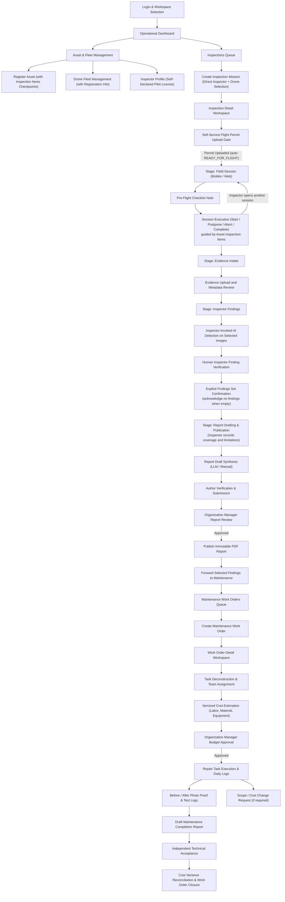
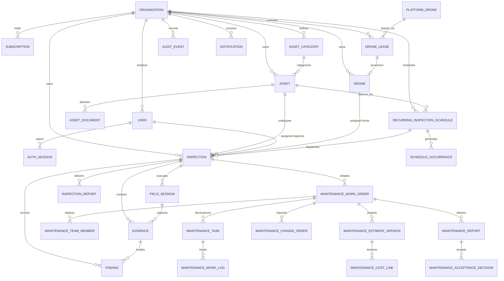

## 3. Functional Requirements

### 3.1 System Functional Overview

The SmartDroneInspection platform provides an integrated web and mobile software ecosystem supporting the full infrastructure inspection-to-maintenance lifecycle. The web application serves administrative, planning, analytical, and review functions for `Platform Admin`, `Platform Manager`, and `Organization Manager`, while offering inspection and maintenance workspaces for `Inspector` and `Maintenance Engineer`. The mobile application provides an on-site operational interface for remote pilots and inspectors to perform pre-flight checklists, track flight survey sessions, and record immediate field observations. Automated background services execute computer vision inference, structured report synthesis, data integrity hashing, and scheduled event notifications.

#### 3.1.1 Screens Flow

#### 3.1.2 Screen Descriptions

| # | Feature | Screen | Description |
| --- | --- | --- | --- |
| 1 | FE-01 | Sign In & Authentication | Secure login interface supporting credential verification, session management, and password recovery. |
| 2 | FE-01 | Platform Administration & Subscriptions | Platform Admin (`ADMIN`) and Platform Manager (`PLATFORM_MANAGER`) portal for managing platform accounts, customer tenant workspaces, enterprise subscriptions, B2B drone leasing pool and contracts, offline payment reconciliation, and platform-wide configurations. |
| 3 | FE-01 | User Profile & Pilot License | Profile management enabling Inspectors to self-declare UAV remote pilot license numbers, certification classes, expiration dates, and upload license certificate files. |
| 4 | FE-02 | Asset Registry | Master inventory of infrastructure assets (bridges, towers, facilities) displaying specifications, location coordinates, and standardized inspection checkpoints (`inspectionItems`). |
| 5 | FE-02 | Asset Detail & Documents | Detailed view of an asset showing engineering drawings, historical inspection records, and checkpoint configuration. |
| 6 | FE-02 | Drone Fleet & B2B Leasing | Catalog of organization drone hardware (`OWNED` and `LEASED` with `leaseExpiresAt` badges), B2B drone leasing requests, serviceability statuses, maintenance logs, and direct registration data (`registrationNumber`, `registrationExpiresAt`). |
| 7 | FE-03 | Inspection Mission Queue | Tabular overview of scheduled, active, and completed inspection missions with multi-criteria status, asset, and date filtering. |
| 8 | FE-03 | Create Inspection Dialog | Dialog for creating inspection missions, defining scheduled windows, directly assigning an active Inspector and serviceable Drone, and detecting scheduling conflicts. |
| 9 | FE-03 | Self-Service Flight Permit Upload Gate | Inspector interface to upload mission-specific aviation flight permits; system automatically verifies Inspector's active pilot license and transitions status from `ASSIGNED` to `READY_FOR_FLIGHT`. |
| 10 | FE-04 | Field Session Stage (Web / Mobile) | On-site interface for recording mandatory pre-flight checklist notes, logging flight start/end times, and capturing postponement, abort, or completion notes based on `assets.inspection_items`. |
| 11 | FE-04 | Evidence Intake Stage | Digital evidence management interface supporting multi-file uploads, progress tracking, and capture metadata inspection. |
| 12 | FE-03 | Additional Field Session | Action for the assigned Inspector to initiate another field session directly while in `FIELD_COMPLETED` without needing preparation versions or separate approvals. |
| 13 | FE-05 | Findings Verification Stage | Inspector-invoked AI suggestions, manual finding authoring, severity classification, resolution of every finding, and explicit confirmation of the findings set (including acknowledgment when no damage was observed). |
| 14 | FE-06 | Report Drafting Stage | Authoring workspace to trigger AI-assisted section drafting or manual authoring, record coverage and limitations, edit narrative sections, and submit verified drafts for review. |
| 15 | FE-06 | Report Review & Document View | Administrative review interface displaying formatted report preview, finding summaries, and controls to approve publication or return with a reason. |
| 16 | FE-06 | Published Report & Corrective Handoff | View of the published immutable PDF deliverable and per-finding controls to forward selected findings to maintenance. |
| 17 | FE-07 | Maintenance Work Orders Queue | Management queue of maintenance work orders displaying status, defect references, assigned leads, and cost variances. |
| 18 | FE-07 | Work Order Detail & Planning | Workspace for breaking down defect remediation into tasks, appointing Team Lead and Report Author, and establishing acceptance criteria. |
| 19 | FE-07 | Cost Estimate & Budget Panel | Form for compiling itemized repair estimates (labor, materials, equipment), viewing calculated baseline totals, and recording budget approval. |
| 20 | FE-07 | Repair Execution & Work Logs | Interface for assigned Engineers to record daily task logs, consumed materials, equipment utilization, and upload before/after proof. |
| 21 | FE-07 | Change Request Dialog | Interface to propose scope, cost, or schedule adjustments with justification; provides administrative approval or rejection controls. |
| 22 | FE-07 | Maintenance Completion & Acceptance | Workspace to author completion reports, conduct independent technical acceptance, reconcile cost actuals against budget, and close work orders. |
| 24 | FE-08 | Operational Dashboard | Role-specific dashboard displaying mission metrics, pending approvals, defect severity breakdowns, upcoming permit expiries, and alerts. |

#### 3.1.3 Screen Authorization

| Screen | Platform Admin | Platform Manager | Organization Manager | Inspector | Maintenance Engineer |
| --- | :---: | :---: | :---: | :---: | :---: |
| Sign In & Authentication | X | X | X | X | X |
| Platform Administration & Subscriptions | X (Users/Categories; Read Commercial) | X (Subscription Settlement) | X (Client Subscription) | — | — |
| B2B Drone Leasing & Pool Management | Read-Only | X (Pool & Lease Settlement) | X (Client Lease Request) | — | — |
| Workforce & Credentials Management | — | — | X | — | — |
| Asset Registry & Fleet Catalog | Read-Only | — | X | Read (Assigned) | Read (Assigned) |
| Inspection Mission Creation & Scheduling | — | — | X | — | — |
| Mission Preparation & Shot-List | — | — | Read | X (Assigned) | — |
| Readiness Authorization Panel | — | — | X | — | — |
| Field Session Logging (Web / Mobile) | — | — | Read | X (Assigned) | — |
| Evidence Intake | — | — | Read | X (Assigned) | — |
| Defect Verification & Findings Confirmation | — | — | Read | X (Assigned) | — |
| Inspection Report Drafting | — | — | Read | X (Author) | — |
| Inspection Report Administrative Review | — | — | X | — | — |
| Published Report & Maintenance Handoff | Read-Only | — | X | Read (Assigned) | Read (Assigned) |
| Maintenance Work Order Creation | — | — | X | — | — |
| Work Order Task Planning & Estimation | — | — | Read | — | X (Team Lead) |
| Work Order Budget & Change Approval | — | — | X | — | — |
| Repair Execution & Work Logs | — | — | Read | — | X (Assigned) |
| Maintenance Completion Report Authoring | — | — | Read | — | X (Report Author) |
| Technical Acceptance & Cost Reconciliation | — | — | X | — | — |
| Operational Dashboard & Notifications | X (Platform) | X (Platform) | X (Enterprise) | X (Assigned) | X (Assigned) |

#### 3.1.4 Non-Screen Functions

| # | Feature | System Function | Description |
| --- | --- | --- | --- |
| 1 | FE-01 | Session Token Verification & Revocation | Validates JSON Web Tokens on API requests; automatically checks token expiration, blacklists revoked sessions, and enforces role boundaries. |
| 2 | FE-02 | Resource Conflict Detection Engine | Evaluates scheduled time windows for Drones and Inspectors across concurrent missions to prevent overlapping assignments. |
| 3 | FE-03 | Periodic Inspection Mission Generator | Automated scheduled job that inspects asset maintenance frequencies and generates draft inspection missions with inherited default pairs. |
| 4 | FE-04 | Evidence Intake Validation | Validates uploaded files and inspection/session scope, stores original bytes, and rejects a repeated sanitized filename within the inspection; evidence-file SHA-256 hashing is not part of the intake contract. |
| 5 | FE-04 | Image EXIF Metadata Extractor | Extracts embedded capture timestamps, camera parameters, and GPS coordinates from uploaded JPEG files to populate evidence records. |
| 6 | FE-05 | Inspector-Invoked Advisory Defect Detection | Optional computer vision service proposes defects only when the assigned Inspector explicitly requests analysis of selected images. |
| 7 | FE-06 | Context-Grounded Report Synthesis Engine | Assembles verified asset, mission, checklist, and defect data into targeted LLM prompts to generate cohesive, structured report section drafts. |
| 8 | FE-06 | PDF Report Document Renderer | Compiles approved report sections, finding tables, attached evidence photos, and metadata into a publication-grade A4 PDF document with SHA-256 recording. |
| 9 | FE-07 | Deterministic Cost Calculation Engine | Computes baseline estimate totals, approved change order deltas, actual expenditures, and variance metrics using exact decimal precision. |
| 10 | FE-08 | Operational Event Notification Dispatcher | Event-driven notification worker delivering in-app alerts and email notifications for mission dispatches, readiness updates, and approval requests. |
| 11 | FE-01 | Subscription & Lease Payment Capture and Reconciliation | When PayPal is explicitly configured, the server creates and captures provider orders for enterprise subscriptions and B2B drone leases, validates the provider-reported amount/currency and webhook signature before activation; otherwise online checkout fails closed and authorized `PLATFORM_MANAGER` confirms wire/invoice payment. |

#### 3.1.5 Entity Relationship Diagram

**Entities Description**

| # | Entity | Table Name | Description |
| --- | --- | --- | --- |
| 1 | Organization | `organizations` | Tenant enterprise customer company subscribing to the platform; isolates all workforce, asset, and operational records. |
| 2 | User | `users` | System user account across Platform Admin (`ADMIN`), Platform Manager (`PLATFORM_MANAGER`), Organization Manager (`ORG_MANAGER`), Inspector (`INSPECTOR`), and Maintenance Engineer (`MAINTENANCE_ENGINEER`) roles (`roles`). Includes self-declared remote pilot license credentials (`pilot_license_number`, `pilot_license_class`, `pilot_license_expires_at`, `pilot_license_file_key`). |
| 3 | Auth Session | `auth_sessions` | Tracks active login sessions, client type, hashed refresh tokens, and revocation state. |
| 4 | Subscription | `subscriptions` | Tracks ENTERPRISE subscription contracts, periods (1, 6, 12 months), and billing/payment status. |
| 5 | Payment Transaction | `payment_transactions` | Records optional PayPal Orders v2 checkout and capture transactions linked to subscriptions. |
| 6 | Platform Drone | `platform_drones` | Platform-owned serial-numbered leasable drone inventory with model, manufacturer, payload metadata, monthly lease rate (`monthly_rate_usd`), and availability status (`AVAILABLE`, `LEASED`, `MAINTENANCE`, `RETIRED`). |
| 7 | Drone Lease | `drone_leases` | B2B drone lease contracts between the platform and a customer organization tracking lease period, agreed amount, wire/PayPal settlement references, active window (`starts_at`, `ends_at`), provisioned customer drone reference (`customer_drone_id`), and reclaim status (`PENDING`, `ACTIVE`, `RECLAIMED`, `CANCELLED`). |
| 8 | Drone | `drones` | Hardware aircraft asset in a customer fleet identified by model, serial number, MTOW, serviceability status, ownership type (`OWNED` or `LEASED`), optional active lease reference (`lease_id`), lease expiration (`lease_expires_at`), and direct registration data (`registration_number`, `registration_file_key`, `registration_expires_at`). |
| 9 | Asset Category | `asset_categories` | Structural categorization for infrastructure assets (Bridges, Power Towers, Industrial Facilities). |
| 10 | Asset | `assets` | Physical infrastructure asset (bridge, pylon, building, facility) managed by the organization. Includes `inspection_items` (`jsonb` array of inspection checkpoint items, e.g. "Mố cầu", "Trụ P1", "Dầm chính", "Khe co giãn"). |
| 11 | Asset Document | `asset_documents` | Engineering schematics, structural drawings, and technical specifications attached to an asset. |
| 12 | Inspection | `inspections` | Core inspection mission directly referencing assigned Inspector and Drone, optional `recurring_schedule_id`, scheduled window, flight permit document attributes (`flight_permit_file_key`, `flight_permit_file_name`, `flight_permit_uploaded_at`), and operational status (17 columns; self-service flight permit gate auto-transitions `ASSIGNED -> READY_FOR_FLIGHT`). |
| 13 | Recurring Inspection Schedule | `recurring_inspection_schedules` | Periodic inspection recurrence rules per asset with timezone-anchored local cadence, assigned Inspector/Drone, duration, reminder lead days, and status (`ACTIVE`, `PAUSED`, `ENDED`). |
| 14 | Schedule Occurrence | `schedule_occurrences` | Individual generated, blocked, or skipped recurring schedule occurrences linked to dispatched `inspections` with retry counts and blocked reasons. |
| 15 | Field Session | `field_sessions` | Individual on-site flight survey session linked directly to `inspections(id)` without intermediate preparation entities, capturing mandatory pre-flight checklist notes and operational outcomes (`PLANNED`, `IN_PROGRESS`, `FIELD_COMPLETED`, `POSTPONED`, `ABORTED`; 12 columns). |
| 16 | Evidence | `evidence` | Digital media captures collected during inspection field sessions with stored object references and GPS coordinates (13 columns; organization resolved via inspections; soft-delete via `is_deleted`). |
| 17 | Finding | `findings` | Unified defect findings table managing AI defect candidates and Inspector-confirmed official findings (15 columns; confirmation via `status = CONFIRMED`; soft-delete via `is_deleted`). |
| 18 | Inspection Report | `inspection_reports` | Versioned inspection report deliverables, review decisions, content snapshots, and rendered PDF keys (13 columns; author resolved via `inspections.inspector_id`; linear versioning via `version_no`). |
| 19 | Maintenance Work Order | `maintenance_work_orders` | Remediation projects initiated from forwarded inspection findings, tracking repair scope, schedule, and state (18 columns). |
| 20 | Maintenance Team Member | `maintenance_team_members` | Engineering team members allocated to a maintenance work order (10 columns). |
| 21 | Maintenance Task | `maintenance_tasks` | Decomposed repair tasks with technical methods, criteria, and assigned engineers (13 columns). |
| 22 | Maintenance Estimate Version | `maintenance_estimate_versions` | Versioned financial projection baselines for labor, materials, equipment, and services (11 columns). |
| 23 | Maintenance Cost Line | `maintenance_cost_lines` | Individual itemized cost rows within an estimate baseline, change order, or actual expenditure (14 columns). |
| 24 | Maintenance Change Order | `maintenance_change_orders` | Formal variance requests adjusting repair scope, budget ceiling, or completion schedule (13 columns). |
| 25 | Maintenance Work Log | `maintenance_work_logs` | Daily execution entries logging labor hours, material consumption, and task milestone notes (13 columns). |
| 26 | Maintenance Report | `maintenance_reports` | Versioned maintenance completion deliverables, verified by the author and accepted by the administrator (9 columns). |
| 27 | Maintenance Acceptance Decision | `maintenance_acceptance_decisions` | Formal technical acceptance records evaluating repair completion and cost reconciliation (9 columns). |
| 28 | Repair Knowledge Chunk | `repair_knowledge_chunks` | Civil/structural engineering repair standard chunks and embeddings supporting RAG scope suggestions (9 columns). |
| 29 | Notification | `notifications` | Operational alerts and deduplicated in-app notifications delivered to system users (13 columns, including `deduplication_key`). |
| 30 | Audit Event | `audit_events` | Append-only security audit trail recording consequential domain transitions and access events (13 columns). |
| — | Event Publication | `event_publication` | Framework transactional outbox table for reliable asynchronous domain event delivery (Spring Modulith). |

---

### 3.2 FE-01 Identity, Enterprise Subscription and Workforce Governance

#### 3.2.1 Enterprise Registration and Tenant Management
- **Function Trigger**: A first organization representative submits the public organization self-registration form, or a `Platform Admin` (`ADMIN`) provisions platform-level (`ADMIN` or `PLATFORM_MANAGER`) or initial customer workspace (`ORG_MANAGER`) accounts in `Platform Users`.
- **Function Description**: Creates one active customer organization and its first active `ORG_MANAGER` account atomically; registration does not issue an authenticated session. The representative must separately affirm authority to represent the organization and acceptance of the active Terms of Service, and acknowledge/accept the active Privacy Notice before provisioning. Platform-level accounts (`ActorZone.PLATFORM`, `organizationId = null`) are provisioned exclusively by `Platform Admin` (`ADMIN`) with strict single-role separation of duties (`ADMIN` XOR `PLATFORM_MANAGER`).
- **Function Details**:
  - *Inputs*: Representative full name, business email, organization name and unique organization code, password, `termsAccepted` and `privacyNoticeAccepted` (both explicitly `true`), and the displayed `termsVersion` and `privacyNoticeVersion`.
  - *Validations*: Enforces existing email/organization-code uniqueness, password policy, explicit true values for both consent flags, and exact matches against the server's active Terms and Privacy Notice versions. Missing, false, or stale consent/version values are rejected with HTTP 400 before organization/user persistence. Platform user mutations (`/api/v1/platform/users`) and standard asset category mutations (`POST/PUT /api/v1/asset-categories`) require `ADMIN` and reject `PLATFORM_MANAGER` with `403 Forbidden`.
  - *Processing*: Creates the organization and first Organization Manager in one transaction, hashes the password (Argon2id), assigns only `ORG_MANAGER` in `CUSTOMER_ORGANIZATION`, and records the accepted policy versions and server timestamp with registration IP/user-agent in the append-only `ORGANIZATION_REGISTRATION` audit event's `safe_metadata` within the same transaction. Passwords and credentials are never included in consent metadata. The audit entry is technical evidence of the recorded application interaction; it is not a certified digital signature and does not by itself guarantee legal enforceability or statutory compliance.
  - *Outputs*: Created organization and user profile; no access/refresh token or authenticated session is issued during registration.
- **Policy content status**: The displayed Terms and Privacy Notice are versioned product drafts pending legal review. They must not be represented as approved legal advice, guaranteed SLA, invoice commitment, absolute liability exclusion, or a certified-signature instrument until authorized review and operational approval are complete.

#### 3.2.2 Inspector Pilot License Self-Declaration and Workforce Provisioning
- **Function Trigger**: Organization Manager navigates to `Workforce Management` and selects `Add User`, or an assigned Inspector navigates to `Account Security` / `Profile Settings` to self-declare pilot credentials.
- **Function Description**: Provisions user accounts for Inspectors and Maintenance Engineers. Inspectors self-declare their remote pilot qualifications (UAV Remote Pilot License number, certification class, expiration date, and uploaded certificate file) directly in their profile (`PUT /api/v1/auth/me/pilot-license`), which the system validates automatically during flight permit upload.
- **Function Details**:
  - *Inputs*:
    - Workforce Provisioning (`ORG_MANAGER`): Full name, corporate email, role selection (`INSPECTOR` or `MAINTENANCE_ENGINEER`), initial status.
    - Pilot License Self-Declaration (`INSPECTOR`): Pilot license number (`pilotLicenseNumber`), license class (`pilotLicenseClass`, e.g. `CLASS_A`, `CLASS_B`), license expiration timestamp (`pilotLicenseExpiresAt`), certificate document (`pilotLicenseFileKey`).
  - *Validations*: Ensures email uniqueness within tenant; validates pilot license expiration date is in the future.
  - *Processing*: Persists workforce account; stores pilot license attributes directly on `users`; automatically verifies license validity whenever the Inspector uploads a mission flight permit.
  - *Outputs*: Provisioned workforce account with self-declared pilot license credentials.

#### 3.2.3 Subscription Entitlements, Contract Terms and Settlement
- **Function Trigger**: Organization Manager requests or renews an ENTERPRISE subscription; Platform Manager reviews a pending request and reconciles cleared funds.
- **Function Description**: Provides a versioned terms preview and fixed standard price schedule for 1, 6, and 12-month terms. An Organization Manager may request a custom duration of 1–120 months and submit a proposed price and negotiation notes; these are a proposal, not an approved contract amount. A Platform Manager (`PLATFORM_MANAGER`) confirms the final amount and subscription activation after reconciling a corporate wire/invoice reference (`Platform Admin` `ADMIN` retains read-only visibility and receives `403 Forbidden` on payment confirmation/activation mutations). If PayPal is explicitly enabled and configured for the deployment, an Organization Manager may use provider-hosted approval for a platform-approved amount. Online payment is disabled by default.
- **Function Details**:
  - *Inputs*:
    - Subscription request: billing period (1–120 months), affirmative agreement to the displayed terms version, optional proposed price and negotiation notes.
    - Platform settlement confirmation: subscription ID, cleared external wire/invoice reference, effective period, final agreed amount and Platform Manager attribution.
    - Optional configured PayPal checkout: subscription ID to create an order; provider order ID to request server-side capture. Capture ID, amount, currency and payer details are obtained from PayPal, never asserted by the browser.
  - *Validations*: The system validates term bounds, required terms agreement, tenant scope, authorization, and effective date ordering. A proposed price is not eligible for PayPal checkout until a platform-approved contract amount exists. For enabled PayPal checkout, the server requires provider capture status `COMPLETED`, exact order ownership, matching approved amount and supported currency, and an idempotently unique provider capture ID. Webhooks are signature-verified against the deployment's configured PayPal webhook ID and environment before a completion event can be applied. When PayPal is disabled or unconfigured, checkout fails closed and no payment transaction or subscription activation is created.
  - *Processing*:
    - Request: stores an immutable `terms_snapshot` containing the accepted terms version, actor, selected term, standard price estimate, and any customer price proposal/notes; the subscription remains `PENDING`.
    - Wire/invoice settlement: an authorized Platform Manager (`PLATFORM_MANAGER`) records the cleared external reference and final agreed amount, closes any prior active term, attributes the confirmation, and activates the approved subscription.
    - Optional PayPal settlement: server creates a provider order for the platform-approved contract amount, the payer approves on PayPal-hosted checkout, and the server captures and verifies the provider response before recording/completing `payment_transactions` and activating the subscription. A verified webhook is an idempotent reconciliation path. Payment-provider credentials are deployment secrets and are not stored in application tables.
  - *Outputs*: Current and historical subscription state, immutable request terms snapshot, deterministic wire/invoice payment instructions, Platform Manager settlement attribution, and (only when configured and verified) a provider transaction record. Entitlement is granted only for an active subscription whose validity window covers the current time.
- **Scope and legal status**: Standard rate values and provider integration configuration are deployment/application configuration, not a dynamic Platform Admin or Platform Manager pricing catalog. Customer proposals do not become accepted prices without platform confirmation. The printable terms view is a draft order/terms summary pending legal review; its recorded application acceptance is not a certified digital signature and does not itself guarantee legal enforceability.

---

### 3.3 FE-02 Infrastructure Asset, Equipment Fleet and Compliance Registry

#### 3.3.1 Infrastructure Asset Catalog and Inspection Checkpoints
- **Function Trigger**: Organization Manager navigates to `Assets` and selects `New Asset`.
- **Function Description**: Registers physical infrastructure assets, records structural attributes and GPS coordinates, and configures a standardized checklist of structural inspection checkpoints (`inspectionItems`, e.g., "Mố cầu M1", "Trụ P1", "Dầm chính", "Gối cầu", "Khe co giãn").
- **Function Details**:
  - *Inputs*: Asset code, asset name, category (Bridge, Power Tower, Industrial Plant, Building), location coordinates, structural drawings, and an array of inspection checkpoint strings (`inspectionItems`).
  - *Validations*: Asset code must be unique within organization; at least one checkpoint item is recommended.
  - *Processing*: Persists asset master record along with its `inspection_items` JSON array; establishes asset condition history. Inspections dispatched for this asset automatically inherit these checkpoints for mobile field session guidance and technical report synthesis.
  - *Outputs*: Active asset record with configured inspection checkpoints available for mission scheduling.

#### 3.3.2 Drone Fleet Management, B2B Drone Leasing and Registration Tracking
- **Function Trigger**: Organization Manager navigates to `Drone Fleet` and selects `Register Drone` or `Drone Leasing`; Platform Manager navigates to `Platform Drone Leasing` to manage the leasable pool, confirm lease payments, or reclaim leased drones.
- **Function Description**: Catalogs unmanned aerial vehicles (UAVs) in the customer fleet (`OWNED` or `LEASED`), tracks payload equipment, serviceability status, and hardware registration data (`registrationNumber`, `registrationExpiresAt`, `registrationFileKey`), and manages the B2B Drone Leasing lifecycle between the platform and customer organizations.
- **Function Details**:
  - *Inputs*:
    - Customer Owned Drone Registration (`ORG_MANAGER`): Manufacturer, model, hardware serial number, maximum takeoff weight (MTOW), camera payload specifications, initial serviceability (`ACTIVE`, `MAINTENANCE`, `SUSPENDED`, `RETIRED`), registration number (`registrationNumber`), registration certificate file (`registrationFileKey`), and registration expiration date (`registrationExpiresAt`).
    - Platform Leasable Drone Pool (`PLATFORM_MANAGER` writes; `ADMIN`, `PLATFORM_MANAGER`, `ORG_MANAGER` reads): Serial number (unique), model, manufacturer, `monthlyRateUsd`, `payloadMetadata` JSON, and status (`AVAILABLE`, `LEASED`, `MAINTENANCE`, `RETIRED`).
    - B2B Lease Request & Settlement (`ORG_MANAGER` request/PayPal; `PLATFORM_MANAGER` wire confirmation & reclaim): Target `platformDroneId`, `leasePeriodMonths` (1–60 months), external wire transfer reference (`externalReference`) or PayPal order/capture IDs (`paypalOrderId`, `paypalCaptureId`).
  - *Validations*: Hardware serial number must be unique across tenant fleet (`(organization_id, serial_number)`) and across the platform pool; weight, payload, and rate fields must be positive numeric values. Only `PLATFORM_MANAGER` may mutate the platform drone pool, confirm lease wire payments, or reclaim active leases (`ADMIN` receives `403 Forbidden` on commercial mutation endpoints while retaining read-only access). Confirming a lease payment requires the `PlatformDrone` to be `AVAILABLE` (returns `409 Conflict` if already leased). `ORG_MANAGER` is blocked from manually changing serviceability on a reclaimed/retired leased drone.
  - *Processing*:
    - Owned Fleet: Stores hardware profile with `ownership_type = 'OWNED'` and direct registration details; monitors flight hours logged from field sessions.
    - Lease Request: Verifies `PlatformDrone` is `AVAILABLE`, computes `agreed_amount_usd = monthly_rate_usd * lease_period_months`, and creates a `PENDING` `drone_leases` contract.
    - Lease Settlement & Automatic Fleet Provisioning: Upon wire payment confirmation by `PLATFORM_MANAGER` or verified PayPal Orders v2 capture, transitions `PlatformDrone` to `LEASED`, transitions `DroneLease` to `ACTIVE` (`starts_at`, `ends_at`), and automatically creates or reactivates the customer `Drone` in `drones` (`organization_id`, `serial_number`, `ownership_type = 'LEASED'`, `lease_id`, `lease_expires_at = ends_at`, `serviceability = 'ACTIVE'`).
    - Lease Reclaim: When `PLATFORM_MANAGER` invokes `POST /api/v1/platform/drone-leases/{leaseId}/reclaim` on an active/expired lease, transitions `DroneLease` to `RECLAIMED`, marks the customer's `Drone` as `RETIRED`, and returns the `PlatformDrone` to `AVAILABLE`.
  - *Outputs*: Registered or lease-provisioned drone hardware profile (`OWNED` or `LEASED` badge with `leaseExpiresAt` date) available for mission assignment, plus auditable B2B lease contract records.

#### 3.3.3 Mission Flight Clearance and Aviation Compliance
- **Function Trigger**: Assigned Inspector uploads official flight clearance document on the inspection workspace.
- **Function Description**: Aviation flight permits issued by relevant authorities (such as the Ministry of National Defence under Decree No. 288/2025/NĐ-CP) are mission-scoped and attached directly to the inspection via the Self-Service Flight Permit Gate (`flight_permit_file_key`, `flight_permit_file_name`, `flight_permit_uploaded_at`), satisfying regulatory compliance without maintaining an orphaned global permit repository.
- **Function Details**:
  - *Inputs*: Mission inspection ID, permit document file (PDF or scanned image).
  - *Validations*: File must be a valid document format within configured size limits; uploading inspector must be the assigned inspector with an unexpired pilot license.
  - *Processing*: Stores permit file in MinIO object storage, attributes upload timestamp, and automatically clears the mission for flight operations.
  - *Outputs*: Verified mission flight clearance attached to the inspection and rendered in the published inspection report deliverable.

---

### 3.4 FE-03 Flight Mission Planning and Readiness Authorization

#### 3.4.1 Inspection Mission Scheduling and Direct Resource Assignment
- **Function Trigger**: Organization Manager selects `Create Inspection` from asset row or inspections list.
- **Function Description**: Schedules an inspection mission for an asset, establishes planned start/end dates, directly selects the responsible active Inspector and serviceable Drone, and performs automated resource conflict checks.
- **Function Details**:
  - *Inputs*: Asset ID, Inspector ID, Drone ID, planned inspection window (start date, end date).
  - *Validations*: Planned end date must be on or after start date; designated Inspector and Drone must belong to the same tenant, be in `ACTIVE` status, and have no overlapping active missions within the planned window.
  - *Processing*: Evaluates concurrent mission schedules; presents conflict alerts if overlapping bookings exist; creates inspection record in `ASSIGNED` status with direct inspector and drone foreign keys.
  - *Outputs*: Dispatched inspection mission record in `ASSIGNED` status, automated notification to assigned Inspector.

#### 3.4.1a Organization-Managed Recurring Inspection Schedules

The Organization Manager may create a recurring inspection schedule for an asset in their organization. Each occurrence creates a separate `ASSIGNED` inspection; recurrence never authorizes flight or bypasses the self-service flight permit upload gate, pilot license currency check, field records, or report approval.

- **Inputs**: Asset, schedule objective and scope metadata, directly selected active Inspector and serviceable Drone, original local start date/time, IANA timezone, positive interval with unit `WEEK`, `MONTH` or `YEAR`, inspection duration, optional inclusive schedule end, and reminder lead days (default 3).
- **Calendar rule**: Each occurrence is calculated from the original local anchor, not the previous shortened month. Nonexistent month/leap days clamp to the month's final day without permanently shifting later occurrences. DST gaps move forward to the next valid time; overlaps use the earlier offset. The timezone and resulting planned instants are shown to the Manager.
- **Authority and validation**: Only an active Organization Manager may manage schedules in their organization. Asset, Inspector, Drone, subscription entitlement and planned resource conflicts must be checked before dispatch; the background generator must not bypass these checks. Inspector visibility remains limited to assigned work.
- **Generation**: Generate the first eligible occurrence and roll subsequent work into a bounded look-ahead window that covers its reminder lead time. A durable schedule/occurrence identity prevents duplicate inspections on retries, restarts or concurrent workers. A blocked occurrence remains visible with its reason; it is not silently skipped or repeatedly dispatched. Manager retry or skip decisions are attributable.
- **Lifecycle**: Manager may pause, resume or end recurrence. Ending/pausing prevents future generation and never deletes already generated inspections or rewrites their historical assignment fields. Changes to schedule configuration apply only to occurrences not yet generated.
- **Notifications**: The assigned Inspector receives an in-app assignment notice and an in-app reminder before the planned inspection (default 3 days). Delivery is deduplicated durably. Rescheduling, reassignment or cancellation must not leave stale reminders addressed to a former Inspector or an obsolete time. Notification delivery does not mark an inspection ready or started.

#### 3.4.2 Self-Service Flight Permit Upload Gate
- **Function Trigger**: Assigned Inspector opens mission detail and uploads the mission flight permit file.
- **Function Description**: Self-service compliance gate enabling the assigned remote pilot to upload the official aviation flight permit. The system checks the pilot's license validity and automatically authorizes flight readiness.
- **Function Details**:
  - *Inputs*: Inspection ID, permit document file (PDF or image).
  - *Validations*: Caller must be the assigned Inspector (`inspections.inspector_id == callerId`); Inspector's self-declared remote pilot license must be non-null and unexpired (`pilot_license_expires_at >= planned_start_at`); designated drone must be serviceable.
  - *Processing*: Stores the permit file in MinIO under `evidence-object-store/{organizationId}/inspections/{inspectionId}/permits/`; sets `flight_permit_file_key`, `flight_permit_file_name`, and `flight_permit_uploaded_at` on `inspections`; atomically transitions the inspection status from `ASSIGNED` to `READY_FOR_FLIGHT`.
  - *Outputs*: Flight-cleared inspection mission in `READY_FOR_FLIGHT` status, unlocking on-site field session execution.

#### 3.4.3 Automatic Flight Readiness and Operational Gate
- **Function Trigger**: System transition upon successful flight permit upload.
- **Function Description**: Eliminates administrative readiness review bottlenecks (`inspection_preparations` and readiness review panels dropped) by automating flight readiness authorization directly upon verified permit upload and pilot license currency check.
- **Function Details**:
  - *Inputs*: Validated permit upload event.
  - *Validations*: Enforces `hasFlightPermit()` precondition for field session execution.
  - *Processing*: Emits `INSPECTION_READINESS_APPROVED` audit event; unlocks mobile/web field session controls.
  - *Outputs*: Immediate operational readiness for on-site survey.

#### 3.4.4 Additional Field Session Initiation
- **Function Trigger**: After a field session ends, the assigned Inspector initiates an additional session if supplemental data collection is required.
- **Function Description**: Allows the assigned Inspector to start an additional field session directly while the inspection is in `FIELD_COMPLETED` prior to report publication, without creating new preparation versions or awaiting administrative approval.
- **Function Details**:
  - *Inputs*: Inspection ID and pre-flight checklist note for the new session.
  - *Validations*: Inspection must be in `FIELD_COMPLETED` status; designated drone must remain serviceable; no concurrent open session may exist.
  - *Processing*: Creates a new `field_sessions` record in `IN_PROGRESS` and sets inspection status to `IN_PROGRESS`.
  - *Outputs*: New active field flight session with previous captures preserved.

---

### 3.5 FE-04 Field Records and Evidence

#### 3.5.1 On-Site Pre-Flight Check and Field Session Logging
- **Function Trigger**: Inspector opens mission on mobile app or web `Field Session` tab and selects `Start Session`.
- **Function Description**: Displays structural checkpoints from `assets.inspection_items`, records mandatory on-site physical checklist notes, confirms airspace safety, logs flight start time, and manages session outcomes (completion, postponement, abort).
- **Function Details**:
  - *Inputs*: Pre-flight checklist verification note (aircraft condition, battery levels, site weather, emergency landing area), session action (`START`, `POSTPONE`, `ABORT`, `COMPLETE`), outcome notes summarizing observations against checkpoints.
  - *Validations*: Inspection must possess an active flight permit (`status` in `READY_FOR_FLIGHT` or `FIELD_COMPLETED`); pre-flight note cannot be blank; only one session can be in progress concurrently.
  - *Processing*: `START` logs session start timestamp and transitions status to `IN_PROGRESS`. `POSTPONE` logs postponement reason and reverts inspection to `READY_FOR_FLIGHT`. `ABORT` logs abort reason and ends session as terminal `ABORTED`. `COMPLETE` records checkpoint outcome notes and transitions inspection to `FIELD_COMPLETED`.
  - *Outputs*: Auditable field flight session record with exact timestamps and operational logs.

#### 3.5.2 Digital Evidence Intake and Retention
- **Function Trigger**: Inspector opens `Evidence` tab and selects `Upload Evidence`.
- **Function Description**: Stores inspection captures and their available metadata as evidence for findings and report preparation. Evidence quality is not a separate approval gate.
- **Function Details**:
  - *Inputs*: Supported image or document files, optional capture time and paired GPS coordinates.
  - *Validations*: Allowed content types and configured size limits; inspection, organization, and field-session scope; repeated sanitized filenames within the inspection are rejected.
  - *Processing*: Stores original bytes in MinIO, extracts available EXIF capture time and GPS, and keeps retired evidence as a soft-deleted audit copy without removing its stored bytes. Evidence intake does not compute or expose a SHA-256 digest.
  - *Outputs*: Evidence register items with file and capture metadata; active evidence can support findings and report content without an `ACCEPTED` quality decision.

The Inspector records coverage and limitations while authoring the report (§3.7.1), not as an evidence-set decision. If more field coverage is needed, the Inspector initiates an Additional Session directly in MF2 (§3.4.4).

---

### 3.6 FE-05 AI-Assisted Defect Detection and Inspector Verification

#### 3.6.1 Inspector-Invoked Advisory Defect Detection
- **Function Trigger**: The assigned Inspector explicitly selects `Analyze` for an eligible active image; analysis never starts automatically when evidence is uploaded or another workflow step completes.
- **Function Description**: An optional computer-vision service proposes structural defect findings for human review. Its availability or omission does not prevent manual finding entry.
- **Function Details**:
  - *Inputs*: Selected active inspection image and the configured model confidence threshold.
  - *Validations*: The image must belong to the assigned inspection and remain active. No evidence-quality decision or accepted-set status is required.
  - *Processing*: Runs the configured detection model only on the Inspector's explicit request and records model provenance, defect label, confidence, and bounding box with each proposal. A repeated request returns existing proposals unless the Inspector explicitly requests a replacement run.
  - *Outputs*: Pending advisory finding proposals linked to their source images; no proposal becomes an official finding without Inspector confirmation.

#### 3.6.2 Human Finding Verification and Findings-Set Confirmation
- **Function Trigger**: The assigned Inspector opens `Findings` after evidence intake.
- **Function Description**: The Inspector resolves advisory AI proposals, records or edits manual findings, and confirms the complete findings set before report drafting.
- **Function Details**:
  - *Inputs*: Per-proposal decision (`CONFIRM`, `MODIFY`, `REJECT`); defect label, severity, technical notes, recommended action, linked active evidence, and any AI annotation.
  - *Validations*: Every pending proposal must be resolved before confirmation. A confirmed finding has supporting active evidence. An empty findings set is valid only after the Inspector explicitly acknowledges that no damage was observed within the inspection scope.
  - *Processing*: Confirmed or modified proposals and manual observations are maintained as findings; rejecting an AI proposal removes that proposal from the retained findings. The Inspector confirms the resolved set; material evidence or finding changes require confirmation again. Finding location is taken from linked evidence metadata when available rather than a separate UI-only component/location field.
  - *Outputs*: A current, Inspector-confirmed findings set (which may be explicitly empty) that permits report drafting.

---

### 3.7 FE-06 Inspection Report Drafting, Review and Publication

#### 3.7.1 Structured Report Authoring and Context-Grounded LLM Drafting
- **Function Trigger**: The assigned Inspector selects `Generate Report Draft` or `Manual Authoring` in the `Report` tab.
- **Function Description**: Creates a structured inspection report from the retained inspection scope, evidence, field-session records, Inspector-confirmed findings, and the Inspector's coverage and limitation assessment. Coverage disclosure belongs to the report, not a separate evidence-quality decision.
- **Function Details**:
  - *Inputs*: Selected drafting method (`AI_ASSISTED` or `MANUAL`); authored sections including Executive Summary, Scope & Methodology, Weather & Site Observations, Component Findings Discussion, Recommendations, `inspectorCoverageAssessment`, and `omissionDisclosure`.
  - *Validations*: The findings set must be confirmed, including explicit acknowledgment when empty; active evidence must exist for evidence-based claims. Generated draft sections must be reviewed and editable by the author before submission.
  - *Processing*: AI-assisted drafting is invoked only when the Inspector selects it. The prompt uses retained inspection scope fields (`objective`, `scope`, `component_scope`, `acceptance_criteria`) and available authorized records; manual authoring remains available without invoking AI. The Inspector reviews and edits the sections before submission.
  - *Outputs*: An author-reviewed report version submitted to the Organization Manager review queue.

#### 3.7.2 Administrative Review, Digital Publication and Immutable Archival
- **Function Trigger**: Organization Manager opens submitted report in `Report Review` workspace.
- **Function Description**: Independent administrative review of report narrative, component findings, and attached evidence. Approves report for formal publication or returns it to author with comments.
- **Function Details**:
  - *Inputs*: Review decision (`APPROVE` or `RETURN`), `return_reason` text (mandatory on return).
  - *Validations*: Reviewer must be an Organization Manager (`ORG_MANAGER`) distinct from the report author; all findings must be in an evaluated state.
  - *Processing*: Submission records `submitted_at` on the report version. On approval, compiles report data into a formal A4 PDF, stores the deliverable in MinIO, calculates and records the PDF SHA-256 digest, marks the version `PUBLISHED`, and transitions the inspection to `REPORT_PUBLISHED`. On return, stores `return_reason`, marks the version `RETURNED`, and notifies the author; a subsequent review cycle may replace the current return reason.
  - *Outputs*: Published immutable PDF inspection report, its recorded PDF checksum, and an authorized download endpoint.

#### 3.7.3 Per-Finding Corrective Handoff
- **Function Trigger**: An Organization Manager opens `Send to Maintenance` for a published inspection.
- **Function Description**: The Organization Manager selects which Inspector-confirmed findings to forward to MF4. Each finding records its forwarding timestamp; the consequential reviewer decision and selected IDs are retained in the append-only audit event stream, not duplicated as handoff columns on the inspection.
- **Function Details**:
  - *Inputs*: The published inspection and the IDs of confirmed findings selected for forwarding.
  - *Validations*: The report must be published and the inspection not already `COMPLETED`; each selected finding must belong to the inspection, be confirmed, and not already have a `forwarded_to_maintenance_at` value.
  - *Processing*: Sets `forwarded_to_maintenance_at` for each selected finding and records the reviewer, report version, selected IDs and before/after inspection status in an append-only audit event. If one or more findings are forwarded, the inspection status becomes `REPAIR_PENDING`; if none are forwarded on a newly published inspection (including an explicitly confirmed empty findings set), its status becomes `COMPLETED`. A completed inspection cannot change its maintenance disposition afterward; the UI requires explicit confirmation before completing without forwarding. No no-repair rationale or duplicate handoff columns are stored on `inspections`.
  - *Outputs*: Individually traceable forwarded findings for MF4, an audit event for the Organization Manager's selected IDs and an inspection status carrying the overall outcome. Findings and evidence are associated with the inspection directly. Forwarding does not create a maintenance work order.

---

### 3.8 FE-07 Maintenance Remediation, Cost Control and Acceptance

#### 3.8.1 Maintenance Work Order Planning and Team Allocation
- **Function Trigger**: Organization Manager navigates to `Maintenance` and selects `Create Work Order`.
- **Function Description**: Initiates a formal maintenance work order linking forwarded defect candidates, decomposes corrective scope into tasks (with optional RAG-assisted engineering standard scope and acceptance-criteria suggestions from `repair_knowledge_chunks` and deterministic fallback), and appoints the engineering team.
- **Function Details**:
  - *Inputs*: Source inspection ID, selected defect candidate IDs, work order title, priority, target completion date, assigned engineering team members, designated Team Lead, designated Report Author.
  - *Validations*: Must reference valid forwarded defect candidates; designated Team Lead and Report Author must belong to the approved team; neither may serve as independent reviewer.
  - *Processing*: Creates work order in `PLANNING` status; links defects to work order scope; initializes task inventory.
  - *Outputs*: Created work order with appointed team, ready for technical estimation.

#### 3.8.2 Itemized Cost Estimation and Change Order Governance
- **Function Trigger**: Maintenance Team Lead compiles estimate; Organization Manager reviews budget.
- **Function Description**: Compiles detailed itemized cost estimates across labor, replacement materials, equipment rentals, and specialized services. Supports formal Change Requests for emergent site conditions.
- **Function Details**:
  - *Inputs*: Line items (category, description, quantity, unit price, currency), change request justification, delta cost, delta schedule days.
  - *Validations*: Quantities and unit prices must be positive decimal numbers; budget approval requires Organization Manager role (`ORG_MANAGER`).
  - *Processing*: Calculates exact decimal baseline budget totals; on approval, freezes estimate baseline (`APPROVED`). Change requests require administrative review; approved changes calculate revised budget ceiling.
  - *Outputs*: Approved initial cost baseline, approved change order records, auditable financial ceiling.

#### 3.8.3 Repair Execution Logging and Before/After Evidence Documentation
- **Function Trigger**: Assigned Maintenance Engineers select task in `Work Order Execution`.
- **Function Description**: Records daily task execution logs, material consumption, labor hours, and uploads photographic proof demonstrating structural defect rectification.
- **Function Details*:
  - *Inputs*: Task ID, labor hours worked, materials consumed, equipment hours, task progress percentage, before-repair photos, during-repair photos, after-repair photos, test certificates.
  - *Validations*: Log entry restricted to assigned team members; completion of repair task requires mandatory after-repair photographic proof.
  - *Processing*: Persists chronological work logs; updates real-time task progress; stores repair evidence with SHA-256 integrity hashing; updates work order status to `IN_PROGRESS`.
  - *Outputs*: Documented repair logs and verifiable before/after evidence register.

#### 3.8.4 Completion Reporting, Independent Acceptance and Cost Reconciliation
- **Function Trigger**: Designated Report Author compiles report; Organization Manager performs acceptance.
- **Function Description**: Compiles maintenance completion report from task logs, test records, and financial actuals. Independent Organization Manager conducts technical acceptance and reconciles final costs against approved budget before closing work order.
- **Function Details**:
  - *Inputs*: Completion narrative, final acceptance test results, variance explanations, acceptance decision (`ACCEPT` or `REJECT`), final cost reconciliation sign-off.
  - *Validations*: Reviewing Organization Manager must be independent (not Team Lead or Report Author); all tasks must be completed with attached proof; cost variance must be documented.
  - *Processing*: Calculates financial variance (Budget vs. Actuals); on acceptance, marks work order `CLOSED`, publishes completion report deliverable, and updates asset maintenance history.
  - *Outputs*: Closed maintenance work order, reconciled financial statement, and updated asset structural health record.

---

### 3.9 FE-08 Operational Dashboard and System Notifications

#### 3.9.1 Multi-Role Operational Dashboards and Analytics
- **Function Trigger**: User signs in or navigates to `Dashboard`.
- **Function Description**: Delivers role-customized operational metrics, status summaries, defect distribution charts, and workload queues.
- **Function Details**:
  - *Platform Admin & Platform Manager*: Tenant count, active enterprise subscriptions, B2B drone pool & active lease metrics, total managed assets, system storage utilization.
  - *Organization Manager*: Asset condition summaries, active vs. completed inspection missions, defect severity distribution (Critical, Severe, Moderate, Minor), pending readiness reviews, maintenance budget variances.
  - *Inspector*: Assigned upcoming missions, pending pre-flight checklists, open field sessions, unreviewed AI defect queues.
  - *Maintenance Engineer*: Assigned repair tasks, work order deadlines, pending work log submissions.

#### 3.9.2 Automated Event-Driven Operational Notifications
- **Function Trigger**: System domain events (Mission Dispatched, Readiness Decision Recorded, Evidence Uploaded, Report Submitted, Work Order Budget Approved, Work Order Closed).
- **Function Description**: Dispatches real-time in-app alerts and asynchronous email notifications to relevant stakeholders, informing them of required workflow actions.
- **Function Details**:
  - *Inputs*: Domain event payload, recipient user IDs, notification template.
  - *Validations*: Recipient must have active account status and appropriate permission scope for the target entity.
  - *Processing*: Renders notification message with direct deep-link to target workspace screen; dispatches in-app notification via WebSockets/polling; sends email notification via SMTP gateway.
  - *Outputs*: Real-time notification badge increment, system notification record in user inbox, delivered email alert.

**Recurring inspection delivery slice (§3.4.1a)**: Assignment and advance reminders are initially delivered through a paginated **in-app inbox** on web (and exposed via `/api/v1/notifications` for client consumers), with unread count and idempotent mark-as-read. Every read/write is scoped to the authenticated recipient and organization; clients cannot select another recipient. Only recognized internal inspection/work-order targets may be opened. Email/SMTP, WebSocket realtime delivery and operating-system push are not implemented or promised by this slice; polling requires the application to be open. A notification is informational and cannot bypass the target resource's server-side authorization. Runtime acceptance remains in progress as recorded in Report 5.
