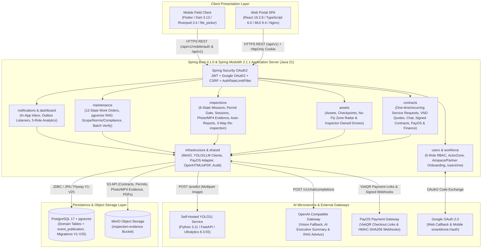
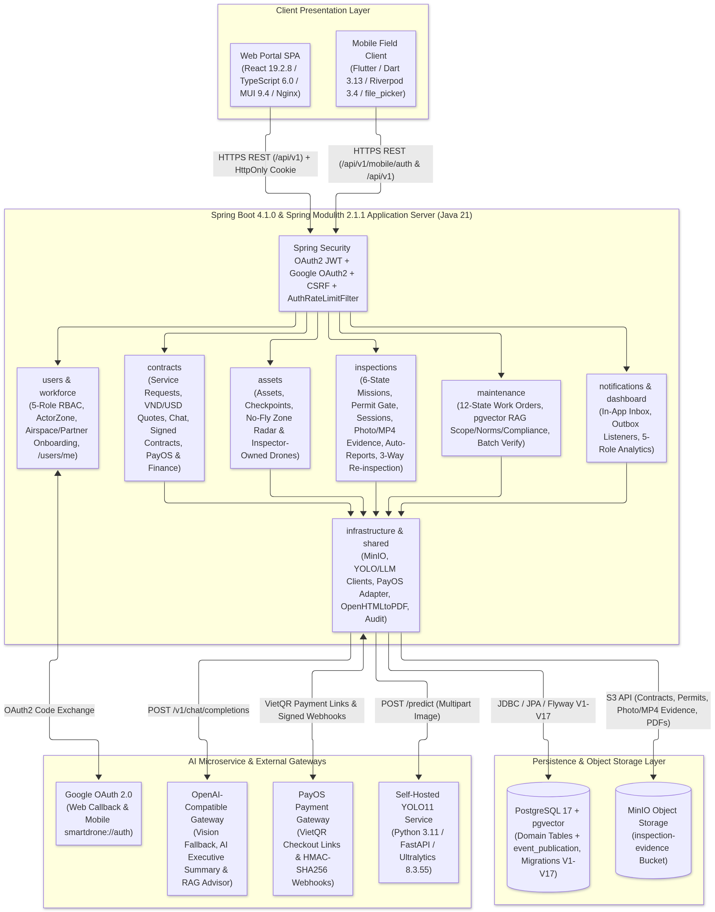
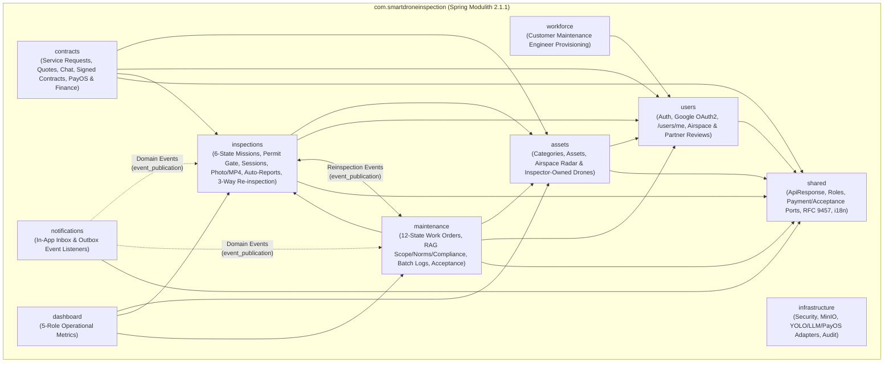

# II. Software Design Document

## 1. System Design

### 1.1 System Architecture

The SmartDroneInspection platform employs a modular, multi-zone cloud-native architecture separating client presentation (React 19 Web SPA and Flutter Mobile App), backend modular monolith application logic (Java 21, Spring Boot 4.1.0, Spring Modulith 2.1.1), S3-compatible object storage (MinIO), relational & vector storage (PostgreSQL 17 with `pgvector`), and containerized AI inference microservices (Python 3.11 FastAPI + Ultralytics YOLO11 and OpenAI-compatible Vision/LLM/RAG gateways). Inspector-specific license and experience data resides in `inspector_profiles`, while authentication, registration, and password-reset challenges share `otp_challenges`; recurring service request occurrences are materialized from the parent request rather than an internal inspection-schedule engine.

**Subsystem and Component Descriptions**

1. **Web Client Portal (`SmartDroneInspection-frontend` — React 19.2.8, TypeScript 6.0.2, Material UI 9.4.0, Vite 8.2.2, Nginx 1.27-alpine)**: Delivers responsive, code-split workspace portals (`/admin/`, `/client/`, `/operations/`) for the five canonical roles: `ADMIN`, `MANAGER`, `CUSTOMER`, `INSPECTOR`, and `MAINTENANCE_ENGINEER`, normalizing legacy role aliases (`PLATFORM_MANAGER` $\rightarrow$ `MANAGER`, `ORG_MANAGER` $\rightarrow$ `CUSTOMER`). Manages server state via TanStack React Query `5.102.8`, auth/UI state via Zustand `5.0.15`, authenticated blob streaming (`AuthenticatedMedia` for images and HTML5 `video/mp4` playback), and secures browser sessions with in-memory JWT access tokens (`15m` TTL), `HttpOnly; SameSite=Strict` refresh cookies (`sdi_refresh`), and `X-XSRF-TOKEN` CSRF headers.
2. **Mobile Field Client (`SmartDroneInspection-mobile` — Flutter 1.0.0+1, Dart 3.13.2, Riverpod 3.4.2, GoRouter 18.0.0, Dio 5.11.0, `file_picker` 12.1.3)**: Cross-platform Android/iOS field application for `INSPECTOR` and `MAINTENANCE_ENGINEER`. Supports native mobile authentication (`/api/v1/mobile/auth` with `flutter_secure_storage`), Google OAuth2 deep-link sign-in (`smartdrone://auth` via `OAuthCallbackScreen`), flight permit and streaming `video/mp4` / photo evidence intake (`MultipartFile.fromStream` up to `10 MiB`), on-site field session logging (`Start`, `Complete`, `Abort`), and maintenance task work log execution (`release`, `start`, `work-logs`, `verify`, `declare-complete`).
3. **Modular Monolith Application Server (`SmartDroneInspection-backend` — Java 21, Spring Boot 4.1.0, Spring Modulith 2.1.1)**: Encapsulates domain modules with compile-time boundary verification (`ModulithArchitectureTest`), virtual threads (`spring.threads.virtual.enabled=true`), OAuth2 Resource Server JWT authentication (`HS256`), Google OAuth2 federation (`OAuth2Controller`, `GoogleOAuthService`), Argon2id password hashing, IP rate-limiting (`AuthRateLimitFilter`), OpenHTMLtoPDF `1.0.10` server-side PDF rendering, and Spring Modulith transactional event outbox (`event_publication`).
4. **Self-Hosted AI Defect Detection Microservice (`ai-inference` — Python 3.11, FastAPI 0.115.6, Ultralytics 8.3.55 YOLO11, PyTorch 2.5.1)**: Containerized computer vision microservice (`smartdroneinspection-ai-inference:8000`) running custom-trained `YOLO11` weights (`mbdd2025-v1`, `/app/models/best.pt`) to detect 5 structural defect classes (`crack`, `leakage`, `abscission`, `corrosion`, `bulge`) and return normalized bounding boxes (`{x, y, width, height}`) and confidence scores.
5. **OpenAI-Compatible Multimodal Vision, AI Executive Summary & pgvector RAG Gateways**:
   - **Vision Fallback** (`OpenAiCompatibleInferenceClient`): Secondary multimodal defect detector invoked automatically when `YOLO11` returns zero detections or is unreachable (`FE-06`).
   - **LLM Executive Summary Synthesis** (`ReportDraftClient`): Generates structured executive summaries (`ReportAiSummaryResponse`: `summary`, `keyHighlights`, `recommendedActions`, `overallRisk`) for auto-compiled inspection reports, with deterministic fallback when offline (`FE-06`).
   - **pgvector RAG Maintenance Scope, Cost Norms & Compliance Engine** (`MaintenanceScopeAdvisorService` + `DeterministicScopeFallback`): Queries 1536-dimensional `repair_knowledge_chunks` (`TCVN 9343:2012`, `ACI 224.1R`, `EN 1504-9`, `ISO 12944-5`, `ASTM C1583`, `TCVN 9361:2012`) to recommend corrective scope and 1-click initial tasks (`suggest-scope`), standard Vietnamese construction cost norms (`suggest-estimate`, `FE-07`), and an acceptance compliance score based on task completion, work-log verification, populated test readings, and as-left condition (`acceptance-compliance`, `FE-08`); the current check does not validate numeric readings against standard thresholds.
6. **Relational & Vector Database (PostgreSQL 17 with `pgvector` and `pgcrypto`)**: Persists the relational schema and `event_publication` outbox managed by Flyway migrations (`V1`–`V25`), enforcing `ActorZone` constraints and selected composite tenant foreign keys (notably inspection-to-asset/drone/Inspector and maintenance-work-order-to-asset relationships), optimistic locking (`row_version`), and `hnsw` cosine vector indexing.
7. **Distributed Object Storage (MinIO S3-Compatible Storage)**: Stores binary objects in the `inspection-evidence` bucket, including signed paper contracts (`PDF`, `DOCX`, `JPEG`, `PNG`) stored on the parent `ServiceRequest`, Inspector license scans and 3-document drone registrations, asset engineering documents, mission flight permits, field photo and `video/mp4` captures, and published Inspection and Maintenance Completion PDF reports with `SHA-256` verification.
8. **Online Payment Gateway Adapter (`PayOSPaymentGateway` & `PayOSWebhookController` — PayOS VietQR)**: Generates unique 64-bit `payos_order_code` VietQR payment links (`/payos/create-payment-link`) after a `CUSTOMER` accepts a published inspection report, using VND settlement amounts, verifies HMAC-SHA256 webhook signatures (`POST /api/v1/webhooks/payos`), and records the occurrence as `PAID`. For an assigned Inspector, successful settlement also records payout status as `PAID` with an automatic disbursement reference; the VND-only settlement path does not make legacy USD-compatible quote input an eligible PayOS currency (`FE-06`).

---

### 1.2 Package Diagram

The backend application (`com.smartdroneinspection`) is partitioned into **Spring Modulith domain modules** plus a shared kernel (`shared`), verified automatically in CI by `ModulithArchitectureTest.java`. Inter-module side effects (notifications and automatic re-inspection loop orchestration) communicate through Spring Modulith domain events (`event_publication`) and explicit SPI ports.

**Package Descriptions**

| No | Package | Description |
| :---: | :--- | :--- |
| 01 | `com.smartdroneinspection.users` | Governs browser (`BrowserAuthController`), mobile (`MobileAuthController`), and Google OAuth2 (`OAuth2Controller`) authentication, LOGIN/REGISTRATION/PASSWORD_RESET OTP flows persisted through `OtpChallenge` and `otp_challenges`, Argon2id password encoding, HS256 JWT issuance, refresh token rotation (`auth_sessions`), Inspector profiles/license/flight-log management (`InspectorProfileController`, `InspectorProfile`), customer airspace registration & review (`AirspaceReviewController`), and platform account provisioning/administration (`PlatformUserController`). |
| 02 | `com.smartdroneinspection.workforce` | Manages customer organization maintenance workforce accounts (`WorkforceController` at `/api/v1/workforce/users`), allowing `CUSTOMER` accounts to provision and manage `MAINTENANCE_ENGINEER` staff. |
| 03 | `com.smartdroneinspection.contracts` | Implements the MF2 commercial vertical slice (`ContractWorkflowController`, `ContractWorkflowService`): one-time/recurring service requests (`service_requests`), in-context order chat (`service_request_messages`), versioned VND quotes persisted in `service_request_quotes` (with a legacy USD-compatible API input mapped to the VND storage field), signed paper contract upload/download, occurrence dispatch (`service_request_occurrences`) via `Mf2InspectionAssignment`, partner registry (`PartnerRegistryController`), finance settings (`InspectionFinanceSettingsController`), and PayOS VietQR checkout & webhook processing (`PayOSWebhookController`). |
| 04 | `com.smartdroneinspection.assets` | Manages the global asset category catalog (`AssetCatalogController`), customer infrastructure assets with No-Fly Zone creation guards and checkpoints (`AssetController`), SHA-256 engineering documents (`AssetDocumentController`), Vietnam airspace evaluation (`AirspaceController`), and inspector-owned drone inventory and 3-document registration review (`DroneController`, `DroneRegistrationApplicationController`). |
| 05 | `com.smartdroneinspection.inspections` | Orchestrates 6-state inspection missions (`InspectionController`, `InspectionListController`), recurring `ServiceRequest` occurrence materialization and dispatch, flight permit upload gate, 2-outcome field sessions (`InspectionFieldSessionController`: `Start`, `Complete`, `Abort` emitting `FieldSessionAbortedEvent`), manager dispatch (`reschedule`, `reassign`, `cancel`), photo/MP4 evidence streaming (`EvidenceService`), YOLO11 + Vision fallback detection, finding confirmation (`FindingService`), report authoring (automatically compiled or manual draft), section editing, author verification, submission/withdrawal, reviewer decisions and publication (five persisted `ReportStatus` states), AI Executive Summary (`/ai-summary`), independent `MANAGER` review/publication, Customer report acceptance & PayOS link bridge, and 3-way re-inspection defect verification (`ReinspectionVerificationService`). |
| 06 | `com.smartdroneinspection.maintenance` | Governs 12-state corrective maintenance work orders (`MaintenanceController`, `MaintenanceExecutionController`), `pgvector` RAG scope advisory with 1-click initial tasks (`MaintenanceScopeAdvisorService`), RAG norm-based cost estimation (`/suggest-estimate`), team assignment, budget/Change Order approval, 1-click batch work log verification (`/work-logs/batch-verify`), smart completion report synthesis (`/reports/auto-draft`), RAG acceptance compliance auditing (`/acceptance-compliance`), event-driven re-inspection loop (`WorkOrderReinspectionListener`), cost reconciliation, and closure. |
| 07 | `com.smartdroneinspection.notifications` | Provides the deduplicated in-app notification inbox (`NotificationController` at `/api/v1/notifications`) and `@ApplicationModuleListener` consumers (`InspectionNotificationListener`, `MaintenanceNotificationListener`) backed by `event_publication`. |
| 08 | `com.smartdroneinspection.dashboard` | Aggregates role-scoped operational KPIs, asset health summaries, mission queues, and maintenance budget metrics across the 5 canonical roles. |
| 09 | `com.smartdroneinspection.infrastructure` | Encapsulates outbound adapters behind feature-owned ports: Spring Security OAuth2/CSRF/Rate-Limit filters, MinIO object store (`MinioEvidenceObjectStore`), AI clients (`YoloInferenceClient`, `OpenAiCompatibleInferenceClient`, `PrimaryWithFallbackInference`, `ReportDraftClient`, `MaintenanceScopeAdvisorClient`), PayOS adapter (`PayOSPaymentGateway`), and append-only audit logging (`SecurityAuditService`). |
| 10 | `com.smartdroneinspection.shared` | Defines standardized `ApiResponse<T>` envelopes, `Roles` constants (`ADMIN`, `MANAGER`, `CUSTOMER`, `INSPECTOR`, `MAINTENANCE_ENGINEER`), cross-module ports (`InspectionPaymentGate`, `InspectionReportAcceptancePort`), RFC 9457 `ProblemDetail` exception handlers (`GlobalExceptionHandler`), pagination primitives, and `Accept-Language` localization (`en`, `vi`). |

---

**Technology & Infrastructure Declarations**

**1. Third-Party & External Services Declaration**

| No | Service Name | Purpose | Outbound Data Sent | Fallback & Security Control |
| :---: | --- | --- | --- | --- |
| 01 | **Self-Hosted YOLO11 Service** (`ai-inference`) | Primary computer vision defect detection (`mbdd2025-v1`) for crack, leakage, abscission, corrosion, and bulge (`FE-06`). | Inspection image bytes (`image/jpeg`, `image/png`) over internal Docker network (`:8000/predict`). | Runs locally inside private Docker network; zero external third-party data exposure. |
| 02 | **Multimodal Vision Fallback** | Automatic secondary defect detector when `YOLO11` returns zero detections on an image (`FE-06`). | Base64-encoded inspection image and defect detection prompt (`POST /v1/chat/completions`). | Outputs remain `PENDING` until explicit human `INSPECTOR` confirmation (`CONFIRMED`). |
| 03 | **OpenAI-Compatible LLM & RAG Gateway** | Context-grounded AI Executive Summary (`FE-06`) and `pgvector` RAG Maintenance Scope, Cost Norms, and Acceptance Compliance Advisor (`FE-07`, `FE-08`). | Sanitized asset category, confirmed defect findings, field test readings, and `TCVN`/`EN`/`ISO` excerpts (no PII or secrets). | If unreachable or disabled, deterministic report compilation, `DeterministicScopeFallback`, and rule-based norm/compliance evaluators run automatically. |
| 04 | **PayOS Payment Gateway** (VietQR & Webhooks) | Online VietQR payment link generation and HMAC-SHA256 webhook capture for accepted inspection reports (`FE-06`). | 64-bit `payos_order_code`, occurrence fee in VND, return/cancel URLs, and HMAC signature headers. | `DisabledPayOSGatewayDummy` fallback in local/test profiles; manual payment confirmation by `MANAGER` is always available. |
| 05 | **Google OAuth 2.0** | Federated user sign-in across Web callback and Mobile `smartdrone://auth` deep link (`FE-01`). | Standard OAuth2 authorization code and redirect URI. | Standard Argon2id email/password authentication remains available at all times. |
| 06 | **MinIO Object Storage** (S3-Compatible) | Binary object persistence (`inspection-evidence` bucket) for signed contracts, licenses, drone docs, flight permits, photo/MP4 evidence, and published PDFs. | Binary file streams, MIME content types, and object keys over internal Docker network (`:9000`). | All reads/writes proxy through authenticated Spring Boot endpoints enforcing `ActorZone`, tenant, assignment, and `SHA-256` checks. |
| 07 | **OpenStreetMap & Nominatim** | Base map tiles and Vietnam address search for the interactive Airspace & No-Fly Zone Map (`FE-02`, `FE-04`). | Public tile coordinates and search queries from the browser; zero user PII transmitted. | Static Vietnam infrastructure landmark search and Haversine coordinate checks against Decision 18/2020/QĐ-TTg & Decree 288/2025/NĐ-CP operate locally. |

**2. Development Technologies & Exact Versions**

| Layer | Technology / Library | Exact Version | Role in System |
| --- | --- | --- | --- |
| **Backend Runtime & Framework** | Java (Eclipse Temurin) / Spring Boot | `Java 21` / `Spring Boot 4.1.0` | Core REST API server with Java 21 virtual threads enabled. |
| **Backend Modularity & Persistence** | Spring Modulith / Spring Data JPA / Flyway | `2.1.1` / `4.1.0` / `PostgreSQL Driver` | Module boundary verification, transactional event outbox (`event_publication`), and schema migrations (`V1`–`V25`). |
| **Backend Security & Crypto** | Spring Security OAuth2 JWT / Argon2 / BouncyCastle | `Spring Security 7.x` / `bcprov 1.84` | `Argon2id` password hashing, `HS256` JWT access tokens, `HmacSHA256` refresh cookies, Google OAuth2, CSRF & IP rate limiting. |
| **Backend PDF & Storage SDKs** | OpenHTMLtoPDF / Apache PDFBox / MinIO SDK | `1.0.10` / `3.0.5` / `9.0.3` | Server-side A4 PDF rendering and S3 object storage streaming. |
| **AI Inference Service** | Python / FastAPI / Uvicorn / Ultralytics / PyTorch | `3.11` / `0.115.6` / `0.34.0` / `8.3.55` / `2.5.1` | Containerized `YOLO11` (`mbdd2025-v1`) defect detection microservice. |
| **Frontend Web Portal** | React / TypeScript / Vite / Material UI (MUI) | `19.2.8` / `6.0.2` / `8.2.2` / `9.4.0` | Multi-portal SPA (`/admin`, `/client`, `/operations`), served by `nginx:1.27-alpine`. |
| **Frontend State, Routing & Forms** | TanStack Query / React Router / Zustand / Zod | `5.102.8` / `7.18.3` / `5.0.15` / `4.5.4` | Server cache invalidation, role-guarded routing, auth store, and schema validation. |
| **Mobile Field Client** | Flutter / Dart / Riverpod / GoRouter / Dio / `file_picker` | `1.0.0+1` / `3.13.2` / `3.4.2` / `18.0.0` / `5.11.0` / `12.1.3` | Cross-platform Android/iOS field client for partner Inspectors and Maintenance Engineers. |
| **Database & Vector Index** | PostgreSQL with `pgvector` & `pgcrypto` | `PostgreSQL 17` (`pgvector:pg17`) | Relational transactional store + 1536-dim `hnsw` cosine vector index on `repair_knowledge_chunks`. |

**3. Source Control & DevOps Configuration**

| Category | Configuration Details |
| --- | --- |
| **Platform & Repositories** | 4 GitHub repositories: - `SmartDroneInspection-backend` - `SmartDroneInspection-frontend` - `SmartDroneInspection-mobile` - `SmartDroneInspection-docs` |
| **Branching & Merge Rules** | Trunk-based feature workflow (`feat/<branch>`, `fix/<branch>`, `docs/<branch>` → Pull Request → `main`); all PRs require passing CI checks before merge. |
| **Continuous Integration (CI)** | GitHub Actions (`ci.yml`): - **Backend**: `./mvnw -B verify` (JUnit/Testcontainers tests, `ModulithArchitectureTest`, JaCoCo `>= 80%`). - **Frontend**: `vitest run` + `oxlint` + `vite build`. - **Mobile**: `flutter analyze` + `flutter test`. - **Docs**: Python OOXML exporter suite (`tools/tests`). |
| **Continuous Deployment (CD)** | GitHub Actions (`deploy.yml`): - Connects to staging VPS via Tailscale SSH, acquires deployment lock, backs up PostgreSQL (`pg_dump`), runs `docker compose up -d --build`, and verifies `/actuator/health`. |

**4. Deployment Environments & Rollback Procedure**

| Environment | Host / Infrastructure | Deployment Mechanism | Verification & Rollback Strategy |
| --- | --- | --- | --- |
| **Local Development** | Developer Workstation (Docker Desktop) | `docker compose up -d` starting `postgres:17`, `minio`, `ai-inference`, `backend:8080`, and Vite dev server (`:3000` / `:5173`). | Flyway `V1`–`V25` validation on startup; healthcheck verified via `/actuator/health`. |
| **Isolated E2E Test Environment** | Ephemeral Docker Compose project (`sdi-e2e-<runId>`) | Binds dynamic loopback ports and seeds disposable organizations, partner inspectors, drones, and contracts. | Automatically torn down after E2E verification without touching local development volumes. |
| **Staging / Production** | Cloud VPS (`smartdroneinspection.duckdns.org`) | Automated GitHub Actions CD (`deploy.yml`) deploying Nginx, Spring Boot, FastAPI `YOLO11`, PostgreSQL 17, and MinIO. | Pre-deploy `pg_dump` backup, `/actuator/health` smoke check, and automated rollback on failure. |

**5. AI Tools Usage Declaration (SDLC Stages)**

| AI Tool | Model(s) Used | SDLC Stage(s) | Governance & Verification Rule |
| --- | --- | --- | --- |
| **Claude Code / Coding Agent** | `Claude Opus` / `Claude Sonnet` | Requirement Analysis (SRS), Software Design (SDD & Mermaid Diagrams), Full-Stack Implementation, and Automated Test Suites. | - Reviewed by the owning team member and verified against automated tests (`./mvnw verify`, `vitest`, `flutter test`, `export_all.py`) before commit. - Zero real customer PII, credentials, or API secrets submitted to AI tools. |
| **Ultralytics YOLO11 (Runtime Service)** | `YOLO11` (`mbdd2025-v1`) | Runtime Inspection Image Defect Detection (`FE-06`). | - Strictly advisory (`PENDING` status); requires explicit human `INSPECTOR` confirmation (`CONFIRMED`) before entering official reports. |
| **OpenAI-Compatible LLM (Runtime Adapter)** | `llama3` / `gpt-4o-mini` compatible API | Runtime Vision Fallback, AI Executive Summary (`FE-06`), and `pgvector` RAG scope advice (`FE-07`); cost norm estimation is a separate deterministic function, and the `FE-08` compliance audit checks task/log completion and populated field readings rather than validating numeric measurements against standard thresholds. | - Grounded strictly on confirmed database records and `repair_knowledge_chunks` (`TCVN`/`EN`/`ISO`). - Requires human `MANAGER` report publication and independent `CUSTOMER` budget/acceptance decisions. |
