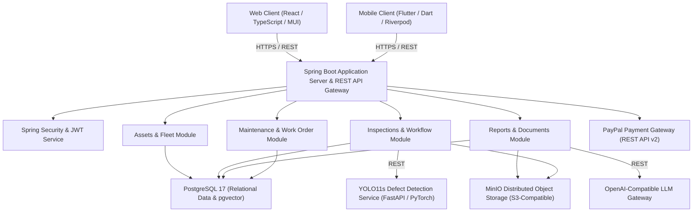
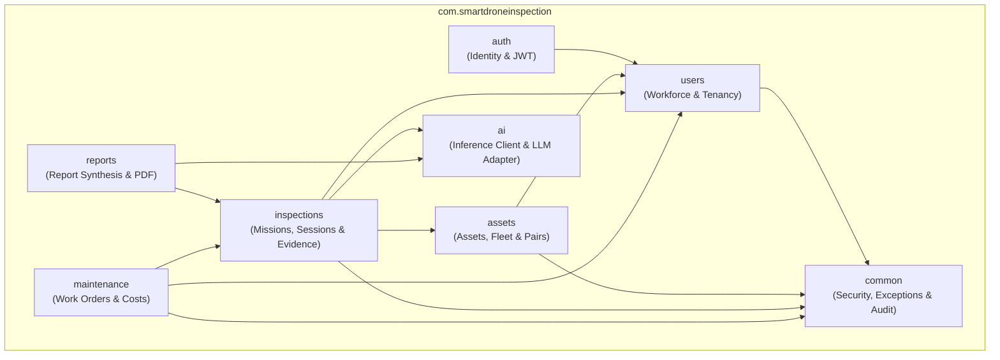

# II. Software Design Document

## 1. System Design

### 1.1 System Architecture

The SmartDroneInspection platform employs a modular, multi-tenant cloud-native architecture separating client presentation, backend application logic, object storage, and AI inference microservices.

**Subsystem and Component Descriptions**

1. **Web Client Portal (React 19, TypeScript, Material-UI, Vite)**: Delivers responsive, role-tailored administrative and operational interfaces for Platform Admin, Organization Admin, Inspector, and Maintenance Engineer. Manages browser state via TanStack React Query and enforces token security through memory-held access tokens and HttpOnly refresh cookies.
2. **Mobile Field Client (Flutter 3, Dart, Riverpod)**: Delivers an on-site operational client optimized for tablet and mobile devices in outdoor field environments. Handles pre-flight safety checklist completion, field flight session logging, and raw visual media capture.
3. **Application Server & API Gateway (Spring Boot 3, Java 21)**: Implements domain-driven Spring Modulith modules encapsulating business logic, tenancy isolation, transactional consistency, and role-based access control (RBAC/ABAC). Exposes standardized REST APIs under `/api/v1`.
4. **AI Computer Vision Microservice (Python 3.11, FastAPI, Ultralytics YOLO11s)**: Containerized microservice executing deep learning object detection for structural defect identification (cracks, spalling, corrosion, leakage, exposure) based on the MBDD2025 dataset.
5. **LLM Report Synthesis Gateway**: Context-grounded language model integration synthesizing structured narrative drafts for inspection and maintenance reports exclusively from verified database inputs.
6. **Relational & Vector Database (PostgreSQL 17, pgvector)**: Central transactional database managing multi-tenant business entities, mission parameters, defect coordinates, and maintenance audit trails with strict foreign key constraints.
7. **Distributed Object Storage (MinIO / S3-Compatible)**: Encrypted, scalable binary storage housing full-resolution aerial imagery, inspection evidence, and compiled PDF deliverables, addressed via server-generated pre-signed URLs.
8. **Online Payment Gateway Adapter (PayPal REST API v2)**: Interfaces with PayPal's payment services to generate checkout orders, capture transaction authorizations, and verify cryptographic webhook IPN signatures for automated enterprise SaaS subscription billing.

---

### 1.2 Package Diagram

The backend application is organized into cohesive modules adhering to Spring Modulith principles, maintaining strict package-level visibility and decoupled inter-module communication via published domain events.

**Package Descriptions**

| No | Package | Description |
| :---: | :--- | :--- |
| 01 | `com.smartdroneinspection.auth` | Manages authentication flows, Argon2id password hashing, access and refresh token issuance, session blacklisting, PayPal subscription checkout, and Spring Security filter chains. |
| 02 | `com.smartdroneinspection.users` | Governs multi-tenant enterprise organizations, workforce provisioning (Inspectors, Maintenance Engineers), and professional credential verification. |
| 03 | `com.smartdroneinspection.assets` | Manages physical infrastructure assets, drone hardware inventory, regulatory flight permits, and default Inspector-Drone operational pairings. |
| 04 | `com.smartdroneinspection.inspections` | Handles inspection scheduling, conflict checking, flight preparations, readiness reviews, field session logging, evidence ingestion, and finding confirmations. |
| 05 | `com.smartdroneinspection.ai` | Provides HTTP client adapters for the external YOLO11s computer vision microservice and LLM generative report drafting endpoints. |
| 06 | `com.smartdroneinspection.reports` | Coordinates structured report authoring, administrative review workflows, OpenHTMLtoPDF rendering, SHA-256 fingerprinting, and MinIO archival. |
| 07 | `com.smartdroneinspection.maintenance` | Governs corrective maintenance work orders, repair task decomposition, itemized cost estimation, change order control, daily work logs, and technical acceptance. |
| 08 | `com.smartdroneinspection.common` | Encapsulates cross-cutting infrastructure including RFC 9457 Problem Details error handling, tenant resolution interceptors, and security audit loggers. |
