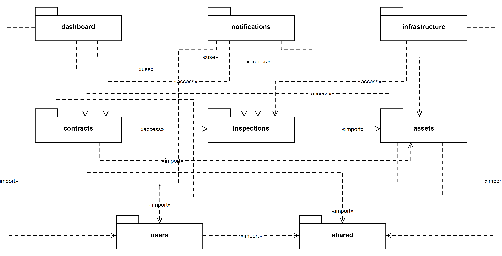
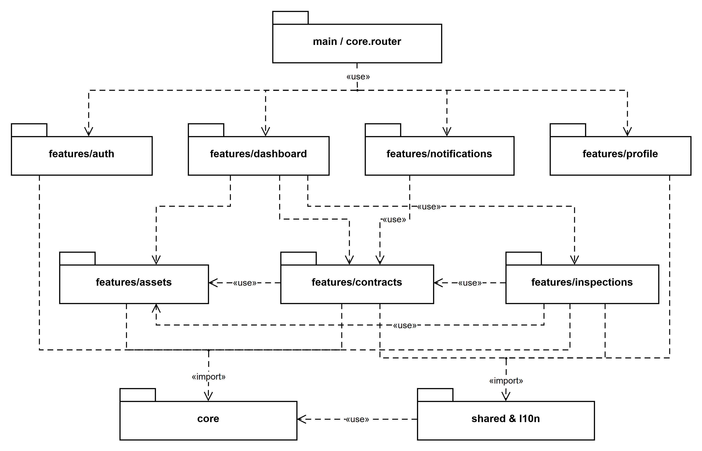

# II. Software Design Document

## 1. System Design

### 1.1 System Architecture

The web portal and mobile app reach the inspection backend through Nginx. The system coordinates building inspections and follow-up visits.

*Figure 4.1 System Architecture*

**Component responsibilities**

| Component | Technology | Primary Responsibility |
| :--- | :--- | :--- |
| Web Portal | React 19 and TypeScript | Provides web workspaces for all four roles. |
| Customer Mobile App | Flutter | Gives Customers access to inspection services. |
| Proxy and Web Container | Nginx | Routes API requests and serves portal files. |
| API Backend | Java 21 and Spring Boot | Runs the inspection workflow and checks access. |
| Relational Database | PostgreSQL 17 with pgvector | Stores records and supports searches for related cases and standards. |
| Object Storage | MinIO | Stores private documents, media, and reports. |
| AI Inference | FastAPI, YOLO11, and FastEmbed | Detects possible defects and prepares text for similarity searches. |
| Flight Data | SmartDroneHub | Provides read-only flight data and video. |
| Identity Provider | Google OAuth 2.0 | Lets users sign in with Google. |
| Payment Services | Sepay and VNPay | Handle customer payments. Sepay also supports Inspector payouts. |
| External AI Service | OpenAI-compatible API | Provides backup detection and drafts report text. |
| Maps and Geocoding | Google map tiles and Nominatim | Shows building locations and looks up addresses. |

### 1.2 Package Diagram

#### 1.2.1 Backend Package Diagram

*Figure 4.2 Backend Package Diagram*

**Package Descriptions**

| No | Package | Description |
| :---: | :--- | :--- |
| 01 | users | Manages accounts, sign-in, sessions, and Inspector applications and qualifications. |
| 02 | contracts | Manages service requests, quotations, contracts, dispatch, and settlement. |
| 03 | assets | Manages buildings, checkpoints, airspace checks, drone registration, and fleet records. |
| 04 | inspections | Manages permits, field sessions, evidence, findings, reports, and re-inspections. |
| 05 | notifications | Sends in-app notifications and emails about changes in the inspection workflow. |
| 06 | dashboard | Collects the metrics shown in each role's dashboard. |
| 07 | infrastructure | Connects the backend to storage, video processing, AI, flight telemetry, and payment services. |
| 08 | shared | Provides common security rules, error handling, upload validation, and interfaces used across modules. |

#### 1.2.2 Web Portal Package Diagram

*Figure 4.3 Web Portal Package Diagram*

**Package Descriptions**

| No | Package | Description |
| :---: | :--- | :--- |
| 01 | `app` | Defines portal navigation, route access, and the application layout. |
| 02 | `features/landing` | Displays the public home page and links to the role workspaces. |
| 03 | `features/auth` | Provides registration, sign-in, and session recovery. |
| 04 | `features/dashboard` | Shows the work summary and metrics for the signed-in role. |
| 05 | `features/notifications` | Displays alerts and opens the related request, inspection, or report. |
| 06 | `features/admin` | Provides account administration, platform settings, and review queues. |
| 07 | `features/assets` | Provides building management, airspace guidance, and drone registration screens. |
| 08 | `features/contracts` | Provides request, chat, quotation, dispatch, and finance workspaces. |
| 09 | `features/inspections` | Supports permit upload, field sessions, flight data, evidence, and finding review. |
| 10 | `features/reports` | Provides screens for report drafting, review, publication, and customer access. |
| 11 | `features/pets3d` | Displays the optional 3D companion in the portal. |
| 12 | `shared` | Provides common API access, maps, translations, and interface components. |

#### 1.2.3 Mobile App Package Diagram

*Figure 4.4 Customer Mobile App Package Diagram*

**Package Descriptions**

| No | Package | Description |
| :---: | :--- | :--- |
| 01 | `main.dart` and the app router | Start the app and route Customers to the available screens. |
| 02 | `core` | Provides network access, secure storage, and application settings. |
| 03 | `features/auth` | Handles sign-in and restores sessions for Customer accounts. |
| 04 | `features/dashboard` | Summarizes the Customer's buildings, requests, and inspections. |
| 05 | `features/notifications` | Lists updates and opens the related records. |
| 06 | `features/profile` | Displays account details and language preferences. |
| 07 | `features/assets` | Shows the Customer's buildings, locations, and inspection checkpoints. |
| 08 | `features/contracts` | Lets Customers submit service requests, view details, and send order messages. |
| 09 | `features/inspections` | Shows inspection progress, chat, findings, and published reports. |
| 10 | `shared` and `l10n` | Provide reusable interface components and English and Vietnamese translations. |
