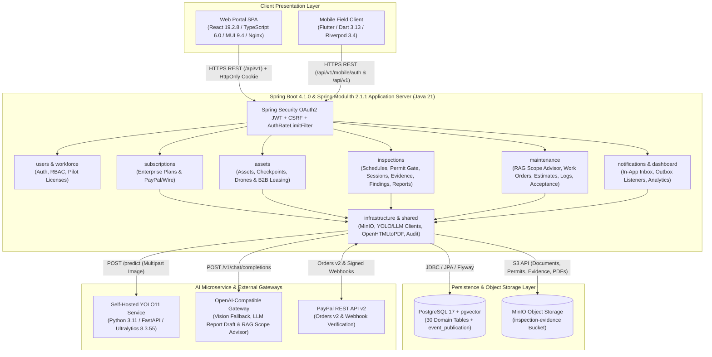
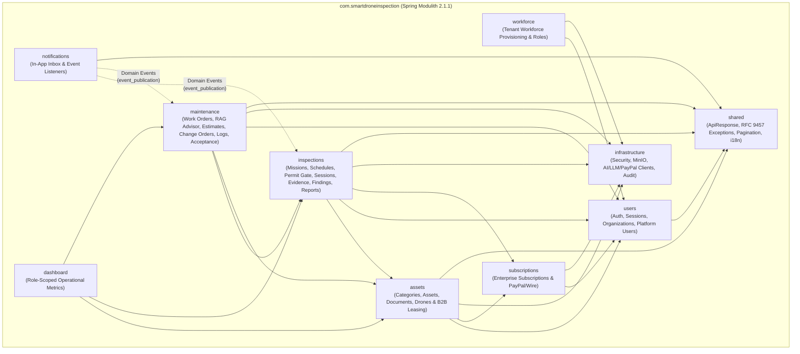

# II. Software Design Document

## 1. System Design

### 1.1 System Architecture

The SmartDroneInspection platform employs a modular, multi-tenant cloud-native architecture separating client presentation (React 19 Web SPA and Flutter Mobile App), backend modular monolith application logic (Java 21, Spring Boot 4.1.0, Spring Modulith 2.1.1), S3-compatible object storage (MinIO), relational & vector storage (PostgreSQL 17 with `pgvector`), and containerized AI inference microservices (Python 3.11 FastAPI + Ultralytics YOLO11 and OpenAI-compatible Vision/LLM/RAG gateways).

**Subsystem and Component Descriptions**

1. **Web Client Portal (`SmartDroneInspection-frontend` — React 19.2.8, TypeScript 6.0.2, Material UI 9.4.0, Vite 8.2.2, Nginx 1.27-alpine)**: Delivers responsive, role-gated workspace portals (`/admin/`, `/client/`, `/operations/`) for `Platform Admin` (`ADMIN`), `Platform Manager` (`PLATFORM_MANAGER`), `Organization Manager` (`ORG_MANAGER`), `Inspector` (`INSPECTOR`), and `Maintenance Engineer` (`MAINTENANCE_ENGINEER`). Manages server state via TanStack React Query `5.102.8`, auth/UI state via Zustand `5.0.15`, and secures browser sessions with in-memory JWT access tokens (`15m` TTL), `HttpOnly; SameSite=Strict` refresh cookies (`sdi_refresh`), and `X-XSRF-TOKEN` CSRF headers.
2. **Mobile Field Client (`SmartDroneInspection-mobile` — Flutter 1.0.0+1, Dart 3.13.2, Riverpod 3.4.2, GoRouter 18.0.0, Dio 5.11.0)**: Cross-platform Android/iOS field application for `Inspector` and `Maintenance Engineer`. Supports native mobile authentication (`/api/v1/mobile/auth` with `flutter_secure_storage`), self-declared pilot license updates, self-service flight permit upload, on-site field session execution (`start`, `postpone`, `complete`, `abort`), camera/gallery evidence upload (`image_picker`), and maintenance task work log execution (`release`, `start`, `work-logs`, `verify`, `declare-complete`).
3. **Modular Monolith Application Server (`SmartDroneInspection-backend` — Java 21, Spring Boot 4.1.0, Spring Modulith 2.1.1)**: Encapsulates 9 domain modules with compile-time boundary verification (`ModulithArchitectureTest`), virtual threads (`spring.threads.virtual.enabled=true`), OAuth2 Resource Server JWT authentication (`HS256`), Argon2id password hashing, IP rate-limiting (`AuthRateLimitFilter`), OpenHTMLtoPDF `1.0.10` server-side PDF rendering, and Spring Modulith transactional event outbox (`event_publication`).
4. **Self-Hosted AI Defect Detection Microservice (`ai-inference` — Python 3.11, FastAPI 0.115.6, Ultralytics 8.3.55 YOLO11, PyTorch 2.5.1)**: Containerized computer vision microservice (`smartdroneinspection-ai-inference:8000`) running custom-trained `YOLO11` weights (`mbdd2025-v1`, `/app/models/best.pt`) to detect 5 structural defect classes (`crack`, `leakage`, `abscission`, `corrosion`, `bulge`) and return normalized bounding boxes (`{x, y, width, height}`) and confidence scores.
5. **OpenAI-Compatible Multimodal Vision, LLM Report Drafting & RAG Advisor Gateways**:
   - **Vision Fallback** (`OpenAiCompatibleInferenceClient`): Optional secondary multimodal defect detector invoked by `PrimaryWithFallbackInference` when primary YOLO11 fails and `users.vision_fallback_enabled` is enabled.
   - **LLM Report Synthesis** (`ReportDraftClient`): Context-grounded narrative generator synthesizing structured JSON report sections (`executiveSummary`, `methodEquipmentConditions`, `conclusionsRecommendations`, `overallCondition`, `omissionDisclosure`) from verified database records, with deterministic manual authoring (`/report/draft/manual`) always available.
   - **RAG Maintenance Scope Advisor** (`MaintenanceScopeAdvisorService` + `DeterministicScopeFallback`): Queries `repair_knowledge_chunks` (`TCVN 9343:2012`, `EN 1504-9`, `ISO 12944-5`, `ASTM C1583`, `TCVN 9361:2012`) to recommend corrective scope, acceptance criteria, reference standards, and sequential tasks, falling back deterministically if the LLM gateway is unreachable.
6. **Relational & Vector Database (PostgreSQL 17 with `pgvector` and `pgcrypto`)**: Persists 30 application tables + `event_publication` outbox managed by Flyway migrations (`V1`–`V5`), enforcing composite tenant foreign keys `(id, organization_id)`, optimistic locking (`row_version`), and `hnsw` cosine vector indexing.
7. **Distributed Object Storage (MinIO S3-Compatible Storage)**: Stores binary objects in the `inspection-evidence` bucket, including asset technical documents (`asset_documents`), drone registrations, mission flight permits, field evidence photographs, and immutable published Inspection and Maintenance Completion PDF reports with SHA-256 verification.
8. **Online Payment Gateway Adapter (`PayPalPaymentGateway` & `PayPalWebhookController` — PayPal REST API v2)**: Executes server-to-server OAuth2 authentication (`/v1/oauth2/token`), order creation (`/v2/checkout/orders`), server-side capture (`/v2/checkout/orders/{id}/capture`), and cryptographic webhook signature verification (`/v1/notifications/verify-webhook-signature`) for Enterprise subscriptions and B2B drone leases, alongside corporate wire confirmation by `PLATFORM_MANAGER`.

---

### 1.2 Package Diagram

The backend application (`com.smartdroneinspection`) is partitioned into **9 Spring Modulith domain modules** plus a shared kernel (`shared`), verified automatically in CI by `ModulithArchitectureTest.java`. Inter-module side effects (notifications and automatic re-inspection creation) communicate asynchronously through Spring Modulith domain events persisted in `event_publication`.

**Package Descriptions**

| No | Package | Description |
| :---: | :--- | :--- |
| 01 | `com.smartdroneinspection.users` | Governs browser (`BrowserAuthController`) and mobile (`MobileAuthController`) authentication, Argon2id/BCrypt password encoding, HS256 JWT issuance, `HmacSHA256` refresh token rotation (`auth_sessions`), customer organization self-registration (`organizations`), pilot license self-declaration, and platform-level user provisioning (`PlatformUserController`). |
| 02 | `com.smartdroneinspection.workforce` | Manages customer organization workforce accounts (`WorkforceController` at `/api/v1/workforce/users`), provisioning `INSPECTOR` and `MAINTENANCE_ENGINEER` users with one-time temporary passwords and role/status management. |
| 03 | `com.smartdroneinspection.subscriptions` | Manages ENTERPRISE subscription contracts (`subscriptions`), payment transactions (`payment_transactions`), wire payment confirmation and direct subscription activation by `PLATFORM_MANAGER` (`PlatformSubscriptionController`, `SubscriptionAdminController`), PayPal Orders v2 checkout (`SubscriptionController`), and signed webhook processing (`PayPalWebhookController`). |
| 04 | `com.smartdroneinspection.assets` | Manages the global asset category catalog (`AssetCatalogController`), tenant infrastructure assets with `inspection_items` checkpoints (`AssetController`), SHA-256 deduplicated engineering documents (`AssetDocumentController`), owned/leased drone inventory (`DroneController`), and the B2B Drone Leasing pool and contracts (`DroneLeaseController`, `PlatformDroneLeaseController`). |
| 05 | `com.smartdroneinspection.inspections` | Orchestrates one-off inspection scheduling (`InspectionListController`), timezone-anchored recurring schedules and background jobs (`InspectionScheduleController`, `RecurringInspectionSchedulerJob`, `InspectionReminderJob`), self-service flight permit upload gate, on-site field sessions (`InspectionFieldSessionController`), EXIF/MinIO evidence intake, YOLO11 defect detection, human finding confirmation, LLM/manual report authoring, OpenHTMLtoPDF rendering (`PdfReportRenderer`), independent review/publication, and corrective handoff (`InspectionController`). |
| 06 | `com.smartdroneinspection.maintenance` | Governs corrective maintenance work orders (`MaintenanceController`, `MaintenanceExecutionController`), RAG-assisted scope suggestions (`MaintenanceScopeAdvisorService`, `DeterministicScopeFallback`), team role assignment (`LEAD`, `REPORT_AUTHOR`, `MEMBER`, independent `acceptingReviewerUserId`), tasks, itemized estimates, change orders, task work logs, completion report PDF rendering (`MaintenanceReportRenderer`), independent acceptance decisions, cost reconciliation, and closure. |
| 07 | `com.smartdroneinspection.notifications` | Provides the deduplicated in-app notification inbox (`NotificationController` at `/api/v1/notifications`) and `@ApplicationModuleListener` event consumers (`InspectionNotificationListener`, `MaintenanceNotificationListener`) backed by Spring Modulith's `event_publication` outbox. |
| 08 | `com.smartdroneinspection.dashboard` | Aggregates role-scoped operational KPIs, asset health summaries, mission queues, and maintenance variance metrics for the multi-portal dashboard. |
| 09 | `com.smartdroneinspection.infrastructure` | Encapsulates cross-cutting adapters: Spring Security OAuth2/CSRF/Rate-Limit filters (`SecurityConfig`, `AuthRateLimitFilter`), MinIO object store (`MinioEvidenceObjectStore`), AI clients (`YoloInferenceClient`, `OpenAiCompatibleInferenceClient`, `PrimaryWithFallbackInference`, `ReportDraftClient`, `MaintenanceScopeAdvisorClient`), PayPal adapter (`PayPalPaymentGateway`), and append-only audit logging (`SecurityAuditService`). |
| 10 | `com.smartdroneinspection.shared` | Defines standardized `ApiResponse<T>` envelopes, RFC 9457 `ProblemDetail` exception handlers (`GlobalExceptionHandler`), pagination primitives, and `Accept-Language` localization (`en`, `vi`). |

---

**Technology & Infrastructure Declarations (Review 2 Mandatory Declaration)**

In accordance with the **SWP490 Review 2 Guidelines (Section 03)**, the five mandatory technology and operational declarations are specified below:

**1. Third-Party & External Services Declaration**

| No | Service Name | Purpose | Outbound Data Sent | Fallback & Security Control |
| :---: | --- | --- | --- | --- |
| 01 | **Self-Hosted YOLO11 Service** (`smartdroneinspection-ai-inference`) | Primary computer vision object detection (`mbdd2025-v1`) for structural defects (`crack`, `leakage`, `abscission`, `corrosion`, `bulge`). | Raw inspection image bytes (`image/jpeg`, `image/png`) over internal Docker bridge network (`POST http://ai-inference:8000/predict`). | Runs locally inside private Docker network; zero external third-party data exposure. |
| 02 | **OpenAI-Compatible Multimodal Vision Gateway** (Optional) | Secondary fallback defect detection when primary YOLO11 is unavailable and Inspector enables `vision_fallback_enabled`. | Base64-encoded inspection image and defect detection system prompt (`POST /v1/chat/completions`). | Disabled by default (`COMPATIBLE_VISION_ENABLED=false`); strictly opt-in per user; outputs remain `PENDING` until human Inspector confirmation. |
| 03 | **OpenAI-Compatible LLM Gateway** (`ReportDraftClient` & `MaintenanceScopeAdvisorClient`) | Context-grounded Inspection Report section drafting (`FE-09`) and RAG-assisted Maintenance Scope & Task suggestion (`FE-10`). | Sanitized asset category, structural checkpoints, confirmed defect labels/severities, and retrieved `TCVN`/`EN`/`ISO` standard excerpts (no PII, passwords, or payment secrets). | If unreachable or disabled, `FE-09` provides deterministic Manual Structured Drafting (`/report/draft/manual`) and `FE-10` automatically executes `DeterministicScopeFallback`. |
| 04 | **PayPal REST API v2** (`Orders v2` & `Webhook Verification`) | Online B2B checkout and settlement verification for Enterprise Subscriptions (`FE-02`) and B2B Drone Leases (`FE-03`). | Platform-approved USD contract amount, currency (`USD`), internal `subscriptionId`/`leaseId` reference, and webhook verification headers. | Disabled by default (`PAYPAL_ENABLED=false` uses `DisabledPaymentGateway`); Corporate Wire/Invoice confirmation by `PLATFORM_MANAGER` is always available. Server verifies amount/currency and webhook signature. |
| 05 | **MinIO Object Storage** (Self-Hosted S3-Compatible) | Binary object persistence (`inspection-evidence` bucket) for asset documents, flight permits, field evidence, and published PDFs. | Binary file streams, MIME content types, and object keys over internal Docker network (`http://minio:9000`). | All reads/writes proxy through authenticated Spring Boot endpoints enforcing tenant and role checks; SHA-256 digests verified on documents and PDFs. |
| 06 | **OpenStreetMap Tile Service** (`tile.openstreetmap.org`) | Base raster map tiles for the interactive Vietnam Airspace & No-Fly Zone Map (`FE-05` `AirspaceNoFlyMap` on Web). | Standard public tile coordinates (`z/x/y.png`) from the user's browser; zero tenant or user PII transmitted. | SVG vector prohibited/restricted circles and coordinate Haversine evaluation (`/api/v1/airspace/evaluate`) work independently even if tile CDN is offline. |

**2. Development Technologies & Exact Versions**

| Layer | Technology / Library | Exact Version | Role in System |
| --- | --- | --- | --- |
| **Backend Runtime & Framework** | Java (Eclipse Temurin) / Spring Boot | `Java 21` / `Spring Boot 4.1.0` | Core REST API server with virtual threads (`spring.threads.virtual.enabled=true`). |
| **Backend Modularity & Persistence** | Spring Modulith / Spring Data JPA / Flyway | `2.1.1` / `4.1.0` / `PostgreSQL Driver` | Module boundary verification, transactional event outbox (`event_publication`), and schema migrations (`V1`–`V5`). |
| **Backend Security & Crypto** | Spring Security OAuth2 JWT / Argon2 / BouncyCastle | `Spring Security 7.x` / `bcprov-jdk18on 1.84` | `Argon2id` password hashing, `HS256` JWT access tokens, `HmacSHA256` refresh cookies, CSRF & IP rate limiting. |
| **Backend PDF & Storage SDKs** | OpenHTMLtoPDF / Apache PDFBox / MinIO SDK | `1.0.10` / `3.0.5` / `9.0.3` | Server-side A4 PDF rendering with SHA-256 fingerprinting and S3 object storage streaming. |
| **AI Inference Service** | Python / FastAPI / Uvicorn / Ultralytics / PyTorch | `3.11` / `0.115.6` / `0.34.0` / `8.3.55` / `2.5.1` | Containerized `YOLO11` (`mbdd2025-v1`) defect detection microservice. |
| **Frontend Web Portal** | React / TypeScript / Vite / Material UI (MUI) | `19.2.8` / `6.0.2` / `8.2.2` / `9.4.0` | Multi-portal SPA (`admin`, `client`, `operations`), served by `nginx:1.27-alpine`. |
| **Frontend State, Routing & Forms** | TanStack Query / React Router / Zustand / Zod | `5.102.8` / `7.18.3` / `5.0.15` / `4.5.4` | Server cache invalidation, role-guarded routing, auth store, and schema validation. |
| **Mobile Field Client** | Flutter / Dart / Riverpod / GoRouter / Dio | `1.0.0+1` / `3.13.2` / `3.4.2` / `18.0.0` / `5.11.0` | Cross-platform Android/iOS field client for Inspectors and Maintenance Engineers. |
| **Database & Vector Index** | PostgreSQL with `pgvector` & `pgcrypto` | `PostgreSQL 17` (`pgvector:pg17`) | Relational transactional store + 1536-dim `hnsw` cosine vector index on `repair_knowledge_chunks`. |

**3. Source Control & DevOps Configuration**

| Category | Configuration Details |
| --- | --- |
| **Platform & Repositories** | GitHub (`SmartDroneInspection-backend`, `SmartDroneInspection-frontend`, `SmartDroneInspection-mobile`, `SmartDroneInspection-docs`), tagged `review-2` for Review 2 baseline. |
| **Branching & Merge Rules** | Trunk-based feature workflow (`feat/<branch>`, `fix/<branch>`, `docs/<branch>` → Pull Request → `main`); all PRs require passing CI checks before merge. |
| **Continuous Integration (CI)** | GitHub Actions (`ci.yml`): runs `./mvnw -B verify` (Spotless Google Java Format check + 77 JUnit 5 / Testcontainers Postgres & MinIO integration test classes / 850 tests + `ModulithArchitectureTest` + JaCoCo `80%` coverage gate), `vitest run` (`81` frontend suites / `602` tests) + `oxlint`, `flutter analyze` + `flutter test` (`14` mobile suites / `20` tests), and Python OOXML report exporter tests (`33` suites). |
| **Continuous Deployment (CD)** | GitHub Actions (`deploy.yml`): connects to staging/production host via Tailscale (`tailscale/github-action@v4`) + SSH, acquires cross-repo deployment lock (`flock -w 900 /tmp/sdi-deploy.lock`), backs up PostgreSQL (`pg_dump`), deploys containers via `docker compose up -d --build`, and runs HTTP health smoke checks. |

**4. Deployment Environments & Rollback Procedure**

| Environment | Host / Infrastructure | Deployment Mechanism | Verification & Rollback Strategy |
| --- | --- | --- | --- |
| **Local Development** | Developer Workstation (Docker Desktop) | `docker compose up -d` starting `postgres:17`, `minio`, `ai-inference`, `backend:8080`, and Vite dev server (`:5173`). | Flyway `ddl-auto=validate` on startup; reset via `docker compose down -v` or Flyway baseline. |
| **Isolated E2E Test Environment** | Ephemeral Docker Compose project (`sdi-e2e-<runId>`) | `node e2e/scripts/run-e2e.mjs` binds dynamic loopback ports (`127.0.0.1:0`) and runs `e2e/scripts/bootstrap-api.mjs` to seed disposable org, subscription, and workforce accounts. | Automatically torn down after E2E verification without touching local development containers or volumes. |
| **Staging / Production (`review-2` Demo)** | Cloud VPS2 (`smartdroneinspection.duckdns.org`, Tailscale `100.120.66.114`) | Automated GitHub Actions CD (`deploy.yml`) deploying Nginx frontend (`:18080`), Spring Boot backend (`:18081`), FastAPI YOLO11 (`:8000`), PostgreSQL 17, and MinIO behind HTTPS reverse proxy. | **Pre-deploy**: automated `pg_dump -U postgres smartdroneinspection > ~/db_backups/pre-deploy-<timestamp>.sql`. **Smoke check**: `/actuator/health` and `/` HTTP 200. **Rollback**: checkout previous Git tag (`review-2`), restore pre-deploy SQL dump if schema changed, and run `docker compose up -d`. |

**5. AI Tools Usage Declaration (SDLC Stages)**

| AI Tool | Model(s) Used | SDLC Stage(s) | Governance & Verification Rule |
| --- | --- | --- | --- |
| **Claude Code / Pi Coding Agent** | `Claude Opus 4.6` / `Claude Sonnet 4.6` / `GPT-5.4` | Requirement Analysis (SRS), Software Design (SDD & Mermaid Diagrams), Full-Stack Implementation, Unit/Integration Test Generation, and RV2 Self-Review (`BM02`). | Every AI-generated artifact is reviewed by the owning team member and verified against automated tests (`./mvnw verify`, `vitest`, `flutter test`, `export_all.py`) before commit. No real customer PII, credentials, or API secrets are submitted to AI tools. |
| **Ultralytics YOLO11 (Runtime Service)** | `YOLO11` (`mbdd2025-v1`) | Runtime Inspection Image Defect Detection (`FE-05`). | Strictly advisory (`PENDING` status); requires explicit human `INSPECTOR` confirmation (`CONFIRMED`) before entering official reports. |
| **OpenAI-Compatible LLM (Runtime Adapter)** | `llama3` / `gpt-4o-mini` compatible API | Runtime Inspection Report Section Synthesis (`FE-06`) & RAG Maintenance Scope Advisory (`FE-07`). | Grounded strictly on database records and `repair_knowledge_chunks` (`TCVN`/`EN`/`ISO`); requires human Author verification (`AUTHOR_VERIFIED`) and independent `ORG_MANAGER` approval. |
