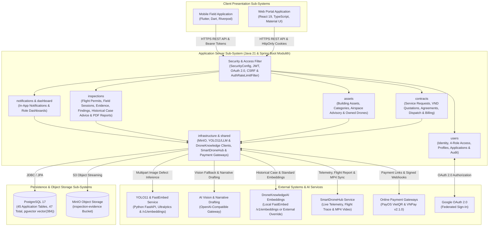
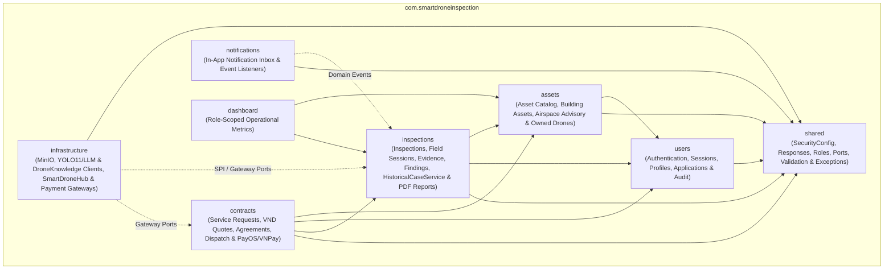
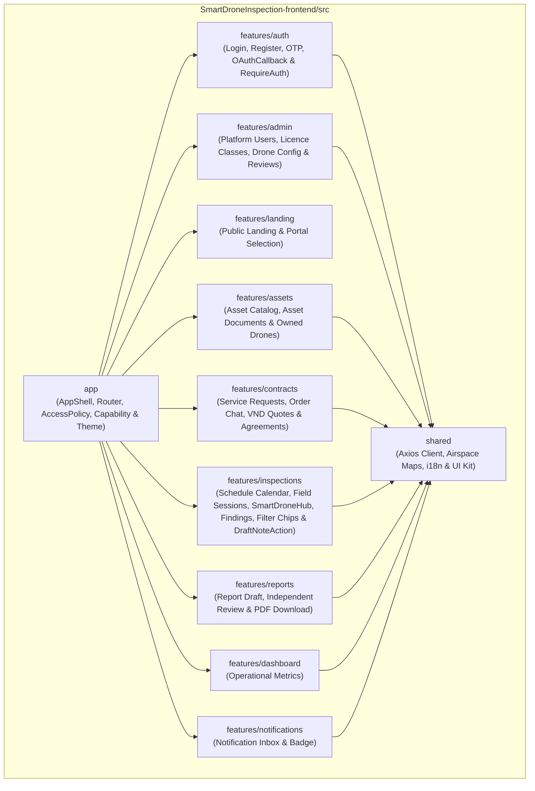
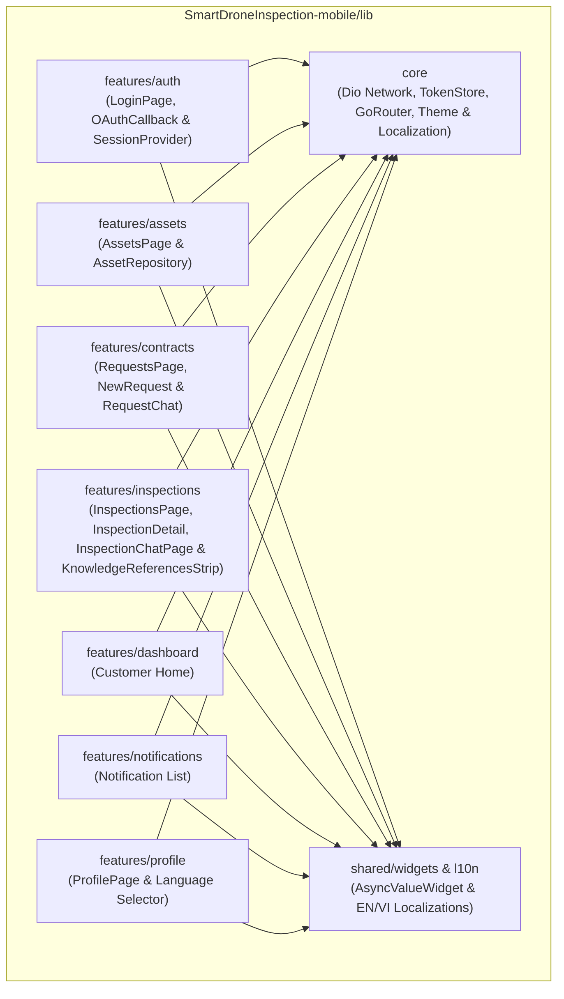

# II. Software Design Document

## 1. System Design

### 1.1 System Architecture

**Current application scope:** Four login roles (`ADMIN`, `MANAGER`, `CUSTOMER`, `INSPECTOR`), eight active features (`FE-01`–`FE-08`) grouped as two per main flow across `MF1`–`MF4`. The inspection scope is buildings only. Corrective maintenance is neither modelled nor exposed: no maintenance package, class, table, or endpoint exists in the delivered codebase. Re-inspection against a published report is modelled, and is designed under `FE-08`. DroneKnowledgeAI is an optional, tenant-isolated advisory retrieval capability for historical cases and engineering standards; it is an automated actor, not a login role, and it never authorizes flight or a workflow transition.

SmartDroneInspection uses a modular client-server architecture that separates the client presentation sub-systems (Web Portal Application and Mobile Field Application), the modular monolith backend application server (Java 21 and Spring Boot 4.1 with Spring Modulith), the persistence and object storage layer (PostgreSQL 17 with `pgvector` and MinIO object storage), and external or containerized systems (YOLO11 defect detection service, OpenAI-compatible vision, narrative-drafting and knowledge-embedding gateway, SmartDroneHub telemetry and flight video service, PayOS and VNPay payment gateways, and Google OAuth 2.0).

**Explanation of Architecture Components**

1. **Web Portal Application (`SmartDroneInspection-frontend`)**: Single-page web sub-system built with React 19, strict TypeScript, Vite, and Material UI. It delivers four role-scoped portals (`/admin`, `/manager`, `/client`, `/operations`) for the four human roles. A section a role may not use has no route at all, so denial is enforced at the routing boundary by `accessPolicy.ts` as well as at the API. The web application is the only client for `ADMIN`, `MANAGER`, and `INSPECTOR`; every field, commercial, and review task is performed here.
2. **Mobile Field Application (`SmartDroneInspection-mobile`)**: Cross-platform mobile sub-system built with Flutter, Dart, Riverpod, GoRouter, and Dio. It is **Customer-only**: `session_provider.dart` and `auth_user.dart` restrict entry to `CUSTOMER` accounts, and the network layer returns the `CUSTOMER_ONLY_MOBILE` error code for any other role. It covers sign-in, organization registration, buildings, service requests with order chat, inspection tracking, published reports, and notifications. It also carries Customer parity for DroneKnowledgeAI (`KnowledgeReferencesStrip`), the Inspector–Customer chat thread (`InspectionChatPage`), re-inspection verdict expiry (`verdict_expiry.dart`), and payment-due deadlines and notice/receipt PDFs. Inspectors record field sessions through the operations web portal, not the mobile application.
3. **Application Server (`SmartDroneInspection-backend`)**: Modular monolith backend sub-system built with Java 21, Spring Boot 4.1.0, and Spring Modulith 2.1.1 across eight modules. It enforces role-based and organization-scoped authorization (`SecurityConfig`, `ActorZone`), domain state transitions, server-side A4 PDF report rendering (openhtmltopdf), security audit logging (`SecurityAuditService`), and transactional cross-module domain events through the Modulith `event_publication` outbox. Module boundaries are declared per module in `package-info.java` and asserted by `ModulithArchitectureTest`, so an undeclared cross-module dependency fails the build.
4. **YOLO11 Defect Detection Service (`ai-inference`)**: Containerized Python FastAPI microservice running trained Ultralytics YOLO11s weights (`MBDD2025`) to detect five building-defect classes (`crack`, `leakage`, `abscission`, `corrosion`, `bulge`) on inspection photographs and video keyframes, returning normalized bounding boxes and confidence scores.
5. **AI Vision, Narrative Drafting and Knowledge-Embedding Gateway**: External OpenAI-compatible language, vision and embeddings service providing three advisory capabilities:
   - **Vision Fallback** (`PrimaryWithFallbackInference`, `OpenAiCompatibleInferenceClient`): Secondary image defect detection invoked when the primary YOLO11 service returns no detections or is unreachable. A user may opt out of the fallback for their own account through `vision_fallback_enabled`.
   - **Narrative Drafting** (`ReportDraftClient`): A single-shot request that turns the confirmed inspection context into structured narrative text for the executive summary. The draft itself is not retrieval-augmented; source-backed references are attached separately from the DroneKnowledgeAI stores and rendered in `ReportAiSummaryResponse.knowledgeReferences`.
   - **Knowledge Embeddings** (`DroneKnowledgeClient`, `DroneKnowledgeConfiguration`, `DroneKnowledgeProperties`): An OpenAI-compatible `POST /v1/embeddings` adapter behind the inspections-owned `HistoricalCaseAdvisorPort`, configured via `app.knowledge-ai.embedding-base-url` (pointing by default in Docker Compose to the local `ai-inference` `fastembed` endpoint serving `sentence-transformers/paraphrase-multilingual-MiniLM-L12-v2`) to produce a 384-dimension vector for cosine retrieval over `inspection_knowledge_chunks` and `historical_finding_cases`. A missing endpoint, timeout, authentication failure or malformed response yields an empty embedding so retrieval degrades to deterministic `HYBRID_MATCH` rather than failing a finding or report.
6. **SmartDroneHub Telemetry and Flight Video Service**: External drone ground-control and telemetry system accessed through `SmartDroneHubClient` and `InspectionDroneHubService`. It supplies read-only live mission telemetry, persists post-flight report metrics and GPS flight traces (`flight_trace_json`) into `field_sessions`, and synchronizes recorded mission MP4 videos into inspection `evidence`. The platform never sends flight commands to it.
7. **Relational Database (PostgreSQL 17)**: Persists **45 application tables** (`43` JPA-mapped application tables plus the two non-entity tables `audit_events` and `platform_ai_settings`; `TARGET_APPLICATION_TABLES` in `RuntimePersistenceInventoryTest` has size 45, while the `44` JPA runtime entity tables additionally include the `event_publication` outbox). Flyway applies `V1__baseline.sql`, a consolidated baseline holding the complete current schema and catalog seeds, followed by the forward migrations `V2__remove_finding_recommended_action.sql`, `V3__reinspection_resolved_validity.sql`, `V4__payment_due_expiry.sql`, `V60__quote_partner_assignment_optional.sql`, `V61__inspection_chat_and_dispatch_settings.sql`, `V62__inspection_knowledge_rag.sql`, `V63__ai_auto_confirm_default_70.sql`, `V64__backfill_published_historical_cases.sql`, and `V65__rag_local_embeddings_384.sql`. With `event_publication` (the Spring Modulith outbox) and `flyway_schema_history`, the `public` schema contains **47 tables**; `FullDatabaseSchemaMigrationTest` asserts the applied migration set is exactly `["1","2","3","4","60","61","62","63","64","65"]`, so an accidental renumbering fails the build. `V62` creates the `pgvector` extension, and `V65` configures `vector(384)` embeddings in `inspection_knowledge_chunks` and `historical_finding_cases`, each with an HNSW `vector_cosine_ops` index; embeddings are read and written with parameterized JDBC rather than mapped as JPA attributes.
8. **Object Storage (MinIO)**: S3-compatible private bucket (`inspection-evidence`) managed through `MinioEvidenceObjectStore` to store signed service agreements, chat attachments, pilot licence scans, three-document drone registration files, building engineering documents, flight permits, field photographs and MP4 videos, and published PDF reports. Binary content is served only through short-lived HMAC media tickets and HTTP Range streaming.
9. **Online Payment Gateways (PayOS and VNPay) & Google OAuth 2.0**: External payment gateways (`PayOSPaymentGateway` VietQR with HMAC-SHA256 webhooks and `VnPayPaymentGateway` v2.1.0 with HMAC-SHA512 webhooks) for VND inspection fee settlement, and Google OAuth 2.0 (`OAuth2Controller`, `GoogleOAuthService`) for federated identity. Both payment gateways are configuration-gated and disabled by default; the application starts and remains operable without them.

**Component responsibilities**

| Component | Technology | Responsibility |
| :--- | :--- | :--- |
| Web Portal Application | React 19, strict TypeScript, Vite, Material UI | Four role-scoped portals; route-level denial; all administrative, commercial, field, and review work. |
| Mobile Field Application | Flutter, Dart, Riverpod, GoRouter, Dio | Customer-only mobile access to buildings, requests, tracking, reports, and notifications. |
| Application Server | Java 21, Spring Boot 4.1.0, Spring Modulith 2.1.1 | Domain logic, authorization, state transitions, PDF rendering, audit, and event publication. |
| YOLO11 Detection Service | Python FastAPI, Ultralytics YOLO11s | Primary building-defect candidate detection over photographs and video keyframes. |
| Vision, Drafting & Knowledge Gateway | OpenAI-compatible HTTP API | Vision fallback detection, single-shot narrative drafting, and optional 1536-dimension case/standard embeddings. |
| SmartDroneHub | External ground station | Read-only telemetry, flight traces, and mission video. |
| PostgreSQL | PostgreSQL 17 | 45 application tables (47 total), pgvector case/standard retrieval, audit trail, and event outbox. |
| MinIO | S3-compatible object storage | Private storage of documents, evidence media, and published PDF reports. |
| PayOS / VNPay / Google OAuth 2.0 | External HTTPS services | Service-fee settlement and federated sign-in. |

### 1.2 Package Diagram

SmartDroneInspection comprises three application sub-systems: the **Backend Application Server** (`com.smartdroneinspection`), the **Web Portal Application** (`SmartDroneInspection-frontend/src`), and the **Mobile Field Application** (`SmartDroneInspection-mobile/lib`). The package diagrams and package descriptions for each sub-system are presented below.

#### 1.2.1 Backend Application Server Package Diagram

The eight modules declare their permitted collaborators in `@ApplicationModule(allowedDependencies = {...})`. `contracts` may reach `assets::domain`, `assets::enums`, `assets::repository`, `users`, and `inspections::spi`; `inspections` may reach `assets::domain`, `assets::enums`, `assets::repository`, `assets::reportcontext`, `users`, and its own `reportcontext`; `notifications` may reach `inspections::events` and `users::events`; `infrastructure` may reach `inspections::spi` and `contracts::gateway`. In particular, `inspections::spi` declares `HistoricalCaseAdvisorPort`, which `infrastructure.ai.DroneKnowledgeClient` implements, keeping the embedding transport outside the business module. Directional control therefore passes through narrow named sub-packages rather than whole modules.

**Package Descriptions**

| No | Package | Description |
| :---: | :--- | :--- |
| 01 | `com.smartdroneinspection.users` | Manages user authentication (password, `OtpChallenge` verification, and Google OAuth 2.0), active sessions (`AuthSession`), JWT and refresh cookies (`AccessTokenService`, `RefreshCookieService`), IP rate limiting (`AuthRateLimitFilter`), account lockout (`LoginFailureService`), security audit logging (`SecurityAuditService`), Inspector profiles (`InspectorProfile`) and flight logs (`InspectorFlightLog`), the public partner Inspector application and its review into a provisioned account (`InspectorApplication`), customer airspace registration reviews (`ProspectiveCustomerRegistration`), and platform user administration. |
| 02 | `com.smartdroneinspection.contracts` | Manages one-time and recurring inspection service requests (`ServiceRequest`), order chat messages and their private attachments (`ServiceRequestMessage`, `ServiceRequestMessageAttachment`), versioned VND quotations (`ServiceRequestQuote`), signed service agreement files, inspection occurrence dispatch (`ServiceRequestOccurrence`), platform finance rates (`InspectionFinanceSettings`), and PayOS/VNPay online payment checkout and webhook processing. |
| 03 | `com.smartdroneinspection.assets` | Manages global building asset categories (`AssetCategory`), customer building assets (`Asset`), category-scoped inspection checkpoints (`InspectionItem`), building reference documents (`AssetDocument`), Vietnam airspace evaluation (`AirspaceAdvisoryService`), drone document and feature configuration (`DroneDocumentConfig`, `DroneFeatureConfig`), and Inspector-owned drone registration and approval (`DroneRegistrationApplication`, `Drone`). |
| 04 | `com.smartdroneinspection.inspections` | Coordinates scheduled inspection missions (`Inspection`), the flight-permit upload and independent verification gate, on-site field sessions (`FieldSession`), `SmartDroneHub` telemetry and flight-video sync (`InspectionDroneHubService`), Manager recovery dispatch after an aborted session, photograph and MP4 evidence with resumable uploads (`Evidence`, `EvidenceUploadSession`), YOLO11 defect analysis and confirmed findings (`Finding`), tenant-isolated historical case recommendation (`HistoricalCaseService` behind the `HistoricalCaseAdvisorPort` SPI), Inspector–Customer inspection chat (`InspectionChatService`), re-inspection verdict validity (`valid_until`), payment-due expiry tracking and payment documents, the four-state inspection report (`InspectionReport`), and deterministic A4 PDF rendering (`PdfReportRenderer`). |
| 05 | `com.smartdroneinspection.notifications` | Delivers deduplicated in-app notifications (`NotificationController`, `NotificationService`) to users in response to domain events published by `inspections` and `users`, with a deduplication key that prevents a retried event from producing a duplicate notice. |
| 06 | `com.smartdroneinspection.dashboard` | Aggregates operational summaries, mission queues, and asset health indicators (`DashboardController`, `DashboardAnalyticsService`) tailored to each of the four user roles. |
| 07 | `com.smartdroneinspection.infrastructure` | Implements technical outbound adapters for MinIO object storage (`MinioEvidenceObjectStore`), YOLO11 and OpenAI-compatible AI clients (`YoloInferenceClient`, `OpenAiCompatibleInferenceClient`, `PrimaryWithFallbackInference`, `ReportDraftClient`), the optional embeddings adapter (`DroneKnowledgeClient`, enabled by `DroneKnowledgeConfiguration` and configured by `DroneKnowledgeProperties`) implementing the inspections-owned `HistoricalCaseAdvisorPort`, `SmartDroneHub` telemetry and video integration (`SmartDroneHubClient`), FFmpeg video processing, and PayOS/VNPay payment gateways (`PayOSPaymentGateway`, `VnPayPaymentGateway`). |
| 08 | `com.smartdroneinspection.shared` | Provides cross-cutting HTTP security configuration (`SecurityConfig`), shared API response wrappers (`ApiResponse`, `Result`), role constants (`Roles`), cross-module service ports (`EvidenceObjectStore`, `AiInferencePort`, `SmartDroneHubPort`, payment ports), upload validation (`EvidenceUploadValidator`), RFC 7807 error handling (`GlobalExceptionHandler`), and bilingual localization (`RequestLocale`). |

#### 1.2.2 Web Portal Application Package Diagram

**Package Descriptions**

| No | Package | Description |
| :---: | :--- | :--- |
| 01 | `src/app` | Contains the application shell (`AppShell`), route configuration (`router.tsx`), the four-portal route access policy (`accessPolicy.ts`), capability helpers (`capability.ts`), portal selection (`PortalSelectionPage`), and design tokens and theme (`tokens.ts`, `theme.ts`, `ColorModeContext`). |
| 02 | `src/features/auth` | Implements customer organization registration, partner Inspector application submission, email/password and OTP sign-in, Google OAuth 2.0 callback handling, session bootstrapping, and route guards (`RequireAuth`). |
| 03 | `src/features/admin` | Provides platform account administration, pilot-licence class maintenance, drone document and feature configuration, platform finance settings, AI inference settings, and the airspace, partner-application, and drone-registration review queues. |
| 04 | `src/features/landing` | Provides the public landing experience and the role-aware entry point into the four portals. |
| 05 | `src/features/assets` | Provides building asset management, reference document streaming, and Inspector-owned drone registration and inventory. |
| 06 | `src/features/contracts` | Implements one-time and recurring service requests, in-context order chat with attachments, VND quotation issuance and acceptance, signed contract upload, and occurrence dispatch, with separate `customer` and `manager` presentation branches. |
| 07 | `src/features/inspections` | Implements the Inspector schedule calendar, the customer inspection progress view, on-site field session and `SmartDroneHub` telemetry controls, flight-permit upload and review, photo and MP4 evidence upload, YOLO11 defect review with `All active` / `Unconfirmed` / `Confirmed` status filter chips, and `DraftNoteAction` (`Draft note with AI`, collapsed `References`, and batch `Draft all notes`) writing advisory notes directly into the finding editor. |
| 08 | `src/features/reports` | Implements pre-submission report drafting, independent Manager review and publication, on-demand PDF download, and the source-backed `Matched Cases & Standards` footer of `ReportAiSummaryCard`. |
| 09 | `src/features/dashboard`, `src/features/notifications` | Provide four-role operational metrics and the in-app notification inbox with unread badge. |
| 10 | `src/shared` | Provides the Axios HTTP client with automatic token refresh, CSRF handling, and RFC 7807 problem parsing (`api`), the interactive Vietnam airspace planner and map (`airspace`), bilingual EN/VI localization (`i18n`), and the shared UI kit including authenticated media components (`ui`, `AuthenticatedImage`, `AuthenticatedMedia`). |

#### 1.2.3 Mobile Field Application Package Diagram

**Package Descriptions**

| No | Package | Description |
| :---: | :--- | :--- |
| 01 | `lib/core` | Provides the shared Dio HTTP client with authentication, API-response, and locale-header interceptors (`network`), secure token storage (`flutter_secure_storage`), application routing (`app_router.dart`), environment configuration (`env`), and theme and localization providers. |
| 02 | `lib/features/auth` | Implements mobile credential sign-in, Google OAuth 2.0 deep-link callback handling, and Riverpod session state. `session_provider.dart` enforces that only `CUSTOMER` accounts enter the application; the network layer raises `CUSTOMER_ONLY_MOBILE` for any other role. |
| 03 | `lib/features/assets` | Displays the organization's building assets, coordinates, and inspection checkpoints, with `data`, `domain`, and `presentation` layers. |
| 04 | `lib/features/contracts` | Implements the customer service-request list, new-request submission, request detail, and order-chat conversation. |
| 05 | `lib/features/inspections` | Implements the customer inspection list and inspection detail, including the published report and its findings, the collapsible `KnowledgeReferencesStrip` (`knowledge_references_strip.dart`) that hides cleanly when the endpoint is unavailable or empty, the Inspector–Customer `InspectionChatPage` (`inspection_chat_page.dart`), and the `verdict_expiry.dart` helper that flags lapsed or soon-to-lapse `RESOLVED` re-inspection verdicts. |
| 06 | `lib/features/dashboard`, `lib/features/notifications` | Provide the customer home summary and the in-app notification list. |
| 07 | `lib/features/profile`, `lib/shared` & `lib/l10n` | Provide user profile viewing and language switching, reusable asynchronous state widgets, and generated English/Vietnamese localization bundles from `app_en.arb` and `app_vi.arb`. |
