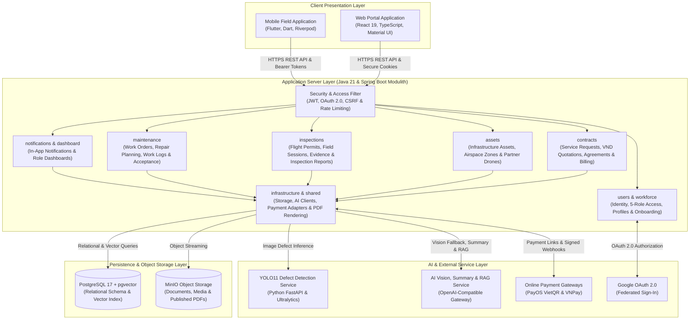
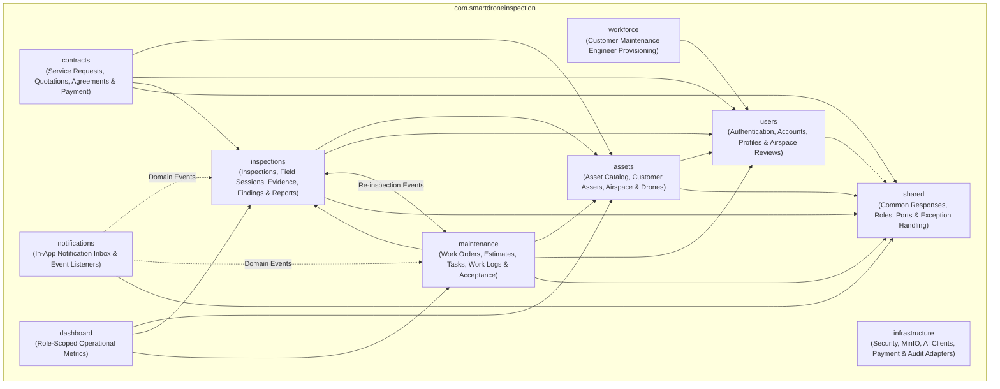

# II. Software Design Document

## 1. System Design

### 1.1 System Architecture

SmartDroneInspection uses a modular client-server architecture that separates the presentation applications (Web Portal and Mobile Field Application), the modular monolith backend server (Java 21 and Spring Boot with Spring Modulith), relational and vector storage (PostgreSQL 17 with vector search), S3-compatible object storage (MinIO), and external or containerized services (YOLO11 defect detection, OpenAI-compatible AI services, PayOS and VNPay payment gateways, and Google OAuth 2.0).

**Subsystem and Component Descriptions**

1. **Web Portal Application**: Single-page web application built with React 19, TypeScript, and Material UI. It provides role-specific workspaces for the five human roles (Platform Administrator, Platform Manager, Customer, Inspector, and Maintenance Engineer), supporting customer registration, asset and drone administration, service request negotiation, evidence and finding review, report publication, online payment, and maintenance governance.
2. **Mobile Field Application**: Cross-platform mobile application built with Flutter and Riverpod for field personnel (Inspectors and Maintenance Engineers). It supports mobile sign-in, pre-flight airspace advisories, flight permit uploads, on-site field session tracking, photograph and video evidence uploads, and maintenance work log recording.
3. **Application Server**: Modular monolith built with Java 21, Spring Boot 4.1, and Spring Modulith. It enforces role-based and organization-scoped access rules, domain state transitions, server-side PDF report generation, and asynchronous cross-module events.
4. **YOLO11 Defect Detection Service**: Containerized Python FastAPI service running trained Ultralytics YOLO11 weights to detect structural defects (cracks, leakage, abscission, corrosion, and bulges) on inspection photographs and return candidate bounding boxes with confidence scores.
5. **AI Vision, Executive Summary, and RAG Advisory Gateway**: Connects to an OpenAI-compatible language and vision service to provide three advisory capabilities:
   - **Vision Fallback**: Secondary image defect detection used when the primary YOLO11 model returns no detections or is unavailable.
   - **Executive Summary Generation**: Drafts structured executive summaries from confirmed inspection findings, with a deterministic template fallback when offline.
   - **Maintenance RAG Advisor**: Searches engineering standard excerpts stored in the vector database to suggest repair scopes, initial maintenance tasks, standard cost norms, and completion compliance checks.
6. **Relational and Vector Database (PostgreSQL 17)**: Stores all transactional domain entities, transactional event publications, and 1536-dimensional vector embeddings for engineering standards, enforcing foreign keys and optimistic concurrency control.
7. **Object Storage (MinIO)**: Stores binary files in a dedicated private bucket, including signed service agreements, pilot license scans, drone registration documents, asset reference documents, flight permits, field photographs and MP4 videos, and published PDF reports.
8. **Online Payment Gateway Adapters (PayOS and VNPay)**: Generate online payment links and QR codes in VND after a Customer accepts a published inspection report, verify signed webhook notifications from the payment provider, and record customer payment and Inspector payout statuses.

---

### 1.2 Package Diagram

The backend application (`com.smartdroneinspection`) is organized into ten Spring Modulith packages. Domain modules interact through public service interfaces and domain events, while outbound technical adapters are isolated inside the `infrastructure` package.

**Package Descriptions**

| No | Package | Description |
| :---: | :--- | :--- |
| 01 | `users` | Manages user authentication (password, one-time verification code, and Google OAuth 2.0), active login sessions, user profiles, Inspector qualifications and flight logs, customer airspace registration reviews, and platform user administration. |
| 02 | `workforce` | Allows Customer organization accounts to provision and manage Maintenance Engineer accounts within their own organization. |
| 03 | `contracts` | Manages one-time and recurring inspection service requests, order chat messages, versioned VND quotations, signed service agreement files, inspection occurrence dispatch, platform finance rates, and online payment processing. |
| 04 | `assets` | Manages global asset categories, customer infrastructure assets and inspection checkpoints, engineering reference documents, Vietnam airspace evaluations, and Inspector drone registration reviews. |
| 05 | `inspections` | Coordinates scheduled inspection missions, flight permit uploads, on-site field sessions, manager recovery dispatch after aborted sessions, photograph and video evidence, AI defect analysis, confirmed findings, inspection report compilation and publication, and three-way re-inspection verification. |
| 06 | `maintenance` | Governs corrective maintenance work orders, repair team allocation, RAG-assisted repair scope and cost estimation, change orders, task work logs and batch verification, maintenance completion reports, customer acceptance decisions, and cost reconciliation. |
| 07 | `notifications` | Delivers deduplicated in-app notifications to users in response to domain events across contracts, inspections, and maintenance work orders. |
| 08 | `dashboard` | Aggregates operational summaries, mission queues, asset health indicators, and maintenance budget metrics tailored to each user role. |
| 09 | `infrastructure` | Implements technical outbound adapters for security filters, MinIO object storage, YOLO11 and LLM clients, PayOS and VNPay payment gateways, PDF rendering, and security audit logging. |
| 10 | `shared` | Provides shared API response wrappers, role constants, cross-module service ports, standardized error handling, pagination utilities, and bilingual message localization. |

---

**Technology and Infrastructure Summary**

| Layer | Technology | Version | Purpose in System |
| --- | --- | --- | --- |
| **Backend Runtime** | Java & Spring Boot | Java 21, Spring Boot 4.1.0 | Core REST API application server with virtual threads enabled. |
| **Backend Modularity** | Spring Modulith & Spring Data JPA | 2.1.1, 4.1.0 | Module boundary verification, relational persistence, and transactional event outbox. |
| **Security & Authentication** | Spring Security OAuth2 & Argon2 | Spring Security 7.x | Password hashing, JWT access tokens, refresh cookies, Google OAuth 2.0, and rate limiting. |
| **Document & Storage SDKs** | OpenHTMLtoPDF & MinIO SDK | 1.0.10, 9.0.3 | Server-side A4 PDF report generation and S3-compatible object storage streaming. |
| **AI Defect Service** | Python, FastAPI & Ultralytics YOLO11 | Python 3.11, FastAPI 0.115.6 | Containerized computer vision service for structural defect detection. |
| **Web Portal** | React, TypeScript, Vite & Material UI | React 19.2.8, TypeScript 6.0.2 | Responsive web portal for administrative, customer, and inspection workflows. |
| **Mobile Field App** | Flutter, Dart, Riverpod & Dio | Flutter 1.0, Dart 3.13.2 | Cross-platform mobile client for field sessions, evidence upload, and repair logs. |
| **Database & Vector Store** | PostgreSQL with `pgvector` | PostgreSQL 17 | Relational database and vector similarity index for maintenance standards. |
