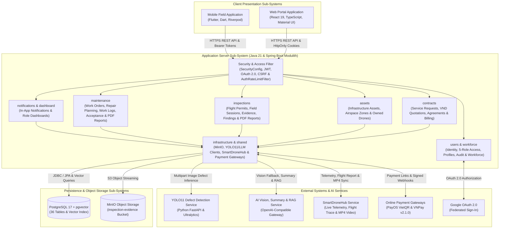
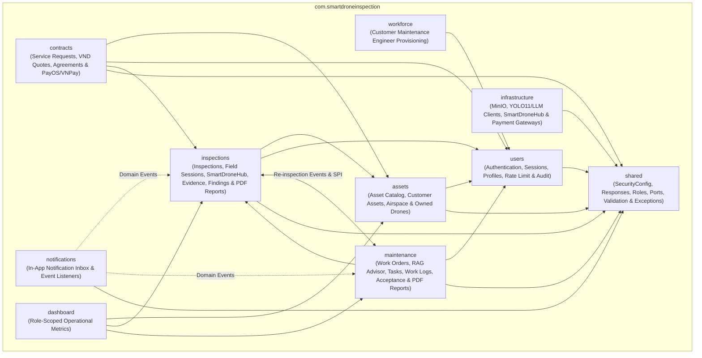
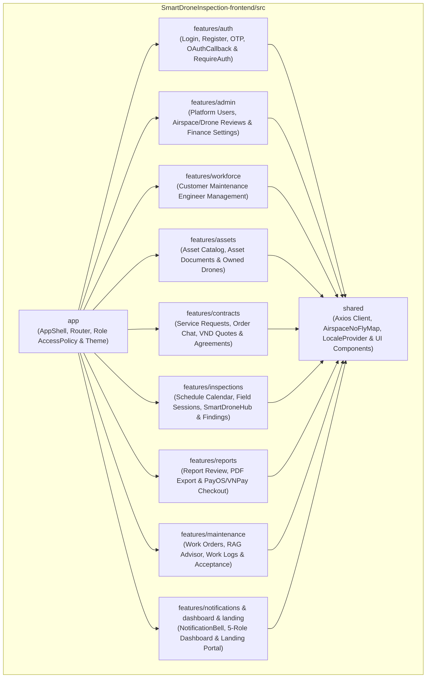
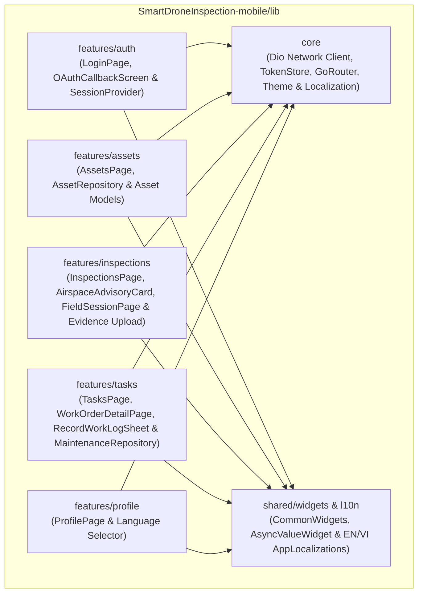

# II. Software Design Document

## 1. System Design

### 1.1 System Architecture

SmartDroneInspection uses a modular client-server architecture that separates the client presentation sub-systems (Web Portal Application and Mobile Field Application), the modular monolith backend application server (Java 21 and Spring Boot 4.1 with Spring Modulith), the persistence and object storage layer (PostgreSQL 17 with `pgvector` and MinIO object storage), and external or containerized systems (YOLO11 defect detection service, OpenAI-compatible AI Vision/Summary/RAG gateway, SmartDroneHub telemetry and flight video service, PayOS and VNPay payment gateways, and Google OAuth 2.0).

**Explanation of Architecture Components**

1. **Web Portal Application (`SmartDroneInspection-frontend`)**: Single-page web sub-system built with React 19.2.8, TypeScript 6.0.2, Vite, TanStack Query, Zustand, and Material UI. It delivers role-scoped workspaces (`/admin`, `/client`, `/operations`) for the five human roles (`ADMIN`, `MANAGER`, `CUSTOMER`, `INSPECTOR`, and `MAINTENANCE_ENGINEER`), supporting customer onboarding, asset and drone administration, service request negotiation, `SmartDroneHub` telemetry viewing, interactive video frame cropping, defect finding review, report publication, online payment (PayOS and VNPay), and maintenance governance.
2. **Mobile Field Application (`SmartDroneInspection-mobile`)**: Cross-platform mobile sub-system built with Flutter, Dart 3.13.2, Riverpod, GoRouter, and Dio for field personnel (`INSPECTOR` and `MAINTENANCE_ENGINEER`). It supports native mobile sign-in (`/api/v1/mobile/auth` with `flutter_secure_storage`), Google OAuth 2.0 deep links (`smartdrone://auth`), pre-flight airspace advisories (`AirspaceAdvisoryCard`), flight permit uploads, on-site field session tracking (`Start`, `Complete`, `Abort`), streaming photograph and MP4 video evidence uploads (`file_picker`), and maintenance work log execution.
3. **Application Server (`SmartDroneInspection-backend`)**: Modular monolith backend sub-system built with Java 21, Spring Boot 4.1.0, and Spring Modulith 2.1.1. It enforces role-based and organization-scoped authorization (`SecurityConfig`, `ActorZone`), domain state transitions, server-side A4 PDF report rendering (`OpenHTMLtoPDF`), security audit logging (`SecurityAuditService`), and transactional cross-module domain events (`event_publication`).
4. **YOLO11 Defect Detection Service (`ai-inference`)**: Containerized Python 3.11 FastAPI microservice running trained Ultralytics YOLO11 weights (`MBDD2025`) to detect five structural defect classes (`crack`, `leakage`, `abscission`, `corrosion`, and `bulge`) on inspection photographs and video keyframes, returning normalized bounding boxes and confidence scores.
5. **AI Vision, Executive Summary, and RAG Advisory Gateway**: External OpenAI-compatible language and vision service providing three advisory capabilities:
   - **Vision Fallback** (`PrimaryWithFallbackInference`, `OpenAiCompatibleInferenceClient`): Secondary image defect detection invoked when the primary YOLO11 service returns no detections or is unreachable.
   - **Executive Summary Generation** (`ReportDraftClient`): Synthesizes structured executive summaries from confirmed inspection findings, with a deterministic template fallback when offline.
   - **Maintenance RAG Advisor** (`MaintenanceScopeAdvisorClient`, `MaintenanceScopeAdvisorService`, `DeterministicScopeFallback`): Searches engineering standard excerpts stored in `repair_knowledge_chunks` to recommend repair scopes, initial maintenance tasks, standard construction cost norms, and completion compliance checks.
6. **SmartDroneHub Telemetry and Flight Video Service**: External drone ground-control and telemetry system accessed through `SmartDroneHubClient` and `InspectionDroneHubService`. It provides live mission telemetry, persists post-flight report metrics and GPS flight traces (`flight_trace_json`) into `field_sessions`, and synchronizes recorded mission MP4 videos into inspection `evidence`.
7. **Relational and Vector Database (PostgreSQL 17)**: Persists all 36 schema tables across Flyway migrations `V1`–`V28` (35 application tables plus `event_publication` for the Spring Modulith transactional outbox) and 1536-dimensional `pgvector` embeddings for engineering standards.
8. **Object Storage (MinIO)**: S3-compatible private bucket (`inspection-evidence`) managed through `MinioEvidenceObjectStore` to store signed service agreements, pilot license scans, 3-document drone registration files, asset engineering documents, flight permits, field photographs and MP4 videos, and published PDF reports.
9. **Online Payment Gateways (PayOS and VNPay) & Google OAuth 2.0**: External payment gateways (`PayOSPaymentGateway` VietQR with HMAC-SHA256 webhooks and `VnPayPaymentGateway` v2.1.0 with HMAC-SHA512 webhooks) for VND inspection fee settlement, and Google OAuth 2.0 (`OAuth2Controller`, `GoogleOAuthService`) for federated identity verification.

---

### 1.2 Package Diagram

SmartDroneInspection comprises three application sub-systems: the **Backend Application Server** (`com.smartdroneinspection`), the **Web Portal Application** (`SmartDroneInspection-frontend/src`), and the **Mobile Field Application** (`SmartDroneInspection-mobile/lib`). The package diagrams and package descriptions for each sub-system are presented below.

#### Backend Application Server Package Diagram

**Package Descriptions (Backend Application Server)**

| No | Package | Description |
| :---: | :--- | :--- |
| 01 | `com.smartdroneinspection.users` | Manages user authentication (password, `OtpChallenge` verification, and Google OAuth 2.0), active sessions (`AuthSession`), JWT/refresh cookies (`AccessTokenService`, `RefreshCookieService`), IP rate limiting (`AuthRateLimitFilter`), account lockout (`LoginFailureService`), security audit logging (`SecurityAuditService`), Inspector profiles (`InspectorProfile`) and flight logs (`InspectorFlightLog`), customer airspace registration reviews (`ProspectiveCustomerRegistration`), and platform user administration. |
| 02 | `com.smartdroneinspection.workforce` | Allows Customer organization accounts (`WorkforceController`, `WorkforceService`) to provision and manage `MAINTENANCE_ENGINEER` accounts scoped strictly to their own customer organization. |
| 03 | `com.smartdroneinspection.contracts` | Manages one-time and recurring inspection service requests (`ServiceRequest`), order chat messages (`ServiceRequestMessage`), versioned VND quotations (`ServiceRequestQuote`), signed service agreement files, inspection occurrence dispatch (`ServiceRequestOccurrence`), platform finance rates (`InspectionFinanceSettings`), and PayOS/VNPay online payment checkout and webhook processing. |
| 04 | `com.smartdroneinspection.assets` | Manages global asset categories (`AssetCategory`), customer infrastructure assets (`Asset`) and inspection checkpoints, engineering reference documents (`AssetDocument`), Vietnam airspace evaluations (`AirspaceAdvisoryService`), and Inspector-owned drone registrations (`DroneRegistrationApplication`, `Drone`). |
| 05 | `com.smartdroneinspection.inspections` | Coordinates scheduled inspection missions (`Inspection`), flight permit uploads, on-site field sessions (`FieldSession`), `SmartDroneHub` live telemetry and flight video sync (`InspectionDroneHubService`), manager recovery dispatch after aborted sessions, photograph and MP4 video evidence (`Evidence`), AI defect analysis and confirmed findings (`Finding`), 4-state inspection report compilation/publication (`InspectionReport`), server-side PDF rendering (`PdfReportRenderer`), and three-way re-inspection verification (`ReinspectionDefectVerification`). |
| 06 | `com.smartdroneinspection.maintenance` | Governs 12-state corrective maintenance work orders (`MaintenanceWorkOrder`), repair team allocation (`MaintenanceTeamMember`), `pgvector` RAG-assisted repair scope and cost estimation (`MaintenanceScopeAdvisorService`, `DeterministicScopeFallback`), versioned estimates (`MaintenanceEstimateVersion`), cost lines (`MaintenanceCostLine`), change orders (`MaintenanceChangeOrder`), task work logs (`MaintenanceWorkLog`) and batch verification, maintenance completion reports (`MaintenanceReportVersion`, `MaintenanceReportRenderer`), customer acceptance decisions (`MaintenanceAcceptanceDecision`), and cost reconciliation. |
| 07 | `com.smartdroneinspection.notifications` | Delivers deduplicated in-app notifications (`NotificationController`, `NotificationService`) to users in response to domain events published by `inspections` (`InspectionNotificationListener`) and `maintenance` (`MaintenanceNotificationListener`). |
| 08 | `com.smartdroneinspection.dashboard` | Aggregates operational summaries, mission queues, asset health indicators, and maintenance budget metrics (`DashboardController`, `DashboardAnalyticsService`) tailored to each of the five user roles. |
| 09 | `com.smartdroneinspection.infrastructure` | Implements technical outbound adapters for MinIO object storage (`MinioEvidenceObjectStore`), YOLO11 and OpenAI-compatible AI clients (`YoloInferenceClient`, `OpenAiCompatibleInferenceClient`, `PrimaryWithFallbackInference`, `ReportDraftClient`, `MaintenanceScopeAdvisorClient`), `SmartDroneHub` telemetry/video integration (`SmartDroneHubClient`), and PayOS/VNPay payment gateways (`PayOSPaymentGateway`, `VnPayPaymentGateway`). |
| 10 | `com.smartdroneinspection.shared` | Provides cross-cutting HTTP security configuration (`SecurityConfig`), shared API response wrappers (`ApiResponse`, `Result`), role constants (`Roles`), cross-module service ports (`EvidenceObjectStore`, `AiInferencePort`, `SmartDroneHubPort`, `PayOSPaymentPort`, `VnPayPaymentPort`), file upload validation (`EvidenceUploadValidator`), RFC 7807 error handling (`GlobalExceptionHandler`), and bilingual localization (`RequestLocale`). |

#### Web Portal Application Package Diagram

**Package Descriptions (Web Portal Application)**

| No | Package | Description |
| :---: | :--- | :--- |
| 01 | `src/app` | Contains application-wide shell layouts (`AppShell`), route configuration (`router`), 5-role route access policies (`accessPolicy.ts`, `capability.ts`), and dark/light theme tokens (`ColorModeContext`). |
| 02 | `src/features/auth` | Implements customer organization registration (`RegisterPage`), email/password and OTP sign-in (`LoginPage`), Google OAuth 2.0 callback handling (`OAuthCallbackPage`), session bootstrapping (`AuthSessionBootstrapper`), and route guards (`RequireAuth`). |
| 03 | `src/features/admin` & `src/features/workforce` | Provide platform account administration (`PlatformUsersPage`), restricted-airspace and drone registration review queues (`Mf1ReviewPage`), platform finance settings (`PlatformFinanceSettingsPage`), and Customer `MAINTENANCE_ENGINEER` provisioning (`WorkforcePage`). |
| 04 | `src/features/assets` | Provides infrastructure asset management (`AssetsPage`), reference document streaming (`documentApi.ts`), and Inspector-owned drone registration and inventory (`DroneInventoryPanel`). |
| 05 | `src/features/contracts` | Implements one-time and recurring service requests, in-context Order Chat, VND quotation issuance and acceptance, signed contract upload, and occurrence dispatch (`ContractsPage`). |
| 06 | `src/features/inspections` | Implements the Inspector Schedule Calendar (`InspectorScheduleCalendar`), Customer 5-Stage Progress Tracker (`InspectionProgressPage`), on-site field session & `SmartDroneHub` telemetry controls (`FieldSessionPage`), photo/MP4 evidence upload (`InspectionEvidencePage`), and YOLO11 defect review (`InspectionFindingsPage`). |
| 07 | `src/features/reports` | Implements pre-submission report preview (`InspectionDraftPage`), independent Manager review and direct publication, on-demand PDF download, PayOS VietQR and VNPay online payment checkout (`ReportDetailPage`), and defect forwarding (`CorrectiveDispositionPage`). |
| 08 | `src/features/maintenance` | Implements the 12-state maintenance work order workspace (`MaintenancePage`), including `pgvector` RAG scope/cost norms suggestions, team assignment, change orders, batch work-log verification, auto-drafted completion reports, 3-way re-inspection review, and cost reconciliation. |
| 09 | `src/features/notifications`, `dashboard` & `landing` | Provide the in-app notification inbox (`NotificationBell`), 5-role operational analytics dashboard (`DashboardPage`), and public/role landing console (`LandingPage`). |
| 10 | `src/shared` | Provides the shared Axios HTTP client with automatic token refresh and CSRF handling (`shared/api`), interactive Vietnam airspace map (`AirspaceNoFlyMap`), bilingual EN/VI localization (`LocaleProvider`), and authenticated media components (`AuthenticatedImage`, `AuthenticatedMedia`). |

#### Mobile Field Application Package Diagram

**Package Descriptions (Mobile Field Application)**

| No | Package | Description |
| :---: | :--- | :--- |
| 01 | `lib/core` | Provides the shared Dio HTTP client (`auth_interceptor.dart`, `api_response_interceptor.dart`, `locale_header_interceptor.dart`), secure token storage (`token_store.dart` via `flutter_secure_storage`), application routing (`app_router.dart`), environment configuration (`app_environment.dart`), and theme/localization providers. |
| 02 | `lib/features/auth` | Implements mobile credential sign-in (`login_page.dart`), Google OAuth 2.0 deep-link callback handling (`oauth_callback_screen.dart`), and Riverpod session state management (`session_provider.dart`, `auth_repository.dart`). |
| 03 | `lib/features/assets` | Displays organization and assigned infrastructure assets, coordinates, and inspection checkpoints (`assets_page.dart`, `asset_repository.dart`). |
| 04 | `lib/features/inspections` | Implements assigned inspection mission queues (`inspections_page.dart`), pre-flight Vietnam airspace radar advisories (`airspace_advisory_card.dart`), flight permit upload, on-site field session execution (`field_session_page.dart`), and streaming photograph/MP4 evidence uploads (`inspection_repository.dart`). |
| 05 | `lib/features/tasks` | Implements Maintenance Engineer work order and task queues (`tasks_page.dart`, `work_order_detail_page.dart`), work order release/start, field work log recording (`record_work_log_sheet.dart`), Team Lead verification, and completion declaration (`maintenance_repository.dart`). |
| 06 | `lib/features/profile`, `lib/shared` & `lib/l10n` | Provide user profile and language switching (`profile_page.dart`), reusable asynchronous state widgets (`async_value_widget.dart`, `common_widgets.dart`), and generated English/Vietnamese localization bundles (`app_localizations_en.dart`, `app_localizations_vi.dart`). |
