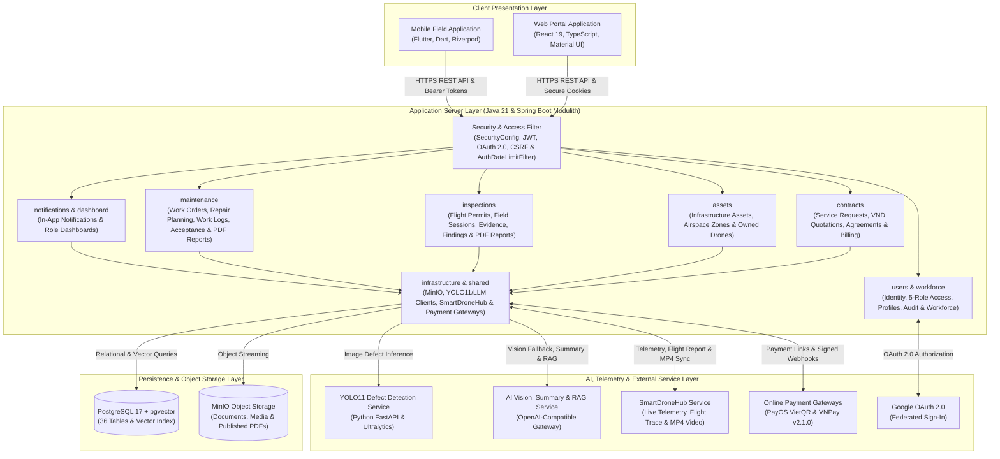
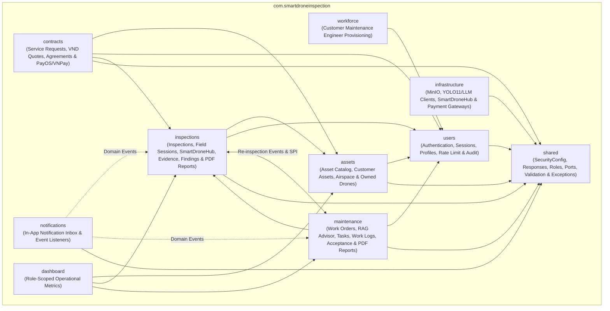

# II. Software Design Document

## 1. System Design

### 1.1 System Architecture

SmartDroneInspection uses a modular client-server architecture that separates the presentation applications (Web Portal and Mobile Field Application), the modular monolith backend server (Java 21 and Spring Boot 4.1 with Spring Modulith), relational and vector storage (PostgreSQL 17 with `pgvector`), S3-compatible object storage (MinIO), and external or containerized services (YOLO11 defect detection, OpenAI-compatible AI services, SmartDroneHub telemetry and video service, PayOS and VNPay payment gateways, and Google OAuth 2.0).

**Subsystem and Component Descriptions**

1. **Web Portal Application**: Single-page web application built with React 19, TypeScript, and Material UI. It provides role-specific workspaces for the five human roles (`ADMIN`, `MANAGER`, `CUSTOMER`, `INSPECTOR`, and `MAINTENANCE_ENGINEER`), supporting customer registration, asset and drone administration, service request negotiation, `SmartDroneHub` telemetry viewing, video frame cropping, finding review, report publication, online payment (PayOS and VNPay), and maintenance governance.
2. **Mobile Field Application**: Cross-platform mobile application built with Flutter and Riverpod for field personnel (`INSPECTOR` and `MAINTENANCE_ENGINEER`). It supports mobile sign-in and Google OAuth 2.0 deep links (`smartdrone://auth`), pre-flight airspace advisories, flight permit uploads, on-site field session tracking, photograph and MP4 video evidence uploads, and maintenance work log recording.
3. **Application Server**: Modular monolith built with Java 21, Spring Boot 4.1, and Spring Modulith. It enforces role-based and organization-scoped access rules, domain state transitions, server-side PDF report rendering (`OpenHTMLtoPDF`), security audit logging, and transactional cross-module domain events.
4. **YOLO11 Defect Detection Service**: Containerized Python FastAPI service running trained Ultralytics YOLO11 weights (`MBDD2025`) to detect structural defects (cracks, leakage, abscission, corrosion, and bulges) on inspection photographs and video keyframes, returning candidate bounding boxes with confidence scores.
5. **AI Vision, Executive Summary, and RAG Advisory Gateway**: Connects to an OpenAI-compatible language and vision service to provide three advisory capabilities:
   - **Vision Fallback**: Secondary image defect detection (`PrimaryWithFallbackInference`) invoked when the primary YOLO11 model returns no detections or is unreachable.
   - **Executive Summary Generation**: Drafts structured executive summaries (`ReportDraftClient`) from confirmed inspection findings, with a deterministic template fallback when offline.
   - **Maintenance RAG Advisor**: Searches engineering standard excerpts stored in `repair_knowledge_chunks` (`MaintenanceScopeAdvisorClient`) to suggest repair scopes, initial maintenance tasks, standard cost norms, and completion compliance checks, with `DeterministicScopeFallback` when offline.
6. **SmartDroneHub Telemetry and Flight Video Service**: External drone ground-control and telemetry service accessed through `SmartDroneHubClient` and `InspectionDroneHubService`. It streams live drone telemetry, persists post-flight report metrics and GPS flight traces (`flight_trace_json`) into `field_sessions`, and synchronizes recorded mission MP4 videos into inspection `evidence`.
7. **Relational and Vector Database (PostgreSQL 17)**: Stores all 36 schema tables across Flyway migrations `V1`–`V28` (35 application tables plus `event_publication` for the Spring Modulith transactional event outbox) and 1536-dimensional `pgvector` embeddings for engineering standards.
8. **Object Storage (MinIO)**: Stores binary files in a private bucket (`MinioEvidenceObjectStore`), including signed service agreements, pilot license scans, drone registration documents, asset reference documents, flight permits, field photographs and MP4 videos, and rendered PDF reports.
9. **Online Payment Gateway Adapters (PayOS and VNPay)**: Generate online payment links and QR codes in VND (`PayOSPaymentGateway` and `VnPayPaymentGateway`) after a Customer accepts a published inspection report, verify signed webhook callbacks (`PayOSWebhookController` HMAC-SHA256 and `VnPayWebhookController` HMAC-SHA512), and record customer payment and Inspector payout statuses.

---

### 1.2 Package Diagram

The backend application (`com.smartdroneinspection`) is organized into ten top-level packages (nine `@ApplicationModule` business/technical modules plus `shared`). Domain modules interact through public service facades, `@NamedInterface("spi")` ports, and `@NamedInterface("events")` domain events, while outbound technical clients are isolated inside `infrastructure`.

**Package Descriptions**

| No | Package | Description |
| :---: | :--- | :--- |
| 01 | `users` | Manages user authentication (password, `OtpChallenge` verification, and Google OAuth 2.0), active sessions (`AuthSession`), JWT/refresh cookies (`AccessTokenService`, `RefreshCookieService`), IP rate limiting (`AuthRateLimitFilter`), account lockout (`LoginFailureService`), security audit logging (`SecurityAuditService`), Inspector profiles (`InspectorProfile`) and flight logs (`InspectorFlightLog`), customer airspace registration reviews (`ProspectiveCustomerRegistration`), and platform user administration. |
| 02 | `workforce` | Allows Customer organization accounts (`WorkforceController`, `WorkforceService`) to provision and manage `MAINTENANCE_ENGINEER` accounts scoped strictly to their own customer organization. |
| 03 | `contracts` | Manages one-time and recurring inspection service requests (`ServiceRequest`), order chat messages (`ServiceRequestMessage`), versioned VND quotations (`ServiceRequestQuote`), signed service agreement files, inspection occurrence dispatch (`ServiceRequestOccurrence`), platform finance rates (`InspectionFinanceSettings`), and PayOS/VNPay online payment checkout and webhook processing. |
| 04 | `assets` | Manages global asset categories (`AssetCategory`), customer infrastructure assets (`Asset`) and inspection checkpoints, engineering reference documents (`AssetDocument`), Vietnam airspace evaluations (`AirspaceAdvisoryService`), and Inspector-owned drone registrations (`DroneRegistrationApplication`, `Drone`). |
| 05 | `inspections` | Coordinates scheduled inspection missions (`Inspection`), flight permit uploads, on-site field sessions (`FieldSession`), `SmartDroneHub` live telemetry and flight video sync (`InspectionDroneHubService`), manager recovery dispatch after aborted sessions, photograph and MP4 video evidence (`Evidence`), AI defect analysis and confirmed findings (`Finding`), 4-state inspection report compilation/publication (`InspectionReport`), server-side PDF rendering (`PdfReportRenderer`), and three-way re-inspection verification (`ReinspectionDefectVerification`). |
| 06 | `maintenance` | Governs 12-state corrective maintenance work orders (`MaintenanceWorkOrder`), repair team allocation (`MaintenanceTeamMember`), `pgvector` RAG-assisted repair scope and cost estimation (`MaintenanceScopeAdvisorService`, `DeterministicScopeFallback`), versioned estimates (`MaintenanceEstimateVersion`), cost lines (`MaintenanceCostLine`), change orders (`MaintenanceChangeOrder`), task work logs (`MaintenanceWorkLog`) and batch verification, maintenance completion reports (`MaintenanceReportVersion`, `MaintenanceReportRenderer`), customer acceptance decisions (`MaintenanceAcceptanceDecision`), and cost reconciliation. |
| 07 | `notifications` | Delivers deduplicated in-app notifications (`NotificationController`, `NotificationService`) to users in response to domain events published by `inspections` (`InspectionNotificationListener`) and `maintenance` (`MaintenanceNotificationListener`). |
| 08 | `dashboard` | Aggregates operational summaries, mission queues, asset health indicators, and maintenance budget metrics (`DashboardController`, `DashboardAnalyticsService`) tailored to each of the five user roles. |
| 09 | `infrastructure` | Implements technical outbound adapters for MinIO object storage (`MinioEvidenceObjectStore`), YOLO11 and OpenAI-compatible AI clients (`YoloInferenceClient`, `OpenAiCompatibleInferenceClient`, `PrimaryWithFallbackInference`, `ReportDraftClient`, `MaintenanceScopeAdvisorClient`), `SmartDroneHub` telemetry/video integration (`SmartDroneHubClient`), and PayOS/VNPay payment gateways (`PayOSPaymentGateway`, `VnPayPaymentGateway`). |
| 10 | `shared` | Provides cross-cutting HTTP security configuration (`SecurityConfig`), shared API response wrappers (`ApiResponse`, `Result`), role constants (`Roles`), cross-module service ports (`EvidenceObjectStore`, `AiInferencePort`, `SmartDroneHubPort`, `PayOSPaymentPort`, `VnPayPaymentPort`), file upload validation (`EvidenceUploadValidator`), RFC 7807 error handling (`GlobalExceptionHandler`), and bilingual localization (`RequestLocale`). |

---

**Technology and Infrastructure Summary**

| Layer | Technology | Version | Purpose in System |
| --- | --- | --- | --- |
| **Backend Runtime** | Java & Spring Boot | Java 21, Spring Boot 4.1.0 | Core REST API application server with virtual threads enabled. |
| **Backend Modularity** | Spring Modulith & Spring Data JPA | 2.1.1, 4.1.0 | Module boundary verification, relational persistence, and transactional event outbox. |
| **Security & Authentication** | Spring Security OAuth2 & Argon2 | Spring Security 7.x | Password hashing, JWT access tokens, refresh cookies, Google OAuth 2.0, and rate limiting. |
| **Document & Storage SDKs** | OpenHTMLtoPDF & MinIO SDK | 1.0.10, 9.0.3 | Server-side A4 PDF report generation and S3-compatible object storage streaming. |
| **AI Defect Service** | Python, FastAPI & Ultralytics YOLO11 | Python 3.11, FastAPI 0.115.6 | Containerized computer vision service for structural defect detection. |
| **Web Portal** | React, TypeScript, Vite & Material UI | React 19.2.8, TypeScript 6.0.2 | Responsive web portal for administrative, customer, and inspection workflows. |
| **Mobile Field App** | Flutter, Dart, Riverpod & Dio | Flutter 1.0, Dart 3.13.2 | Cross-platform mobile client for field sessions, evidence upload, and repair logs. |
| **Database & Vector Store** | PostgreSQL with `pgvector` | PostgreSQL 17 | Relational database (36 tables across `V1`–`V28`) and vector similarity index for maintenance standards. |
