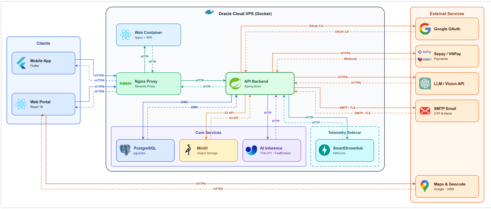
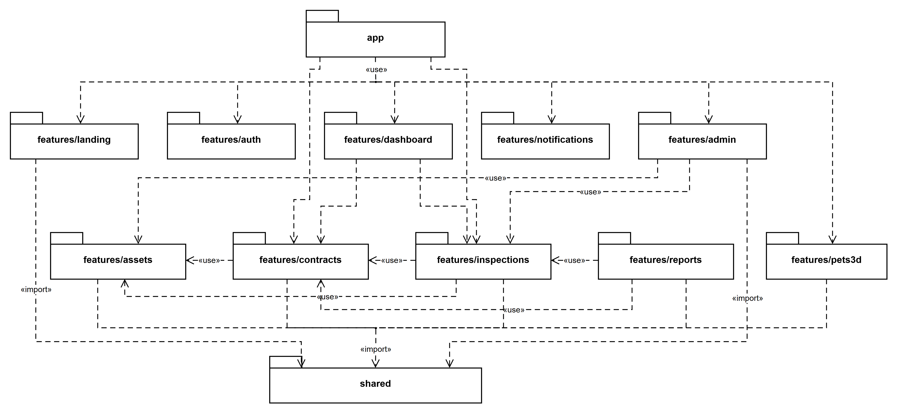

# II. Software Design Document

## 1. System Design

### 1.1 System Architecture

**Current application scope:** Four login roles (`ADMIN`, `MANAGER`, `CUSTOMER`, `INSPECTOR`) and twenty-four atomic active features (`FE-01`–`FE-24`) organized across `MF1`–`MF4`. The inspection scope is buildings only. Corrective maintenance is neither modelled nor exposed: no maintenance package, class, table, or endpoint exists in the delivered codebase. Re-inspection against a published report is modelled, and is designed under `FE-24`. DroneKnowledgeAI is an optional, tenant-isolated advisory retrieval capability for historical cases and engineering standards (`FE-17`); it is an automated actor, not a login role, and it never authorizes flight or a workflow transition.

SmartDroneInspection uses a modular client-server architecture that separates the client presentation sub-systems (Web Portal Application and Mobile Field Application), the modular monolith backend application server (Java 21 and Spring Boot 4.1 with Spring Modulith), the persistence and object storage layer (PostgreSQL 17 with `pgvector` and MinIO object storage), and external or containerized systems (YOLO11 defect detection service, OpenAI-compatible vision, narrative-drafting and knowledge-embedding gateway, SmartDroneHub telemetry and flight video service, Sepay VietQR and VNPay payment gateways, and Google OAuth 2.0), as illustrated in Figure 4.1.

*Figure 4.1 — SmartDroneInspection System Architecture Diagram.*

**Explanation of Architecture Components**

1. **Web Portal Application (`SmartDroneInspection-frontend`)**: Single-page web sub-system built with React 19, strict TypeScript, Vite, and Material UI. It delivers four role-scoped portals (`/admin`, `/manager`, `/client`, `/operations`) for the four human roles. A section a role may not use has no route at all, so denial is enforced at the routing boundary by `accessPolicy.ts` as well as at the API. The web application is the only client for `ADMIN`, `MANAGER`, and `INSPECTOR`; every field, commercial, and review task is performed here.
2. **Mobile Field Application (`SmartDroneInspection-mobile`)**: Cross-platform mobile sub-system built with Flutter, Dart, Riverpod, GoRouter, and Dio. It is **Customer-only**: `session_provider.dart` and `auth_user.dart` restrict entry to `CUSTOMER` accounts, and the network layer returns the `CUSTOMER_ONLY_MOBILE` error code for any other role. It covers sign-in, organization registration, buildings, service requests with order chat, inspection tracking, published reports, and notifications. It also carries Customer parity for DroneKnowledgeAI (`KnowledgeReferencesStrip`), the Inspector–Customer chat thread (`InspectionChatPage`), re-inspection verdict expiry (`verdict_expiry.dart`), and payment-due deadlines and notice/receipt PDFs. Inspectors record field sessions through the operations web portal, not the mobile application.
3. **Application Server (`SmartDroneInspection-backend`)**: Modular monolith backend sub-system built with Java 21, Spring Boot 4.1.0, and Spring Modulith 2.1.1 across eight modules. It enforces role-based and organization-scoped authorization (`SecurityConfig`, `ActorZone`), domain state transitions, versioned inspection report management and publication, security audit logging (`SecurityAuditService`), and transactional cross-module domain events through the Modulith `event_publication` outbox. Module boundaries are declared per module in `package-info.java` and asserted by `ModulithArchitectureTest`, so an undeclared cross-module dependency fails the build.
4. **YOLO11 Defect Detection Service (`ai-inference`)**: Containerized Python FastAPI microservice running trained Ultralytics YOLO11s weights (`MBDD2025`) to detect five building-defect classes (`crack`, `leakage`, `abscission`, `corrosion`, `bulge`) on inspection photographs and video keyframes, returning normalized bounding boxes and confidence scores.
5. **AI Vision, Narrative Drafting and Knowledge-Embedding Gateway**: External OpenAI-compatible language, vision and embeddings service providing three advisory capabilities:
   - **Vision Fallback** (`PrimaryWithFallbackInference`, `OpenAiCompatibleInferenceClient`): Secondary image defect detection invoked when the primary YOLO11 service returns no detections or is unreachable. A user may opt out of the fallback for their own account through `vision_fallback_enabled`.
   - **Narrative Drafting** (`ReportDraftClient`): A single-shot request that turns the confirmed inspection context into structured narrative text for the executive summary. The draft itself is not retrieval-augmented; source-backed references are attached separately from the DroneKnowledgeAI stores and rendered in `ReportAiSummaryResponse.knowledgeReferences`.
   - **Knowledge Embeddings** (`DroneKnowledgeClient`, `DroneKnowledgeConfiguration`, `DroneKnowledgeProperties`): An OpenAI-compatible `POST /v1/embeddings` adapter behind the inspections-owned `HistoricalCaseAdvisorPort`, configured via `app.knowledge-ai.embedding-base-url` (pointing by default in Docker Compose to the local `ai-inference` `fastembed` endpoint serving `sentence-transformers/paraphrase-multilingual-MiniLM-L12-v2`) to produce a 384-dimension vector for cosine retrieval over `inspection_knowledge_chunks` and `historical_finding_cases`. A missing endpoint, timeout, authentication failure or malformed response yields an empty embedding so retrieval degrades to deterministic `HYBRID_MATCH` rather than failing a finding or report.
6. **SmartDroneHub Telemetry and Flight Video Service**: External drone ground-control and telemetry system accessed through `SmartDroneHubClient` and `InspectionDroneHubService`. It supplies read-only live mission telemetry, persists post-flight report metrics and GPS flight traces (`flight_trace_json`) into `field_session_telemetry` (1-to-1 with `field_sessions`), and synchronizes recorded mission MP4 videos into inspection `evidence`. The platform never sends flight commands to it.
7. **Relational Database (PostgreSQL 17)**: Persists **53 application tables** (`51` JPA-mapped application tables plus the two non-entity tables `audit_events` and `platform_ai_settings`; `TARGET_APPLICATION_TABLES` in `RuntimePersistenceInventoryTest` has size 53, while the `52` `RUNTIME_ENTITY_TABLES` additionally include the `event_publication` outbox). Flyway applies `V1__baseline.sql`, a consolidated baseline holding the complete current schema and catalog seeds, followed by twenty-four forward migrations (`V2`–`V4` and `V60`–`V80`): `V2__remove_finding_recommended_action.sql`, `V3__reinspection_resolved_validity.sql`, `V4__payment_due_expiry.sql`, `V60`–`V69` (optional quote pair, inspection chat/dispatch SLA, `pgvector` RAG stores with `vector(384)` local embeddings, `70.00` threshold, `assets.ownership_information`, `gateway_order_created_at`, `gateway_inbound_transactions`, split `inspection_flight_permits` and `field_session_telemetry`), `V70__inspector_ratings.sql`, `V71__checklist_safety_details.sql`, `V72__multi_flight_sessions.sql` (`field_session_flights`), `V73__rating_criteria_configs.sql` (`rating_criterion_configs`), `V74__clean_checklist_drone_agnostic.sql`, `V75__drone_structured_specs.sql` (`mtow_kg`, `max_flight_time_minutes`, `camera_sensor`), `V76__report_approved_status.sql` (`APPROVED` report status), `V77__inspector_payout_bank_details.sql`, `V78__inspector_payout_sepay_order_code.sql` (`SDIPAY<orderCode>`), `V79__service_request_partner_messages.sql` (Manager–Inspector partner chat), and `V80__service_request_inspection_items.sql` (`inspection_items jsonb` on requests and inspections). With `event_publication` (the Spring Modulith outbox) and `flyway_schema_history`, the `public` schema contains **55 tables** (`FullDatabaseSchemaMigrationTest` asserts all 55 tables). `V62` creates the `pgvector` extension, and `V65` configures `vector(384)` embeddings in `inspection_knowledge_chunks` and `historical_finding_cases`, each with an HNSW `vector_cosine_ops` index; embeddings are read and written with parameterized JDBC rather than mapped as JPA attributes.
8. **Object Storage (MinIO)**: S3-compatible private bucket (`inspection-evidence`) managed through `MinioEvidenceObjectStore` to store signed service agreements, chat attachments, pilot licence scans, three-document drone registration files, building engineering documents, flight permits, field photographs and MP4 videos, and published inspection report artefacts. Binary content is served only through short-lived HMAC media tickets and HTTP Range streaming.
9. **Online Payment Gateways (Sepay VietQR and VNPay v2.1.0) & Google OAuth 2.0**: External payment gateways (`SepayPaymentGateway` generating public VietQR images with `SDI<orderCode>` transfer content and authenticating webhooks via constant-time `Authorization: Apikey` header check backed by `GatewayInboundTransactionService`, plus `VnPayPaymentGateway` v2.1.0 with HMAC-SHA512 IPN/Return verification and terminal cancel/expiry order release) for VND inspection fee settlement, and Google OAuth 2.0 (`OAuth2Controller`, `GoogleOAuthService`) for federated identity. Both payment gateways are configuration-gated and disabled by default; the application starts and remains operable without them.

**Component responsibilities**

| Component | Technology | Responsibility |
| :--- | :--- | :--- |
| Web Portal Application | React 19, strict TypeScript, Vite, Material UI | Four role-scoped portals; route-level denial; all administrative, commercial, field, and review work. |
| Mobile Field Application | Flutter, Dart, Riverpod, GoRouter, Dio | Customer-only mobile access to buildings, requests, tracking, reports, and notifications. |
| Application Server | Java 21, Spring Boot 4.1.0, Spring Modulith 2.1.1 | Domain logic, authorization, state transitions, report management, audit, and event publication. |
| YOLO11 Detection Service | Python FastAPI, Ultralytics YOLO11s | Primary building-defect candidate detection over photographs and video keyframes. |
| Vision, Drafting & Knowledge Gateway | `ai-inference` `/v1/embeddings` & OpenAI-compatible HTTP API | Vision fallback detection, single-shot narrative drafting, advisory finding note drafting, and local 384-dimension `fastembed` (`paraphrase-multilingual-MiniLM-L12-v2`) embeddings. |
| SmartDroneHub | External ground station | Read-only telemetry, flight traces, and mission video. |
| PostgreSQL | PostgreSQL 17 | 53 application tables (55 total), pgvector case/standard retrieval, audit trail, gateway webhook log, ratings/multi-sortie records, and event outbox. |
| MinIO | S3-compatible object storage | Private storage of documents, evidence media, and published report artefacts. |
| Sepay / VNPay / Google OAuth 2.0 | External HTTPS services | Service-fee settlement and federated sign-in. |

### 1.2 Package Diagram

SmartDroneInspection comprises three application sub-systems: the **Backend Application Server** (`com.smartdroneinspection`), the **Web Portal Application** (`SmartDroneInspection-frontend/src`), and the **Mobile Field Application** (`SmartDroneInspection-mobile/lib`). The package diagrams and package descriptions for each sub-system are presented below.

#### 1.2.1 Backend Application Server Package Diagram

Figure 4.2 shows the Spring Modulith backend module layout under com.smartdroneinspection.

*Figure 4.2 — Backend Spring Modulith Package Diagram (`com.smartdroneinspection`).*

The eight modules declare their permitted collaborators in `@ApplicationModule(allowedDependencies = {...})`. `contracts` may reach `assets::domain`, `assets::enums`, `assets::repository`, `users`, and `inspections::spi`; `inspections` may reach `assets::domain`, `assets::enums`, `assets::repository`, `assets::reportcontext`, `users`, and its own `reportcontext`; `notifications` may reach `assets`, `assets::events`, `contracts::events`, `inspections::events`, `users`, and `users::events`; `dashboard` may reach `users`, `assets`, `inspections`, and `shared`; `infrastructure` may reach `inspections::spi` and `contracts::gateway`. Cross-module advisory interfaces live in `shared::api` (`CustomerAirspacePolicy`, `AirspaceZoneAdvisor`, `AirspaceZoneInfo`), keeping `assets` airspace zone definitions decoupled from `users` and `inspections`. Directional control therefore passes through narrow named sub-packages rather than whole modules.

**Package Descriptions**

| No | Package | Description |
| :---: | :--- | :--- |
| 01 | `com.smartdroneinspection.users` | Manages user authentication (password, `OtpChallenge` verification, and Google OAuth 2.0), active sessions (`AuthSession`), JWT and refresh cookies (`AccessTokenService`, `RefreshCookieService`), IP rate limiting (`AuthRateLimitFilter`), account lockout (`LoginFailureService`), security audit logging (`SecurityAuditService`), Inspector profiles (`InspectorProfile`, including payout bank details from `V77`) and flight logs (`InspectorFlightLog`), the public partner Inspector application and its review into a provisioned account (`InspectorApplication`), customer registration (`OrganizationRegistrationService`, with optional airspace screening via `ProspectiveCustomerRegistration`), and platform user administration. |
| 02 | `com.smartdroneinspection.contracts` | Manages paginated one-time and recurring inspection service requests (`ServiceRequest`), order chat (`ServiceRequestMessage`, `ServiceRequestMessageAttachment`), internal Manager ↔ Inspector partner chat (`ServiceRequestPartnerChatController`, `ServiceRequestPartnerChatService`, `V79`), versioned VND quotations (`ServiceRequestQuote`), signed service agreement files, per-request `inspection_items jsonb` (`V80`), Manager cancellation of `OPEN`/`QUOTED` requests or individual occurrences when restricted flight permits are unobtainable (`CancelServiceRequestRequest`), inspection occurrence dispatch (`ServiceRequestOccurrence`), platform finance/operations rates, Sepay VietQR (incoming payments + `SDIPAY<orderCode>` partner payouts `V78`) / VNPay checkout, webhook audit logging (`GatewayInboundTransaction`), and payout/refund settlement. |
| 03 | `com.smartdroneinspection.assets` | Manages global building asset categories (`AssetCategory`), paginated customer building assets (`Asset`, server-side filtered/paginated), category-scoped inspection checkpoints (`InspectionItem`), building reference documents (`AssetDocument`), Vietnam airspace evaluation (`AirspaceAdvisoryService`, including `estimateFootprintRadiusMeters` / `findFootprintNoFlyOverlap` perimeter screening and `CustomerAirspacePolicyAdapter` implementing `AirspaceZoneAdvisor`), drone document and feature configuration (`DroneDocumentConfig`, `DroneFeatureConfig`), and paginated Inspector-owned drone registration (`DroneRegistrationApplication`) and fleet management (`Drone` with `V75` structured specs and `RETIRED <-> ACTIVE` toggles). |
| 04 | `com.smartdroneinspection.inspections` | Coordinates scheduled inspection missions (`Inspection`), self-attested flight-permit uploads with restricted-airspace ceiling enforcement (`FlightPermitPolicy.validateRestrictedAirspaceCeiling`, `PERMIT_ALTITUDE_EXCEEDS_ZONE_LIMIT`), on-site field sessions (`FieldSession`) and multi-sortie flight logs (`InspectionFlightController`, `FieldSessionFlight` `V72`), drone-agnostic safety checklists (`V71`, `V74`), `SmartDroneHub` telemetry and flight-video sync (`InspectionDroneHubService`), Manager recovery dispatch and `cancelInspection(...)` SPI (`Mf2InspectionAssignmentAdapter`), photograph and MP4 evidence with resumable uploads (`Evidence`, `EvidenceUploadSession`), YOLO11 defect analysis and confirmed findings (`Finding`), tenant-isolated historical case recommendation (`HistoricalCaseService`), Inspector–Customer inspection chat (`InspectionChatService`), post-inspection ratings (`InspectorRatingController`, `RatingCriteriaConfigController` `V70`/`V73`), re-inspection verdict validity (`valid_until`), payment-due expiry tracking, and versioned inspection report lifecycle management (`SUBMITTED -> APPROVED -> InspectorPayout.PAID -> PUBLISHED`, `V76`). |
| 05 | `com.smartdroneinspection.notifications` | Delivers deduplicated bilingual EN/VI in-app notifications (`NotificationController`, `NotificationService`) and critical lifecycle emails across `assets`, `contracts`, `inspections`, and `users` events, guarded by `uq_notifications_deduplication_key`. |
| 06 | `com.smartdroneinspection.dashboard` | Aggregates separated Admin platform governance metrics and Manager/Customer/Inspector operational summaries (`DashboardController`, `DashboardAnalyticsService`). |
| 07 | `com.smartdroneinspection.infrastructure` | Implements technical outbound adapters for MinIO object storage (`MinioEvidenceObjectStore`), YOLO11 and OpenAI-compatible AI clients (`YoloInferenceClient`, `OpenAiCompatibleInferenceClient`, `PrimaryWithFallbackInference`, `ReportDraftClient`), the optional embeddings adapter (`DroneKnowledgeClient`, enabled by `DroneKnowledgeConfiguration` and configured by `DroneKnowledgeProperties`) implementing the inspections-owned `HistoricalCaseAdvisorPort`, `SmartDroneHub` telemetry and video integration (`SmartDroneHubClient`), FFmpeg video processing, and Sepay/VNPay payment gateways (`SepayPaymentGateway`, `VnPayPaymentGateway`). |
| 08 | `com.smartdroneinspection.shared` | Provides cross-cutting HTTP security configuration (`SecurityConfig`), shared API response wrappers (`ApiResponse`, `Result`), role constants (`Roles`), cross-module service ports (`EvidenceObjectStore`, `AiInferencePort`, `SmartDroneHubPort`, `AirspaceZoneAdvisor`, `AirspaceZoneInfo`, payment ports), upload validation (`EvidenceUploadValidator`), RFC 7807 error handling (`GlobalExceptionHandler`), and bilingual localization (`RequestLocale`). |

#### 1.2.2 Web Portal Application Package Diagram

Figure 4.3 illustrates the React 19 Web Portal source package hierarchy under src/.

*Figure 4.3 — Web Portal React 19 Package Diagram (`src/`).*

**Package Descriptions**

| No | Package | Description |
| :---: | :--- | :--- |
| 01 | `src/app` | Contains the application shell (`AppShell`), route configuration (`router.tsx`), the four-portal route access policy (`accessPolicy.ts`), capability helpers (`capability.ts`), portal selection (`PortalSelectionPage`), and design tokens and theme (`tokens.ts`, `theme.ts`, `ColorModeContext`, defaulting customizations off on first load). |
| 02 | `src/features/auth` | Implements separated Customer vs Inspector auth portals (`RegisterPage`, `InspectorRegisterPage`, OTP, Google OAuth 2.0 callback), account-first customer organization registration (users create assets after account creation), session bootstrapping, and route guards (`RequireAuth`). |
| 03 | `src/features/admin` | Provides platform account administration, pilot-licence class maintenance, drone document, feature, and rating-criteria configuration, platform finance/operations/AI settings, and the airspace, partner-application, and drone-registration review queues. |
| 04 | `src/features/landing` | Provides the public landing experience and the role-aware entry point into the four portals. |
| 05 | `src/features/assets` | Provides paginated building asset management (`AssetsPage` with restricted-zone partial-coverage and no-fly footprint overlap warnings), reference document streaming, and Inspector-owned drone registration and paginated fleet inventory with `RETIRED <-> ACTIVE` controls. |
| 06 | `src/features/contracts` | Implements paginated one-time and recurring service requests (`ServiceRequestListView`, `CreateRequestDialog` allowing new requests when all contracted occurrences are cancelled), commercial order chat and partner chat (`RequestChatPanel`, `PartnerChatPanel`), VND quotation workspace (`ManagerQuoteWorkspace` with `Cancel request`), `RequestCheckpointsEditor`, `ManagerOccurrencesStep` (`Cancel flight` and partner dispatch), and role-scoped `FinanceHistoryPage` (`scope=REVENUE` or `PAYOUTS`). |
| 07 | `src/features/inspections` | Implements the Inspector schedule calendar, `InspectionDetailPage` (restricted-zone confirmation & quick restricted-permit decline chip), `FieldSessionPage` (Stage 1 self-attested permit upload with `Max altitude (m)` validation, Stage 1 permit-unavailable decline, multi-flight sorties, drone-agnostic safety checklists, `SmartDroneHub` telemetry), photo/MP4 evidence intake, YOLO11 defect review, `DraftNoteAction`, and post-inspection Inspector ratings. |
| 08 | `src/features/reports` | Implements pre-submission report drafting, independent Manager review (`SUBMITTED -> APPROVED -> InspectorPayout.PAID -> PUBLISHED`), official publication, and the source-backed `Matched Cases & Standards` footer of `ReportAiSummaryCard`. |
| 09 | `src/features/dashboard`, `src/features/notifications` & `src/features/pets3d` | Provide distinct 4-role operational dashboards (`ADMIN` governance vs `MANAGER` operations), bilingual EN/VI in-app notification feed with toast/unread badge, and the interactive Three.js 3D pet companion (`PetCompanionWidget`). |
| 10 | `src/shared` | Provides the Axios HTTP client with automatic token refresh, CSRF handling, and RFC 7807 problem parsing (`api`), the interactive Vietnam airspace planner, `airspaceZones.ts` (`evaluateFootprintNoFlyOverlap`), and `RestrictedAirspaceNotice.tsx` (`airspace`), bilingual EN/VI localization (`i18n`), and the shared UI kit (`ui`, `AuthenticatedImage`, `AuthenticatedMedia`). |

#### 1.2.3 Mobile Field Application Package Diagram

Figure 4.4 outlines the Flutter Mobile Field Application package organization under lib/.

*Figure 4.4 — Mobile Field App Flutter Package Diagram (`lib/`).*

**Package Descriptions**

| No | Package | Description |
| :---: | :--- | :--- |
| 01 | `lib/core` | Provides the shared Dio HTTP client with authentication, API-response, and locale-header interceptors (`network`), secure token storage (`flutter_secure_storage`), application routing (`app_router.dart`), environment configuration (`env`), and theme and localization providers. |
| 02 | `lib/features/auth` | Implements mobile credential sign-in, Google OAuth 2.0 deep-link callback handling, and Riverpod session state. `session_provider.dart` enforces that only `CUSTOMER` accounts enter the application; the network layer raises `CUSTOMER_ONLY_MOBILE` for any other role. |
| 03 | `lib/features/assets` | Displays the organization's building assets, coordinates, and inspection checkpoints, with `data`, `domain`, and `presentation` layers. |
| 04 | `lib/features/contracts` | Implements the customer service-request list, new-request submission, request detail, and order-chat conversation. |
| 05 | `lib/features/inspections` | Implements the customer inspection list and inspection detail, including the published report and its findings, the collapsible `KnowledgeReferencesStrip` (`knowledge_references_strip.dart`) that hides cleanly when the endpoint is unavailable or empty, the Inspector–Customer `InspectionChatPage` (`inspection_chat_page.dart`), and the `verdict_expiry.dart` helper that flags lapsed or soon-to-lapse `RESOLVED` re-inspection verdicts. |
| 06 | `lib/features/dashboard`, `lib/features/notifications` | Provide the customer home summary and the in-app notification list. |
| 07 | `lib/features/profile`, `lib/shared` & `lib/l10n` | Provide user profile viewing and language switching, reusable asynchronous state widgets, and generated English/Vietnamese localization bundles from `app_en.arb` and `app_vi.arb`. |
