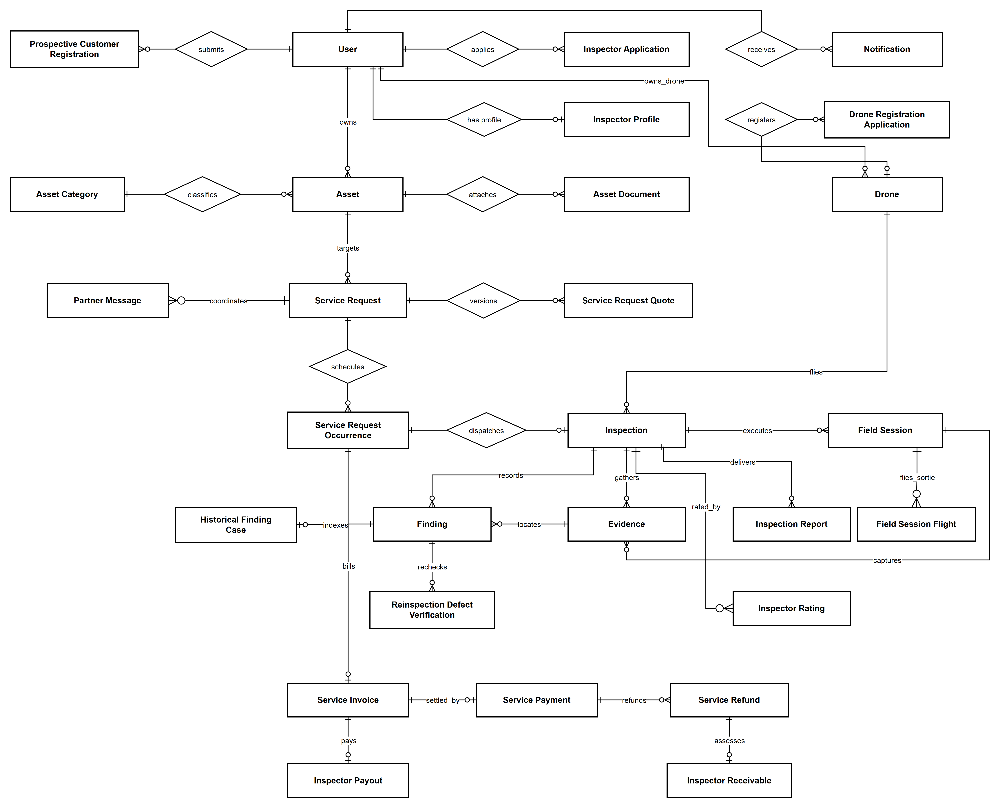
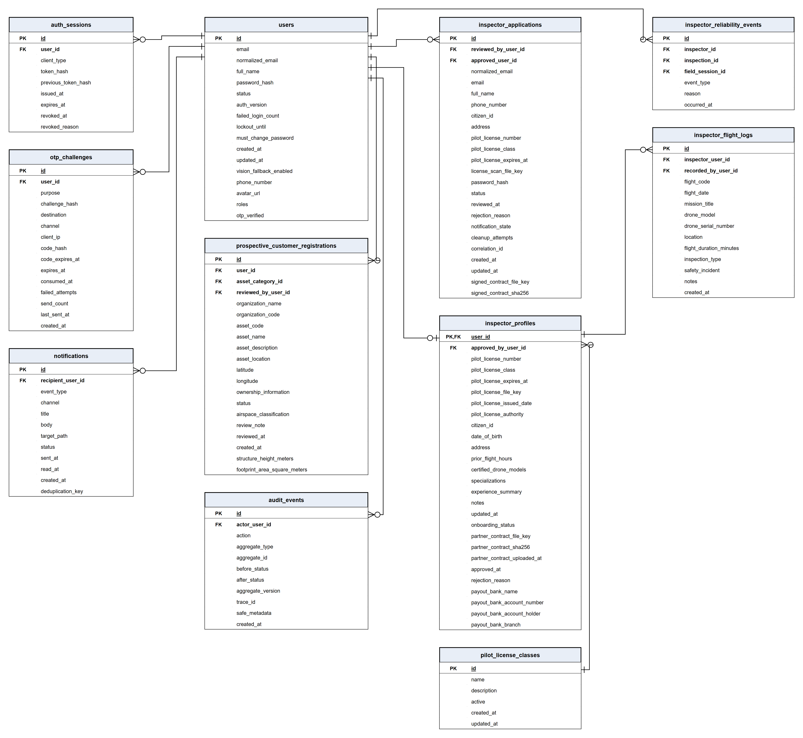
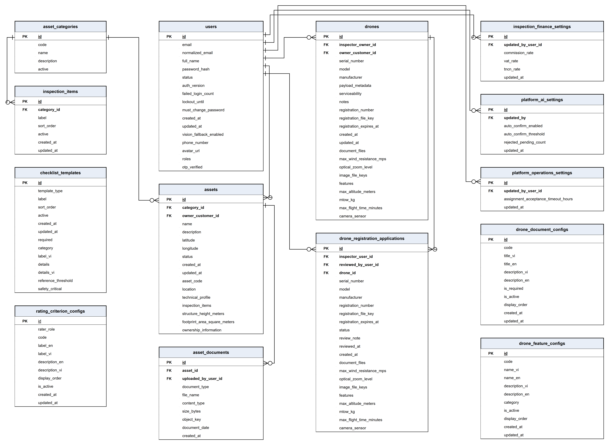
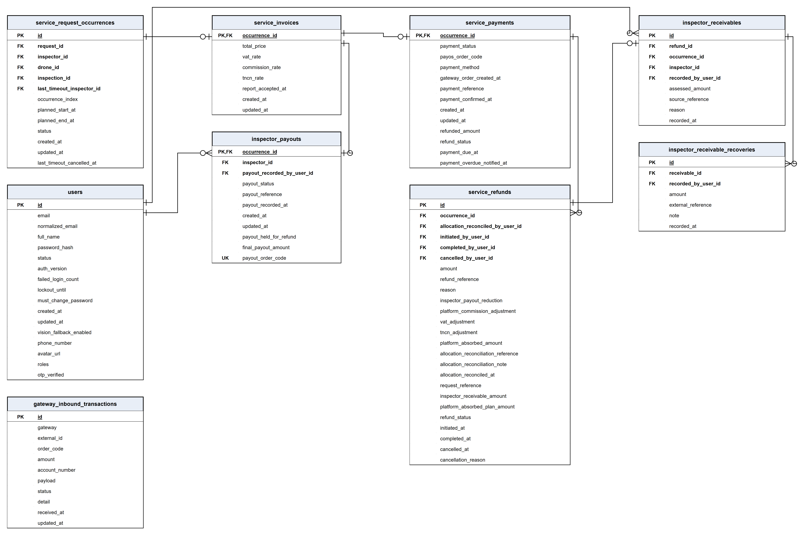

## 2. Database Design

**Files and Persistence Storage Description**

PostgreSQL stores structured records for building inspections. Flyway manages the schema as it changes. The database contains 53 application tables, an event outbox, and a migration history table.

MinIO stores private files such as signed contracts, chat attachments, licence and drone documents, flight permits, evidence, and report PDFs. PostgreSQL links each file to its related record. The backend checks access to that record before serving a file.

**Database Relationships**

*Figure 4.5 Conceptual Entity Relationships*

The next five diagrams group related tables by the work they support.

*Figure 4.6 Accounts and Governance*

*Figure 4.7 Buildings, Drones, and Settings*

*Figure 4.8 Requests, Dispatch, and Field Work*

*Figure 4.9 Evidence, Findings, and Reports*

*Figure 4.10 Payments, Payouts, and Refunds*

*Figure 4.11 Physical Database Schema*

The physical diagram covers the 53 application tables and the event outbox.

**Table Descriptions**

| No | Table | Description |
| :---: | :--- | :--- |
| 01 | `users` | Stores user accounts, sign-in information, and assigned roles. Customer accounts own their buildings and requests. Primary key: `id` Foreign keys: None |
| 02 | `inspector_profiles` | Stores approved Inspector qualifications, partner agreement details, and payout information. Primary key: `user_id` Foreign keys: `user_id`, `approved_by_user_id` to `users.id` |
| 03 | `inspector_applications` | Stores prospective Inspectors' applications and the Manager's review decision. Primary key: `id` Foreign keys: `reviewed_by_user_id`, `approved_user_id` to `users.id` |
| 04 | `otp_challenges` | Records one-time codes and their expiry for sign-in, registration, and password reset. Primary key: `id` Foreign keys: `user_id` to `users.id` |
| 05 | `auth_sessions` | Tracks sign-in sessions, token renewal, and revocation. Primary key: `id` Foreign keys: `user_id` to `users.id` |
| 06 | `inspector_flight_logs` | Records previous flights declared or recorded for an Inspector. Primary key: `id` Foreign keys: `inspector_user_id`, `recorded_by_user_id` to `users.id` |
| 07 | `prospective_customer_registrations` | Retains historical requests from the former restricted-location review process. Primary key: `id` Foreign keys: `user_id`, `asset_category_id`, `reviewed_by_user_id` |
| 08 | `drone_registration_applications` | Stores an Inspector's drone registration documents and the review outcome. Primary key: `id` Foreign keys: `inspector_user_id`, `drone_id`, `reviewed_by_user_id` |
| 09 | `drones` | Stores each drone's owner, specifications, registration, and availability for dispatch. Primary key: `id` Foreign keys: `inspector_owner_id`, `owner_customer_id` to `users.id` |
| 10 | `asset_categories` | Defines the building categories Customers can use. Primary key: `id` Foreign keys: None |
| 11 | `inspection_items` | Defines the default inspection checkpoints for each building category. Primary key: `id` Foreign keys: `category_id` to `asset_categories.id` |
| 12 | `assets` | Stores buildings, their owners and locations, and the checkpoints selected for each building. Primary key: `id` Foreign keys: `category_id` to `asset_categories.id`, `owner_customer_id` to `users.id` |
| 13 | `asset_documents` | Links engineering drawings and other reference files to a building. Primary key: `id` Foreign keys: `asset_id` to `assets.id`, `uploaded_by_user_id` to `users.id` |
| 14 | `checklist_templates` | Defines the safety checks that Inspectors complete before and after flights. Primary key: `id` Foreign keys: None |
| 15 | `drone_document_configs` | Defines which drone registration documents are available and required. Primary key: `id` Foreign keys: None |
| 16 | `drone_feature_configs` | Defines the drone capabilities that can be recorded or required for an inspection. Primary key: `id` Foreign keys: None |
| 17 | `pilot_license_classes` | Lists the pilot licence classes the platform recognizes. Primary key: `id` Foreign keys: None |
| 18 | `inspection_finance_settings` | Stores the fee and tax rates used to calculate the Inspector's payout. Primary key: `id` Foreign keys: `updated_by_user_id` to `users.id` |
| 19 | `platform_ai_settings` | Stores the rule and confidence threshold for automatically confirming AI detection candidates. Primary key: `id` Foreign keys: `updated_by` |
| 20 | `service_requests` | Records a Customer's inspection request, selected checkpoints, assigned Manager, and accepted terms. Primary key: `id` Foreign keys: `asset_id` to `assets.id`, `created_by_user_id`, `accepted_by_user_id`, `assigned_manager_id`, `manager_assigned_by_user_id`, `owner_customer_id` to `users.id`, `source_inspection_id` to `inspections.id` |
| 21 | `service_request_messages` | Stores order messages between the Customer and the assigned Manager. Primary key: `id` Foreign keys: `request_id` to `service_requests.id`, `author_user_id` to `users.id` |
| 22 | `service_request_message_attachments` | Links a file in private storage to an order message. Primary key: `id` Foreign keys: `message_id` to `service_request_messages.id` |
| 23 | `service_request_quotes` | Stores the current price and scope. The request keeps a snapshot of the terms the Customer accepts. Primary key: `id` Foreign keys: `request_id` to `service_requests.id`, `inspector_id`, `issued_by_user_id`, `updated_by_user_id` to `users.id`, `drone_id` to `drones.id` |
| 24 | `service_request_occurrences` | Records each scheduled visit and its assigned Inspector, drone, and inspection. Primary key: `id` Foreign keys: `request_id` to `service_requests.id`, `inspector_id` to `users.id`, `drone_id` to `drones.id`, `inspection_id` to `inspections.id` |
| 25 | `service_invoices` | Stores the agreed fee and the rates applied to each scheduled visit. Primary key: `occurrence_id` Foreign keys: `occurrence_id` to `service_request_occurrences.id` |
| 26 | `service_payments` | Tracks checkout, payment confirmation, the due date, and refunded amounts. Primary key: `occurrence_id` Foreign keys: `occurrence_id` to `service_invoices.occurrence_id` |
| 27 | `inspector_payouts` | Tracks when an Inspector is eligible for payment and records the settlement or refund hold. Primary key: `occurrence_id` Foreign keys: `occurrence_id` to `service_invoices.occurrence_id`, `inspector_id`, `payout_recorded_by_user_id` to `users.id` |
| 28 | `service_refunds` | Records a refund's amount, reference, approval history, and allocation. Primary key: `id` Foreign keys: `occurrence_id` to `service_payments.occurrence_id`, `initiated_by_user_id`, `completed_by_user_id`, `cancelled_by_user_id`, `allocation_reconciled_by_user_id` to `users.id` |
| 29 | `inspector_receivables` | Records amounts recoverable from an Inspector when a refund follows a completed payout. Primary key: `id` Foreign keys: `refund_id` to `service_refunds.id`, `occurrence_id` to `service_request_occurrences.id`, `inspector_id`, `recorded_by_user_id` to `users.id` |
| 30 | `inspector_receivable_recoveries` | Records collections against the outstanding Inspector receivable. Primary key: `id` Foreign keys: `receivable_id` to `inspector_receivables.id`, `recorded_by_user_id` to `users.id` |
| 31 | `inspections` | Records the inspection schedule, assigned Inspector and drone, selected checkpoints, and progress. Primary key: `id` Foreign keys: `asset_id` to `assets.id`, `inspector_id`, `declined_by_inspector_id`, `owner_customer_id` to `users.id`, `drone_id` to `drones.id`, `source_inspection_id` to `inspections.id` |
| 32 | `field_sessions` | Records when on-site work starts and ends and why a session was stopped, if applicable. Primary key: `id` Foreign keys: `inspection_id` to `inspections.id`, `aborted_by_user_id` to `users.id` |
| 33 | `evidence` | Links inspection photos and videos to their files and tracks processing status. Primary key: `id` Foreign keys: `inspection_id` to `inspections.id`, `field_session_id` to `field_sessions.id`, `source_video_evidence_id` to `evidence.id` |
| 34 | `evidence_upload_sessions` | Tracks the parts and completion state of resumable video uploads. Primary key: `id` Foreign keys: `inspection_id` to `inspections.id`, `field_session_id` to `field_sessions.id`, `created_by_user_id` to `users.id`, `evidence_id` to `evidence.id` |
| 35 | `findings` | Stores possible and confirmed defects, with their source evidence and Inspector notes. Primary key: `id` Foreign keys: `inspection_id` to `inspections.id`, `evidence_id` to `evidence.id` |
| 36 | `reinspection_defect_verifications` | Links an original defect to new evidence, the follow-up verdict, and its validity period. Primary key: `id` Foreign keys: `reinspection_id` to `inspections.id`, `source_finding_id` to `findings.id`, `new_evidence_id` to `evidence.id` |
| 37 | `inspection_reports` | Stores report versions, review decisions, publication status, and the official PDF reference. Primary key: `id` Foreign keys: `inspection_id` to `inspections.id`, `reviewer_user_id` to `users.id` |
| 38 | `notifications` | Stores each user's alerts and records when they are read. Primary key: `id` Foreign keys: `recipient_user_id` to `users.id` |
| 39 | `audit_events` | Records important actions, the actor, and the resulting change. Primary key: `id` Foreign keys: `actor_user_id` to `users.id` |
| 40 | `inspector_reliability_events` | Records reliability events such as an aborted or overdue field session. Primary key: `id` Foreign keys: `inspector_id` to `users.id`, `inspection_id` to `inspections.id`, `field_session_id` to `field_sessions.id` |
| 41 | `platform_operations_settings` | Stores platform-wide operational policies configured by Admin: Inspector assignment acceptance timeout hours (`V61`) and Service Request minimum scheduling lead days (`V81`). Primary key: `id` Foreign keys: `updated_by_user_id` to `users.id` |
| 42 | `inspection_messages` | Stores messages between the owning Customer and assigned Inspector for an inspection. Primary key: `id` Foreign keys: `inspection_id` to `inspections.id`, `author_user_id` to `users.id` |
| 43 | `inspection_message_attachments` | Links a private file to a message in an inspection. Primary key: `id` Foreign keys: `message_id` to `inspection_messages.id` |
| 44 | `inspection_knowledge_chunks` | Stores searchable extracts from engineering standards used to support findings. Primary key: `id` Foreign keys: None |
| 45 | `historical_finding_cases` | Stores published findings and anonymized examples for comparison with new findings. Primary key: `id` Foreign keys: None (logical links to `findings`, `inspections`, `assets`, `users`) |
| 46 | `gateway_inbound_transactions` | Records authenticated payment notifications and helps detect duplicate events. Primary key: `id` Foreign keys: None |
| 47 | `inspection_flight_permits` | Links an inspection to its permit, validity period, and the Inspector's declaration. Primary key: `inspection_id` Foreign keys: `inspection_id` to `inspections.id`, `uploaded_by`, `verified_by` to `users.id` |
| 48 | `field_session_telemetry` | Stores flight measurements, GPS traces, and the associated video for a field session. Primary key: `field_session_id` Foreign keys: `field_session_id` to `field_sessions.id`, `flight_video_evidence_id` to `evidence.id` |
| 49 | `service_request_partner_messages` | Stores coordination messages between the Manager and Inspector for a request. Primary key: `id` Foreign keys: `request_id` to `service_requests.id`, `inspector_id`, `author_user_id` to `users.id` |
| 50 | `service_request_partner_message_attachments` | Links a private file to a partner message. Primary key: `id` Foreign keys: `message_id` to `service_request_partner_messages.id` |
| 51 | `inspector_ratings` | Records Customer and Manager scores for the Inspector after an inspection. Primary key: `id` Foreign keys: `inspection_id` to `inspections.id`, and `inspector_id` and `rater_user_id` to `users.id` |
| 52 | `field_session_flights` | Records each flight in a field session, including its timing, route, and video. Primary key: `id` Foreign keys: `field_session_id` to `field_sessions.id`, `inspection_id` to `inspections.id`, and `flight_video_evidence_id` to `evidence.id` |
| 53 | `rating_criterion_configs` | Defines the rating criteria shown to Customers and Managers. Primary key: `id` Foreign keys: None |

**Framework tables**

The Spring Modulith outbox records events until their listeners process them. Flyway records applied migrations in its history table. These two tables are counted separately from the 53 application tables.
