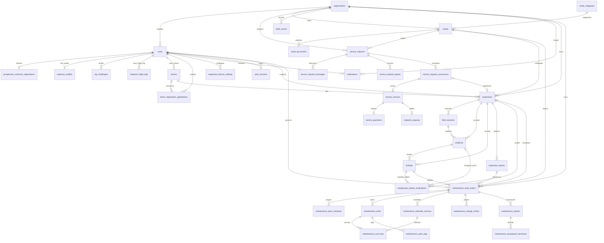
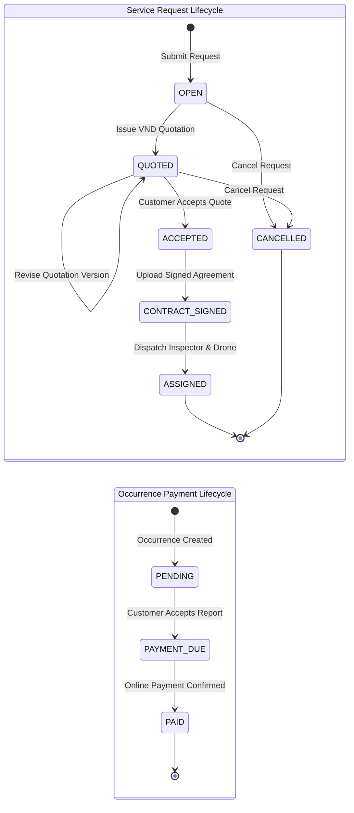
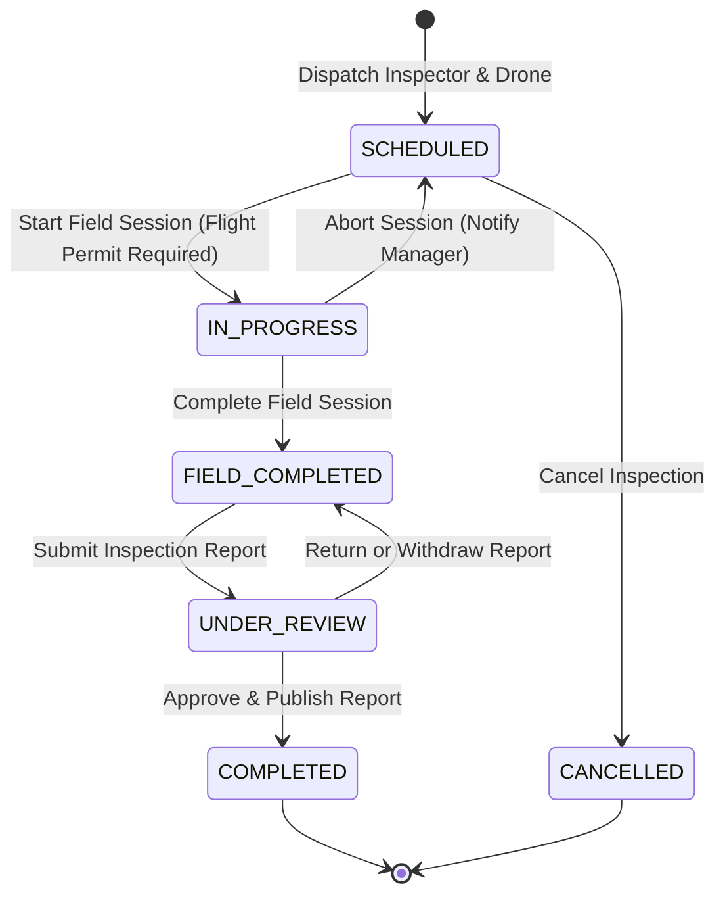
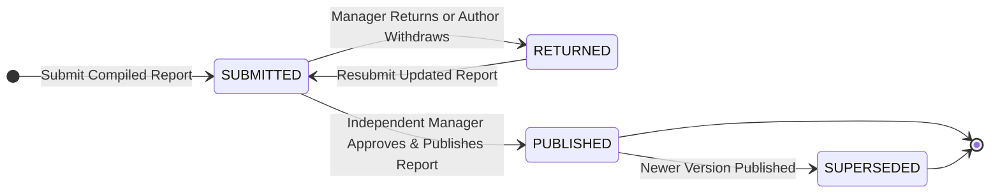
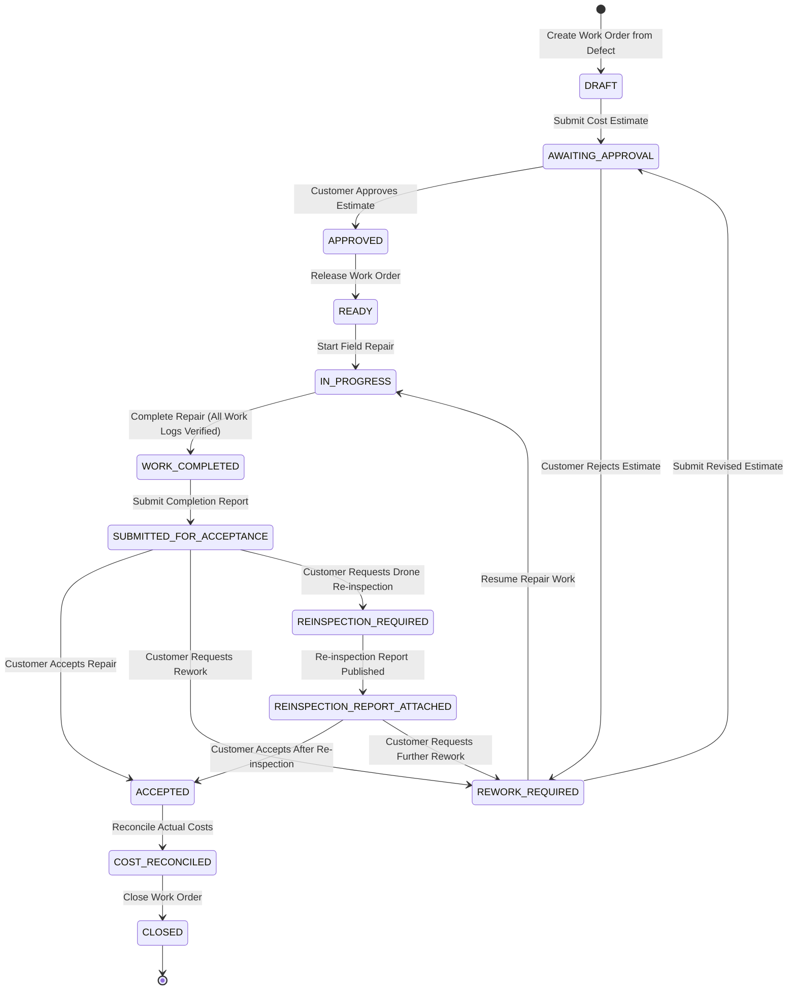

## 2. Database Design

The relational database is implemented on PostgreSQL 17 with the `pgvector` extension. The schema enforces referential integrity through foreign keys, tenant and role isolation, and optimistic concurrency control. It supports four main business areas:

- **Onboarding, Assets, and Drone Registry (MF1)**: Customer organizations, user accounts, Inspector profiles and flight logs, one-time verification challenges, customer airspace registration reviews, infrastructure assets, asset documents, and Inspector-owned drone registrations.
- **Commercial Requests, Quotations, and Agreements (MF2)**: One-time and recurring service requests, order chat messages, versioned VND quotations, scheduled inspection occurrences, and platform financial rate settings.
- **Field Inspections, Evidence, and Reporting (MF3)**: Inspection missions, on-site field sessions, photograph and video evidence, AI and confirmed defect findings, versioned inspection reports, and three-way re-inspection defect verifications.
- **Corrective Maintenance and Closeout (MF4)**: Maintenance work orders, repair teams, tasks, cost estimates, cost lines, change orders, work logs, completion reports, customer acceptance decisions, and engineering standard knowledge chunks.

**Table Descriptions**

| No | Table | Description |
| :---: | :--- | :--- |
| 01 | `organizations` | Stores customer organizations that own infrastructure assets, request inspection services, and govern maintenance work orders. - Primary keys: `id` - Foreign keys: None |
| 02 | `users` | Stores user accounts across the five system roles (Platform Administrator, Platform Manager, Customer, Inspector, and Maintenance Engineer), account status, and organization scope. - Primary keys: `id` - Foreign keys: `organization_id` |
| 03 | `inspector_profiles` | Stores Inspector pilot license numbers, license classes, expiration dates, scanned license files, flight hours, and technical specializations. - Primary keys: `user_id` - Foreign keys: `user_id` |
| 04 | `otp_challenges` | Stores one-time verification codes for user sign-in, customer registration, and password reset. - Primary keys: `id` - Foreign keys: `user_id` |
| 05 | `inspector_flight_logs` | Records historical flight missions, flight duration, aircraft details, location, and safety notes for Inspectors. - Primary keys: `id` - Foreign keys: `inspector_user_id`, `recorded_by_user_id` |
| 06 | `auth_sessions` | Tracks active web and mobile login sessions, hashed refresh tokens, expiration times, and session revocation records. - Primary keys: `id` - Foreign keys: `user_id` |
| 07 | `prospective_customer_registrations` | Stores customer organization and initial asset registration requests that require platform review due to restricted airspace proximity. - Primary keys: `id` - Foreign keys: `user_id`, `asset_category_id`, `reviewed_by_user_id` |
| 08 | `drone_registration_applications` | Stores Inspector applications to register owned drones with registration, ownership, and technical inspection documents. - Primary keys: `id` - Foreign keys: `inspector_user_id`, `drone_id`, `reviewed_by_user_id` |
| 09 | `drones` | Catalogs approved drones owned by Inspectors or customer organizations, including serial number, model, and serviceability status. - Primary keys: `id` - Foreign keys: `inspector_owner_id`, `organization_id` |
| 10 | `asset_categories` | Defines the global catalog of infrastructure asset categories managed by platform administrators. - Primary keys: `id` - Foreign keys: None |
| 11 | `assets` | Stores customer infrastructure assets, geographic coordinates, technical profiles, and structural inspection checkpoints. - Primary keys: `id` - Foreign keys: `organization_id`, `category_id` |
| 12 | `asset_documents` | Stores engineering drawings and reference documents attached to an infrastructure asset. - Primary keys: `id` - Foreign keys: `asset_id`, `uploaded_by_user_id` |
| 13 | `service_requests` | Stores one-time and recurring customer inspection requests, preferred time windows, recurrence rules, accepted quotation version, and signed agreement file reference. - Primary keys: `id` - Foreign keys: `organization_id`, `asset_id`, `created_by_user_id` |
| 14 | `service_request_messages` | Stores chat messages exchanged between the Customer and the Platform Manager during service request negotiation. - Primary keys: `id` - Foreign keys: `request_id`, `author_user_id` |
| 15 | `service_request_quotes` | Stores versioned VND quotations proposing the inspection scope, schedule window, Inspector, drone, and fee per occurrence. - Primary keys: `id` - Foreign keys: `request_id`, `inspector_id`, `drone_id`, `issued_by_user_id` |
| 16 | `service_request_occurrences` | Stores each scheduled inspection occurrence generated from a one-time or recurring service request, including dispatch status and assigned Inspector, drone, and inspection. - Primary keys: `id` - Foreign keys: `request_id`, `inspector_id`, `drone_id`, `inspection_id` |
| 17 | `service_invoices` | Stores the per-occurrence service price, VAT, commission, and TNCN rate snapshots, plus the Customer's report acceptance time. - Primary keys: `occurrence_id` - Foreign keys: `occurrence_id` → `service_request_occurrences.id` |
| 18 | `service_payments` | Tracks customer collection status, PayOS/VNPay order code and method, payment reference, and confirmed time for a service invoice. - Primary keys: `occurrence_id` - Foreign keys: `occurrence_id` → `service_invoices.occurrence_id` |
| 19 | `inspector_payouts` | Records the Inspector recipient, per-invoice payout status, external or simulated payout reference, and recorded time. - Primary keys: `occurrence_id` - Foreign keys: `occurrence_id` → `service_invoices.occurrence_id`, `inspector_id` → `users.id` |
| 20 | `inspection_finance_settings` | Stores platform commission, VAT, and personal income tax rates used to calculate net partner payouts. - Primary keys: `id` - Foreign keys: `updated_by_user_id` |
| 21 | `inspections` | Stores scheduled inspection missions (initial inspections and re-inspections), assigned Inspector and drone, flight permit reference, and mission status. - Primary keys: `id` - Foreign keys: `organization_id`, `asset_id`, `inspector_id`, `drone_id`, `work_order_id`, `source_inspection_id` |
| 22 | `field_sessions` | Records on-site field flight sessions, pre-flight safety notes, completion outcome notes, abort reasons, persisted `SmartDroneHub` flight report metrics (`telemetry_source`, `flight_duration_seconds`, `distance_flown_meters`, `max_altitude_meters`, `start_battery_percent`, `end_battery_percent`, `flight_final_state`, `flight_report_note`), GPS flight trace (`flight_trace_json`), and synced flight video reference (`flight_video_evidence_id`). - Primary keys: `id` - Foreign keys: `inspection_id`, `flight_video_evidence_id` |
| 23 | `evidence` | Stores metadata and object storage keys for photographs and MP4 videos captured during field sessions, including capture time and GPS coordinates. - Primary keys: `id` - Foreign keys: `inspection_id`, `field_session_id` |
| 24 | `findings` | Stores AI-suggested defect candidates and Inspector-confirmed defect findings, including defect label, severity, confidence score, and bounding box. - Primary keys: `id` - Foreign keys: `inspection_id`, `evidence_id` |
| 25 | `inspection_reports` | Stores versioned inspection report records, their status and publication metadata, submission and review timestamps, and return feedback. - Primary keys: `id` - Foreign keys: `inspection_id`, `reviewer_user_id` |
| 26 | `reinspection_defect_verifications` | Stores three-way verification records comparing the original defect finding, repair proof, and new re-inspection evidence. - Primary keys: `id` - Foreign keys: `reinspection_id`, `source_finding_id`, `new_evidence_id` |
| 27 | `maintenance_work_orders` | Stores corrective maintenance work orders created from published inspection defects, tracking scope, priority, assigned roles, and lifecycle status. - Primary keys: `id` - Foreign keys: `organization_id`, `asset_id`, `source_finding_id`, `source_report_version_id`, `reinspection_id`, `owner_user_id`, `budget_approver_user_id`, `team_lead_user_id`, `report_author_user_id`, `accepting_reviewer_user_id` |
| 28 | `maintenance_team_members` | Stores Maintenance Engineers assigned to a work order along with their team role (Team Lead, Report Author, or Member). - Primary keys: `id` - Foreign keys: `work_order_id`, `engineer_user_id`, `assigned_by_user_id` |
| 29 | `maintenance_tasks` | Stores individual repair tasks, repair methods, planned schedules, acceptance criteria, and task status under a work order. - Primary keys: `id` - Foreign keys: `work_order_id`, `assigned_engineer_user_id` |
| 30 | `maintenance_estimate_versions` | Stores versioned repair cost estimates prepared by Maintenance Engineers and reviewed by the Customer budget approver. - Primary keys: `id` - Foreign keys: `work_order_id`, `prepared_by_user_id`, `approved_by_user_id` |
| 31 | `maintenance_cost_lines` | Stores itemized planned and actual cost entries (labor, material, equipment, external service, and contingency) for a work order. - Primary keys: `id` - Foreign keys: `work_order_id`, `estimate_version_id`, `task_id`, `entered_by_user_id` |
| 32 | `maintenance_change_orders` | Stores scope or budget change requests submitted during repair execution and decided by the Customer. - Primary keys: `id` - Foreign keys: `work_order_id`, `requested_by_user_id`, `decided_by_user_id` |
| 33 | `maintenance_work_logs` | Stores field repair execution logs, labor hours, test measurements, as-left conditions, and Team Lead verification status. - Primary keys: `id` - Foreign keys: `work_order_id`, `task_id`, `engineer_user_id` |
| 34 | `maintenance_reports` | Stores versioned maintenance completion reports prepared by the Report Author for Customer review. - Primary keys: `id` - Foreign keys: `work_order_id` |
| 35 | `maintenance_acceptance_decisions` | Records independent Customer acceptance decisions, technical review comments, and re-inspection or rework outcomes. - Primary keys: `id` - Foreign keys: `work_order_id`, `report_version_id`, `reviewer_user_id` |
| 36 | `repair_knowledge_chunks` | Stores civil and structural engineering standard excerpts and vector embeddings used by the maintenance advisor. - Primary keys: `id` - Foreign keys: None |
| 37 | `notifications`, `audit_events` & `event_publication` | Store deduplicated user notifications, security audit trails, and transactional domain event publications. - Primary keys: `id` - Foreign keys: `organization_id`, `recipient_user_id`, `actor_user_id` |

---

**Domain Entity State Machine Diagrams**

**1. Service Request and Payment State Machines**

| Domain Entity | Lifecycle States | Key Transition Rules |
| --- | --- | --- |
| **Customer & Drone Onboarding** | `PENDING`, `APPROVED`, `REJECTED` | Locations inside a prohibited No-Fly Zone are rejected immediately; restricted airspace locations remain pending until reviewed by an Administrator or Manager. Drone registration requires all three supporting documents before approval. |
| **Service Request** | `OPEN`, `QUOTED`, `ACCEPTED`, `CONTRACT_SIGNED`, `ASSIGNED`, `CANCELLED` | Accepting a quotation materializes the planned inspection occurrences. Uploading the signed offline agreement moves the request to the contract-signed state so occurrences can be dispatched. |
| **Occurrence Payment & Payout** | Payment: `PENDING`, `PAYMENT_DUE`, `PAID` Payout: `PENDING`, `ELIGIBLE`, `PAID` | Customer acceptance of a published report makes payment due for that occurrence. Confirmed payment via PayOS or VNPay marks the occurrence as paid and records Inspector payout settlement. |

**2. Inspection, Field Session, and Inspection Report State Machines**

| Domain Entity | Lifecycle States | Key Transition Rules |
| --- | --- | --- |
| **Inspection Mission** | `SCHEDULED`, `IN_PROGRESS`, `FIELD_COMPLETED`, `UNDER_REVIEW`, `COMPLETED`, `CANCELLED` | A field session can start only when the mission is scheduled and a flight permit is on file. Once a session completes, no additional field session can be started; the Inspector proceeds to evidence review and report submission. |
| **Field Session** | `PLANNED`, `IN_PROGRESS`, `FIELD_COMPLETED`, `ABORTED` | Starting a session requires a pre-flight safety note, and completing a session requires outcome notes. Aborting a session records the abort reason, reverts the mission to scheduled, and alerts the Manager to reschedule, reassign, or cancel. |
| **Defect Finding** | `PENDING`, `CONFIRMED` | AI-detected defect candidates start as pending. All pending candidates must be confirmed or removed by the assigned Inspector before the findings baseline can be locked. |
| **Inspection Report** | `SUBMITTED`, `RETURNED`, `PUBLISHED`, `SUPERSEDED` | A qualified Manager or Administrator other than the author either returns a submitted report with a reason or approves and publishes it in one action. Publication marks the report version official and immutable and completes the inspection. |

**3. Maintenance Work Order State Machine**

| Domain Entity | Lifecycle States | Key Transition Rules |
| --- | --- | --- |
| **Maintenance Work Order** | `DRAFT`, `AWAITING_APPROVAL`, `APPROVED`, `READY`, `IN_PROGRESS`, `WORK_COMPLETED`, `SUBMITTED_FOR_ACCEPTANCE`, `ACCEPTED`, `REWORK_REQUIRED`, `REINSPECTION_REQUIRED`, `COST_RECONCILED`, `CLOSED` | The Customer budget approver and accepting reviewer must be independent of the executing repair team. Requesting a drone re-inspection creates a linked re-inspection mission and attaches its published report back to the work order. |
| **Estimate & Change Order** | `DRAFT`, `SUBMITTED`, `APPROVED`, `REJECTED`, `SUPERSEDED` | A work order cannot be declared complete while any change order is awaiting approval. Approved change orders adjust the authorized budget ceiling without overwriting the original estimate. |
| **Maintenance Work Log** | `IN_PROGRESS`, `PAUSED_FOR_CHANGE`, `SUBMITTED`, `VERIFIED` | Every submitted work log must be verified by the designated Team Lead before the work order can be declared complete. |
