## 2. Database Design

The relational database architecture is implemented on PostgreSQL 17 with strict foreign key constraints, index-optimized tenant filtering, and cryptographic audit fields. The database schema encompasses 41 core tables categorized across identity, assets, inspection workflow, maintenance remediation, and cross-cutting infrastructure.

```mermaid
%% title: Database Entity Relationship Diagram (ERD)
erDiagram
  ORGANIZATION ||--o{ USER : employs
  ORGANIZATION ||--o{ SUBSCRIPTION : holds
  ORGANIZATION ||--o{ ASSET_CATEGORY : defines
  ORGANIZATION ||--o{ DRONE : owns
  ORGANIZATION ||--o{ ASSET : owns
  ORGANIZATION ||--o{ FLIGHT_PERMIT : holds
  ORGANIZATION ||--o{ AUDIT_EVENT : records
  ORGANIZATION ||--o{ NOTIFICATION : receives

  USER ||--o{ USER_ROLE : assigned
  USER ||--o{ AUTH_SESSION : opens
  AUTH_SESSION ||--o{ REFRESH_TOKEN : issues
  USER ||--o{ WORKFORCE_CREDENTIAL : holds

  ASSET_CATEGORY ||--o{ CHECKLIST_TEMPLATE : configures
  CHECKLIST_TEMPLATE ||--o{ CHECKLIST_ITEM : contains
  ASSET_CATEGORY ||--o{ ASSET : categorizes

  ASSET ||--o{ ASSET_DOCUMENT : attaches
  ASSET ||--o{ ASSET_PAIR_ASSIGNMENT : binds
  USER ||--o{ ASSET_PAIR_ASSIGNMENT : "assigned inspector"
  DRONE ||--o{ ASSET_PAIR_ASSIGNMENT : "assigned drone"

  DRONE ||--o{ DRONE_DOCUMENT : attaches
  ASSET ||--o{ INSPECTION_SCHEDULE : schedules

  ASSET ||--o{ INSPECTION : undergoes
  INSPECTION ||--o{ INSPECTION_PREPARATION : plans
  INSPECTION_PREPARATION ||--o{ INSPECTION_READINESS_DECISION : evaluated_by
  INSPECTION ||--o{ FIELD_SESSION : executes
  FIELD_SESSION ||--o{ CHECKLIST_RESPONSE : logs
  CHECKLIST_ITEM ||--o{ CHECKLIST_RESPONSE : answers

  INSPECTION ||--o{ EVIDENCE : contains
  FIELD_SESSION ||--o{ EVIDENCE : captures
  INSPECTION ||--o{ EVIDENCE_QUALITY_DECISION : evaluates
  INSPECTION ||--o{ FINDING : records
  EVIDENCE ||--o{ FINDING : locates

  INSPECTION ||--o{ INSPECTION_REPORT : owns
  INSPECTION_REPORT ||--o{ INSPECTION_REPORT_VERSION : publishes
  INSPECTION_REPORT_VERSION ||--o{ REPORT_VERSION_FINDING : includes
  INSPECTION_REPORT_VERSION ||--o{ REPORT_VERSION_EVIDENCE : includes

  INSPECTION ||--o{ MAINTENANCE_WORK_ORDER : initiates
  MAINTENANCE_WORK_ORDER ||--o{ MAINTENANCE_TEAM_MEMBER : deploys
  MAINTENANCE_WORK_ORDER ||--o{ MAINTENANCE_TASK : deconstructs
  MAINTENANCE_WORK_ORDER ||--o{ MAINTENANCE_ESTIMATE_VERSION : projects
  MAINTENANCE_ESTIMATE_VERSION ||--o{ MAINTENANCE_COST_LINE : itemizes
  MAINTENANCE_WORK_ORDER ||--o{ MAINTENANCE_CHANGE_ORDER : requests
  MAINTENANCE_TASK ||--o{ MAINTENANCE_WORK_LOG : tracks
  MAINTENANCE_WORK_ORDER ||--o{ MAINTENANCE_REPORT_VERSION : delivers
  MAINTENANCE_REPORT_VERSION ||--o{ MAINTENANCE_ACCEPTANCE_DECISION : accepts
```

**Table Descriptions**

| No | Table | Description |
| :---: | :--- | :--- |
| 01 | `organizations` | Stores tenant enterprise companies subscribing to the platform. - Primary key: `id` (UUID) - Foreign keys: `created_by_user_id` references `users(id)` |
| 02 | `users` | Stores system user accounts and role assignments (`roles`) across all platform and enterprise roles. - Primary key: `id` (UUID) - Foreign keys: `organization_id` references `organizations(id)` |
| 03 | `auth_sessions` | Tracks active user login sessions, client type, hashed refresh tokens, and revocation status. - Primary key: `id` (UUID) - Foreign keys: `user_id` references `users(id)` |
| 04 | `workforce_credentials` | Records professional licenses, pilot certifications, and safety credentials with validity periods. - Primary key: `id` (UUID) - Foreign keys: `user_id` references `users(id)`, `organization_id` references `organizations(id)`, `evidence_id` references `evidence(id)`, `verified_by_user_id` references `users(id)` |
| 05 | `subscriptions` | Tracks ENTERPRISE subscription contracts, periods (1, 6, 12 months), and billing status. - Primary key: `id` (UUID) - Foreign keys: `organization_id` references `organizations(id)`, `confirmed_by_user_id` references `users(id)` |
| 06 | `payment_transactions` | Records optional PayPal Orders v2 checkout and capture transactions linked to subscriptions. - Primary key: `id` (UUID) - Foreign keys: `subscription_id` references `subscriptions(id)` |
| 07 | `asset_categories` | Structural categories for infrastructure assets (Bridges, Power Towers, Industrial Facilities). - Primary key: `id` (UUID) - Foreign keys: `organization_id` references `organizations(id)` |
| 08 | `checklist_templates` | Reusable inspection checklist templates linked to specific asset categories. - Primary key: `id` (UUID) - Foreign keys: `asset_category_id` references `asset_categories(id)`, `created_by_user_id` references `users(id)` |
| 09 | `checklist_items` | Individual inspection checkpoints and verification criteria within a checklist template. - Primary key: `id` (UUID) - Foreign keys: `template_id` references `checklist_templates(id)` |
| 10 | `assets` | Manages physical infrastructure assets (bridges, pylons, buildings, facilities). - Primary key: `id` (UUID) - Foreign keys: `organization_id` references `organizations(id)`, `category_id` references `asset_categories(id)` |
| 11 | `asset_documents` | Engineering schematics, structural drawings, and technical specifications attached to an asset. - Primary key: `id` (UUID) - Foreign keys: `asset_id` references `assets(id)`, `uploaded_by_user_id` references `users(id)` |
| 12 | `drones` | Catalogs organization drone aircraft, hardware serial numbers, MTOW, and serviceability status. - Primary key: `id` (UUID) - Foreign keys: `organization_id` references `organizations(id)` |
| 13 | `drone_documents` | Airworthiness certifications, registration files, and maintenance logs attached to a drone. - Primary key: `id` (UUID) - Foreign keys: `drone_id` references `drones(id)`, `uploaded_by_user_id` references `users(id)`, `reviewed_by_user_id` references `users(id)` |
| 14 | `flight_permits` | Official aviation flight permits, geographical bounding polygons, and validity windows. - Primary key: `id` (UUID) - Foreign keys: `organization_id` references `organizations(id)`, `asset_id` references `assets(id)`, `source_evidence_id` references `evidence(id)`, `reviewed_by_user_id` references `users(id)` |
| 15 | `asset_pair_assignments` | Defines the operational default Inspector and Drone pairing assigned to an asset. - Primary key: `id` (UUID) - Foreign keys: `asset_id` references `assets(id)`, `inspector_user_id` references `users(id)`, `drone_id` references `drones(id)`, `organization_id` references `organizations(id)`, `assigned_by_user_id` references `users(id)` |
| 16 | `inspections` | Core mission table tracking scheduled windows, active status, pair snapshot, and defect handoff. - Primary key: `id` (UUID) - Foreign keys: `asset_id` references `assets(id)`, `organization_id` references `organizations(id)`, `inspector_id` references `users(id)`, `drone_id` references `drones(id)`, `asset_pair_assignment_id` references `asset_pair_assignments(id)` |
| 17 | `inspection_preparations` | Versioned pre-flight planning data including component shot-lists and safety protocols. - Primary key: `id` (UUID) - Foreign keys: `inspection_id` references `inspections(id)`, `inspector_user_id` references `users(id)` |
| 18 | `checklist_responses` | Pilot responses and notes recorded against individual checklist items during field sessions. - Primary key: `id` (UUID) - Foreign keys: `inspection_id` references `inspections(id)`, `field_session_id` references `field_sessions(id)`, `checklist_item_id` references `checklist_items(id)`, `evidence_id` references `evidence(id)`, `responder_user_id` references `users(id)`, `completed_by_user_id` references `users(id)` |
| 19 | `inspection_readiness_decisions` | Administrative authorization records approving or returning a mission preparation. - Primary key: `id` (UUID) - Foreign keys: `inspection_id` references `inspections(id)`, `preparation_id` references `inspection_preparations(id)`, `reviewed_by_user_id` references `users(id)` |
| 20 | `field_sessions` | Records individual on-site flight sessions, checklist notes, and operational outcomes. - Primary key: `id` (UUID) - Foreign keys: `inspection_id` references `inspections(id)`, `organization_id` references `organizations(id)`, `inspector_user_id` references `users(id)`, `drone_id` references `drones(id)`, `readiness_decision_id` references `inspection_readiness_decisions(id)`, `checklist_template_id` references `checklist_templates(id)` |
| 21 | `evidence` | Digital media assets with stored object references and extracted GPS coordinates. - Primary key: `id` (UUID) - Foreign keys: `inspection_id` references `inspections(id)`, `organization_id` references `organizations(id)`, `field_session_id` references `field_sessions(id)`, `maintenance_work_order_id` references `maintenance_work_orders(id)`, `maintenance_task_id` references `maintenance_tasks(id)`, `maintenance_work_log_id` references `maintenance_work_logs(id)` |
| 22 | `findings` | Unified findings table managing AI defect candidates and human-verified official findings. - Primary key: `id` (UUID) - Foreign keys: `inspection_id` references `inspections(id)`, `evidence_id` references `evidence(id)` |
| 23 | `inspection_reports` | Versioned inspection report deliverables, human review gates, rendered PDF object keys, and SHA-256 hashes. - Primary key: `id` (UUID) - Foreign keys: `inspection_id` references `inspections(id)`, `author_user_id` references `users(id)`, `reviewer_user_id` references `users(id)`, `source_version_id` references `inspection_reports(id)` |
| 24 | `maintenance_work_orders` | Remediation projects initiated from confirmed inspection findings. - Primary key: `id` (UUID) - Foreign keys: `organization_id` references `organizations(id)`, `asset_id` references `assets(id)`, `source_finding_id` references `findings(id)`, `source_report_version_id` references `inspection_reports(id)`, `owner_user_id` references `users(id)`, `team_lead_user_id` references `users(id)`, `report_author_user_id` references `users(id)`, `budget_approver_user_id` references `users(id)`, `accepting_reviewer_user_id` references `users(id)` |
| 25 | `maintenance_team_members` | Engineering team members allocated to a maintenance work order. - Primary key: `id` (UUID) - Foreign keys: `work_order_id` references `maintenance_work_orders(id)`, `engineer_user_id` references `users(id)`, `assigned_by_user_id` references `users(id)` |
| 26 | `maintenance_tasks` | Decomposed repair tasks with technical methods and assigned engineers. - Primary key: `id` (UUID) - Foreign keys: `work_order_id` references `maintenance_work_orders(id)`, `assigned_engineer_user_id` references `users(id)` |
| 27 | `maintenance_estimate_versions` | Versioned financial projection baselines for labor, materials, equipment, and services. - Primary key: `id` (UUID) - Foreign keys: `work_order_id` references `maintenance_work_orders(id)`, `prepared_by_user_id` references `users(id)`, `approved_by_user_id` references `users(id)` |
| 28 | `maintenance_cost_lines` | Individual itemized cost rows within an estimate baseline, change order, or actual expenditure. - Primary key: `id` (UUID) - Foreign keys: `work_order_id` references `maintenance_work_orders(id)`, `estimate_version_id` references `maintenance_estimate_versions(id)`, `change_order_id` references `maintenance_change_orders(id)`, `task_id` references `maintenance_tasks(id)`, `entered_by_user_id` references `users(id)` |
| 29 | `maintenance_change_orders` | Formal variance requests adjusting repair scope, budget ceiling, or completion schedule. - Primary key: `id` (UUID) - Foreign keys: `work_order_id` references `maintenance_work_orders(id)`, `requested_by_user_id` references `users(id)`, `decided_by_user_id` references `users(id)` |
| 30 | `maintenance_work_logs` | Daily execution entries logging labor hours, material consumption, and task milestone notes. - Primary key: `id` (UUID) - Foreign keys: `work_order_id` references `maintenance_work_orders(id)`, `task_id` references `maintenance_tasks(id)`, `engineer_user_id` references `users(id)` |
| 31 | `maintenance_reports` | Versioned maintenance completion deliverables, verified by the author and accepted by the administrator. - Primary key: `id` (UUID) - Foreign keys: `work_order_id` references `maintenance_work_orders(id)`, `author_user_id` references `users(id)` |
| 32 | `maintenance_acceptance_decisions` | Formal technical acceptance records evaluating repair completion and cost reconciliation. - Primary key: `id` (UUID) - Foreign keys: `work_order_id` references `maintenance_work_orders(id)`, `report_version_id` references `maintenance_reports(id)`, `reviewer_user_id` references `users(id)` |
| 33 | `repair_knowledge_chunks` | Civil/structural engineering repair standard chunks and embeddings supporting RAG scope suggestions. - Primary key: `id` (UUID) - Foreign keys: None |
| 34 | `notifications` | Operational alerts and domain event notifications delivered to system users. - Primary key: `id` (UUID) - Foreign keys: `organization_id` references `organizations(id)`, `recipient_user_id` references `users(id)` |
| 35 | `audit_events` | Append-only security audit trail recording consequential domain transitions and access events. - Primary key: `id` (UUID) - Foreign keys: `organization_id` references `organizations(id)`, `actor_user_id` references `users(id)` |
| 36 | `event_publication` | Outbox pattern transactional event publication log for reliable asynchronous domain event delivery. - Primary key: `id` (UUID) - Foreign keys: None |
