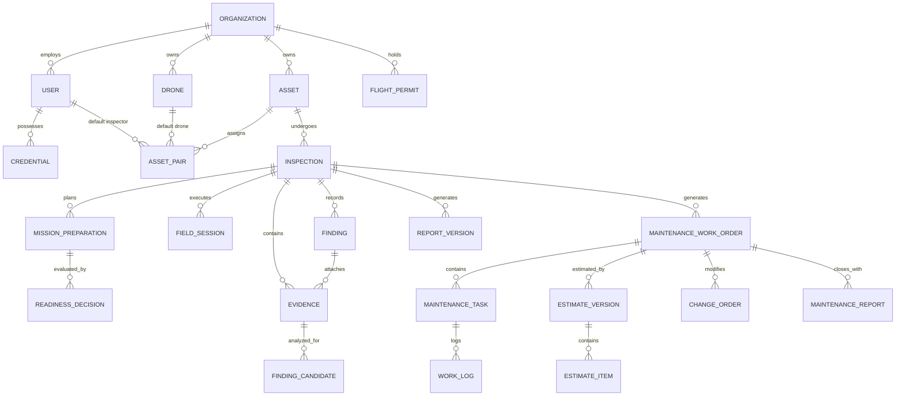

## 2. Database Design

The relational database architecture is implemented on PostgreSQL 17 with strict foreign key constraints, index-optimized tenant filtering, and cryptographic audit fields.

**Table Descriptions**

| No | Table | Description |
| :---: | :--- | :--- |
| 01 | `organizations` | Stores tenant enterprise companies subscribing to the platform. - Primary key: `id` (UUID) - Foreign keys: None |
| 02 | `users` | Stores user accounts across platform and enterprise roles. - Primary key: `id` (UUID) - Foreign keys: `organization_id` references `organizations(id)` |
| 03 | `credentials` | Records professional licenses, pilot certifications, and safety credentials. - Primary key: `id` (UUID) - Foreign keys: `user_id` references `users(id)` |
| 04 | `subscriptions` | Tracks ENTERPRISE subscription contracts, periods (1, 6, 12 months), and billing status. - Primary key: `id` (UUID) - Foreign keys: `organization_id` references `organizations(id)` |
| 05 | `drones` | Catalogs organization drone aircraft, serial numbers, MTOW, and serviceability status. - Primary key: `id` (UUID) - Foreign keys: `organization_id` references `organizations(id)` |
| 06 | `flight_permits` | Records official aviation flight permits, geographical polygons, and validity windows. - Primary key: `id` (UUID) - Foreign keys: `organization_id` references `organizations(id)` |
| 07 | `assets` | Manages physical infrastructure assets (bridges, pylons, buildings, industrial facilities). - Primary key: `id` (UUID) - Foreign keys: `organization_id` references `organizations(id)` |
| 08 | `asset_pairs` | Defines the operational default Inspector and Drone pairing assigned to an asset. - Primary key: `id` (UUID) - Foreign keys: `asset_id` references `assets(id)`, `user_id` references `users(id)`, `drone_id` references `drones(id)` |
| 09 | `inspections` | Core mission table tracking scheduled windows, active status, and assigned pair snapshot. - Primary key: `id` (UUID) - Foreign keys: `asset_id` references `assets(id)`, `inspector_id` references `users(id)`, `drone_id` references `drones(id)` |
| 10 | `mission_preparations` | Versioned pre-flight planning data including component shot-lists and safety protocols. - Primary key: `id` (UUID) - Foreign keys: `inspection_id` references `inspections(id)` |
| 11 | `readiness_decisions` | Administrative authorization records approving or returning a mission preparation. - Primary key: `id` (UUID) - Foreign keys: `preparation_id` references `mission_preparations(id)`, `reviewer_id` references `users(id)` |
| 12 | `field_sessions` | Records individual on-site flight sessions, checklist notes, and operational outcomes. - Primary key: `id` (UUID) - Foreign keys: `inspection_id` references `inspections(id)`, `inspector_id` references `users(id)` |
| 13 | `evidence` | Digital media assets with server-calculated SHA-256 digests and extracted GPS coordinates. - Primary key: `id` (UUID) - Foreign keys: `inspection_id` references `inspections(id)`, `session_id` references `field_sessions(id)` |
| 14 | `evidence_quality_decisions` | Substantive Inspector evaluation of captured media against planned shot-lists. - Primary key: `id` (UUID) - Foreign keys: `inspection_id` references `inspections(id)`, `decided_by` references `users(id)` |
| 15 | `finding_candidates` | Advisory defect proposals generated by the YOLO11s computer vision microservice. - Primary key: `id` (UUID) - Foreign keys: `evidence_id` references `evidence(id)` |
| 16 | `findings` | Confirmed structural defect findings verified by the human Inspector. - Primary key: `id` (UUID) - Foreign keys: `inspection_id` references `inspections(id)`, `evidence_id` references `evidence(id)` |
| 17 | `report_versions` | Versioned inspection report deliverables, rendered PDF object keys, and SHA-256 hashes. - Primary key: `id` (UUID) - Foreign keys: `inspection_id` references `inspections(id)`, `author_id` references `users(id)`, `reviewer_id` references `users(id)` |
| 18 | `maintenance_work_orders` | Remediation projects initiated from confirmed inspection findings. - Primary key: `id` (UUID) - Foreign keys: `inspection_id` references `inspections(id)`, `organization_id` references `organizations(id)` |
| 19 | `maintenance_tasks` | Decomposed repair tasks with technical methods and assigned engineers. - Primary key: `id` (UUID) - Foreign keys: `work_order_id` references `maintenance_work_orders(id)`, `assigned_to` references `users(id)` |
| 20 | `estimate_versions` | Versioned financial projection baselines for labor, materials, equipment, and services. - Primary key: `id` (UUID) - Foreign keys: `work_order_id` references `maintenance_work_orders(id)`, `approved_by` references `users(id)` |
| 21 | `estimate_items` | Individual itemized cost rows within an estimate baseline. - Primary key: `id` (UUID) - Foreign keys: `estimate_version_id` references `estimate_versions(id)` |
| 22 | `change_orders` | Formal variance requests adjusting repair scope, budget ceiling, or completion schedule. - Primary key: `id` (UUID) - Foreign keys: `work_order_id` references `maintenance_work_orders(id)`, `requested_by` references `users(id)`, `approved_by` references `users(id)` |
| 23 | `work_logs` | Daily execution entries logging labor hours, material consumption, and task milestone notes. - Primary key: `id` (UUID) - Foreign keys: `task_id` references `maintenance_tasks(id)`, `logged_by` references `users(id)` |
| 24 | `maintenance_reports` | Final repair completion deliverables, verified by the author and accepted by the administrator. - Primary key: `id` (UUID) - Foreign keys: `work_order_id` references `maintenance_work_orders(id)`, `author_id` references `users(id)`, `accepted_by` references `users(id)` |
