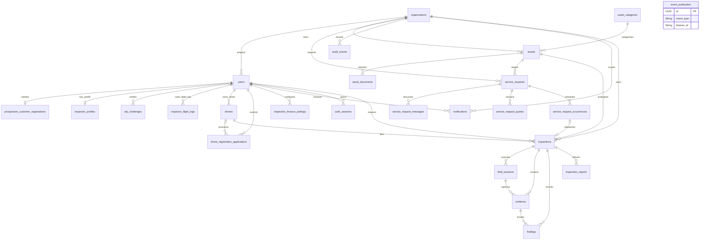

## 2. Database Design

**Scope boundary:** Corrective maintenance has been fully removed from the application. Flyway forward migration `V33__drop_maintenance_schema.sql` drops all legacy maintenance tables (`maintenance_*`, `reinspection_defect_verifications`, `repair_knowledge_chunks`), foreign keys, and maintenance-specific columns (`forwarded_to_maintenance_at`, `work_order_id`, `source_report_version_id`, `source_inspection_id`), aligning the physical database schema with the 4-role / 6-feature service model.

**Files and Persistence Storage Description**

SmartDroneInspection persists structured relational data in **PostgreSQL 17** (with `pgcrypto` and `pgvector` extensions) and binary media/documents in **MinIO S3-compatible object storage**:

- **Flyway Schema Migration Files (`SmartDroneInspection-backend/src/main/resources/db/migration/V1__baseline.sql` – `V36__drone_feature_configs.sql`)**: Versioned forward SQL migration files managed automatically by Flyway on application startup. Following migrations `V33`–`V36`, the active schema defines **32 active application tables** (34 total in `public` including `event_publication` and `flyway_schema_history`), adding `drone_document_configs`, `drone_feature_configs`, and drone image/capability/document JSONB fields on `drone_registration_applications` and `drones`, along with composite tenant foreign keys, status check constraints, and optimistic locking (`row_version`) columns.
- **MinIO Object Storage Files (`inspection-evidence` bucket)**: Binary files are streamed through `MinioEvidenceObjectStore` using deterministic or UUID-scoped object keys referenced by PostgreSQL columns:
  - `contracts/requests/{requestId}/{uuid}/{fileName}`: Signed offline service agreement scans (`service_requests.contract_object_key`).
  - `licenses/{userId}/{uuid}-{fileName}` and `drone-registration-applications/{inspectorId}/evidence/{docType}/{uuid}.{ext}`: Inspector pilot license scans (`inspector_profiles.pilot_license_file_key`), configurable drone registration documents, and drone photos (`DRONE_IMAGE`) referenced by `drone_registration_applications` and `drones`.
  - `assets/{assetId}/documents/{uuid}-{fileName}`: Infrastructure asset engineering drawings and reference documents verified with `SHA-256` checksums (`asset_documents.object_key`).
  - `inspections/{inspectionId}/flight-permits/{uuid}-{fileName}` and `inspections/{inspectionId}/evidence/{uuid}-{fileName}`: Mission flight permits (`inspections.flight_permit_file_key`) and field photographs / `video/mp4` captures (`evidence.object_key`).
  - `reports/{reportVersionId}.pdf`: Rendered A4 Inspection Reports generated by `OpenHTMLtoPDF`.

**Table Descriptions**

| No | Table | Description |
| :---: | :--- | :--- |
| 01 | `organizations` | Stores customer organizations that own infrastructure assets, request inspection services, and govern maintenance work orders. - Primary keys: `id` - Foreign keys: None |
| 02 | `users` | Stores user accounts across the five system roles (`ADMIN`, `MANAGER`, `CUSTOMER`, `INSPECTOR`, and `MAINTENANCE_ENGINEER`), account status, `ActorZone`, and organization scope. - Primary keys: `id` - Foreign keys: `organization_id` |
| 03 | `inspector_profiles` | Stores Inspector pilot license numbers, license classes, expiration dates, scanned license files, flight hours, and technical specializations. - Primary keys: `user_id` - Foreign keys: `user_id` |
| 04 | `otp_challenges` | Stores consolidated one-time verification codes (`LOGIN`, `REGISTRATION`, and `PASSWORD_RESET`), expiration timestamps, and attempt counters. - Primary keys: `id` - Foreign keys: `user_id` |
| 05 | `inspector_flight_logs` | Records historical flight missions, flight duration, aircraft details, location, and safety notes for Inspectors. - Primary keys: `id` - Foreign keys: `inspector_user_id`, `recorded_by_user_id` |
| 06 | `auth_sessions` | Tracks active web and mobile login sessions, hashed refresh tokens, expiration times, and session revocation records. - Primary keys: `id` - Foreign keys: `user_id` |
| 07 | `prospective_customer_registrations` | Stores customer organization and initial asset registration requests that require platform review due to restricted airspace proximity. - Primary keys: `id` - Foreign keys: `user_id`, `asset_category_id`, `reviewed_by_user_id` |
| 08 | `drone_registration_applications` | Stores Inspector applications to register owned drones with registration, ownership, and technical inspection documents. - Primary keys: `id` - Foreign keys: `inspector_user_id`, `drone_id`, `reviewed_by_user_id` |
| 09 | `drones` | Catalogs approved drones owned by Inspectors or customer organizations, including serial number, model, and serviceability status. - Primary keys: `id` - Foreign keys: `inspector_owner_id`, `organization_id` |
| 10 | `asset_categories` | Defines the global catalog of infrastructure asset categories managed by platform administrators. - Primary keys: `id` - Foreign keys: None |
| 11 | `assets` | Stores customer infrastructure assets, geographic coordinates, technical profiles, and structural inspection checkpoints (`inspection_items`). - Primary keys: `id` - Foreign keys: `organization_id`, `category_id` |
| 12 | `asset_documents` | Stores engineering drawings and reference documents attached to an infrastructure asset with SHA-256 checksums. - Primary keys: `id` - Foreign keys: `asset_id`, `uploaded_by_user_id` |
| 13 | `service_requests` | Stores one-time and recurring customer inspection requests, preferred time windows, monthly recurrence interval (1–120 months), count/end-date bounds, immutable agreed quotation terms snapshot (`accepted_terms_snapshot`), and signed agreement file reference. The agreement date range is derived from the selected schedule bound; recurring quotation schedules are anchored to the Customer-requested first date; first requested dates must satisfy the 20-calendar-day product lead time in Asia/Ho_Chi_Minh business time. - Primary keys: `id` - Foreign keys: `organization_id`, `asset_id`, `created_by_user_id`, `accepted_quote_id`, `accepted_by_user_id` |
| 14 | `service_request_messages` | Stores chat messages exchanged between the Customer and the Platform Manager during service request negotiation, including `read_at` read-receipt tracking. - Primary keys: `id` - Foreign keys: `request_id`, `author_user_id` |
| 15 | `service_request_quotes` | Stores the active quotation proposing the inspection scope, schedule window, Inspector, drone, and fee per occurrence with optimistic locking (`row_version`). - Primary keys: `id` - Foreign keys: `request_id`, `inspector_id`, `drone_id`, `issued_by_user_id`, `updated_by_user_id` |
| 16 | `service_request_occurrences` | Stores scheduled inspection occurrences generated from accepted service requests, including dispatch status and assigned Inspector, drone, and inspection. - Primary keys: `id` - Foreign keys: `request_id`, `inspector_id`, `drone_id`, `inspection_id` |
| 17 | `service_invoices` | Stores per-occurrence service price and VAT, commission, and TNCN rate snapshots, plus the Customer report-acceptance time. - Primary keys: `occurrence_id` - Foreign keys: `occurrence_id` → `service_request_occurrences.id` |
| 18 | `service_payments` | Tracks customer payment status, PayOS/VNPay order code and method, transaction reference, and confirmation time for an invoice. - Primary keys: `occurrence_id` - Foreign keys: `occurrence_id` → `service_invoices.occurrence_id` |
| 19 | `inspector_payouts` | Records the Inspector recipient, invoice payout status, external or simulated payout reference, and recorded time. - Primary keys: `occurrence_id` - Foreign keys: `occurrence_id` → `service_invoices.occurrence_id`, `inspector_id` → `users.id` |
| 20 | `inspection_finance_settings` | Stores platform commission, VAT, and personal income tax rates used to calculate net partner payouts. - Primary keys: `id` - Foreign keys: `updated_by_user_id` |
| 21 | `inspections` | Stores scheduled inspection missions, assigned Inspector and drone, flight permit reference, `findings_confirmed_at` timestamp, and 6-state mission status. - Primary keys: `id` - Foreign keys: `organization_id`, `asset_id`, `inspector_id`, `drone_id` |
| 22 | `field_sessions` | Records on-site field flight sessions, pre-flight safety notes, completion outcome notes, abort reasons, persisted `SmartDroneHub` flight report metrics (`telemetry_source`, `flight_duration_seconds`, `distance_flown_meters`, `max_altitude_meters`, `start_battery_percent`, `end_battery_percent`, `flight_final_state`, `flight_report_note`), GPS flight trace (`flight_trace_json`), and synced flight video reference (`flight_video_evidence_id`). - Primary keys: `id` - Foreign keys: `inspection_id`, `flight_video_evidence_id` |
| 23 | `evidence` | Stores metadata and object storage keys for photographs and MP4 videos captured during field sessions, including capture time and GPS coordinates. - Primary keys: `id` - Foreign keys: `inspection_id`, `field_session_id` |
| 24 | `findings` | Stores AI-suggested defect candidates and Inspector-confirmed defect findings, including defect label, severity, confidence score, and bounding box. - Primary keys: `id` - Foreign keys: `inspection_id`, `evidence_id` |
| 25 | `inspection_reports` | Stores versioned 4-state inspection report records (`SUBMITTED`, `RETURNED`, `PUBLISHED`, `SUPERSEDED`), submission and review timestamps, and return feedback. - Primary keys: `id` - Foreign keys: `inspection_id`, `reviewer_user_id` |
| 26 | `notifications` | Stores deduplicated in-app notifications (`uq_notifications_deduplication_key`), read status, and navigation target paths for users. - Primary keys: `id` - Foreign keys: `organization_id`, `recipient_user_id` |
| 27 | `audit_events` | Stores append-only security and business audit trail events with actor, action, aggregate type, and aggregate ID. - Primary keys: `id` - Foreign keys: `organization_id`, `actor_user_id` |
| 28 | `event_publication` | Stores Spring Modulith transactional domain event publications and listener completion timestamps for reliable asynchronous delivery. - Primary keys: `id` - Foreign keys: None |
