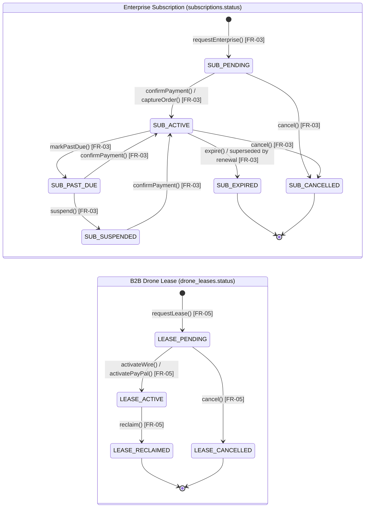
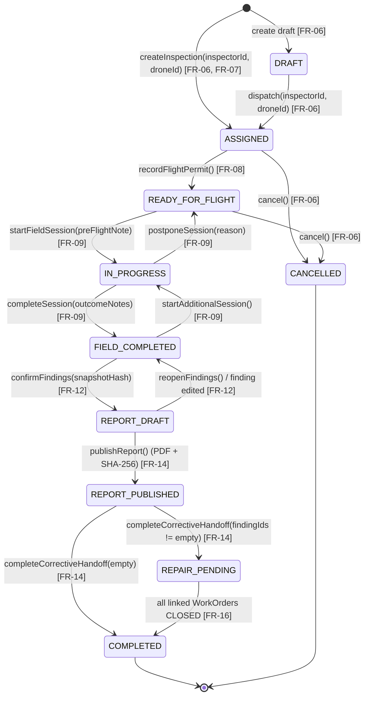
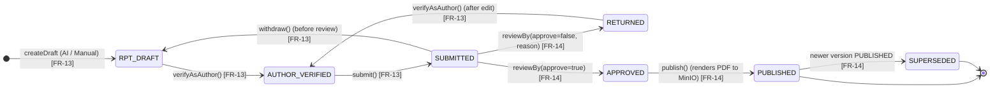
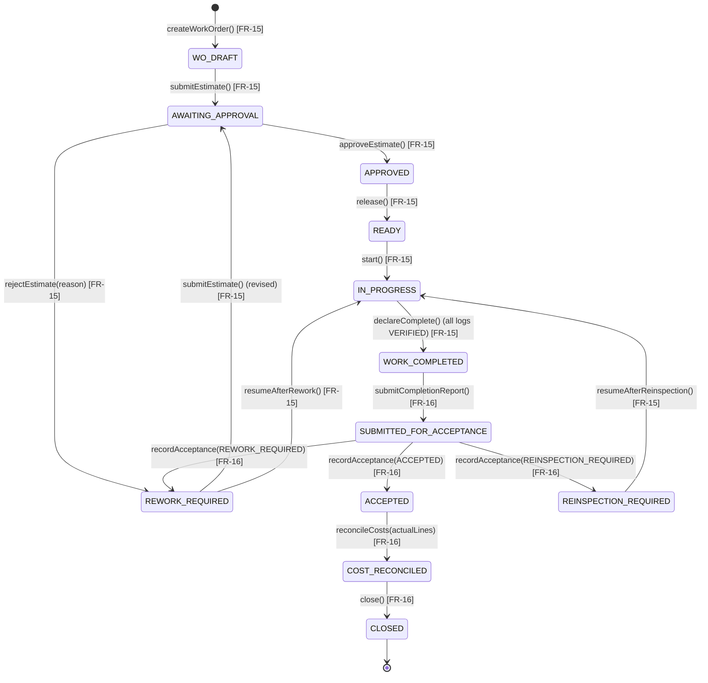

## 2. Database Design

The relational database architecture is implemented on PostgreSQL 17 with strict foreign key constraints, index-optimized tenant filtering, and cryptographic audit fields. The database schema encompasses 30 application tables (plus the `event_publication` transactional outbox) categorized across identity, assets and B2B drone leasing, inspection workflow, maintenance remediation, and cross-cutting infrastructure.

```mermaid
%% title: Database Entity Relationship Diagram (ERD)
erDiagram
  organizations ||--o{ users : employs
  organizations ||--o{ subscriptions : holds
  subscriptions ||--o{ payment_transactions : settles
  organizations ||--o{ drones : owns
  organizations ||--o{ drone_leases : contracts
  platform_drones ||--o{ drone_leases : leased_via
  drone_leases ||--o| drones : provisions
  users ||--o{ drone_leases : requests
  organizations ||--o{ assets : owns
  asset_categories ||--o{ assets : categorizes
  assets ||--o{ asset_documents : attaches
  organizations ||--o{ audit_events : records
  organizations ||--o{ notifications : scopes
  users ||--o{ notifications : receives
  users ||--o{ auth_sessions : opens
  organizations ||--o{ inspections : owns
  assets ||--o{ inspections : undergoes
  users ||--o{ inspections : assigned_inspector
  drones ||--o{ inspections : assigned_drone
  organizations ||--o{ recurring_inspection_schedules : schedules
  assets ||--o{ recurring_inspection_schedules : recurs_for
  users ||--o{ recurring_inspection_schedules : default_inspector
  drones ||--o{ recurring_inspection_schedules : default_drone
  recurring_inspection_schedules ||--o{ schedule_occurrences : generates
  organizations ||--o{ schedule_occurrences : scopes
  inspections |o--o{ schedule_occurrences : fulfills
  recurring_inspection_schedules ||--o{ inspections : dispatches
  inspections ||--o{ field_sessions : executes
  inspections ||--o{ evidence : contains
  field_sessions ||--o{ evidence : captures
  inspections ||--o{ findings : records
  evidence ||--o{ findings : locates
  inspections ||--o{ inspection_reports : delivers
  organizations ||--o{ maintenance_work_orders : owns
  assets ||--o{ maintenance_work_orders : remediates
  users ||--o{ maintenance_work_orders : governs
  findings ||--o{ maintenance_work_orders : initiates
  inspection_reports ||--o{ maintenance_work_orders : references
  maintenance_work_orders ||--o{ maintenance_team_members : deploys
  maintenance_work_orders ||--o{ maintenance_tasks : deconstructs
  maintenance_work_orders ||--o{ maintenance_estimate_versions : projects
  maintenance_estimate_versions ||--o{ maintenance_cost_lines : itemizes
  maintenance_tasks ||--o{ maintenance_cost_lines : accrues
  maintenance_work_orders ||--o{ maintenance_change_orders : requests
  maintenance_tasks ||--o{ maintenance_work_logs : tracks
  maintenance_work_orders ||--o{ maintenance_reports : delivers
  maintenance_reports ||--o{ maintenance_acceptance_decisions : accepts
  organizations {
    _ id PK
    _ created_by_user_id FK
    _ created_at
    _ updated_at
    _ legal_name
    _ display_name
    _ registration_code
    _ timezone
    _ status
    _ row_version
  }
  users {
    _ id PK
    _ organization_id FK
    _ email
    _ normalized_email
    _ full_name
    _ password_hash
    _ status
    _ actor_zone
    _ auth_version
    _ failed_login_count
    _ lockout_until
    _ must_change_password
    _ last_login_at
    _ last_login_ip
    _ created_at
    _ updated_at
    _ vision_fallback_enabled
    _ phone_number
    _ avatar_url
    _ roles
    _ pilot_license_number
    _ pilot_license_class
    _ pilot_license_expires_at
    _ pilot_license_file_key
  }
  auth_sessions {
    _ id PK
    _ user_id FK
    _ client_type
    _ token_hash
    _ previous_token_hash
    _ issued_at
    _ expires_at
    _ revoked_at
    _ revoked_reason
  }
  subscriptions {
    _ id PK
    _ organization_id FK
    _ confirmed_by_user_id FK
    _ plan_code
    _ billing_period_months
    _ agreed_amount_usd
    _ status
    _ starts_at
    _ ends_at
    _ external_reference
    _ terms_snapshot
    _ confirmed_at
    _ created_at
    _ updated_at
    _ row_version
  }
  payment_transactions {
    _ id PK
    _ subscription_id FK
    _ paypal_order_id
    _ paypal_capture_id
    _ amount
    _ currency
    _ status
    _ payer_email
    _ captured_at
    _ created_at
    _ updated_at
    _ row_version
  }
  platform_drones {
    _ id PK
    _ serial_number
    _ model
    _ manufacturer
    _ payload_metadata
    _ monthly_rate_usd
    _ status
    _ notes
    _ created_at
    _ updated_at
    _ row_version
  }
  drone_leases {
    _ id PK
    _ platform_drone_id FK
    _ organization_id FK
    _ customer_drone_id FK
    _ requested_by_user_id FK
    _ confirmed_by_user_id FK
    _ lease_period_months
    _ monthly_rate_usd
    _ agreed_amount_usd
    _ status
    _ starts_at
    _ ends_at
    _ reclaimed_at
    _ external_reference
    _ paypal_order_id
    _ paypal_capture_id
    _ confirmed_at
    _ notes
    _ created_at
    _ updated_at
    _ row_version
  }
  drones {
    _ id PK
    _ organization_id FK
    _ lease_id FK
    _ serial_number
    _ model
    _ manufacturer
    _ payload_metadata
    _ serviceability
    _ last_maintenance_at
    _ next_maintenance_at
    _ notes
    _ registration_number
    _ registration_file_key
    _ registration_expires_at
    _ created_at
    _ updated_at
    _ row_version
    _ ownership_type
    _ lease_expires_at
  }
  asset_categories {
    _ id PK
    _ code
    _ name
    _ description
    _ active
    _ created_at
    _ updated_at
    _ row_version
  }
  assets {
    _ id PK
    _ organization_id FK
    _ category_id FK
    _ name
    _ description
    _ latitude
    _ longitude
    _ status
    _ created_at
    _ updated_at
    _ row_version
    _ asset_code
    _ location
    _ technical_profile
    _ inspection_items
  }
  asset_documents {
    _ id PK
    _ asset_id FK
    _ uploaded_by_user_id FK
    _ document_type
    _ file_name
    _ content_type
    _ size_bytes
    _ checksum_sha256
    _ object_key
    _ document_date
    _ created_at
  }
  recurring_inspection_schedules {
    _ id PK
    _ organization_id FK
    _ asset_id FK
    _ created_by_user_id FK
    _ inspector_id FK
    _ drone_id FK
    _ anchor_date
    _ timezone
    _ recurrence_unit
    _ recurrence_interval
    _ duration_seconds
    _ reminder_days
    _ ends_at
    _ next_occurrence
    _ status
    _ created_at
    _ updated_at
    _ row_version
  }
  schedule_occurrences {
    _ id PK
    _ schedule_id FK
    _ organization_id FK
    _ inspection_id FK
    _ occurrence_index
    _ occurrence_key
    _ planned_start_at
    _ planned_end_at
    _ status
    _ blocked_reason
    _ retry_count
    _ reminder_sent_at
    _ created_at
    _ updated_at
    _ row_version
  }
  inspections {
    _ id PK
    _ asset_id FK
    _ organization_id FK
    _ inspector_id FK
    _ drone_id FK
    _ recurring_schedule_id FK
    _ status
    _ created_at
    _ updated_at
    _ row_version
    _ planned_start_at
    _ planned_end_at
    _ flight_permit_file_key
    _ flight_permit_file_name
    _ flight_permit_uploaded_at
    _ findings_confirmed_at
    _ findings_snapshot_hash
  }
  field_sessions {
    _ id PK
    _ inspection_id FK
    _ status
    _ started_at
    _ ended_at
    _ postponement_reason
    _ abort_reason
    _ created_at
    _ updated_at
    _ row_version
    _ pre_flight_checklist_note
    _ outcome_notes
  }
  evidence {
    _ id PK
    _ inspection_id FK
    _ field_session_id FK
    _ file_name
    _ content_type
    _ size_bytes
    _ object_key
    _ capture_time
    _ latitude
    _ longitude
    _ location_description
    _ is_deleted
    _ created_at
  }
  findings {
    _ id PK
    _ inspection_id FK
    _ evidence_id FK
    _ finding_code
    _ defect_label
    _ severity
    _ bounding_box
    _ technical_notes
    _ recommended_action
    _ status
    _ model_name
    _ confidence
    _ forwarded_to_maintenance_at
    _ is_deleted
    _ created_at
  }
  inspection_reports {
    _ id PK
    _ inspection_id FK
    _ reviewer_user_id FK
    _ version_no
    _ status
    _ content_snapshot
    _ submitted_at
    _ reviewed_at
    _ return_reason
    _ rendered_object_key
    _ rendered_checksum_sha256
    _ published_at
    _ created_at
  }
  repair_knowledge_chunks {
    _ id PK
    _ standard_code
    _ title
    _ category
    _ defect_patterns
    _ content
    _ reference_url
    _ created_at
  }
  notifications {
    _ id PK
    _ recipient_user_id FK
    _ organization_id FK
    _ event_type
    _ channel
    _ title
    _ body
    _ target_path
    _ status
    _ attempt_count
    _ last_error_code
    _ sent_at
    _ read_at
    _ created_at
    _ aggregate_type
    _ aggregate_id
    _ deduplication_key
  }
  audit_events {
    _ id PK
    _ organization_id FK
    _ actor_user_id FK
    _ action
    _ aggregate_type
    _ aggregate_id
    _ before_status
    _ after_status
    _ aggregate_version
    _ reason
    _ trace_id
    _ safe_metadata
    _ created_at
  }
  event_publication {
    _ id PK
    _ listener_id
    _ event_type
    _ serialized_event
    _ publication_date
    _ completion_date
    _ status
    _ completion_attempts
    _ last_resubmission_date
  }
  maintenance_work_orders {
    _ id PK
    _ organization_id FK
    _ asset_id FK
    _ source_report_version_id FK
    _ source_finding_id FK
    _ owner_user_id FK
    _ budget_approver_user_id FK
    _ team_lead_user_id FK
    _ report_author_user_id FK
    _ accepting_reviewer_user_id FK
    _ status
    _ priority
    _ due_at
    _ corrective_scope
    _ acceptance_criteria
    _ created_at
    _ updated_at
    _ row_version
  }
  maintenance_team_members {
    _ id PK
    _ work_order_id FK
    _ engineer_user_id FK
    _ assigned_by_user_id FK
    _ member_role
    _ effective_from
    _ effective_until
    _ reason
    _ active
    _ created_at
  }
  maintenance_tasks {
    _ id PK
    _ work_order_id FK
    _ assigned_engineer_user_id FK
    _ task_number
    _ name
    _ method
    _ planned_start_at
    _ planned_end_at
    _ acceptance_criteria
    _ status
    _ created_at
    _ updated_at
    _ row_version
  }
  maintenance_estimate_versions {
    _ id PK
    _ work_order_id FK
    _ prepared_by_user_id FK
    _ approved_by_user_id FK
    _ version_no
    _ status
    _ approved_at
    _ currency
    _ baseline_total
    _ assumptions
    _ created_at
  }
  maintenance_cost_lines {
    _ id PK
    _ work_order_id FK
    _ estimate_version_id FK
    _ task_id FK
    _ entered_by_user_id FK
    _ line_kind
    _ state
    _ description
    _ quantity
    _ unit
    _ unit_rate
    _ amount
    _ currency
    _ created_at
  }
  maintenance_change_orders {
    _ id PK
    _ work_order_id FK
    _ requested_by_user_id FK
    _ decided_by_user_id FK
    _ change_number
    _ reason
    _ proposed_delta
    _ status
    _ decided_at
    _ decision_reason
    _ created_at
    _ updated_at
    _ row_version
  }
  maintenance_work_logs {
    _ id PK
    _ work_order_id FK
    _ task_id FK
    _ engineer_user_id FK
    _ started_at
    _ ended_at
    _ hours
    _ as_left_condition
    _ test_readings
    _ status
    _ created_at
    _ updated_at
    _ row_version
  }
  maintenance_reports {
    _ id PK
    _ work_order_id FK
    _ version_no
    _ status
    _ author_verified_at
    _ content_snapshot
    _ rendered_object_key
    _ rendered_checksum_sha256
    _ created_at
  }
  maintenance_acceptance_decisions {
    _ id PK
    _ work_order_id FK
    _ report_version_id FK
    _ reviewer_user_id FK
    _ decision
    _ technical_comments
    _ acceptance_checklist
    _ test_result
    _ decided_at
  }
```

**Table Descriptions**

| No | Table | Description |
| :---: | :--- | :--- |
| 01 | `organizations` | Stores tenant enterprise companies subscribing to the platform. (`10` columns). - Primary keys: `id` (UUID) - Foreign keys: `created_by_user_id` references `users(id)`|
| 02 | `users` | Stores system user accounts across `ADMIN`, `PLATFORM_MANAGER`, `ORG_MANAGER`, `INSPECTOR`, and `MAINTENANCE_ENGINEER`, account status (`ACTIVE`, `SUSPENDED`, `DISABLED`), and self-declared remote pilot license credentials. (`24` columns). - Primary keys: `id` (UUID) - Foreign keys: `organization_id` references `organizations(id)`|
| 03 | `auth_sessions` | Tracks active user login sessions (`WEB`, `MOBILE`), hashed refresh tokens, expiration timestamps, and revocation status. (`9` columns). - Primary keys: `id` (UUID) - Foreign keys: `user_id` references `users(id)`|
| 04 | `subscriptions` | Tracks ENTERPRISE subscription contracts, billing periods (`1..120` months), agreed USD amounts, immutable contract terms snapshots, and lifecycle status (`PENDING`, `ACTIVE`, `PAST_DUE`, `SUSPENDED`, `EXPIRED`, `CANCELLED`). (`15` columns). - Primary keys: `id` (UUID) - Foreign keys: `confirmed_by_user_id` references `users(id)`, `organization_id` references `organizations(id)`|
| 05 | `payment_transactions` | Records PayPal Orders v2 checkout and capture transactions linked to enterprise subscriptions (`PENDING`, `COMPLETED`, `FAILED`, `REFUNDED`). (`12` columns). - Primary keys: `id` (UUID) - Foreign keys: `subscription_id` references `subscriptions(id)`|
| 06 | `platform_drones` | Platform-owned serial-numbered leasable drone pool managed by `PLATFORM_MANAGER` (`AVAILABLE`, `LEASED`, `MAINTENANCE`, `RETIRED`). (`11` columns). - Primary keys: `id` (UUID) - Foreign keys: None|
| 07 | `drone_leases` | B2B drone lease contracts between the platform and a customer organization (`PENDING`, `ACTIVE`, `RECLAIMED`, `CANCELLED`) with wire/PayPal settlement and customer fleet provisioning. (`21` columns). - Primary keys: `id` (UUID) - Foreign keys: `platform_drone_id` references `platform_drones(id)`, `organization_id` references `organizations(id)`, `customer_drone_id` references `drones(id)`, `requested_by_user_id` references `users(id)`, `confirmed_by_user_id` references `users(id)`|
| 08 | `drones` | Catalogs customer organization drone aircraft (`OWNED` or `LEASED`), hardware serial numbers, payload metadata, serviceability status (`ACTIVE`, `MAINTENANCE`, `SUSPENDED`, `RETIRED`), and CAAV registration metadata. (`19` columns). - Primary keys: `id` (UUID) - Foreign keys: `organization_id` references `organizations(id)`, `lease_id` references `drone_leases(id)`|
| 09 | `asset_categories` | Global structural categorization catalog for infrastructure assets managed by `ADMIN`. (`8` columns). - Primary keys: `id` (UUID) - Foreign keys: None|
| 10 | `assets` | Manages physical infrastructure assets (`ACTIVE`, `INACTIVE`, `RETIRED`), GPS coordinates, and `inspection_items` (`jsonb` array of standardized structural checkpoints). (`15` columns). - Primary keys: `id` (UUID) - Foreign keys: `category_id` references `asset_categories(id)`, `organization_id` references `organizations(id)`|
| 11 | `asset_documents` | Engineering schematics, structural drawings, and technical specifications attached to an asset with 64-character SHA-256 deduplication. (`11` columns). - Primary keys: `id` (UUID) - Foreign keys: `asset_id` references `assets(id)`, `uploaded_by_user_id` references `users(id)`|
| 12 | `inspections` | Core inspection mission table tracking scheduled time windows, direct Inspector and Drone assignment, optional `recurring_schedule_id`, self-service flight permit attributes, and 10-state lifecycle status. (`17` columns). - Primary keys: `id` (UUID) - Foreign keys: `asset_id` references `assets(id)`, `drone_id` references `drones(id)`, `inspector_id` references `users(id)`, `organization_id` references `organizations(id)`, `recurring_schedule_id` references `recurring_inspection_schedules(id)`|
| 13 | `recurring_inspection_schedules` | Periodic inspection recurrence rules per asset with timezone-anchored cadence (`WEEK`, `MONTH`, `YEAR`), default Inspector/Drone, duration, reminder lead days, and status (`ACTIVE`, `PAUSED`, `ENDED`). (`18` columns). - Primary keys: `id` (UUID) - Foreign keys: `organization_id` references `organizations(id)`, `asset_id` references `assets(id)`, `created_by_user_id` references `users(id)`, `inspector_id` references `users(id)`, `drone_id` references `drones(id)`|
| 14 | `schedule_occurrences` | Individual `GENERATED`, `BLOCKED`, or `SKIPPED` recurring schedule occurrences linked to dispatched `inspections`. (`15` columns). - Primary keys: `id` (UUID) - Foreign keys: `schedule_id` references `recurring_inspection_schedules(id)`, `organization_id` references `organizations(id)`, `inspection_id` references `inspections(id)`|
| 15 | `field_sessions` | Records individual on-site flight survey sessions, pre-flight safety checklist notes, and operational outcomes (`PLANNED`, `IN_PROGRESS`, `FIELD_COMPLETED`, `POSTPONED`, `ABORTED`). (`12` columns). - Primary keys: `id` (UUID) - Foreign keys: `inspection_id` references `inspections(id)`|
| 16 | `evidence` | Digital media captures collected during inspection field sessions with MinIO object keys, EXIF capture timestamps, GPS coordinates, location descriptions, and soft-delete flag (`is_deleted`). (`13` columns). - Primary keys: `id` (UUID) - Foreign keys: `field_session_id` references `field_sessions(id)`, `inspection_id` references `inspections(id)`|
| 17 | `findings` | Unified defect findings table managing YOLO11 AI defect candidates (`PENDING`) and human-verified official findings (`CONFIRMED`) with bounding boxes and maintenance forwarding timestamps. (`15` columns). - Primary keys: `id` (UUID) - Foreign keys: `evidence_id` references `evidence(id)`, `inspection_id` references `inspections(id)`|
| 18 | `inspection_reports` | Versioned inspection report deliverables (`DRAFT`, `AUTHOR_VERIFIED`, `SUBMITTED`, `RETURNED`, `APPROVED`, `PUBLISHED`, `SUPERSEDED`), review gates, rendered PDF object keys, and SHA-256 checksums. (`13` columns). - Primary keys: `id` (UUID) - Foreign keys: `reviewer_user_id` references `users(id)`, `inspection_id` references `inspections(id)`|
| 19 | `maintenance_work_orders` | Remediation projects initiated from confirmed inspection findings, tracking corrective scope, acceptance criteria, team role assignments, and 12-state lifecycle status. (`18` columns). - Primary keys: `id` (UUID) - Foreign keys: `asset_id` references `assets(id)`, `accepting_reviewer_user_id` references `users(id)`, `budget_approver_user_id` references `users(id)`, `organization_id` references `organizations(id)`, `owner_user_id` references `users(id)`, `report_author_user_id` references `users(id)`, `source_finding_id` references `findings(id)`, `source_report_version_id` references `inspection_reports(id)`, `team_lead_user_id` references `users(id)`|
| 20 | `maintenance_team_members` | Engineering team members allocated to a maintenance work order (`LEAD`, `REPORT_AUTHOR`, `MEMBER`) with partial unique indexes on active leadership roles. (`10` columns). - Primary keys: `id` (UUID) - Foreign keys: `assigned_by_user_id` references `users(id)`, `engineer_user_id` references `users(id)`, `work_order_id` references `maintenance_work_orders(id)`|
| 21 | `maintenance_tasks` | Decomposed repair tasks (`PLANNED`, `READY`, `IN_PROGRESS`, `PAUSED_FOR_CHANGE`, `WORK_COMPLETED`, `REWORK_REQUIRED`, `ACCEPTED`, `CANCELLED`) with technical methods and assigned engineers. (`13` columns). - Primary keys: `id` (UUID) - Foreign keys: `assigned_engineer_user_id` references `users(id)`, `work_order_id` references `maintenance_work_orders(id)`|
| 22 | `maintenance_estimate_versions` | Versioned financial projection baselines (`DRAFT`, `SUBMITTED`, `APPROVED`, `REJECTED`, `SUPERSEDED`) for labor, materials, equipment, and services. (`11` columns). - Primary keys: `id` (UUID) - Foreign keys: `approved_by_user_id` references `users(id)`, `prepared_by_user_id` references `users(id)`, `work_order_id` references `maintenance_work_orders(id)`|
| 23 | `maintenance_cost_lines` | Individual itemized cost rows (`LABOR`, `MATERIAL`, `EQUIPMENT`, `SERVICE`) within an `ESTIMATE` baseline or `ACTUAL` expenditure reconciliation. (`14` columns). - Primary keys: `id` (UUID) - Foreign keys: `entered_by_user_id` references `users(id)`, `estimate_version_id` references `maintenance_estimate_versions(id)`, `task_id` references `maintenance_tasks(id)`, `work_order_id` references `maintenance_work_orders(id)`|
| 24 | `maintenance_change_orders` | Formal variance requests (`DRAFT`, `AWAITING_APPROVAL`, `APPROVED`, `REJECTED`, `RETURNED`, `SUPERSEDED`) adjusting repair scope or budget ceiling. (`13` columns). - Primary keys: `id` (UUID) - Foreign keys: `decided_by_user_id` references `users(id)`, `requested_by_user_id` references `users(id)`, `work_order_id` references `maintenance_work_orders(id)`|
| 25 | `maintenance_work_logs` | Execution entries (`IN_PROGRESS`, `PAUSED_FOR_CHANGE`, `SUBMITTED`, `VERIFIED`) logging task labor hours, as-left conditions, and test readings. (`13` columns). - Primary keys: `id` (UUID) - Foreign keys: `task_id` references `maintenance_tasks(id)`, `engineer_user_id` references `users(id)`, `work_order_id` references `maintenance_work_orders(id)`|
| 26 | `maintenance_reports` | Versioned maintenance completion deliverables (`DRAFT`, `AUTHOR_VERIFIED`, `SUBMITTED`, `RETURNED`, `APPROVED`, `SUPERSEDED`) verified by the Report Author and rendered to PDF. (`9` columns). - Primary keys: `id` (UUID) - Foreign keys: `work_order_id` references `maintenance_work_orders(id)`|
| 27 | `maintenance_acceptance_decisions` | Formal independent technical acceptance records (`ACCEPTED`, `REWORK_REQUIRED`, `REINSPECTION_REQUIRED`) evaluating repair completion. (`9` columns). - Primary keys: `id` (UUID) - Foreign keys: `report_version_id` references `maintenance_reports(id)`, `reviewer_user_id` references `users(id)`, `work_order_id` references `maintenance_work_orders(id)`|
| 28 | `repair_knowledge_chunks` | Civil and structural engineering repair standard chunks (`TCVN`, `EN`, `ISO`, `ASTM`) and 1536-dim `pgvector` embeddings supporting RAG scope suggestions. (`9` columns including `embedding vector(1536)`). - Primary keys: `id` (UUID) - Foreign keys: None|
| 29 | `notifications` | Operational alerts and deduplicated in-app notifications (`SENT`, `READ`, `FAILED`) delivered to system users. (`17` columns). - Primary keys: `id` (UUID) - Foreign keys: `organization_id` references `organizations(id)`, `recipient_user_id` references `users(id)`|
| 30 | `audit_events` | Append-only security audit trail recording consequential domain transitions and access events. (`13` columns). - Primary keys: `id` (UUID) - Foreign keys: `actor_user_id` references `users(id)`, `organization_id` references `organizations(id)`|
| 31 | `event_publication` | Spring Modulith transactional outbox table for reliable asynchronous domain event delivery. (`9` columns). - Primary keys: `id` (UUID) - Foreign keys: None|

---

**Main Domain Entity State Machine Diagrams**

Every lifecycle entity in `SmartDroneInspection-backend` is governed by an explicit state machine with guarded domain methods.

**1. Enterprise Subscription & B2B Drone Lease State Machines**

| Domain Entity | Lifecycle States & Key Transitions | Business Rule Guards |
| --- | --- | --- |
| **Enterprise Subscription** (`Subscription.Status`) | - **States**: `PENDING`, `ACTIVE`, `PAST_DUE`, `SUSPENDED`, `EXPIRED`, `CANCELLED` - **Request**: `POST /subscriptions` (`-> PENDING`) - **Activate**: Wire confirmation or PayPal capture (`-> ACTIVE`) - **Renew / End**: Prior active term transitions to `EXPIRED` | - Enforces at most one `ACTIVE` subscription per organization (unique active subscription index). |
| **B2B Drone Lease & Pool** (`DroneLeaseStatus`) | - **Lease States**: `PENDING`, `ACTIVE`, `RECLAIMED`, `CANCELLED` - **Pool States**: `AVAILABLE`, `LEASED`, `MAINTENANCE`, `RETIRED` - **Activate / Reclaim**: `/confirm-payment` (`-> ACTIVE`), `/reclaim` (`-> RECLAIMED`) | - Auto-provisions customer `Drone` (`LEASED`, `ACTIVE`) on activation. - Retires customer `Drone` (`RETIRED`) on reclaim. |
| **Asset & Drone Fleet** (`AssetStatus`, `DroneStatus`) | - **Asset States**: `ACTIVE`, `INACTIVE`, `RETIRED` - **Drone States**: `ACTIVE`, `MAINTENANCE`, `SUSPENDED`, `RETIRED` - **Transitions**: `/retire` (`-> RETIRED`), `/serviceability` | - `RETIRED` is terminal and blocks new edits or schedules. - Only `ACTIVE` assets and `ACTIVE` drones can be scheduled. |
| **Recurring Schedule & Inbox** (`ScheduleStatus`) | - **Schedule**: `ACTIVE`, `PAUSED`, `ENDED` (`/pause`, `/resume`, `/end`) - **Occurrence**: `GENERATED`, `BLOCKED`, `SKIPPED` (`/retry`, `/skip`) - **Notification**: `PENDING`, `SENT`, `READ`, `FAILED` | - At most one `ACTIVE` schedule per asset. - `GENERATED` occurrence links to a dispatched `ASSIGNED` inspection. |

**2. Inspection, FieldSession, Finding & InspectionReport State Machines**

| Domain Entity | Lifecycle States & Key Transitions | Business Rule Guards |
| --- | --- | --- |
| **Inspection Mission** (`InspectionStatus`) | - **States**: `DRAFT`, `ASSIGNED`, `READY_FOR_FLIGHT`, `IN_PROGRESS`, `FIELD_COMPLETED`, `REPORT_DRAFT`, `REPORT_PUBLISHED`, `REPAIR_PENDING`, `COMPLETED`, `CANCELLED` - **Key Steps**: Dispatch (`-> ASSIGNED`), Permit Gate (`-> READY_FOR_FLIGHT`), Field Session (`-> FIELD_COMPLETED`), Confirm Findings (`-> REPORT_DRAFT`), Publish (`-> REPORT_PUBLISHED`), Corrective Handoff (`-> REPAIR_PENDING` or `COMPLETED`) | - Permit gate verifies unexpired Inspector pilot license. - Editing findings in `REPORT_DRAFT` reverts mission to `FIELD_COMPLETED` and marks earlier drafts stale. |
| **Field Session** (`FieldSessionStatus`) | - **States**: `PLANNED`, `IN_PROGRESS`, `POSTPONED`, `ABORTED`, `FIELD_COMPLETED` - **Transitions**: Start (`/field-sessions`), Postpone (`/postponement`), Abort (`/abort`), Complete (`/completion`) | - Requires non-blank `preFlightChecklistNote` on start and `outcomeNotes` on completion. - At most one `IN_PROGRESS` session per mission. |
| **Defect Finding** (`FindingStatus`) | - **States**: `PENDING`, `CONFIRMED`, plus soft-delete (`is_deleted`) - **Transitions**: AI/Manual create (`-> PENDING`), Confirm (`/confirmation -> CONFIRMED`), Retire (`DELETE`), Restore (`/restore`) | - Every `PENDING` AI candidate must be confirmed or soft-deleted before `POST /findings/confirm`. |
| **Inspection Report** (`ReportStatus`) | - **States**: `DRAFT`, `AUTHOR_VERIFIED`, `SUBMITTED`, `RETURNED`, `APPROVED`, `PUBLISHED`, `SUPERSEDED` - **Transitions**: Author (`/draft`, `/verify`, `/submit`), Review (`/review`), Publish (`/publish`) | - Independent `ORG_MANAGER` reviewer must not equal the author `Inspector`. - Evidence and findings are locked during `SUBMITTED` and `PUBLISHED`. |

**3. Maintenance Work Order & Sub-Entity State Machines**

| Domain Entity | Lifecycle States & Key Transitions | Business Rule Guards |
| --- | --- | --- |
| **Maintenance Work Order** (`WorkOrderStatus`) | - **12 States**: `DRAFT`, `AWAITING_APPROVAL`, `APPROVED`, `READY`, `IN_PROGRESS`, `WORK_COMPLETED`, `SUBMITTED_FOR_ACCEPTANCE`, `ACCEPTED`, `REWORK_REQUIRED`, `REINSPECTION_REQUIRED`, `COST_RECONCILED`, `CLOSED` - **Plan & Budget**: Create (`-> DRAFT`), Submit Estimate (`-> AWAITING_APPROVAL`), Approve (`-> APPROVED`) - **Execute**: Release (`-> READY`), Start (`-> IN_PROGRESS`), Declare Complete (`-> WORK_COMPLETED`) - **Accept & Close**: Submit Report (`-> SUBMITTED_FOR_ACCEPTANCE`), Accept (`-> ACCEPTED`), Reconcile (`-> COST_RECONCILED`), Close (`-> CLOSED`) | - Budget Approver and Accepting Reviewer must be independent `ORG_MANAGER`s outside the executing repair team. - `REINSPECTION_REQUIRED` automatically creates a linked verification `Inspection`. |
| **Estimate Version** (`EstimateStatus`) | - **States**: `DRAFT`, `SUBMITTED`, `APPROVED`, `REJECTED`, `SUPERSEDED` - **Transitions**: Submit (`/submit`), Approve (`/approve`, prior `-> SUPERSEDED`), Reject (`/reject`) | - Approver (`ORG_MANAGER`) must not equal `preparedByUserId`. |
| **Maintenance Work Log** (`WorkLogStatus`) | - **States**: `IN_PROGRESS`, `PAUSED_FOR_CHANGE`, `SUBMITTED`, `VERIFIED` - **Transitions**: Log (`/work-logs`), Submit (`/submit`), Verify (`/verify` by Team Lead) | - Every submitted work log must be `VERIFIED` by the Team Lead before `declareComplete()` is allowed. |
| **Change Order** (`ChangeOrderStatus`) | - **States**: `DRAFT`, `AWAITING_APPROVAL`, `APPROVED`, `REJECTED`, `RETURNED`, `SUPERSEDED` - **Transitions**: Propose (`/changes`), Decide (`/approve`, `/reject`, `/return`) | - Approved deltas adjust the budget ceiling during cost reconciliation without mutating the initial baseline. |
| **Completion Report** (`ReportVersionStatus`) | - **States**: `DRAFT`, `AUTHOR_VERIFIED`, `SUBMITTED`, `RETURNED`, `APPROVED`, `SUPERSEDED` - **Transitions**: Author (`/reports`, `/verify`, `/submit`), Accept (`/acceptance-decisions`) | - Only the designated Report Author can verify/submit; only the independent Accepting Reviewer can accept. |
