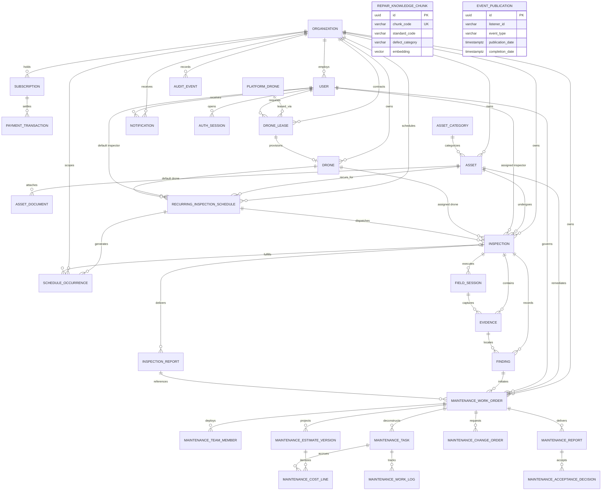
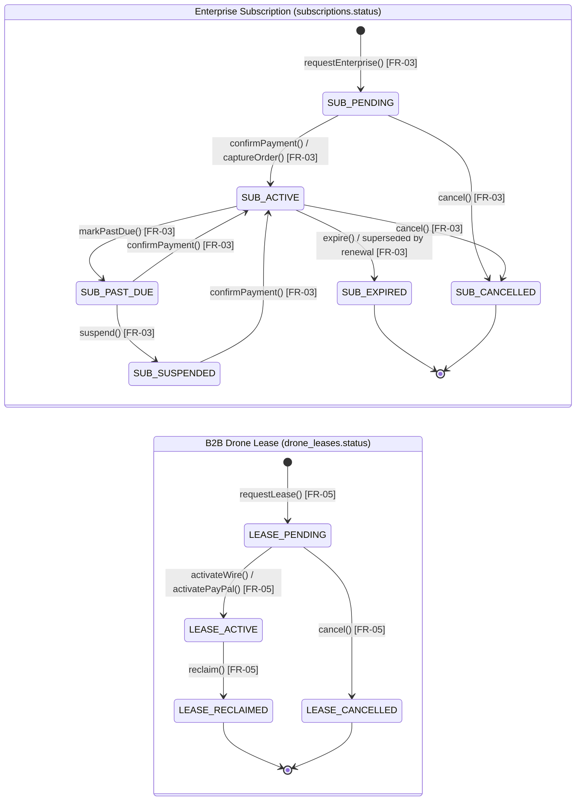
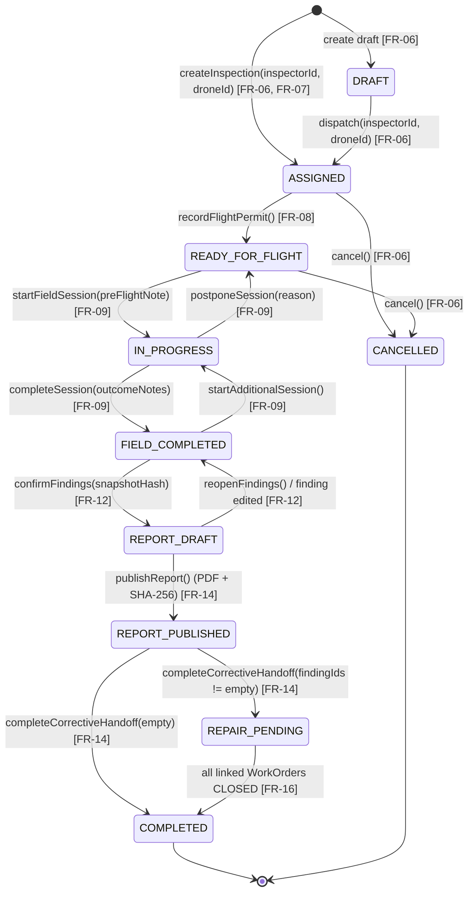
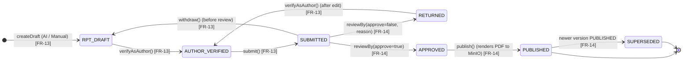
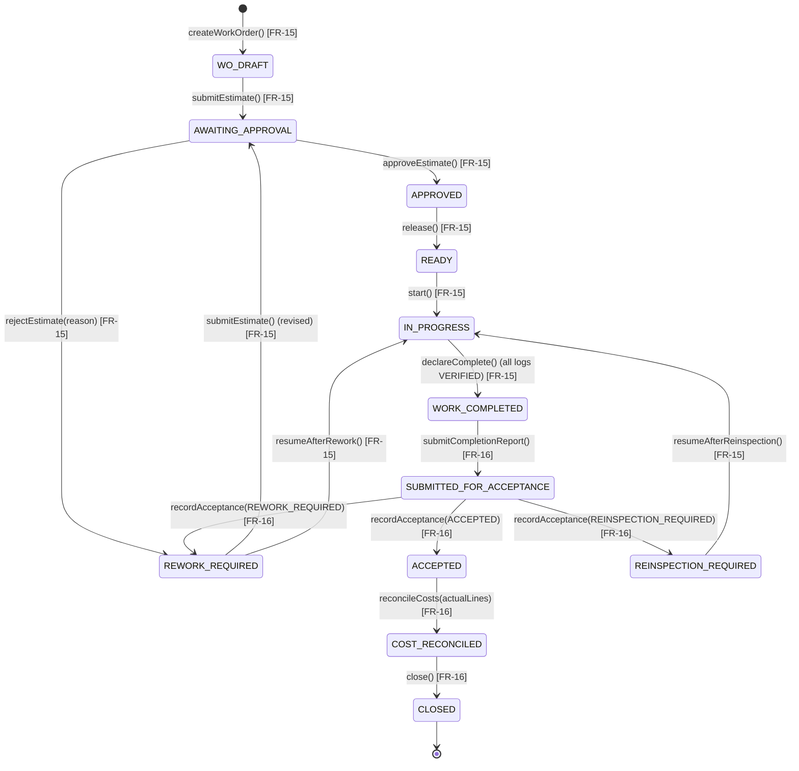

## 2. Database Design

The relational database architecture is implemented on PostgreSQL 17 with strict foreign key constraints, index-optimized tenant filtering, and cryptographic audit fields. The database schema encompasses 30 application tables (plus the `event_publication` transactional outbox) categorized across identity, assets and B2B drone leasing, inspection workflow, maintenance remediation, and cross-cutting infrastructure.

**Table Descriptions**

| No | Table | Description |
| :---: | :--- | :--- |
| 01 | `organizations` | Stores tenant enterprise companies subscribing to the platform. (`10` columns). - Primary keys: `id` (UUID) - Foreign keys: `created_by_user_id` references `users(id)` - Columns: `id` (uuid), `created_at` (timestamptz), `updated_at` (timestamptz), `legal_name` (varchar(250)), `display_name` (varchar(200)), `registration_code` (varchar(64)), `timezone` (varchar(64)), `status` (varchar(24)), `created_by_user_id` (uuid), `row_version` (bigint) |
| 02 | `users` | Stores system user accounts across `ADMIN`, `PLATFORM_MANAGER`, `ORG_MANAGER`, `INSPECTOR`, and `MAINTENANCE_ENGINEER`, account status (`ACTIVE`, `SUSPENDED`, `DISABLED`), and self-declared remote pilot license credentials. (`24` columns). - Primary keys: `id` (UUID) - Foreign keys: `organization_id` references `organizations(id)` - Columns: `id` (uuid), `email` (varchar(320)), `normalized_email` (varchar(320)), `full_name` (varchar(200)), `password_hash` (varchar(1024)), `status` (varchar(32)), `actor_zone` (varchar(32)), `organization_id` (uuid), `auth_version` (integer), `failed_login_count` (integer), `lockout_until` (timestamptz), `must_change_password` (boolean), `last_login_at` (timestamptz), `last_login_ip` (varchar(45)), `created_at` (timestamptz), `updated_at` (timestamptz), `vision_fallback_enabled` (boolean), `phone_number` (varchar(32)), `avatar_url` (varchar(500)), `roles` (varchar(255)), `pilot_license_number` (varchar(100)), `pilot_license_class` (varchar(16)), `pilot_license_expires_at` (timestamptz), `pilot_license_file_key` (varchar(1000)) |
| 03 | `auth_sessions` | Tracks active user login sessions (`WEB`, `MOBILE`), hashed refresh tokens, expiration timestamps, and revocation status. (`9` columns). - Primary keys: `id` (UUID) - Foreign keys: `user_id` references `users(id)` - Columns: `id` (uuid), `user_id` (uuid), `client_type` (varchar(16)), `token_hash` (varchar(64)), `previous_token_hash` (varchar(64)), `issued_at` (timestamptz), `expires_at` (timestamptz), `revoked_at` (timestamptz), `revoked_reason` (varchar(128)) |
| 04 | `subscriptions` | Tracks ENTERPRISE subscription contracts, billing periods (`1..120` months), agreed USD amounts, immutable contract terms snapshots, and lifecycle status (`PENDING`, `ACTIVE`, `PAST_DUE`, `SUSPENDED`, `EXPIRED`, `CANCELLED`). (`15` columns). - Primary keys: `id` (UUID) - Foreign keys: `confirmed_by_user_id` references `users(id)`, `organization_id` references `organizations(id)` - Columns: `id` (uuid), `organization_id` (uuid), `plan_code` (varchar(32)), `billing_period_months` (integer), `agreed_amount_usd` (numeric(12,2)), `status` (varchar(24)), `starts_at` (timestamptz), `ends_at` (timestamptz), `external_reference` (varchar(128)), `terms_snapshot` (jsonb), `confirmed_by_user_id` (uuid), `confirmed_at` (timestamptz), `created_at` (timestamptz), `updated_at` (timestamptz), `row_version` (bigint) |
| 05 | `payment_transactions` | Records PayPal Orders v2 checkout and capture transactions linked to enterprise subscriptions (`PENDING`, `COMPLETED`, `FAILED`, `REFUNDED`). (`12` columns). - Primary keys: `id` (UUID) - Foreign keys: `subscription_id` references `subscriptions(id)` - Columns: `id` (uuid), `subscription_id` (uuid), `paypal_order_id` (varchar(64)), `paypal_capture_id` (varchar(64)), `amount` (numeric(12,2)), `currency` (varchar(3)), `status` (varchar(24)), `payer_email` (varchar(255)), `captured_at` (timestamptz), `created_at` (timestamptz), `updated_at` (timestamptz), `row_version` (bigint) |
| 06 | `platform_drones` | Platform-owned serial-numbered leasable drone pool managed by `PLATFORM_MANAGER` (`AVAILABLE`, `LEASED`, `MAINTENANCE`, `RETIRED`). (`11` columns). - Primary keys: `id` (UUID) - Foreign keys: None - Columns: `id` (uuid), `serial_number` (varchar(128)), `model` (varchar(200)), `manufacturer` (varchar(200)), `payload_metadata` (jsonb), `monthly_rate_usd` (numeric(12,2)), `status` (varchar(24)), `notes` (varchar(2000)), `created_at` (timestamptz), `updated_at` (timestamptz), `row_version` (bigint) |
| 07 | `drone_leases` | B2B drone lease contracts between the platform and a customer organization (`PENDING`, `ACTIVE`, `RECLAIMED`, `CANCELLED`) with wire/PayPal settlement and customer fleet provisioning. (`21` columns). - Primary keys: `id` (UUID) - Foreign keys: `platform_drone_id` references `platform_drones(id)`, `organization_id` references `organizations(id)`, `customer_drone_id` references `drones(id)`, `requested_by_user_id` references `users(id)`, `confirmed_by_user_id` references `users(id)` - Columns: `id` (uuid), `platform_drone_id` (uuid), `organization_id` (uuid), `customer_drone_id` (uuid), `requested_by_user_id` (uuid), `lease_period_months` (integer), `monthly_rate_usd` (numeric(12,2)), `agreed_amount_usd` (numeric(12,2)), `status` (varchar(24)), `starts_at` (timestamptz), `ends_at` (timestamptz), `reclaimed_at` (timestamptz), `external_reference` (varchar(128)), `paypal_order_id` (varchar(64)), `paypal_capture_id` (varchar(64)), `confirmed_by_user_id` (uuid), `confirmed_at` (timestamptz), `notes` (varchar(2000)), `created_at` (timestamptz), `updated_at` (timestamptz), `row_version` (bigint) |
| 08 | `drones` | Catalogs customer organization drone aircraft (`OWNED` or `LEASED`), hardware serial numbers, payload metadata, serviceability status (`ACTIVE`, `MAINTENANCE`, `SUSPENDED`, `RETIRED`), and CAAV registration metadata. (`19` columns). - Primary keys: `id` (UUID) - Foreign keys: `organization_id` references `organizations(id)`, `lease_id` references `drone_leases(id)` - Columns: `id` (uuid), `organization_id` (uuid), `serial_number` (varchar(128)), `model` (varchar(200)), `manufacturer` (varchar(200)), `payload_metadata` (jsonb), `serviceability` (varchar(24)), `last_maintenance_at` (timestamptz), `next_maintenance_at` (timestamptz), `notes` (varchar(2000)), `registration_number` (varchar(100)), `registration_file_key` (varchar(1000)), `registration_expires_at` (timestamptz), `created_at` (timestamptz), `updated_at` (timestamptz), `row_version` (bigint), `ownership_type` (varchar(24)), `lease_id` (uuid), `lease_expires_at` (timestamptz) |
| 09 | `asset_categories` | Global structural categorization catalog for infrastructure assets managed by `ADMIN`. (`8` columns). - Primary keys: `id` (UUID) - Foreign keys: None - Columns: `id` (uuid), `code` (varchar(64)), `name` (varchar(160)), `description` (varchar(2000)), `active` (boolean), `created_at` (timestamptz), `updated_at` (timestamptz), `row_version` (bigint) |
| 10 | `assets` | Manages physical infrastructure assets (`ACTIVE`, `INACTIVE`, `RETIRED`), GPS coordinates, and `inspection_items` (`jsonb` array of standardized structural checkpoints). (`15` columns). - Primary keys: `id` (UUID) - Foreign keys: `category_id` references `asset_categories(id)`, `organization_id` references `organizations(id)` - Columns: `id` (uuid), `organization_id` (uuid), `category_id` (uuid), `name` (varchar(200)), `description` (varchar(2000)), `latitude` (numeric(9,6)), `longitude` (numeric(9,6)), `status` (varchar(24)), `created_at` (timestamptz), `updated_at` (timestamptz), `row_version` (bigint), `asset_code` (varchar(64)), `location` (jsonb), `technical_profile` (jsonb), `inspection_items` (jsonb) |
| 11 | `asset_documents` | Engineering schematics, structural drawings, and technical specifications attached to an asset with 64-character SHA-256 deduplication. (`11` columns). - Primary keys: `id` (UUID) - Foreign keys: `asset_id` references `assets(id)`, `uploaded_by_user_id` references `users(id)` - Columns: `id` (uuid), `asset_id` (uuid), `uploaded_by_user_id` (uuid), `document_type` (varchar(32)), `file_name` (varchar(500)), `content_type` (varchar(160)), `size_bytes` (bigint), `checksum_sha256` (char(64)), `object_key` (varchar(1000)), `document_date` (date), `created_at` (timestamptz) |
| 12 | `inspections` | Core inspection mission table tracking scheduled time windows, direct Inspector and Drone assignment, optional `recurring_schedule_id`, self-service flight permit attributes, and 10-state lifecycle status. (`17` columns). - Primary keys: `id` (UUID) - Foreign keys: `asset_id` references `assets(id)`, `drone_id` references `drones(id)`, `inspector_id` references `users(id)`, `organization_id` references `organizations(id)`, `recurring_schedule_id` references `recurring_inspection_schedules(id)` - Columns: `id` (uuid), `asset_id` (uuid), `status` (varchar(32)), `created_at` (timestamptz), `updated_at` (timestamptz), `row_version` (bigint), `organization_id` (uuid), `planned_start_at` (timestamptz), `planned_end_at` (timestamptz), `inspector_id` (uuid), `drone_id` (uuid), `flight_permit_file_key` (varchar(1000)), `flight_permit_file_name` (varchar(500)), `flight_permit_uploaded_at` (timestamptz), `findings_confirmed_at` (timestamptz), `findings_snapshot_hash` (varchar(64)), `recurring_schedule_id` (uuid) |
| 13 | `recurring_inspection_schedules` | Periodic inspection recurrence rules per asset with timezone-anchored cadence (`WEEK`, `MONTH`, `YEAR`), default Inspector/Drone, duration, reminder lead days, and status (`ACTIVE`, `PAUSED`, `ENDED`). (`18` columns). - Primary keys: `id` (UUID) - Foreign keys: `organization_id` references `organizations(id)`, `asset_id` references `assets(id)`, `created_by_user_id` references `users(id)`, `inspector_id` references `users(id)`, `drone_id` references `drones(id)` - Columns: `id` (uuid), `organization_id` (uuid), `asset_id` (uuid), `created_by_user_id` (uuid), `inspector_id` (uuid), `drone_id` (uuid), `anchor_date` (timestamp without time zone), `timezone` (varchar(64)), `recurrence_unit` (varchar(16)), `recurrence_interval` (integer), `duration_seconds` (bigint), `reminder_days` (integer), `ends_at` (timestamptz), `next_occurrence` (bigint), `status` (varchar(32)), `created_at` (timestamptz), `updated_at` (timestamptz), `row_version` (bigint) |
| 14 | `schedule_occurrences` | Individual `GENERATED`, `BLOCKED`, or `SKIPPED` recurring schedule occurrences linked to dispatched `inspections`. (`15` columns). - Primary keys: `id` (UUID) - Foreign keys: `schedule_id` references `recurring_inspection_schedules(id)`, `organization_id` references `organizations(id)`, `inspection_id` references `inspections(id)` - Columns: `id` (uuid), `schedule_id` (uuid), `organization_id` (uuid), `occurrence_index` (bigint), `occurrence_key` (varchar(64)), `planned_start_at` (timestamptz), `planned_end_at` (timestamptz), `status` (varchar(32)), `inspection_id` (uuid), `blocked_reason` (varchar(1000)), `retry_count` (integer), `reminder_sent_at` (timestamptz), `created_at` (timestamptz), `updated_at` (timestamptz), `row_version` (bigint) |
| 15 | `field_sessions` | Records individual on-site flight survey sessions, pre-flight safety checklist notes, and operational outcomes (`PLANNED`, `IN_PROGRESS`, `FIELD_COMPLETED`, `POSTPONED`, `ABORTED`). (`12` columns). - Primary keys: `id` (UUID) - Foreign keys: `inspection_id` references `inspections(id)` - Columns: `id` (uuid), `inspection_id` (uuid), `status` (varchar(24)), `started_at` (timestamptz), `ended_at` (timestamptz), `postponement_reason` (varchar(2000)), `abort_reason` (varchar(2000)), `created_at` (timestamptz), `updated_at` (timestamptz), `row_version` (bigint), `pre_flight_checklist_note` (varchar(2000)), `outcome_notes` (varchar(4000)) |
| 16 | `evidence` | Digital media captures collected during inspection field sessions with MinIO object keys, EXIF capture timestamps, GPS coordinates, location descriptions, and soft-delete flag (`is_deleted`). (`13` columns). - Primary keys: `id` (UUID) - Foreign keys: `field_session_id` references `field_sessions(id)`, `inspection_id` references `inspections(id)` - Columns: `id` (uuid), `inspection_id` (uuid), `field_session_id` (uuid), `file_name` (varchar(500)), `content_type` (varchar(160)), `size_bytes` (bigint), `object_key` (varchar(1000)), `capture_time` (timestamptz), `latitude` (numeric(9,6)), `longitude` (numeric(9,6)), `location_description` (varchar(1000)), `is_deleted` (boolean), `created_at` (timestamptz) |
| 17 | `findings` | Unified defect findings table managing YOLO11 AI defect candidates (`PENDING`) and human-verified official findings (`CONFIRMED`) with bounding boxes and maintenance forwarding timestamps. (`15` columns). - Primary keys: `id` (UUID) - Foreign keys: `evidence_id` references `evidence(id)`, `inspection_id` references `inspections(id)` - Columns: `id` (uuid), `inspection_id` (uuid), `evidence_id` (uuid), `finding_code` (varchar(64)), `defect_label` (varchar(160)), `severity` (varchar(16)), `bounding_box` (jsonb), `technical_notes` (varchar(4000)), `recommended_action` (varchar(4000)), `status` (varchar(24)), `model_name` (varchar(160)), `confidence` (numeric(6,5)), `forwarded_to_maintenance_at` (timestamptz), `is_deleted` (boolean), `created_at` (timestamptz) |
| 18 | `inspection_reports` | Versioned inspection report deliverables (`DRAFT`, `AUTHOR_VERIFIED`, `SUBMITTED`, `RETURNED`, `APPROVED`, `PUBLISHED`, `SUPERSEDED`), review gates, rendered PDF object keys, and SHA-256 checksums. (`13` columns). - Primary keys: `id` (UUID) - Foreign keys: `reviewer_user_id` references `users(id)`, `inspection_id` references `inspections(id)` - Columns: `id` (uuid), `inspection_id` (uuid), `version_no` (integer), `status` (varchar(32)), `content_snapshot` (jsonb), `submitted_at` (timestamptz), `reviewer_user_id` (uuid), `reviewed_at` (timestamptz), `return_reason` (varchar(2000)), `rendered_object_key` (varchar(1000)), `rendered_checksum_sha256` (char(64)), `published_at` (timestamptz), `created_at` (timestamptz) |
| 19 | `maintenance_work_orders` | Remediation projects initiated from confirmed inspection findings, tracking corrective scope, acceptance criteria, team role assignments, and 12-state lifecycle status. (`18` columns). - Primary keys: `id` (UUID) - Foreign keys: `asset_id` references `assets(id)`, `accepting_reviewer_user_id` references `users(id)`, `budget_approver_user_id` references `users(id)`, `organization_id` references `organizations(id)`, `owner_user_id` references `users(id)`, `report_author_user_id` references `users(id)`, `source_finding_id` references `findings(id)`, `source_report_version_id` references `inspection_reports(id)`, `team_lead_user_id` references `users(id)` - Columns: `id` (uuid), `organization_id` (uuid), `asset_id` (uuid), `source_report_version_id` (uuid), `source_finding_id` (uuid), `status` (varchar(32)), `priority` (varchar(24)), `due_at` (timestamptz), `corrective_scope` (varchar(4000)), `acceptance_criteria` (varchar(4000)), `owner_user_id` (uuid), `budget_approver_user_id` (uuid), `team_lead_user_id` (uuid), `report_author_user_id` (uuid), `accepting_reviewer_user_id` (uuid), `created_at` (timestamptz), `updated_at` (timestamptz), `row_version` (bigint) |
| 20 | `maintenance_team_members` | Engineering team members allocated to a maintenance work order (`LEAD`, `REPORT_AUTHOR`, `MEMBER`) with partial unique indexes on active leadership roles. (`10` columns). - Primary keys: `id` (UUID) - Foreign keys: `assigned_by_user_id` references `users(id)`, `engineer_user_id` references `users(id)`, `work_order_id` references `maintenance_work_orders(id)` - Columns: `id` (uuid), `work_order_id` (uuid), `engineer_user_id` (uuid), `member_role` (varchar(24)), `effective_from` (timestamptz), `effective_until` (timestamptz), `assigned_by_user_id` (uuid), `reason` (varchar(2000)), `active` (boolean), `created_at` (timestamptz) |
| 21 | `maintenance_tasks` | Decomposed repair tasks (`PLANNED`, `READY`, `IN_PROGRESS`, `PAUSED_FOR_CHANGE`, `WORK_COMPLETED`, `REWORK_REQUIRED`, `ACCEPTED`, `CANCELLED`) with technical methods and assigned engineers. (`13` columns). - Primary keys: `id` (UUID) - Foreign keys: `assigned_engineer_user_id` references `users(id)`, `work_order_id` references `maintenance_work_orders(id)` - Columns: `id` (uuid), `work_order_id` (uuid), `task_number` (integer), `name` (varchar(300)), `method` (varchar(4000)), `assigned_engineer_user_id` (uuid), `planned_start_at` (timestamptz), `planned_end_at` (timestamptz), `acceptance_criteria` (varchar(4000)), `status` (varchar(24)), `created_at` (timestamptz), `updated_at` (timestamptz), `row_version` (bigint) |
| 22 | `maintenance_estimate_versions` | Versioned financial projection baselines (`DRAFT`, `SUBMITTED`, `APPROVED`, `REJECTED`, `SUPERSEDED`) for labor, materials, equipment, and services. (`11` columns). - Primary keys: `id` (UUID) - Foreign keys: `approved_by_user_id` references `users(id)`, `prepared_by_user_id` references `users(id)`, `work_order_id` references `maintenance_work_orders(id)` - Columns: `id` (uuid), `work_order_id` (uuid), `version_no` (integer), `status` (varchar(24)), `prepared_by_user_id` (uuid), `approved_by_user_id` (uuid), `approved_at` (timestamptz), `currency` (char(3)), `baseline_total` (numeric(18,2)), `assumptions` (varchar(4000)), `created_at` (timestamptz) |
| 23 | `maintenance_cost_lines` | Individual itemized cost rows (`LABOR`, `MATERIAL`, `EQUIPMENT`, `SERVICE`) within an `ESTIMATE` baseline or `ACTUAL` expenditure reconciliation. (`14` columns). - Primary keys: `id` (UUID) - Foreign keys: `entered_by_user_id` references `users(id)`, `estimate_version_id` references `maintenance_estimate_versions(id)`, `task_id` references `maintenance_tasks(id)`, `work_order_id` references `maintenance_work_orders(id)` - Columns: `id` (uuid), `work_order_id` (uuid), `estimate_version_id` (uuid), `task_id` (uuid), `line_kind` (varchar(24)), `state` (varchar(24)), `description` (varchar(1000)), `quantity` (numeric(18,6)), `unit` (varchar(48)), `unit_rate` (numeric(18,6)), `amount` (numeric(18,2)), `currency` (char(3)), `entered_by_user_id` (uuid), `created_at` (timestamptz) |
| 24 | `maintenance_change_orders` | Formal variance requests (`DRAFT`, `AWAITING_APPROVAL`, `APPROVED`, `REJECTED`, `RETURNED`, `SUPERSEDED`) adjusting repair scope or budget ceiling. (`13` columns). - Primary keys: `id` (UUID) - Foreign keys: `decided_by_user_id` references `users(id)`, `requested_by_user_id` references `users(id)`, `work_order_id` references `maintenance_work_orders(id)` - Columns: `id` (uuid), `work_order_id` (uuid), `change_number` (integer), `reason` (varchar(2000)), `proposed_delta` (numeric(18,2)), `status` (varchar(24)), `requested_by_user_id` (uuid), `decided_by_user_id` (uuid), `decided_at` (timestamptz), `decision_reason` (varchar(2000)), `created_at` (timestamptz), `updated_at` (timestamptz), `row_version` (bigint) |
| 25 | `maintenance_work_logs` | Execution entries (`IN_PROGRESS`, `PAUSED_FOR_CHANGE`, `SUBMITTED`, `VERIFIED`) logging task labor hours, as-left conditions, and test readings. (`13` columns). - Primary keys: `id` (UUID) - Foreign keys: `task_id` references `maintenance_tasks(id)`, `engineer_user_id` references `users(id)`, `work_order_id` references `maintenance_work_orders(id)` - Columns: `id` (uuid), `work_order_id` (uuid), `task_id` (uuid), `engineer_user_id` (uuid), `started_at` (timestamptz), `ended_at` (timestamptz), `hours` (numeric(18,6)), `as_left_condition` (varchar(4000)), `test_readings` (varchar(4000)), `status` (varchar(24)), `created_at` (timestamptz), `updated_at` (timestamptz), `row_version` (bigint) |
| 26 | `maintenance_reports` | Versioned maintenance completion deliverables (`DRAFT`, `AUTHOR_VERIFIED`, `SUBMITTED`, `RETURNED`, `APPROVED`, `SUPERSEDED`) verified by the Report Author and rendered to PDF. (`9` columns). - Primary keys: `id` (UUID) - Foreign keys: `work_order_id` references `maintenance_work_orders(id)` - Columns: `id` (uuid), `work_order_id` (uuid), `version_no` (integer), `status` (varchar(32)), `author_verified_at` (timestamptz), `content_snapshot` (text), `rendered_object_key` (varchar(1000)), `rendered_checksum_sha256` (char(64)), `created_at` (timestamptz) |
| 27 | `maintenance_acceptance_decisions` | Formal independent technical acceptance records (`ACCEPTED`, `REWORK_REQUIRED`, `REINSPECTION_REQUIRED`) evaluating repair completion. (`9` columns). - Primary keys: `id` (UUID) - Foreign keys: `report_version_id` references `maintenance_reports(id)`, `reviewer_user_id` references `users(id)`, `work_order_id` references `maintenance_work_orders(id)` - Columns: `id` (uuid), `work_order_id` (uuid), `report_version_id` (uuid), `reviewer_user_id` (uuid), `decision` (varchar(32)), `technical_comments` (varchar(4000)), `acceptance_checklist` (varchar(4000)), `test_result` (varchar(4000)), `decided_at` (timestamptz) |
| 28 | `repair_knowledge_chunks` | Civil and structural engineering repair standard chunks (`TCVN`, `EN`, `ISO`, `ASTM`) and 1536-dim `pgvector` embeddings supporting RAG scope suggestions. (`9` columns including `embedding vector(1536)`). - Primary keys: `id` (UUID) - Foreign keys: None - Columns: `id` (UUID), `standard_code` (VARCHAR(64)), `title` (VARCHAR(255)), `category` (VARCHAR(64)), `defect_patterns` (VARCHAR(255)), `content` (TEXT), `reference_url` (VARCHAR(500)), `created_at` (TIMESTAMPTZ) |
| 29 | `notifications` | Operational alerts and deduplicated in-app notifications (`SENT`, `READ`, `FAILED`) delivered to system users. (`17` columns). - Primary keys: `id` (UUID) - Foreign keys: `organization_id` references `organizations(id)`, `recipient_user_id` references `users(id)` - Columns: `id` (uuid), `recipient_user_id` (uuid), `organization_id` (uuid), `event_type` (varchar(96)), `channel` (varchar(16)), `title` (varchar(300)), `body` (varchar(4000)), `target_path` (varchar(1000)), `status` (varchar(24)), `attempt_count` (integer), `last_error_code` (varchar(96)), `sent_at` (timestamptz), `read_at` (timestamptz), `created_at` (timestamptz), `aggregate_type` (varchar(128)), `aggregate_id` (uuid), `deduplication_key` (varchar(192)) |
| 30 | `audit_events` | Append-only security audit trail recording consequential domain transitions and access events. (`13` columns). - Primary keys: `id` (UUID) - Foreign keys: `actor_user_id` references `users(id)`, `organization_id` references `organizations(id)` - Columns: `id` (uuid), `organization_id` (uuid), `actor_user_id` (uuid), `action` (varchar(128)), `aggregate_type` (varchar(128)), `aggregate_id` (uuid), `before_status` (varchar(64)), `after_status` (varchar(64)), `aggregate_version` (bigint), `reason` (varchar(2000)), `trace_id` (varchar(128)), `safe_metadata` (jsonb), `created_at` (timestamptz) |
| 31 | `event_publication` | Spring Modulith transactional outbox table for reliable asynchronous domain event delivery. (`9` columns). - Primary keys: `id` (UUID) - Foreign keys: None - Columns: `id` (uuid), `listener_id` (text), `event_type` (text), `serialized_event` (text), `publication_date` (timestamptz), `completion_date` (timestamptz), `status` (text), `completion_attempts` (integer), `last_resubmission_date` (timestamptz) |

---

**Main Domain Entity State Machine Diagrams (Review 2 Mandatory Lifecycle Specification)**

Every main lifecycle entity in `SmartDroneInspection-backend` is governed by an explicit Java enum state machine with guarded domain methods. All states used in code, their triggering Functional Requirements (`FR-01`–`FR-17`), and terminal exit states are modeled below.

**1. Enterprise Subscription & B2B Drone Lease State Machines (`Subscription.Status`, `DroneLeaseStatus`, `PlatformDroneStatus`)**

| Entity & Status Enum | State Values | Triggering FR & API / Domain Method | Guard & Coupled Side Effects |
| --- | --- | --- | --- |
| `Subscription` (`Subscription.Status`) | `PENDING`, `ACTIVE`, `PAST_DUE`, `SUSPENDED`, `EXPIRED`, `CANCELLED` | `FR-03`: `POST /api/v1/subscriptions` (`PENDING`); `POST /api/v1/platform/subscriptions/{id}/confirm-payment` or `/paypal/capture-order` (`ACTIVE`); renewal/expiry (`EXPIRED`, `CANCELLED`). | Partial unique index `uq_subscriptions_active_organization` guarantees at most one `ACTIVE` subscription per tenant; activating a new term expires any prior active term. |
| `DroneLease` (`DroneLeaseStatus`) & `PlatformDrone` (`PlatformDroneStatus`) | Lease: `PENDING`, `ACTIVE`, `RECLAIMED`, `CANCELLED`. Pool: `AVAILABLE`, `LEASED`, `MAINTENANCE`, `RETIRED` | `FR-05`: `POST /api/v1/drone-leases` (`PENDING`); `POST /api/v1/platform/drone-leases/{id}/confirm-payment` or `/paypal/capture-order` (`ACTIVE`); `POST /reclaim` (`RECLAIMED`). | Lease activation requires `PlatformDrone` in `AVAILABLE` (transitions to `LEASED`) and auto-provisions customer `Drone` (`ownershipType=LEASED`, `serviceability=ACTIVE`). Reclaim retires customer `Drone` (`RETIRED`) and returns pool drone to `AVAILABLE`. |
| `Asset` (`AssetStatus`) & `Drone` (`DroneServiceability`) | Asset: `ACTIVE`, `INACTIVE`, `RETIRED`. Drone: `ACTIVE`, `MAINTENANCE`, `SUSPENDED`, `RETIRED` | `FR-04`, `FR-05`: `POST /api/v1/assets`, `POST /api/v1/assets/{id}/retire`, `PATCH /api/v1/drones/{id}/serviceability`. | `RETIRED` is terminal for `Asset` (`ensureNotRetired()`) and owned `Drone`s; only `ACTIVE` assets and `ACTIVE` drones can be scheduled in `FR-06`/`FR-07`. |
| `RecurringInspectionSchedule`, `ScheduleOccurrence` & `Notification` | Schedule: `ACTIVE`, `PAUSED`, `ENDED`. Occurrence: `GENERATED`, `BLOCKED`, `SKIPPED`. Notification: `SENT`, `READ`, `FAILED` | `FE-04`: `POST /api/v1/inspection-schedules` (`ACTIVE`), `/pause` (`PAUSED`), `/resume` (`ACTIVE`), `/end` (`ENDED`); occurrence `/retry` (`BLOCKED -> GENERATED`), `/skip` (`BLOCKED -> SKIPPED`); `PATCH /api/v1/notifications/{id}/read` (`SENT -> READ`). | `ENDED` and `SKIPPED` are terminal. `GENERATED` links `inspection_id` to a newly created `ASSIGNED` `Inspection`. |

**2. Inspection, FieldSession, Finding & InspectionReport State Machines (`InspectionStatus`, `FindingStatus`, `ReportStatus`)**

| Entity & Status Enum | State Values | Triggering FR & API / Domain Method | Guard & Coupled Side Effects |
| --- | --- | --- | --- |
| `Inspection` (`InspectionStatus`) | `DRAFT`, `ASSIGNED`, `READY_FOR_FLIGHT`, `IN_PROGRESS`, `FIELD_COMPLETED`, `REPORT_DRAFT`, `REPORT_PUBLISHED`, `REPAIR_PENDING`, `COMPLETED`, `CANCELLED` | `FR-06`–`FR-14`: `POST /inspections` (`ASSIGNED`), `POST /flight-permit` (`READY_FOR_FLIGHT`), `POST /field-sessions` (`IN_PROGRESS`), `POST /completion` (`FIELD_COMPLETED`), `POST /findings/confirm` (`REPORT_DRAFT`), `POST /report/versions/{v}/publish` (`REPORT_PUBLISHED`), `POST /report/corrective-handoff` (`REPAIR_PENDING` or `COMPLETED`). | Self-service permit gate checks `pilot_license_expires_at >= planned_start_at`. Findings confirmation hashes active `CONFIRMED` findings (`findings_snapshot_hash`); any finding edit prior to submission reverts `REPORT_DRAFT -> FIELD_COMPLETED`. |
| `FieldSession` (`FieldSession.status`) | `PLANNED`, `IN_PROGRESS`, `POSTPONED`, `ABORTED`, `FIELD_COMPLETED` | `FR-09`: `POST /field-sessions` (`IN_PROGRESS`), `/postponement` (`POSTPONED`), `/abort` (`ABORTED`), `/completion` (`FIELD_COMPLETED`). | Requires non-blank `pre_flight_checklist_note` to start and `outcome_notes` to complete; at most one `IN_PROGRESS` session per inspection. |
| `Finding` (`FindingStatus`) | `PENDING`, `CONFIRMED` (plus soft-delete `is_deleted`) | `FR-11`, `FR-12`: `POST /analyze` (`PENDING`), `POST /findings` (`PENDING`), `POST /findings/{id}/confirmation` (`CONFIRMED`), `DELETE /findings/{id}` (`is_deleted=true`), `POST /restore` (`is_deleted=false`). | All `PENDING` AI proposals must be confirmed or soft-deleted before `confirmFindings()` can transition `Inspection` to `REPORT_DRAFT`. |
| `InspectionReport` (`ReportStatus`) | `DRAFT`, `AUTHOR_VERIFIED`, `SUBMITTED`, `RETURNED`, `APPROVED`, `PUBLISHED`, `SUPERSEDED` | `FR-13`, `FR-14`: `POST /report/draft` (`DRAFT`), `/verify` (`AUTHOR_VERIFIED`), `/submit` (`SUBMITTED`), `/withdraw` (`DRAFT`), `/review` (`APPROVED` or `RETURNED`), `/publish` (`PUBLISHED`). | Reviewer (`ORG_MANAGER`) must not equal `inspections.inspector_id`. While `SUBMITTED`, evidence/findings are locked; `PUBLISHED` and `SUPERSEDED` are immutable. |

**3. Maintenance Work Order & Sub-Entity State Machines (`WorkOrderStatus`, `EstimateStatus`, `WorkLogStatus`, `ChangeOrderStatus`, `ReportVersionStatus`)**

| Entity & Status Enum | State Values | Triggering FR & API / Domain Method | Guard & Coupled Side Effects |
| --- | --- | --- | --- |
| `MaintenanceWorkOrder` (`WorkOrderStatus`) | `DRAFT`, `AWAITING_APPROVAL`, `APPROVED`, `READY`, `IN_PROGRESS`, `WORK_COMPLETED`, `SUBMITTED_FOR_ACCEPTANCE`, `ACCEPTED`, `REWORK_REQUIRED`, `REINSPECTION_REQUIRED`, `COST_RECONCILED`, `CLOSED` | `FR-15`, `FR-16`: `/work-orders` (`DRAFT`), `/estimate-versions/{v}/submit` (`AWAITING_APPROVAL`), `/approve` (`APPROVED`), `/release` (`READY`), `/start` (`IN_PROGRESS`), `/declare-complete` (`WORK_COMPLETED`), `/reports/{v}/submit` (`SUBMITTED_FOR_ACCEPTANCE`), `/acceptance-decisions` (`ACCEPTED` / `REWORK_REQUIRED` / `REINSPECTION_REQUIRED`), `/cost-reconciliation` (`COST_RECONCILED`), `/close` (`CLOSED`). | Enforces separation of duties: `budgetApproverUserId` and `acceptingReviewerUserId` must be `ORG_MANAGER`s outside the executing team (`LEAD`, `REPORT_AUTHOR`, `MEMBER`). `REINSPECTION_REQUIRED` publishes `ReinspectionRequestedEvent` to create a verification `Inspection`. |
| `MaintenanceEstimateVersion` (`EstimateStatus`) | `DRAFT`, `SUBMITTED`, `APPROVED`, `REJECTED`, `SUPERSEDED` | `FR-15`: `POST /estimate-versions` (`DRAFT`), `/submit` (`SUBMITTED`), `/approve` (`APPROVED`, prior becomes `SUPERSEDED`), `/reject` (`REJECTED`). | Approver (`ORG_MANAGER`) must not equal `preparedByUserId`. |
| `MaintenanceWorkLog` (`WorkLogStatus`) | `IN_PROGRESS`, `PAUSED_FOR_CHANGE`, `SUBMITTED`, `VERIFIED` | `FR-15`: `POST /work-logs` (`IN_PROGRESS`), pause/resume for change (`PAUSED_FOR_CHANGE`), `/submit` (`SUBMITTED`), `/verify` (`VERIFIED` by Team Lead). | All submitted work logs must be `VERIFIED` before `declareComplete()` can transition the work order to `WORK_COMPLETED`. |
| `MaintenanceChangeOrder` (`ChangeOrderStatus`) | `DRAFT`, `AWAITING_APPROVAL`, `APPROVED`, `REJECTED`, `RETURNED`, `SUPERSEDED` | `FR-15`: `POST /changes` (`AWAITING_APPROVAL`), `/approve` (`APPROVED`), `/reject` (`REJECTED`), `/return` (`RETURNED`). | Approved deltas adjust the effective budget ceiling during `cost-reconciliation` without mutating the baseline `MaintenanceEstimateVersion`. |
| `MaintenanceReportVersion` (`ReportVersionStatus`) | `DRAFT`, `AUTHOR_VERIFIED`, `SUBMITTED`, `RETURNED`, `APPROVED`, `SUPERSEDED` | `FR-16`: `POST /reports` (`DRAFT`), `/verify` (`AUTHOR_VERIFIED`), `/submit` (`SUBMITTED`), `/acceptance-decisions` (`APPROVED` + PDF rendered to MinIO, or `RETURNED`). | Only the designated `reportAuthorUserId` can verify and submit; only the independent `acceptingReviewerUserId` can accept or return. |
