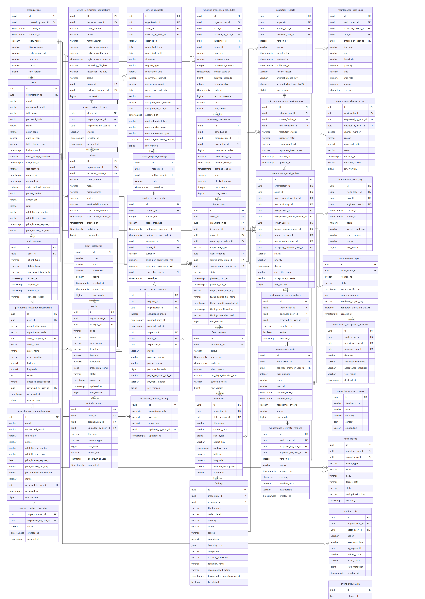
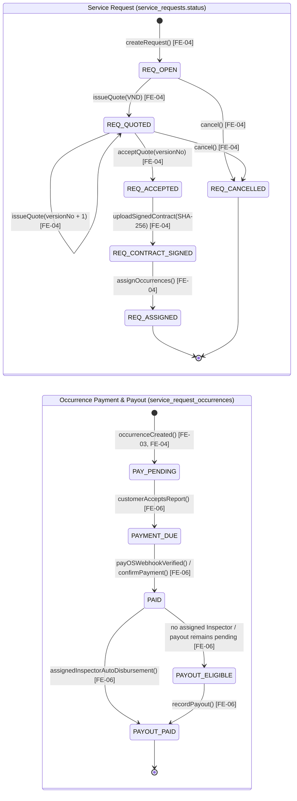
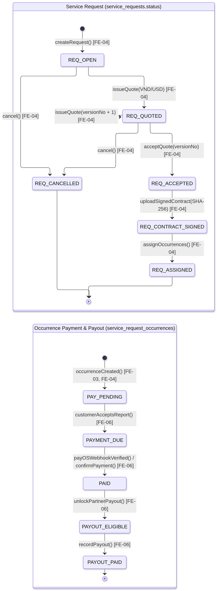
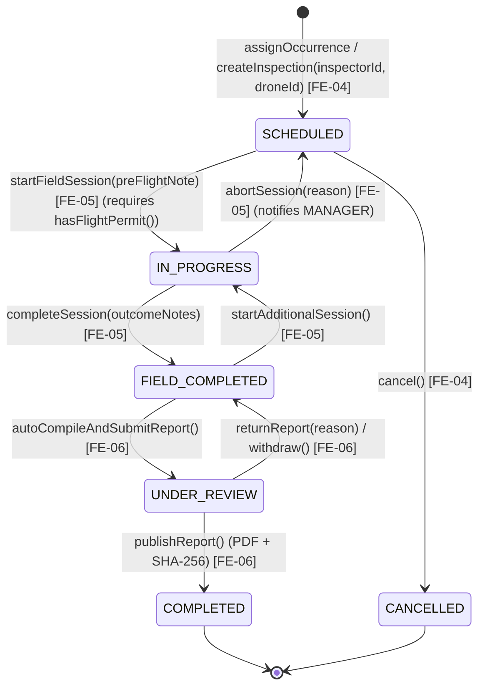
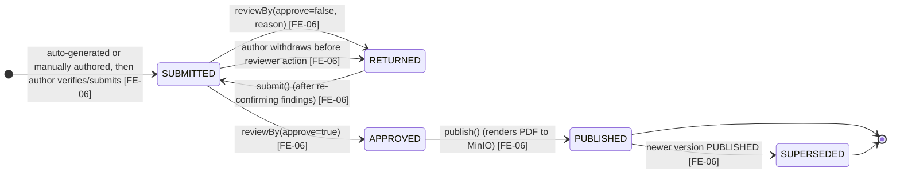
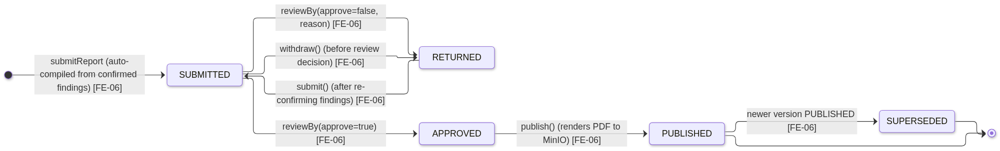
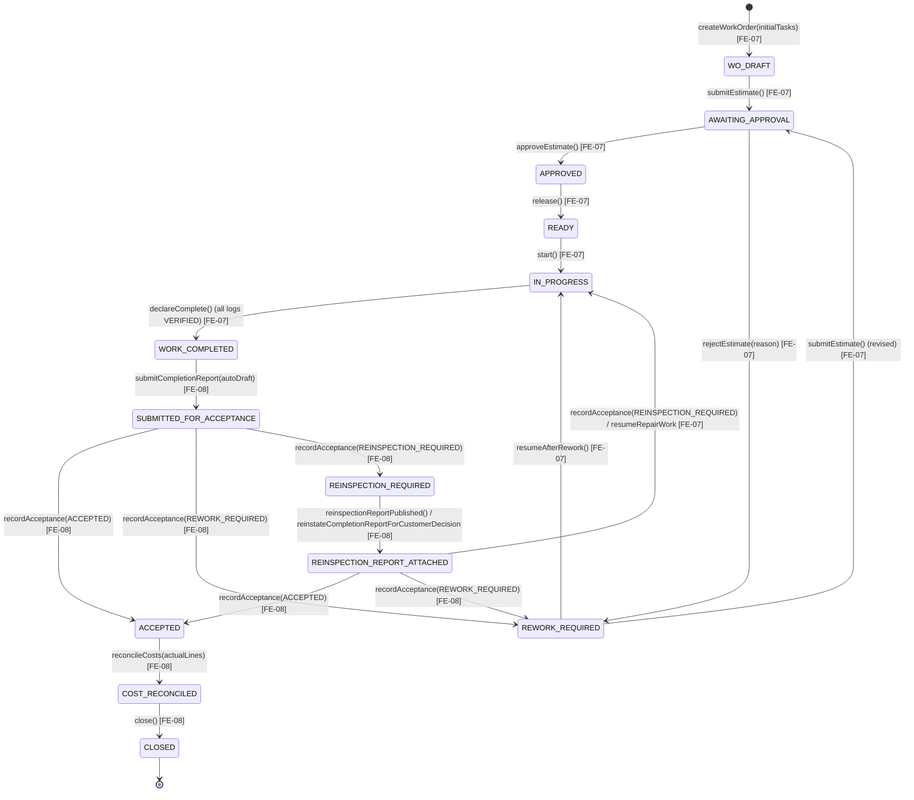

## 2. Database Design

The relational database architecture is implemented on PostgreSQL 17 (`pgvector`) with foreign key constraints, `ActorZone` validation, selected composite tenant foreign keys (including inspection-to-asset/drone/Inspector and work-order-to-asset relationships), optimistic concurrency control (`row_version`), and cryptographic `SHA-256` audit fields. The live backend schema is managed through Flyway migrations `V1`–`V25`; this section's table and column inventory is the V25 target schema after legacy subscription/PayPal billing, platform drone leasing, the internal recurring schedule engine, and obsolete partner-application storage were retired. V25 database execution has not yet been verified in this environment because Docker/Testcontainers was unavailable. It covers identity and onboarding (`MF1`), infrastructure assets and inspector-owned drones (`MF1`), commercial service requests, quotations, contracts and PayOS settlement (`MF2`), inspection execution and reporting (`MF3`), and RAG-assisted maintenance work orders and re-inspection verification (`MF4`), alongside cross-cutting notifications, audit logs, and the `event_publication` transactional outbox. `inspector_profiles` now owns Inspector-specific profile/license fields, and `otp_challenges` stores the LOGIN, REGISTRATION, and PASSWORD_RESET challenge purposes.

```mermaid
%% title: Database Entity Relationship Diagram (ERD)
erDiagram
  organizations ||--o{ users : employs
  users ||--o| prospective_customer_registrations : submits
  users ||--o| inspector_profiles : has_profile
  users |o--o{ otp_challenges : stores_login_challenges
  users ||--o{ inspector_flight_logs : owns_flight_log
  users |o--o{ inspector_flight_logs : records_flight_log
  organizations ||--o{ drones : org_owns
  users ||--o{ drones : inspector_owns
  users ||--o{ drone_registration_applications : submits
  drones |o--o{ drone_registration_applications : provisions
  users ||--o{ inspection_finance_settings : configures
  organizations ||--o{ assets : owns
  asset_categories ||--o{ assets : categorizes
  assets ||--o{ asset_documents : attaches
  organizations ||--o{ service_requests : requests
  assets ||--o{ service_requests : targets
  service_requests ||--o{ service_request_messages : discusses
  service_requests ||--o{ service_request_quotes : versions
  service_requests ||--o{ service_request_occurrences : materializes
  service_request_occurrences |o--o| inspections : dispatches
  organizations ||--o{ audit_events : records
  organizations ||--o{ notifications : scopes
  users ||--o{ notifications : receives
  users ||--o{ auth_sessions : opens
  organizations ||--o{ inspections : owns
  assets ||--o{ inspections : undergoes
  users ||--o{ inspections : assigned_inspector
  drones ||--o{ inspections : assigned_drone
  inspections ||--o{ field_sessions : executes
  inspections ||--o{ evidence : contains
  field_sessions ||--o{ evidence : captures
  inspections ||--o{ findings : records
  evidence ||--o{ findings : locates
  inspections ||--o{ inspection_reports : delivers
  inspections ||--o{ reinspection_defect_verifications : verifies
  findings ||--o{ reinspection_defect_verifications : baseline_defect
  evidence |o--o{ reinspection_defect_verifications : recapture_proof
  organizations ||--o{ maintenance_work_orders : owns
  assets ||--o{ maintenance_work_orders : remediates
  users ||--o{ maintenance_work_orders : owns_work_order
  users ||--o{ maintenance_work_orders : approves_budget
  users ||--o{ maintenance_work_orders : leads_team
  users ||--o{ maintenance_work_orders : authors_completion_report
  users ||--o{ maintenance_work_orders : accepts_completion
  findings ||--o{ maintenance_work_orders : initiates
  inspection_reports ||--o{ maintenance_work_orders : references
  inspections |o--o{ maintenance_work_orders : reinspects
  maintenance_work_orders ||--o{ maintenance_team_members : deploys
  maintenance_work_orders ||--o{ maintenance_tasks : deconstructs
  maintenance_work_orders ||--o{ maintenance_estimate_versions : projects
  maintenance_estimate_versions ||--o{ maintenance_cost_lines : itemizes
  maintenance_tasks ||--o{ maintenance_cost_lines : accrues
  maintenance_work_orders ||--o{ maintenance_change_orders : requests
  maintenance_tasks ||--o{ maintenance_work_logs : tracks
  maintenance_work_orders ||--o{ maintenance_reports : delivers
  maintenance_reports ||--o{ maintenance_acceptance_decisions : accepts
  organizations {
    uuid id PK
    timestamptz created_at
    timestamptz updated_at
    varchar display_name
    varchar registration_code
    varchar status
  }
  users {
    uuid id PK
    uuid organization_id FK
    varchar email
    varchar normalized_email
    varchar full_name
    varchar password_hash
    varchar status
    varchar actor_zone
    integer auth_version
    integer failed_login_count
    timestamptz lockout_until
    boolean must_change_password
    boolean otp_verified
    timestamptz created_at
    timestamptz updated_at
    boolean vision_fallback_enabled
    varchar phone_number
    text avatar_url
    varchar roles
  }
  inspector_profiles {
    uuid user_id PK, FK
    varchar pilot_license_number
    varchar pilot_license_class
    timestamptz pilot_license_expires_at
    varchar pilot_license_file_key
    date pilot_license_issued_date
    varchar pilot_license_authority
    varchar citizen_id
    date date_of_birth
    varchar address
    numeric prior_flight_hours
    varchar certified_drone_models
    varchar specializations
    text experience_summary
    text notes
    timestamptz updated_at
  }
  otp_challenges {
    uuid id PK
    varchar purpose
    varchar challenge_hash
    uuid user_id FK nullable
    varchar destination
    varchar channel
    varchar client_ip
    varchar code_hash
    timestamptz code_expires_at
    timestamptz expires_at
    timestamptz consumed_at
    integer failed_attempts
    integer send_count
    timestamptz last_sent_at
    timestamptz created_at
    bigint row_version
  }
  inspector_flight_logs {
    uuid id PK
    uuid inspector_user_id FK
    varchar flight_code
    date flight_date
    varchar mission_title
    varchar drone_model
    varchar drone_serial_number
    varchar location
    integer flight_duration_minutes
    varchar inspection_type
    boolean safety_incident
    text notes
    uuid recorded_by_user_id FK
    timestamptz created_at
  }
  auth_sessions {
    uuid id PK
    uuid user_id FK
    varchar client_type
    varchar token_hash
    varchar previous_token_hash
    timestamptz issued_at
    timestamptz expires_at
    timestamptz revoked_at
    varchar revoked_reason
  }
  prospective_customer_registrations {
    uuid id PK
    uuid user_id FK
    varchar organization_name
    varchar organization_code
    uuid asset_category_id FK
    varchar asset_code
    varchar asset_name
    varchar asset_description
    varchar asset_location
    numeric latitude
    numeric longitude
    varchar ownership_information
    varchar status
    varchar airspace_classification
    varchar review_note
    uuid reviewed_by_user_id FK
    timestamptz reviewed_at
    timestamptz created_at
    bigint row_version
  }
  drone_registration_applications {
    uuid id PK
    uuid inspector_user_id FK
    varchar serial_number
    varchar model
    varchar manufacturer
    varchar registration_number
    varchar registration_file_key
    timestamptz registration_expires_at
    varchar ownership_file_key
    varchar inspection_file_key
    varchar status
    varchar review_note
    uuid drone_id FK
    uuid reviewed_by_user_id FK
    timestamptz reviewed_at
    timestamptz created_at
    bigint row_version
  }
  drones {
    uuid id PK
    uuid organization_id FK
    uuid inspector_owner_id FK
    varchar serial_number
    varchar model
    varchar manufacturer
    jsonb payload_metadata
    varchar serviceability
    varchar notes
    varchar registration_number
    varchar registration_file_key
    timestamptz registration_expires_at
    timestamptz created_at
    timestamptz updated_at
    bigint row_version
  }
  asset_categories {
    uuid id PK
    varchar code
    varchar name
    varchar description
    boolean active
    bigint row_version
  }
  assets {
    uuid id PK
    uuid organization_id FK
    uuid category_id FK
    varchar asset_code
    varchar name
    varchar description
    jsonb location
    numeric latitude
    numeric longitude
    jsonb technical_profile
    jsonb inspection_items
    varchar status
    timestamptz created_at
    timestamptz updated_at
    bigint row_version
  }
  asset_documents {
    uuid id PK
    uuid asset_id FK
    uuid uploaded_by_user_id FK
    varchar document_type
    varchar file_name
    varchar content_type
    bigint size_bytes
    character checksum_sha256
    varchar object_key
    date document_date
    timestamptz created_at
  }
  service_requests {
    uuid id PK
    uuid organization_id FK
    uuid asset_id FK
    uuid created_by_user_id FK
    varchar description
    date requested_from
    date requested_until
    varchar timezone
    varchar request_type
    varchar recurrence_unit
    integer recurrence_interval
    integer occurrence_count
    date recurrence_end_date
    time window_start
    time window_end
    varchar status
    integer accepted_quote_version
    varchar contract_object_key
    timestamptz contract_uploaded_at
    timestamptz created_at
    timestamptz updated_at
    bigint row_version
  }
  service_request_messages {
    uuid id PK
    uuid request_id FK
    uuid author_user_id FK
    varchar body
    timestamptz created_at
  }
  service_request_quotes {
    uuid id PK
    uuid request_id FK
    integer version_no
    varchar scope_snapshot
    timestamptz first_occurrence_start_at
    timestamptz first_occurrence_end_at
    uuid inspector_id FK
    uuid drone_id FK
    numeric price_per_occurrence_vnd
    uuid issued_by_user_id FK
    timestamptz created_at
  }
  service_request_occurrences {
    uuid id PK
    uuid request_id FK
    integer occurrence_index
    varchar status
    timestamptz planned_start_at
    timestamptz planned_end_at
    uuid inspector_id FK
    uuid drone_id FK
    uuid inspection_id FK
    numeric total_price
    numeric vat_rate
    numeric commission_rate
    numeric tncn_rate
    timestamptz report_accepted_at
    varchar payment_status
    varchar payment_reference
    timestamptz payment_confirmed_at
    bigint payos_order_code
    varchar payment_method
    varchar payout_status
    timestamptz payout_recorded_at
    varchar payout_reference
    timestamptz created_at
    timestamptz updated_at
    bigint row_version
  }
  inspection_finance_settings {
    uuid id PK
    numeric commission_rate
    numeric vat_rate
    numeric tncn_rate
    uuid updated_by_user_id FK
    timestamptz updated_at
  }
  inspections {
    uuid id PK
    uuid asset_id FK
    uuid organization_id FK
    uuid inspector_id FK
    uuid drone_id FK
    varchar inspection_type
    uuid work_order_id FK
    uuid source_inspection_id FK
    uuid source_report_version_id FK
    varchar status
    timestamptz planned_start_at
    timestamptz planned_end_at
    varchar flight_permit_file_key
    varchar flight_permit_file_name
    timestamptz findings_confirmed_at
    boolean partner_assignment
    timestamptz created_at
    timestamptz updated_at
    bigint row_version
  }
  field_sessions {
    uuid id PK
    uuid inspection_id FK
    varchar status
    timestamptz started_at
    timestamptz ended_at
    varchar abort_reason
    timestamptz created_at
    timestamptz updated_at
    varchar pre_flight_checklist_note
    varchar outcome_notes
    bigint row_version
  }
  evidence {
    uuid id PK
    uuid inspection_id FK
    uuid field_session_id FK
    varchar file_name
    varchar content_type
    bigint size_bytes
    varchar object_key
    timestamptz capture_time
    numeric latitude
    numeric longitude
    varchar location_description
    boolean is_deleted
    timestamptz created_at
  }
  findings {
    uuid id PK
    uuid inspection_id FK
    uuid evidence_id FK
    varchar finding_code
    varchar defect_label
    varchar severity
    varchar status
    numeric confidence
    jsonb bounding_box
    varchar model_name
    varchar technical_notes
    varchar recommended_action
    timestamptz forwarded_to_maintenance_at
    boolean is_deleted
    timestamptz created_at
  }
  inspection_reports {
    uuid id PK
    uuid inspection_id FK
    uuid reviewer_user_id FK
    integer version_no
    varchar status
    timestamptz submitted_at
    timestamptz reviewed_at
    timestamptz published_at
    varchar return_reason
    timestamptz created_at
  }
  reinspection_defect_verifications {
    uuid id PK
    uuid reinspection_id FK
    uuid source_finding_id FK
    uuid new_evidence_id FK
    varchar resolution_status
    varchar inspector_notes
    varchar repair_proof_url
    varchar repair_engineer_notes
    timestamptz created_at
    timestamptz updated_at
  }
  maintenance_work_orders {
    uuid id PK
    uuid organization_id FK
    uuid asset_id FK
    uuid source_report_version_id FK
    uuid source_finding_id FK
    uuid reinspection_id FK
    uuid reinspection_report_version_id FK
    uuid owner_user_id FK
    uuid budget_approver_user_id FK
    uuid team_lead_user_id FK
    uuid report_author_user_id FK
    uuid accepting_reviewer_user_id FK
    varchar status
    varchar priority
    timestamptz due_at
    varchar corrective_scope
    varchar acceptance_criteria
    timestamptz created_at
    timestamptz updated_at
    bigint row_version
  }
  maintenance_team_members {
    uuid id PK
    uuid work_order_id FK
    uuid engineer_user_id FK
    uuid assigned_by_user_id FK
    varchar member_role
    timestamptz effective_from
    timestamptz effective_until
    boolean active
    varchar reason
    timestamptz created_at
  }
  maintenance_tasks {
    uuid id PK
    uuid work_order_id FK
    uuid assigned_engineer_user_id FK
    integer task_number
    varchar name
    varchar method
    timestamptz planned_start_at
    timestamptz planned_end_at
    varchar acceptance_criteria
    varchar status
    timestamptz created_at
    timestamptz updated_at
    bigint row_version
  }
  maintenance_estimate_versions {
    uuid id PK
    uuid work_order_id FK
    uuid prepared_by_user_id FK
    uuid approved_by_user_id FK
    integer version_no
    varchar status
    timestamptz approved_at
    character currency
    numeric baseline_total
    varchar assumptions
    timestamptz created_at
  }
  maintenance_cost_lines {
    uuid id PK
    uuid work_order_id FK
    uuid estimate_version_id FK
    uuid task_id FK
    uuid entered_by_user_id FK
    varchar line_kind
    varchar state
    varchar description
    numeric quantity
    varchar unit
    numeric unit_rate
    numeric amount
    character currency
    timestamptz created_at
  }
  maintenance_change_orders {
    uuid id PK
    uuid work_order_id FK
    uuid requested_by_user_id FK
    uuid decided_by_user_id FK
    integer change_number
    varchar reason
    numeric proposed_delta
    varchar status
    timestamptz decided_at
    varchar decision_reason
    timestamptz created_at
    timestamptz updated_at
    bigint row_version
  }
  maintenance_work_logs {
    uuid id PK
    uuid work_order_id FK
    uuid task_id FK
    uuid engineer_user_id FK
    timestamptz started_at
    timestamptz ended_at
    numeric hours
    varchar as_left_condition
    varchar test_readings
    varchar status
    timestamptz created_at
    bigint row_version
  }
  maintenance_reports {
    uuid id PK
    uuid work_order_id FK
    integer version_no
    varchar status
    timestamptz author_verified_at
    text content_snapshot
    timestamptz created_at
  }
  maintenance_acceptance_decisions {
    uuid id PK
    uuid work_order_id FK
    uuid report_version_id FK
    uuid reviewer_user_id FK
    varchar decision
    varchar technical_comments
    varchar acceptance_checklist
    varchar test_result
    timestamptz decided_at
  }
  repair_knowledge_chunks {
    uuid id PK
    varchar standard_code
    varchar title
    varchar category
    varchar defect_patterns
    text content
    vector embedding
  }
  notifications {
    uuid id PK
    uuid recipient_user_id FK
    uuid organization_id FK
    varchar event_type
    varchar channel
    varchar title
    varchar body
    varchar target_path
    varchar status
    timestamptz sent_at
    timestamptz read_at
    timestamptz created_at
    varchar deduplication_key
  }
  audit_events {
    uuid id PK
    uuid organization_id FK
    uuid actor_user_id FK
    varchar action
    varchar aggregate_type
    uuid aggregate_id
    varchar before_status
    varchar after_status
    bigint aggregate_version
    varchar reason
    varchar trace_id
    jsonb safe_metadata
    timestamptz created_at
  }
  event_publication {
    uuid id PK
    text listener_id
    text event_type
    text serialized_event
    timestamptz publication_date
    timestamptz completion_date
    text status
    integer completion_attempts
    timestamptz last_resubmission_date
  }
```



**Table Descriptions**

| No | Table | Description |
| :---: | :--- | :--- |
| 01 | `organizations` | Stores customer organizations (`ActorZone.CUSTOMER_ORGANIZATION`) that own assets, commission inspection service contracts, and govern maintenance work orders.<br>- Primary keys: `id` (UUID)<br>- Foreign keys: None |
| 02 | `users` | Stores system user accounts across the 5 canonical roles (`ADMIN`, `MANAGER`, `CUSTOMER`, `INSPECTOR`, `MAINTENANCE_ENGINEER`), `actor_zone` (`PLATFORM`, `CUSTOMER_ORGANIZATION`, `INSPECTOR_PARTNER`, `PROSPECT_CUSTOMER`), and account status (`ACTIVE`, `SUSPENDED`, `DISABLED`). Inspector-specific pilot license and profile data is stored in `inspector_profiles`.<br>- Primary keys: `id` (UUID)<br>- Foreign keys: `organization_id` references `organizations(id)` |
| 03 | `auth_sessions` | Tracks active user login sessions (`WEB`, `MOBILE`), hashed refresh tokens, expiration timestamps, and revocation status.<br>- Primary keys: `id` (UUID)<br>- Foreign keys: `user_id` references `users(id)` |
| 04 | `prospective_customer_registrations` | Holds prospective customer onboarding records and initial asset coordinates when airspace evaluation returns `RESTRICTED_ZONE` (`PENDING`, `APPROVED`, `REJECTED` — `V7`).<br>- Primary keys: `id` (UUID)<br>- Foreign keys: `user_id` references `users(id)`, `asset_category_id` references `asset_categories(id)`, `reviewed_by_user_id` references `users(id)` |
| 05 | `drone_registration_applications` | Stores partner Inspector-owned drone registration applications requiring three document keys (`registration_file_key`, `ownership_file_key`, `inspection_file_key` — `V7`).<br>- Primary keys: `id` (UUID)<br>- Foreign keys: `inspector_user_id` references `users(id)`, `drone_id` references `drones(id)`, `reviewed_by_user_id` references `users(id)` |
| 06 | `inspector_profiles` | Stores Inspector-specific pilot license, identity, qualifications, and experience fields split from `users` by V25.<br>- Primary keys: `user_id` (UUID)<br>- Foreign keys: `user_id` references `users(id)` |
| 07 | `otp_challenges` | Stores login, registration, and password-reset OTP challenges distinguished by `purpose`, consolidated in V25.<br>- Primary keys: `id` (UUID)<br>- Foreign keys: optional `user_id` reference to `users(id)` for login; registration and password-reset challenges store `destination` |
| 08 | `inspector_flight_logs` | Stores Inspector flight history, duration, drone, location, safety-incident, and recorder information (`V24`).<br>- Primary keys: `id` (UUID)<br>- Foreign keys: `inspector_user_id` references `users(id)`, optional `recorded_by_user_id` references `users(id)` |
| 09 | `drones` | Catalogs aircraft scoped either to a partner Inspector (`inspector_owner_id`) or a customer organization (`organization_id`), enforcing `ck_drones_owner_scope` and global serial uniqueness (`V7`).<br>- Primary keys: `id` (UUID)<br>- Foreign keys: `inspector_owner_id` references `users(id)`, `organization_id` references `organizations(id)` |
| 10 | `asset_categories` | Global structural categorization catalog for infrastructure assets managed by `ADMIN`.<br>- Primary keys: `id` (UUID)<br>- Foreign keys: None |
| 11 | `assets` | Manages physical infrastructure assets (`ACTIVE`, `INACTIVE`, `RETIRED`), GPS coordinates verified against No-Fly Zones, and `inspection_items` (`jsonb` array of structural checkpoints).<br>- Primary keys: `id` (UUID)<br>- Foreign keys: `category_id` references `asset_categories(id)`, `organization_id` references `organizations(id)` |
| 12 | `asset_documents` | Engineering and reference documents attached to an asset, with checksum-based duplicate detection and uploader attribution.<br>- Primary keys: `id` (UUID)<br>- Foreign keys: `asset_id` references `assets(id)`; `uploaded_by_user_id` identifies the uploader |
| 13 | `service_requests` | Commercial inspection service requests (`ONE_TIME`, `RECURRING`) tracking lifecycle status (`OPEN`, `QUOTED`, `ACCEPTED`, `CONTRACT_SIGNED`, `ASSIGNED`, `CANCELLED`), accepted quote version, and the object key/upload time for the signed paper contract (`V8`, `V12`, `V18`).<br>- Primary keys: `id` (UUID)<br>- Foreign keys: `organization_id` references `organizations(id)`, `asset_id` references `assets(id)`, `created_by_user_id` references `users(id)` |
| 14 | `service_request_messages` | In-context order chat messages exchanged between `CUSTOMER` and `MANAGER` during service request and quote negotiation (`V8`).<br>- Primary keys: `id` (UUID)<br>- Foreign keys: `request_id` references `service_requests(id)`, `author_user_id` references `users(id)` |
| 15 | `service_request_quotes` | Versioned commercial quotations (`version_no`) recording scope snapshot, proposed schedule, partner `inspector_id`, inspector-owned `drone_id`, and the VND price per occurrence (`price_per_occurrence_vnd`; `V8`, `V12`, `V18`). The request DTO retains a legacy USD-compatible input field, but its amount maps into this VND persistence field; it is not separate USD storage or USD PayOS settlement. PayOS amounts are VND-only.<br>- Primary keys: `id` (UUID)<br>- Foreign keys: `request_id` references `service_requests(id)`, `inspector_id` references `users(id)`, `drone_id` references `drones(id)`, `issued_by_user_id` references `users(id)` |
| 16 | `service_request_occurrences` | Individual inspection delivery occurrences (`PENDING_ASSIGNMENT`, `ASSIGNED`, `CANCELLED`) tracking dispatch assignment snapshots, `payos_order_code`, payment status (`PENDING`, `PAYMENT_DUE`, `PAID`), and payout status (`PENDING`, `ELIGIBLE`, `PAID`). Successful PayOS settlement records payout `PAID` with an automatic disbursement reference when an Inspector is assigned; the implementation does not leave that assigned payout only `ELIGIBLE`. The signed contract is stored on the parent `service_requests` row, not on each occurrence. V18 removed per-occurrence contract fields and the obsolete PayOS payment-link identifier; V25 removed only the unused sequence.<br>- Primary keys: `id` (UUID)<br>- Foreign keys: `request_id` references `service_requests(id)`, `inspector_id` references `users(id)`, `drone_id` references `drones(id)`, `inspection_id` references `inspections(id)` |
| 17 | `inspection_finance_settings` | Platform financial rate configuration (`commission_rate`, `vat_rate`, `tncn_rate`) governing VND quote settlement and partner net payout calculations (`V12`).<br>- Primary keys: `id` (UUID)<br>- Foreign keys: `updated_by_user_id` references `users(id)` |
| 18 | `inspections` | Core inspection mission table tracking 6-state canonical lifecycle status (`SCHEDULED`, `IN_PROGRESS`, `FIELD_COMPLETED`, `UNDER_REVIEW`, `COMPLETED`, `CANCELLED` — `V15`), `inspection_type` (`INITIAL`, `RE_INSPECTION` — `V10`), partner assignment flag, flight permit attributes, and source Work Order linkage.<br>- Primary keys: `id` (UUID)<br>- Foreign keys: `asset_id` references `assets(id)`, `drone_id` references `drones(id)`, `inspector_id` references `users(id)`, `organization_id` references `organizations(id)`, `work_order_id` references `maintenance_work_orders(id)`, `source_inspection_id` references `inspections(id)` |
| 19 | `field_sessions` | Records individual on-site flight survey sessions, pre-flight safety checklist notes, abort reasons, and operational outcomes (`PLANNED`, `IN_PROGRESS`, `FIELD_COMPLETED`, `ABORTED`; historical `POSTPONED` read-only).<br>- Primary keys: `id` (UUID)<br>- Foreign keys: `inspection_id` references `inspections(id)` |
| 20 | `evidence` | Digital photo and `video/mp4` captures collected during field sessions with MinIO object keys, EXIF capture timestamps, GPS coordinates, location descriptions, and soft-delete flag (`is_deleted`).<br>- Primary keys: `id` (UUID)<br>- Foreign keys: `field_session_id` references `field_sessions(id)`, `inspection_id` references `inspections(id)` |
| 21 | `findings` | Unified defect findings table managing `YOLO11` / Vision fallback candidates (`PENDING`) and Inspector-confirmed findings (`CONFIRMED`) with bounding boxes and maintenance forwarding timestamps.<br>- Primary keys: `id` (UUID)<br>- Foreign keys: `evidence_id` references `evidence(id)`, `inspection_id` references `inspections(id)` |
| 22 | `inspection_reports` | Versioned inspection report deliverables with 5 persisted states (`SUBMITTED`, `RETURNED`, `APPROVED`, `PUBLISHED`, `SUPERSEDED` — `V16`, `V17`). Automatic generation and manual draft, section editing, author verification, submission, withdrawal, reviewer decisions, and publication are API authoring/workflow actions rather than additional persisted states; published versions render to immutable `SHA-256` PDFs.<br>- Primary keys: `id` (UUID)<br>- Foreign keys: `reviewer_user_id` references `users(id)`, `inspection_id` references `inspections(id)` |
| 23 | `reinspection_defect_verifications` | Three-way comparative defect verification records linking a `RE_INSPECTION` mission to each original `source_finding_id`, recaptured drone `new_evidence_id`, repair proof URL, repair engineer notes, and resolution status (`RESOLVED`, `UNRESOLVED`, `INCONCLUSIVE`).<br>- Primary keys: `id` (UUID)<br>- Foreign keys: `reinspection_id` references `inspections(id)`, `source_finding_id` references `findings(id)`, `new_evidence_id` references `evidence(id)` |
| 24 | `maintenance_work_orders` | Remediation projects initiated from confirmed published findings, tracking corrective scope, acceptance criteria, distinct owner, budget approver, team lead, report author and accepting reviewer assignments, optional `reinspection_id`, and 12-state lifecycle status (`V6`, `V10`). V25 retains owner and linked reinspection-report version data.<br>- Primary keys: `id` (UUID)<br>- Foreign keys: `asset_id` references `assets(id)`, `organization_id` references `organizations(id)`, `source_finding_id` references `findings(id)`, `source_report_version_id` references `inspection_reports(id)`, `reinspection_id` references `inspections(id)`, `reinspection_report_version_id` references `inspection_reports(id)`, and `owner_user_id`, `budget_approver_user_id`, `team_lead_user_id`, `report_author_user_id`, `accepting_reviewer_user_id` each reference `users(id)` |
| 25 | `maintenance_team_members` & `maintenance_tasks` | Engineering team members (`LEAD`, `REPORT_AUTHOR`, `MEMBER`) and decomposed repair tasks (`PLANNED`, `READY`, `IN_PROGRESS`, `WORK_COMPLETED`, `REWORK_REQUIRED`, `ACCEPTED`, `CANCELLED`).<br>- Primary keys: `id` (UUID)<br>- Foreign keys: `work_order_id` references `maintenance_work_orders(id)`, `engineer_user_id` / `assigned_engineer_user_id` reference `users(id)` |
| 26 | `maintenance_estimate_versions`, `maintenance_cost_lines` & `maintenance_change_orders` | Versioned repair budgets (`DRAFT`, `SUBMITTED`, `APPROVED`, `REJECTED`, `SUPERSEDED`), itemized cost rows (`LABOR`, `MATERIAL`, `EQUIPMENT`, `EXTERNAL_SERVICE`, `OTHER`, `CONTINGENCY`), and Change Order variance requests.<br>- Primary keys: `id` (UUID)<br>- Foreign keys: `work_order_id` references `maintenance_work_orders(id)` |
| 27 | `maintenance_work_logs`, `maintenance_reports` & `maintenance_acceptance_decisions` | Field execution logs (`IN_PROGRESS`, `PAUSED_FOR_CHANGE`, `SUBMITTED`, `VERIFIED`), auto-drafted completion reports rendered to PDF, and independent `CUSTOMER` acceptance decisions (`ACCEPTED`, `REWORK_REQUIRED`, `REINSPECTION_REQUIRED`).<br>- Primary keys: `id` (UUID)<br>- Foreign keys: `work_order_id` references `maintenance_work_orders(id)` |
| 28 | `repair_knowledge_chunks` | Civil and structural engineering repair standard chunks (`TCVN`, `ACI`, `EN`, `ISO`, `ASTM`) and optional 1536-dim `pgvector` embeddings supporting RAG scope, cost norm, and compliance advisors.<br>- Primary keys: `id` (UUID)<br>- Foreign keys: None |
| 29 | `notifications`, `audit_events` & `event_publication` | Deduplicated notifications (active V25 schema retains `channel`, `sent_at`, `read_at`, and `deduplication_key`), security/workflow audit trail, and Spring Modulith transactional event outbox.<br>- Primary keys: `id` (UUID)<br>- Foreign keys: `organization_id` references `organizations(id)`, `recipient_user_id` / `actor_user_id` references `users(id)` |

---

**Main Domain Entity State Machine Diagrams**

Every lifecycle entity in `SmartDroneInspection-backend` is governed by an explicit state machine with guarded domain methods.

**1. Service Request, Contract Occurrence & PayOS Payment State Machines**





| Domain Entity | Lifecycle States & Key Transitions | Business Rule Guards |
| --- | --- | --- |
| **Onboarding Applications**<br>(`ProspectiveCustomerRegistration`, `DroneRegistrationApplication`) | - **States**: `PENDING`, `APPROVED`, `REJECTED`<br>- **Customer Airspace**: `NO_FLY_ZONE` rejected immediately (`403`); `RESTRICTED_ZONE` $\rightarrow$ `PENDING`; `CLEAR_ZONE` auto-approved<br>- **Drone**: `/approve` (`-> APPROVED`), `/reject` (`-> REJECTED`) | - Platform-administered Inspector provisioning is represented by the user/profile and partner-owned drone records; there is no active Inspector partner-application table in V25.<br>- Drone approval requires all 3 files (`REGISTRATION`, `OWNERSHIP`, `INSPECTION`) and provisions `Drone` (`inspector_owner_id`). |
| **Service Request & Quote**<br>(`ServiceRequestStatus`) | - **States**: `OPEN`, `QUOTED`, `ACCEPTED`, `CONTRACT_SIGNED`, `ASSIGNED`, `CANCELLED`<br>- **Transitions**: `/quotes` (`-> QUOTED`), `/accept` (`-> ACCEPTED`), `/signed-contract` (`-> CONTRACT_SIGNED`), `/assign` (`-> ASSIGNED`) | - Quotes persist VND pricing; PayOS handles occurrence settlement.<br>- Recurring service requests materialize `service_request_occurrences`; these are distinct from the retired internal recurring-schedule tables. |
| **Occurrence Payment & Payout**<br>(`OccurrencePaymentStatus`, `PayoutStatus`) | - **Payment States**: `PENDING` $\rightarrow$ `PAYMENT_DUE` $\rightarrow$ `PAID`<br>- **Payout States**: `PENDING` $\rightarrow$ `ELIGIBLE` $\rightarrow$ `PAID`<br>- **Transitions**: `/accept` (`-> PAYMENT_DUE`), verified PayOS webhook (`-> PAID`), assigned Inspector payout is automatically recorded `PAID`; explicit `/record-payout` records `PAID` where applicable | - PayOS checkout requires a VND amount; legacy USD-compatible API quote input is mapped to the VND quote storage field and does not constitute USD settlement.<br>- `ReportService` currently does not enforce a `402 Payment Required` guard for report PDF downloads.<br>- Payout records the automatic disbursement reference for an assigned Inspector; net amount is calculated using configured finance rates. |
| **Asset & Drone Fleet**<br>(`AssetStatus`, `DroneServiceability`) | - **Asset States**: `ACTIVE`, `INACTIVE`, `RETIRED`<br>- **Drone Serviceability**: `ACTIVE`, `MAINTENANCE`, `SUSPENDED`, `RETIRED`<br>- **Transitions**: `/retire` (`-> RETIRED`), `/serviceability` | - Asset creation in a `NO_FLY_ZONE` is blocked.<br>- Only `ACTIVE` assets and `ACTIVE` inspector-owned drones can be dispatched; this status does not imply legal permit or mission readiness. |

**2. Inspection, FieldSession, Finding & InspectionReport State Machines**







| Domain Entity | Lifecycle States & Key Transitions | Business Rule Guards |
| --- | --- | --- |
| **Inspection Mission**<br>(`InspectionStatus` — 6 Canonical States `V15`) | - **States**: `SCHEDULED`, `IN_PROGRESS`, `FIELD_COMPLETED`, `UNDER_REVIEW`, `COMPLETED`, `CANCELLED`<br>- **Key Steps**: Dispatch (`-> SCHEDULED`), Field Session (`-> IN_PROGRESS -> FIELD_COMPLETED`), Auto-Compile & Submit Report (`-> UNDER_REVIEW`), Publish (`-> COMPLETED`) | - Flight readiness verified via permit on file (`hasFlightPermit()`) and active pilot licensing.<br>- Findings confirmation and report auto-compilation occur in `FIELD_COMPLETED`; publication moves directly to `COMPLETED`. |
| **Field Session**<br>(`FieldSessionStatus`) | - **States**: `PLANNED`, `IN_PROGRESS`, `FIELD_COMPLETED`, `ABORTED` (historical `POSTPONED` retained for read-only history)<br>- **Transitions**: Start (`/field-sessions`), Abort (`/abort`), Complete (`/completion`) | - Requires non-blank `preFlightChecklistNote` on start and `outcomeNotes` on completion.<br>- Aborting a session returns the inspection to `SCHEDULED` and emits `FieldSessionAbortedEvent` to `MANAGER` for rescheduling, reassignment, or cancellation.<br>- At most one `IN_PROGRESS` session per mission. |
| **Defect Finding & 3-Way Verification**<br>(`FindingStatus`, `ResolutionStatus`) | - **Finding States**: `PENDING`, `CONFIRMED`, plus soft-delete (`is_deleted`)<br>- **Re-inspection 3-Way States**: `RESOLVED`, `UNRESOLVED`, `INCONCLUSIVE`<br>- **Transitions**: AI/Manual create (`-> PENDING`), Confirm (`/confirmation -> CONFIRMED`), Verify (`/reinspection-verifications/{id}`) | - Every `PENDING` AI candidate must be confirmed or soft-deleted before `POST /findings/confirm`.<br>- `RE_INSPECTION` compares the prior defect, repair proof captured as Inspector notes/evidence, and new drone evidence. |
| **Inspection Report**<br>(`ReportStatus` — 5 Canonical States `V17`) | - **States**: `SUBMITTED`, `RETURNED`, `APPROVED`, `PUBLISHED`, `SUPERSEDED`<br>- **Transitions**: Auto-Compile & Submit (`/report/draft`), Review (`/review`), Publish (`/publish`), Withdraw (`/withdraw`) | - `DRAFT` and `AUTHOR_VERIFIED` states and manual `content_snapshot` notes are eliminated (`V16`, `V17`).<br>- Independent reviewer (`MANAGER` / `ADMIN`) must not equal the author `INSPECTOR`.<br>- `CUSTOMER` access is restricted to `PUBLISHED` reports (`403 REPORT_NOT_PUBLISHED`). |

**3. Maintenance Work Order & Sub-Entity State Machines**



| Domain Entity | Lifecycle States & Key Transitions | Business Rule Guards |
| --- | --- | --- |
| **Maintenance Work Order**<br>(`WorkOrderStatus`) | - **12 States**: `DRAFT`, `AWAITING_APPROVAL`, `APPROVED`, `READY`, `IN_PROGRESS`, `WORK_COMPLETED`, `SUBMITTED_FOR_ACCEPTANCE`, `ACCEPTED`, `REWORK_REQUIRED`, `REINSPECTION_REQUIRED`, `COST_RECONCILED`, `CLOSED`<br>- **Plan & Budget**: Create with 1-Click `initialTasks` (`-> DRAFT`), Submit RAG Estimate (`-> AWAITING_APPROVAL`), Approve (`-> APPROVED`)<br>- **Execute**: Release (`-> READY`), Start (`-> IN_PROGRESS`), Batch-Verify & Declare Complete (`-> WORK_COMPLETED`)<br>- **Accept & Close**: Auto-Draft & Submit Report (`-> SUBMITTED_FOR_ACCEPTANCE`), Accept (`-> ACCEPTED`), Reconcile (`-> COST_RECONCILED`), Close (`-> CLOSED`) | - Budget Approver and Accepting Reviewer must be independent `CUSTOMER` users outside the executing repair team.<br>- `REINSPECTION_REQUIRED` emits `ReinspectionRequestedEvent` to spawn a linked `RE_INSPECTION` mission; `ReinspectionReportPublishedEvent` attaches the published report and reinstates the Work Order for final acceptance. |
| **Estimate Version**<br>(`EstimateStatus`) | - **States**: `DRAFT`, `SUBMITTED`, `APPROVED`, `REJECTED`, `SUPERSEDED`<br>- **Transitions**: RAG Norms (`/suggest-estimate`), Submit (`/submit`), Approve (`/approve`, prior `-> SUPERSEDED`), Reject (`/reject`) | - Approver (`CUSTOMER`) must not equal `preparedByUserId`. |
| **Maintenance Work Log**<br>(`WorkLogStatus`) | - **States**: `IN_PROGRESS`, `PAUSED_FOR_CHANGE`, `SUBMITTED`, `VERIFIED`<br>- **Transitions**: Log (`/work-logs`), Submit (`/submit`), Verify (`/verify` or 1-Click `/work-logs/batch-verify` by Team Lead) | - Every submitted work log must be `VERIFIED` by the Team Lead and no Change Order may be `AWAITING_APPROVAL` before `declareComplete()` is allowed. |
| **Change Order**<br>(`ChangeOrderStatus`) | - **States**: `DRAFT`, `AWAITING_APPROVAL`, `APPROVED`, `REJECTED`, `RETURNED`, `SUPERSEDED`<br>- **Transitions**: Propose (`/changes`), Decide (`/approve`, `/reject`, `/return`) | - Approved deltas adjust the budget ceiling during cost reconciliation without mutating the initial baseline. |
| **Completion Report**<br>(`ReportVersionStatus`) | - **States**: `DRAFT`, `AUTHOR_VERIFIED`, `SUBMITTED`, `RETURNED`, `APPROVED`, `SUPERSEDED`<br>- **Transitions**: Auto-Draft (`/reports/auto-draft`), Verify & Submit (`/verify`, `/submit`), RAG Audit (`/acceptance-compliance`), Accept (`/acceptance-decisions`) | - Only the designated Report Author can verify/submit; only the independent `CUSTOMER` Accepting Reviewer can accept. |
