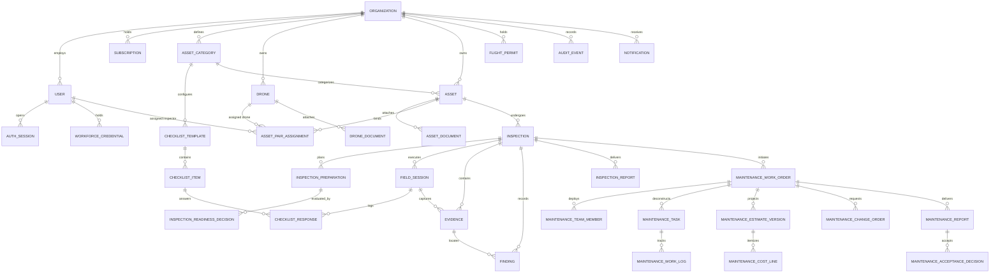

## 2. Database Design

The relational database architecture is implemented on PostgreSQL 17 with strict foreign key constraints, index-optimized tenant filtering, and cryptographic audit fields. The database schema encompasses 35 application tables (plus the `event_publication` transactional outbox) categorized across identity, assets, inspection workflow, maintenance remediation, and cross-cutting infrastructure.

**Table Descriptions**

| No | Table | Description |
| :---: | :--- | :--- |
| 01 | `organizations` | Stores tenant enterprise companies subscribing to the platform. - Primary key: `id` (UUID) - Foreign keys: `created_by_user_id` references `users(id)` |
| 02 | `users` | Stores system user accounts and role assignments (`roles`) across all platform and enterprise roles. - Primary key: `id` (UUID) - Foreign keys: `organization_id` references `organizations(id)` |
| 03 | `auth_sessions` | Tracks active user login sessions, client type, hashed refresh tokens, and revocation status. - Primary key: `id` (UUID) - Foreign keys: `user_id` references `users(id)` |
| 04 | `workforce_credentials` | Records professional licenses, pilot certifications, and safety credentials with validity periods. - Primary key: `id` (UUID) - Foreign keys: `user_id` references `users(id)`, `organization_id` references `organizations(id)`, `evidence_id` references `evidence(id)`, `verified_by_user_id` references `users(id)` |
| 05 | `subscriptions` | Tracks ENTERPRISE subscription contracts, periods (1, 6, 12 months), and billing status. - Primary key: `id` (UUID) - Foreign keys: `organization_id` references `organizations(id)`, `confirmed_by_user_id` references `users(id)` |
| 06 | `payment_transactions` | Records optional PayPal Orders v2 checkout and capture transactions linked to subscriptions. - Primary key: `id` (UUID) - Foreign keys: `subscription_id` references `subscriptions(id)` |
| 07 | `asset_categories` | Structural categories for infrastructure assets (Bridges, Power Towers, Industrial Facilities). - Primary key: `id` (UUID) - Foreign keys: `organization_id` references `organizations(id)` |
| 08 | `checklist_templates` | Reusable inspection checklist templates linked to specific asset categories. - Primary key: `id` (UUID) - Foreign keys: `asset_category_id` references `asset_categories(id)`, `created_by_user_id` references `users(id)` |
| 09 | `checklist_items` | Individual inspection checkpoints and verification criteria within a checklist template. - Primary key: `id` (UUID) - Foreign keys: `template_id` references `checklist_templates(id)` |
| 10 | `assets` | Manages physical infrastructure assets (bridges, pylons, buildings, facilities). - Primary key: `id` (UUID) - Foreign keys: `organization_id` references `organizations(id)`, `category_id` references `asset_categories(id)` |
| 11 | `asset_documents` | Engineering schematics, structural drawings, and technical specifications attached to an asset. - Primary key: `id` (UUID) - Foreign keys: `asset_id` references `assets(id)`, `uploaded_by_user_id` references `users(id)` |
| 12 | `drones` | Catalogs organization drone aircraft, hardware serial numbers, MTOW, and serviceability status. - Primary key: `id` (UUID) - Foreign keys: `organization_id` references `organizations(id)` |
| 13 | `drone_documents` | Airworthiness certifications, registration files, and maintenance logs attached to a drone. - Primary key: `id` (UUID) - Foreign keys: `drone_id` references `drones(id)`, `uploaded_by_user_id` references `users(id)`, `reviewed_by_user_id` references `users(id)` |
| 14 | `flight_permits` | Official aviation flight permits, geographical bounding polygons, and validity windows. - Primary key: `id` (UUID) - Foreign keys: `organization_id` references `organizations(id)`, `asset_id` references `assets(id)`, `source_evidence_id` references `evidence(id)`, `reviewed_by_user_id` references `users(id)` |
| 15 | `asset_pair_assignments` | Defines the operational default Inspector and Drone pairing assigned to an asset. - Primary key: `id` (UUID) - Foreign keys: `asset_id` references `assets(id)`, `inspector_user_id` references `users(id)`, `drone_id` references `drones(id)`, `organization_id` references `organizations(id)`, `assigned_by_user_id` references `users(id)` |
| 16 | `inspections` | Core mission table tracking scheduled windows, active status, pair snapshot, and defect handoff. - Primary key: `id` (UUID) - Foreign keys: `asset_id` references `assets(id)`, `organization_id` references `organizations(id)`, `inspector_id` references `users(id)`, `drone_id` references `drones(id)`, `asset_pair_assignment_id` references `asset_pair_assignments(id)` |
| 17 | `inspection_preparations` | Versioned pre-flight planning data including component shot-lists and safety protocols. - Primary key: `id` (UUID) - Foreign keys: `inspection_id` references `inspections(id)`, `inspector_user_id` references `users(id)` |
| 18 | `checklist_responses` | Pilot responses and notes recorded against individual checklist items during field sessions. - Primary key: `id` (UUID) - Foreign keys: `inspection_id` references `inspections(id)`, `field_session_id` references `field_sessions(id)`, `checklist_item_id` references `checklist_items(id)`, `evidence_id` references `evidence(id)`, `responder_user_id` references `users(id)`, `completed_by_user_id` references `users(id)` |
| 19 | `inspection_readiness_decisions` | Administrative authorization records approving or returning a mission preparation. - Primary key: `id` (UUID) - Foreign keys: `inspection_id` references `inspections(id)`, `preparation_id` references `inspection_preparations(id)`, `reviewed_by_user_id` references `users(id)` |
| 20 | `field_sessions` | Records individual on-site flight sessions, checklist notes, and operational outcomes. - Primary key: `id` (UUID) - Foreign keys: `inspection_id` references `inspections(id)`, `organization_id` references `organizations(id)`, `inspector_user_id` references `users(id)`, `drone_id` references `drones(id)`, `readiness_decision_id` references `inspection_readiness_decisions(id)`, `checklist_template_id` references `checklist_templates(id)` |
| 21 | `evidence` | Digital media captures collected during an inspection (13 columns). - Primary key: `id` (UUID) - Foreign keys: `inspection_id` references `inspections(id)`, `field_session_id` references `field_sessions(id)` - Columns: `id`, `inspection_id`, `field_session_id`, `file_name`, `content_type`, `size_bytes`, `object_key`, `capture_time`, `latitude`, `longitude`, `location_description`, `is_deleted`, `created_at` - Note: `organization_id` resolved via `inspections.organization_id`; `upload_status`, `evidence_kind`, and 3 `maintenance_*_id` FKs dropped; soft-delete via `is_deleted`. |
| 22 | `findings` | Unified findings table managing AI defect candidates and human-verified official findings (15 columns). - Primary key: `id` (UUID) - Foreign keys: `inspection_id` references `inspections(id)`, `evidence_id` references `evidence(id)` - Columns: `id`, `inspection_id`, `evidence_id`, `finding_code`, `defect_label`, `severity`, `bounding_box`, `technical_notes`, `recommended_action`, `status`, `model_name`, `confidence`, `forwarded_to_maintenance_at`, `is_deleted`, `created_at` - Note: `updated_at`, `deleted_at` (replaced by `is_deleted`), `inspector_confirmed_at` (subsumed by `status = CONFIRMED`), `model_version`, and `model_provider` dropped. |
| 23 | `inspection_reports` | Versioned inspection report deliverables, human review gates, rendered PDF object keys, and SHA-256 hashes (13 columns). - Primary key: `id` (UUID) - Foreign keys: `inspection_id` references `inspections(id)`, `reviewer_user_id` references `users(id)` - Columns: `id`, `inspection_id`, `version_no`, `status`, `content_snapshot`, `submitted_at`, `reviewer_user_id`, `reviewed_at`, `return_reason`, `rendered_object_key`, `rendered_checksum_sha256`, `published_at`, `created_at` - Note: `author_user_id` resolved via `inspections.inspector_id`; `source_version_id`, `withdrawn_at`, and `withdrawal_reason` dropped (withdrawing reverts `SUBMITTED -> DRAFT`). |
| 24 | `maintenance_work_orders` | Remediation projects initiated from confirmed inspection findings (18 columns). - Primary key: `id` (UUID) - Foreign keys: `organization_id` references `organizations(id)`, `asset_id` references `assets(id)`, `source_finding_id` references `findings(id)`, `source_report_version_id` references `inspection_reports(id)`, `owner_user_id` references `users(id)`, `team_lead_user_id` references `users(id)`, `report_author_user_id` references `users(id)`, `budget_approver_user_id` references `users(id)`, `accepting_reviewer_user_id` references `users(id)` |
| 25 | `maintenance_team_members` | Engineering team members allocated to a maintenance work order (10 columns). - Primary key: `id` (UUID) - Foreign keys: `work_order_id` references `maintenance_work_orders(id)`, `engineer_user_id` references `users(id)`, `assigned_by_user_id` references `users(id)` |
| 26 | `maintenance_tasks` | Decomposed repair tasks with technical methods and assigned engineers (13 columns; `completion_notes` and `display_order` dropped). - Primary key: `id` (UUID) - Foreign keys: `work_order_id` references `maintenance_work_orders(id)`, `assigned_engineer_user_id` references `users(id)` |
| 27 | `maintenance_estimate_versions` | Versioned financial projection baselines for labor, materials, equipment, and services (11 columns; `tax_basis` and redundant `snapshot` dropped). - Primary key: `id` (UUID) - Foreign keys: `work_order_id` references `maintenance_work_orders(id)`, `prepared_by_user_id` references `users(id)`, `approved_by_user_id` references `users(id)` |
| 28 | `maintenance_cost_lines` | Individual itemized cost rows within an estimate baseline or actual expenditure (14 columns; `change_order_id`, `tax_treatment`, `evidence_reference`, and `entered_at` dropped). - Primary key: `id` (UUID) - Foreign keys: `work_order_id` references `maintenance_work_orders(id)`, `estimate_version_id` references `maintenance_estimate_versions(id)`, `task_id` references `maintenance_tasks(id)`, `entered_by_user_id` references `users(id)` |
| 29 | `maintenance_change_orders` | Formal variance requests adjusting repair scope or budget ceiling (13 columns; `affected_tasks`, `supporting_evidence`, `proposed_start_at`, and `proposed_end_at` dropped). - Primary key: `id` (UUID) - Foreign keys: `work_order_id` references `maintenance_work_orders(id)`, `requested_by_user_id` references `users(id)`, `decided_by_user_id` references `users(id)` |
| 30 | `maintenance_work_logs` | Execution entries logging labor hours, as-left conditions, and test readings (13 columns; `actual_cost_references` dropped). - Primary key: `id` (UUID) - Foreign keys: `work_order_id` references `maintenance_work_orders(id)`, `task_id` references `maintenance_tasks(id)`, `engineer_user_id` references `users(id)` |
| 31 | `maintenance_reports` | Versioned maintenance completion deliverables, verified by the author and accepted by the administrator (9 columns; redundant `author_user_id`, unused LLM metadata, and snapshot hash columns dropped). - Primary key: `id` (UUID) - Foreign keys: `work_order_id` references `maintenance_work_orders(id)` |
| 32 | `maintenance_acceptance_decisions` | Formal technical acceptance records evaluating repair completion (9 columns; `signature_reference` and duplicate `created_at` dropped). - Primary key: `id` (UUID) - Foreign keys: `work_order_id` references `maintenance_work_orders(id)`, `report_version_id` references `maintenance_reports(id)`, `reviewer_user_id` references `users(id)` |
| 33 | `repair_knowledge_chunks` | Civil/structural engineering repair standard chunks and embeddings supporting RAG scope suggestions. - Primary key: `id` (UUID) - Foreign keys: None |
| 34 | `notifications` | Operational alerts and domain event notifications delivered to system users. - Primary key: `id` (UUID) - Foreign keys: `organization_id` references `organizations(id)`, `recipient_user_id` references `users(id)` |
| 35 | `audit_events` | Append-only security audit trail recording consequential domain transitions and access events. - Primary key: `id` (UUID) - Foreign keys: `organization_id` references `organizations(id)`, `actor_user_id` references `users(id)` |
| 36 | `event_publication` | Outbox pattern transactional event publication log for reliable asynchronous domain event delivery. - Primary key: `id` (UUID) - Foreign keys: None |

### 2.1 Streamlined MF3 Data Dictionary

The MF3 domain model has been streamlined into three cohesive tables totaling 41 columns across evidence intake, defect findings, and published report deliverables.

#### Table: `evidence` (13 columns)

Stores metadata for digital media captured during inspection field sessions and retained in MinIO object storage.

| Column | Type | Nullable | Default | Description |
| :--- | :--- | :---: | :--- | :--- |
| `id` | `uuid` | No | `gen_random_uuid()` | Primary key. Unique identifier of the evidence item. |
| `inspection_id` | `uuid` | No | — | Foreign key referencing `inspections(id)`. Tenant ownership is resolved via `inspections.organization_id`. |
| `field_session_id` | `uuid` | Yes | `NULL` | Foreign key referencing `field_sessions(id)`. Identifies the on-site field session during which this capture was recorded. |
| `file_name` | `varchar(500)` | No | — | Original sanitized media file name (e.g. `DJI_20261022_001.JPG`). |
| `content_type` | `varchar(160)` | No | — | MIME content type (e.g. `image/jpeg`, `image/png`). |
| `size_bytes` | `bigint` | No | — | File payload size in bytes (> 0). |
| `object_key` | `varchar(1000)` | No | — | Object storage path / key in MinIO. |
| `capture_time` | `timestamptz` | Yes | `NULL` | EXIF capture timestamp recorded by the camera sensor. |
| `latitude` | `numeric(9,6)` | Yes | `NULL` | GPS latitude coordinate (-90 to +90) extracted from capture metadata. |
| `longitude` | `numeric(9,6)` | Yes | `NULL` | GPS longitude coordinate (-180 to +180) extracted from capture metadata. |
| `location_description` | `varchar(1000)` | Yes | `NULL` | Human-readable location or structural zone description (e.g. `Pier 3 North Span`). |
| `is_deleted` | `boolean` | No | `false` | Soft-delete flag. Replaces obsolete `retired_at`; setting `true` soft-deletes the capture while retaining MinIO bytes. |
| `created_at` | `timestamptz` | No | `CURRENT_TIMESTAMP` | Record creation timestamp. |

*Dropped columns & rationales:*
- `organization_id`: Dropped; redundant since tenant isolation is strictly resolved through `inspections.organization_id`.
- `upload_status`: Dropped; file ingestion and MinIO persistence are atomic and synchronous.
- `evidence_kind`: Dropped; records in this table represent inspection captures exclusively.
- `retired_at`: Replaced by the standard `is_deleted` boolean flag.
- `maintenance_work_log_id`, `maintenance_work_order_id`, `maintenance_task_id`: Dropped; evidence is decoupled from maintenance execution.

#### Table: `findings` (15 columns)

Consolidates all defect observations—both automated YOLO11s AI proposals and manual Inspector observations—into a single table.

| Column | Type | Nullable | Default | Description |
| :--- | :--- | :---: | :--- | :--- |
| `id` | `uuid` | No | `gen_random_uuid()` | Primary key. Unique identifier of the finding. |
| `inspection_id` | `uuid` | No | — | Foreign key referencing `inspections(id)`. |
| `evidence_id` | `uuid` | Yes | `NULL` | Foreign key referencing `evidence(id)`. Source photographic capture supporting this finding (`NULL` for general observations). |
| `finding_code` | `varchar(64)` | No | — | Sequential inspection-scoped reference code (e.g. `FND-001`). Unique per inspection. |
| `defect_label` | `varchar(160)` | No | — | Defect classification label (e.g. `Cracking`, `Corrosion`, `Spalling`). |
| `severity` | `varchar(24)` | No | — | Defect severity rating: `LOW`, `MEDIUM`, `HIGH`, or `CRITICAL`. |
| `bounding_box` | `jsonb` | Yes | `NULL` | Normalized bounding box coordinates `{x, y, width, height}` identifying defect position on evidence media (`NULL` for unlocated defects). |
| `technical_notes` | `varchar(4000)` | No | — | Detailed engineering narrative describing defect dimensions, condition, and observations. |
| `recommended_action` | `varchar(4000)` | Yes | `NULL` | Recommended remediation or engineering intervention. |
| `status` | `varchar(24)` | No | — | Finding lifecycle status: `PENDING` (advisory proposal) or `CONFIRMED` (official verified defect). |
| `model_name` | `varchar(160)` | Yes | `NULL` | AI detector model identifier (e.g. `YOLO11s-defect-v1`); `NULL` for manual observations. |
| `confidence` | `numeric(6,5)` | Yes | `NULL` | Model prediction confidence score between 0.00000 and 1.00000. |
| `forwarded_to_maintenance_at` | `timestamptz` | Yes | `NULL` | Timestamp when finding was forwarded to MF4 remediation triage; `NULL` if not forwarded. |
| `is_deleted` | `boolean` | No | `false` | Soft-delete flag. Replaces obsolete `deleted_at`; setting `true` soft-deletes Inspector working findings. |
| `created_at` | `timestamptz` | No | `CURRENT_TIMESTAMP` | Record creation timestamp. |

*Dropped columns & rationales:*
- `updated_at`: Dropped; finding revisions are handled through state transitions, preserving append-only clarity.
- `deleted_at`: Replaced by standard `is_deleted` boolean flag.
- `inspector_confirmed_at`: Dropped; confirmation is directly represented by `status = CONFIRMED`.
- `model_version`, `model_provider`: Dropped; `model_name` and `confidence` provide sufficient AI provenance.

#### Table: `inspection_reports` (13 columns)

Manages versioned inspection report deliverables, content snapshots, administrative review gates, and published PDF deliverables.

| Column | Type | Nullable | Default | Description |
| :--- | :--- | :---: | :--- | :--- |
| `id` | `uuid` | No | `gen_random_uuid()` | Primary key. Unique identifier of the report deliverable version. |
| `inspection_id` | `uuid` | No | — | Foreign key referencing `inspections(id)`. Author is resolved via `inspections.inspector_id`. |
| `version_no` | `integer` | No | — | 1-based sequential version number for this inspection report (> 0). |
| `status` | `varchar(32)` | No | — | Report status: `DRAFT`, `AUTHOR_VERIFIED`, `SUBMITTED`, `RETURNED`, `APPROVED`, `PUBLISHED`, `SUPERSEDED`. |
| `content_snapshot` | `jsonb` | No | `'{}'::jsonb` | Structured JSON payload containing authored section narratives (Executive Summary, Scope & Methodology, Weather & Observations, Component Findings, Recommendations, Coverage, Omissions). |
| `submitted_at` | `timestamptz` | Yes | `NULL` | Timestamp when the verified draft was submitted for administrative review. |
| `reviewer_user_id` | `uuid` | Yes | `NULL` | Foreign key referencing `users(id)` representing the Organization Admin who reviewed this version. |
| `reviewed_at` | `timestamptz` | Yes | `NULL` | Timestamp when the administrative review decision was recorded. |
| `return_reason` | `varchar(2000)` | Yes | `NULL` | Reviewer comments explaining return reason when status is `RETURNED`. |
| `rendered_object_key` | `varchar(1000)` | Yes | `NULL` | Object storage key in MinIO for the rendered immutable publication-grade PDF deliverable. |
| `rendered_checksum_sha256` | `char(64)` | Yes | `NULL` | Cryptographic SHA-256 hash of the rendered PDF file for archival verification. |
| `published_at` | `timestamptz` | Yes | `NULL` | Timestamp when the approved report was formally published. |
| `created_at` | `timestamptz` | No | `CURRENT_TIMESTAMP` | Record creation timestamp. |

*Dropped columns & rationales:*
- `author_user_id`: Dropped; author is deterministically resolved via `inspections.inspector_id`.
- `source_version_id`: Dropped; linear version sequencing via `version_no` within an inspection is sufficient.
- `withdrawn_at`, `withdrawal_reason`: Dropped; author withdrawal reverts report status from `SUBMITTED` back to `DRAFT`.
