## 3. Detailed Design

### 3.1 FE-01 Account Access and Verification

The backend verifies credentials, creates a session, and checks the user's role and access to the requested record. The web portal opens the workspace for that role. The mobile app accepts Customer accounts.

#### 3.1.1 Class Diagram

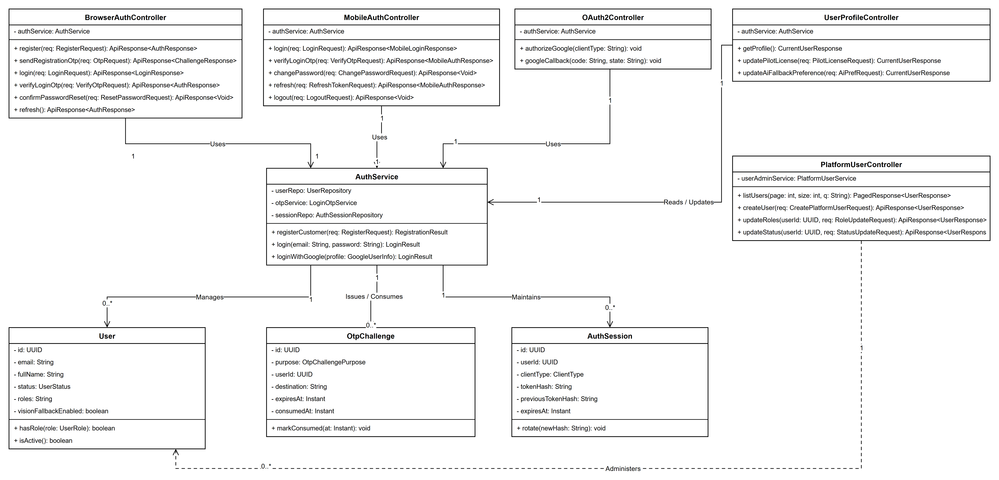

*Figure 4.12 Account Access Class Diagram*

**Class Specifications**

| No | Class or Component | Responsibility |
| :---: | :--- | :--- |
| 01 | Browser and mobile auth controllers | Handle registration, sign-in, verification, password reset, and session renewal. |
| 02 | OAuth2Controller | Handles Google sign-in and returns users to the calling client. |
| 03 | UserProfileController and PlatformUserController | Let users edit their own profile and let Admins manage platform accounts. |
| 04 | AuthService | Checks credentials, limits repeated attempts, and issues and renews sessions. |
| 05 | User, OtpChallenge, and AuthSession | Represent a user account, a time-limited verification challenge, and an authenticated session. |

#### 3.1.2 Customer Registration Sequence

*Figure 4.13 Customer Registration Sequence*

#### 3.1.3 Sign-In and Verification Sequence

*Figure 4.14 Sign-In and Verification Sequence*

#### 3.1.4 Expired Sign-In Challenge

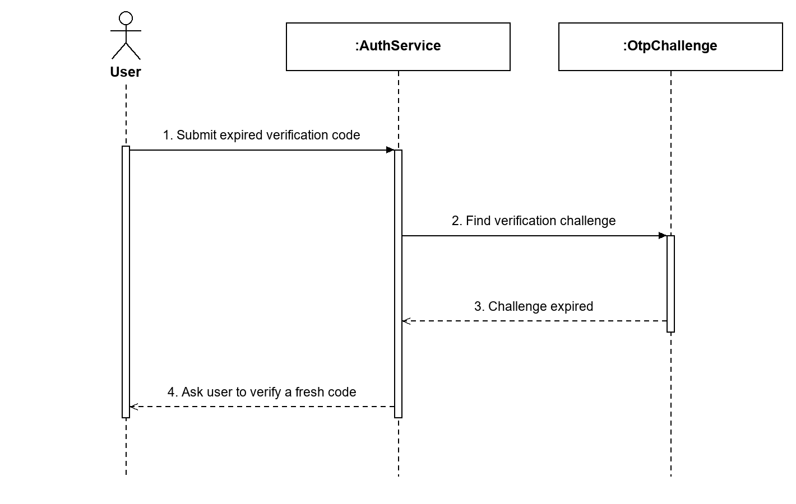

*Figure 4.15 Expired Sign-In Challenge*

#### 3.1.5 Customer Enrollment and Building Eligibility

*Figure 4.16 Customer Enrollment and Building Eligibility*

| Step | Record Used | Rule |
| --- | --- | --- |
| Registration and OTP | Identity service and verification challenge | The Customer supplies the code issued for the account. Expired or invalid codes leave verification incomplete. |
| Building location | Building service and published airspace zones | A no-fly zone blocks building registration. A restricted zone shows a warning and requires a permit for flight. |
| Building visibility | Asset ownership and role policy | Customers can open their own buildings. Staff access depends on their role and the record. |
| Handoff | Building identifier and category | The resulting building can be selected in a service request. Its category supplies checkpoint defaults for Manager preparation. |

#### 3.1.6 Design Rules and Test References

Only a valid challenge can trigger session creation.

These scenarios describe expected behavior. See Report 5 for the execution result and supporting evidence.

| Case | Scenario | Expected behavior |
| --- | --- | --- |
| WF1-001 | Register a Customer and their first building in clear airspace. | Create the Customer account and building after verifying the registration code. |
| WF1-003 | Manage platform accounts with Admin and Manager accounts. | An Admin can manage platform accounts. A Manager's changes are refused. |
| WF1-004 | Repeat failed sign-ins, burst requests, and replay a refresh token. | Apply the configured rate and failure limits. Reject reuse of a rotated refresh token. |
| WF1-005 | Open a page or request a record outside the user's allowed scope. | Display the access-denied page for restricted routes. Refuse restricted API calls. |
| WF1-022 | Edit the signed-in user's profile. | Save valid values for that user. Reject invalid values and unauthenticated requests. |
| WF2-019 | Switch between English and Vietnamese across the web and mobile clients. | Translate system labels and messages. Preserve the user's own text. |
| WF2-020 | Open a restricted page through a notification link. | Reject unknown or external destinations. Apply route and record access checks. |

### 3.2 FE-02 Inspector Application and Qualification

A prospective Inspector submits a licence and supporting documents. The Manager reviews the application and provisions the account after approval. Administrators can view the review queue. Dispatch checks that qualifications are current for the planned flight.

#### 3.2.1 Class Diagram

*Figure 4.17 Inspector Qualification Class Diagram*

**Class Specifications**

| No | Class or Component | Responsibility |
| :---: | :--- | :--- |
| 01 | InspectorApplicationService | Accepts partner applications, records Manager decisions, and creates approved accounts. |
| 02 | InspectorProfileService | Maintains pilot credentials, licence renewals, and flight records. |
| 03 | PilotLicenseClassService and expiry checks | Maintain the licence classes and notify users when a licence approaches expiry. |

#### 3.2.2 Inspector Application Review Sequence

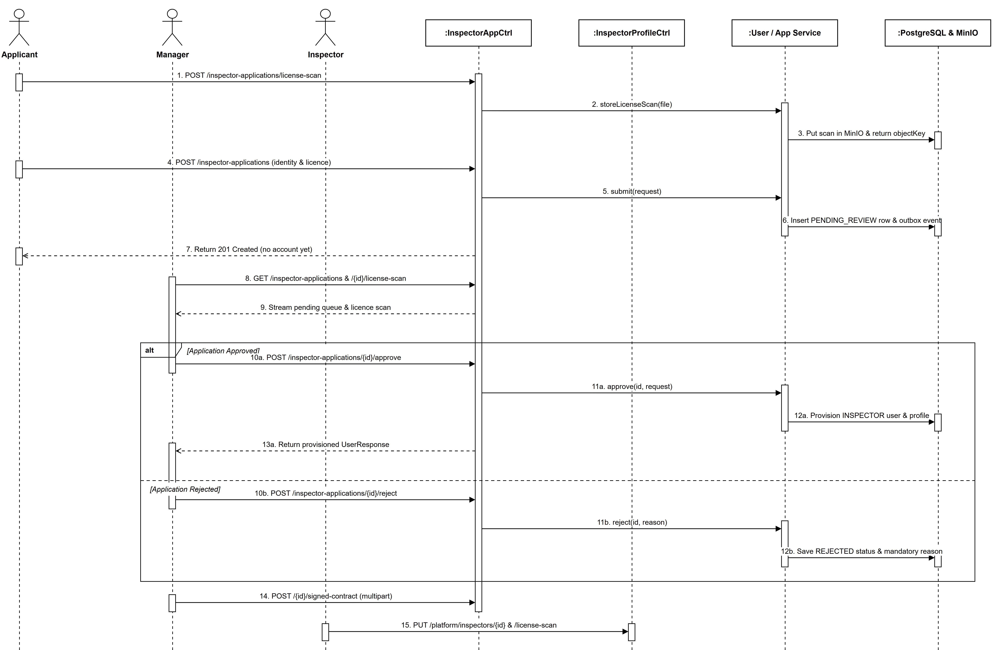

*Figure 4.18 Inspector Application Review Sequence*

#### 3.2.3 Application Rejected at Review

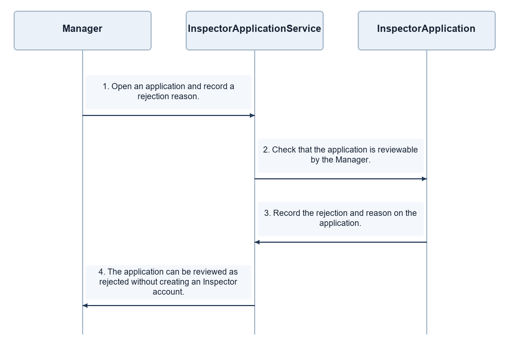

*Figure 4.19 Application Rejected at Review*

#### 3.2.4 Design Rules and Test References

The application and approved account are separate records.

These scenarios describe expected behavior. See Report 5 for the execution result and supporting evidence.

| Case | Scenario | Expected behavior |
| --- | --- | --- |
| WF1-006 | Check a pilot licence for dispatch eligibility. | Require a recognised class, licence number, uploaded scan, and validity on the planned date. |
| WF1-007 | Prevent self-granted access during Inspector onboarding. | An application does not create a role. Manager approval provisions an Inspector account. Duplicate email responses disclose no account details. |
| WF1-008 | Approve a qualified Inspector application before a drone is registered. | Create the partner account and pilot profile. Review any drone later through fleet registration. |
| WF1-010 | End-to-end Platform-provisioned Inspector and 3-document owned-drone approval walkthrough on staging. | Inspector is active in `INSPECTOR_PARTNER` zone and owned drone transitions to `ACTIVE` with `inspector_owner_id` set in `drones`. |

### 3.3 FE-03 Drone Registration and Fleet

An Inspector submits a drone with its photos and configured documents. The Manager approves or rejects the registration. Dispatch requires an active drone owned by the selected Inspector with registration valid for the planned flight.

#### 3.3.1 Class Diagram

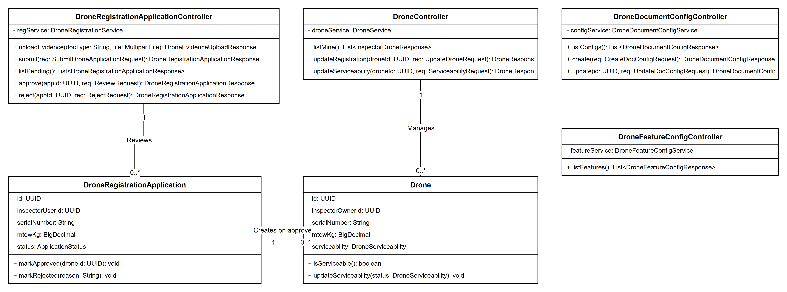

*Figure 4.20 Drone Fleet Class Diagram*

**Class Specifications**

| No | Class or Component | Responsibility |
| :---: | :--- | :--- |
| 01 | Drone document and feature controllers | Let Admins configure document requirements and the drone capabilities used for dispatch. |
| 02 | DroneRegistrationApplicationController | Accepts registration evidence and records the Manager's decision. |
| 03 | DroneService | Maintains the Inspector's fleet, including renewals and availability. |

#### 3.3.2 Drone Registration Sequence

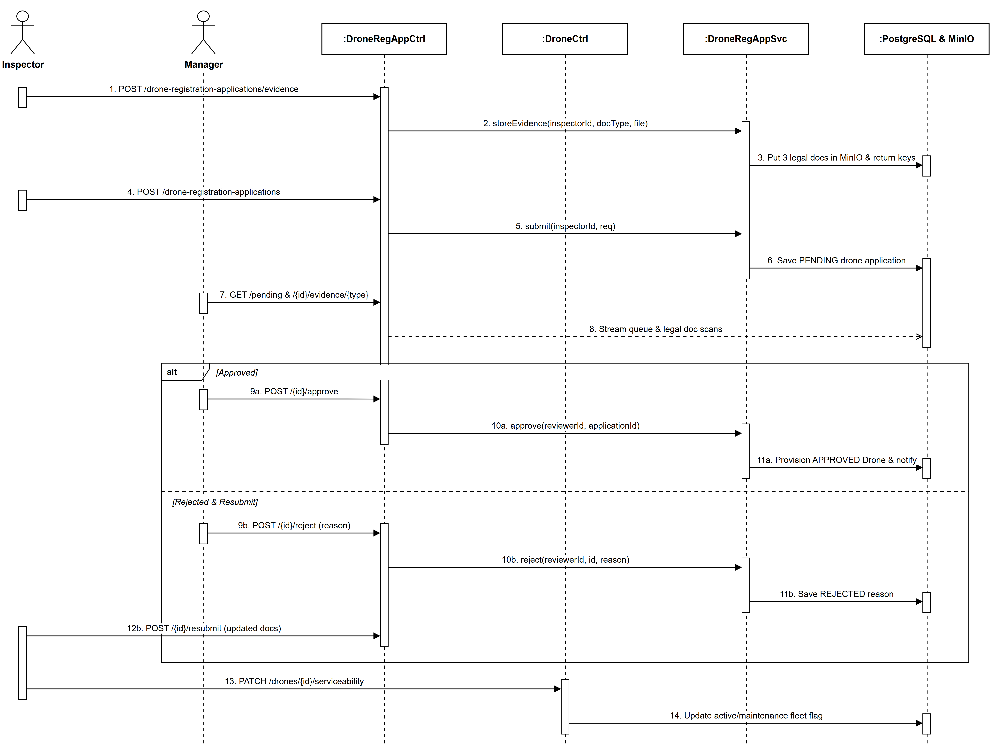

*Figure 4.21 Drone Registration Sequence*

#### 3.3.3 Drone Unavailable at Dispatch

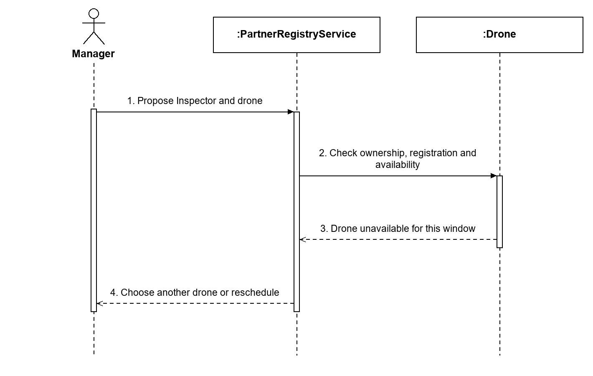

*Figure 4.22 Drone Unavailable at Dispatch*

#### 3.3.4 Partner and Drone Readiness

*Figure 4.23 Partner and Drone Readiness*

| Step | Record Used | Rule |
| --- | --- | --- |
| Application review | Assigned Manager and partner application | The Manager records the decision and reason. Admins can view applications. |
| Aircraft record | Inspector, drone and registration documents | The Inspector supplies the configured documents. Dispatch requires an approved, active drone. |
| Occurrence qualification | Partner eligibility and dispatch scheduling | Expired qualifications or incompatible aircraft make that candidate ineligible for the requested flight window. |
| Handoff | Approved Inspector and eligible aircraft | The Manager selects the Inspector and drone. The system checks their availability again when saving. |

#### 3.3.5 Design Rules and Test References

Approval alone does not make an aircraft eligible for every occurrence.

These scenarios describe expected behavior. See Report 5 for the execution result and supporting evidence.

| Case | Scenario | Expected behavior |
| --- | --- | --- |
| WF1-014 | Register or renew an Inspector-owned drone. | A Manager approves the application. Dispatch still requires current registration, complete documentation, and known weight. |
| WF1-015 | Register a drone with missing required files or a serial number owned by someone else. | Refuse an incomplete registration or conflicting serial number. Allow the owner to renew their own registration. |
| WF1-016 | Change drone serviceability and try to assign the drone. | Allow valid status changes. Refuse assignment while the drone is under maintenance or retired. |

### 3.4 FE-04 Building Location and Airspace Screening

The airspace service checks the building coordinates chosen on the map. A no-fly zone blocks registration of that building. A restricted zone shows an advisory and the applicable altitude ceiling.

#### 3.4.1 Class Diagram

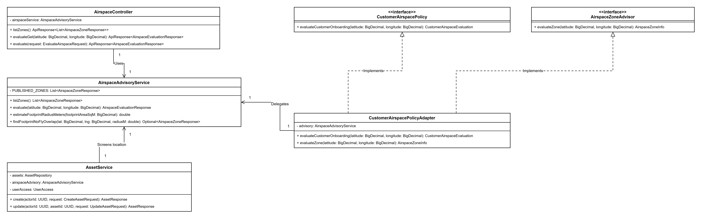

*Figure 4.24 Airspace Screening and Advisories Class Diagram*

**Class Specifications**

| No | Class or Component | Responsibility |
| :---: | :--- | :--- |
| 01 | AirspaceController | Provides published airspace zones and evaluates selected coordinates. |
| 02 | AirspaceAdvisoryService | Classifies a location using active no-fly and restricted zones. |
| 03 | CustomerAirspacePolicyAdapter | Shares the classification, warning, and altitude limit with registration and inspection workflows. |
| 04 | Location picker and airspace advisory | Show the result on web and mobile. The web map also flags a building footprint that overlaps a no-fly zone. |

#### 3.4.2 Airspace Screening Sequence

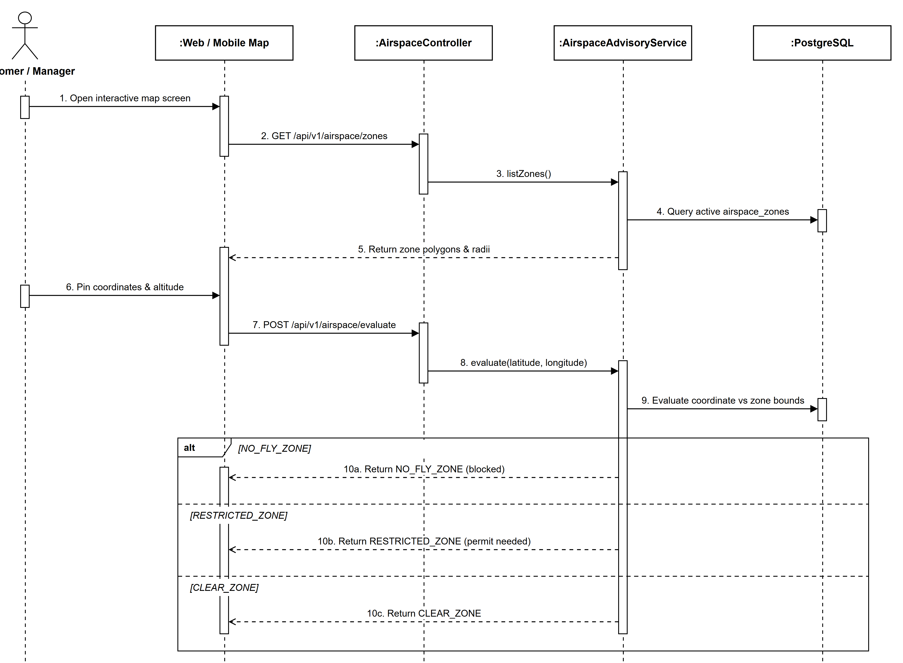

*Figure 4.25 Airspace Screening Sequence*

#### 3.4.3 Building Pin Inside No-Fly Zone

*Figure 4.26 Building Pin Inside No-Fly Zone*

#### 3.4.4 Design Rules and Test References

The backend checks submitted coordinates independently of the map display.

These scenarios describe expected behavior. See Report 5 for the execution result and supporting evidence.

| Case | Scenario | Expected behavior |
| --- | --- | --- |
| WF1-002 | Screen the location during Customer registration. | Reject a no-fly location. For a restricted location, activate the accepted registration with the advisory and retain the permit requirement. |
| WF2-004 | `AirspaceAdvisoryService`, Web `AirspaceNoFlyMap`, and Mobile `AirspaceAdvisoryCard` classify coordinates into No-Fly Zone, Restricted Zone, or Clear Zone with `MSG28` warnings. | Returns accurate Haversine classification (`NO_FLY_ZONE`, `RESTRICTED_ZONE`, `CLEAR_ZONE`), surfaces `MSG28` warning and `cambay.mod.gov.vn` reference, and renders interactive vector overlays. |
| WF2-005 | Submit coordinates outside valid geographic bounds. | Reject the location before performing the airspace check. |

### 3.5 FE-05 Financial History

The ledger links each scheduled inspection to its settlement records. Customers see their own payments and receipts. Inspectors see their assigned work and payouts. Managers see separate revenue and payout views.

#### 3.5.1 Class Diagram

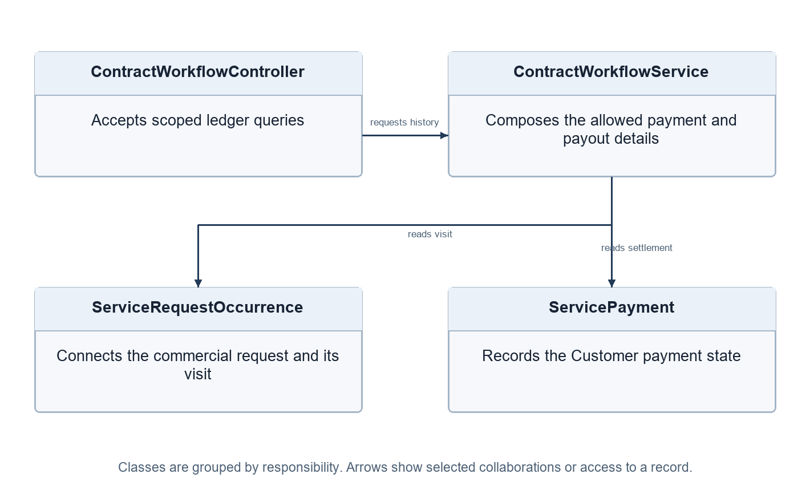

*Figure 4.27 Financial History Class Diagram*

**Class Specifications**

| No | Class or Component | Responsibility |
| :---: | :--- | :--- |
| 01 | ContractWorkflowController | Provides ledger entries filtered by the caller's role and access to each visit. |
| 02 | Financial response models | Return the payment and payout fields that each role is allowed to see. |
| 03 | Finance history and inspection overview | Show the ledger and the settlement details for a visit. |

#### 3.5.2 Financial History Sequence

*Figure 4.28 Financial History Sequence*

#### 3.5.3 Financial Ledger Outside Owner Scope

*Figure 4.29 Financial Ledger Outside Owner Scope*

#### 3.5.4 Design Rules and Test References

Role permissions and access to the individual record are checked separately.

These scenarios describe expected behavior. See Report 5 for the execution result and supporting evidence.

| Case | Scenario | Expected behavior |
| --- | --- | --- |
| WF3-032 | Open financial history as a Customer, Inspector, and Manager. | Show a Customer's own invoices and payments, an Inspector's own payouts and receivables, and the Manager's authorized ledger. |

### 3.6 FE-06 Buildings and Reference Documents

Customers manage their own buildings. A building category supplies default inspection checkpoints. The Manager selects the checkpoints for the requested visit before dispatch.

#### 3.6.1 Class Diagram

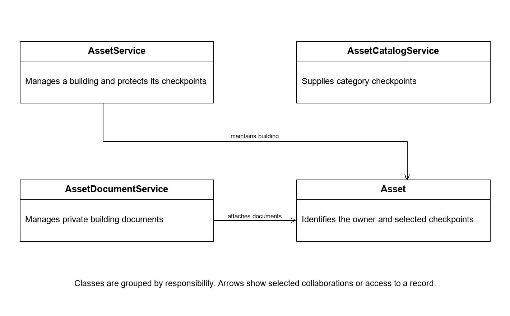

*Figure 4.30 Buildings and Documents Class Diagram*

**Class Specifications**

| No | Class or Component | Responsibility |
| :---: | :--- | :--- |
| 01 | AssetService | Records buildings, screens their location, and locks checkpoint edits once inspections use them. |
| 02 | AssetCatalogService | Maintains building categories and the default checkpoints for new buildings. |
| 03 | AssetDocumentService | Checks uploaded documents, prevents duplicates, and serves files to authorized users. |

#### 3.6.2 Building and Document Registration Sequence

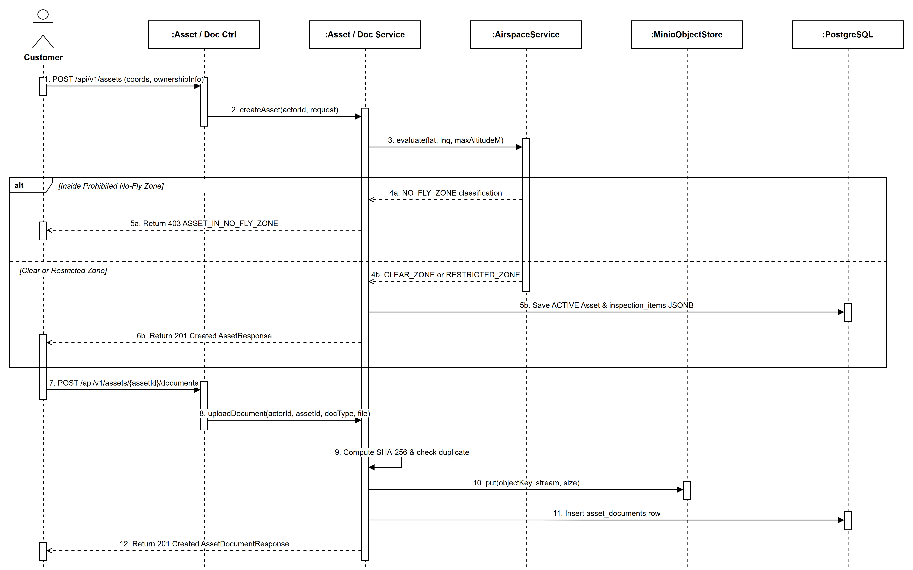

*Figure 4.31 Building and Document Registration Sequence*

#### 3.6.3 Checkpoint Changes After Inspection Use

*Figure 4.32 Checkpoint Changes After Inspection Use*

#### 3.6.4 Design Rules and Test References

Building-level defaults are distinct from the checkpoint snapshot kept by a visit.

These scenarios describe expected behavior. See Report 5 for the execution result and supporting evidence.

| Case | Scenario | Expected behavior |
| --- | --- | --- |
| WF1-011 | Create a building with checkpoints and attach an engineering document. | Save the building and checkpoints. Return the original document to an authorized user. |
| WF1-012 | Submit a prohibited building location, duplicate code, or duplicate document. | Reject the invalid location, duplicate code within the owner's buildings, and duplicate or empty file. |
| WF1-013 | Retire a building that has previous inspection records. | Keep the inspection and report history. Refuse edits and new inspection requests for the retired building. |

### 3.7 FE-07 Restricted Airspace Advisory

A restricted location can proceed after the Customer verifies their account. The system records the warning on the building. The assigned Inspector must obtain and record the required permit before flight.

#### 3.7.1 Class Diagram

See Figure 4.24. The shared model identifies the airspace result and the adapter that supplies the advisory to registration.

**Class Specifications**

| No | Class or Component | Responsibility |
| :---: | :--- | :--- |
| 01 | CustomerAirspacePolicyAdapter | Passes the restricted-zone warning and altitude limit to the relevant workflow. |
| 02 | AuthService and AssetService | Allow registration in restricted zones and store the resulting advisory. |
| 03 | Restricted airspace notices | Show the zone and altitude ceiling where the Customer or Inspector needs to act. |

#### 3.7.2 Restricted Airspace Advisory Sequence

*Figure 4.33 Restricted Airspace Advisory Sequence*

#### 3.7.3 Restricted Location With a Ceiling

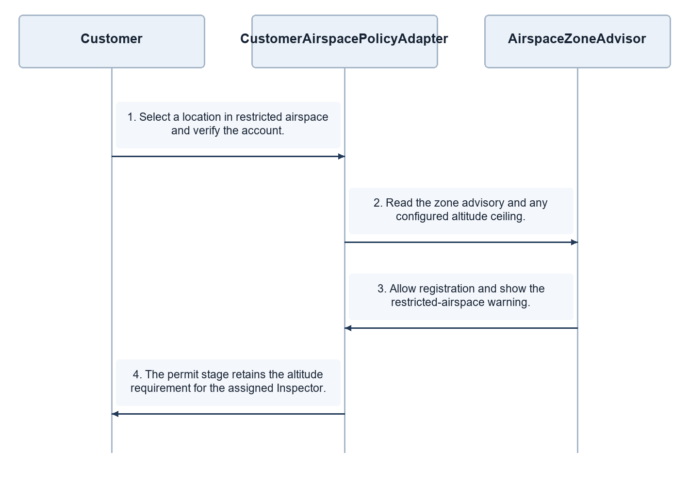

*Figure 4.34 Restricted Location With a Ceiling*

#### 3.7.4 Design Rules and Test References

A location advisory and the permit decision are distinct checks.

These scenarios describe expected behavior. See Report 5 for the execution result and supporting evidence.

| Case | Scenario | Expected behavior |
| --- | --- | --- |
| WF1-009 | Register a Customer at a restricted location. | Activate the account and building after verification. Return the restricted-zone advisory. Prohibited locations remain blocked. |

### 3.8 FE-08 Service Requests and Quotations

Customers request one visit or a recurring schedule. The assigned Manager records the scope, checkpoints, and price in VND. A change to the active quotation requires a new Customer decision.

#### 3.8.1 Class Diagram

See Figure 4.38. The shared model shows how a request relates to its quotations and how accepted terms become scheduled occurrences.

**Class Specifications**

| No | Class or Component | Responsibility |
| :---: | :--- | :--- |
| 01 | ContractWorkflowService | Validates dates, handles Manager assignment, and saves the current quotation. |
| 02 | ServiceRequest and ServiceRequestQuote | Record the requested schedule, checkpoints, price, and latest quoted terms. |
| 03 | Request list and quotation workspace | Let Customers submit and review requests. Managers use the workspace to prepare and revise quotes. |

#### 3.8.2 Request and Quotation Sequence

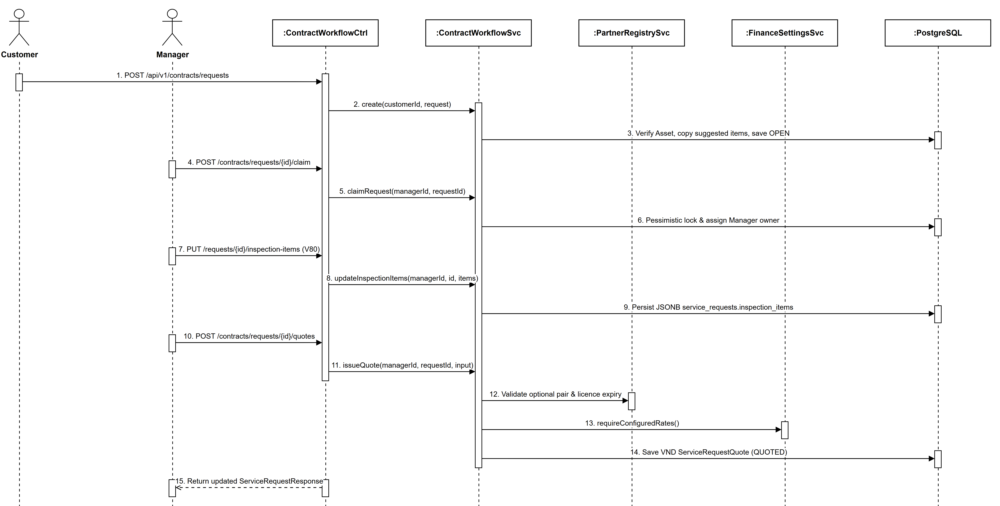

*Figure 4.35 Request and Quotation Sequence*

#### 3.8.3 Quotation Changes Before Acceptance

*Figure 4.36 Quotation Changes Before Acceptance*

#### 3.8.4 Service Request

*Figure 4.37 Service Request State Model*

A Customer request moves from preparation and quotation to accepted terms. Uploading the signed agreement enables dispatch. Cancelling a request before acceptance and cancelling a contracted visit operate on different records.

Related design sections are FE-08 and FE-09.

#### 3.8.5 Design Rules and Test References

Only the accepted terms can create the agreed occurrence schedule.

These scenarios describe expected behavior. See Report 5 for the execution result and supporting evidence.

| Case | Scenario | Expected behavior |
| --- | --- | --- |
| WF1-017 | Create recurring visits from accepted terms. | Create the agreed dates without choosing an Inspector in the quotation. At dispatch, check licences and drone registration for each visit. |
| WF1-018 | Monthly recurring `ServiceRequest` occurrences stay anchored to the Customer-requested first date without drift across short months. | Occurrences remain anchored at `2027-01-31`, `2027-02-28`, `2027-03-31`, and `2027-04-30` (`09:00:00Z`), with February clamped and no permanent drift. The same month-arithmetic helper supports 1, 3, 6, 9, 12 and custom month intervals up to 120. |
| WF1-019 | Validate the planned recurring dates. | Enforce the minimum lead time. Keep the accepted end-date or visit-count rule when revising the quotation. |
| WF2-022 | Propose a later first visit in the quotation. | Validate the revised schedule and require Customer acceptance before creating the resulting visits. |
| WF2-023 | Manager request detail shows a persistent asset overview above every workflow step. | The overview renders on every step, shows the linked asset and customer-selected schedule, displays the signed-in Manager and assigned drone (or an empty value before dispatch), and toggles cleanly. Manager list queries do not perform the Customer-name lookup. |
| WF2-026 | Set checkpoints for a service request. | Save the cleaned checkpoint list to the request and transfer it to the inspection on dispatch. Reject later changes to the dispatched list. |

### 3.9 FE-09 Signed Contracts and Dispatch

The accepted quotation sets the schedule. A Manager uploads the signed paper agreement before assigning an Inspector and a drone. Dispatch checks qualification and schedule conflicts for each visit.

#### 3.9.1 Class Diagram

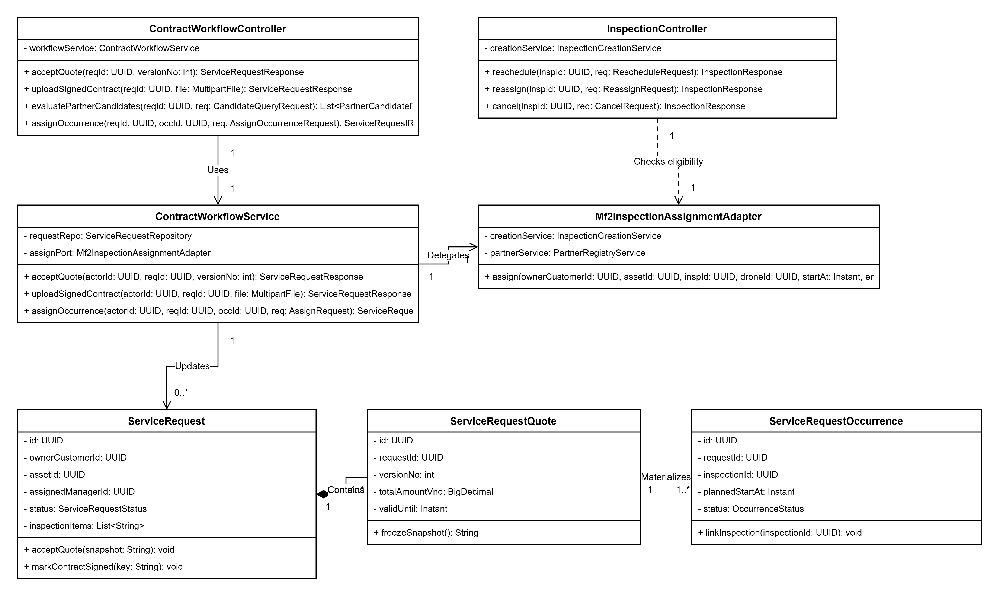

*Figure 4.38 Contracts and Dispatch Class Diagram*

**Class Specifications**

| No | Class or Component | Responsibility |
| :---: | :--- | :--- |
| 01 | ContractWorkflowService | Freezes accepted terms, creates visits, stores the signed agreement, and records assignment or cancellation. |
| 02 | PartnerRegistryService and assignment adapter | Check the Inspector and drone for valid qualifications, equipment, and availability on the scheduled date. |
| 03 | Occurrence dispatch workspace | Lets the Manager review candidates, assign a team, or reschedule, reassign, or cancel a visit. |

#### 3.9.2 Contract Signing and Dispatch Sequence

*Figure 4.39 Contract Signing and Dispatch Sequence*

#### 3.9.3 Cancel a Visit After Inspector Withdrawal

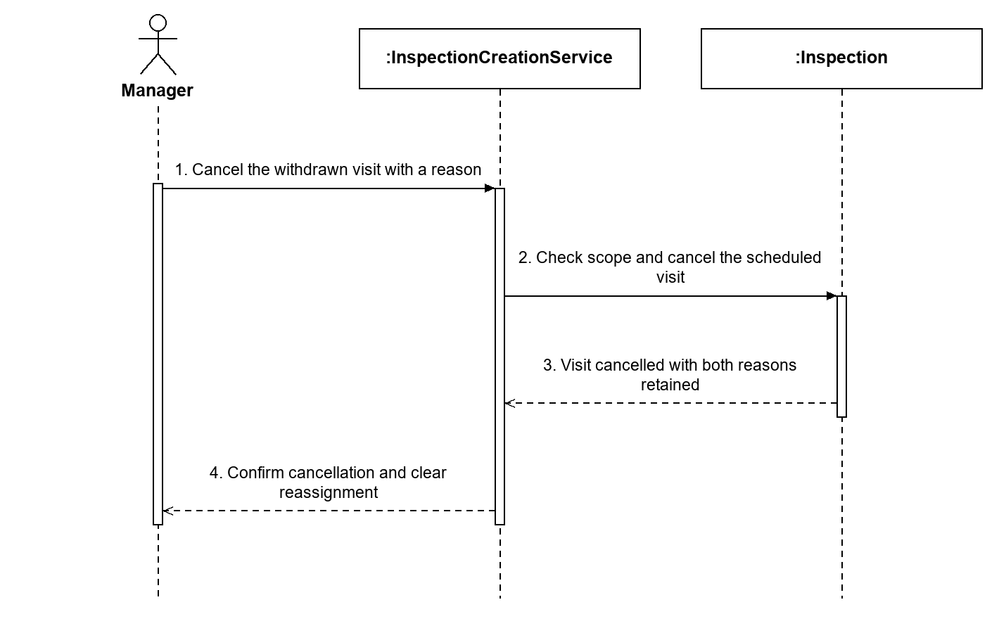

*Figure 4.40 Cancel a Visit After Inspector Withdrawal*

#### 3.9.4 Quotation and Dispatch

*Figure 4.41 Quotation and Dispatch*

| Step | Record Used | Rule |
| --- | --- | --- |
| Quote preparation | Request assignment and quotation version | The assigned Manager records the price and scope. Changing the active quote returns it to an explicit Customer decision. |
| Agreement and schedule | Accepted quotation and signed agreement | The accepted version defines the initial and recurring dates. The contract upload enables assignment actions. |
| Occurrence assignment | Selected Inspector and drone | Assignment checks qualification and scheduling conflicts. The Inspector receives an offer for that occurrence. |
| Cancellation | Open or quoted request, or contracted occurrence | The Manager can cancel an open request before acceptance or cancel an eligible scheduled visit after signing. The system records the reason. |

#### 3.9.5 Scheduled Occurrence

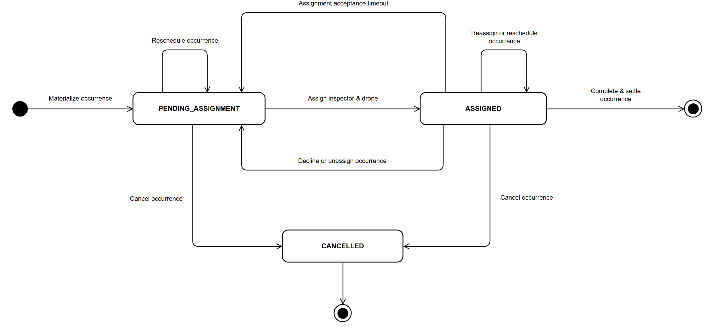

*Figure 4.42 Scheduled Occurrence State Model*

Each occurrence keeps its own assignment status and planned window. A Manager can recover or cancel an eligible occurrence while retaining the accepted terms and other visits.

Related design sections are FE-09 and FE-11.

#### 3.9.6 Design Rules and Test References

A scheduled visit can close independently of other visits under the accepted contract.

These scenarios describe expected behavior. See Report 5 for the execution result and supporting evidence.

| Case | Scenario | Expected behavior |
| --- | --- | --- |
| WF1-021 | Connect onboarding, quotation and dispatch. | Verified Inspector and drone records become eligible. Signing enables dispatch. The assigned visit links to a scheduled inspection. |
| WF2-002 | Assign a visit with a scheduling conflict, ineligible drone, or missing agreement. | Refuse dispatch until the agreement, aircraft eligibility, and scheduling checks pass. |
| WF2-003 | Attempt dispatch or recovery with the wrong role or request scope. | Restrict quotation, agreement, and dispatch changes to authorized Managers. |
| WF2-024 | Open an inspection review from the Manager dispatch screen. | Open the field audit when it is incomplete. Proceed to the report decision after the required audit. |
| WF2-016 | Follow a contracted visit from dispatch through field completion. | Complete the workflow after assignment and permit checks. Measure API latency against the Report 5 target. |
| WF2-034 | Manager cancels a scheduled occurrence after Inspector withdrawal | The inspection becomes CANCELLED. reassignmentRequired is false. The Inspector identity, withdrawal reason and Manager cancellation reason remain in the response. |

### 3.10 FE-10 Order, Partner, and Inspection Chat

Order chat connects the Customer and assigned Manager. Partner chat connects the Manager and Inspector for the request. Inspection chat connects the owning Customer and assigned Inspector. Attachments use the same access rules as their conversation.

#### 3.10.1 Class Diagram

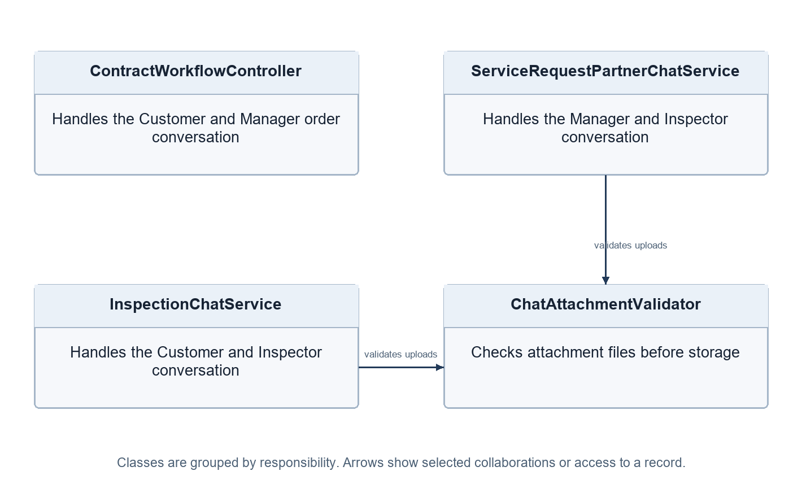

*Figure 4.43 Scoped Conversations Class Diagram*

**Class Specifications**

| No | Class or Component | Responsibility |
| :---: | :--- | :--- |
| 01 | ContractWorkflowController | Handles messages and attachments between the Customer and the assigned Manager. |
| 02 | InspectionChatService | Limits inspection messages and attachments to the owning Customer and assigned Inspector. |
| 03 | ServiceRequestPartnerChatService | Limits partner messages and attachments to the Manager and Inspector for the request. |
| 04 | ChatAttachmentValidator | Checks file type, name, and size before storing an attachment. |
| 05 | Web and mobile inboxes | Keep each conversation separate and show its messages, unread count, and attachments. |

#### 3.10.2 Order, Partner, and Inspection Chat Sequence

*Figure 4.44 Order, Partner, and Inspection Chat Sequence*

#### 3.10.3 Attachment Request Outside Conversation Scope

*Figure 4.45 Attachment Request Outside Conversation Scope*

#### 3.10.4 Design Rules and Test References

Attachment rights follow the conversation, not possession of a file identifier.

These scenarios describe expected behavior. See Report 5 for the execution result and supporting evidence.

| Case | Scenario | Expected behavior |
| --- | --- | --- |
| WF2-001 | Keep order chat and its files scoped to the request. | Only the owning Customer and assigned Manager can read the conversation and validated attachments. Eligible visits can receive bulk assignments. |
| WF2-027 | Share a message and attachment in the Manager and Inspector thread. | Store the message privately and update its read state. Allow access only to the Manager and Inspector assigned to the thread. |

### 3.11 FE-11 Assignment Expiry

An unanswered assignment expires after the configured window. The system releases the reservation and notifies the Manager so the visit can be assigned again.

#### 3.11.1 Class Diagram

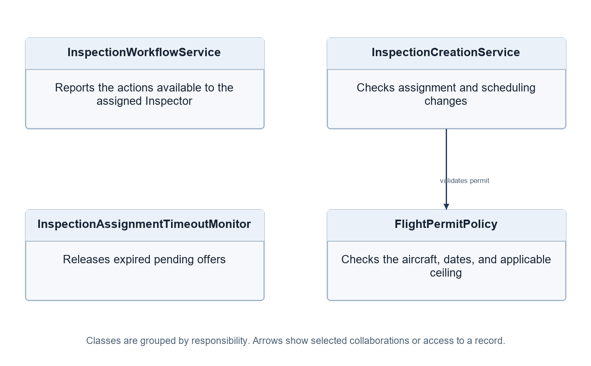

*Figure 4.46 Assignment Eligibility and Permits Class Diagram*

**Class Specifications**

| No | Class or Component | Responsibility |
| :---: | :--- | :--- |
| 01 | PlatformOperationsSettingsService | Lets an Admin configure how long an Inspector has to accept an offer. |
| 02 | InspectionAssignmentTimeoutMonitor | Clears expired offers and returns the affected visit to the assignment queue. |
| 03 | Settings and expiry notification | Show the configured timeout and take the Manager to the request that needs a new assignment. |

#### 3.11.2 Assignment Expiry Sequence

*Figure 4.47 Assignment Expiry Sequence*

#### 3.11.3 Withdraw an Accepted Assignment Before Field Work

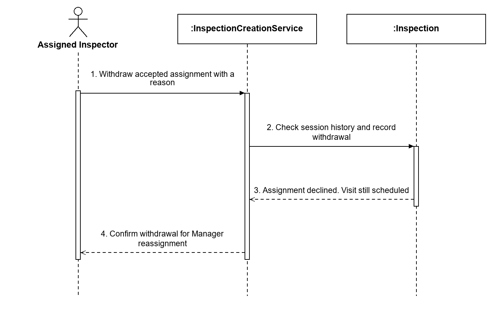

*Figure 4.48 Withdraw an Accepted Assignment Before Field Work*

#### 3.11.4 Inspection

*Figure 4.49 Inspection State Model*

A scheduled inspection can start field work only after its access, assignment, and permit checks succeed. For pre-field withdrawal the inspection remains scheduled while the assignment becomes declined and requires replacement.

Related design sections are FE-11, FE-13 and FE-14.

#### 3.11.5 Design Rules and Test References

Withdrawal sets the assignment to `DECLINED` while the inspection remains `SCHEDULED`. The reassignment flag stays set until the Manager recovers or cancels the visit.

These scenarios describe expected behavior. See Report 5 for the execution result and supporting evidence.

| Case | Scenario | Expected behavior |
| --- | --- | --- |
| WF2-021 | Let a pending assignment expire before the Inspector accepts it. | Make the visit available for reassignment and notify the responsible Manager. |
| WF2-032 | Withdraw an accepted assignment before field work | Eligibility is true before withdrawal. The operation succeeds and the scheduled occurrence requires reassignment. |

### 3.12 FE-12 Notifications

Workflow events create alerts for the people involved. Opening a notification still requires access to the related record. The same event can be retried without creating a duplicate alert.

#### 3.12.1 Class Diagram

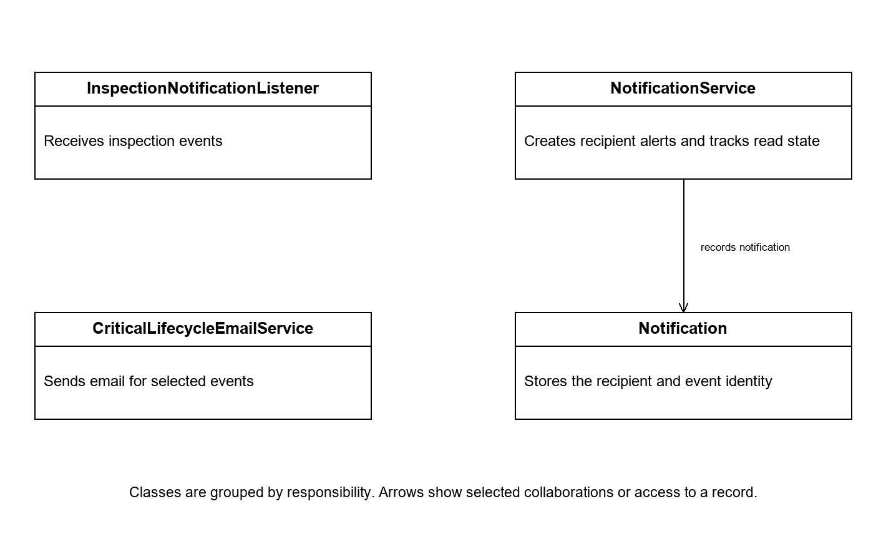

*Figure 4.50 Lifecycle Notifications Class Diagram*

**Class Specifications**

| No | Class or Component | Responsibility |
| :---: | :--- | :--- |
| 01 | Notification listeners | Convert request, inspection, application, and payment events into alerts. |
| 02 | NotificationService and email service | Store alerts once, track read status, and send emails for important events. |
| 03 | Notification bell and inbox | Show unread alerts and open the related record through an approved portal link. |

#### 3.12.2 Notification Delivery Sequence

*Figure 4.51 Notification Delivery Sequence*

#### 3.12.3 Notification Event Delivered Again

*Figure 4.52 Notification Event Delivered Again*

#### 3.12.4 Design Rules and Test References

The target record still requires its ordinary access check.

These scenarios describe expected behavior. See Report 5 for the execution result and supporting evidence.

| Case | Scenario | Expected behavior |
| --- | --- | --- |
| WF2-025 | Create a service request and replay its notification event. | Send one notice with a link to the request to each active Manager. |
| WF1-020 | Deliver the same domain event twice and mark the resulting notice as read. | Keep one notice for the recipient. Preserve its read state and reject updates by other users. |
| WF2-028 | Retry bilingual notifications and mark alerts as read. | Persist one alert per recipient and event. Deliver critical email where configured. Reading alerts updates only the authenticated recipient and keeps authorized links usable. |

### 3.13 FE-13 Flight Permits

The assigned Inspector uploads and attests the permit. It becomes effective after the system validates it. A change of drone or a reschedule outside the permit window requires another upload.

#### 3.13.1 Class Diagram

See Figure 4.46. The shared model identifies the inspection service and permit policy that check the aircraft and flight window.

**Class Specifications**

| No | Class or Component | Responsibility |
| :---: | :--- | :--- |
| 01 | InspectionController | Accepts the permit from the assigned Inspector and serves the uploaded document to authorized users. |
| 02 | FlightPermitPolicy | Checks file validity, the scheduled window, the drone, and the applicable altitude limit. |
| 03 | Permit panel and preview | Show upload and validation status. The Inspector can decline when the required permit cannot be obtained. |

#### 3.13.2 Flight Permit Validation Sequence

*Figure 4.53 Flight Permit Validation Sequence*

#### 3.13.3 Drone Change Invalidates the Permit

*Figure 4.54 Drone Change Invalidates the Permit*

#### 3.13.4 Design Rules and Test References

The permit is tied to both the aircraft and the scheduled window.

These scenarios describe expected behavior. See Report 5 for the execution result and supporting evidence.

| Case | Scenario | Expected behavior |
| --- | --- | --- |
| WF2-008 | Historical case for independent Manager permit approval. | This case is superseded. The current design validates the assigned Inspector's self-attestation and grants approval after a valid upload. See WF2-029. |
| WF2-009 | Historical case for the previous permit review flow. | This case is superseded. Use the active self-attestation and replacement-permit cases in this section for the current design. |
| WF2-029 | Submit a valid self-attested permit as the assigned Inspector. | Approve the uploaded permit immediately and unlock the pre-flight step. |
| WF2-030 | Open an uploaded permit as a Manager or Admin. | Provide a read-only permit view. |
| WF2-031 | Replace the drone or move the visit outside the permit dates. | Require the assigned Inspector to upload a valid replacement before field work can start. |
| WF2-033 | Reject withdrawal after an Inspector has aborted a started session | canWithdrawAssignment is false. The decline endpoint returns HTTP 409 ASSIGNMENT_FIELD_WORK_STARTED. |

### 3.14 FE-14 Field Sessions and Flight Data

The Inspector completes safety checks and records each flight within a field session. SmartDroneHub supplies read-only telemetry and video. When the Inspector records an abort, the Manager can reschedule, reassign, or cancel the visit. The Customer receives flight summaries and traces after report publication.

#### 3.14.1 Class Diagram

*Figure 4.55 Field Session and Flight Data Class Diagram*

**Class Specifications**

| No | Class or Component | Responsibility |
| --- | --- | --- |
| 01 | InspectionFieldSessionService | Starts, completes, and aborts a session for the assigned Inspector. |
| 02 | InspectionDroneHubService | Reads permitted flight data and links a synchronized video to evidence. |
| 03 | FieldSessionFlight | Tracks individual flights separately from the parent session. |

#### 3.14.2 Field Session and Flight Data Sequence

*Figure 4.56 Field Session and Flight Data Sequence*

#### 3.14.3 Abort and Recovery Sequence

*Figure 4.57 Abort and Recovery Sequence*

#### 3.14.4 Reject Withdrawal After Field Abort

*Figure 4.58 Reject Withdrawal After Field Abort*

#### 3.14.5 Field Work and Evidence

*Figure 4.59 Field Work and Evidence*

| Step | Record Used | Rule |
| --- | --- | --- |
| Permit and planned window | Assigned Inspector, aircraft and permit | The permit must match the dates and drone. A restricted zone with a ceiling also requires an approved maximum altitude. |
| Flight record | Session, sortie and telemetry provenance | Record the session outcome and identify whether the flight data was imported or entered manually. |
| Evidence and findings | Evidence object and finding baseline | Link ready evidence to its findings. The Inspector confirms the set of findings used for the report. |
| Customer read scope | Ownership and publication check | The Customer can see inspection progress. Flight summaries and traces become visible after publication. |

#### 3.14.6 Field Session

*Figure 4.60 Field Session State Model*

The assigned Inspector completes or aborts a started session. A recorded abort preserves the reason and triggers the Manager recovery flow. It does not restore pre-field withdrawal eligibility for the same assignment.

Related design sections are FE-13 and FE-14.

#### 3.14.7 Design Rules and Test References

Field abort and pre-field withdrawal use different recovery rules.

These scenarios describe expected behavior. See Report 5 for the execution result and supporting evidence.

| Case | Scenario | Expected behavior |
| --- | --- | --- |
| WF2-011 | Start a field session with a permit and then complete or abort the session. | Check the permit dates and aircraft before starting. Preserve the recorded session outcome and flight data source. |
| WF2-012 | Start field work without a valid permit or checklist. | Reject a missing, invalidated, or expired permit, a blank required checklist note, or a concurrent session. No new session is created. |
| WF2-017 | Open inspection metrics in each role's dashboard. | Show scoped metrics and count only confirmed findings in the official defect charts. |
| WF2-018 | Open a visit from the Inspector schedule. | Show its schedule and warnings and open the relevant step in the visit. |
| WF3-020 | Import flight data or record a manual declaration. | Label the data source. Keep unavailable fields empty and show no fabricated GPS trace for manual entries. Reject access outside the assigned inspection. |

### 3.15 FE-15 Photo and Video Evidence

The system links each upload to its inspection and field session. Video uploads can resume after interruption. Processed media becomes available to authorized users once the playable file is ready.

#### 3.15.1 Class Diagram

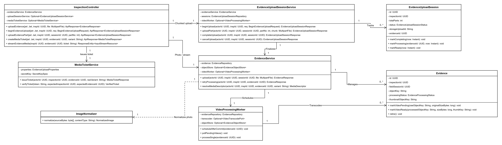

*Figure 4.61 Evidence Intake and Streaming Class Diagram*

**Class Specifications**

| No | Class or Component | Responsibility |
| :---: | :--- | :--- |
| 01 | EvidenceService and ImageNormalizer | Read capture details from photos, prepare thumbnails, and link the images to the inspection. |
| 02 | EvidenceUploadSessionService | Tracks the parts of resumable video uploads and records completion or failure. |
| 03 | VideoProcessingWorker and MediaTicketService | Prepare playable video and issue short-lived access tickets for authorized viewing. |
| 04 | Evidence workspace | Lets Inspectors upload files, review locations, and select video frames as evidence. |

#### 3.15.2 Evidence Upload and Processing Sequence

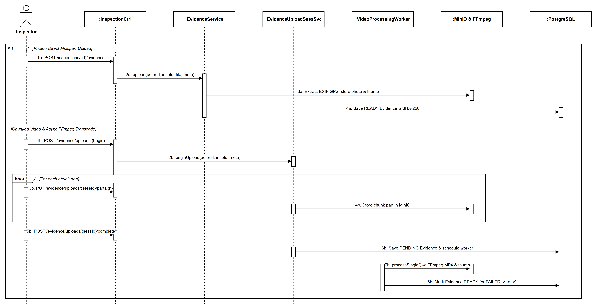

*Figure 4.62 Evidence Upload and Processing Sequence*

#### 3.15.3 Resume an Interrupted Video Upload

*Figure 4.63 Resume an Interrupted Video Upload*

#### 3.15.4 Design Rules and Test References

An upload session and the playable evidence item have different lifecycles.

These scenarios describe expected behavior. See Report 5 for the execution result and supporting evidence.

| Case | Scenario | Expected behavior |
| --- | --- | --- |
| WF3-002 | Upload evidence and handle repeated filenames. | Preserve capture metadata, assign distinct filenames, and reject corrupt or unauthorized uploads. |
| WF3-022 | Normalize an image and create its preview. | Preserve capture time, GPS and orientation. Store a thumbnail and retain the original size alongside the processed size. |
| WF3-023 | Resume or cancel a multipart video upload. | Retrying a part or completion is safe. Cancellation aborts unfinished parts. Reject expired sessions and unauthorized requests. |
| WF3-024 | Process a video in the background. | Keep raw data until the processed video and preview are verified and ready. A failed job retains enough data to retry. |
| WF3-025 | Stream evidence with a scoped access ticket. | Authorize the specific evidence and variant. Support byte ranges without exposing sign-in tokens in playback links. |

### 3.16 FE-16 Defect Detection and Findings

YOLO11 proposes defects from photos and video frames. An optional vision service can help when YOLO11 produces no detections or is unavailable. Platform settings determine whether high-confidence results can be confirmed automatically. The Inspector reviews findings and locks the set used by the report.

#### 3.16.1 Class Diagram

*Figure 4.64 Defect Detection Class Diagram*

**Class Specifications**

| No | Class or Component | Responsibility |
| --- | --- | --- |
| 01 | FindingService | Collects detection results and manages Inspector finding decisions. |
| 02 | PrimaryWithFallbackInference | Routes image analysis through the available, permitted provider. |
| 03 | Finding | Links the proposed or confirmed defect to the supporting evidence. |

#### 3.16.2 Defect Detection and Review Sequence

*Figure 4.65 Defect Detection and Review Sequence*

#### 3.16.3 Primary Detection Unavailable

*Figure 4.66 Primary Detection Unavailable*

#### 3.16.4 Design Rules and Test References

Detection suggestions do not replace the Inspector's confirmation of the finding baseline.

These scenarios describe expected behavior. See Report 5 for the execution result and supporting evidence.

| Case | Scenario | Expected behavior |
| --- | --- | --- |
| WF3-001 | Re-run detection and try to confirm a baseline with pending proposals. | Replace unreviewed suggestions and keep confirmed and manual findings. Resolve pending proposals before confirmation. |
| WF3-003 | Detect or manually record findings. | Keep candidates linked to their evidence. Independent Inspector decisions determine which entries are confirmed for the report. |
| WF3-004 | Try to change findings as an Inspector who is not assigned. | Restrict analysis, edits, and confirmation to the assigned Inspector. Give authorized Managers and Customers read access. |
| WF3-007 | Analyze a photo, then retry when the primary detector is unavailable. | Measure inference against the test target. Use the available vision fallback and keep manual finding entry available. |
| WF3-008 | Complete field evidence, review, publication and Customer payment. | Compile the report from confirmed findings, require independent Manager review, settle any applicable payout, and unlock Customer payment only after publication and acceptance. |
| WF3-010 | Change evidence after finding confirmation. | Edits before review require renewed confirmation. A submitted report locks relevant inputs, a return reopens correction, and publication locks the official result. |
| WF3-017 | Analyze a photo with an empty primary detection result. | Run the vision fallback when enabled and return its detections for Inspector review. |

### 3.17 FE-17 Finding Notes and Knowledge References

DroneKnowledgeAI searches engineering standards, the Customer's past cases, and anonymized examples. It can search by text when embeddings are unavailable. Related cases help draft suggested finding notes. The report summary uses confirmed inspection data and lists source references separately.

#### 3.17.1 Class Diagram

*Figure 4.67 Finding Notes and References Class Diagram*

**Class Specifications**

| No | Class or Component | Responsibility |
| --- | --- | --- |
| 01 | HistoricalCaseService | Retrieves authorized references and prepares context for suggestions. |
| 02 | HistoricalCaseAdvisorPort | Allows retrieval and draft assistance through provider adapters. |
| 03 | DroneKnowledgeClient | Calls the configured embeddings and note drafting providers. |

#### 3.17.2 Finding Notes and References Sequence

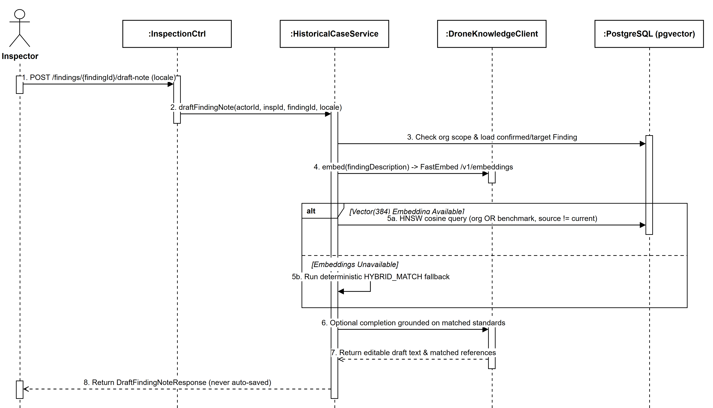

*Figure 4.68 Finding Notes and References Sequence*

#### 3.17.3 Embeddings Endpoint Unavailable

*Figure 4.69 Embeddings Endpoint Unavailable*

#### 3.17.4 Design Rules and Test References

The fallback preserves the same record scope as vector retrieval.

These scenarios describe expected behavior. See Report 5 for the execution result and supporting evidence.

| Case | Scenario | Expected behavior |
| --- | --- | --- |
| WF3-029 | Request related cases or a suggested finding note. | Limit retrieval to authorized cases and anonymized examples. Present references and editable text without saving or confirming the finding automatically. |
| WF3-030 | Show case and standards references with a report summary. | Display the references separately. The Inspector remains responsible for the submitted report and the Manager for its review. |

### 3.18 FE-18 Report Review and Publication

The Inspector submits a report version based on confirmed findings. A Manager who did not author the report approves it or returns it for correction. If payout applies, the Manager can publish only after settlement. The published PDF is the official Customer deliverable.

#### 3.18.1 Class Diagram

*Figure 4.70 Report Review Class Diagram*

**Class Specifications**

| No | Class or Component | Responsibility |
| --- | --- | --- |
| 01 | ReportService | Manages versions and enforces review, payout, and publication rules. |
| 02 | ReportDraftClient | Drafts a summary from the supplied inspection context. |
| 03 | PdfReportRenderer | Renders the official report artifact. |

#### 3.18.2 Report Review and Publication Sequence

*Figure 4.71 Report Review and Publication Sequence*

#### 3.18.3 Report Returned for Correction

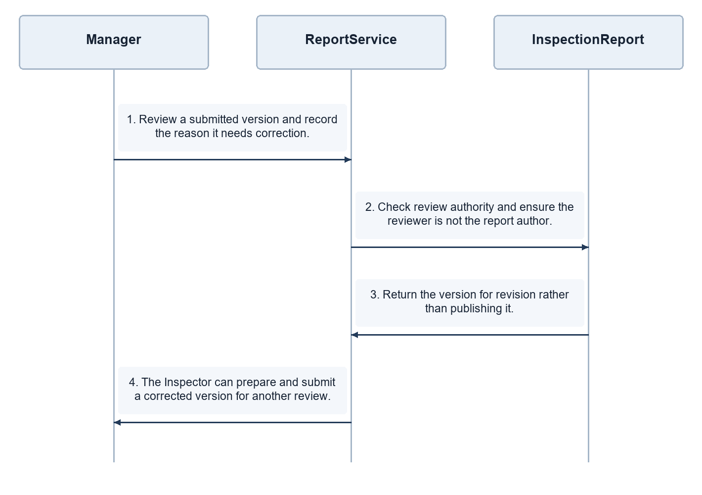

*Figure 4.72 Report Returned for Correction*

#### 3.18.4 Official Publication and Settlement

*Figure 4.73 Official Publication and Settlement*

| Step | Record Used | Rule |
| --- | --- | --- |
| Review and payout | Report version and Inspector payout | Return a report for correction or approve it. Resolve an applicable payout before publication. |
| Official report | Published version and ownership | The owning Customer gains access to the official report after publication. |
| Customer settlement | Accepted version, invoice and payment order | Acceptance opens checkout. The backend verifies the gateway message and matches the reference and amount. |
| Follow-up | Receipt, refund ledger or re-inspection | Keep the original inspection and payment history. A re-inspection links the new findings and evidence to the original record. |

#### 3.18.5 Report Version

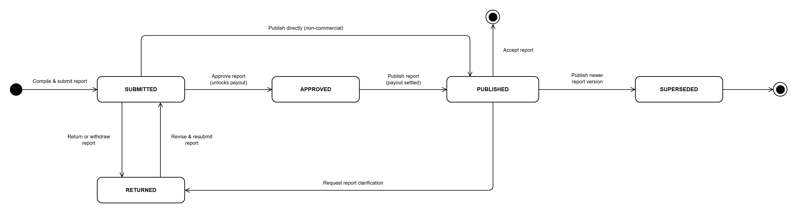

*Figure 4.74 Report Version State Model*

The independent Manager returns or approves the submitted version. An applicable payout must settle before the approved document becomes the official published version.

Related design sections are FE-18 and FE-22.

#### 3.18.6 Design Rules and Test References

Only an independently reviewed version can move toward publication.

These scenarios describe expected behavior. See Report 5 for the execution result and supporting evidence.

| Case | Scenario | Expected behavior |
| --- | --- | --- |
| WF3-005 | Prepare the executive summary and submit the inspection report. | Move the version into review and retain the submitted summary and findings. |
| WF3-006 | Independently review and publish the inspection report. | Reject self-review. In the current design approval precedes publication and any applicable payout must settle first. Customer acceptance opens payment through Sepay or VNPay. |
| WF3-009 | Read progress and report queues with scoped access. | The Inspector reads assigned inspections and the Customer reads their own. Staff reads follow the server scope. The official report is visible to the owning Customer after publication. |
| WF3-016 | Download the report PDF and publish a newer report version. | Generate the PDF when requested. Keep the earlier version and its PDF in the version history. |

### 3.19 FE-19 Report Acceptance and Clarification

The owning Customer can request clarification before acceptance. Acceptance applies to the published version the Customer reviewed and opens payment for that visit.

#### 3.19.1 Class Diagram

*Figure 4.75 Report Acceptance and Invoicing Class Diagram*

**Class Specifications**

| No | Class or Component | Responsibility |
| :---: | :--- | :--- |
| 01 | ContractWorkflowService | Records acceptance for the published report version and opens payment. |
| 02 | ReportService | Accepts clarification requests from the owning Customer before acceptance. |
| 03 | Customer report and settlement views | Show the published PDF and offer separate actions for clarification and acceptance. |

#### 3.19.2 Customer Report Acceptance Sequence

*Figure 4.76 Customer Report Acceptance Sequence*

#### 3.19.3 Clarification Before Acceptance

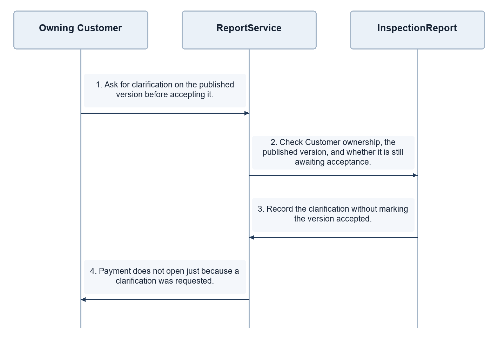

*Figure 4.77 Clarification Before Acceptance*

#### 3.19.4 Design Rules and Test References

Clarification and acceptance are separate Customer decisions.

These scenarios describe expected behavior. See Report 5 for the execution result and supporting evidence.

| Case | Scenario | Expected behavior |
| --- | --- | --- |
| WF3-012 | Accept a report, pay through Sepay or VNPay, and open the receipt. | Open payment on acceptance. Make the receipt available after verified settlement. |

### 3.20 FE-20 Online Payment

After accepting a report, the Customer can pay in VND through Sepay VietQR or VNPay. The backend checks the gateway message and matches the order and amount before recording payment. Returning from the gateway shows the stored result.

#### 3.20.1 Class Diagram

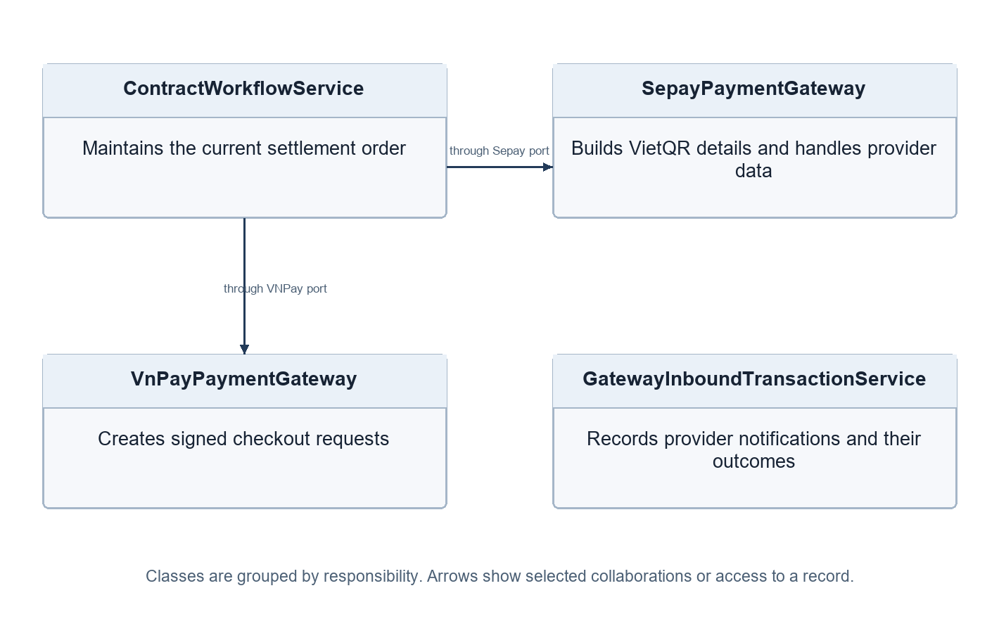

*Figure 4.78 Online Settlement Class Diagram*

**Class Specifications**

| No | Class or Component | Responsibility |
| :---: | :--- | :--- |
| 01 | SepayPaymentGateway | Creates VietQR transfer details and verifies notifications from Sepay. |
| 02 | GatewayInboundTransactionService | Records gateway events, protects against repeat processing, and preserves the result for audit. |
| 03 | VnPayPaymentGateway | Signs checkout requests, verifies payment notifications, and returns the Customer to the settlement screen. |
| 04 | ContractWorkflowService | Keeps one active unresolved order and releases it when the gateway confirms cancellation or expiry. |

#### 3.20.2 Online Payment Sequence

*Figure 4.79 Online Payment Sequence*

#### 3.20.3 Gateway Amount Does Not Match

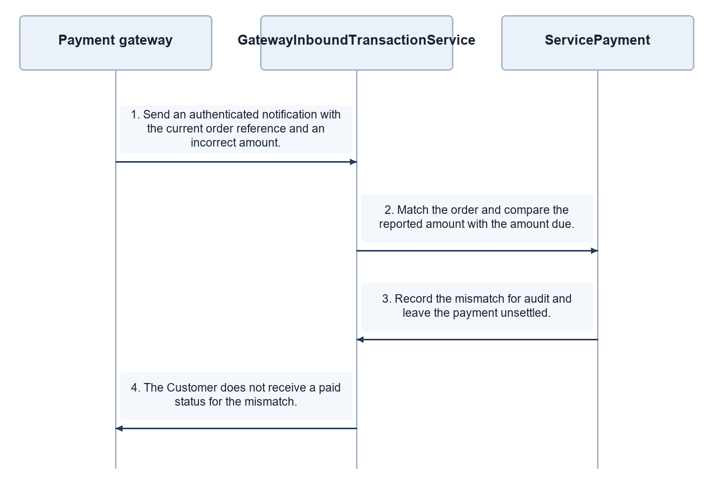

*Figure 4.80 Gateway Amount Does Not Match*

#### 3.20.4 Customer Payment

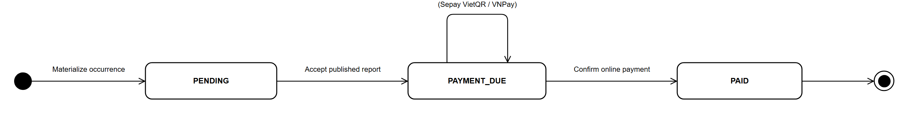

*Figure 4.81 Customer Payment State Model*

Customer acceptance opens payment for the visit. Gateway verification checks the active order and exact amount before recording payment. Payment and refund history remain traceable.

Related design sections are FE-19, FE-20 and FE-21.

#### 3.20.5 Design Rules and Test References

An authenticated callback must still match the amount and reference.

These scenarios describe expected behavior. See Report 5 for the execution result and supporting evidence.

| Case | Scenario | Expected behavior |
| --- | --- | --- |
| WF3-018 | Inspect the invoice, payment, and payout records for a scheduled visit. | Store the invoice amount, Customer payment state, and payout recipient in separate records. |
| WF3-019 | Track invoice, Customer payment and partner payout separately. | Keep separate records. Use report approval to establish payout eligibility and record actual disbursement independently of Customer checkout. |

### 3.21 FE-21 Invoices and Payment Deadlines

Acceptance starts the configurable payment window, which defaults to 15 days. The invoice retains the rates applied when it was issued. The Customer can download a notice while payment is due and a receipt after payment.

#### 3.21.1 Class Diagram

See Figure 4.75. The shared model separates the accepted report, invoice snapshot, and payment deadline.

**Class Specifications**

| No | Class or Component | Responsibility |
| :---: | :--- | :--- |
| 01 | InspectionFinanceCalculator and ServiceInvoice | Apply the configured commission and tax rates and store a copy on the invoice. |
| 02 | PaymentDueExpiryService | Sets the due date on acceptance and sends an overdue alert once. |
| 03 | PaymentDocumentService | Serves the payment notice while an amount is due and the receipt after it is paid. |

#### 3.21.2 Payment Deadline and Document Sequence

*Figure 4.82 Payment Deadline and Document Sequence*

#### 3.21.3 Issue One Alert After Payment Deadline

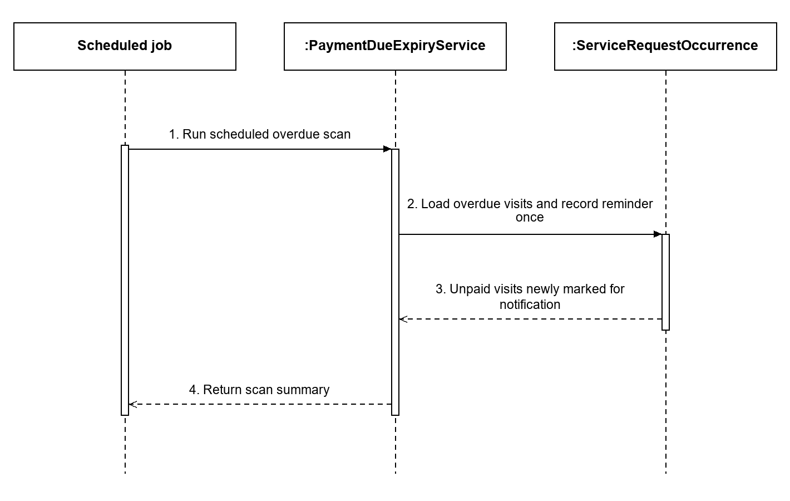

*Figure 4.83 Issue One Alert After Payment Deadline*

#### 3.21.4 Design Rules and Test References

The due date is fixed when the published report is accepted.

These scenarios describe expected behavior. See Report 5 for the execution result and supporting evidence.

| Case | Scenario | Expected behavior |
| --- | --- | --- |
| WF3-026 | Open a payment deadline on report acceptance. | Stamp the due date once. Notify on overdue payment without changing the payment state or removing report access. |
| WF3-027 | Download a payment notice or receipt. | Show the notice after acceptance and the receipt after verified payment. Scope the read and label both as records rather than tax invoices. |

### 3.22 FE-22 Inspector Payout

Report approval makes the Inspector eligible for payout. The Manager can record settlement, and Sepay can reconcile a matching transfer. The system checks payout settlement before publication when it applies.

#### 3.22.1 Class Diagram

*Figure 4.84 Payouts and Refund Recovery Class Diagram*

**Class Specifications**

| No | Class or Component | Responsibility |
| :---: | :--- | :--- |
| 01 | ReportService and InspectorPayout | Make payout available after approval and check settlement before publication. |
| 02 | OccurrenceFinanceResponse | Shows authorized payout amounts, deductions, refund holds, and receivable information. |
| 03 | Payout workspace | Lets a Manager record a transfer and shows the Inspector the details of their own payout. |

#### 3.22.2 Inspector Payout Sequence

*Figure 4.85 Inspector Payout Sequence*

#### 3.22.3 Report Publication Waits for Payout

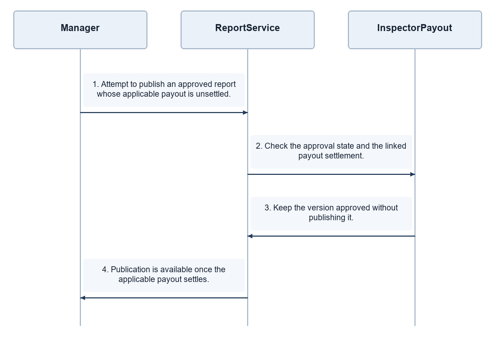

*Figure 4.86 Report Publication Waits for Payout*

#### 3.22.4 Inspector Payout

*Figure 4.87 Inspector Payout State Model*

Report approval establishes eligibility. The payout hold and settlement status govern whether the applicable report publication gate can proceed. Completed payouts stay in history even if a later refund creates a receivable.

Related design sections are FE-22 and FE-23.

#### 3.22.5 Design Rules and Test References

Customer checkout and Inspector payout have separate settlement records.

These scenarios describe expected behavior. See Report 5 for the execution result and supporting evidence.

| Case | Scenario | Expected behavior |
| --- | --- | --- |
| WF3-033 | Reconcile an Inspector payout, replay the reference, and try a held payout. | Record the transfer once with the Manager and time. Refuse payment while a refund hold is active. |

### 3.23 FE-23 Refunds and Inspector Receivables

A Manager can initiate a refund against a captured payment. A pending refund holds an unpaid payout. The Manager records how the refund is allocated, and the amounts must add up to the refund total. After a completed payout, the system records any recoverable amount separately and keeps the original payout in the ledger.

#### 3.23.1 Class Diagram

See Figure 4.84. The shared model separates the historic payout, refund allocation, and receivable created after settlement.

**Class Specifications**

| No | Class or Component | Responsibility |
| :---: | :--- | :--- |
| 01 | ContractWorkflowController and ServiceRefund | Check the refundable balance and record a refund request, transfer, or cancellation. |
| 02 | InspectorReceivable and recovery records | Keep track of money to recover from an Inspector after a paid visit is refunded. |
| 03 | Refund controls | Let a Manager record and reconcile refunds and log collections against a receivable. |

#### 3.23.2 Refund and Receivable Sequence

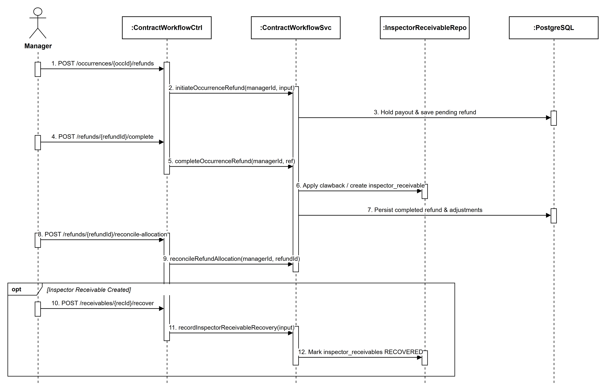

*Figure 4.88 Refund and Receivable Sequence*

#### 3.23.3 Refund After Payout Settlement

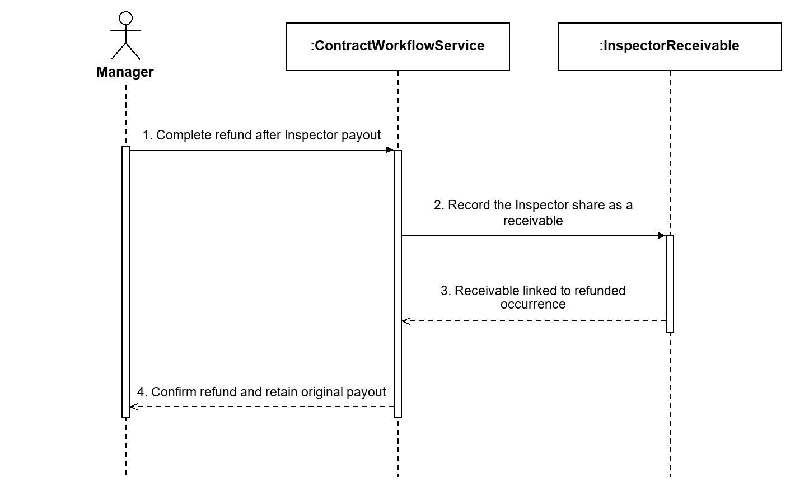

*Figure 4.89 Refund After Payout Settlement*

#### 3.23.4 Design Rules and Test References

The refund and collection trail remains attributable to the original occurrence.

These scenarios describe expected behavior. See Report 5 for the execution result and supporting evidence.

| Case | Scenario | Expected behavior |
| --- | --- | --- |
| WF3-021 | Protect checkout and preserve refund accounting. | Keep an unresolved order from being overwritten. Hold an unpaid payout during refund handling. Preserve an already settled payout and record its recoverable share separately. |

### 3.24 FE-24 Re-inspection and Defect Verification

A follow-up visit refers to the original published report. The assigned Inspector compares each original finding with fresh evidence from the follow-up session. The verdict can be resolved, unresolved, or inconclusive. An expired resolved verdict needs fresh evidence before publication.

#### 3.24.1 Class Diagram

*Figure 4.90 Re-inspection Class Diagram*

**Class Specifications**

| No | Class or Component | Responsibility |
| :---: | :--- | :--- |
| 01 | ReinspectionVerificationService | Checks access and ties each verdict to evidence captured during the assigned follow-up visit. |
| 02 | Web and mobile re-inspection views | Show the original and new evidence together and flag resolved findings that have expired or are near expiry. |

#### 3.24.2 Re-inspection Verification Sequence

*Figure 4.91 Re-inspection Verification Sequence*

#### 3.24.3 Reject Expired Resolved Verdict

*Figure 4.92 Reject Expired Resolved Verdict*

#### 3.24.4 Design Rules and Test References

The comparison remains linked to the original published finding.

These scenarios describe expected behavior. See Report 5 for the execution result and supporting evidence.

| Case | Scenario | Expected behavior |
| --- | --- | --- |
| WF3-028 | Verify a resolved verdict using current evidence. | Accept fresh evidence from the completed follow-up session. Reject reused source evidence and prevent duplicate open follow-up inspections. |
| WF3-031 | Check Customer mobile parity for related records. | Show verdict expiry warnings, payment documents, assigned-inspection chat and knowledge references where that Customer is authorized. |
