## 3. Detailed Design

### 3.1 FE-01 Customer Registration, Sign-In and Account Access

#### 3.1.1 Class Diagram

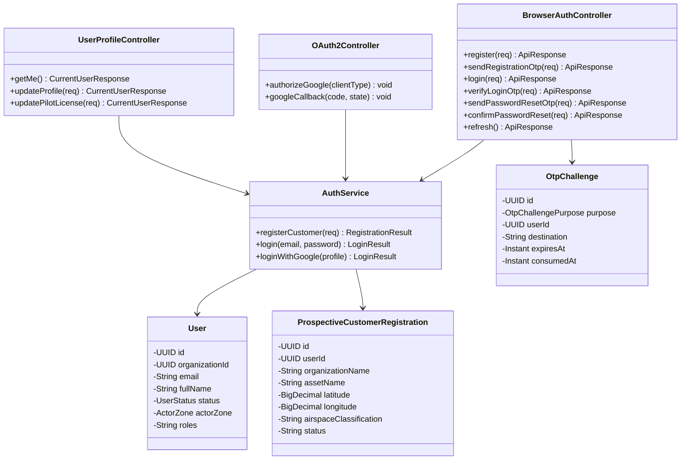

**Class Specifications**

| No | Class | Description |
| :---: | :--- | :--- |
| 01 | `BrowserAuthController` & `MobileAuthController` | Handle customer registration, email and password sign-in, one-time verification code delivery and confirmation, password reset, and session token refresh for web and mobile clients. |
| 02 | `OAuth2Controller` | Handles federated Google OAuth 2.0 sign-in and callback redirection for web browsers and mobile deep links. |
| 03 | `UserProfileController` | Allows signed-in users to view and update their personal account profile, change their password, and maintain pilot license details. |
| 04 | `AuthService` | Coordinates credential verification, account lockout after repeated failed attempts, airspace screening during customer onboarding, and JWT session issuance. |
| 05 | `User` & `OtpChallenge` | Domain entities representing user accounts across the five system roles and time-limited verification challenges for sign-in, registration, and password reset. |
| 06 | `ProspectiveCustomerRegistration` | Domain entity recording a customer organization and initial asset registration request along with its airspace classification result. |

#### 3.1.2 Customer Registration and User Sign-In Sequence Diagram

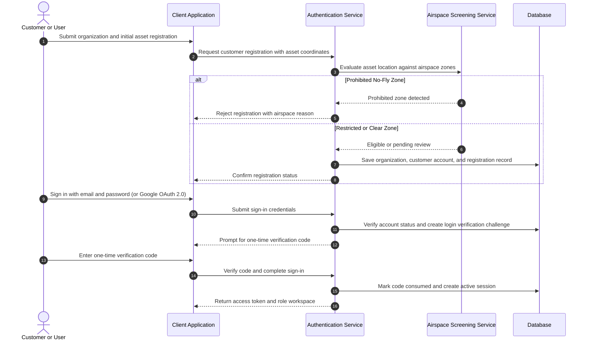

---

### 3.2 FE-02 Partner Qualification, Workforce, Assets and Drone Registration

#### 3.2.1 Class Diagram

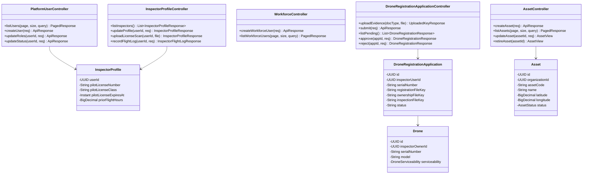

**Class Specifications**

| No | Class | Description |
| :---: | :--- | :--- |
| 01 | `PlatformUserController` & `InspectorProfileController` | Allow platform administrators and managers to provision Inspector accounts, maintain pilot license credentials, upload license scans, and record flight logs. |
| 02 | `WorkforceController` | Allows a Customer organization manager to provision and manage Maintenance Engineer accounts within that customer organization. |
| 03 | `AssetController` & `AssetDocumentController` | Manage customer infrastructure assets, structural inspection checkpoints, and engineering reference documents, blocking asset creation inside prohibited No-Fly Zones. |
| 04 | `DroneRegistrationApplicationController` | Handles Inspector drone registration submissions with three required documents (registration, ownership, and technical inspection) and platform review decisions. |
| 05 | `InspectorProfile`, `Drone` & `Asset` | Domain entities representing Inspector qualifications, approved Inspector-owned drones, and customer infrastructure assets. |

#### 3.2.2 Partner Provisioning and Customer Workforce Sequence Diagram

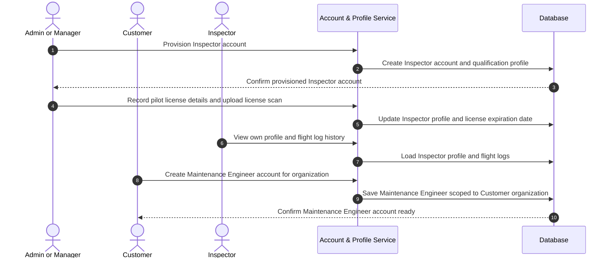

#### 3.2.3 Inspector-Owned Drone Registration Sequence Diagram

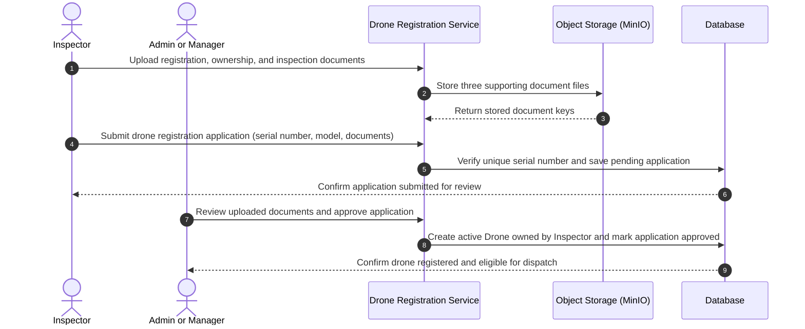

#### 3.2.4 WF-01 Onboarding, Asset and Drone Registry Activity Diagram

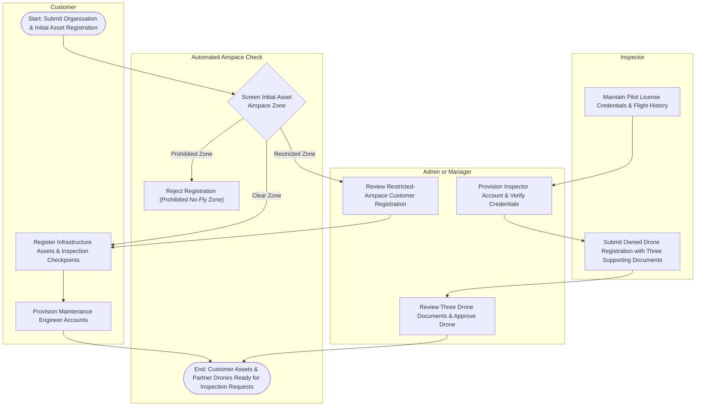

---

### 3.3 FE-03 Recurring Service Requests, Occurrences and Notifications

#### 3.3.1 Class Diagram

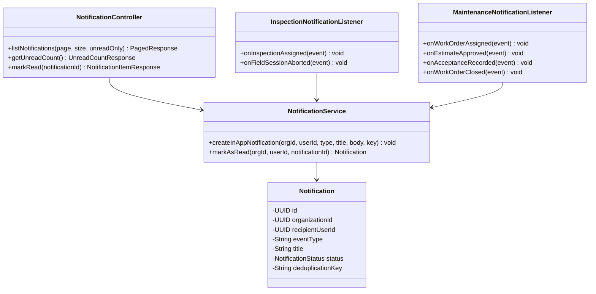

**Class Specifications**

| No | Class | Description |
| :---: | :--- | :--- |
| 01 | `ContractWorkflowService` | Expands accepted one-time and recurring service requests into individual inspection occurrences based on the agreed recurrence interval and schedule window. |
| 02 | `NotificationController` & `NotificationService` | Provide the in-app notification inbox, unread notification counter, and read-status updates for signed-in users. |
| 03 | `InspectionNotificationListener` & `MaintenanceNotificationListener` | Consume transactional domain events (such as mission assignment, aborted field sessions, estimate approval, and work order closure) to create deduplicated in-app notifications. |
| 04 | `Notification` | Domain entity representing a user notification scoped by organization and deduplication key. |

#### 3.3.2 Recurring Occurrences and Notification Sequence Diagram

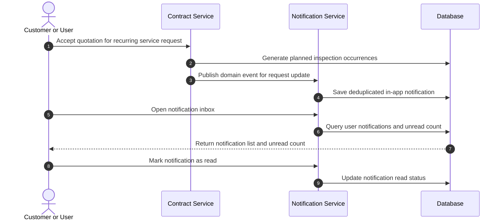

---

### 3.4 FE-04 Service Requests, Quotations, Contracts, Dispatch and Airspace Map

#### 3.4.1 Class Diagram

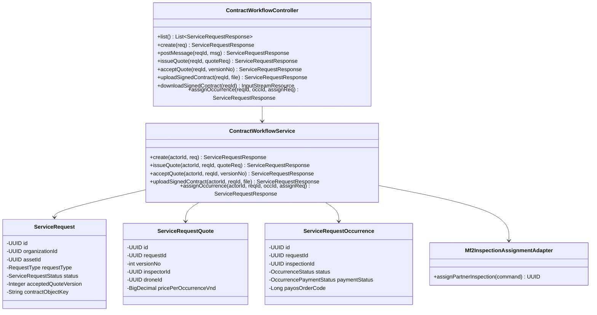

**Class Specifications**

| No | Class | Description |
| :---: | :--- | :--- |
| 01 | `ContractWorkflowController` & `ContractWorkflowService` | Manage customer inspection service requests, order chat messages, versioned VND quotations, quote acceptance, signed paper agreement uploads, and occurrence dispatch. |
| 02 | `Mf2InspectionAssignmentAdapter` | Validates Inspector pilot license status, drone ownership, and schedule availability across customer organizations before creating a scheduled inspection mission. |
| 03 | `ServiceRequest`, `ServiceRequestQuote` & `ServiceRequestOccurrence` | Domain entities representing the customer request, each proposed VND quotation version, and the individual inspection occurrences generated upon quote acceptance. |

#### 3.4.2 Service Request, Quotation, Signed Contract and Dispatch Sequence Diagram

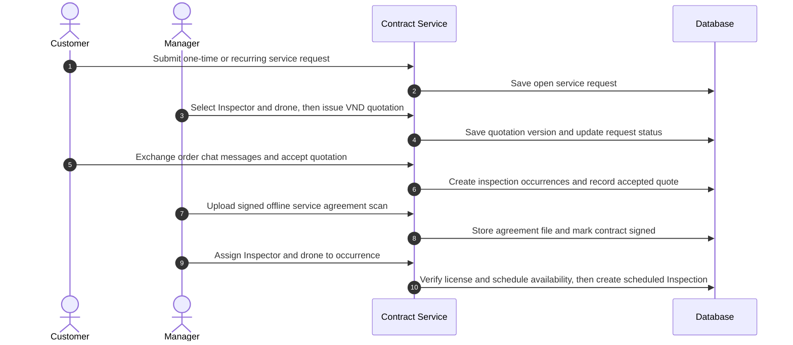

#### 3.4.3 WF-02 Service Request, Quotation, Contract and Dispatch Activity Diagram

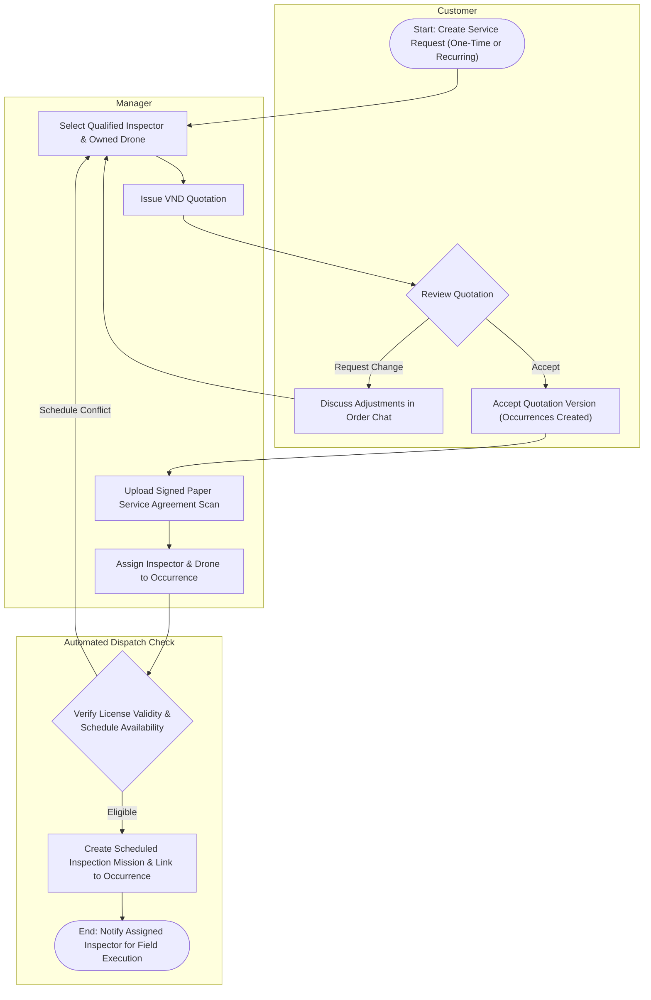

---

### 3.5 FE-05 Flight Permit Gate and Field Inspection Execution

#### 3.5.1 Class Diagram

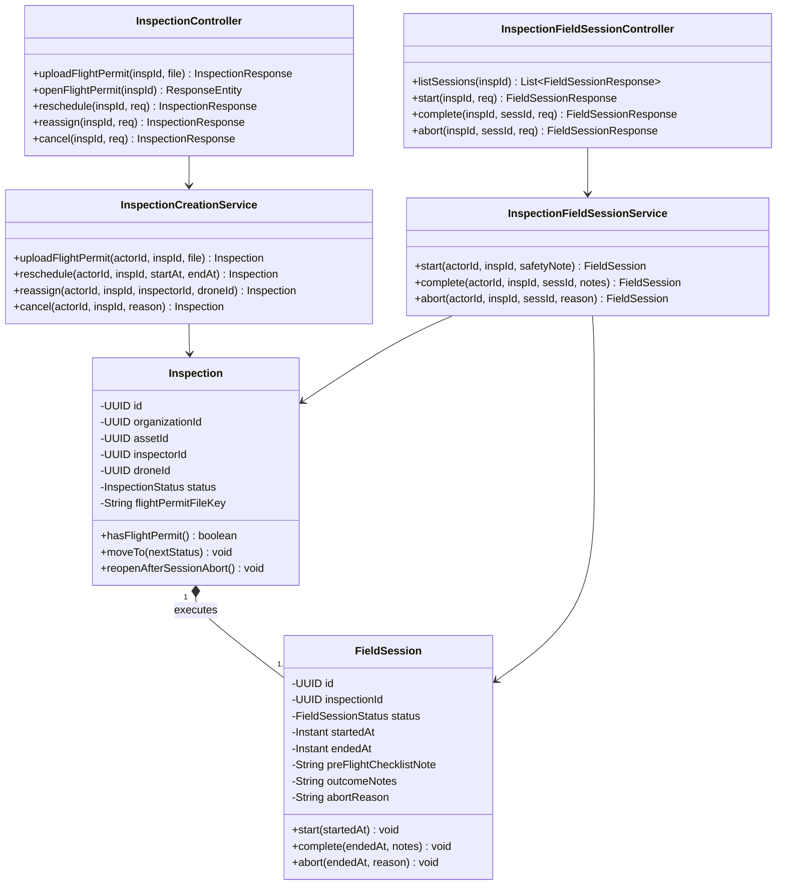

**Class Specifications**

| No | Class | Description |
| :---: | :--- | :--- |
| 01 | `InspectionController` & `InspectionCreationService` | Handle mission flight permit uploads and provide Manager recovery actions (reschedule, reassign, or cancel) when an on-site field session is aborted. |
| 02 | `InspectionFieldSessionController` & `InspectionFieldSessionService` | Govern on-site field session execution, enforcing that a session can start only when the inspection is scheduled with a flight permit on file, and recording either normal completion or session abort. |
| 03 | `Inspection` | Aggregate root representing an inspection mission, its assigned Inspector and drone, flight permit reference, and six-state mission status. |
| 04 | `FieldSession` | Domain entity recording the start time, pre-flight safety note, end time, completion outcome notes, or abort reason of an on-site flight survey. |

#### 3.5.2 Flight Permit and Field Inspection Execution Sequence Diagram

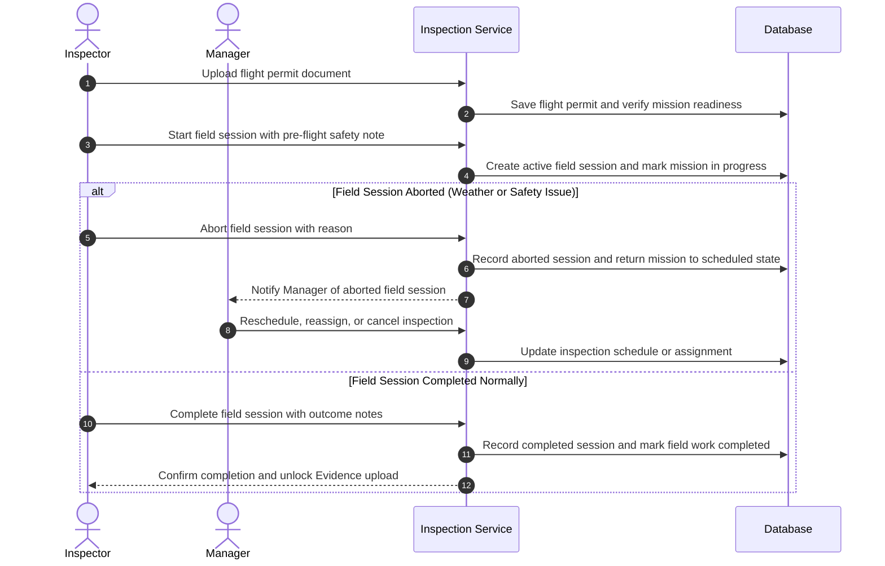

---

### 3.6 FE-06 Evidence Intake, AI Defect Detection, Inspection Report and Payment

#### 3.6.1 Defect Detection and Finding Confirmation Class Diagram

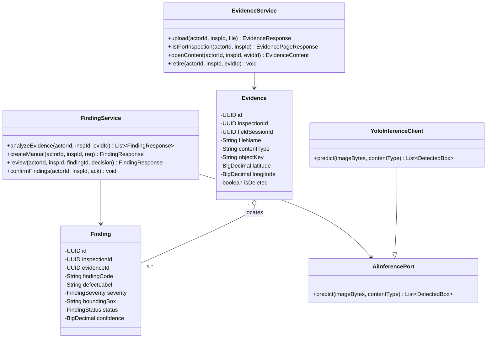

#### 3.6.2 Defect Detection and Finding Confirmation Sequence Diagram

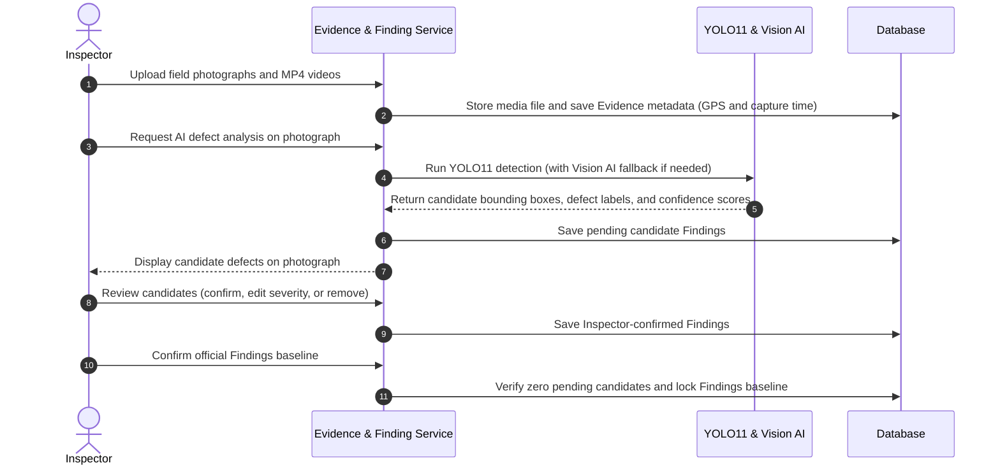

#### 3.6.3 Inspection Report, Publication and Online Payment Class Diagram

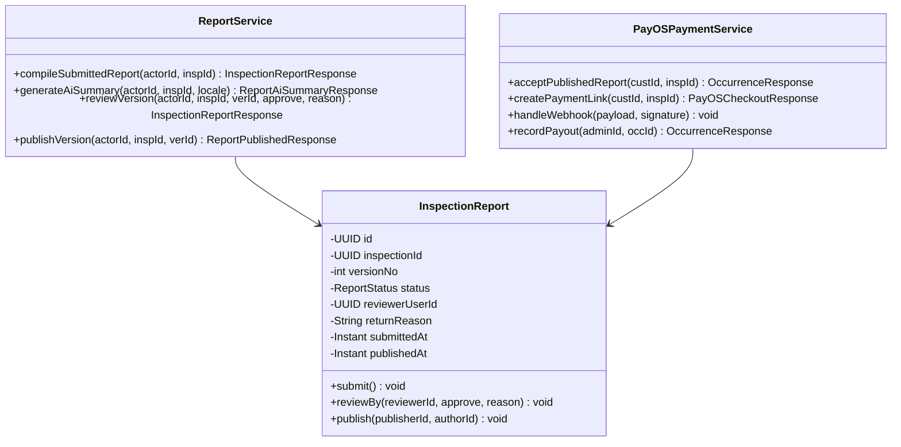

**Class Specifications**

| No | Class | Description |
| :---: | :--- | :--- |
| 01 | `EvidenceService` | Uploads, streams, and retires field photographs and MP4 videos associated with an inspection session. |
| 02 | `FindingService` & `YoloInferenceClient` | Invoke YOLO11 and Vision fallback defect detection on inspection photographs, manage manual and AI-suggested findings, and lock the confirmed findings baseline. |
| 03 | `ReportService` & `InspectionReport` | Compile structured inspection reports from confirmed findings, generate AI executive summaries, enforce independent Manager review, and publish official report versions. |
| 04 | `PayOSPaymentService` | Records Customer report acceptance, generates PayOS VietQR and VNPay online payment links in VND, verifies payment webhook callbacks, and updates customer payment and partner payout statuses. |

#### 3.6.4 Report Compilation, Publication and Payment Sequence Diagram

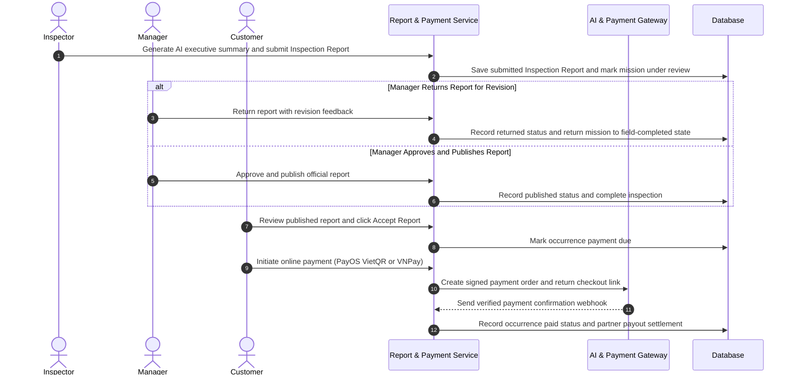

#### 3.6.5 WF-03 Inspection, Reporting and Payment Activity Diagram

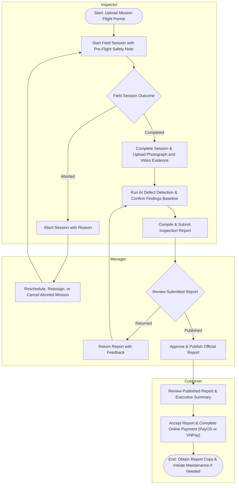

---

### 3.7 FE-07 Maintenance Work Orders, Repair Planning and Field Execution

#### 3.7.1 Class Diagram

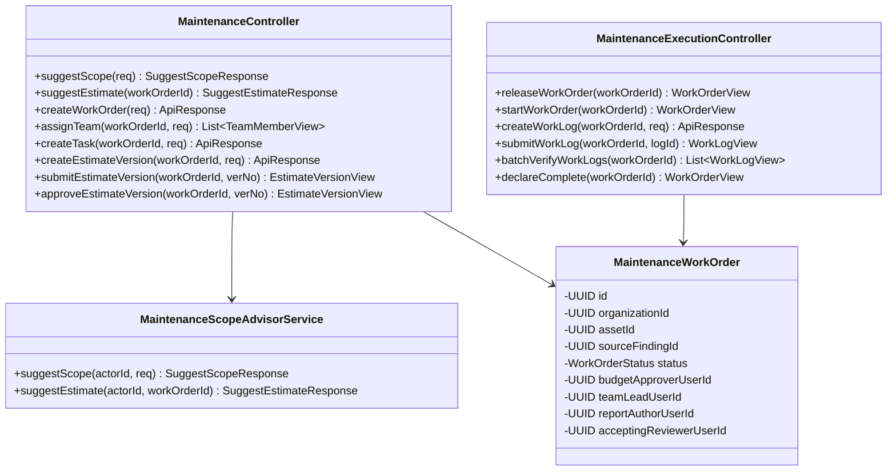

**Class Specifications**

| No | Class | Description |
| :---: | :--- | :--- |
| 01 | `MaintenanceController` | Manages corrective maintenance work order creation from confirmed defects, repair team allocation, task breakdown, and cost estimate submission and approval. |
| 02 | `MaintenanceScopeAdvisorService` | Queries engineering repair standards stored in the vector database to suggest repair scopes, initial repair tasks, and standard construction cost norms. |
| 03 | `MaintenanceExecutionController` | Governs field repair execution, change order requests, engineer work log submission, Team Lead batch verification, and work completion declaration. |
| 04 | `MaintenanceWorkOrder` | Aggregate root tracking the twelve-state maintenance lifecycle and enforcing separation of duties between the executing engineers and the Customer reviewers. |

#### 3.7.2 Work Order Planning, Cost Estimation and Repair Execution Sequence Diagram

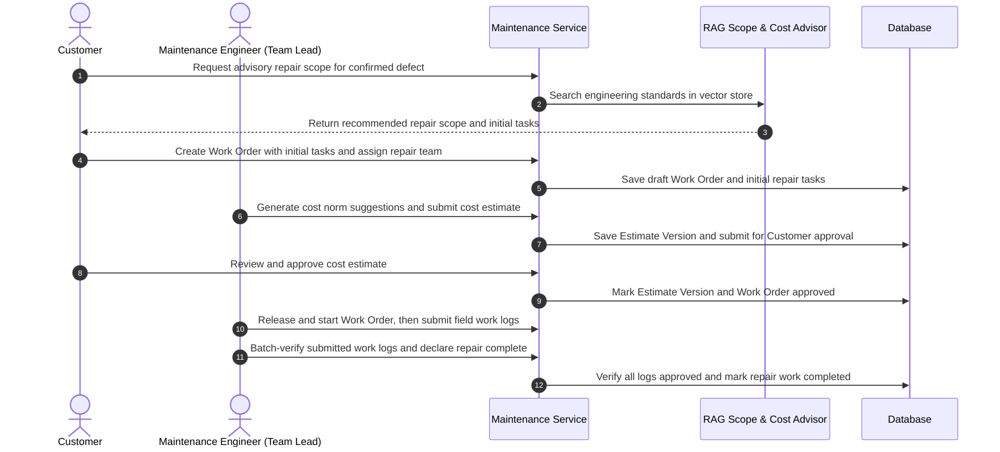

---

### 3.8 FE-08 Maintenance Completion Report, Re-inspection Verification and Closure

#### 3.8.1 Class Diagram

```mermaid
%% title: FE-08 Completion Report, Re-inspection Verification and Cost Closure Class Diagram
classDiagram
  class MaintenanceExecutionController {
    +getAutoDraftReport(workOrderId) AutoDraftReportResponse
    +getAcceptanceCompliance(workOrderId) AcceptanceComplianceResponse
    +recordAcceptanceDecision(workOrderId, req) ApiResponse
    +reconcileCosts(workOrderId, req) CostReconciliationView
    +closeWorkOrder(workOrderId) WorkOrderView
  }
  class ReinspectionVerificationService {
    +getVerifications(actorId, reinspId) List~ReinspectionVerificationResponse~
    +updateVerification(actorId, reinspId, verId, req) ReinspectionVerificationResponse
  }
  class InspectionReinspectionListener {
    +onReinspectionRequested(event) void
  }
  class WorkOrderReinspectionListener {
    +onReinspectionCreated(event) void
    +onReinspectionReportPublished(event) void
  }
  class ReinspectionDefectVerification {
    -UUID id
    -UUID reinspectionId
    -UUID sourceFindingId
    -UUID newEvidenceId
    -String repairProofUrl
    -String repairEngineerNotes
    -String resolutionStatus
    -String inspectorNotes
  }
  MaintenanceExecutionController --> WorkOrderReinspectionListener
  ReinspectionVerificationService --> ReinspectionDefectVerification
  InspectionReinspectionListener --> ReinspectionDefectVerification
```

**Class Specifications**

| No | Class | Description |
| :---: | :--- | :--- |
| 01 | `MaintenanceExecutionController` | Supports auto-drafting the maintenance completion report, running the acceptance compliance check, recording the Customer acceptance decision, reconciling actual costs, and closing the work order. |
| 02 | `ReinspectionVerificationService` & `ReinspectionDefectVerification` | Manage three-way defect verification during a drone re-inspection mission, comparing the original defect, the engineer repair proof, and the newly captured drone evidence. |
| 03 | `InspectionReinspectionListener` & `WorkOrderReinspectionListener` | Coordinate the event-driven re-inspection loop between the maintenance module and the inspection module when a Customer requests drone re-inspection. |

#### 3.8.2 Completion Report, Three-Way Re-inspection and Closure Sequence Diagram

```mermaid
%% title: FE-08 Completion Report, Three-Way Re-inspection and Closure Sequence Diagram
sequenceDiagram
  autonumber
  actor Author as Maintenance Engineer (Report Author)
  actor Cust as Customer (Accepting Reviewer)
  actor Insp as Inspector
  actor Mgr as Manager
  participant MaintSvc as Maintenance Service
  participant InspSvc as Inspection Service
  participant DB as Database

  Author->>MaintSvc: Auto-draft and submit Maintenance Completion Report
  MaintSvc->>DB: Save completion report and submit Work Order for acceptance

  Cust->>MaintSvc: Review compliance summary and request Drone Re-inspection
  MaintSvc->>InspSvc: Publish re-inspection request event
  InspSvc->>DB: Create linked Re-inspection Mission and 3-way verification records

  Insp->>InspSvc: Capture new drone evidence and record 3-way verification result
  Insp->>InspSvc: Submit Re-inspection Report
  Mgr->>InspSvc: Review and publish Re-inspection Report
  InspSvc->>MaintSvc: Attach published re-inspection report to Work Order

  Cust->>MaintSvc: Review re-inspection result and accept completed repair
  MaintSvc->>DB: Mark Work Order accepted
  Cust->>MaintSvc: Reconcile actual costs and close Work Order
  MaintSvc->>DB: Save final cost lines and close Work Order
```

#### 3.8.3 WF-04 Maintenance, Re-inspection and Closure Activity Diagram

```mermaid
%% title: WF-04 Activity Diagram - Maintenance Work Order, Re-inspection and Closure
flowchart TD
  subgraph CU4["Customer"]
    D1(["Start: Create Work Order from Confirmed Defect"])
    D4{"Review Cost Estimate"}
    D5["Approve Cost Estimate"]
    D9["Review Completion Report & Compliance Check"]
    D10{"Acceptance Decision"}
    D11["Request Drone Re-inspection"]
    D15["Accept Repair, Reconcile Actual Costs & Close Work Order"]
    D16(["End: Closed Work Order with Complete Audit Trail"])
  end

  subgraph ME4["Maintenance Engineer Team"]
    D2["Prepare Cost Estimate Using Standard Norms"]
    D6["Execute Repair Tasks, Record Work Logs & Batch Verify"]
    D8["Compile & Submit Maintenance Completion Report"]
  end

  subgraph RI4["Inspector & Manager"]
    D12["Dispatch Linked Re-inspection Mission"]
    D13["Compare Original Defect, Repair Proof & New Drone Evidence"]
    D14["Publish Re-inspection Report & Return to Customer Review"]
  end

  D1 --> D2 --> D4
  D4 -->|"Reject"| D2
  D4 -->|"Approve"| D5 --> D6 --> D8 --> D9 --> D10
  D10 -->|"Rework Required"| D6
  D10 -->|"Re-inspection Required"| D11 --> D12 --> D13 --> D14 --> D9
  D10 -->|"Accepted"| D15 --> D16
```
